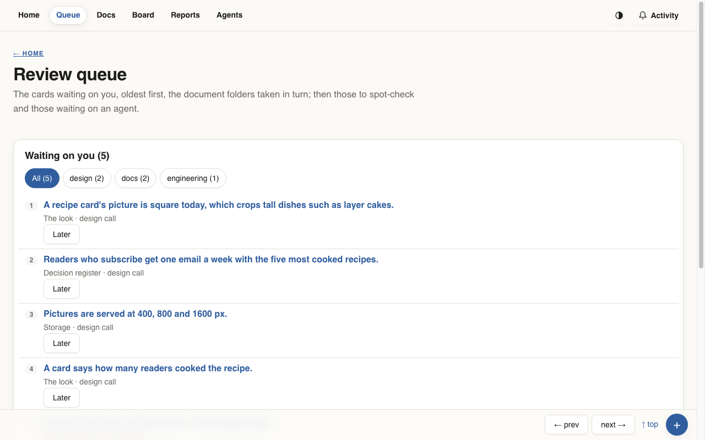
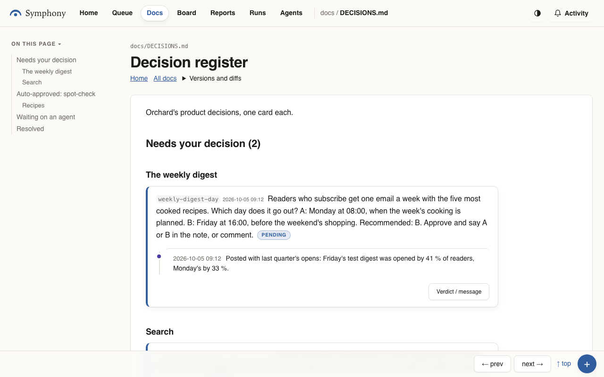

#  Symphony

Symphony is a local workspace for building a project with AI agents and staying in charge of it.
The agents write design documents, file and do tasks, and review each other's work; you read,
decide and comment in one web app, on a laptop or a phone, and every decision is written into the
project's own Markdown and git history. It runs on your machine, serves every project you
register from one server, and keeps everything in the repository.

It is for one person directing several agent sessions (Claude Code, Codex) on the same repository
at once.



## What it does

- **Decision cards and a review queue.** An agent that needs a choice from you writes a card: one
  question, its options, a recommendation, pictures where the thing is visual. The queue lists
  every card waiting on you, oldest first across the topics; you approve, reject or comment, and
  the verdict is a dated line under the card in the document itself
  ([the queue](docs/product/QUEUE.md), [review](docs/REVIEW.md)).
- **Documents.** The project's Markdown is served as pages you can comment on block by block,
  with their pictures, HTML mockups, versions and diffs. A branch's documents show what they
  change against main.
- **A task board.** Agents file tasks with a brief, claim them, post evidence, review one another
  and land approved branches with one command. The board shows who holds what, what is stuck and
  on whom, and each task's page shows its gates, its timeline and its thread
  ([the board's page](docs/product/BOARD.md), [a task's page](docs/product/TASK.md),
  [how the board works](docs/TASKS.md)).
- **Agents and their sessions.** Who is connected, on which task and branch, whether each is alive,
  and a link into its terminal. What you say on a card or a task reaches the agent that holds it.
- **Runs and reports.** Every build, test and check an agent runs is recorded, and the reports
  show how work flows: tasks done, lead time, where the hours go
  ([runs](docs/RUNS.md), [machine work](docs/MACHINE_WORK.md)).
- **Plugins and themes.** A project adds its own card kinds, pages and actions as a plugin, and
  its own look as a theme ([the project file](docs/PROJECT_FILE.md),
  [the plugin protocol](docs/PLUGIN_PROTOCOL.md)).
- **One server, many projects.** Each registered project is served under its own address with its
  own documents, board and theme; the front page lists them with what waits on you in each.



What each page is for and how it behaves is in the [product specs](docs/product/README.md); every
other document is listed in [the documentation](docs/README.md).

## Try it

Install the Rust toolchain named in `rust-toolchain.toml` and [`just`](https://just.systems),
clone this repository, and in it run:

```sh
just symphony --port 0
```

It builds the server, which embeds its web client, and prints the address where it serves this
repository's own documents. `just symphony-cli` prints the document commands and
`just tasks --help` the board's.

## On your own project

A project runs four commands: `symphony`, `tasks`, `agent-send` and `symphony-server`. Install
their published packages from crates.io:

```sh
cargo install --locked --config profile.release.strip=true --config profile.release.codegen-units=1 symphony-app symphony-board symphony-server
```

Each answers `--version`. [RELEASES](docs/RELEASES.md#packages-on-cratesio) lists the packages,
versions and installation settings. To build them from source, clone this repository and run:

```sh
cargo build --locked --release --bin symphony --bin tasks --bin agent-send --bin symphony-server
```

A source build leaves them in `.target/release/`: put that folder on `PATH`, or link them where
`symphony init` says. An install from crates.io is the version last published there, which
`symphony --version` prints; a source build is main.

Then, in the project's main checkout:

```sh
symphony init        # the agents' skills, the recipes, the permissions and hooks; ends with Next:
# … do each line of Next: (the project file, docs/, the board's SurrealDB, the board), then
git add .agents .claude .codex .gitignore justfile symphony.just symphony.toml docs
git commit -m "Symphony installed"
just symphony        # the app, at the address it prints
```

[Getting started](docs/GETTING_STARTED.md) takes it from there in order: each line of `Next:`, a
first document and a first decision card, answering it in the app, a first task from filing to
landing, and the nine skills that put agents on the work.

## GitHub

Symphony needs no GitHub. An optional program, `symphony-github`, connects a project's board to
one repository on GitHub.com: issues carrying a label become proposals, tasks you choose are
published as issues, and `just land` can deliver a task as a pull request that GitHub squashes
once the evidence it writes there as checks allows it. It is not among the packages above, so it
is built from this repository, and delivery needs one GitHub App installed on the repository,
with no administration, and one ruleset on its default branch, verified by someone who administers
the repository.
[Setting up GitHub](docs/GITHUB_SETUP.md) gives every step in order and how to check it works.

## As a library

A project with plugins of its own takes Symphony's versioned libraries from crates.io, or from
this repository by Git at a release tag with the selected revision in its Cargo lockfile. Take
the related packages from one source together; its host supplies its plugins and its own
verification, approval and landing policy
([the plugin protocol](docs/PLUGIN_PROTOCOL.md), [releases](docs/RELEASES.md)).

## Working on Symphony

[The workspace guide](AGENTS.md) holds the commands, the checks and what each needs installed,
[RULES.md](RULES.md) the standing rules, and [the server guide](apps/symphony-server/README.md)
how the server is put together.

The PostgreSQL tests need PostgreSQL 18 or later, installed with your package manager, with its
`bin` folder on `PATH`. On a Mac with Homebrew:

```sh
brew install postgresql@18
export PATH="$(brew --prefix postgresql@18)/bin:$PATH"
```

An explicit `[board] postgresql` absolute folder in `symphony.toml` overrides discovery. All
tools come from that one installation; missing tools or an older server fail with setup guidance
([the project setting](docs/PROJECT_FILE.md#board)). Tests start only their own scratch servers.

## License

MIT. Copyright (c) 2026 Stefano Benatti. See [LICENSE](LICENSE).
