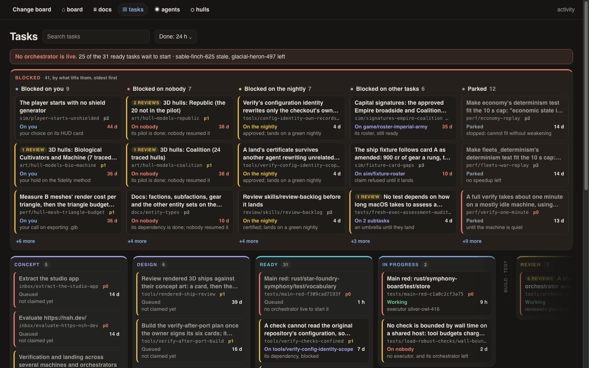
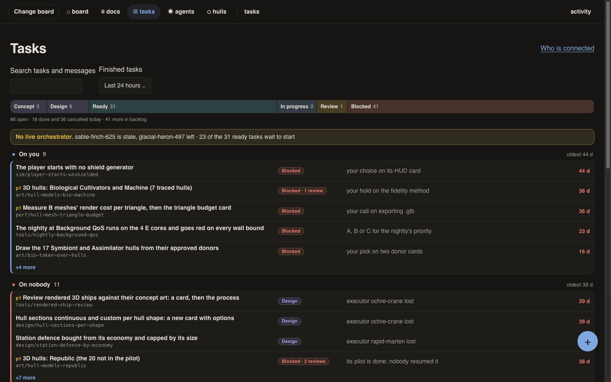
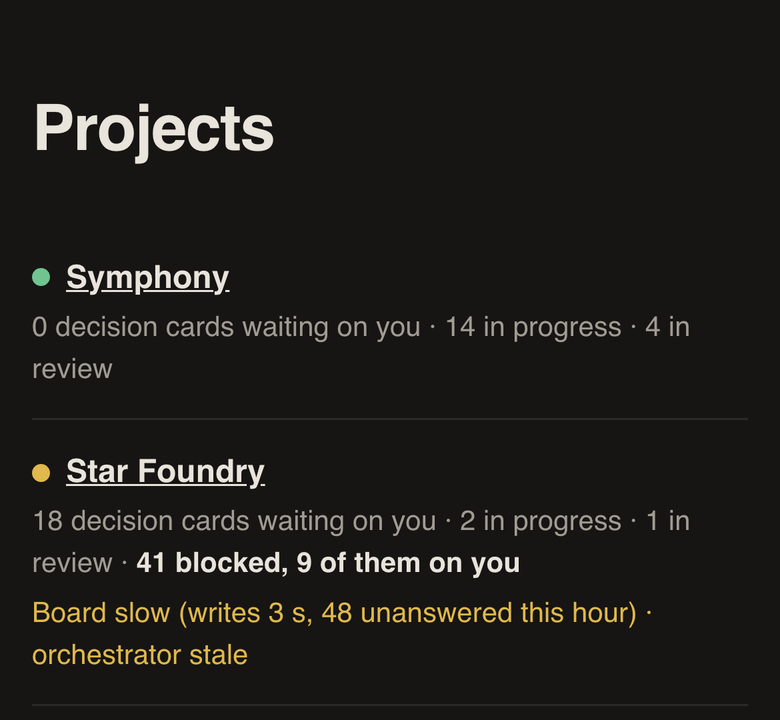

# Decision register

Symphony's own product and engineering decisions, one card each. The cards that need the owner
are at the top, and the page regroups itself every time one is answered. How cards, verdicts and
their dated history work is in [REVIEW](REVIEW.md).

<!-- register:start -->
## Needs your decision

### Board

- [ ] **board-at-a-glance** — A task board should say what is stuck, on whom and for how long. Star Foundry's board says none of it: 41 tasks are blocked, a median of 10 days, and no card says why; 110 of the 117 role chips on them name sessions that have left. Under every option, each card ends in one line: who it waits on, why in a few words, and how long it has been in its stage (red from a week). Roles that left and document chips leave the card, review rounds become one mark, and a banner says once when no orchestrator is live. Where does the waiting work go? A: a Blocked lane above today's columns, grouped by what lifts each block. B: no Blocked column; a blocked task stays first in the column it stopped in, every stage fits a wide screen, and a phone shows one stage at a time. C: no columns; one list grouped by who has to act next, oldest first, under a bar of the stages' counts. Recommended: C. Approve and say A, B or C in the note, or comment. [[analysis/board-design#The options]]
  [2026-11-11 19:42] agent — Base: the board today, wide, from the shared server at 19:10. 
  [2026-11-11 19:42] agent — Posted for the board task `tools/board-design-review`. The three options at 1440 wide:   
  [2026-11-11 19:42] agent — The options are mock-ups on the board's own colours, filled with Star Foundry's 86 open tasks as they stood at 19:10. Queued and parked work, which waits by design, is drawn quieter and never red. All four pictures carry today's header, filters and buttons: the header's rows and names are app/header-names' card, not this choice.

    **On a phone**, today first (its first card mid-screen, under the three-row header, the filters and the scroll hint), then A, B and C:    

    **A, a Blocked lane.** Removes the Blocked column, role and document chips, and the scroll hint. Keeps columns that scroll sideways, so Review and Done stay off the first screen wide, the Status filter and the prev, next and top pager. Cost: the least.

    **B, stuck in place.** Removes the lower row, sideways scrolling, the Status filter, the prev, next and top pager, role and document chips, and the scroll hint. Keeps the pipeline as columns, and a column's head shows where work piles up (Review 1, +18 blocked). Cost: stage tabs on a phone.

    **C, who acts next.** Removes columns, sideways scrolling, the lower row, the Status filter, the prev, next and top pager, role and document chips, and the scroll hint. The pipeline becomes the bar on top, and each row names its stage. Cost: a new page layout.

    All three keep search and the finished window with their labels, Who is connected and the + button.

    **Why C.** C orders all 86 open tasks by who has to act, oldest first, with the age at the right, the same wide and on a phone and with no sideways scroll. A orders only the 41 blocked tasks, above columns that still scroll sideways. In B the by-who order is a strip filter you tap. B is the pick if columns matter more than who acts.

    **Fresh review.** A reviewer saw the three before this card went up. Its three blocking findings were fixed and checked again, and the task's reviewer also picked C. The first reviewer's verdict: "Its single list grouped by who acts next, with 'On you' first and ages on the right, answers what is stuck, on whom and for how long in one top-to-bottom read, and it looks the same wide and on the phone."

    Filed in design, waiting on this card: tools/task-waits-on (the line's data, for any option) and app/board-at-a-glance (the chosen option only).
  [2026-11-11 20:06] agent — Corrected after the task's review, before any answer. Two counts were wrong: 23 ready tasks wait only on an orchestrator, not 25 (two wait on a blocked subtask), and 6 blocked tasks wait on nobody, not 7 (one waits on its orchestrator, which is stale, so still there). The cards no longer repeat the missing orchestrator; the banner says it once. A now shows the Status filter it keeps. Every picture now has today's header and controls, and each option lists what it drops. C's phone rows keep the slug. The pictures above are the corrected ones.
- [ ] **projects-health** — The Projects page warns only while a board's callbacks or sweep fail. At 19:10 today Star Foundry's board took 3 s to answer a write, left 48 requests unanswered in the hour and had its one orchestrator stale, and its row read like Symphony's. Proposed: a dot per project for its worst signal (green, amber, red); only when it is not green, one short line saying why; and counts that say what they count, `18 decision cards waiting on you`, then `41 blocked, 9 of them on you`. Approve, or comment with what to change. [[analysis/board-design#The projects page]]
  [2026-11-11 19:42] agent — Base: the Projects page today, on a phone, from the shared server at 19:09. 
  [2026-11-11 19:42] agent — Proposed, on a phone and wide:  
  [2026-11-11 19:42] agent — Red keeps today's words for failing callbacks or sweep. Amber is a board slow over the last hour (writes over a second at p90, or any request unanswered) or no live orchestrator while work waits to start (`orchestrator stale`, or `no orchestrator` when none is there: a stale session is still there, one rule for the card line, the board's banner and this page); the build sets the thresholds. The blocked counts come from the same line as board-at-a-glance. The fresh reviewer's finding that "18 waiting on you" and "9 on you" read as two answers to one question is fixed by naming the 18 as decision cards. Filed in design, waiting on this card: app/projects-health.

### Owner asks

- [x] **owner-asks** — What you say that waits on an agent's answer stops being a board task and becomes an ask: a verdict with a note, a rejection, a card message, a comment, a chat question or a message on a task. Five choices, each with its default. 1. Name: an ask, open or answered, never a task and in no task count; an open one shows who holds it and for how long. 2. Where: the queue's *Waiting on the agent* group lists the open asks with holder and age; the tasks board has one line of asks above its columns, never counted in them; `just tasks asks` in the terminal. 3. Store: a record of its own on the board; no verdict task is filed again, the open one becomes an ask, the finished ones leave every count. 4. Priority: pushed to its holder at once, first in its digest and named before any ready task; shown late after ten minutes with nobody holding it. 5. Routing: first the running agent working on what it is about (the executor of the card's task or branch, then its reviewer and orchestrator), then the chat seat, then an orchestrator; it moves on when its holder goes quiet or has not answered in ten minutes. Approve to take all five defaults, or comment with the ones to change. [[analysis/owner-asks#The design]]
  [2026-11-11 19:21] agent — Posted for the board task `tools/owner-asks-not-tasks`.

    **Today.** Each verdict you save becomes a `verdicts/…` task in the board's columns and counts. Eight were filed today; seven were each claimed by an agent and approved by a reviewer, to record an answer already on the card. Your question on worktree-build-folders was answered on its branch 17 minutes after you asked; its task sat ready 50 minutes longer and counts as 1.1 h of work nobody took. Chat goes to one session, whatever it is about. [[analysis/owner-asks#Today]]

    **1.** The app already calls a chat question an ask; the word now covers everything you wait on an agent for. It has no stage, so nothing has to pretend to claim or review it.

    **3.** A flag on a task would leave every count, list and digest to filter it out, now and each one added later, and a claim and a review would still close it.

    **5.** "Has context" is read from what the board keeps: roles on the task, the task a branch belongs to, the task whose brief names the card, launch records and where a subagent last worked. Nothing new is recorded.

    Two smaller questions, ten minutes and comments already open, are at [[analysis/owner-asks#Open questions]].
  [2026-11-11 19:33] owner · approved
  [2026-11-11 19:39] agent · question — Your approval came before these pictures, so it takes the five defaults but not how asks look. With asks, the queue, the tasks board and the home page, then the queue and the board on a phone:      Is this how asks should look? Approve to keep it, or comment with what to change. The same pages today are at [[analysis/owner-asks#Pictures]].

### Build tools

- [ ] **relax-not-adopted** — Could Relax, Makepad's live Rust compiler, make Symphony's builds faster? Tried on this workspace against cargo: not yet, so nothing is adopted and cargo stays the build and the gate. Of the six cases tried, three ran and matched cargo. `docs-audit`, the server and the `chrome-devtools` tests stop on gaps in its standard library and its ARM vector instructions, and 7 of the 32 `symphony-schema` tests fail under it that pass under cargo. Where it runs, an edit reaches its result sooner; with nothing changed it is slower, and that is every `just tasks` command. Approve to close, or comment. [[analysis/relax-build-trial#The result]]
  [2026-11-11 20:12] agent — Posted for the board task `tools/relax-build-trial`. Medians of three runs each, at load 150 to 275 on 16 cores:

    | | cargo | Relax |
    |---|---|---|
    | `symphony-args` tests, after an edit | 3.1 s | 0.8 s |
    | `symphony-api` tests, clean checkout | 37 s, 22 CPU-s | 28 s, 39 CPU-s |
    | `symphony-api` tests, after an edit | 18 s, 9 CPU-s | 10 s, 20 CPU-s |
    | `symphony-api` tests, nothing changed | 3.0 s | 5.6 s |
    | `tasks list`, after an edit in `crates/tasks` | 75 s, 27 CPU-s | 12 s, 14 CPU-s |
    | `tasks list`, nothing changed | 5 s, 0.3 CPU-s | 11 s, 12 CPU-s |
    | 18 short `symphony-api` tests, run alone | 0.03 to 0.10 s | 3.7 to 5.0 s |
    | peak memory, `tasks list` | 720 MB | 1.05 GB |
    | disk, per worktree | 4.7 GB | 2.5 GB, and 1.2 GB once per machine |

    **Adopted:** nothing: no recipe, pin or doc change. The trial's Relax build stayed in a scratch folder.

    **Why not.** The crates agents edit most (`symphony`, the board's library, the server) do not run under it. Its false failures would send agents after bugs that are not theirs. The board launcher's usual case, nothing changed, gets slower and takes 1 GB per command. And on `symphony-api` it spends twice cargo's CPU on a machine whose limit is CPU. Short test processes never leave its slowest tier, which is where LLVM wins for us.

    **What would change it:** a published `relax` binary to pin, the missing standard library pieces and ARM vector instructions, and test runs that do not start on its slowest tier. [[analysis/relax-build-trial#What would have to change]]

## Auto-approved: spot-check

### Names

- [a] **symphony-own-names** — Symphony still carries Star Foundry's names. Counted on main today: 113 `SF_` variables, 19 of them read outside tests; the state folders in each repository's git common dir (`sf-tasks` for the board, `sf-surreal`, `sf-symphony`, `sf-docs`, `sf-task-models`); Star Foundry's own tools named in Symphony's code (`sf-slots`, `sf-land`, `sf-cargo`); and six documents that name it. A second project should meet none of them. Proposed names: `SYMPHONY_` for variables; one `symphony/` folder in the git common dir holding `tasks`, `surreal`, `server`, `models` and `tools`; and Star Foundry's tools named only in its own `symphony.toml`. How do the old names go? A: a bridge. One release reads both names and says once when it used an old one; each project's state moves on a day you pick; the release after both have moved stops reading the old names. B: at once. One release renames everything, and both projects change and move the same day. C: new projects only. The two existing projects keep their `sf-` folders for good. Recommended: A. Approve and say A, B or C in the note (and the prefix, if not `SYMPHONY_`), or comment. [[analysis/sf-names#The choices]]
  [2026-11-11 19:17] agent — Posted for the board task `tools/no-star-foundry-names`. `git grep -iE "sf[-_]|star.?foundry"` finds 825 lines in 213 files; the generated client has none. As occurrences, by category: 182 variables Symphony reads, 185 test-only variables, 193 folder and file names, 19 format names, 96 test temp names, 109 of Star Foundry's own names, and 72 mentions of "Star Foundry" in docs. [[analysis/sf-names#The count]]
  [2026-11-11 19:20] agent · auto-approved — A: the owner asked to "completely remove star foundry direct references within symphony app folder" (2026-11-11), which rules out C; B reaches the same names by moving both projects' live boards on one day, and A does it with no day on which a board cannot be read. Prefix `SYMPHONY_`. Moving a project's live state still needs the owner's word on the day. Any verdict here overrides this.

    **What moving means.** Each project's state moves by a few folder renames in its git common dir, not a copy. Star Foundry's board is 7.2 GB and this one's is 80 MB. The board's database and the shared server on port 8765 stop for the seconds it takes. A one-line file left at each old name makes an older build fail with a message instead of starting an empty board. Nothing moves without your word on the day. [[analysis/sf-names#Moving live state]]

    **A, a bridge.** Cost: a small helper that reads both names, carried by one or two releases. Star Foundry keeps working through it until its pin and wrappers move, which is a note for its board.

    **B, at once.** Cost: Star Foundry's pin, wrappers and tests land with both moves on the same day. Every older build fails until it is rebuilt, and Star Foundry keeps 46 of them.

    **C, new projects only.** Cost: both naming schemes stay in the code, and the grep never comes clean. Nothing moves.

    **Why A.** Each project moves on its own day with nothing broken in between, and the code ends with no old name except the fences.

    **Defaults unless the note says otherwise.** The board database's internal namespace `sf` stays until each board's next reclaim. Star Foundry's tool names become `symphony.toml` settings. Analysis documents keep Star Foundry's name where they measured its board. Board variables take `SYMPHONY_`, not `TASKS_`. `tasks-cutover` is retired. [[analysis/sf-names#Smaller choices]]

## Rejected and replaced

### Reports and monitoring

- [-] **reports-task-gates-timeline** — A task's page opens on its gates: every stamp or check it needs to land, met (by whom, when), missing, or waived (why). Below them, a timeline of what it went through: stages, claims, review rounds and verdicts, builds and tests, waits, each with its duration. Symphony shows its own gates without a plugin: the reviewer's verdict, the project's check on the tip, the review callback, a card waiting on the owner. How do a project's own gates reach the page? A: a typed seam, drawn the same way for every project. B: a panel of generic blocks the plugin lays out. Recommended: A. Approve and say A or B in the note, or comment. [[analysis/reports-and-monitoring#The task page]]
  [2026-11-11 13:31] agent — Posted for the board task `product/reports-and-monitoring`, the second reports card.

    **What exists.** The board replays a task's stages from its thread but keeps only totals, and the task page shows none. Star Foundry's landing already answers its stamps for the task page (required, met or missing, waivers with why and by whom), and nothing shows them: a plugin can add a button or a field to a task, not a list of what it needs.

    **A, typed gates.** A plugin answers name, state, by, when and why; one component draws them. Symphony can then count them across tasks: which gate waits longest, which is missing most. Cost: one seam, one wire type, one component; Star Foundry's adapter adds the times its stamps lack today.

    **B, a block panel.** Cost: the least Symphony work, but each project draws it differently and nothing can be counted.

    **The timeline** needs no new recording: the replay keeps each segment as well as its totals, and runs come from the run files. A phone gets a vertical list with a bar per step; a wide screen gets lanes over time.

    **Why A.** What a task waits on is the question asked of it, and a typed answer also feeds the defect report. This page takes the place of the task-page halves of `tools/stage-times` and `tools/review-as-stamps`. [[analysis/reports-and-monitoring#Timeline]]
  [2026-11-11 13:46] owner · rejected — this needs some visualization layer to decide (images)
  [2026-11-11 14:12] agent — Replaced by **reports-task-page-pictures**: the same choice, with pictures. One task's page under A and under B, on a phone and on a wide screen, and its timeline drawn both ways.

## Resolved

### Build folders

- [r] **worktree-build-folders** — Agents' worktrees now share compiled dependencies on disk. Each keeps a build folder of its own that starts as a copy-on-write clone of the main checkout's, taking disk only as a build changes it, and the board's sweep clears a worktree's build folder once its task is done and its work merged. Is that the way? A: as built. B: one build folder every worktree shares. C: a compiler cache (sccache) in place of the clone. Recommended: A. Approve and say A, B or C in the note, or comment. [[analysis/worktree-build-folders#The choice]]
  [2026-11-11 17:19] agent — Posted for the board task `tools/one-build-folder-for-worktrees`. Built as A, so you can switch.

    **A, as built.** Two first builds of the board's tests at once took 2.7 minutes instead of 8.3, both correct. A worktree holds about 1.3 GB instead of 2.4 GB. Cost: `du` overstates it, counting each clone in full, and a worktree's first build waits up to two minutes while the main checkout is building.

    **B, one shared folder.** The least disk, but wrong builds: Cargo gives the same package in two worktrees the same output files, and one worktree ran the other's freshly compiled code as its own (measured). Builds also wait on each other, one at a time.

    **C, sccache.** Saves compile time, not disk: every worktree still holds its full build, and the cache holds one more copy. It is not installed here.

    **Why A.** Correct builds, a first build three times faster, about half the disk per worktree, and the sweep returns the rest when the work lands. The board also warns, in `just tasks status` and on every page, when free disk drops under 20 GB (`SF_LOW_DISK_GB`). Measurements and method: [[analysis/worktree-build-folders#Measurements]]
  [2026-11-11 17:42] owner · question — can we combine A with C? I would like to save on both disk space and compile time.
  [2026-11-11 17:59] agent — We can, but measured it saves nothing. I ran sccache 0.10.0 from a scratch folder, installing nothing. The board's tests were built from an empty build folder, so every dependency compiled. The first build filled the cache in 178 s. Then, at the same time, another worktree with that warm cache took 188 s, and the same build without sccache took 233 s. **None of the 187 crates came from the cache**, and none did again in the first worktree with a new build folder.

    **Why.** sccache reuses a compile only when its absolute paths match, and every compile names its build folder. Under A each worktree has its own folder, which correct builds need: B's shared folder ran one worktree's code as another's. The workspace's own crates never cache either, since they compile incrementally, and nor do proc-macros and build scripts.

    **What C would add on top of A:** hits only for a folder rebuilt at its own path after it was cleared, and there the seed already starts it from main's build. **What it costs:** a cache holding one more copy (190 MiB per build folder here, with a size cap), a pinned download in the toolchain setup, a server process, and chaining under the client bundle's own `RUSTC_WRAPPER`. The build recorder wraps Cargo, not rustc, so it does not clash.

    **Compile time is what A already saves:** a seeded worktree compiled 2 crates instead of 187. What remains is a dependency main has not built yet, after a `Cargo.lock` change. A small follow-up could build main after each landing that changes the lock, so new worktrees clone current dependencies.

    **Recommended: A alone, without C.** Approve and say A, and whether you want that follow-up filed. [[analysis/worktree-build-folders#The seed with sccache]]
  [2026-11-11 18:27] owner · approved — A
  [2026-11-11 19:40] agent — Recorded: A. Worktrees keep a build folder of their own, cloned from the main checkout's; no shared folder and no sccache. The branch `tools/one-build-folder-for-worktrees` is in review with it built this way.
  [2026-11-11 19:40] agent · resolved

### Client cache

- [r] **client-cache** — A page draws at once from what this device last held, marked as possibly out of date, while it asks the server whether anything changed; an unchanged read answers with no body. Measured today, a return visit to a task page draws its brief after 192 ms on this Mac and 2.9 s at phone speed, waiting on data the device already had; with the cache, about 85 ms and 1.8 s. Five choices, each with its default: 1. Where: IndexedDB, keys by project. 2. Freshness: a checksum per read, answered `304` with no body when unchanged; the live feed as today. 3. Kept: the board, the queue, the 30 tasks and 20 documents opened last, each with what its page drew; 8 MB a project (tasks 2, documents 6), 32 MB in all, 14 days, least recently used out first; never searches, older messages or the landing offer. 4. Versions: a format number in the wire crate clears the cache when it changes; a server update needs nothing. 5. Stale: a notice, and the verdict, answer and task buttons wait until the server answers. Approve to take all five defaults, or comment with the ones to change. [[analysis/client-cache#The design]]
  [2026-11-11 18:30] agent — Posted for the board task `perf/client-cache/design`.

    **Today.** Every data read is answered `no-store`, so a return visit downloads its data again and draws nothing until it arrives. Measured on a private server with a copy of this board, five runs each, warm: home 107 ms, `/tasks` 401 ms, a task 192 ms, this register 194 ms, Star Foundry's register 296 ms; at phone speed (Fast 3G) 2.3 to 3.8 s. The page's code starts asking for data at 50 to 75 ms, and at 1.8 s on the phone.

    **1.** IndexedDB works on the tailnet's plain `http://`, reads off the page's thread and has room. localStorage holds about 5 MB for the whole origin, shared with drafts; a service worker needs a secure page, which the tailnet is not.

    **2.** A checksum survives a server restart. The feed's version moves with every agent's health, and the feed keeps only its last 128 events, a few minutes on a busy board.

    **3.** Thirty tasks take about 1.3 MB; separate caps keep a week of tasks from pushing out the documents.

    **4.** Clearing on every client build would cost a slow visit per page after each update; main's client changed 7 times today.

    **5.** Nothing that acts is given on content the server has not confirmed. The landing offer is always read fresh.

    **Gain.** Every page draws in about 60 to 85 ms here and 1.8 s on the phone, about 0.6 s once `perf/asset-caching` lands too. An unchanged visit's data drops from 13.5 to 6.4 KB on `/tasks` and from 26.7 to 9.9 KB on the large register. A first visit is unchanged but for the store's code, about 1 to 2 KB. [[analysis/client-cache#Expected gain]]
  [2026-11-11 18:48] owner · approved
  [2026-11-11 19:00] agent — Recorded: the design as recommended, built by the board task `perf/client-cache/build`. The owner added two things in the terminal (2026-11-11), now in that task's brief. Documents are kept by how often they are visited, not only how recently: a project's entrypoint pages stay, a page opened once goes first. And pages are fetched ahead: the tasks and documents a drawn page links to are read into the cache while the device is idle, within the same caps, never on a metered or slow connection, and never for a link that acts.
  [2026-11-11 19:00] agent · resolved

### Desktop client

- [r] **desktop-client** — A Symphony app for the Mac that sits in the menu bar and the dock, connects to several servers (this Mac's, another machine's over the tailnet, later a hosted one), counts what waits on you across all of them and notifies you with no tab open. How is it built? A: a thin native shell whose windows show each server's own pages, always at that server's release. B: the Dioxus client compiled into the app, talking to every server's API. C: A now, B later. Recommended: A. Approve and say A, B or C in the note, or comment. [[analysis/desktop-client#How it is built]]
  [2026-11-11 14:07] agent — Posted for the board task `product/desktop-client`.

    **What the tab cannot do.** Notify you with no Symphony tab open (today only a project's home page does, while its tab is hidden). Show one count of what waits on you, across every server and project, in the dock and menu bar. Keep following with its window closed. Find this Mac's server by itself, and keep the others by name. The first release does these four; a global shortcut comes next. Focusing an agent's pane and opening a file in the editor are done by the server on its own machine (`tools/go-to-agent-session`), so the browser gets them too.

    **A, a thin shell.** Each server's window loads that server's own pages, so the app and a server never disagree, and a Symphony release reaches the app with no app update. The shell adds notifications, the badge, the menu bar and links out to the browser. Cost: one new crate, and one new read on the server listing its projects with their counts, which another machine cannot get today. No client change, nothing added to the 250 KB budget, and the wire stays free to change. Offline: says the server does not answer and keeps its last count.

    **B, the client compiled in.** Cost: 31 of the client's files call the browser directly and need a native version; plugin viewers need cross-origin access the server does not give. The wire becomes a contract between releases, while it changed 20 times last week, several not additively: a Symphony release would need an app release. Gain: it reads each project's last board offline and runs no code a server sends; it looks and performs as A does.

    **C.** A's cost now, B's later, on a wire that would by then have to stand still.

    **Why A.** Everything in the first release for the least new code, with the client and wire still free to change every release. The app's own screens can still be Dioxus.

    **Trust.** On a tailnet nothing new is needed: the server already admits the tailnet's machines, as it does your phone. A hosted server needs HTTPS and a login, a card of its own later. The app never runs a command, opens a local file or app, or leaves the server's site in its window on a server's word.

    **Delivery.** macOS first, built from a release tag and installed with one recipe; a build made on the Mac that runs it needs no notarisation. Signing ($99 a year) waits until it runs on another machine. Linux, Windows and a phone app are not in this card.

    The first slice, and how it is tested without a display: [[analysis/desktop-client#The first slice]]. Five smaller questions are at [[analysis/desktop-client#Open questions]]; answer any of them in the note.
  [2026-11-11 14:33] agent — Corrections to the entry above, after a review of its clarity.

    **B** still runs a server's scripts in plugin viewers and card mockups unless it drops them; only its own client code never comes from a server.

    **The projects list** answers the tailnet today, but only as an HTML page; A's new read gives it as data.

    **Pane focus** is planned (`tools/go-to-agent-session`, not built yet), and opening a file in the editor is proposed here the same way; neither is done by the server today.

    **The first release notifies** when a project's waiting count rises: a new card, an agent's question on a card, or an answer to your note. Questions agents ask you on tasks and reviewers' verdicts are counted nowhere yet; open question 1 asks whether you want them. [[analysis/desktop-client#What notifies]]

    **The wire** changed in 15 commits last week (not 20: that counted merges). With A it stays free to change but for the few fields the app reads, which a test pins.
  [2026-11-11 15:26] owner · question — 1. Should the badge and notifications also cover questions agents ask you on tasks (--to owner), or reviewers' verdicts on tasks?
    Yes. We should also have different users in the future, so that asks / notifications could be targetted to specific people.
    2. When two servers serve the same project's board
    For now I think the model should be indeed two separate boards. Albeit we will soon move to a "central board" with "multiple machines connected"
    3. Yeah, why not dioxus.
    4. once it does.
    5. can be skipped for now.
    But considering there will be an iOS app desired to exist too, how would this shape or change the decided upon solution here?
  [2026-11-11 15:44] agent — Your five answers, each with what it changes, then the iPhone app. Answered for the board task `product/desktop-client`; the analysis records the answers under [[analysis/desktop-client#Open questions]].

    **1. Questions on tasks and reviewers' verdicts: yes.** The badge also counts each question an agent asks you on a task (`--to owner`) until you answer it, and the app notifies it. A reviewer's verdict is notified too. It asks nothing of you, so it does not stay in the badge unless you say it should. Both need counts on the wire beside the cards, which the server's new projects read carries. Targeting people: the board knows one person today, `owner`, so the new counts are kept per recipient, and adding people later adds names, not new counts. People themselves need a login, which comes with the hosted server's card.

    **2. Two servers, one project: two boards for now.** The app lists and counts each server's own board, as the analysis assumed. Once the central board exists, a project reached through two servers must be counted once, by the board rather than the server; that waits for the central board. Runs already go this way: each machine sends them to the server hosting the board (`reports-ci-runs`, approved 15:21).

    **3. "Yeah, why not dioxus": the app's own screens are Dioxus.** The question was narrow: under A, are the few screens the app draws itself (the server list, adding a server, "this server does not answer") Dioxus or plain pages? Your answer settles that: Dioxus, beside the server's page in the same window, if the first slice shows Dioxus can host it. It does not choose A, B or C. Under A the app is a Dioxus app whose windows show each server's own pages; under B the whole Dioxus client is compiled into the app. If you meant the whole client should be Dioxus inside the app, that is B. Asked plainly below.

    **4. Apple developer account: once it runs on a second machine.** No change for the Mac app. An iPhone app brings it forward (below).

    **5. Global shortcut: skipped.** It leaves the second release too, until you ask for it.

    **An iPhone app.** Read in code: Dioxus 0.7.10 builds for iOS, and its mobile target is its desktop one (the same window and web view crates), so A's shell and B's client both carry to the phone. The rest is inferred, not tried:

    - **Notices on a phone come from the server.** iOS suspends an app soon after it leaves the screen, so the follower that keeps counting with every window closed cannot run there. A notice is a push the server sends through Apple's push service, which needs the paid developer account ($99 a year). So the rule for when to notify, and what a notice says, belongs in shared code the server can run too, not only in the Mac app. This holds under A and B alike.
    - **The account.** An iPhone app installed without the paid account stops opening after 7 days. Anything longer, TestFlight and push all need it, so the account comes when the phone app starts.
    - **A fits the phone better.** Under A the iPhone app is the same shell, showing the server's pages, so a Symphony release reaches the phone with no new phone build. Under B a Symphony release that changes the wire needs a new phone build, installed through TestFlight.
    - **A cheaper first step.** The board added to the phone's home screen can get notices without any app (web push, iOS 16.4 and later), but only over HTTPS. The tailnet can give its names HTTPS (`tailscale serve`); the server's save check accepts only `http://` pages today.

    So the phone strengthens A, and adds a push from the server whichever way the app is built. The phone app stays a card of its own, after the Mac app.
  [2026-11-11 15:44] agent · question — How is the app built? A: a thin shell whose windows show each server's own pages, with its own screens in Dioxus. B: the whole Dioxus client compiled into the app. C: A now, B later. Recommended: A, and the iPhone app keeps it so. Approve and say A, B or C in the note.
  [2026-11-11 16:24] owner · approved — A
  [2026-11-11 16:32] agent — Recorded: A. The app is a thin shell whose windows show each server's own pages, with its own few screens in Dioxus. The analysis now states A as decided and follows your five answers throughout. Filed on this board, ready, as the analysis's two first-release slices:

    - `tools/server-projects-list`: each server lists its projects as data. It gives counts, the first waiting card, the questions agents ask you on tasks until you answer them, and the newest reviewer verdict, kept per person (today only you). It lands first, since the app reads it.
    - `tools/desktop-app`: the Mac app. It finds this Mac's server and adds others by URL, shows a sidebar of servers and projects, and puts the count in the dock and menu bar. It notifies for cards, task questions and verdicts, opens outside links in the browser, and installs with one recipe. Two servers serving one project count as two boards. There is no developer account and no global shortcut.

    Not filed, each waiting on what it needs: the iPhone app and its push from the server, a hosted server's HTTPS and login, signing and a self-updating app (once it runs on a second machine), notices aimed at named people (once Symphony has users), and counting one project once across servers (with the central board).
  [2026-11-11 16:33] agent · resolved

### Reports, small choices

- [r] **reports-small-choices** — Six smaller choices for the Runs and Reports pages, each with the default the filed tasks follow until you answer. 1. Slowest tests: stable cargo prints no time per test, so show the slowest suites only, without adopting cargo-nextest. 2. Agents' cost: tokens only, no money, since a subscription is not paid per token. 3. Symphony's landings: Symphony has no land command, so count each merge commit on its main as a landing run. 4. Queue wait where no pool queues work: show none, and leave out the time Cargo waits on its build lock. 5. A project's own gate with the same name as Symphony's review gate replaces it on the task page only, not in the board's sign-off lane or the PULL digest. 6. A project's own section under Symphony's figures (Star Foundry's certificate costs, art builds, test classes), drawn through a plugin seam and a chart block: not filed until a project asks for it. Approve to keep all six defaults, or comment with the numbers to change. [[analysis/reports-and-monitoring#Open questions]]
  [2026-11-11 15:45] agent — Posted for the board task `product/reports-and-monitoring`, after `reports-ci-runs` was approved. Choices 1 to 5 are the analysis's open questions 2, 3, 5, 6 and 7, which no verdict has answered. Choice 6 is the report-section seam the analysis proposed, which no card asked. The tasks that meet them: 1 `tools/run-suites`; 2 `tools/agent-activity-history`; 3 `tools/runs-rollup`; 4 `tools/run-record`; 5 `tools/task-gates-seam`; 6 none yet.
  [2026-11-11 16:22] owner · approved — 1. can absolutely adopt cargo nextest.
    2. nope. tokens are hard to measure, since cache vs non cache hits counts differently. This should be counted "as if we were paying API costs" for it. Best assumption/guess on pricing actual cost
    3. add a land command, should be offered by default on init. Remember -> convention over configuration approach
    4. okay
    5. yes indeed. lower level replaces higher level. Should replace it everywhere for itself.
    6 approved.
  [2026-11-11 16:31] agent — Recorded, each with what it changes. New tasks are on this board, ready.

    **1. cargo-nextest: adopted.** `tools/nextest` runs this workspace's tests through nextest at a pinned version, installed by one setup step so a test run never downloads. Doc-tests, which nextest does not run, still run through cargo. Test binaries that share one fixture across their tests, such as the perf suite's one board, keep it. `tools/run-suites` now waits on it and reads each test's time; `tools/runs-rollup` gives the slowest and flakiest tests, not only suites.

    **2. Cost in money, as if paying API prices.** `tools/agent-cost-estimate` prices input, output, cache writes and cache reads apart, per model, from a dated price table in the repository taken from the providers' published prices. Every figure is labelled an estimate. A model missing from the table takes the newest price of its family, marked as a guess; one with no family is shown unpriced and named, never counted as free.

    **3. A land command.** `tools/land-command`: `just land SLUG` checks the reviewer's approval on the tip and the project's check on the merge, merges, closes the task, sweeps its worktree, and later records the landing as a run. `symphony init` installs it in every project, and a project's own `land` replaces it. It replaces the merges by hand, so the Runs page counts landings from it, not from merge commits.

    **4. No queue wait where nothing queues.** Recorded; `tools/run-record` already does this.

    **5. A project's gate replaces Symphony's everywhere.** `tools/project-gates-everywhere` carries it past the task page to the sign-off lane, the digest orchestrators get, and the move to blocked. The analysis now states the rule in general: the more specific level's answer replaces the general one's.

    **6. The project report section and the chart block wait until a project asks.** Recorded; nothing filed.
  [2026-11-11 16:33] agent · resolved

### Reports and monitoring

- [r] **reports-ci-runs** — Each project gets a Runs page, as a CI product shows it: what runs and waits now, then every verify, lint, test, client build, review callback, landing and later nightly, with its commit, branch, task, who started it, result, duration and queue wait. A run opens on its steps, their times and logs; trends show pass rate and duration per pipeline and suite, the slowest suites, the flakiest tests, and machine minutes per task, day and project. Where are runs kept? A: day files in the git common dir, read by a core page. B: tables on the board. C: the same files, shown by plugin components on a document. Recommended: A. Approve and say A, B or C in the note, or comment. [[analysis/reports-and-monitoring#Runs]]
  [2026-11-11 13:31] agent — Posted for the board task `product/reports-and-monitoring`, the first of three reports cards; each can be approved alone.

    **Why.** No run is kept anywhere Symphony reads, and Symphony's own builds and tests are never recorded. Star Foundry's verify keeps a line per run for itself, and it shows what is missing: 510 runs since 2026-11-08, a full verify's median 24 min and p90 2.7 h, 139 wall-hours on 2026-11-09 alone, 28 red and 52 timed out.

    **A, day files.** The recorder `tools/build-test-recorded-generic` adds appends one line per run and per step in the git common dir, with its log beside it and the test results read from cargo's output. The page reads the newest files; trends are rolled up hourly. Cost: a page kind, an API, a roll-up. Nothing writes to the board. Runs kept 90 days, logs 14.

    **B, the board.** Cost: a schema change, which makes every older server refuse writes, and writes on the board's write path for every run and step, hundreds of runs a day at Star Foundry's rate.

    **C, plugin components.** Cost: rendered again on every read, nothing updates while a run goes, and charts carry no values on a tap.

    **Why A.** Every project gets it, Symphony included, with no load on the board, in the shape Star Foundry's verify lines already have.

    **The record needs more than the recorder plans** (task, handle, phase, label, start, end, exit, machine): the run and its steps, the pipeline, commit, tree and branch, who started it, queued and started times, CPU time, the log, and results per test suite. Stable cargo prints no time per test (tried). [[analysis/reports-and-monitoring#The run record]]

    Seven smaller questions, for all three cards, are at [[analysis/reports-and-monitoring#Open questions]]; answer any of them in a note.
  [2026-11-11 13:45] owner · question — How would A work when we move to separate machines using a single board?
  [2026-11-11 14:12] agent — **As written, A shows only one machine's runs.** Run files live in the git common dir of the clone where the run happened. A clone on another machine has its own common dir, and today its own board as well.

    **How A works on several machines.** Each machine's recorder writes its own day file first, and that file is its outbox. It sends each run's start and end lines over HTTP to the Symphony server that hosts the board. That server appends them to its own run files under the sending machine's id, and answers with the run ids it stored. A line not yet acknowledged is sent again at the next run's start and end, and a line sent twice is stored once.

    - **Who may send.** The server already admits only its own machine and confirmed tailnet peers, and it checks the Host. The machine id is a label, not a password, so the server records which tailnet machine sent each line. It refuses one machine id arriving from a second tailnet machine.
    - **Server unreachable.** Runs wait in the outbox and arrive late, marked late. The page shows each machine's last contact.
    - **Clocks.** Each machine times its own runs with a clock that only counts forward, so durations are right even when its time of day is wrong. Order and age use the time the server received a line. Each send measures the machine's clock offset, and the page shows it when it is over 30 s.
    - **Logs** stay on their machine. A red run's first and last lines travel with its end line. A green run's log opens on demand when its machine serves; otherwise the page says which machine has it.
    - **Running now.** Sending only finished runs would hide what runs elsewhere, so the start line is sent too.

    **B on several machines** needs the board itself reachable from every machine. It is a database without a login, listening on this machine alone, so it would need a login it does not have. An offline machine would still need an outbox and its log files. **So A, with the send, stays the recommendation.** [[analysis/reports-and-monitoring#Several machines, one board]]
  [2026-11-11 15:21] owner · approved — A
  [2026-11-11 15:43] agent — Recorded: A, with the send from the entry above, so runs on several machines show on one page. Filed on this board, ready, in the order they land:

    - `tools/run-record`: the recorder writes one line per run and per named step to day files in the git common dir, kept 90 days. It builds on `tools/build-test-recorded-generic` once that lands, and does not change it. The review callback runs through it, so its exit is kept.
    - `tools/run-logs`: each run's log beside the day files, kept 14 days (a red run's 30, at most 2 GB a project). The terminal shows what it showed before.
    - `tools/run-suites`: each test binary's counts and time, and the failed tests with their first line, read from cargo's plain output.
    - `tools/run-send`: the send to the server hosting the board. The local file is the outbox, the server acknowledges by run id, and a machine id is bound to the first tailnet machine it came from.
    - `tools/runs-rollup`: pass rate and duration per pipeline and suite, the slowest suites, flaky tests, queue wait and machine minutes, rolled up in the hourly job `tools/reports-rollup` builds.
    - `tools/runs-page`: the Runs page and its API, on a phone and wide, with the machine view.

    **Six smaller choices** these tasks meet are on a short card of their own, `reports-small-choices`, each with the default the tasks follow until you answer.
  [2026-11-11 15:45] agent · resolved
- [r] **reports-pipeline-defects** — A Reports page per project, after Runs: how work flows (tasks in each status per day, lead time and its trend, where task-hours go, bounces, what sits longest); where defects are caught (review, red verify, main red, nightly red, revert), how long each took to fix, how many escape past landing and which checks catch what; then agents (sessions, tokens) and board health per hour over days. How are the figures computed? A: the server rolls them up every hour into files. B: from the board on each view. C: a nightly report document. Recommended: A. Approve and say A, B or C in the note, or comment. [[analysis/reports-and-monitoring#Pipeline and defects]]
  [2026-11-11 13:31] agent — Posted for the board task `product/reports-and-monitoring`, the third reports card.

    **What exists.** `tasks stats` prints the flow figures in a terminal. Star Foundry's board holds about 1,220 top-level tasks since 2026-09-26: 405 went back from review at least once, 16 main reds and 54 nightly reds were filed, and its main took 1,218 merges in 14 days with no revert. Board health is kept for one hour, in memory.

    **A, hourly.** Each hour the server reads each project's window once (0.3 to 2.5 s on Star Foundry's board) and writes the day's figures to a file; health gets a line an hour from memory. Cost: a figure up to an hour old; one board read an hour per project; nothing written to the board.

    **B, per view.** Cost: that read on every open, slower as the board grows, and no history of what the board does not keep.

    **C, a nightly document.** Cost: nothing live, and a commit a day.

    **Why A.** The page opens at once on a phone and the board's write path is untouched.

    **New recording these need:** health per hour; agents' activity and stale or lost counts; tokens (`tools/board-token-usage`, approved, not built); and, from the project's landing and nightly, which landing a red came from, for the escape rate. **A cost in money is not knowable today**: transcripts carry tokens and the model, never a price. [[analysis/reports-and-monitoring#Defects]]
  [2026-11-11 13:48] owner · approved — A
  [2026-11-11 14:12] agent — Recorded as A. The shared server rolls the figures up every hour into day files in each project's git common dir. Nothing is computed when the page opens, and no report document is written. [[analysis/reports-and-monitoring#How the figures are computed]] now says so.

    Filed on the board, ready, each quoting your verdict:
    - tools/reports-rollup: the hourly roll-up into files.
    - tools/reports-page: the page. It comes after the roll-up and the next two, whose files it reads.
    - tools/board-health-history: board health, one line an hour, kept 90 days.
    - tools/agent-activity-history: sessions started, and stale and lost counts, by kind and model.
    - tools/red-landing-origin: a red names the commits it came between, so escapes trace to the landings in that range.

    Star Foundry's landing and nightly would need to pass those commits; that change is Star Foundry's, for its own board.
  [2026-11-11 14:14] agent · resolved

### Client size budget

- [r] **first-visit-budget-pings** — The `/tasks` page is capped at 250,000 bytes on a first visit, and a test enforces it. The page is 249,982 bytes, 18 under. The test also counts the live feed's keep-alive pings, 19 bytes every 5 seconds, so on a busy machine it reads 250,047 to 250,066 and fails though nothing changed. It is the last thing between main and a `just verify` that passes every time. What should the cap count? A: everything but the keep-alive pings, which are reported beside the total. B: as now, and trim the page until pings fit under it. C: raise the cap. Recommended: A. Approve and say A, B or C in the note, and say whether 18 bytes of room is enough or the page should be trimmed as well.
  [2026-11-11 16:20] agent — Posted for the board task `tests/first-visit-budget-counts-pings`.

    **A, leave the pings out.** Real feed content still counts. A quiet run measures the same as today, so the cap is no looser. Cost: a small change to the test, and the guide says what the cap counts.

    **B, trim the page.** Cost: the test stays tied to machine load until the page is about 400 bytes smaller, and every later ping-sized change brings the failure back.

    **C, raise the cap.** Cost: the phone's first visit gets heavier each time this is done.

    **Why A.** A ping is not page weight, and how many arrive depends on when the test server started, not on the page.

    **The room.** At 18 bytes almost any client change crosses the cap. The last change, one CSS selector, moved the total by 5.
  [2026-11-11 15:18] owner · approved — A and B. This is too close to the limit anyway. Check what can be done to improve upon it for a more reasonable/comfortable range.
  [2026-11-11 15:43] agent — Recorded: A and B, both in the board task `tests/first-visit-budget-counts-pings`, which fleet-osprey is working on now. The keep-alive pings leave the cap and are reported beside the total. The `/tasks` first visit is measured part by part (the compiled client, styles, scripts, the board data) and trimmed until it is at least 10 KB under the cap, instead of 18 bytes; the task reports what each cut saved and what further cuts would cost. The cap stays 250,000 bytes.
  [2026-11-11 15:45] agent · resolved
  [2026-11-11 18:10] agent — Done and superseded on the cap: pings are left out and the `/tasks` first visit is 239,313 bytes on main (task closed, approved). The owner then raised the cap to 300,000 bytes (2026-11-11, said to the other orchestrator; main 1d1eab1), so "the cap stays 250,000" above no longer holds.

### Task page, in pictures

- [r] **reports-task-page-pictures** — A task's page opens on its gates: every stamp or check it needs to land, each met, missing or waived, with who, when and why. Below them, a timeline of what the task went through. The pictures show one task, on a phone and on a wide screen. How do a project's own gates reach the page? A: a typed seam, so Symphony draws every project's gates the same way and can count them. B: a panel of generic blocks the plugin lays out. The timeline is the same under A and B. Recommended: A. Approve and say A or B in the note, or comment. *Replaces:* reports-task-gates-timeline. [[analysis/reports-and-monitoring#Pictures]]
  [2026-11-11 14:12] agent — The gates on a phone, under A and under B:  
  [2026-11-11 14:12] agent — The task is made up in Star Foundry's shape: its four stamps, two review rounds, a build and tests. Its times are invented. The pictures follow the app's colours, type and chips, in light and dark.

    **A** is one component for every project. What the task waits on comes first, with who and when, and a gate can link to its run or verdict. Symphony can count these gates across tasks, for example which one waits longest.

    **B** is the plugin's own layout. Star Foundry's stamps answer has no times, so its table has none. On a phone, a table wider than the screen scrolls sideways.

    Wide:  

    **The timeline** is the same under A and B. On a phone it is a list with a bar per step; on a wide screen, lanes over time.  
  [2026-11-11 14:28] owner · approved — A
  [2026-11-11 14:36] agent — Recorded as A: a typed seam, and Symphony draws every project's gates the same way. [[analysis/reports-and-monitoring#Gates]] now says so, and the A pictures are the look to build to.

    Filed on the board, ready, each quoting your verdict and naming the pictures:
    - tools/task-gates-seam: the plugin seam and its wire type, with Symphony's own gates when no plugin answers.
    - tools/task-gates-panel: the gates on the task page, on a phone and wide.
    - tools/task-timeline: stage segments kept from the replay, served and drawn as a list on a phone and as lanes wide. Runs join once tools/build-test-recorded-generic records them.
    - tools/star-foundry-gates-adapter: a note to copy to Star Foundry's board, since the code is there. Its stamps answer gains times and maps to the seam.

    The task-page halves of tools/stage-times and tools/review-as-stamps are replaced by these; both threads say so.
  [2026-11-11 14:37] agent · resolved

### Delivery to projects

- [r] **symphony-update-command** — A project takes a newer Symphony with one command, `just symphony-update`, which `symphony init` installs. The project's own check, land command and approval still decide whether it lands. Which commit should the command take? A: main's newest. B: the newest release, which Symphony would tag. C: no command, a written checklist instead. Recommended: A. Approve and say A, B or C in the note, or comment. [[analysis/symphony-update#The command, step by step]]
  [2026-11-11 12:37] agent — Posted for the board task `product/symphony-update`.

    **What the command does.** On a new branch it moves only the Symphony commit in Cargo.lock, builds, brings the shipped skills and hook up to date, and runs the project's check. The project's land command and approval land it. Run again on main afterwards, it restarts the shared server. It never lands, pushes or moves another dependency by itself, and it asks before a restart that changes the board schema.

    **A, follow main.** Each run takes main's newest commit. Main moved 9 to 23 times a day this past week, so a project is shown as behind only when main's board schema or pin is ahead of it, or its commit is over a week old. Cost: a bad main commit reaches the project if the project's own check misses it; one revert undoes it.

    **B, follow releases.** Symphony tags a release for a fix, a schema change or once a week, and the command takes the newest tag. Cost: a release step on Symphony's side for every fix, and a fix waits for its tag. There are no tags today.

    **C, a checklist.** The same steps by hand. Cost: today's hand work every time, and nothing tells a project it is behind.

    **Why A.** Star Foundry is the only project, its own `just verify` checks every update before it lands, and a revert is the rollback. B pays off once a project off this machine uses Symphony.

    Four smaller questions are at the end of [[analysis/symphony-update#Open questions]]; answer any of them in the note.
  [2026-11-11 12:43] owner · approved — B. There will be other projects using it. New releases can be pushed for urgent bugfixes, but generally should be generated based on nightly builds that would do a full verification cycle and conciliation.
  [2026-11-11 12:53] agent — Recorded as B: projects follow Symphony's release tags, never main. A nightly on main's tip runs the full verification and the conciliation, and tags a release only when both are green. An urgent fix is released out of cycle after the same checks. The pin-only move, the project's own landing, the schema and restart handling, and rollback (now to the previous release tag) stay as proposed. [[analysis/symphony-update#Releases]] now states this. Filed on the board: tools/release-nightly (the releases and the nightly), tools/symphony-update-command (the command and the stamped recipe init installs) and tools/symphony-behind-signal (the line on the page, in tasks status and at start). What conciliation should cover is asked on tools/release-nightly's thread; until you answer it reads as building each project the machine serves against the candidate.
  [2026-11-11 12:53] agent · resolved
<!-- register:end -->
