# Decision register

Symphony's own product and engineering decisions, one card each. The cards that need the owner
are at the top, and the page regroups itself every time one is answered. How cards, verdicts and
their dated history work is in [REVIEW](REVIEW.md).

<!-- register:start -->
## Needs your decision

### Documents

- [ ] **guides-keep-owner-quotes** — The documents under `docs/` no longer quote your words or say who decided what and when: that lives in this register and on task threads, and a document links the card where the reason matters. The guides agents read first, `AGENTS.md`, `RULES.md` and the packages' `AGENTS.md`, still quote you, dated, as the basis of their rules: 23 quoted passages in 19 places. Should the guides keep those quotes? A: yes, each rule keeps the words it rests on. B: no, each guide states its rules in plain words, and the quotes move word for word to a record under `docs/history/`, so none is lost. Recommended: B. Approve and say A or B in the note, or comment. [[REVIEW#Slugs in prose]]
  [2026-11-13 19:55] agent — Posted for the board task `docs/documents-carry-no-ledger`, from your comment on the consumer contract analysis, which names docs and not the guides.

    **Where the quotes are:** `RULES.md` 14 in 11 rules; `AGENTS.md` 6 in 4 places (the land's push, the land with no prompt, the release cadence and its refresh); `apps/symphony-ui/AGENTS.md` 2, and one dated attribution (the move to Dioxus, the first-visit budget); `crates/tasks/AGENTS.md` 1 (idle sessions closed within the hour). The root `README.md` and the servers' and components' guides quote none.

    **A, keep them.** An agent reading a rule sees the words it rests on beside it. The guides keep a ledger the documents no longer do, and each new rule adds a dated line.

    **B, the rule alone.** Each guide says what to do, as the documents now do. The words are kept word for word in `docs/history/`, beside the review ledger, and the threads keep theirs. One task here makes the move; no rule changes meaning.

    **Why B.** The reason you gave for documents holds for the guides: they are what agents read as current instruction, and `RULES.md` already says guides say how things are now. B loses nothing, since the words move to a record.

    **Earlier verdicts checked.** No card says whether the guides count as documents, so none decides this one.

    This card is the only change.

### Task page, in pictures

- [ ] **task-timeline-as-built** — A task's page now shows what the task went through, built from the approved pictures. It sits under the gates and subtasks and above the brief. On a phone it is a list with a bar per step; on a wide screen it is lanes over the same hours. Where the build differs from the pictures, the lines below say why. Approve to keep it, or comment with what to change. [[analysis/reports-and-monitoring#Pictures]]
  [2026-11-12 03:49] agent — Base: the approved pictures, on a phone and on a wide screen.  
  [2026-11-12 03:49] agent — As built, the pictures' task on a phone and on a wide screen: 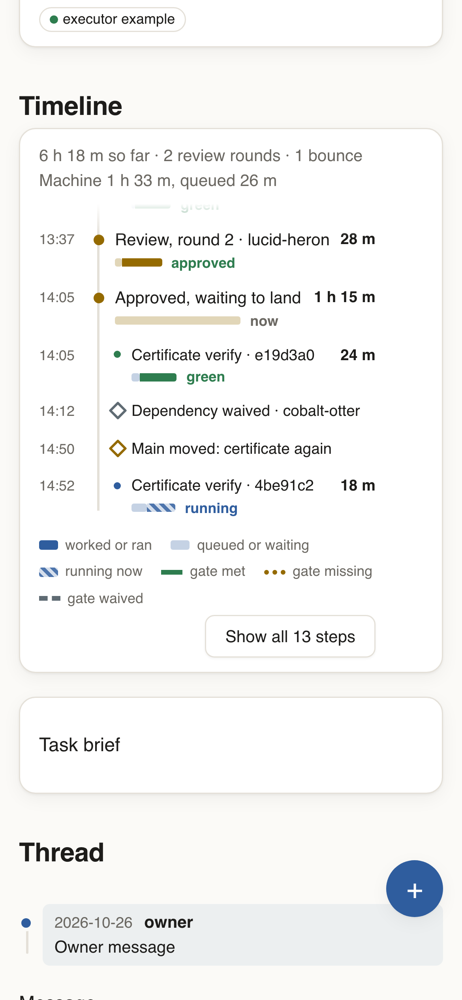 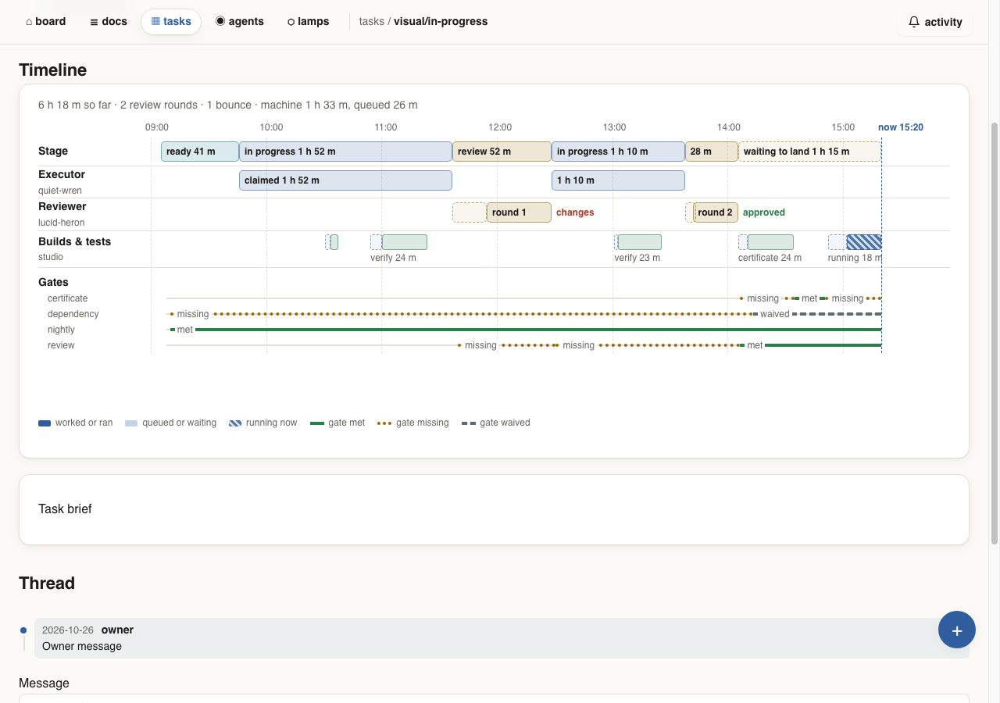
  [2026-11-12 03:49] agent — Posted for the board task `tools/task-timeline`. The same task in dark mode:  

    A week-long task of 50 steps, light and dark:  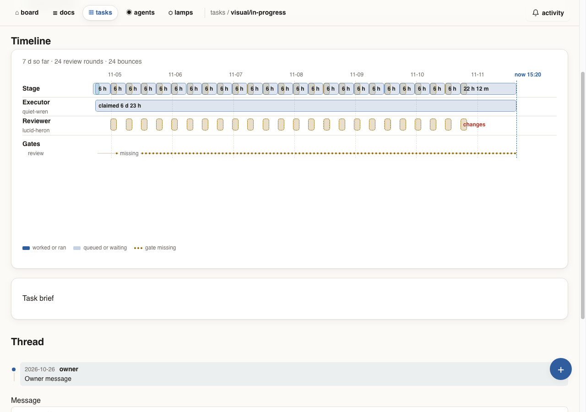  

    **Where it differs from the pictures, and why:**
    - **It sits in a box with "Show all".** The box is as tall as this browser last drew the task's timeline: at most 460 px on a phone and 480 px wide. A first visit gets that most, so a short timeline leaves room under it, as in the week's wide pictures; the next visit's box fits it. Steps that do not fit fade out, and "Show all N steps" shows them; a phone shows the latest steps. Why: drawn whole, a 50-step task pushed the brief 2,700 to 4,600 px down, and the page moved each time a step came.
    - **Lane words are drawn only where they fit.** A narrower window shortens a word or leaves it off. Why: the pictures are drawn at one width, and real tasks printed words over each other.
    - **Runs that overlap each get a row** in the builds and tests lane, at most three. Why: the pictures' runs never overlap; real ones do.
    - **In light mode, a segment's words use the page's text colour, not their tone.** Why: on their pale fill, the review tone (the theme's question colour) reads about 3.9 to 1 and the done tone (its like colour) about 4.5 to 1, under the 4.5 to 1 that text needs. Dark mode keeps the tones. This is a colour change for you to judge.
    - **Each gate state has a pattern as well as a colour:** met solid, missing dotted, waived dashed, held double. Why: a state should not be told by colour alone.
    - **A line under the lanes says what the keyboard is on**, in the same words as the hover. Why: the arrow keys walk the lanes, and a keyboard has no hover.
    - **On a phone the list keeps 40 px clear on the right.** Why: the page's floating + button covered a duration on every row at 390 px. Long labels are cut short with "…"; the whole label is in the row's hover and is read out in full.
    - **A note says when early runs are gone.** Why: when the run history no longer reaches back to the task's start, missing runs would otherwise read as no runs.

    Approve to keep it, or comment with what to change.
  [2026-11-12 04:54] agent — **What the timeline costs to load, measured by the reviewer.** It is a module of its own, loaded once a task's page has drawn: 201,818 bytes after the first visit, about 150 KB of it the runtime every module carries. The first visit of a task's page, and of `/agents`, which shares its module, grows by only 4,988 bytes, the box; `/` and `/tasks` do not change. Folded into that shared module instead, the timeline would add about 30 KB to every first visit of a task's page and of `/agents`, and save the 201,818 later. It stays separate unless you say otherwise.

## Waiting on an agent

### Releases

- [x] **consumer-contract-versioning** — A consuming project could take Symphony's parts one at a time, each when it is ready, and Symphony's releases would stop waiting on that project's whole test suite; how much can be phased depends on how far the contract goes. Today the project takes all of Symphony at one commit, and the machine's one server is built from it. How far should the contract go? A: the process boundary only: a project links nothing of Symphony, its plugin is a program of its own speaking the versioned plugin protocol, and the machine runs one Symphony release for the server, the board commands and the client. B: A, plus a few packages with version numbers of their own that a project may keep linking at the version it names: the plugin kit (its seams, blocks and doc checks) as one, and each small helper (child processes, schema checks, arguments, the repository reader). C: every one of the 14 packages versioned on its own, a project linking what it links today. Recommended: B. Approve and say A, B or C in the note, or comment. [[analysis/consumer-contract#The options]]
  [2026-11-13 18:42] agent — Posted for the board task `docs/consumer-contract-analysis`, from your comment on **conciliation-consumer-own-reds**.

    **What a project can stay behind on:**
    - A: its plugin program, while the machine's server speaks that program's protocol major (how many releases a major lasts is a number to set), and its scripts and tools that call `tasks api` or Symphony's commands, within those versions.
    - B: A's, plus its plugin kit's version, and each helper for as long as it likes, since nothing on the machine shares them.
    - C: any package, within what the others' versions accept.
    - None of them: a server, board commands or a board schema older than the machine's. Those stay one per machine and move together at its update, as you chose for the board: "C makes sense to improve upon A. while we don't have a dedicated build service."

    **What Symphony must keep working:**
    - A: every minor of the plugin protocol, and the previous major for that window; the board's `tasks api` calls; command names and outputs; settings keys (the server already leaves out one it does not know and reads the rest; the lint and registration would warn of a retired one for the window rather than refuse it).
    - B: A's, plus the kit's and the helpers' Rust names within a major, a check against the previous version's tag saying when a change needs a new one. Last week 0 to 13 commits touched these parts' sources.
    - C: the Rust names of every package, the library and the board included, whose sources 198 and 270 commits touched last week (commits, not counted changes to public names); and a package registry, since with Git pins two versions of this repository bring two copies of every package they share (tried here), whose types do not match (from Cargo's documentation; not compiled).

    **The work:**
    - Here, A and B: finish the plugin path you chose ("Let's go with B first, measure results against the current approach for a post change comparison."): every seam answered from a process, and the release installed on the machine instead of built by a project; then checks of the contract in place of the conciliation. B adds the kit split out of the wire types, and its version tags. C adds the registry, version checks for every package, and tests across the versions a project may combine.
    - On the consuming project's board, A and B: its host is no longer built (4 files); its plugin becomes a process and leaves the library's internals (27 of the 44 of its files that name the library); its review tool writes the board through `tasks api` rather than the board's library. Two other users of the library need an answer: an art tool (9 files), which runs Symphony's status, triage and page rendering with its plugin installed, and its review tool's landing (4 files), which takes the landing's checks and the lock it shares with the server. Under A both reach those through the machine's commands or copy them, and the project also copies the helpers it links, one of them in 132 of its files. Under B the analysis proposes the art tool through the machine's commands, and the landing on the library at the kit's own tag, which promises nothing, so a break there is the project's own, found by its gate.

    **What changes for releases, under A and B:** a release is judged by checks this repository owns (the plugin protocol, `tasks api`, the kit's version check), never by a project's whole suite, so a project's own reds stay on its own board. The release is installed on the machine and moves no project's pin; each project moves its kit and helpers through its own landing. Until that is built, **conciliation-consumer-own-reds** decides what holds a release.

    **Why B.** It phases what a project's own code can phase, and promises stability only where little changes. A makes the project copy code it links today, and possibly change its plugin at whatever kit it rebuilds with, for no promise in return. C promises stability on the packages that change most, needs a registry, and still cannot phase the server or a board.

    **Earlier verdicts checked.** **plugin-delivery-choice** (B), **release-delivery** (C) and **board-schema-at-update** (C) chose how plugins, releases and boards reach the machine: A and B build on them, and C leaves them as they are. **symphony-update-command** (B) has projects follow release tags, which every option keeps. **consumer-api-break-release** (A) keeps an old name beside the new for a release, which B keeps for its kit. None says whether packages are versioned apart, so none decides this card.

    This card is the only change. The build is filed after your verdict. [[analysis/consumer-contract#Why B]]
  [2026-11-13 19:39] owner · approved — There are multiple A/B/Cs here. No way to decide on all things. Those are separate decisions. For the original question, I agree with approach B

## Rejected and replaced

### Page loading

- [-] **skeleton-loading-look** — While a page waits for its data, it shows pale bars where its text will be, with a soft light passing over them every 1.8 s (still bars for anyone who turns motion off). A task and a document show the bars until their first screen has arrived, 3 s at most, then appear whole; the task board shows its controls at once, with bars in each column until its tasks arrive. Nothing jumps any more as a page loads: the largest layout shift on any page, phone or wide, is now 0.011, down from 0.17 on a document and 0.14 in the chat (under 0.05 is good). Three smaller changes come with it: the chat's form stays at the foot of its panel, with New conversation just above it; a wide page keeps room for its scrollbar, so the header no longer jumps 15 px; and the bars' two colours are theme settings a project can change (`--skeleton`, `--skeleton-shine`). Is this the look? Approve, or comment with what to change.
  [2026-11-11 21:00] agent — Posted for the board task `app/skeleton-loading`. Pictures with motion off, so the bars are still.

    A task on a phone, before and after:  

    A document on a phone, before, after and dark, and on a wide screen: 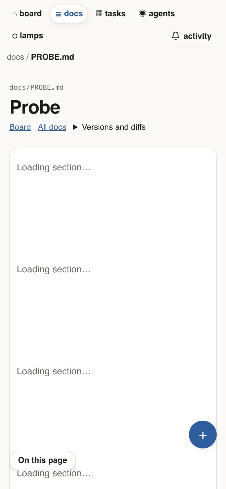   

    The chat on a phone with its conversation in, before and after:  

    **Layout shift**, the worse of a first and a repeat visit, phone / wide, before → after: document 0.171 / 0.124 → 0.007 / 0; chat 0.143 / 0.030 → 0 / 0; task 0.107 / 0.075 → 0.011 / 0.008; register 0.050 / 0.079 → 0.007 / 0.006; task board 0.018 / 0.048 → 0.001 / 0; home and the activity panel 0 before and after. A browser test now fails any page at 0.05 or more.
  [2026-11-11 22:05] owner · rejected — It should have a closer outline to what it shadows. If it should have a "box" it should have a box with the "text shadows" on it.
  [2026-11-12 02:43] agent — Replaced by **skeleton-loading-outline**: each placeholder is now its component's own box (border, corners, padding, size) with a bar where each line of its text will go: the task board's columns and cards, a task's head, brief, thread and composer, a document's outline and body, the queue's groups and rows, and the chat's messages. Pictures of each, on a phone and wide, light and dark, are on that card.

### Landing

- [-] **land-tests-changed-packages** — `just land` checks a merge with the docs audit alone and runs no test, so a red that a branch's evidence missed reaches main. Three did tonight, each already red at the approved tip: a route change whose `after_http` nobody ran; a branch that added a `symphony` command and merged main's new test that lists them, and never ran that 0.2 s test; and a board change whose `polish::` and `shot::` browser tests nobody ran. Should the land's check also run, on the merge, the fast test targets of the packages the branch changed? A: no; the executor and the reviewer run them at the tip, and the lander reruns by hand what main gained since, as CHECKS now says. B: yes, for each package that both the branch and main's newer commits changed. C: yes, for every package the branch changed, on every land. Recommended: C. Approve and say A, B or C in the note, or comment. [[CHECKS#After main moves]]
  [2026-11-12 06:06] agent — Posted for the board task `tools/checks-name-the-tests-landings-missed`.

    **What the land would have caught under each**, of tonight's three reds:

    | red at the tip | A | B | C |
    |---|---|---|---|
    | a route change: `-p symphony-server --test after_http` | no | yes, as main had changed `symphony-server` too | yes |
    | a new command: `-p symphony --test serve` | no | no: main had changed none of the branch's packages since its tip | yes |
    | a board change: its `polish::` and `shot::` browser tests | no | no | no |

    None of the three was made by the land's merge, so B's own case, two lines of work green alone and red together, did not occur. The tests CHECKS now names for each kind of change (a route's targets, the rule for a new command, the tasks board's row), run at the tip, catch all three: A rests on that alone, and B and C are the land's net under it.

    **A land today** rebuilds the client in its own worktree to compare it with the committed one, 7 to 20 minutes (median 11, over the 17 client checks lands ran tonight), builds `symphony` for the docs audit, and runs no test.

    **What a package's fast targets take**, cargo's own run times from tonight's three nightly runs, build not included, a fast target being one that took under 2.5 minutes in every run:

    | package | its fast targets | run |
    |---|---|---|
    | `symphony` | all but `nightly` | 3 to 5 min |
    | `symphony-board` | the library, `child_guard`, `cli`, `launch`, `store` | 4 to 6 min |
    | `symphony-server` | the library and the `after_*` targets | 3 to 3.5 min |
    | `symphony-ui` | all but `browser` and `wasm_build` | 10 to 30 s |
    | each other crate | all | seconds |

    First the land's worktree builds those test binaries: the whole workspace's took 4 and 5 minutes on two nights and 18 on a loaded one, and a land's packages are part of that.

    **Not fast, so in neither:** the browser target first (171 s one night, 61 minutes on another when its tests timed out), the board's `perf`, `sweep` and `server` (2.5 to 15 minutes each; `perf` took 883 s in one run) and `launcher` (seconds, and 10 minutes once), the server's `standalone` (3 to 5), the client's `wasm_build` (1 to 3) and `symphony`'s `nightly` (nearly 3). They stay the nightly's: under load their timeouts would turn lands red that changed nothing they test. Where the line falls is the recipe's to set, not this card's.

    **What B and C cost over tonight's lands**, each land's packages weighed by those run times (the middle of each range), the client distribution counted as `symphony-server` as CHECKS does:

    | lands since | lands | B runs tests on | for, in all | C runs tests on | for, in all |
    |---|---|---|---|---|---|
    | 18:00 on 11-11 | 47 | 31 | 2.8 hours | 41 | 4.4 hours |
    | 00:00 on 11-11 | 64 | 39 | 3.6 hours | 55 | 6 hours |

    Main's newer commits mostly touch the same few packages a branch does, so B runs on two lands in three and costs about two thirds of what C does. A land that runs either adds 5 to 6.5 minutes on average and up to 13 (a branch through `symphony`, the board and the server), beside the client check's 11.

    **A, by hand.** Nothing added to a land. Cost: a target someone leaves out reaches main red and stays there until a full run finds it.

    **B, shared packages.** Catches one of the three, because main happened to have changed the same package. Cost: about two thirds of C's.

    **C, every changed package.** Catches two of the three whatever main did meanwhile, and B's case as well, since every package both changed is one the branch changed. Cost: the minutes above, on 41 of the 47 lands.

    **Why C.** The reds that reached main tonight were evidence that left a target out, which C catches on every land and B only where main moved in the same package; B costs two thirds of C and caught half as much. A adds nothing to a land, but rests on every executor and reviewer running what CHECKS names, which three branches tonight did not. Built as one recipe the check names, which picks the packages from the branch's diff: the mechanical half of `just check-fast`, filed as `tools/check-fast`.
  [2026-11-12 06:42] owner · rejected — Adding 5 minutes may seem low, but the issue is that it becomes a “blocking 5 mins”. Every new PR that gets merged could invalidate the 5 min run, making it have to run it again and again and again, spiraling the 5 minute forever. A solution like a lock or queue would directly bottleneck the pipeline which isn’t acceptable either. So a nightly or more often run that then runs all tests and publishes when green is the only acceptable choice I can think of. Or the orchestrators could do a manual run of what they think is needed to ensure quality. But this cannot be an automated approach or that would wait and spiral OR add a number of tickets bottleneck to be merged and both are not acceptable.
  [2026-11-12 06:44] agent — Done as you say, with no replacement card: the land's check stays the docs audit and runs no test, and nothing automatic waits on a land. Quality rests on three things: the evidence at the tip that CHECKS names for each kind of change, run again at the new tip after a branch merges main, for the packages the branch itself changed; an orchestrator's run by hand of what it judges a land needs, which nothing waits on; and the full run (`just nightly`), nightly or more often, which runs every test and publishes a release when green, each red it finds a task with one owner. CHECKS and RELEASES now say so. [[CHECKS#After main moves]]

### Owner asks

- [-] **owner-asks** — What you say that waits on an agent's answer stops being a board task and becomes an ask: a verdict with a note, a rejection, a card message, a comment, a chat question or a message on a task. Five choices, each with its default. 1. Name: an ask, open or answered, never a task and in no task count; an open one shows who holds it and for how long. 2. Where: the queue's *Waiting on the agent* group lists the open asks with holder and age; the tasks board has one line of asks above its columns, never counted in them; `just tasks asks` in the terminal. 3. Store: a record of its own on the board; no verdict task is filed again, the open one becomes an ask, the finished ones leave every count. 4. Priority: pushed to its holder at once, first in its digest and named before any ready task; shown late after ten minutes with nobody holding it. 5. Routing: first the running agent working on what it is about (the executor of the card's task or branch, then its reviewer and orchestrator), then the chat seat, then an orchestrator; it moves on when its holder goes quiet or has not answered in ten minutes. Approve to take all five defaults, or comment with the ones to change. [[analysis/owner-asks#The design]]
  [2026-11-11 19:21] agent — Posted for the board task `tools/owner-asks-not-tasks`.

    **Today.** Each verdict you save becomes a `verdicts/…` task in the board's columns and counts. Eight were filed today; seven were each claimed by an agent and approved by a reviewer, to record an answer already on the card. Your question on worktree-build-folders was answered on its branch 17 minutes after you asked; its task sat ready 50 minutes longer and counts as 1.1 h of work nobody took. Chat goes to one session, whatever it is about. [[analysis/owner-asks#Today]]

    **1.** The app already calls a chat question an ask; the word now covers everything you wait on an agent for. It has no stage, so nothing has to pretend to claim or review it.

    **3.** A flag on a task would leave every count, list and digest to filter it out, now and each one added later, and a claim and a review would still close it.

    **5.** "Has context" is read from what the board keeps: roles on the task, the task a branch belongs to, the task whose brief names the card, launch records and where a subagent last worked. Nothing new is recorded.

    Two smaller questions, ten minutes and comments already open, are at [[analysis/owner-asks#Open questions]].
  [2026-11-11 19:33] owner · approved
  [2026-11-11 19:39] agent · question — Your approval came before these pictures, so it takes the five defaults but not how asks look. With asks, the queue, the tasks board and the home page, then the queue and the board on a phone: 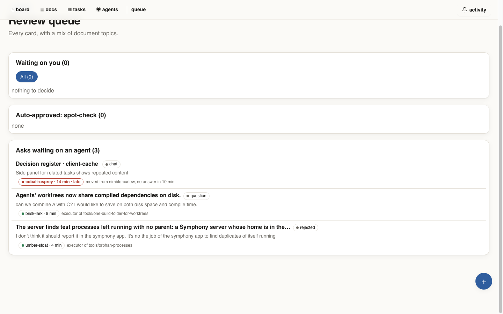     Is this how asks should look? Approve to keep it, or comment with what to change. The same pages today are at [[analysis/owner-asks#Pictures]].
  [2026-11-11 22:19] owner · rejected — it should not be in the same page as tasks. That page is already bloated with too many things.
  [2026-11-11 22:20] agent — The line of asks above the tasks board's columns is dropped: nothing about asks is drawn on the tasks page. The five defaults you approved at 19:33 stand, less that line. Where asks are shown instead is the new card owner-asks-place.

### Reports and monitoring

- [-] **reports-task-gates-timeline** — A task's page opens on its gates: every stamp or check it needs to land, met (by whom, when), missing, or waived (why). Below them, a timeline of what it went through: stages, claims, review rounds and verdicts, builds and tests, waits, each with its duration. Symphony shows its own gates without a plugin: the reviewer's verdict, the project's check on the tip, the review callback, a card waiting on the owner. How do a project's own gates reach the page? A: a typed seam, drawn the same way for every project. B: a panel of generic blocks the plugin lays out. Recommended: A. Approve and say A or B in the note, or comment. [[analysis/reports-and-monitoring#The task page]]
  [2026-11-11 13:31] agent — Posted for the board task `product/reports-and-monitoring`, the second reports card.

    **What exists.** The board replays a task's stages from its thread but keeps only totals, and the task page shows none. The consuming project's landing already answers its stamps for the task page (required, met or missing, waivers with why and by whom), and nothing shows them: a plugin can add a button or a field to a task, not a list of what it needs.

    **A, typed gates.** A plugin answers name, state, by, when and why; one component draws them. Symphony can then count them across tasks: which gate waits longest, which is missing most. Cost: one seam, one wire type, one component; the consuming project's adapter adds the times its stamps lack today.

    **B, a block panel.** Cost: the least Symphony work, but each project draws it differently and nothing can be counted.

    **The timeline** needs no new recording: the replay keeps each segment as well as its totals, and runs come from the run files. A phone gets a vertical list with a bar per step; a wide screen gets lanes over time.

    **Why A.** What a task waits on is the question asked of it, and a typed answer also feeds the defect report. This page takes the place of the task-page halves of `tools/stage-times` and `tools/review-as-stamps`. [[analysis/reports-and-monitoring#Timeline]]
  [2026-11-11 13:46] owner · rejected — this needs some visualization layer to decide (images)
  [2026-11-11 14:12] agent — Replaced by **reports-task-page-pictures**: the same choice, with pictures. One task's page under A and under B, on a phone and on a wide screen, and its timeline drawn both ways.

### Test leftovers

- [-] **orphans-end-by-age** — The server finds test processes left running with no parent: a Symphony server whose home is in the temporary folder or a checkout's `artifacts/`, and a task database on a private port whose data is in memory or in such a folder. Today every page names each one and gives one command, `symphony-server orphans --end PID…`, which checks each again and ends only those; the server ends none by itself. Should it end them itself once they are old enough? A: no, it keeps reporting them. B: it ends both kinds after an hour, with the same checks, and logs each one it ends. C: it ends the databases after an hour and only reports the servers. Recommended: A. Approve and say A, B or C in the note, or comment.
  [2026-11-11 18:44] agent — Posted for the board task `tools/orphan-processes`.

    **Where they came from.** The 14 databases seen on 2026-11-11 were the board servers of fixture repositories. They were started detached, as the live board's is, so nothing ended them. That start is now supervised for any board in the temporary folder or under `artifacts/`: the database ends when the process that started it ends, even when it is killed. The two test fixtures that started an in-memory database themselves now have the store tests' leash. The server's own parent is no longer counted. After these changes, a leftover means a path nobody has found yet.

    **A, report only.** Nothing is ended that someone meant to keep running, such as a server started by hand with `nohup` and its home in the temporary folder. Cost: the owner runs the command when the notice shows.

    **B, end both after an hour.** Nothing piles up, and no one has to act. Cost: a process kept running on purpose under the temporary folder ends after an hour without being asked. A leak that keeps happening is then cleaned up instead of reported.

    **C, end the databases only.** The databases took the memory (542 MB for 14). A database nobody started by hand is nearly always a test's. Servers stay the owner's call.

    **Why A.** The paths that leaked are repaired, so the notice should rarely show. When it does, it points at a new leak that should be fixed, not cleaned up quietly. B or C can be added later as one timer on the census, which re-checks each process before ending it, as the command does.
  [2026-11-11 18:51] owner · rejected — I don't think it should report it in the symphony app. It's no the job of the symphony app to find duplicates of itself running
  [2026-11-11 19:13] agent — Done on `tools/orphan-processes`: the Symphony no longer looks for copies of itself or for test databases. The census, the notice at the top of every page, the `symphony-server orphans` command and the starter's line about leftovers are gone, with their tests and docs; no notice moved to the live feed. The repairs at the source stay: the database of a board in the temporary folder or under `artifacts/` ends when the process that started it ends, even when that process is killed, and the two test fixtures that start a database themselves end it the same way. The server's status still sends `orphans`, always 0, so a starter built before this can still read it.

## Resolved

### Releases

- [~] **conciliation-consumer-own-reds** — Today a Symphony release waits until every test of the consuming project's packages that use Symphony passes against it, even tests that already fail on that project's own main with no Symphony change. So a red on that project's own main holds every Symphony release, and with it the machine's refresh (each project's pin, its board and the shared server moved to the release), as it does now: today's release waits on 31 of its tests, all failing on its own main, none caused here. Before it tags, the release run builds and tests each consuming project's packages that use Symphony against the release, in a scratch copy: the conciliation. What should make that check red? A: any failing test, as today; the release and the refresh wait until the project's main is green. B: only a test or a build that passes at the project's own pinned Symphony and fails with the release; tests already failing at its pin are listed in the release's notes as the project's own, and the release and the refresh go ahead. C: any failing test but those on a list kept by hand for each project in `symphony.toml`. Recommended: B. Approve and say A, B or C in the note, or comment. [[RELEASES#The release run]]
  [2026-11-13 17:53] agent — Posted for the board task `docs/conciliation-baseline-card`.

    **What happened today.** The release candidate, first judged at 09:00, was rerun at 15:29. Its other red has since been fixed and landed; the conciliation's red is the one left, on 31 tests of the consuming project in 7 test targets. Each was run again alone, with the release and with the project's own pin (no Symphony change at all): all 31 fail both ways, at the same line with the same message. None is caused by the release and none is load: a missing file, a missing entry in its budget table, 11 fixtures that its own landing rules refuse, and 8 that the rules of Symphony's board already in its pin refuse (a subtask is never moved to review, a reviewer cannot judge a task it filed, a draft card is not listed). That pin is a commit of main moved by hand, which no release run has judged: there is no release yet. Each is the project's to fix, and its board has a task for each. A rerun now would be red on the same 31 and spend the second of the candidate's three, so the red is held open until the project's fixes land or you answer.

    **A, any failing test, as today.**
    - When a release ships: once the consuming project's main is green, after its own tasks for these tests land there, and again after any later red on its main. Until then each rerun is red on the same tests; the candidate is dropped at its 24-hour bound (09:00 on 2026-11-14) or after three red reruns, and the run of main's tip that follows meets the same reds.
    - When the machine refreshes: only after that release. Meanwhile the project's pin, its board's schema and the shared server stay where they are.
    - Cost: nothing to build. The project's own reds are filed here as a release red, one task for the check whatever the number of tests, which nothing here can fix.
    - What it cannot see: nothing broken is released, but it cannot tell the project's own reds from a break the release makes.

    **B, judged against the project's own pin.** In the scratch copy the project's tests run twice: at its own committed lock, and with the lock moved to the release. The check is red only for a test or a build that passes at the pin and fails with the release. Tests already red at the pin are listed in the run's record and the release's notes as the project's own, with its board's tasks where known, and nothing is filed here for them.
    - When a release ships: at the first run after B is built in which the release breaks nothing new. Today's 31 would not hold it.
    - When the machine refreshes: right after that release, so the project's pin moves while its own main is still red. Its own commit gate and hooks still decide whether the move lands there; if they refuse it, the release stands and the move waits for that project's own landing, as today.
    - Cost: a task here to build it. About twice the project's test time on a run where its commit or lock changed since the last baseline (its conciliation took 13, 90 and 23 minutes in the last three runs); a rerun against an unchanged project reuses the baseline and runs once.
    - What it cannot see: the baseline is whatever the project's pin is. A break that came in with a pin no conciliation judged, as today's pin is, is listed as the project's own: 8 of today's 31 fail on Symphony board rules that came in with that pin. And a test already red at the pin for a reason of the project's that the release also breaks for another: that break shows only once the project fixes the first, and then on its own board, as its own red.

    **C, a list of tests to skip.** Each consuming project gets a list of its tests in this repository's `symphony.toml`, which the conciliation leaves out.
    - When a release ships: once a task here lists today's 31 and lands. Each later red on the project's main holds the release again until it is listed.
    - When the machine refreshes: as under B.
    - Cost: no extra run time. An edit and a land here for each red there, and another to take a test off the list once the project fixes it, which nothing reminds anyone to do.
    - What it cannot see: anything the release breaks in a listed test, for as long as it stays listed. B and C both turn today's red check green while the 31 still fail; the difference is that B still runs every test and is red on anything the release newly breaks, while C stops running the listed tests.

    **Your words that bear on it:**
    - 2026-11-11, on how projects take a newer Symphony: "New releases can be pushed for urgent bugfixes, but generally should be generated based on nightly builds that would do a full verification cycle and conciliation." What makes the conciliation red was left open then; this card asks it.
    - 2026-11-12: "also nightly fixes should be prioritized, like bugfixes are since they block releases. Meaning express path line followed up by another run". Under A, a red nothing here can fix blocks the release all the same.
    - 2026-11-11: "tests that are failing in main should be handled by an orchestrator as a separate task in order for individual tasks not to be blocked by it and have a single dedicated owner to solve it." The consuming project's own reds have that owner on its own board.
    - 2026-11-12: "yes, a green release should refresh".

    **Why B.** The conciliation is there to tell whether a release breaks a consuming project, and B answers exactly that: what the release breaks is red, and the project's own reds stay with their owner on its board, as your words above have it for a red main, instead of holding every Symphony release and refresh. A ties Symphony's releases to another project's main being green. C stays blind to what it lists and needs a land here for every red there.

    **Earlier verdicts checked.** **symphony-update-command** (B) asks for a conciliation, not for what makes it red: A, B and C each keep one. **consumer-api-break-release** (A, a deliberate break in two releases) stands under each, since a test the release breaks passes at the pin and fails with the release: A and B see it, and C sees it unless the test is listed. Neither decides this card.

    This card is the only change. The option you choose is built by a task filed after your verdict.
  [2026-11-13 18:15] owner · question — There should be proper isolation against a contract, so that each package/crate of symphony can be released and versioned on its own. Consumers could list an outdated package u til they are ready to update, allowing a phased update approach. Thoughts?
  [2026-11-13 18:24] agent · question — On your comment (contract isolation, each package released and versioned on its own, consumers staying on an older one until ready): I think it is the right end state, and it removes this question rather than answering it. With a contract, a release is judged by contract tests this repository owns, never by the consumer's whole suite, so a consumer's own reds cannot hold a release, and the refresh becomes each consumer's own phased move. What it needs, as I read the code today: (1) the contract named and versioned: the plugin protocol and block vocabulary, the wire types, the board's schema and CLI, the installed recipes; (2) consumers reaching Symphony across a boundary that tolerates two versions: the plugin process protocol already is one, while a plugin crate linked into the host is not, since two versions of the wire types in one binary are different types; (3) the two things one machine shares, the server and each board's schema, taking a consumer one version behind, which the schema does not do today (it only moves forward with the pin). That is a design with real choices (which packages version apart, how far back the server and schema reach), so I would put it to you as its own analysis and card, not build it from a comment. It does not ship before the candidate's bound (09:00 on 2026-11-14), so this card still needs A, B or C for the releases until then; my recommendation stays B as the bridge, with the contract design filed now. Say the word (or just approve with A, B or C) and I file the contract analysis either way.
  [2026-11-13 19:39] owner · dismissed
- [r] **consumer-api-break-release** — A release reaches a consumer by a pin move that may change only `Cargo.toml` and `Cargo.lock`, and is cut only when the consumer's default branch, as committed, builds and tests against it. So a change here that removes or reshapes a public item a consumer uses can never be released: the consumer's code cannot change until its pin moves. Tonight's first run found one such break in the consuming project, and its fix found a second behind it; both were accidents, now being put back. How is a deliberate one released? A: in two releases: the change keeps the old item working beside the new (no `#[deprecated]` mark, which the consuming project's lint would turn red), the consumer moves over through a task of its own, and a later task here removes the old item, which that run's conciliation proves. B: in one: the consumer prepares its side on a branch the conciliation builds in place of its default branch, and after the release its owner lands the pin's move with it through the consumer's own landing. Recommended: A: nothing in the run or the refresh changes, and no consumer's main breaks or waits on a person; its cost is the old item kept for a release or more. Approve and say A or B in the note, or comment. [[analysis/release-candidate#A deliberate break of a consumer's API]]
  [2026-11-12 19:22] agent — Posted for the board task `design/release-candidate-branch`, from the review of the release candidate design you approved.
  [2026-11-12 20:26] owner · approved — I don't fully understand this issue. So pick whatever choice makes sense to you.
  [2026-11-12 21:14] agent — Chosen as A by the orchestrator under your words, "pick whatever choice makes sense to you", and filed as the board task `tools/consumer-api-break-in-two-releases`. In plain words: when Symphony changes something a project's code uses, the old version keeps working until the release after its replacement is out, so a project is never broken by taking a release.
  [2026-11-12 21:15] agent · resolved
- [r] **release-candidate-name** — Your words, 2026-11-12: "we can also move from calling this "nightly" to release candidate", then "just release ? (would do tests and release, if fails then won't do release and agents has to fix?)". Read literally, "release candidate" names the run. The design you approved gives it to the commit the run holds while its reds are fixed, and calls the run a release run, which `just release` starts; its card listed those names without pointing out the difference. What does "release candidate" name? A: the commit held: a candidate red, a candidate rerun, and the run is a release run. B: the run: a release candidate run, its reds release candidate reds, and the commit held is just the candidate. Either way the rest stands unless you comment: `just release`; `just nightly` answering one line pointing to it until the first release it cuts; `--commit COMMIT` for `--release COMMIT`; reds filed as `tests/release-red-NAME`. Recommended: A, since a release candidate is the build that may become the release, and the command already names the run. Approve and say A or B in the note, or comment. [[analysis/release-candidate#The vocabulary]]
  [2026-11-12 19:22] agent — Posted for the board task `design/release-candidate-branch`, from the review of the release candidate design you approved.
  [2026-11-12 20:25] owner · approved — A. should also had been auto approved.
  [2026-11-12 21:14] agent — A it is, and you are right that it should not have been asked: the process card you approved already called the commit the run holds the release candidate. Recorded for the board task `tools/release-rename`: "release candidate" names that held commit, a red there is a candidate red and its rerun a candidate rerun, and the run itself is a release run, started by `just release`.
  [2026-11-12 21:15] agent · resolved
- [r] **release-main-while-candidate-open** — While a release candidate is open, the run judges nothing on main's tip, up to its 24-hour bound. Main's newest landings are checked only by their own evidence and by the regenerator's client check and docs audit each round; a break they bring is found by the first run after the release, and the release lacks what landed since the candidate. Should main's tip also get a run? A: no, as designed; the first landing after the release starts one when 20 or more have landed since the candidate, which a busy day reaches. B: a run of main's tip right after each candidate's release, whatever the count: one more full run per candidate on a quiet day. C: runs of main's tip at the cadence while the candidate is open, taking turns with its reruns, since only one run holds the lock at a time: a run of main holding it when a rerun is due delays the release by up to a whole run (the first run took an hour and never reached the tests) and spends the 24-hour bound, and the reds of two trees share one series. Recommended: A. Approve and say A, B or C in the note, or comment. [[analysis/release-candidate#Main while a candidate is open]]
  [2026-11-12 19:22] agent — Posted for the board task `design/release-candidate-branch`, from the review of the release candidate design you approved.
  [2026-11-12 20:24] owner · approved — A. this should had been auto approve/triaged, its basically what was decided in the other card.
  [2026-11-12 21:14] agent — A it is, and you are right that it should not have been asked: the release-candidate process A you approved at 19:05 already holds the run on the candidate, so main's tip gets no full run while a candidate is open, and B or C would have changed that. Recorded for the board task `tools/release-candidate-held`, which builds it: the first landing after a release starts a run of main's tip once 20 or more have landed since the candidate.
  [2026-11-12 21:15] agent · resolved
- [r] **release-candidate-process** — The full run judges main's tip, and main gains 2 to 8 landings an hour. So a red's fix reaches the next run with everything that landed since, and that run can be red again: a release may never come. Your words, 2026-11-12: "release candidate branch process? bugfix - rerun failures then release once green. Then update main with bugfixed changes. Open to suggestions on how". How is a red fixed and the release cut? A: the run holds the commit it judged; each fix starts there, never merges main, and lands on main as any task does; the fix's tip, on main from then on, becomes the candidate, and a rerun of what was red releases it. B: the fix lands on main first, and the run copies it onto the candidate (a cherry-pick). C: the fix lands on the candidate only, and the candidate is merged into main after the release. D: no candidate; each run judges main's newest tip, reusing the green of each step whose inputs did not change. Recommended: A. Approve and say A, B, C or D in the note, or comment. [[analysis/release-candidate#The options]]
  [2026-11-12 18:45] agent — Base: today, each run judges main's newest tip. 
  [2026-11-12 18:45] agent — Posted for the board task `design/release-candidate-branch`. A, the recommendation, drawn: 

    **Tonight's first run**, 17:28 to 18:27, was red twice. `just verify` stopped at its size check, two binaries past their budgets, so none of its tests ran. And the consuming project no longer builds against it. Main gained 3 landings meanwhile. Under every option, "rerun failures" first needs the run split into steps that each run on their own: the first part of the stamps task.

    **A, the fix's own tip.** Main has each fix from its land, nothing is merged back, and the tree released is the tree a reviewer approved. `just land` does not change, and neither does what a release is. Cost: a fix is written on a tree up to a day old, so it conflicts with main more often; a conflict drops the candidate, and the next run judges main's tip. A second red's fix merges the first before its review. A fix that changes the client commits its own build of it.

    **B, picked onto the candidate.** Cost: the pick conflicted in two of three trials. The release is a commit nobody reviewed and main lacks, so what a release is must change, and the run builds and commits the candidate's client itself.

    **C, merged back after the release.** Your words read literally. Cost: main lacks every fix until the release, so every agent on main meets the same red. The release is a commit main lacks until the merge back, which can conflict after the release is cut (tried).

    **D, no candidate.** What is being built now. Cost: today 38 of 56 landings changed the board's or the symphony crate, so the run after a fix reruns nearly everything, and each landing since can bring a red of its own. A release comes only when main is quiet.

    **Why A.** It is the one option in which the tree judged changes only by the fixes, so a release comes however fast main moves. It updates main earlier than your "Then", at each fix's land. It works before the stamps land, and is faster with them. A red that passes when run alone is fixed as you said, rewritten or taken out of the run, never rerun until it passes.

    **Names, unless your note says otherwise.** `just release` runs it, as you proposed; today's `just nightly` answers one line pointing to it until the first release it cuts. The commit it holds is the release candidate, and a red there is a candidate red, filed as `tests/release-red-NAME`. `--release COMMIT` becomes `--commit COMMIT`. Everything moves in one step, the first task, as you chose for the last rename ("B - just remove the bandaid quickly"). The whole vocabulary: [[analysis/release-candidate#The vocabulary]]

    Approve and say A, B, C or D in the note, or comment. [[analysis/release-candidate#Why A]]
  [2026-11-12 19:05] owner · approved — A
  [2026-11-12 19:22] agent · question — A it is. Its review on the board task found four things to correct in what you approved, and two trades the card did not state. The design now says each, and the three choices they leave open are cards of their own: **release-main-while-candidate-open**, **release-candidate-name** and **consumer-api-break-release**.

    **Corrected:**
    - **Only a red's own fix moves the candidate.** As written, any task started at the candidate's commit would have moved it, and main sits at that commit for minutes (tried). It now moves only on the land of a red's own task.
    - **A conflict no longer drops the candidate.** When a fix's land conflicts, its executor merges main and asks for a fresh review, as for any task. The commit approved before that merge is on main once the fix lands, and holds only the candidate and the fix, so it becomes the candidate (tried).
    - **The refresh moves a pin only forward.** A pin moved by hand to a commit of main while a candidate is open is neither before nor after the release, and moving it would drop what it had, a newer board schema among them (tried). Such a pin is left and named until a release descends from it.
    - **B's "two of three trials" was not a rate:** the same fix conflicts the same way under A (tried); B's other costs stand. And D's release comes when a run of main's tip finds no new red, not only when main is quiet.

    **The two trades A makes:**
    - **Main's tip gets no full run while a candidate is open**, up to the 24-hour bound. A break landed meanwhile is found by the first run after the release, and the release lacks what landed since the candidate. The regenerator still checks main each round. Whether main gets a run too: **release-main-while-candidate-open**.
    - **Once stamps land, the commit tagged is not run in full.** The steps that were red, did not run or that a fix reaches run on it; the rest keep their green from the candidate's first commit, whose inputs for them are the same. That is your "Nightly can also use the stamp based approach for things that did not change so it's faster", and it holds under every option, D included. Before stamps, the rerun is the whole verification.

    **Your words the card did not quote**, 2026-11-12:
    - "also nightly fixes should be prioritized, like bugfixes are since they block releases. Meaning express path line followed up by another run. Nightly can also use the stamp based approach for things that did not change so it's faster": the express path stands for a red's fix, and the candidate's rerun is the run that follows it. The express path's own "a fix's land starts another run of main's tip" is dropped.
    - "we can also move from calling this "nightly" to release candidate" and "just release ? (would do tests and release, if fails then won't do release and agents has to fix?)": the card's names gave "release candidate" to the commit held, not to the run, without saying so: **release-candidate-name**.

    Tonight's first run also showed that a deliberate break of a consumer's API has no way to a release: **consumer-api-break-release**.

    Since these change what you approved: do the corrections stand? Approve again to keep A with them, or comment. [[analysis/release-candidate#The trades]]
  [2026-11-12 19:38] agent · question — One more change under your A, the same correction to D: the Base picture's last label, "and so on, until main is quiet", now reads "and so on, until a run finds no new red". Approve again to keep A with the corrections, or comment.
  [2026-11-12 20:35] agent — Your A stands, with the corrections and the two trades above: they follow from it and are not new choices, so they are auto-approved as you say, and both questions above are withdrawn. Nothing on this card waits on you. Your words, 2026-11-12: "release-candidate-proccess is weird. the card was approved, then another question to decide came, but the decision remains in approved? this should had been a seaparate card no the same one. I also don't really get why those similar questions about things that were already been approved are being asked. They are consequences of the previous decision and should be auto-approved"
  [2026-11-12 20:35] agent · resolved

### Page loading

- [x] **client-shared-runtime** — You chose to share the runtime between the client's page modules; it works, but not for every page within your caps. Today 57 % of the client's code is a copy of code another module holds, and a first visit to Reports loads the whole task pages' module, 557,536 bytes. With one shared part, Reports drops to 286,100. But the shared part holds code a given page never uses: shared with the board, `/tasks` grew from 295,837 to 360,579 bytes on a first visit, over its 300,000 cap. Which pages should share? A: every page but home and the board, which keep their own modules and caps. Reports 286,100; a task page and `/agents` 7,460 more; the published client about 2.4 MB smaller, 4.7 MB once the documents and the queue join (it is 20.56 MB of a 20.75 MB line). B: all eight, about 7 MB smaller and cheap moves between every page, but the board's cap raised to about 365,000 and likely home's (estimated 291,000 against its 300,000). C: only inside the task pages' module: Reports the same, nothing else shared, and the published client 0.5 MB larger, past its line, so it cannot land alone. Recommended: A. Approve and say A, B or C in the note, or comment. [[analysis/client-shared-runtime#The choice]]
  [2026-11-13 17:58] agent — Posted for the board task `perf/client-shared-runtime-investigation`. The prototype is the branch `perf/client-shared-runtime-prototype`, never landed. Whichever you choose, two faults in the build tool's splitter come first: it blanks some text in the shared part (every task page showed "Page unavailable" until the prototype repaired it), and it writes its files differently on every build, which the client check refuses. The first step of the work is a step of our build that repairs both, until the tool does; the analysis says how.
  [2026-11-13 18:17] owner · approved — A
  [2026-11-13 18:20] agent — Recorded: A, every page but home and the board ("A"). Since the card was posted, the review of the analysis corrected three things it said. None changes A, and the analysis now says each:

    - **Reports' 557,536 bytes** are its whole first visit; the task pages' module and its script are 534,635 of them.
    - **Home under B** was estimated at about 291,000, about 9 KB under its 300,000 cap, not likely over it as the card said. The board's cap would still have had to rise to about 365,000.
    - **A's cost in time** is one request more on a shared page, for its part. This machine's load hid it, so it is measured on a quiet machine as the evidence of A's second step.

    The analysis lists A's five steps in order, the splitter's repair first.
- [r] **skeleton-first-visit** — The first time a browser opens a task's page at a width, the page's outline cannot know the task's title, facts, gates or brief, so what follows them moves when the page arrives. Every later visit lands within 1 px either way. What should the first outline guess? A: fixed guesses: a title of one line wide and two on a phone, one line of facts, four gates and a brief of seven lines. B: the sizes of the last task this browser drew at that width, and A's guesses only before any. Recommended: B. Approve and say A or B in the note, or comment.
  [2026-11-12 08:01] agent — Base: the task's page loading on a phone today, then loaded. 
  [2026-11-12 08:01] agent — The same task's first visit on a phone, then loaded, under each: 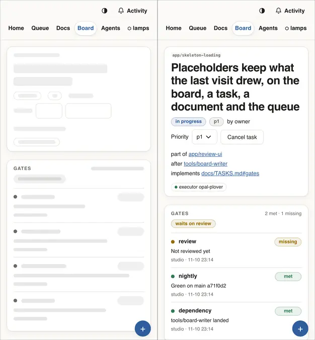 
  [2026-11-12 08:01] agent — Posted for the board task `app/skeleton-loading`, which builds B. Measured on two tasks of different titles, facts, gates and briefs, each opened first in a browser that drew no task (A) and after the other task (B), on a phone and wide. How far each part lands from its outline:

    | part | A, fixed guesses | B, the last task's sizes |
    |---|---|---|
    | gates, under the head | 47 to 112 px | 37 to 65 px |
    | timeline box | 26 to 48 px | 6 to 23 px |
    | brief | 26 to 48 px | 6 to 23 px |
    | thread | 38 to 586 px | 116 to 324 px |

    On a phone the first screen shows the head and the gates; wide, the top of the timeline box as well. The brief and the thread are below it.

    **A, fixed guesses.** Every first visit outlines the same made-up task; what moves is how far a task is from it. Nothing is read.

    **B, the last task's sizes.** A first visit outlines the task drawn before it; what moves is how far two tasks in a row differ. Nothing more is kept: it reads the newest of the sizes the browser keeps for each task's next visit.

    The task's pictures on **skeleton-loading-outline**, on a phone and wide, light and dark, show it today, under A, under B, on the next visit and loaded, in that order.

    **Why B.** It lands what the first screen shows closer: the gates within 65 px against 112, and the timeline box within 23 px against 48. The thread, off the first screen, lands closer under A for one test task and under B for the other.
  [2026-11-12 08:20] owner · approved — B
  [2026-11-12 08:20] agent — B it is, and it is the build on `app/skeleton-loading`: the first time a browser opens a task's page at a width, its outline takes the head, title, facts, gates and brief of the last task that browser drew at that width; a browser that drew no task there yet uses the fixed guesses. Every later visit of the task takes its own, within 1 px. It goes back to review with the rest of the task.
  [2026-11-12 20:35] agent · resolved
- [r] **skeleton-loading-outline** — Replaces: skeleton-loading-look. While a page loads, each placeholder has the outline of what it stands for: a card, column, message or row is drawn as its real box (border, corners, padding, size), with a pale bar where each line of its text will go, at that line's height; pills, fields, headings and ranks have their own shapes, and a picture still to come is its box, filled. The task board shows its heading and filters at once, with a bar in the Status and Finished tasks boxes, over columns topped with their status colours: each column shows a card for each task the last visit counted there (one before any visit), and a column no agent has taken up shows cards without a role chip. A task shows its head (a title of two lines on a phone), its gates, its brief and its thread; a document its path, title and links, its outline (the On this page button on a phone) and its body; the queue its group cards, topic chips and ranked rows; the chat two messages. The light passes over the bars every 1.8 s (still bars for anyone who turns motion off). On a repeat visit each part lands within 1 px of its outline, as the browser keeps what it last drew. On a first visit what the page cannot know yet still moves: a task's gates, brief or title of another length move what follows them (the test task's thread lands 313 px higher on a phone, 177 px wide), and the board's lower row moves with its columns' heights (19 px). Is this the look? Approve, or comment with what to change.
  [2026-11-12 02:43] agent — Posted for the board task `app/skeleton-loading`. Each picture is before, now and loaded, side by side, light above dark, with motion off.

    The task board, on a phone and wide: 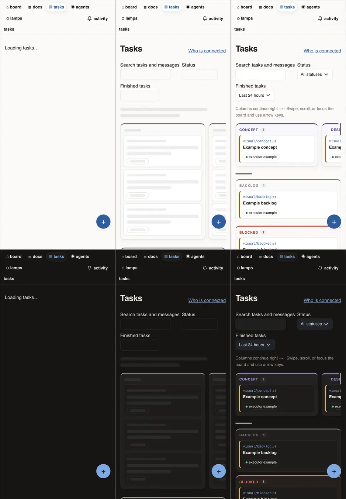 

    A task, on a phone and wide:  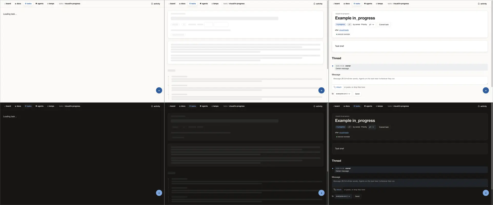 Then with its head in and its thread still reading, before and now:  

    A document, on a phone and wide:  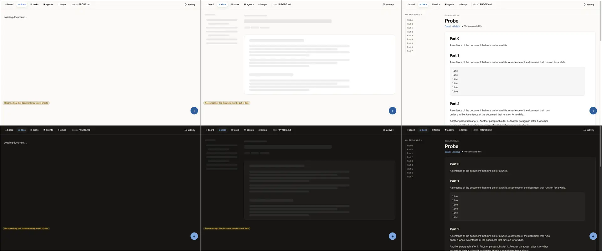 Then with its head in and its body still reading, before and now:  

    The queue:  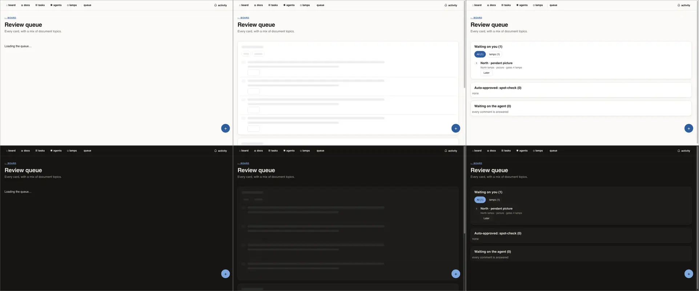

    The chat:  

    **Layout shift**, the worse of a first and a repeat visit, phone / wide, before → now: document 0.171 / 0.124 → 0 / 0; chat 0.143 / 0.030 → 0 / 0; task 0.107 / 0.075 → 0 / 0; register 0.050 / 0.079 → 0 / 0.006; task board 0.018 / 0.048 → 0.002 / 0.001; home and the activity panel 0 before and now (under 0.05 is good).
  [2026-11-12 03:57] agent — Updated for the gates card that now sits under a task's head. A task's placeholder now includes that card too, with a line for each gate this browser last saw (four the first time), so the brief stays put as the page arrives. The task again, before, now and loaded, against main as it is now:

      Then with its head in and its thread still reading, before and now:  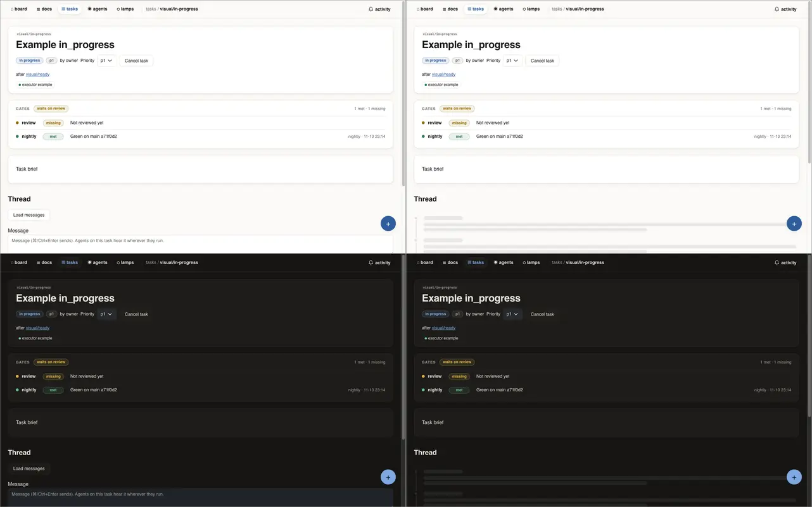

    The task board and the other pages look as above, and the layout shift is unchanged: a task 0 / 0 with its gates in.
  [2026-11-12 06:01] agent — Reworded after review. "Nothing moves" was wrong: the layout-shift score cannot see a placeholder replaced by the real page, as every real element is new. Now each part is measured where its outline stood and where the page draws it, on the test pages:

    - **Repeat visit:** every part of the task, board, document and queue within 1 px, phone and wide.
    - **First visit:** the document and the queue within 1 px. The board's lower row (backlog, blocked, cancelled) 19 px up, as its columns' heights are not known yet. A task's gates 32 px up on a phone (the test task's title is one line, not two), its brief 222 px up on a phone and 87 px wide, and its thread 313 px and 177 px (four gates and seven lines of brief outlined, against its two and one).

    Changed to match the page: columns topped with their status colour; a bar in the Status and Finished tasks boxes; a card per task the last visit counted, and one per column before any visit; no role chip in a column no agent has taken up; a task title of two lines on a phone; the On this page button on a phone; a task's head and brief at the height this browser last drew them; columns 280 px wide on a phone, as the board's.

    Each picture is before, the first visit, the next visit (the board and a task) and loaded, light above dark, motion off. The yellow Reconnecting notice under a document's placeholder shows on main too.

    The task board:  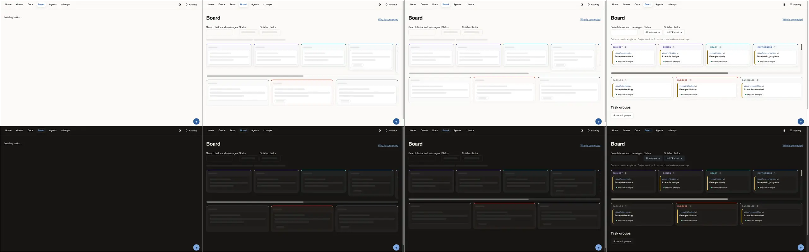

    A task:   Then with its head in and its thread still reading, before and now:  

    A document: 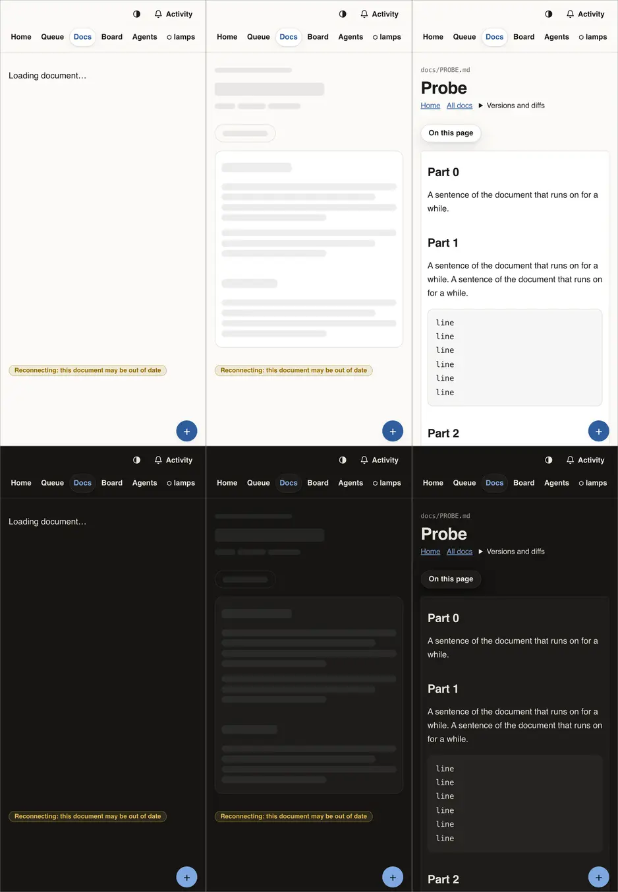 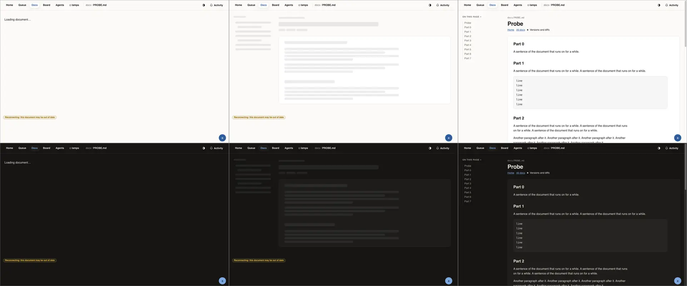

    The queue:  
  [2026-11-12 06:32] owner · approved
  [2026-11-12 08:01] agent — Corrected after a second review: the card claimed more than its test measured, on test pages of one task per column. Now measured on pages shaped as the live ones: columns of 1 to 20 tasks whose titles take one to three lines, cards with and without a chip row, three queue groups of one, no and three rows, and two tasks of different titles, facts, gates and briefs. Each part is measured where its outline stood and where the page draws it, on a phone and wide.

    - **Next visit: every part within 1 px.** The board's filters, pipeline, its fourth concept card and its lower row; each queue group; a document's head, outline and body; a task's head, gates, timeline box, brief and thread. For this the browser now keeps each column's first 16 cards (height, and whether it has a chip row), each queue group's rows and height, and a task's title, facts and gates as well as its head and brief.
    - **First visit:** a document within 1 px; the board's filters and pipeline, the queue's first group and a task's head within 1 px. The rest cannot be known yet and moves: the board's lower row 258 px down on a phone and 379 px wide, as each column outlines one card; the queue's second group 313 px up and its third 413 px up, as it outlines four rows and two for one and none; a task's parts by what its title, facts, gates and brief differ from the outline, for which there is a choice on **skeleton-first-visit**.
    - **"No role chip" was wrong:** that row also holds a card's linked documents, on 5 of the live board's 6 design cards and 5 of its 9 ready ones. Each card now outlines its chip row as it was last drawn.
    - The timeline box that now sits on a task's page is outlined at the height the page will give it.

    Each picture is before, the first visit, then for a task its first visit after another task, the next visit (the board, a task and the queue) and loaded, light above dark, motion off.

    The task board:  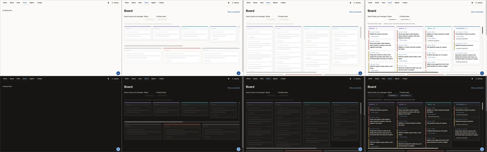

    A task:  

    The queue:  

    A document:  
  [2026-11-12 20:35] agent · resolved

### Artifacts in a clone

- [r] **pictures-in-every-clone** — Your requirement, 2026-11-12: "A git clone should be able to see the images, specially the ones that are referenced in the docs and including for previous decisions as well." A plain `git clone` shows a picture only when the picture is committed. Where do the pictures a document or a card shows, and a task's working evidence, live? A: the ignored folder, as today; no clone shows them. B: Git LFS for every picture; a clone shows them only where git-lfs is installed and the account's LFS quota is intact or paid. C: a ref of their own outside every branch; no clone shows them. D: git notes; no clone shows them. E: a store in the main checkout named by each file's SHA-256, outside git; no clone shows them. F: a split: what a document or a card shows is committed beside it, so every clone and GitHub show it with no tool, and working evidence that no document shows goes to E's store, kept while something actively references it, under the sweep's 5 GB cap. Recommended: F. Approve and say A, B, C, D, E or F in the note, or comment. *Replaces:* where-artifacts-live. [[analysis/attached-artifacts#What a plain clone shows]]
  [2026-11-12 16:36] agent — Posted for the board task `design/artifacts-attached-not-committed`. This card replaces **where-artifacts-live**, whose head still recommended E from before your requirement. My answers to your question there are its 16:09 line: each option against a plain clone, why F, and whether pushed objects can be deleted (no for LFS, short of deleting the repository or asking support; a plain commit only by force-pushing main). F, drawn:

    

    **What F means for you:**

    - **It commits the documents' pictures directly,** which you first asked to avoid ("Instead of directly commiting"). Why: nothing that reaches GitHub through main comes back off, by LFS or by a plain commit, so LFS buys no way back. A plain commit needs no tool and no quota, and every clone shows it.
    - **Every checkout carries all of them.** Each worktree and each consumer's pinned Cargo checkout of Symphony holds every picture the documents show: 4.3 MiB each today, about 0.9 GiB each after a year at that pace. The pace, about 2.5 MiB a day, is inferred from two days, and the first was the documents' first burst of pictures. After a year that is about 36 GiB across this repository's 40 worktrees, and about 18 GiB across the 20 pinned checkouts the consuming project's Cargo keeps.
    - **The consuming project, committed plainly:** its documents show 2.47 GiB, so 2.47 GiB in each of its worktrees, about 0.94 TiB across its 388 today. That cost decides plain commits against LFS there, and the choice is the consuming project's.
    - **Evidence posted only on a thread is in no clone** under any option but committing it. The board's threads are in no clone either.
    - **Kept while something actively references it:** a task not done or cancelled, a post on an open task's thread, a card not resolved, a document on main (its history included) or on an open task's branch, or an open ask. A post on a closed task's thread keeps nothing by itself. Past the 5 GB cap an agent removes what nothing references, closed tasks' files first. Nothing is removed on a timer.

    **B passes only on a condition:** git-lfs installed, and the account's LFS quota intact or paid. Past the storage quota with no payment method, "You will only retrieve the pointer files"; past the bandwidth quota, "Git LFS support is disabled on your account until the next month" ([GitHub's Git LFS billing](https://docs.github.com/en/billing/concepts/product-billing/git-lfs)). The consuming project's 2.47 GiB uses the free 10 GiB a month in about four fresh clones.

    Approve and say A, B, C, D, E or F in the note, or comment. [[analysis/attached-artifacts#F. The split (recommended)]]
  [2026-11-12 17:40] owner · approved — agreed with F
  [2026-11-12 17:59] agent — F is taken. A picture a document or a card shows will be committed beside it. Working evidence will stay in the main checkout's store, under the sweep's 5 GB cap, kept while something actively references it. The design now records your choice and date. These tasks are filed on the board, ready and not yet started:

    - `tools/doc-pictures-committed` (p1): the docs audit refuses an agent's card picture that git does not track, judged only on the lines a branch wrote. When the server commits your verdict, it also commits the uploads your line names, so a clone shows them.
    - `tools/attach-evidence` (p1): `symphony-cli attach` and `shot --attach` put a thread's evidence in the store by its content, so its link outlives the worktree.
    - `tools/artifact-reference-index` (p2, after attach): one index of what still names each kept file. It replaces the sweep's own lookup.
    - `tools/kept-folder-one-check` (p2, after the index): the store and the swept folder are measured together under the cap. Past it, a check lists what nothing references, for an agent to remove. Nothing runs on a timer.

    The consuming project's half is a note for its own board in the design: plain commits or LFS for the 2.47 GiB its documents show, and its cap. Nothing was filed or changed there. [[analysis/attached-artifacts#The implementation tasks]]
  [2026-11-12 17:59] agent · resolved

### Worktree sweep

- [r] **sweep-swept-retention** — Before the sweep removes a finished worktree, it moves what git ignores in its artifacts folder (the pictures its thread names, a test's leftovers) into the main checkout's `artifacts/swept/NAME/`, and nothing ever empties that folder. Any rule that empties it deletes evidence, so the rule is yours. How long is what was set aside kept? A: for good, every dry run saying how much it holds (built). B: 30 days after the worktree's task closed, then deleted, the dry run naming what goes next. C: only the files a task's thread names; the rest is deleted as the worktree goes. Recommended: A. Approve and say A, B (and the days, if not 30) or C in the note, or comment. [[TASKS#Board health]]
  [2026-11-12 14:31] agent — Posted for the board task `tools/sweep-removes-nothing`. A dry run on a scratch repository after one sweep set a worktree's evidence aside; the highlighted line is the new one: 

    **What it would hold.** On 2026-11-12, 16 of this repository's 40 worktrees had an artifacts folder, 4.6 GB in all: 3.5 GB of it one review's build, 0.9 GB one test's proof, the rest a few MB each. Each move is a rename on the same disk, so it takes no new space: it is what the worktrees held already.

    **A, keep for good.** Nothing a thread names is ever lost. Cost: the folder grows with every task that leaves evidence, a review's build kept in its artifacts included; the dry run says how much, and the board warns on every page when free disk drops under 20 GB.

    **B, keep 30 days.** The disk comes back by itself. Cost: a link on an older thread stops working, and a task reopened after that has lost its pictures.

    **C, keep what a thread names.** Keeps the evidence and drops the leftovers, such as that 3.5 GB build. Cost: a picture named by another spelling, or only in a card, is deleted; the sweep reads the threads of every task tied to the worktree before each removal.

    **Why A.** It deletes nothing until a size worth acting on shows, and B or C can follow as one rule over the same folder.
  [2026-11-12 14:39] owner · question — images should be kept, build should not. Images and other artifacts can be pushed into a main tree. However there should be a cap to the size of the folder, after which it should ask/warn agents to manually check and remove stale images and artifacts not in use. Maybe 5 GB limit?
  [2026-11-12 15:14] agent — Built as you said, for the board task `tools/sweep-removes-nothing`. Your words, 2026-11-12: "images should be kept, build should not. Images and other artifacts can be pushed into a main tree. However there should be a cap to the size of the folder, after which it should ask/warn agents to manually check and remove stale images and artifacts not in use. Maybe 5 GB limit?" and, the same day: "Instead of directly commiting, artifacts could be attached some with some different process. Either nodes, or git files? Forgot the name but I think there was something for this type of challenge in particular. But if there's something that still actively references the artifact, then it should be kept until space used becomes a problems requiring it to be remove."

    **Kept, never committed.** The orchestrator's reading of "pushed into a main tree", labelled as theirs: kept in the main checkout's artifacts folder (ignored by git), not committed to the repository. Attaching artifacts without a commit on main (Git LFS, notes or a ref of its own) is a design task of its own, not built here.

    **Build output is never kept.** A folder tagged with `CACHEDIR.TAG`, as Cargo's build folders are, or a file of compiled code, known by its first bytes (ELF, Mach-O, wasm, an archive), goes with the worktree. A correction to the figures above: the 3.5 GB I called one review's build is no build but a scratch repository's `.git` (`artifacts/hg-review/sf/.git` in that worktree), which these rules keep; the test's proof holds 280 MB server binaries, which are compiled code and now go.

    **The cap, and nothing removed.** `[board] swept_cap_gb` in `symphony.toml`, 5 GB when unwritten, your suggested figure. The sweep never removes anything it set aside. Past the cap it still sets aside, and the sweep's output, the land's and a dry run's say so in one line, and `just tasks status` warns of it until it is under again, naming the size, the cap and the five largest folders with their tasks and stages. Each folder is marked `in use: WHERE` while a task tied to it is not done or cancelled, a post on an open task's thread names a path under it, or a file of `docs/` on main does (cards included), and `no reference found` otherwise; only those are suggested for the check by hand. The lookup is one read of the open tasks' threads and one search of `docs/`, made once each time the folder is measured past its cap. Rules: [[TASKS#Board health]].
  [2026-11-12 17:43] owner · approved
  [2026-11-12 17:59] agent · resolved
- [r] **sweep-artifacts-set-aside** — A worktree whose task is done or cancelled used to stay whole for as long as anything sat in its `artifacts/` folder: the pictures its thread names, a test's leftovers, a review's build. That was the reason in 729 of the sweep log's 850 "kept" lines. What should the sweep do with that folder before it removes the worktree? A: move it into the main checkout's `artifacts/swept/NAME/`, and back if git refuses the removal. B: delete it with the worktree. C: keep the worktree, as before. Recommended: A, which is built. Approve and say A, B or C in the note, or comment. [[TASKS#Board health]]
  [2026-11-12 12:15] agent — Posted for the board task `tools/sweep-removes-nothing`.

    **What the folders hold today.** 16 of the 40 worktrees have one, 4.6 GB in all: 3.5 GB is one review's build (`hg-review`), 0.9 GB one test's proof, and the rest is a few MB each.

    **A, move.** Nothing is lost, and every picture a thread names can still be found by its worktree's name. The move is a rename on the same disk, so it copies nothing. Cost: `artifacts/swept/` in the main checkout keeps growing until someone empties it, about 4.6 GB today.

    **B, delete.** All the disk comes back at once. Cost: a task's evidence pictures are never committed, so a thread's link to one stops working once its worktree goes.

    **C, keep.** Nothing changes. Cost: the 16 worktrees and their build output stay until someone empties each folder by hand. That is part of why the sweep removed 0 of 38.

    **Why A.** It loses nothing, frees everything else in the worktree, and switching to B later is one line. The task's report has the other causes of "removed 0".
  [2026-11-12 12:38] owner · approved — A
  [2026-11-12 12:42] agent — Built as A says, nothing else changed. Before the sweep removes a worktree whose work is finished, it moves what git ignores in that worktree's artifacts/ into the main checkout's artifacts/swept/NAME/, NAME being the worktree's folder (NAME-2, NAME-3 when that name is taken). If git then refuses the removal, everything goes back. Nothing empties artifacts/swept/ by itself. It goes to review with the board task tools/sweep-removes-nothing now.
  [2026-11-12 12:42] agent · resolved

### Task page, in pictures

- [r] **task-page-timeline-place** — The timeline pushes a task's brief and thread off the first screen. Its box sits between the gates and the brief: 480 px tall wide, 460 px on a phone. At 1280×800 the brief now starts 214 px below the first screen and the thread 511 px below; before the timeline both were about 540 px higher. The message box is still at the end of the thread, a scroll away. Where should the timeline go? A: as built, open under the gates. B: closed to its line of totals, opened in place with a click. C: open, but at most 240 px tall, the rest behind "Show all". D: under the thread and the message box. Recommended: B. Approve and say A, B, C or D in the note, or comment. [[analysis/reports-and-monitoring#Timeline]]
  [2026-11-12 08:09] agent — Posted for the board task `tests/timeline-pushes-thread-below-fold`. The first screen of one task's page at 1280×800 under each option. A is the page as built; B, C and D are that page edited in the browser to show the option, not built. The task went round review five times, on a scratch board:   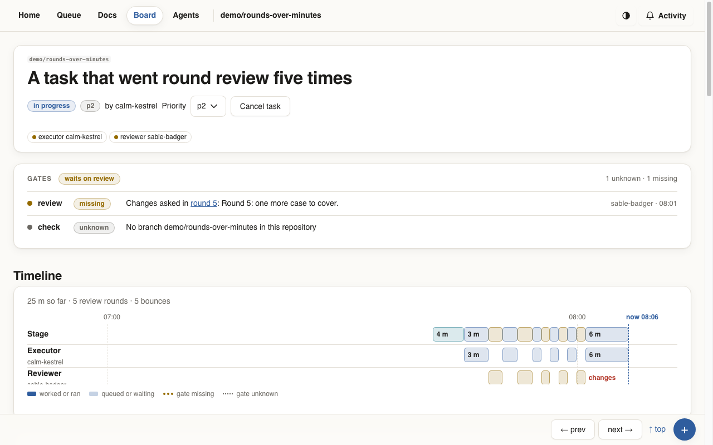 

    **How each option looks, at 1280×800 and on a phone:**
    - **A** opens the page on the gates and the timeline, as in the pictures you approved. The brief starts 214 px below the first screen, 335 px on a phone. On a later visit a short timeline's box shrinks to fit it (322 px wide here, the brief then 56 px below); a long timeline, or any on a phone, keeps the full box.
    - **B** puts the brief on the first screen and starts the thread 87 px below it, 294 px on a phone. The totals stay in view. The timeline's own code (201,818 bytes) loads only when someone opens it. Seeing the steps takes a click.
    - **C** just brings the brief onto the first screen and starts the thread 271 px below it, 453 px on a phone. Wide, the lanes are cut off under the reviewer's; on a phone it shows the last few steps.
    - **D** puts the brief on the first screen and starts the thread at its foot, as before the timeline; on a phone the thread is 146 px below. The timeline is read last, after the whole thread.

    **Why B:** you mostly open a task to read its brief and thread and to answer. The gates already say what it waits on, and the totals say whether the history is worth opening.
  [2026-11-12 08:09] agent — The same on a phone. The head and the gates fill most of a phone's first screen under every option:  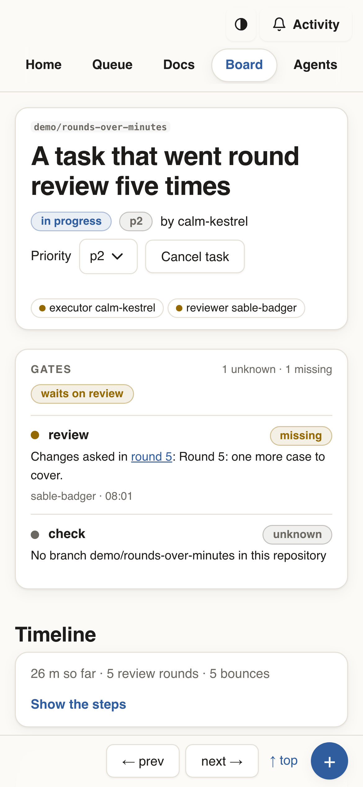  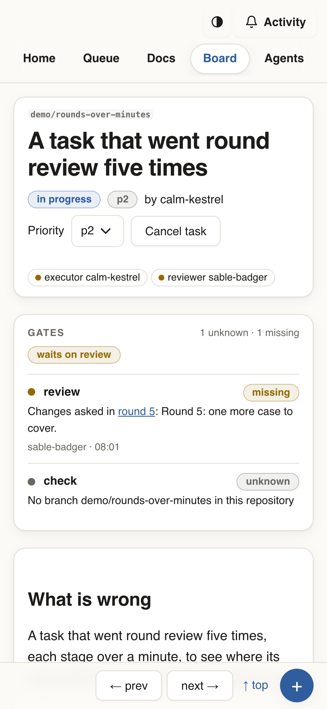
  [2026-11-12 08:22] owner · approved — C
  [2026-11-12 08:24] agent — Recorded as C: the timeline stays open under the gates, in a box at most 240 px tall on a phone and wide. Steps that do not fit fade out, and "Show all N steps" opens the rest in place, wide as well as on a phone. A later visit's box still shrinks to fit a shorter timeline. Building it now on the board task `tests/timeline-pushes-thread-below-fold`, with pictures at 1280×800 and on a phone.
  [2026-11-12 17:59] agent · resolved
- [r] **reports-task-page-pictures** — A task's page opens on its gates: every stamp or check it needs to land, each met, missing or waived, with who, when and why. Below them, a timeline of what the task went through. The pictures show one task, on a phone and on a wide screen. How do a project's own gates reach the page? A: a typed seam, so Symphony draws every project's gates the same way and can count them. B: a panel of generic blocks the plugin lays out. The timeline is the same under A and B. Recommended: A. Approve and say A or B in the note, or comment. *Replaces:* reports-task-gates-timeline. [[analysis/reports-and-monitoring#Pictures]]
  [2026-11-11 14:12] agent — The gates on a phone, under A and under B:  
  [2026-11-11 14:12] agent — The task is made up in the consuming project's shape: its four stamps, two review rounds, a build and tests. Its times are invented. The pictures follow the app's colours, type and chips, in light and dark.

    **A** is one component for every project. What the task waits on comes first, with who and when, and a gate can link to its run or verdict. Symphony can count these gates across tasks, for example which one waits longest.

    **B** is the plugin's own layout. The consuming project's stamps answer has no times, so its table has none. On a phone, a table wider than the screen scrolls sideways.

    Wide:  

    **The timeline** is the same under A and B. On a phone it is a list with a bar per step; on a wide screen, lanes over time.  
  [2026-11-11 14:28] owner · approved — A
  [2026-11-11 14:36] agent — Recorded as A: a typed seam, and Symphony draws every project's gates the same way. [[analysis/reports-and-monitoring#Gates]] now says so, and the A pictures are the look to build to.

    Filed on the board, ready, each quoting your verdict and naming the pictures:
    - tools/task-gates-seam: the plugin seam and its wire type, with Symphony's own gates when no plugin answers.
    - tools/task-gates-panel: the gates on the task page, on a phone and wide.
    - tools/task-timeline: stage segments kept from the replay, served and drawn as a list on a phone and as lanes wide. Runs join once tools/build-test-recorded-generic records them.
    - the consuming project's gates adapter: a note to copy to that project's board, since the code is there. Its stamps answer gains times and maps to the seam.

    The task-page halves of tools/stage-times and tools/review-as-stamps are replaced by these; both threads say so.
  [2026-11-11 14:37] agent · resolved

### Artifacts

- [~] **where-artifacts-live** — A task's pictures live in an ignored folder of the checkout that took them, so a post or card naming one shows a broken picture once that worktree is swept, and on any other machine. Under every option, an artifact is kept while anything names it (a card not resolved, a task not closed, a document on main, any thread post), and once the folder passes the 5 GB cap only what nothing names is listed, for an agent to remove; never a timer. Where do attached artifacts live? A: the ignored folder as it is, with the cap. B: Git LFS. C: a ref of their own outside every branch, pushed to GitHub. D: git notes. E: a store in each project's main checkout named by each file's SHA-256, the one your uploads already use; nothing in git. Recommended: E. Approve and say A, B, C, D or E in the note, or comment. [[analysis/attached-artifacts#The options]]
  [2026-11-12 15:19] agent — Base: where an artifact lives today, and where its link breaks. 
  [2026-11-12 15:19] agent — Posted for the board task `design/artifacts-attached-not-committed`. E, the recommendation, drawn: 

    **Today.** This repository's 41 checkouts hold 4.62 GiB in their artifacts folders: 249 MiB of it pictures, 1,453 of them, the rest scratch data of reviews and tests. Pictures grew 94 MiB on 11-11 and 155 MiB on 11-12. 14 thread posts name a picture by a worktree's path; 6 of those 8 worktrees are gone, so those links lead nowhere, and four of their folders are nowhere on this machine. The consuming project holds 7.35 GiB of pictures, and its documents show 1,340 from its ignored folder, 30 already missing.

    **A, the folder with the cap.** Nothing new. Cost: a link names a path, which breaks when the sweep sets a worktree aside, and nothing shows on another machine.

    **B, Git LFS.** Cost: a pointer for every file is committed into main. GitHub frees LFS storage only when the repository is deleted, so no check could give space back there. Every worktree gets a full copy of every file (41 × 249 MiB here). A consumer's Cargo fetch gets the pointers, not the pictures (tried). Free up to 10 GiB stored and 10 GiB a month downloaded, then $0.07 a GiB a month and $0.0875 a GiB.

    **C, a ref of their own.** Not in a clone of main or a consumer's Cargo fetch (tried; Cargo fetches only the branch or commit it locks), fetched by name when wanted, one ref a task. Cost: every artifact counts in the GitHub repository's size, which GitHub strongly recommends keeping under 5 GB; the consuming project's pictures alone are 7.35 GiB. Whether GitHub keeps such a ref, and what deleting one frees there, is not documented, and was not tried.

    **D, git notes.** Binary only with care, not shown by GitHub since 2014, hung on a commit rather than a task, and one history for every artifact: fetching it fetches all of them, and dropping one rewrites it.

    **E, a store by content.** One command copies a file into `artifacts/uploads/<sha256>.<ext>` and prints the line to post. The name never moves, and every page, branch view and the phone read it. Removing a file gives its space back. Cost: this machine holds the only copy, as today; a second machine serving the board would ask this one's server, as run logs are read, built when there is one.

    **Why E.** It is the only option in which a link never breaks on this machine and removing a file frees its space, with nothing added to git or to GitHub's quota. Every option but A names an artifact by its content, so C or an object store can be added later behind the same names. What counts as a reference and how it is found: [[analysis/attached-artifacts#The reference index]]. The five implementation tasks, in order: [[analysis/attached-artifacts#The implementation tasks]]
  [2026-11-12 15:55] owner · question — A git clone should be able to see the images, specially the ones that are referenced in the docs and including for previous decisions as well. I believe this excludes E and A correct? Assuming the above, what is the recommmendation? If B, can you not push override objects to delete them? I doubt there is no way to remove them?
  [2026-11-12 16:09] agent — **Yes, it excludes A and E. It excludes C and D too.** A plain `git clone` shows a picture only when the picture is committed. Here is each option against "a clone shows the pictures the docs reference, past decisions included":

    - **A, the ignored folder:** no. Git ignores it, so no clone has it. Excluded.
    - **B, Git LFS:** yes, where git-lfs is installed: the clone downloads each picture in its tree (tried on a scratch repository). Without git-lfs, the clone holds 131-byte pointers until `git lfs install` and `git lfs pull`. Passes.
    - **C, a ref of their own:** no. A clone skips refs outside branches and tags (tried). Getting them takes `git fetch origin 'refs/artifacts/*:refs/artifacts/*'` and then a tool to put the files where the docs' links point. Excluded.
    - **D, git notes:** no, for the same reason. It takes `git fetch origin 'refs/notes/*:refs/notes/*'`, and notes are never files in the checkout. Excluded.
    - **E, the store outside git:** no. Excluded. A copy of the store under a ref fails the same way C does.
    - **A picture committed beside its document, as card pictures are today:** yes, with no extra command. GitHub shows it too: "Links starting with / will be relative to the repository root" ([GitHub](https://docs.github.com/en/repositories/managing-your-repositorys-settings-and-features/customizing-your-repository/about-readmes)).

    **Recommended: F, the split your wording suggests.**

    - **What a document or a decision card shows is committed beside it,** as card pictures are now. A clone, GitHub and every past decision show it.
    - **Your own uploads on a card get committed with the verdict,** at the path your line names, so your words stay as written.
    - **Working evidence that no document shows stays out of git,** in E's store in the main checkout, under the 5 GB cap of the sweep that lands first. An agent removes it once nothing actively references it, closed tasks' files first. Nothing is removed on a timer.

    

    **What each half costs at today's growth:**

    - **Committed, here:** 4.3 MiB on main now. 5.2 MiB came in the two days the docs have had pictures, so about 2.5 MiB a day, or about 0.9 GiB a year at that pace. Every clone carries it, and so does each consumer's Cargo copy of Symphony. GitHub holds the whole repository at 129 MiB today. None of it is ever removed.
    - **Committed, the consuming project:** its documents show 1,310 pictures, 2.47 GiB, still in its ignored folder, and 30 more are already lost. They came mostly in September, 2.1 GiB; October added 0.4 GiB. Committing them takes its repository from 122 MiB to about 2.6 GiB, under the 5 GB GitHub strongly recommends, and puts a copy in each of its worktrees. Under LFS instead, they use 2.47 GiB of the free 10 GiB, and its worktrees can skip them. That choice is the consuming project's.
    - **Local evidence:** 0 bytes in git. About 125 MiB a day of pictures here, held under 5 GB on this one disk. Nothing backs it up (Time Machine has no destination here), so a dead disk loses it, and no clone or other machine sees it.

    Why plain commits and not B for the documents' half: here that half is small. Commits need no tool on any machine, no quota and no change to how the server or the audit read a file. B fits only where a project's documents show a lot, as the consuming project's do.

    **Your B question: can pushed objects be deleted?**

    - **LFS on GitHub: no, as far as the documentation says.** The only routes it gives are "To remove Git LFS objects from a repository, delete and recreate the repository", or to "contact support" ([GitHub](https://docs.github.com/en/repositories/working-with-files/managing-large-files/removing-files-from-git-large-file-storage)). An object is named by the hash of its bytes, so pushing a new version adds a new object, and the old one "still exist[s] on the remote storage" and keeps counting. The LFS protocol has only `download` and `upload` ([batch API](https://github.com/git-lfs/git-lfs/blob/main/docs/api/batch.md)), so no push can override or delete one. Not verified: whether support purges on request, and how fast.
    - **A plain commit:** removing it means rewriting history and force-pushing main. That breaks every clone and every consumer's pin, and goes against this repository's rule never to force. GitHub also keeps cached views until support runs a garbage collection ([GitHub](https://docs.github.com/en/authentication/keeping-your-account-and-data-secure/removing-sensitive-data-from-a-repository)).
    - **A separate ref (C):** deleting or replacing that ref removes it with no rewrite of main. When GitHub then frees the space is **unknown**: nothing documents it, and I pushed nothing to find out.

    So whatever reaches GitHub through main stays there for good, plain or LFS. That is why only what a document shows goes there.

    Approve and say F, or another letter, in the note, or comment. [[analysis/attached-artifacts#What a plain clone shows]]
  [2026-11-12 16:36] agent · dismissed — superseded by **pictures-in-every-clone**

### Delivery to projects

- [r] **pin-waits-for-current-client** — A land now merges and pushes in seconds. The client the server embeds is rebuilt after it by one background run, which commits it to main a few minutes later: about 14 minutes when the land changed the client, none when it did not. In between, main's committed client is older than its sources. A release already waits for it: the nightly releases nothing while main's client is behind. May a project's pin be moved to a commit of main whose committed client is behind? A: no; the pin waits until `just tasks regenerate --status` says the client is current, as a release does. B: yes; the pin moves, and the project's server serves the older client until its next move. Recommended: A. Approve and say A or B in the note, or comment. [[TASKS#The regenerator]]
  [2026-11-12 14:20] agent — Posted for the board task `perf/land-batches-approved-tips`.

    **Why it matters.** A change to the wire types, the server and the client lands its server at once and its client one round later. A server built from main in that window embeds the older client against the newer server, so a page can fail to read what the server sends.

    **Where it applies.** Your verdict on how projects take a newer Symphony (they follow release tags, never main) already keeps a behind client out of every pin to a release, since no release is cut on one. This is for a pin moved by hand to a commit of main, which is every pin move until the first release is tagged. The check belongs to the project's own pin tooling. Symphony gives it the signal: the status command exits nonzero unless main's client is current.
  [2026-11-12 14:31] owner · approved — A
  [2026-11-12 14:33] agent — Building A now. A new form of the status command, `just tasks regenerate --status --wait` run in the Symphony checkout, waits while main's client is being rebuilt and succeeds only once it is current, the way the nightly waits before a release. A pin moved to a commit of main moves only after it succeeds, and the guides now say so. The pin itself is moved by the project's own tooling, which runs this command first. A pin to a release needs no wait, since no release is cut while main's client is behind.
  [2026-11-12 16:36] agent · resolved
- [r] **board-schema-at-update** — With one release per machine, the server and every project's board commands come from one release, never apart. When does a project's board move to a new release's schema? A: at `symphony update`, every registered board, each after a dump, whatever else writes it. B: at each project's own `just tasks migrate`, as today. C: at `symphony update`, each board after a dump, but only once every program that writes it is on the release's schema; a release that raises the schema waits until then, naming the writers to rebuild. Recommended: C. Approve and say A, B or C in the note, or comment. [[analysis/plugin-delivery#The board]]
  [2026-11-12 10:06] agent — Posted for the board task `design/plugin-delivery-without-rebuilds`, revised after its review.

    **Today** only a project's own migrate in its main checkout moves its board. The schema went from 9 to 17 in ten days, the last this morning. A board command behind its board's schema is refused outright, reads included. A server one schema behind reads the board and writes nothing, so your messages, priorities, fields and cancels from the app fail.

    **Who writes a board.** Not only the server and `tasks`: the consuming project's nightly opens its board to write through Symphony's crates at the consuming project's pin, and its landing runs its own `tasks` build. Each is refused once its board moves past it.

    **A, every board at the update.** Nothing is left half-updated on Symphony's side. Cost: every writer not from the release is refused the moment its board moves; for the consuming project today, its nightly and its landing. And had the board moved before the server came from the release, the running server would have been left a schema behind and read-only to you.

    **B, per project.** Each project moves its board once its own writers are rebuilt. Cost: until it does, the release's server and board commands, a schema ahead, cannot open that board at all, so the project keeps building its own server and board commands: today's cost, kept.

    **C, when every writer is on the release.** The board records each program that opens it to write and the schema it was built at; the update moves a board only when every writer seen there in the last week is the release's own or built at its schema. A release that keeps the schema installs at once. Cost: the record is new work, older builds do not write it, and one lagging writer holds a schema-raising release for every project on the machine.

    **For every letter.** Before a board moves it is dumped through its running database, and the update never stops, signals or restarts a board's database. This morning the consuming project's board came back three days old because its launcher ended a database that was slow to replay its log (`tools/board-database-lost-its-log`); the server's refusal to read a board behind its schema is what kept anyone from writing on the old state.

    **Why C.** "More automatic type of updates" is your ask: C moves every board it safely can by itself and stops with a name where it cannot, where A would break a writer and B would keep today's builds. Symphony's own board keeps moving with main, as it does now.
  [2026-11-12 10:20] owner · approved — I didn't say which one I approved did I. C makes sense to improve upon A. while we don't have a dedicated build service.
  [2026-11-12 10:54] agent — Recorded as C, the improvement on A while there is no dedicated build service. Two of its costs, stated plainly. Symphony's own board keeps moving with main, so whenever a release that raises the schema is held, by a lagging writer of any project or by the update waiting to be run, the machine's server reads Symphony's board and writes nothing to it, and after a second raise cannot read it at all: today's "Symphony's own pages wait for the consumer's pin" in another form. The update names the writer that holds it, and the hold ends when that writer is rebuilt. Writers built before the record never write it, so the record alone cannot see them. The record therefore lands with a schema raise of its own, made once as today by each project's `just tasks migrate` after its writers are rebuilt; since a writer behind its board's schema is refused, no older build can write the board from then on, and the update never moves a board whose schema predates the record. [[analysis/plugin-delivery#The board]]
  [2026-11-12 10:54] agent · resolved
- [r] **release-delivery** — Each release comes as separate parts, each with its checksum: the server with no client inside it, one build of the client beside it, the board commands, the document command line. One command, `symphony update`, installs them on the machine, fetching only the parts that changed. From the fifth slice it replaces the per-project update command chosen on 2026-11-11: no project moves a pin to take a release. How does a release reach the machine? A: the nightly builds it here after it tags, once per release (about 11 minutes); nothing is downloaded. B: a hosted build makes each platform's parts on the tag and publishes them; the update downloads them. C: A now, B once a project runs on another machine. Recommended: C. Approve and say A, B or C in the note, or comment. [[analysis/plugin-delivery#Distribution]]
  [2026-11-12 10:06] agent — Posted for the board task `design/plugin-delivery-without-rebuilds`, revised after its review.

    **Why separate parts.** The consuming project's release builds, measured this morning: the server 295 MB, of which about 266 MB is every client build ever published, `tasks` 32 MB, `symphony` 23 MB and `agent-send` 6 MB. The server's code alone is about 30 MB, an estimate by subtraction. So a new client means a whole new server, and so does a board change. Split, a release replaces only what changed, usually one or two parts. The two size tasks on the board give each part's measured size and rebuild time when they post; neither had by 10:05.

    **What it replaces.** On 2026-11-11 you chose a per-project command that moves a project's pin to the newest release tag (the resolved card `symphony-update-command`, further down). Its task `tools/symphony-update-command` is ready and not started, and `tools/symphony-behind-signal` depends on it. Until the release's server serves every project, moving the pin is still how the consuming project takes a release, so the first task stays worth building as filed. At the fifth slice `symphony update` replaces it and its recipe retires, and the behind signal reads the machine's installed release instead of a project's pin. Under the first card's A, the 2026-11-11 command stays as decided, and this card's release carries only the board commands.

    **A, built here.** The nightly already checks out and verifies the tagged commit, so building it once more is about 11 minutes, once per release for the whole machine. Cost: a second machine has nothing to fetch.

    **B, downloaded.** Each platform's parts are built by a hosted CI on the tag. Cost: this repository has no hosted CI today, and someone has to keep it working. On macOS a `curl` download is not quarantined and runs with the linker's ad-hoc signature, but Apple documents no promise that Gatekeeper never checks it; signing with a Developer ID and notarising are the safe form, a step of their own.

    **Why C.** Everything runs on this machine today, so A is enough and costs nothing new. B waits until a second machine needs it.
  [2026-11-12 10:18] owner · approved — We will move to B in the future. Just not yet.
  [2026-11-12 10:54] agent — Recorded: releases are built here by the nightly for now, and hosted builds that the update downloads are the later direction, when you say so rather than when a project reaches another machine. Under the first card's A, a project would build its own server while the machine ran the release's board commands, so its pin would have to be at the installed release's tag, or its server would be a schema behind its board, reading it and writing nothing. Under B, which you chose, that case does not arise: nothing comes from a release before the fifth slice, when the server and the board commands come together. Until then the consuming project builds both at its pin and moves the pin to the newest release tag with the command you chose on 2026-11-11, so that command's task stays as filed until the fifth slice. [[analysis/plugin-delivery#How a release gets there]]
  [2026-11-12 10:54] agent · resolved
- [r] **plugin-delivery-choice** — A project should take a Symphony release without compiling Symphony, its own plugin delivered apart. Today each update makes the consuming project move its pin, fix what broke, rebuild a 295 MB server and its board commands, and restart: about 30 minutes this morning. And one server must link every project's plugins, so a second project with plugins could share it only through one build that links both projects' plugins. How does a project's plugin reach the release's server? A: still linked, against a small stable SDK; the project still compiles the server at every update. B: a program of the project's own, which the server starts and talks to in JSON lines, over a versioned protocol. C: a WebAssembly plugin the server runs in a sandbox. D: a shared library with a stable ABI. Recommended: B, once its first slice has measured what JSON costs. Approve and say A, B, C or D in the note, or comment. [[analysis/plugin-delivery#The options]]
  [2026-11-12 10:06] agent — Base: how an update reaches a project today. 
  [2026-11-12 10:06] agent — Posted for the board task `design/plugin-delivery-without-rebuilds`, revised after its review. B, the recommendation, drawn: 

    **What breaks today is not the seams.** They have not changed in the last twenty landings. The consuming project's last four pin moves broke only its tests of Symphony's internals (a struct gained a field, a function an argument, a help text changed). Even with nothing broken, each update still compiles the server and restarts it.

    **A, linked with an SDK.** It ends the fixing, not the compiling: still about 30 minutes per update, and still one server that must link every project's plugins. The update command you chose on 2026-11-11, a project moving its pin to the newest release tag, stays the way to update.

    **B, a plugin program.** The consuming project's plugin crate stays as it is; a new binary's `main` serves it, and both the server and the `symphony` command line talk to it. Nothing it does today is lost. Its costs: one pipe per project, so a hung call holds a worker, and a process that stops answering is killed and restarted with its warmed caches lost; a page render needs two passes to send its components in one request; card answers must be kept per branch; debugging goes through the plugin's log and a replay of a recorded request; and until the plugin uses the SDK alone, a library change it links shows as a silent mismatch instead of a compile error, so that step comes before the server leaves the project. What JSON costs per register read and page render is not measured. Symphony's work: about two to three weeks, an estimate the analysis breaks down part by part.

    **C, WebAssembly.** A real sandbox, but the consuming project's plugin must first stop linking the whole Symphony library, and its land action, its picture resizing and its file-writing command all become host functions. Cost: wasmtime in the server and the command line (its C library alone was 19 MB in a 2024 Linux build; what it would add here is not measured), and a runtime upgrade every month or two.

    **D, a shared library.** Still a compile per release with the exact same compiler, and a panic takes down the server every project shares. Bevy dropped the same idea as unsound.

    **Why B.** It is the only option where an update compiles nothing of the project's and the plugin keeps everything with no rewrite. C can follow later behind the same seams, if a plugin ever comes from someone else.

    **First slice, an estimated 2 to 3 days:** every plugin call sent through a JSON round trip inside today's server and timed, on the consuming project's 39 registers and heaviest pages. B goes on if that cost is small; the bound is yours to set with the numbers in hand. Until the fifth slice the consuming project keeps taking releases by moving its pin. Success, once every slice lands: an update is one command, compiles nothing of the project's, and takes minutes, not 30; how many is not estimated yet. [[analysis/plugin-delivery#The slices]]
  [2026-11-12 10:17] owner · approved — Let's go with B first, measure results against the current approach for a post change comparison.
  [2026-11-12 10:54] agent — Recorded as B, with your comparison built into the first slice. Before anything changes, that slice measures today's approach: an update end to end on the consuming project's next pin move (each step's wall time, from the first command to the restarted server answering, with the load); what it rebuilds and redistributes (the units Cargo compiles, whose they are, and the bytes installed, the 295 MB server included); and every plugin call's time, linked, over the consuming project's 39 registers and heaviest pages. It then times the same calls through a JSON round trip. The same three measures are taken again after the change: the calls through the process at the third slice, the update and its bytes at the first `symphony update` that installs a release. The numbers go into one before-and-after table in the analysis. [[analysis/plugin-delivery#Before and after]]
  [2026-11-12 10:54] agent · resolved
- [r] **symphony-update-command** — A project takes a newer Symphony with one command, `just symphony-update`, which `symphony init` installs. The project's own check, land command and approval still decide whether it lands. Which commit should the command take? A: main's newest. B: the newest release, which Symphony would tag. C: no command, a written checklist instead. Recommended: A. Approve and say A, B or C in the note, or comment. [[analysis/symphony-update#The command, step by step]]
  [2026-11-11 12:37] agent — Posted for the board task `product/symphony-update`.

    **What the command does.** On a new branch it moves only the Symphony commit in Cargo.lock, builds, brings the shipped skills and hook up to date, and runs the project's check. The project's land command and approval land it. Run again on main afterwards, it restarts the shared server. It never lands, pushes or moves another dependency by itself, and it asks before a restart that changes the board schema.

    **A, follow main.** Each run takes main's newest commit. Main moved 9 to 23 times a day this past week, so a project is shown as behind only when main's board schema or pin is ahead of it, or its commit is over a week old. Cost: a bad main commit reaches the project if the project's own check misses it; one revert undoes it.

    **B, follow releases.** Symphony tags a release for a fix, a schema change or once a week, and the command takes the newest tag. Cost: a release step on Symphony's side for every fix, and a fix waits for its tag. There are no tags today.

    **C, a checklist.** The same steps by hand. Cost: today's hand work every time, and nothing tells a project it is behind.

    **Why A.** The consuming project is the only project, its own `just verify` checks every update before it lands, and a revert is the rollback. B pays off once a project off this machine uses Symphony.

    Four smaller questions are at the end of [[analysis/symphony-update#Open questions]]; answer any of them in the note.
  [2026-11-11 12:43] owner · approved — B. There will be other projects using it. New releases can be pushed for urgent bugfixes, but generally should be generated based on nightly builds that would do a full verification cycle and conciliation.
  [2026-11-11 12:53] agent — Recorded as B: projects follow Symphony's release tags, never main. A nightly on main's tip runs the full verification and the conciliation, and tags a release only when both are green. An urgent fix is released out of cycle after the same checks. The pin-only move, the project's own landing, the schema and restart handling, and rollback (now to the previous release tag) stay as proposed. [[analysis/symphony-update#Releases]] now states this. Filed on the board: tools/release-nightly (the releases and the nightly), tools/symphony-update-command (the command and the stamped recipe init installs) and tools/symphony-behind-signal (the line on the page, in tasks status and at start). What conciliation should cover is asked on tools/release-nightly's thread; until you answer it reads as building each project the machine serves against the candidate.
  [2026-11-11 12:53] agent · resolved

### Build tools

- [r] **relax-not-adopted** — Could Relax, Makepad's live Rust compiler, make Symphony's builds faster? Tried on this workspace against cargo: not yet, so nothing is adopted and cargo stays the build and the gate. Of the six cases tried, three ran and matched cargo. `docs-audit`, the server and the `chrome-devtools` tests stop on gaps in its standard library and its ARM vector instructions, and 7 of the 32 `symphony-schema` tests fail under it that pass under cargo. Where it runs, an edit reaches its result sooner; with nothing changed it is slower, and that is every `just tasks` command. Approve to close, or comment. [[analysis/relax-build-trial#The result]]
  [2026-11-11 20:12] agent — Posted for the board task `tools/relax-build-trial`. Medians of three runs each, at load 150 to 275 on 16 cores:

    | | cargo | Relax |
    |---|---|---|
    | `symphony-args` tests, after an edit | 3.1 s | 0.8 s |
    | `symphony-api` tests, clean checkout | 37 s, 22 CPU-s | 28 s, 39 CPU-s |
    | `symphony-api` tests, after an edit | 18 s, 9 CPU-s | 10 s, 20 CPU-s |
    | `symphony-api` tests, nothing changed | 3.0 s | 5.6 s |
    | `tasks list`, after an edit in `crates/tasks` | 75 s, 27 CPU-s | 12 s, 14 CPU-s |
    | `tasks list`, nothing changed | 5 s, 0.3 CPU-s | 11 s, 12 CPU-s |
    | 18 short `symphony-api` tests, run alone | 0.03 to 0.10 s | 3.7 to 5.0 s |
    | peak memory, `tasks list` | 720 MB | 1.05 GB |
    | disk, per worktree | 4.7 GB | 2.5 GB, and 1.2 GB once per machine |

    **Adopted:** nothing: no recipe, pin or doc change. The trial's Relax build stayed in a scratch folder.

    **Why not.** The crates agents edit most (`symphony`, the board's library, the server) do not run under it. Its false failures would send agents after bugs that are not theirs. The board launcher's usual case, nothing changed, gets slower and takes 1 GB per command. And on `symphony-api` it spends twice cargo's CPU on a machine whose limit is CPU. Short test processes never leave its slowest tier, which is where LLVM wins for us.

    **What would change it:** a published `relax` binary to pin, the missing standard library pieces and ARM vector instructions, and test runs that do not start on its slowest tier. [[analysis/relax-build-trial#What would have to change]]
  [2026-11-11 20:20] agent · auto-approved — not adopted: the owner asked for "empirical test, if better numbers should be adopted" and said "if there's proof this is better no need to ask me to decide" (2026-11-11); the measurements leave one option standing, since three of six cases do not start under Relax and 7 of 32 `symphony-schema` tests fail under it that pass under cargo. Cargo stays the build and the gate. Any verdict here overrides this.
  [2026-11-12 08:51] owner · approved
  [2026-11-12 10:54] agent · resolved

### Owner asks

- [r] **owner-asks-place** — Where open asks are shown, now that the tasks page shows none ("it should not be in the same page as tasks. That page is already bloated with too many things."). A. The queue's *Waiting on the agent* group lists each open ask with who holds it and for how long, and the home page counts them; no new page. B. The same, plus a page of their own, `/asks`, linked from the queue, that also keeps the answered ones. Recommended: A, since the queue is already where you look for what waits, and B can follow if answered asks turn out to be worth rereading. [[analysis/owner-asks#The design]]
  [2026-11-11 22:21] agent — Posted for the board task `tools/owner-asks-build`, replacing the look question on the card owner-asks. A as built:   
  [2026-11-11 22:22] owner · approved
  [2026-11-12 06:45] agent · resolved

### Names

- [r] **symphony-own-names** — Symphony still carries the names of the project it grew in, the consuming project. Counted on main today: 113 variables with that project's two-letter prefix, 19 of them read outside tests; five state folders by that prefix in each repository's git common dir (the board's, the SurrealDB fetch's, the server's, the documents' and the models'); three of that project's own tools named in Symphony's code (its slot, landing and cargo tools); and six documents that name it. A second project should meet none of them. Proposed names: `SYMPHONY_` for variables; one `symphony/` folder in the git common dir holding `tasks`, `surreal`, `server`, `models` and `tools`; and the consuming project's tools named only in its own `symphony.toml`. How do the old names go? A: a bridge. One release reads both names and says once when it used an old one; each project's state moves on a day you pick; the release after both have moved stops reading the old names. B: at once. One release renames everything, and both projects change and move the same day. C: new projects only. The two existing projects keep their old folders for good. Recommended: A. Approve and say A, B or C in the note (and the prefix, if not `SYMPHONY_`), or comment. [[analysis/own-names#The choices]]
  [2026-11-11 19:17] agent — Posted for the board task that renames them, in the tools lane of this repository's board. A grep for the old prefix and the consuming project's name, any case, finds 825 lines in 213 files; the generated client has none. As occurrences, by category: 182 variables Symphony reads, 185 test-only variables, 193 folder and file names, 19 format names, 96 test temp names, 109 of the consuming project's own names, and 72 mentions of its name in docs. [[analysis/own-names#The count]]
  [2026-11-11 19:20] agent · auto-approved — A: the owner asked on 2026-11-11 for every direct reference to the consuming project to be removed from Symphony's app folder (the owner's exact words: board post #2869), which rules out C; B reaches the same names by moving both projects' live boards on one day, and A does it with no day on which a board cannot be read. Prefix `SYMPHONY_`. Moving a project's live state still needs the owner's word on the day. Any verdict here overrides this.
  [2026-11-11 22:02] owner · approved — B - just remove the bandaid quickly. Break things then fix them ASAP
  [2026-11-11 22:02] agent — B replaces the auto-approved A: no bridge. Every old name goes in one pass, variables, state folders and tool names, with no reader of an old name left behind; the consuming project's pin, wrappers and tests move in the same pass, and what breaks is fixed as it shows. The variables slice already built drops its old-name reads before it lands. The two live boards move by folder renames with the shared server stopped for the seconds it takes; I say when on the day, before doing it. Carried on that board task.

    **What moving means.** Each project's state moves by a few folder renames in its git common dir, not a copy. The consuming project's board is 7.2 GB and this one's is 80 MB. The board's database and the shared server on port 8765 stop for the seconds it takes. A one-line file left at each old name makes an older build fail with a message instead of starting an empty board. Nothing moves without your word on the day. [[analysis/own-names#Moving live state]]

    **A, a bridge.** Cost: a small helper that reads both names, carried by one or two releases. The consuming project keeps working through it until its pin and wrappers move, which is a note for its board.

    **B, at once.** Cost: the consuming project's pin, wrappers and tests land with both moves on the same day. Every older build fails until it is rebuilt, and the consuming project keeps 46 of them.

    **C, new projects only.** Cost: both naming schemes stay in the code, and the grep never comes clean. Nothing moves.

    **Why A.** Each project moves on its own day with nothing broken in between, and the code ends with no old name except the fences.

    **Defaults unless the note says otherwise.** The board database's internal namespace `sf` stays until each board's next reclaim. The consuming project's tool names become `symphony.toml` settings. Analysis documents name the consuming project where they measured its board. Board variables take `SYMPHONY_`, not `TASKS_`. `tasks-cutover` is retired. [[analysis/own-names#Smaller choices]]
  [2026-11-11 22:02] agent · resolved

### Board

- [r] **projects-health** — The Projects page warns only while a board's callbacks or sweep fail. At 19:10 today the consuming project's board took 3 s to answer a write, left 48 requests unanswered in the hour and had its one orchestrator stale, and its row read like Symphony's. Proposed: a dot per project for its worst signal (green, amber, red); only when it is not green, one short line saying why; and counts that say what they count, `18 decision cards waiting on you`, then `41 blocked, 9 of them on you`. Approve, or comment with what to change. [[analysis/board-design#The projects page]]
  [2026-11-11 19:42] agent — Base: the Projects page today, on a phone, from the shared server at 19:09. 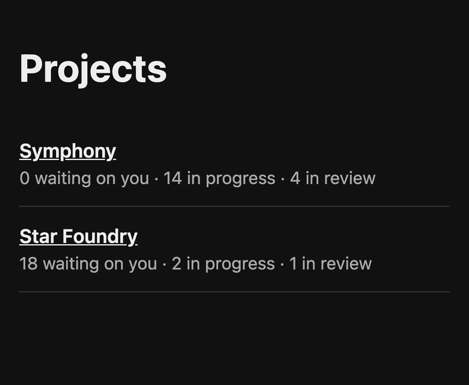
  [2026-11-11 19:42] agent — Proposed, on a phone and wide:  
  [2026-11-11 19:42] agent — Red keeps today's words for failing callbacks or sweep. Amber is a board slow over the last hour (writes over a second at p90, or any request unanswered) or no live orchestrator while work waits to start (`orchestrator stale`, or `no orchestrator` when none is there: a stale session is still there, one rule for the card line, the board's banner and this page); the build sets the thresholds. The blocked counts come from the same line as board-at-a-glance. The fresh reviewer's finding that "18 waiting on you" and "9 on you" read as two answers to one question is fixed by naming the 18 as decision cards. Filed in design, waiting on this card: app/projects-health.
  [2026-11-11 21:53] owner · approved
  [2026-11-11 22:02] agent · resolved
- [r] **board-at-a-glance** — A task board should say what is stuck, on whom and for how long. The consuming project's board says none of it: 41 tasks are blocked, a median of 10 days, and no card says why; 110 of the 117 role chips on them name sessions that have left. Under every option, each card ends in one line: who it waits on, why in a few words, and how long it has been in its stage (red from a week). Roles that left and document chips leave the card, review rounds become one mark, and a banner says once when no orchestrator is live. Where does the waiting work go? A: a Blocked lane above today's columns, grouped by what lifts each block. B: no Blocked column; a blocked task stays first in the column it stopped in, every stage fits a wide screen, and a phone shows one stage at a time. C: no columns; one list grouped by who has to act next, oldest first, under a bar of the stages' counts. Recommended: C. Approve and say A, B or C in the note, or comment. [[analysis/board-design#The options]]
  [2026-11-11 19:42] agent — Base: the board today, wide, from the shared server at 19:10. 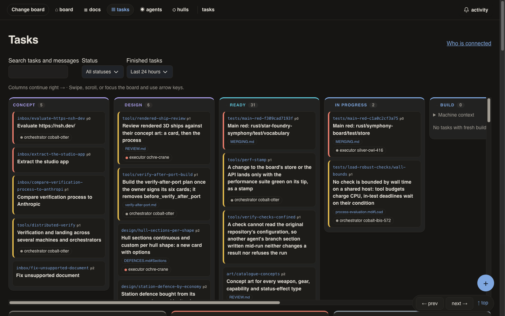
  [2026-11-11 19:42] agent — Posted for the board task `tools/board-design-review`. The three options at 1440 wide:  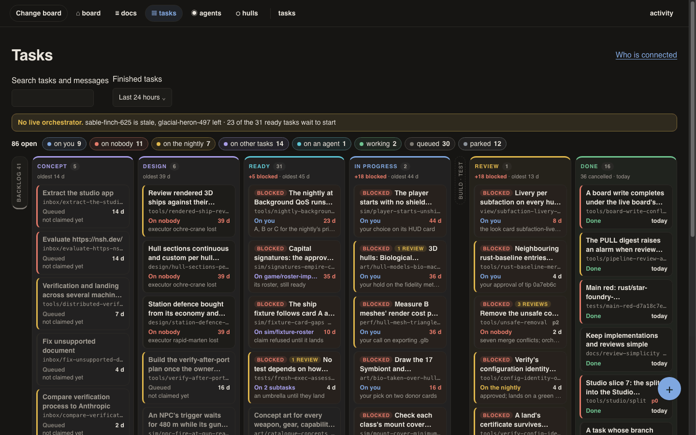 
  [2026-11-11 19:42] agent — The options are mock-ups on the board's own colours, filled with the consuming project's 86 open tasks as they stood at 19:10. Queued and parked work, which waits by design, is drawn quieter and never red. All four pictures carry today's header, filters and buttons: the header's rows and names are app/header-names' card, not this choice.

    **On a phone**, today first (its first card mid-screen, under the three-row header, the filters and the scroll hint), then A, B and C: 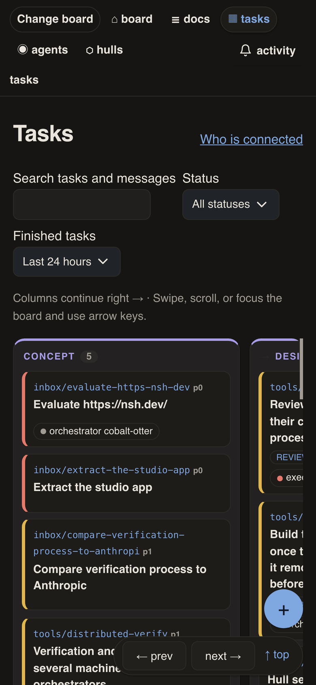 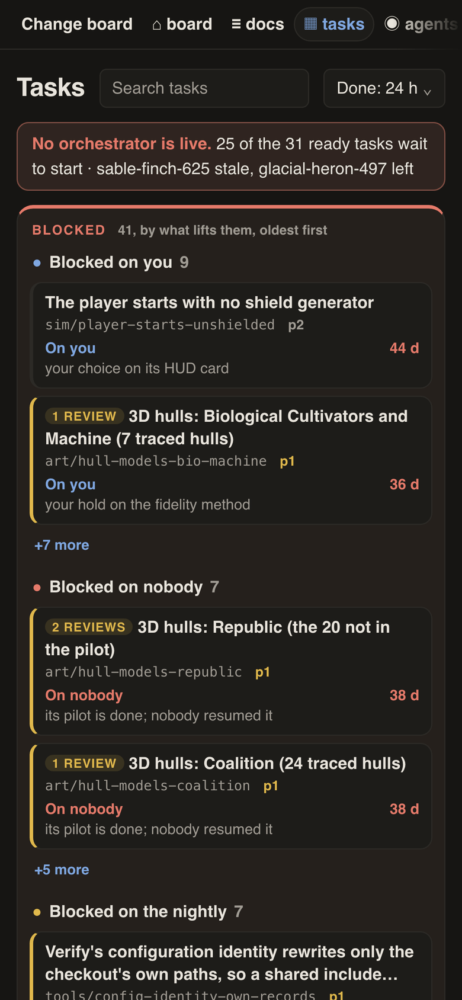 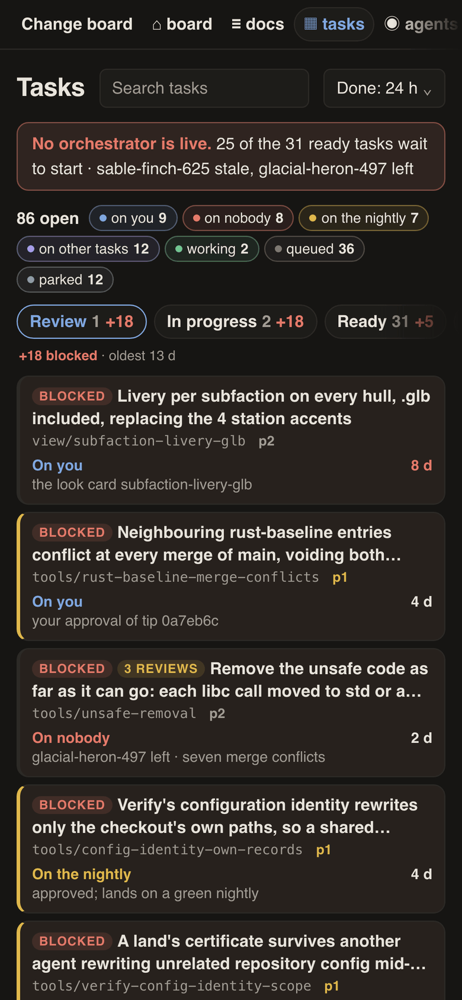 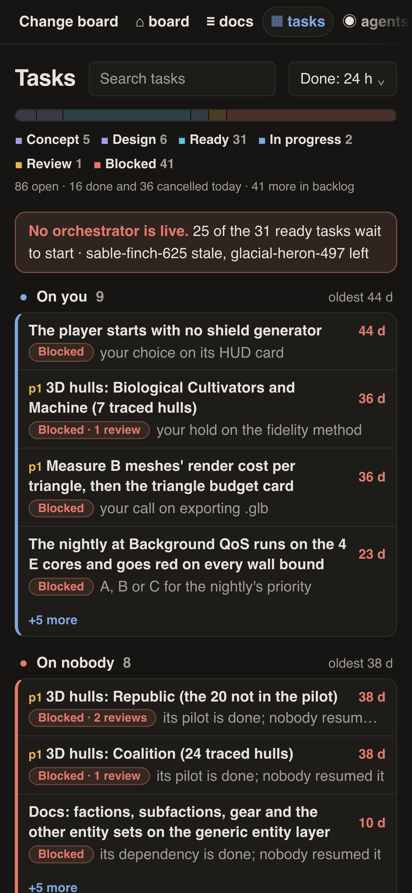

    **A, a Blocked lane.** Removes the Blocked column, role and document chips, and the scroll hint. Keeps columns that scroll sideways, so Review and Done stay off the first screen wide, the Status filter and the prev, next and top pager. Cost: the least.

    **B, stuck in place.** Removes the lower row, sideways scrolling, the Status filter, the prev, next and top pager, role and document chips, and the scroll hint. Keeps the pipeline as columns, and a column's head shows where work piles up (Review 1, +18 blocked). Cost: stage tabs on a phone.

    **C, who acts next.** Removes columns, sideways scrolling, the lower row, the Status filter, the prev, next and top pager, role and document chips, and the scroll hint. The pipeline becomes the bar on top, and each row names its stage. Cost: a new page layout.

    All three keep search and the finished window with their labels, Who is connected and the + button.

    **Why C.** C orders all 86 open tasks by who has to act, oldest first, with the age at the right, the same wide and on a phone and with no sideways scroll. A orders only the 41 blocked tasks, above columns that still scroll sideways. In B the by-who order is a strip filter you tap. B is the pick if columns matter more than who acts.

    **Fresh review.** A reviewer saw the three before this card went up. Its three blocking findings were fixed and checked again, and the task's reviewer also picked C. The first reviewer's verdict: "Its single list grouped by who acts next, with 'On you' first and ages on the right, answers what is stuck, on whom and for how long in one top-to-bottom read, and it looks the same wide and on the phone."

    Filed in design, waiting on this card: tools/task-waits-on (the line's data, for any option) and app/board-at-a-glance (the chosen option only).
  [2026-11-11 20:06] agent — Corrected after the task's review, before any answer. Two counts were wrong: 23 ready tasks wait only on an orchestrator, not 25 (two wait on a blocked subtask), and 6 blocked tasks wait on nobody, not 7 (one waits on its orchestrator, which is stale, so still there). The cards no longer repeat the missing orchestrator; the banner says it once. A now shows the Status filter it keeps. Every picture now has today's header and controls, and each option lists what it drops. C's phone rows keep the slug. The pictures above are the corrected ones.
  [2026-11-11 21:52] owner · approved — B. They shoild be blocked on a decision (not a person). There should not be a blocked on nothing, a card that is blocked on nothing is not blocked.
  [2026-11-11 21:55] agent — B it is: no Blocked column, a blocked task stays first in the column it stopped in. Your two rules go into the build: a block names what it waits on, a decision card, a task or a check, and where that is yours it reads `On your decision NAME`, never a person alone; and a task whose block names nothing is not drawn or counted as blocked, it goes back to the stage it stopped in and the board lists it once for its orchestrator to give a reason or release. Carried on the board tasks `app/board-at-a-glance` and `tools/task-waits-on`.
  [2026-11-11 22:02] agent · resolved

### The header

- [r] **header-appearance** — Appearance moves out of the chat sheet into the header: a round ◑ button, left of Activity, opens a small panel with the same two actions as today, import a shadcn theme or go back to the default theme, for this project on this device. The chat sheet then holds the chat and the new task alone. Approve, or comment. [[analysis/header-names#Appearance]]
  [2026-11-11 20:30] agent — Posted for the board task `app/header-names`. The wide pictures are the right half of a 1440-wide page. Today, Appearance tops the chat sheet; here its menu is open (it shows through to the tabs under it, which `app/ui-polish-1` repairs): 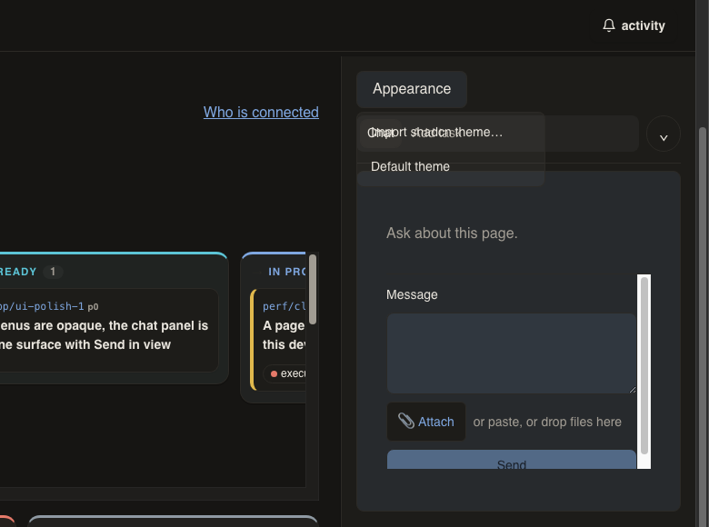 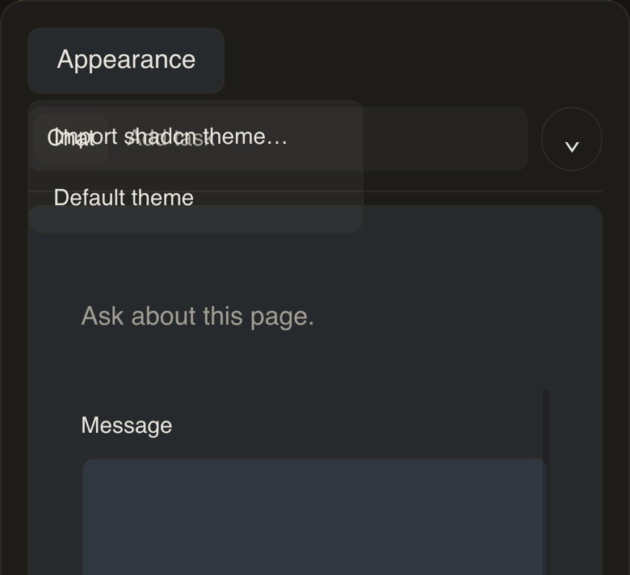

    Proposed, the header's ◑ button and its panel. On a phone the open panel covers the row of pages until it is closed: 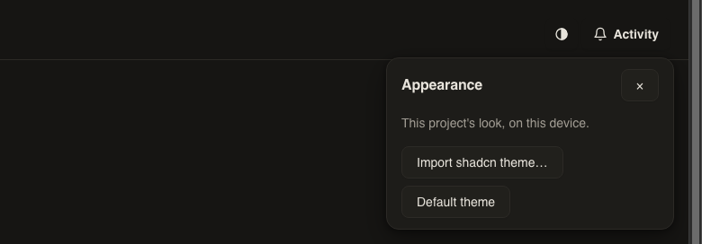 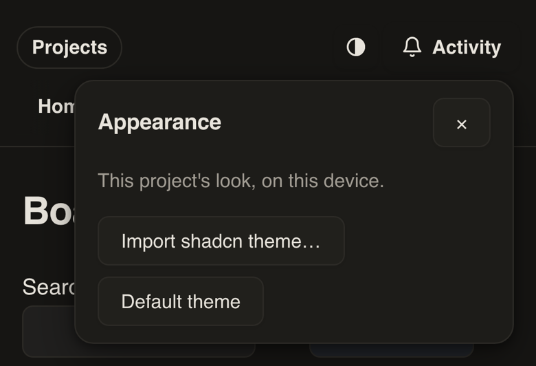

    Proposed, the chat sheet without it: 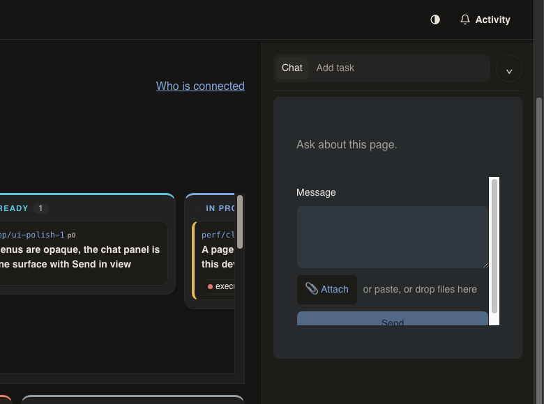 
  [2026-11-11 22:00] owner · approved
  [2026-11-12 06:45] agent · resolved
- [r] **header-on-a-phone** — On a phone the header is two rows and never more: Projects, the ◑ Appearance button (third card) and Activity on the first, the five pages spread across the second, all in view at 390 wide. The grey path row (docs / TASKS.md) is dropped on a phone, since the page shows docs/TASKS.md just under the header. Today the header wraps into three rows. Approve, or comment. [[analysis/header-names#On a phone]]
  [2026-11-11 20:30] agent — Posted for the board task `app/header-names`. A document on a phone, today then proposed: 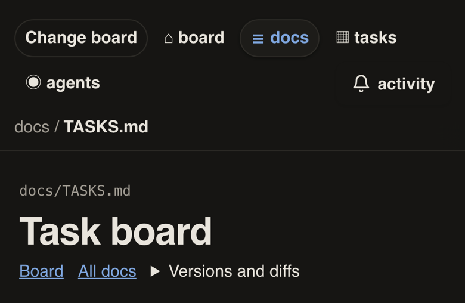 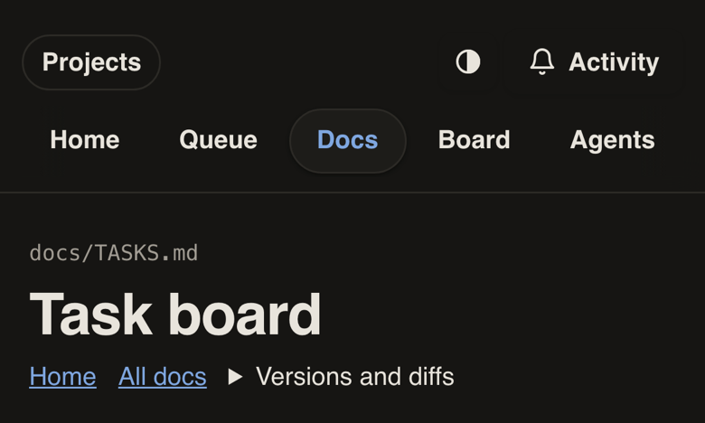

    At 1440 wide nothing moves: one row, the path kept; only the names differ (first card). The left half, today then proposed:  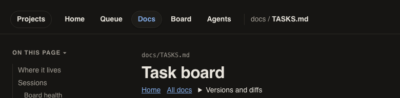

    Not pictured: six pages, as many as the consuming project has, still fit at 390 wide; a project with more scrolls the second row sideways, shaded at the edge it continues past. The server's own pages (the Projects list, a missing page) draw the same two rows, where today they scroll sideways with "agents" cut off.
  [2026-11-11 21:59] owner · approved
  [2026-11-12 06:45] agent · resolved
- [r] **header-page-names** — The header names each page once, in words alone (the ⌂ ☰ ▦ ◉ icons go), and every link to a page uses the same word: Projects (the list of every project on this computer, today "Change board"), then Home (today "⌂ board": the word Board moves to the task columns), Queue (new: the queue has no link today), Docs, Board (the task columns, today "▦ tasks") and Agents. The grey word after the links that only repeated the lit page ("tasks" in the first picture) goes; a document keeps its path there. Approve, or comment with the names or order to change. [[analysis/header-names#Names]]
  [2026-11-11 20:30] agent — Posted for the board task `app/header-names`. The pictures are this repository's board, dark, today then proposed; the proposed phone picture also shows the ◑ Appearance button (third card) and the two rows (second card).

    At 1440 wide (the left half, where the names are), today then proposed: 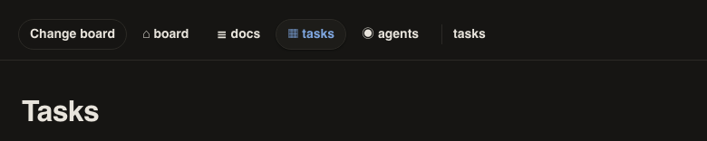 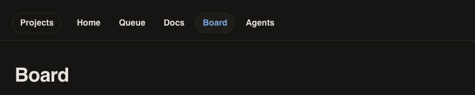

    On a phone, today then proposed:  

    The same words follow wherever pages link to each other: the board's heading says Board (above), and a document's "Board" link says Home (second card's pictures). Not pictured: the queue's "← board" says Home, and a missing page offers Home, Docs and Projects. A project's own page keeps its plugin's label: the consuming project's lower-case one until its plugin capitalises it.
  [2026-11-11 21:59] owner · approved
  [2026-11-12 06:45] agent · resolved

### Build folders

- [r] **worktree-build-folders** — Agents' worktrees now share compiled dependencies on disk. Each keeps a build folder of its own that starts as a copy-on-write clone of the main checkout's, taking disk only as a build changes it, and the board's sweep clears a worktree's build folder once its task is done and its work merged. Is that the way? A: as built. B: one build folder every worktree shares. C: a compiler cache (sccache) in place of the clone. Recommended: A. Approve and say A, B or C in the note, or comment. [[analysis/worktree-build-folders#The choice]]
  [2026-11-11 17:19] agent — Posted for the board task `tools/one-build-folder-for-worktrees`. Built as A, so you can switch.

    **A, as built.** Two first builds of the board's tests at once took 2.7 minutes instead of 8.3, both correct. A worktree holds about 1.3 GB instead of 2.4 GB. Cost: `du` overstates it, counting each clone in full, and a worktree's first build waits up to two minutes while the main checkout is building.

    **B, one shared folder.** The least disk, but wrong builds: Cargo gives the same package in two worktrees the same output files, and one worktree ran the other's freshly compiled code as its own (measured). Builds also wait on each other, one at a time.

    **C, sccache.** Saves compile time, not disk: every worktree still holds its full build, and the cache holds one more copy. It is not installed here.

    **Why A.** Correct builds, a first build three times faster, about half the disk per worktree, and the sweep returns the rest when the work lands. The board also warns, in `just tasks status` and on every page, when free disk drops under 20 GB (`SYMPHONY_LOW_DISK_GB`). Measurements and method: [[analysis/worktree-build-folders#Measurements]]
  [2026-11-11 17:42] owner · question — can we combine A with C? I would like to save on both disk space and compile time.
  [2026-11-11 17:59] agent — We can, but measured it saves nothing. I ran sccache 0.10.0 from a scratch folder, installing nothing. The board's tests were built from an empty build folder, so every dependency compiled. The first build filled the cache in 178 s. Then, at the same time, another worktree with that warm cache took 188 s, and the same build without sccache took 233 s. **None of the 187 crates came from the cache**, and none did again in the first worktree with a new build folder.

    **Why.** sccache reuses a compile only when its absolute paths match, and every compile names its build folder. Under A each worktree has its own folder, which correct builds need: B's shared folder ran one worktree's code as another's. The workspace's own crates never cache either, since they compile incrementally, and nor do proc-macros and build scripts.

    **What C would add on top of A:** hits only for a folder rebuilt at its own path after it was cleared, and there the seed already starts it from main's build. **What it costs:** a cache holding one more copy (190 MiB per build folder here, with a size cap), a pinned download in the toolchain setup, a server process, and chaining under the client bundle's own `RUSTC_WRAPPER`. The build recorder wraps Cargo, not rustc, so it does not clash.

    **Compile time is what A already saves:** a seeded worktree compiled 2 crates instead of 187. What remains is a dependency main has not built yet, after a `Cargo.lock` change. A small follow-up could build main after each landing that changes the lock, so new worktrees clone current dependencies.

    **Recommended: A alone, without C.** Approve and say A, and whether you want that follow-up filed. [[analysis/worktree-build-folders#The seed with sccache]]
  [2026-11-11 18:27] owner · approved — A
  [2026-11-11 19:40] agent — Recorded: A. Worktrees keep a build folder of their own, cloned from the main checkout's; no shared folder and no sccache. The branch `tools/one-build-folder-for-worktrees` is in review with it built this way.
  [2026-11-11 19:40] agent · resolved

### Client cache

- [r] **client-cache** — A page draws at once from what this device last held, marked as possibly out of date, while it asks the server whether anything changed; an unchanged read answers with no body. Measured today, a return visit to a task page draws its brief after 192 ms on this Mac and 2.9 s at phone speed, waiting on data the device already had; with the cache, about 85 ms and 1.8 s. Five choices, each with its default: 1. Where: IndexedDB, keys by project. 2. Freshness: a checksum per read, answered `304` with no body when unchanged; the live feed as today. 3. Kept: the board, the queue, the 30 tasks and 20 documents opened last, each with what its page drew; 8 MB a project (tasks 2, documents 6), 32 MB in all, 14 days, least recently used out first; never searches, older messages or the landing offer. 4. Versions: a format number in the wire crate clears the cache when it changes; a server update needs nothing. 5. Stale: a notice, and the verdict, answer and task buttons wait until the server answers. Approve to take all five defaults, or comment with the ones to change. [[analysis/client-cache#The design]]
  [2026-11-11 18:30] agent — Posted for the board task `perf/client-cache/design`.

    **Today.** Every data read is answered `no-store`, so a return visit downloads its data again and draws nothing until it arrives. Measured on a private server with a copy of this board, five runs each, warm: home 107 ms, `/tasks` 401 ms, a task 192 ms, this register 194 ms, the consuming project's register 296 ms; at phone speed (Fast 3G) 2.3 to 3.8 s. The page's code starts asking for data at 50 to 75 ms, and at 1.8 s on the phone.

    **1.** IndexedDB works on the tailnet's plain `http://`, reads off the page's thread and has room. localStorage holds about 5 MB for the whole origin, shared with drafts; a service worker needs a secure page, which the tailnet is not.

    **2.** A checksum survives a server restart. The feed's version moves with every agent's health, and the feed keeps only its last 128 events, a few minutes on a busy board.

    **3.** Thirty tasks take about 1.3 MB; separate caps keep a week of tasks from pushing out the documents.

    **4.** Clearing on every client build would cost a slow visit per page after each update; main's client changed 7 times today.

    **5.** Nothing that acts is given on content the server has not confirmed. The landing offer is always read fresh.

    **Gain.** Every page draws in about 60 to 85 ms here and 1.8 s on the phone, about 0.6 s once `perf/asset-caching` lands too. An unchanged visit's data drops from 13.5 to 6.4 KB on `/tasks` and from 26.7 to 9.9 KB on the large register. A first visit is unchanged but for the store's code, about 1 to 2 KB. [[analysis/client-cache#Expected gain]]
  [2026-11-11 18:48] owner · approved
  [2026-11-11 19:00] agent — Recorded: the design as recommended, built by the board task `perf/client-cache/build`. The owner added two things in the terminal (2026-11-11), now in that task's brief. Documents are kept by how often they are visited, not only how recently: a project's entrypoint pages stay, a page opened once goes first. And pages are fetched ahead: the tasks and documents a drawn page links to are read into the cache while the device is idle, within the same caps, never on a metered or slow connection, and never for a link that acts.
  [2026-11-11 19:00] agent · resolved

### Desktop client

- [r] **desktop-client** — A Symphony app for the Mac that sits in the menu bar and the dock, connects to several servers (this Mac's, another machine's over the tailnet, later a hosted one), counts what waits on you across all of them and notifies you with no tab open. How is it built? A: a thin native shell whose windows show each server's own pages, always at that server's release. B: the Dioxus client compiled into the app, talking to every server's API. C: A now, B later. Recommended: A. Approve and say A, B or C in the note, or comment. [[analysis/desktop-client#How it is built]]
  [2026-11-11 14:07] agent — Posted for the board task `product/desktop-client`.

    **What the tab cannot do.** Notify you with no Symphony tab open (today only a project's home page does, while its tab is hidden). Show one count of what waits on you, across every server and project, in the dock and menu bar. Keep following with its window closed. Find this Mac's server by itself, and keep the others by name. The first release does these four; a global shortcut comes next. Focusing an agent's pane and opening a file in the editor are done by the server on its own machine (`tools/go-to-agent-session`), so the browser gets them too.

    **A, a thin shell.** Each server's window loads that server's own pages, so the app and a server never disagree, and a Symphony release reaches the app with no app update. The shell adds notifications, the badge, the menu bar and links out to the browser. Cost: one new crate, and one new read on the server listing its projects with their counts, which another machine cannot get today. No client change, nothing added to the 250 KB budget, and the wire stays free to change. Offline: says the server does not answer and keeps its last count.

    **B, the client compiled in.** Cost: 31 of the client's files call the browser directly and need a native version; plugin viewers need cross-origin access the server does not give. The wire becomes a contract between releases, while it changed 20 times last week, several not additively: a Symphony release would need an app release. Gain: it reads each project's last board offline and runs no code a server sends; it looks and performs as A does.

    **C.** A's cost now, B's later, on a wire that would by then have to stand still.

    **Why A.** Everything in the first release for the least new code, with the client and wire still free to change every release. The app's own screens can still be Dioxus.

    **Trust.** On a tailnet nothing new is needed: the server already admits the tailnet's machines, as it does your phone. A hosted server needs HTTPS and a login, a card of its own later. The app never runs a command, opens a local file or app, or leaves the server's site in its window on a server's word.

    **Delivery.** macOS first, built from a release tag and installed with one recipe; a build made on the Mac that runs it needs no notarisation. Signing ($99 a year) waits until it runs on another machine. Linux, Windows and a phone app are not in this card.

    The first slice, and how it is tested without a display: [[analysis/desktop-client#The first slice]]. Five smaller questions are at [[analysis/desktop-client#Open questions]]; answer any of them in the note.
  [2026-11-11 14:33] agent — Corrections to the entry above, after a review of its clarity.

    **B** still runs a server's scripts in plugin viewers and card mockups unless it drops them; only its own client code never comes from a server.

    **The projects list** answers the tailnet today, but only as an HTML page; A's new read gives it as data.

    **Pane focus** is planned (`tools/go-to-agent-session`, not built yet), and opening a file in the editor is proposed here the same way; neither is done by the server today.

    **The first release notifies** when a project's waiting count rises: a new card, an agent's question on a card, or an answer to your note. Questions agents ask you on tasks and reviewers' verdicts are counted nowhere yet; open question 1 asks whether you want them. [[analysis/desktop-client#What notifies]]

    **The wire** changed in 15 commits last week (not 20: that counted merges). With A it stays free to change but for the few fields the app reads, which a test pins.
  [2026-11-11 15:26] owner · question — 1. Should the badge and notifications also cover questions agents ask you on tasks (--to owner), or reviewers' verdicts on tasks?
    Yes. We should also have different users in the future, so that asks / notifications could be targetted to specific people.
    2. When two servers serve the same project's board
    For now I think the model should be indeed two separate boards. Albeit we will soon move to a "central board" with "multiple machines connected"
    3. Yeah, why not dioxus.
    4. once it does.
    5. can be skipped for now.
    But considering there will be an iOS app desired to exist too, how would this shape or change the decided upon solution here?
  [2026-11-11 15:44] agent — Your five answers, each with what it changes, then the iPhone app. Answered for the board task `product/desktop-client`; the analysis records the answers under [[analysis/desktop-client#Open questions]].

    **1. Questions on tasks and reviewers' verdicts: yes.** The badge also counts each question an agent asks you on a task (`--to owner`) until you answer it, and the app notifies it. A reviewer's verdict is notified too. It asks nothing of you, so it does not stay in the badge unless you say it should. Both need counts on the wire beside the cards, which the server's new projects read carries. Targeting people: the board knows one person today, `owner`, so the new counts are kept per recipient, and adding people later adds names, not new counts. People themselves need a login, which comes with the hosted server's card.

    **2. Two servers, one project: two boards for now.** The app lists and counts each server's own board, as the analysis assumed. Once the central board exists, a project reached through two servers must be counted once, by the board rather than the server; that waits for the central board. Runs already go this way: each machine sends them to the server hosting the board (`reports-ci-runs`, approved 15:21).

    **3. "Yeah, why not dioxus": the app's own screens are Dioxus.** The question was narrow: under A, are the few screens the app draws itself (the server list, adding a server, "this server does not answer") Dioxus or plain pages? Your answer settles that: Dioxus, beside the server's page in the same window, if the first slice shows Dioxus can host it. It does not choose A, B or C. Under A the app is a Dioxus app whose windows show each server's own pages; under B the whole Dioxus client is compiled into the app. If you meant the whole client should be Dioxus inside the app, that is B. Asked plainly below.

    **4. Apple developer account: once it runs on a second machine.** No change for the Mac app. An iPhone app brings it forward (below).

    **5. Global shortcut: skipped.** It leaves the second release too, until you ask for it.

    **An iPhone app.** Read in code: Dioxus 0.7.10 builds for iOS, and its mobile target is its desktop one (the same window and web view crates), so A's shell and B's client both carry to the phone. The rest is inferred, not tried:

    - **Notices on a phone come from the server.** iOS suspends an app soon after it leaves the screen, so the follower that keeps counting with every window closed cannot run there. A notice is a push the server sends through Apple's push service, which needs the paid developer account ($99 a year). So the rule for when to notify, and what a notice says, belongs in shared code the server can run too, not only in the Mac app. This holds under A and B alike.
    - **The account.** An iPhone app installed without the paid account stops opening after 7 days. Anything longer, TestFlight and push all need it, so the account comes when the phone app starts.
    - **A fits the phone better.** Under A the iPhone app is the same shell, showing the server's pages, so a Symphony release reaches the phone with no new phone build. Under B a Symphony release that changes the wire needs a new phone build, installed through TestFlight.
    - **A cheaper first step.** The board added to the phone's home screen can get notices without any app (web push, iOS 16.4 and later), but only over HTTPS. The tailnet can give its names HTTPS (`tailscale serve`); the server's save check accepts only `http://` pages today.

    So the phone strengthens A, and adds a push from the server whichever way the app is built. The phone app stays a card of its own, after the Mac app.
  [2026-11-11 15:44] agent · question — How is the app built? A: a thin shell whose windows show each server's own pages, with its own screens in Dioxus. B: the whole Dioxus client compiled into the app. C: A now, B later. Recommended: A, and the iPhone app keeps it so. Approve and say A, B or C in the note.
  [2026-11-11 16:24] owner · approved — A
  [2026-11-11 16:32] agent — Recorded: A. The app is a thin shell whose windows show each server's own pages, with its own few screens in Dioxus. The analysis now states A as decided and follows your five answers throughout. Filed on this board, ready, as the analysis's two first-release slices:

    - `tools/server-projects-list`: each server lists its projects as data. It gives counts, the first waiting card, the questions agents ask you on tasks until you answer them, and the newest reviewer verdict, kept per person (today only you). It lands first, since the app reads it.
    - `tools/desktop-app`: the Mac app. It finds this Mac's server and adds others by URL, shows a sidebar of servers and projects, and puts the count in the dock and menu bar. It notifies for cards, task questions and verdicts, opens outside links in the browser, and installs with one recipe. Two servers serving one project count as two boards. There is no developer account and no global shortcut.

    Not filed, each waiting on what it needs: the iPhone app and its push from the server, a hosted server's HTTPS and login, signing and a self-updating app (once it runs on a second machine), notices aimed at named people (once Symphony has users), and counting one project once across servers (with the central board).
  [2026-11-11 16:33] agent · resolved

### Reports, small choices

- [r] **reports-small-choices** — Six smaller choices for the Runs and Reports pages, each with the default the filed tasks follow until you answer. 1. Slowest tests: stable cargo prints no time per test, so show the slowest suites only, without adopting cargo-nextest. 2. Agents' cost: tokens only, no money, since a subscription is not paid per token. 3. Symphony's landings: Symphony has no land command, so count each merge commit on its main as a landing run. 4. Queue wait where no pool queues work: show none, and leave out the time Cargo waits on its build lock. 5. A project's own gate with the same name as Symphony's review gate replaces it on the task page only, not in the board's sign-off lane or the PULL digest. 6. A project's own section under Symphony's figures (the consuming project's certificate costs, picture builds, test classes), drawn through a plugin seam and a chart block: not filed until a project asks for it. Approve to keep all six defaults, or comment with the numbers to change. [[analysis/reports-and-monitoring#Open questions]]
  [2026-11-11 15:45] agent — Posted for the board task `product/reports-and-monitoring`, after `reports-ci-runs` was approved. Choices 1 to 5 are the analysis's open questions 2, 3, 5, 6 and 7, which no verdict has answered. Choice 6 is the report-section seam the analysis proposed, which no card asked. The tasks that meet them: 1 `tools/run-suites`; 2 `tools/agent-activity-history`; 3 `tools/runs-rollup`; 4 `tools/run-record`; 5 `tools/task-gates-seam`; 6 none yet.
  [2026-11-11 16:22] owner · approved — 1. can absolutely adopt cargo nextest.
    2. nope. tokens are hard to measure, since cache vs non cache hits counts differently. This should be counted "as if we were paying API costs" for it. Best assumption/guess on pricing actual cost
    3. add a land command, should be offered by default on init. Remember -> convention over configuration approach
    4. okay
    5. yes indeed. lower level replaces higher level. Should replace it everywhere for itself.
    6 approved.
  [2026-11-11 16:31] agent — Recorded, each with what it changes. New tasks are on this board, ready.

    **1. cargo-nextest: adopted.** `tools/nextest` runs this workspace's tests through nextest at a pinned version, installed by one setup step so a test run never downloads. Doc-tests, which nextest does not run, still run through cargo. Test binaries that share one fixture across their tests, such as the perf suite's one board, keep it. `tools/run-suites` now waits on it and reads each test's time; `tools/runs-rollup` gives the slowest and flakiest tests, not only suites.

    **2. Cost in money, as if paying API prices.** `tools/agent-cost-estimate` prices input, output, cache writes and cache reads apart, per model, from a dated price table in the repository taken from the providers' published prices. Every figure is labelled an estimate. A model missing from the table takes the newest price of its family, marked as a guess; one with no family is shown unpriced and named, never counted as free.

    **3. A land command.** `tools/land-command`: `just land SLUG` checks the reviewer's approval on the tip and the project's check on the merge, merges, closes the task, sweeps its worktree, and later records the landing as a run. `symphony init` installs it in every project, and a project's own `land` replaces it. It replaces the merges by hand, so the Runs page counts landings from it, not from merge commits.

    **4. No queue wait where nothing queues.** Recorded; `tools/run-record` already does this.

    **5. A project's gate replaces Symphony's everywhere.** `tools/project-gates-everywhere` carries it past the task page to the sign-off lane, the digest orchestrators get, and the move to blocked. The analysis now states the rule in general: the more specific level's answer replaces the general one's.

    **6. The project report section and the chart block wait until a project asks.** Recorded; nothing filed.
  [2026-11-11 16:33] agent · resolved

### Reports and monitoring

- [r] **reports-ci-runs** — Each project gets a Runs page, as a CI product shows it: what runs and waits now, then every verify, lint, test, client build, review callback, landing and later nightly, with its commit, branch, task, who started it, result, duration and queue wait. A run opens on its steps, their times and logs; trends show pass rate and duration per pipeline and suite, the slowest suites, the flakiest tests, and machine minutes per task, day and project. Where are runs kept? A: day files in the git common dir, read by a core page. B: tables on the board. C: the same files, shown by plugin components on a document. Recommended: A. Approve and say A, B or C in the note, or comment. [[analysis/reports-and-monitoring#Runs]]
  [2026-11-11 13:31] agent — Posted for the board task `product/reports-and-monitoring`, the first of three reports cards; each can be approved alone.

    **Why.** No run is kept anywhere Symphony reads, and Symphony's own builds and tests are never recorded. The consuming project's verify keeps a line per run for itself, and it shows what is missing: 510 runs since 2026-11-08, a full verify's median 24 min and p90 2.7 h, 139 wall-hours on 2026-11-09 alone, 28 red and 52 timed out.

    **A, day files.** The recorder `tools/build-test-recorded-generic` adds appends one line per run and per step in the git common dir, with its log beside it and the test results read from cargo's output. The page reads the newest files; trends are rolled up hourly. Cost: a page kind, an API, a roll-up. Nothing writes to the board. Runs kept 90 days, logs 14.

    **B, the board.** Cost: a schema change, which makes every older server refuse writes, and writes on the board's write path for every run and step, hundreds of runs a day at the consuming project's rate.

    **C, plugin components.** Cost: rendered again on every read, nothing updates while a run goes, and charts carry no values on a tap.

    **Why A.** Every project gets it, Symphony included, with no load on the board, in the shape the consuming project's verify lines already have.

    **The record needs more than the recorder plans** (task, handle, phase, label, start, end, exit, machine): the run and its steps, the pipeline, commit, tree and branch, who started it, queued and started times, CPU time, the log, and results per test suite. Stable cargo prints no time per test (tried). [[analysis/reports-and-monitoring#The run record]]

    Seven smaller questions, for all three cards, are at [[analysis/reports-and-monitoring#Open questions]]; answer any of them in a note.
  [2026-11-11 13:45] owner · question — How would A work when we move to separate machines using a single board?
  [2026-11-11 14:12] agent — **As written, A shows only one machine's runs.** Run files live in the git common dir of the clone where the run happened. A clone on another machine has its own common dir, and today its own board as well.

    **How A works on several machines.** Each machine's recorder writes its own day file first, and that file is its outbox. It sends each run's start and end lines over HTTP to the Symphony server that hosts the board. That server appends them to its own run files under the sending machine's id, and answers with the run ids it stored. A line not yet acknowledged is sent again at the next run's start and end, and a line sent twice is stored once.

    - **Who may send.** The server already admits only its own machine and confirmed tailnet peers, and it checks the Host. The machine id is a label, not a password, so the server records which tailnet machine sent each line. It refuses one machine id arriving from a second tailnet machine.
    - **Server unreachable.** Runs wait in the outbox and arrive late, marked late. The page shows each machine's last contact.
    - **Clocks.** Each machine times its own runs with a clock that only counts forward, so durations are right even when its time of day is wrong. Order and age use the time the server received a line. Each send measures the machine's clock offset, and the page shows it when it is over 30 s.
    - **Logs** stay on their machine. A red run's first and last lines travel with its end line. A green run's log opens on demand when its machine serves; otherwise the page says which machine has it.
    - **Running now.** Sending only finished runs would hide what runs elsewhere, so the start line is sent too.

    **B on several machines** needs the board itself reachable from every machine. It is a database without a login, listening on this machine alone, so it would need a login it does not have. An offline machine would still need an outbox and its log files. **So A, with the send, stays the recommendation.** [[analysis/reports-and-monitoring#Several machines, one board]]
  [2026-11-11 15:21] owner · approved — A
  [2026-11-11 15:43] agent — Recorded: A, with the send from the entry above, so runs on several machines show on one page. Filed on this board, ready, in the order they land:

    - `tools/run-record`: the recorder writes one line per run and per named step to day files in the git common dir, kept 90 days. It builds on `tools/build-test-recorded-generic` once that lands, and does not change it. The review callback runs through it, so its exit is kept.
    - `tools/run-logs`: each run's log beside the day files, kept 14 days (a red run's 30, at most 2 GB a project). The terminal shows what it showed before.
    - `tools/run-suites`: each test binary's counts and time, and the failed tests with their first line, read from cargo's plain output.
    - `tools/run-send`: the send to the server hosting the board. The local file is the outbox, the server acknowledges by run id, and a machine id is bound to the first tailnet machine it came from.
    - `tools/runs-rollup`: pass rate and duration per pipeline and suite, the slowest suites, flaky tests, queue wait and machine minutes, rolled up in the hourly job `tools/reports-rollup` builds.
    - `tools/runs-page`: the Runs page and its API, on a phone and wide, with the machine view.

    **Six smaller choices** these tasks meet are on a short card of their own, `reports-small-choices`, each with the default the tasks follow until you answer.
  [2026-11-11 15:45] agent · resolved
- [r] **reports-pipeline-defects** — A Reports page per project, after Runs: how work flows (tasks in each status per day, lead time and its trend, where task-hours go, bounces, what sits longest); where defects are caught (review, red verify, main red, nightly red, revert), how long each took to fix, how many escape past landing and which checks catch what; then agents (sessions, tokens) and board health per hour over days. How are the figures computed? A: the server rolls them up every hour into files. B: from the board on each view. C: a nightly report document. Recommended: A. Approve and say A, B or C in the note, or comment. [[analysis/reports-and-monitoring#Pipeline and defects]]
  [2026-11-11 13:31] agent — Posted for the board task `product/reports-and-monitoring`, the third reports card.

    **What exists.** `tasks stats` prints the flow figures in a terminal. The consuming project's board holds about 1,220 top-level tasks since 2026-09-26: 405 went back from review at least once, 16 main reds and 54 nightly reds were filed, and its main took 1,218 merges in 14 days with no revert. Board health is kept for one hour, in memory.

    **A, hourly.** Each hour the server reads each project's window once (0.3 to 2.5 s on the consuming project's board) and writes the day's figures to a file; health gets a line an hour from memory. Cost: a figure up to an hour old; one board read an hour per project; nothing written to the board.

    **B, per view.** Cost: that read on every open, slower as the board grows, and no history of what the board does not keep.

    **C, a nightly document.** Cost: nothing live, and a commit a day.

    **Why A.** The page opens at once on a phone and the board's write path is untouched.

    **New recording these need:** health per hour; agents' activity and stale or lost counts; tokens (`tools/board-token-usage`, approved, not built); and, from the project's landing and nightly, which landing a red came from, for the escape rate. **A cost in money is not knowable today**: transcripts carry tokens and the model, never a price. [[analysis/reports-and-monitoring#Defects]]
  [2026-11-11 13:48] owner · approved — A
  [2026-11-11 14:12] agent — Recorded as A. The shared server rolls the figures up every hour into day files in each project's git common dir. Nothing is computed when the page opens, and no report document is written. [[analysis/reports-and-monitoring#How the figures are computed]] now says so.

    Filed on the board, ready, each quoting your verdict:
    - tools/reports-rollup: the hourly roll-up into files.
    - tools/reports-page: the page. It comes after the roll-up and the next two, whose files it reads.
    - tools/board-health-history: board health, one line an hour, kept 90 days.
    - tools/agent-activity-history: sessions started, and stale and lost counts, by kind and model.
    - tools/red-landing-origin: a red names the commits it came between, so escapes trace to the landings in that range.

    The consuming project's landing and nightly would need to pass those commits; that change is that project's, for its own board.
  [2026-11-11 14:14] agent · resolved

### Client size budget

- [r] **first-visit-budget-pings** — The `/tasks` page is capped at 250,000 bytes on a first visit, and a test enforces it. The page is 249,982 bytes, 18 under. The test also counts the live feed's keep-alive pings, 19 bytes every 5 seconds, so on a busy machine it reads 250,047 to 250,066 and fails though nothing changed. It is the last thing between main and a `just verify` that passes every time. What should the cap count? A: everything but the keep-alive pings, which are reported beside the total. B: as now, and trim the page until pings fit under it. C: raise the cap. Recommended: A. Approve and say A, B or C in the note, and say whether 18 bytes of room is enough or the page should be trimmed as well.
  [2026-11-11 16:20] agent — Posted for the board task `tests/first-visit-budget-counts-pings`.

    **A, leave the pings out.** Real feed content still counts. A quiet run measures the same as today, so the cap is no looser. Cost: a small change to the test, and the guide says what the cap counts.

    **B, trim the page.** Cost: the test stays tied to machine load until the page is about 400 bytes smaller, and every later ping-sized change brings the failure back.

    **C, raise the cap.** Cost: the phone's first visit gets heavier each time this is done.

    **Why A.** A ping is not page weight, and how many arrive depends on when the test server started, not on the page.

    **The room.** At 18 bytes almost any client change crosses the cap. The last change, one CSS selector, moved the total by 5.
  [2026-11-11 15:18] owner · approved — A and B. This is too close to the limit anyway. Check what can be done to improve upon it for a more reasonable/comfortable range.
  [2026-11-11 15:43] agent — Recorded: A and B, both in the board task `tests/first-visit-budget-counts-pings`, which fleet-osprey is working on now. The keep-alive pings leave the cap and are reported beside the total. The `/tasks` first visit is measured part by part (the compiled client, styles, scripts, the board data) and trimmed until it is at least 10 KB under the cap, instead of 18 bytes; the task reports what each cut saved and what further cuts would cost. The cap stays 250,000 bytes.
  [2026-11-11 15:45] agent · resolved
  [2026-11-11 18:10] agent — Done and superseded on the cap: pings are left out and the `/tasks` first visit is 239,313 bytes on main (task closed, approved). The owner then raised the cap to 300,000 bytes (2026-11-11, said to the other orchestrator; main 1d1eab1), so "the cap stays 250,000" above no longer holds.
<!-- register:end -->
