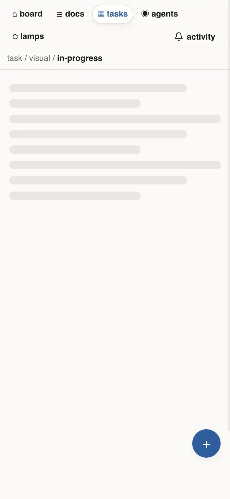
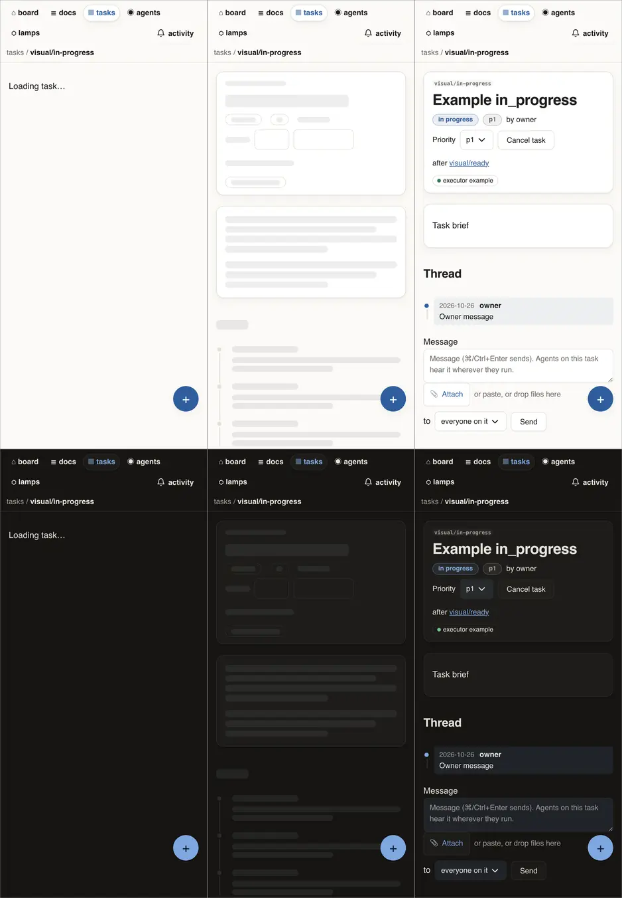
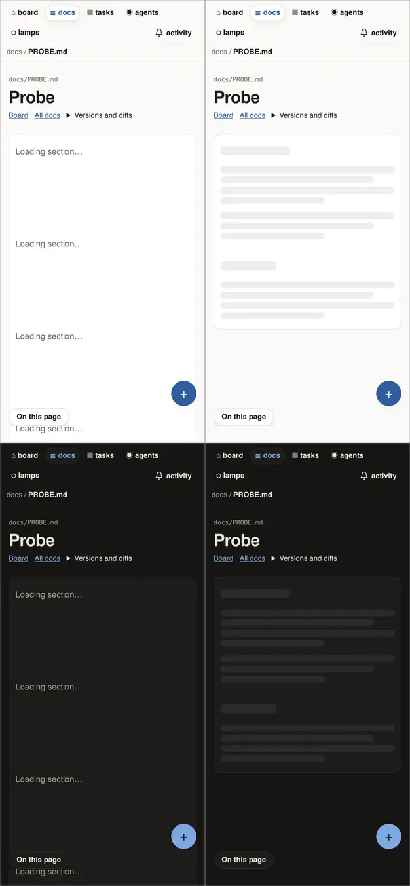
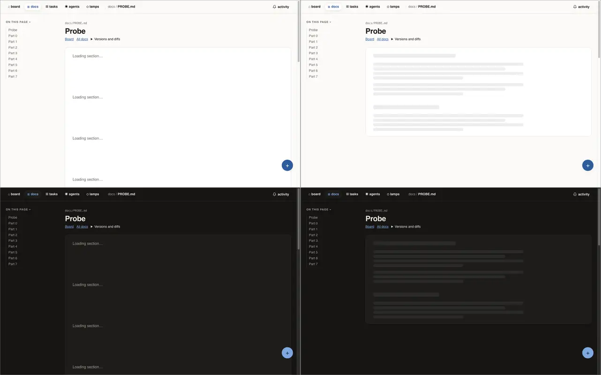
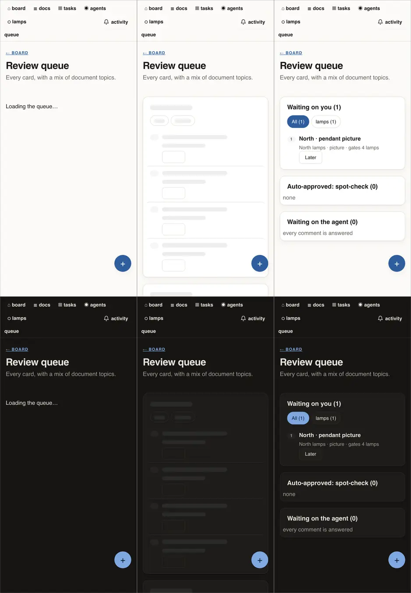
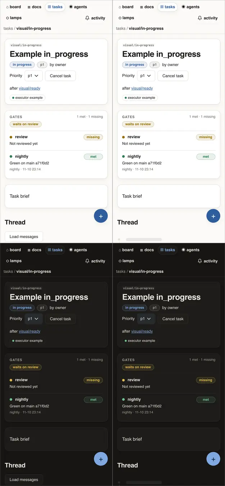
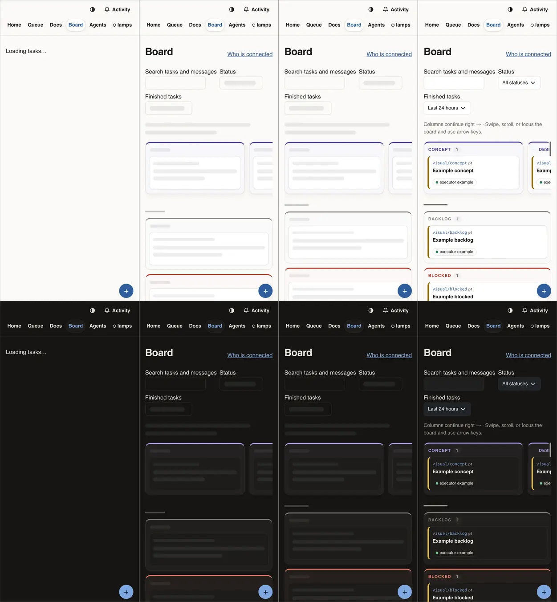
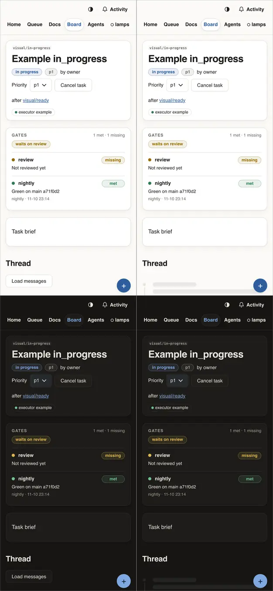
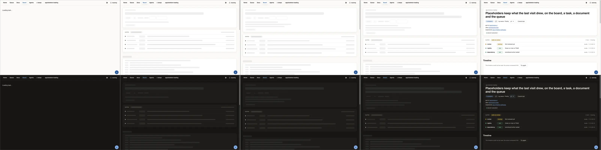

# Decision register

A decision is a card at the place in its document where the thing it decides is said
([where a card is written](REVIEW.md#where-a-card-is-written)). This page holds the cards no
document says the subject of, and links each document that holds cards. The queue lists every card
that waits, and `just symphony-status --json` names every card with its file and line. How cards,
verdicts and their dated history work is in [REVIEW](REVIEW.md).

## Documents that hold cards

A document's first card adds its line here.

- [Checks](CHECKS.md)
- [Setting up GitHub](GITHUB_SETUP.md)
- [Releases](RELEASES.md)
- [Concept review](REVIEW.md)
- [Task board](TASKS.md)
- [The agents page, orchestrator-first](analysis/agents-page.md)
- [Artifacts attached, not committed](analysis/attached-artifacts.md)
- [The board at a glance](analysis/board-design.md)
- [The board's cutover to PostgreSQL, and the way back](analysis/board-pg-cutover.md)
- [The board's store, measured before it moves](analysis/board-store-baseline.md)
- [Where decision cards live](analysis/cards-in-their-documents.md)
- [The client cache](analysis/client-cache.md)
- [Dioxus or JSX for the client](analysis/client-framework-comparison.md)
- [The built client out of git](analysis/client-off-git.md)
- [One runtime for the client's modules](analysis/client-shared-runtime.md)
- [Code and architecture review, November 2026](analysis/code-review-2026-11.md)
- [Components draw when their data arrives](analysis/components-draw-when-their-data-arrives.md)
- [Configurable delivery workflows](analysis/configurable-delivery-workflow.md)
- [Symphony behind a versioned contract](analysis/consumer-contract.md)
- [A desktop Symphony app](analysis/desktop-client.md)
- [Historical personal-path treatment](analysis/github-history-treatment.md)
- [Optional GitHub integration](analysis/github-integration.md)
- [Landing through GitHub pull requests](analysis/github-pr-landing.md)
- [GraphQL, its library and the server's framework](analysis/graphql-and-server-framework.md)
- [The header](analysis/header-names.md)
- [Hosted ingress and board readiness](analysis/hosted-ingress.md)
- [Managed PostgreSQL for a hosted board](analysis/hosted-postgresql.md)
- [Needed stamps](analysis/needed-stamps.md)
- [Symphony's own names](analysis/own-names.md)
- [Owner asks](analysis/owner-asks.md)
- [The header on a phone, in one row](analysis/phone-header.md)
- [Delivering Symphony without rebuilds](analysis/plugin-delivery.md)
- [Where the board's PostgreSQL comes from](analysis/postgresql-binary-source.md)
- [Product documentation review, November 2026](analysis/product-docs-review-2026-11.md)
- [A project's task workflow](analysis/project-workflow.md)
- [Relax against cargo](analysis/relax-build-trial.md)
- [A release candidate held still](analysis/release-candidate.md)
- [The release pipeline, redesigned](analysis/release-pipeline.md)
- [Durable project artifacts](analysis/remote-artifact-store.md)
- [Execution providers and durable attempts](analysis/remote-execution-attempts.md)
- [Reports and monitoring](analysis/reports-and-monitoring.md)
- [Artifact approvals at workflow transitions](analysis/revision-bound-transition-guards.md)
- [The read-only window after a schema move](analysis/schema-move-read-only-window.md)
- [A Settings page](analysis/settings-page.md)
- [Symphony's mark](analysis/symphony-mark.md)
- [Updating a project's Symphony](analysis/symphony-update.md)
- [A task's first visit](analysis/task-first-visit.md)
- [Navigating a task's timeline](analysis/timeline-navigation.md)
- [Orchestrators and messages on a task's timeline](analysis/timeline-orchestrator.md)
- [Worktree build folders](analysis/worktree-build-folders.md)

## Cards with no document of their own

<!-- register:start -->
## Rejected and replaced

### Page loading

- [-] **skeleton-loading-look** — While a page waits for its data, it shows pale bars where its text will be, with a soft light passing over them every 1.8 s (still bars for anyone who turns motion off). A task and a document show the bars until their first screen has arrived, 3 s at most, then appear whole; the task board shows its controls at once, with bars in each column until its tasks arrive. Nothing jumps any more as a page loads: the largest layout shift on any page, phone or wide, is now 0.011, down from 0.17 on a document and 0.14 in the chat (under 0.05 is good). Three smaller changes come with it: the chat's form stays at the foot of its panel, with New conversation just above it; a wide page keeps room for its scrollbar, so the header no longer jumps 15 px; and the bars' two colours are theme settings a project can change (`--skeleton`, `--skeleton-shine`). Is this the look? Approve, or comment with what to change.
  [2026-11-11 21:00] agent — Posted for the board task `app/skeleton-loading`. Pictures with motion off, so the bars are still.

    A task on a phone, before and after:  

    A document on a phone, before, after and dark, and on a wide screen:    

    The chat on a phone with its conversation in, before and after:  

    **Layout shift**, the worse of a first and a repeat visit, phone / wide, before → after: document 0.171 / 0.124 → 0.007 / 0; chat 0.143 / 0.030 → 0 / 0; task 0.107 / 0.075 → 0.011 / 0.008; register 0.050 / 0.079 → 0.007 / 0.006; task board 0.018 / 0.048 → 0.001 / 0; home and the activity panel 0 before and after. A browser test now fails any page at 0.05 or more.
  [2026-11-11 22:05] owner · rejected — It should have a closer outline to what it shadows. If it should have a "box" it should have a box with the "text shadows" on it.
  [2026-11-12 02:43] agent — Replaced by **skeleton-loading-outline**: each placeholder is now its component's own box (border, corners, padding, size) with a bar where each line of its text will go: the task board's columns and cards, a task's head, brief, thread and composer, a document's outline and body, the queue's groups and rows, and the chat's messages. Pictures of each, on a phone and wide, light and dark, are on that card.

### Test leftovers

- [-] **orphans-end-by-age** — The server finds test processes left running with no parent: a Symphony server whose home is in the temporary folder or a checkout's `artifacts/`, and a task database on a private port whose data is in memory or in such a folder. Today every page names each one and gives one command, `symphony-server orphans --end PID…`, which checks each again and ends only those; the server ends none by itself. Should it end them itself once they are old enough? A: no, it keeps reporting them. B: it ends both kinds after an hour, with the same checks, and logs each one it ends. C: it ends the databases after an hour and only reports the servers. Recommended: A. Approve and say A, B or C in the note, or comment.
  [2026-11-11 18:44] agent — Posted for the board task `tools/orphan-processes`.

    **Where they came from.** The 14 databases seen on 2026-11-11 were the board servers of fixture repositories. They were started detached, as the live board's is, so nothing ended them. That start is now supervised for any board in the temporary folder or under `artifacts/`: the database ends when the process that started it ends, even when it is killed. The two test fixtures that started an in-memory database themselves now have the store tests' leash. The server's own parent is no longer counted. After these changes, a leftover means a path nobody has found yet.

    **A, report only.** Nothing is ended that someone meant to keep running, such as a server started by hand with `nohup` and its home in the temporary folder. Cost: the owner runs the command when the notice shows.

    **B, end both after an hour.** Nothing piles up, and no one has to act. Cost: a process kept running on purpose under the temporary folder ends after an hour without being asked. A leak that keeps happening is then cleaned up instead of reported.

    **C, end the databases only.** The databases took the memory (542 MB for 14). A database nobody started by hand is nearly always a test's. Servers stay the owner's call.

    **Why A.** The paths that leaked are repaired, so the notice should rarely show. When it does, it points at a new leak that should be fixed, not cleaned up quietly. B or C can be added later as one timer on the census, which re-checks each process before ending it, as the command does.
  [2026-11-11 18:51] owner · rejected — I don't think it should report it in the symphony app. It's no the job of the symphony app to find duplicates of itself running
  [2026-11-11 19:13] agent — Done on `tools/orphan-processes`: the Symphony no longer looks for copies of itself or for test databases. The census, the notice at the top of every page, the `symphony-server orphans` command and the starter's line about leftovers are gone, with their tests and docs; no notice moved to the live feed. The repairs at the source stay: the database of a board in the temporary folder or under `artifacts/` ends when the process that started it ends, even when that process is killed, and the two test fixtures that start a database themselves end it the same way. The server's status still sends `orphans`, always 0, so a starter built before this can still read it.

## Resolved

### Page loading

- [r] **skeleton-first-visit** — The first time a browser opens a task's page at a width, the page's outline cannot know the task's title, facts, gates or brief, so what follows them moves when the page arrives. Every later visit lands within 1 px either way. What should the first outline guess? A: fixed guesses: a title of one line wide and two on a phone, one line of facts, four gates and a brief of seven lines. B: the sizes of the last task this browser drew at that width, and A's guesses only before any. Recommended: B. Approve and say A or B in the note, or comment.
  [2026-11-12 08:01] agent — Base: the task's page loading on a phone today, then loaded. 
  [2026-11-12 08:01] agent — The same task's first visit on a phone, then loaded, under each:  
  [2026-11-12 08:01] agent — Posted for the board task `app/skeleton-loading`, which builds B. Measured on two tasks of different titles, facts, gates and briefs, each opened first in a browser that drew no task (A) and after the other task (B), on a phone and wide. How far each part lands from its outline:

    | part | A, fixed guesses | B, the last task's sizes |
    |---|---|---|
    | gates, under the head | 47 to 112 px | 37 to 65 px |
    | timeline box | 26 to 48 px | 6 to 23 px |
    | brief | 26 to 48 px | 6 to 23 px |
    | thread | 38 to 586 px | 116 to 324 px |

    On a phone the first screen shows the head and the gates; wide, the top of the timeline box as well. The brief and the thread are below it.

    **A, fixed guesses.** Every first visit outlines the same made-up task; what moves is how far a task is from it. Nothing is read.

    **B, the last task's sizes.** A first visit outlines the task drawn before it; what moves is how far two tasks in a row differ. Nothing more is kept: it reads the newest of the sizes the browser keeps for each task's next visit.

    The task's pictures on **skeleton-loading-outline**, on a phone and wide, light and dark, show it today, under A, under B, on the next visit and loaded, in that order.

    **Why B.** It lands what the first screen shows closer: the gates within 65 px against 112, and the timeline box within 23 px against 48. The thread, off the first screen, lands closer under A for one test task and under B for the other.
  [2026-11-12 08:20] owner · approved — B
  [2026-11-12 08:20] agent — B it is, and it is the build on `app/skeleton-loading`: the first time a browser opens a task's page at a width, its outline takes the head, title, facts, gates and brief of the last task that browser drew at that width; a browser that drew no task there yet uses the fixed guesses. Every later visit of the task takes its own, within 1 px. It goes back to review with the rest of the task.
  [2026-11-12 20:35] agent · resolved
- [r] **skeleton-loading-outline** — Replaces: skeleton-loading-look. While a page loads, each placeholder has the outline of what it stands for: a card, column, message or row is drawn as its real box (border, corners, padding, size), with a pale bar where each line of its text will go, at that line's height; pills, fields, headings and ranks have their own shapes, and a picture still to come is its box, filled. The task board shows its heading and filters at once, with a bar in the Status and Finished tasks boxes, over columns topped with their status colours: each column shows a card for each task the last visit counted there (one before any visit), and a column no agent has taken up shows cards without a role chip. A task shows its head (a title of two lines on a phone), its gates, its brief and its thread; a document its path, title and links, its outline (the On this page button on a phone) and its body; the queue its group cards, topic chips and ranked rows; the chat two messages. The light passes over the bars every 1.8 s (still bars for anyone who turns motion off). On a repeat visit each part lands within 1 px of its outline, as the browser keeps what it last drew. On a first visit what the page cannot know yet still moves: a task's gates, brief or title of another length move what follows them (the test task's thread lands 313 px higher on a phone, 177 px wide), and the board's lower row moves with its columns' heights (19 px). Is this the look? Approve, or comment with what to change.
  [2026-11-12 02:43] agent — Posted for the board task `app/skeleton-loading`. Each picture is before, now and loaded, side by side, light above dark, with motion off.

    The task board, on a phone and wide:  

    A task, on a phone and wide:   Then with its head in and its thread still reading, before and now:  

    A document, on a phone and wide:   Then with its head in and its body still reading, before and now:  

    The queue:  

    The chat:  

    **Layout shift**, the worse of a first and a repeat visit, phone / wide, before → now: document 0.171 / 0.124 → 0 / 0; chat 0.143 / 0.030 → 0 / 0; task 0.107 / 0.075 → 0 / 0; register 0.050 / 0.079 → 0 / 0.006; task board 0.018 / 0.048 → 0.002 / 0.001; home and the activity panel 0 before and now (under 0.05 is good).
  [2026-11-12 03:57] agent — Updated for the gates card that now sits under a task's head. A task's placeholder now includes that card too, with a line for each gate this browser last saw (four the first time), so the brief stays put as the page arrives. The task again, before, now and loaded, against main as it is now:

      Then with its head in and its thread still reading, before and now:  

    The task board and the other pages look as above, and the layout shift is unchanged: a task 0 / 0 with its gates in.
  [2026-11-12 06:01] agent — Reworded after review. "Nothing moves" was wrong: the layout-shift score cannot see a placeholder replaced by the real page, as every real element is new. Now each part is measured where its outline stood and where the page draws it, on the test pages:

    - **Repeat visit:** every part of the task, board, document and queue within 1 px, phone and wide.
    - **First visit:** the document and the queue within 1 px. The board's lower row (backlog, blocked, cancelled) 19 px up, as its columns' heights are not known yet. A task's gates 32 px up on a phone (the test task's title is one line, not two), its brief 222 px up on a phone and 87 px wide, and its thread 313 px and 177 px (four gates and seven lines of brief outlined, against its two and one).

    Changed to match the page: columns topped with their status colour; a bar in the Status and Finished tasks boxes; a card per task the last visit counted, and one per column before any visit; no role chip in a column no agent has taken up; a task title of two lines on a phone; the On this page button on a phone; a task's head and brief at the height this browser last drew them; columns 280 px wide on a phone, as the board's.

    Each picture is before, the first visit, the next visit (the board and a task) and loaded, light above dark, motion off. The yellow Reconnecting notice under a document's placeholder shows on main too.

    The task board:  

    A task:   Then with its head in and its thread still reading, before and now:  

    A document:  

    The queue:  
  [2026-11-12 06:32] owner · approved
  [2026-11-12 08:01] agent — Corrected after a second review: the card claimed more than its test measured, on test pages of one task per column. Now measured on pages shaped as the live ones: columns of 1 to 20 tasks whose titles take one to three lines, cards with and without a chip row, three queue groups of one, no and three rows, and two tasks of different titles, facts, gates and briefs. Each part is measured where its outline stood and where the page draws it, on a phone and wide.

    - **Next visit: every part within 1 px.** The board's filters, pipeline, its fourth concept card and its lower row; each queue group; a document's head, outline and body; a task's head, gates, timeline box, brief and thread. For this the browser now keeps each column's first 16 cards (height, and whether it has a chip row), each queue group's rows and height, and a task's title, facts and gates as well as its head and brief.
    - **First visit:** a document within 1 px; the board's filters and pipeline, the queue's first group and a task's head within 1 px. The rest cannot be known yet and moves: the board's lower row 258 px down on a phone and 379 px wide, as each column outlines one card; the queue's second group 313 px up and its third 413 px up, as it outlines four rows and two for one and none; a task's parts by what its title, facts, gates and brief differ from the outline, for which there is a choice on **skeleton-first-visit**.
    - **"No role chip" was wrong:** that row also holds a card's linked documents, on 5 of the live board's 6 design cards and 5 of its 9 ready ones. Each card now outlines its chip row as it was last drawn.
    - The timeline box that now sits on a task's page is outlined at the height the page will give it.

    Each picture is before, the first visit, then for a task its first visit after another task, the next visit (the board, a task and the queue) and loaded, light above dark, motion off.

    The task board:  

    A task:  

    The queue:  

    A document:  
  [2026-11-12 20:35] agent · resolved

### Delivery to projects

- [r] **live-board-schema-moves** — Two approved tasks each move Symphony's own board (this repository's, in its git common dir) from schema 17 to 18, and both are held unlanded on that: `tasks/board-writer-record` (approved at 6394e33a) and `tools/board-token-usage` (approved at 71f05a84). The shared server on port 8765 runs release-2026-11-13.2, schema 17, and from the first land until it is refreshed you cannot write this board from the app. When may the board move? A: now, `tasks/board-writer-record` to 18 at once and `tools/board-token-usage`, renumbered to 19, only after the server is refreshed. B: only once the refresh works again and no release candidate is open, then `tasks/board-writer-record` lands in a quiet moment and `just release` is run by hand at once, on main's tip, which is then its merge commit, so the app's writes are out until that commit is released; `tools/board-token-usage` follows the same way at 19. C: not yet, both stay held. Recommended: B. Approve and say A, B or C in the note, or comment.
  [2026-11-15 02:40] agent — Posted by the two orchestrators (quiet-plover, silver-sparrow) for those two tasks. One decision, not two: the second to land must renumber, so the order is part of it.

    **What the shared server does against a board ahead of it.** It is built from the consuming project's checkout at its pin, release-2026-11-13.2 (4056a635), schema 17; "ahead" is counted from that pin, not from main, which is also 17 today. Read in that release's code (`crates/tasks/src/schema.rs`, `decide`):
    - **At 18 it reads and writes nothing.** Pages and the board draw. Every write of yours from the app is refused at once: a post on a task's thread, a priority, a field, a cancel, a board action. Document saves and chat wait in its journal until it can write.
    - **At 19 it reads nothing either:** more than one ahead is refused, so this project shows no board.
    - Only its idle sweep, its embedding catch-up and the end of a cancel run the main checkout's `.target/bin/tasks`, and so follow that link.

    **What a 17 build of `tasks` does against 18**, measured on a private scratch board by the reviewer of `tools/board-token-usage` (main's 17 build against that task's 18; `tasks/board-writer-record`'s 18 adds one table and meets the same rule): every command is refused before any write, `list` and `show` included, and a heartbeat writes nothing, so its agent reads quiet or lost until the link it runs is renewed.

    **What each costs.**
    - **A:** you cannot act on this board from the app from the land until a refresh. The refresh is red today (the release run's refresh of the consuming project, filed 2026-11-14, waiting on your word for who edits one line of that project's manifest), so that time has no end in sight. Agents and both orchestrators keep working through `just tasks`.
    - **B:** nothing changes until the refresh is mended. Then each move costs the app's writes until its commit is released: one run when it is green (a run took 23 to 124 minutes), hours more through a release candidate when it is red, and 7 of the last 10 runs were red. Three steps are in it. Your word on that manifest line comes first. The release candidate open today (f35f9eb4, red in one test, its fix in work) is released or dropped before the land, since no run judges main's tip while one is open. And approving B is your word for two `just release` runs by hand, one right after each land, a run that is otherwise yours to start; a red one holds that merge commit as the release candidate until its fixes land and a rerun is green. The quiet moment runs from the land to the first `just tasks` after it, whose build moves the board: no land or review mid-flight in a worktree with a board binary of its own. The refresh moves the server only if the consuming project's own gate and hooks pass the pin's move; otherwise ending the wait is that project's to do.
    - **C:** the board shows no writers still behind and no token cost per task, and the two branches age.

    **Your earlier verdict.** `board-schema-at-update` (C, 2026-11-12), given for `symphony update`: a board moves only once every program that writes it is on the new schema. The shared server writes this board, so A moves it while a writer is behind; B keeps that time to the wait for one release. `tasks/board-writer-record` leaves the server out of its count of writers on purpose, since counting it would refuse the very migrate a refresh runs.
  [2026-11-15 06:49] owner · approved — A
  [2026-11-15 11:13] agent — Recorded: A. `tasks/board-writer-record` moves this board to schema 18 now, and `tools/board-token-usage`, renumbered to 19, lands only after the server is refreshed. From the first of them until that refresh you cannot write this board from the app; agents and orchestrators keep working through `just tasks`.
  [2026-11-15 11:14] agent · resolved

### Client size budget

- [r] **first-visit-budget-pings** — The `/tasks` page is capped at 250,000 bytes on a first visit, and a test enforces it. The page is 249,982 bytes, 18 under. The test also counts the live feed's keep-alive pings, 19 bytes every 5 seconds, so on a busy machine it reads 250,047 to 250,066 and fails though nothing changed. It is the last thing between main and a `just verify` that passes every time. What should the cap count? A: everything but the keep-alive pings, which are reported beside the total. B: as now, and trim the page until pings fit under it. C: raise the cap. Recommended: A. Approve and say A, B or C in the note, and say whether 18 bytes of room is enough or the page should be trimmed as well.
  [2026-11-11 16:20] agent — Posted for the board task `tests/first-visit-budget-counts-pings`.

    **A, leave the pings out.** Real feed content still counts. A quiet run measures the same as today, so the cap is no looser. Cost: a small change to the test, and the guide says what the cap counts.

    **B, trim the page.** Cost: the test stays tied to machine load until the page is about 400 bytes smaller, and every later ping-sized change brings the failure back.

    **C, raise the cap.** Cost: the phone's first visit gets heavier each time this is done.

    **Why A.** A ping is not page weight, and how many arrive depends on when the test server started, not on the page.

    **The room.** At 18 bytes almost any client change crosses the cap. The last change, one CSS selector, moved the total by 5.
  [2026-11-11 15:18] owner · approved — A and B. This is too close to the limit anyway. Check what can be done to improve upon it for a more reasonable/comfortable range.
  [2026-11-11 15:43] agent — Recorded: A and B, both in the board task `tests/first-visit-budget-counts-pings`, which fleet-osprey is working on now. The keep-alive pings leave the cap and are reported beside the total. The `/tasks` first visit is measured part by part (the compiled client, styles, scripts, the board data) and trimmed until it is at least 10 KB under the cap, instead of 18 bytes; the task reports what each cut saved and what further cuts would cost. The cap stays 250,000 bytes.
  [2026-11-11 15:45] agent · resolved
  [2026-11-11 18:10] agent — Done and superseded on the cap: pings are left out and the `/tasks` first visit is 239,313 bytes on main (task closed, approved). The owner then raised the cap to 300,000 bytes (2026-11-11, said to the other orchestrator; main 1d1eab1), so "the cap stays 250,000" above no longer holds.
<!-- register:end -->
