# Decision register

Symphony's own product and engineering decisions, one card each. The cards that need the owner
are at the top, and the page regroups itself every time one is answered. How cards, verdicts and
their dated history work is in [REVIEW](workflow/REVIEW.md).

<!-- register:start -->
## Auto-approved: spot-check

### GitHub delivery

- [a] **github-delivery-turn-on** — Symphony's own tasks would land through pull requests on `heavenstudio/symphony`: GitHub merges each one by itself about 20 seconds after its last approve, nobody runs a land, and nobody, you included, pushes `main` any more. It was rehearsed today on the throwaway repository with nothing done by hand, and it can be turned off again. A: turn it on once `tools/delivery-watcher-closes-merged` and `tools/delivery-rearm-at-new-head` have landed. B: as A, and each release run also checks again who may get past the rule (`[releases] rulesets`). C: not yet. Recommended: A. Approve and say A, B or C in the note, or comment. [[GITHUB_SETUP#Delivery by pull request]]
  [2026-11-21 14:27] agent — Posted for the board task `tools/github-delivery-on-this-repository`.

    **What you do on GitHub, in this order.** The merge settings (squash alone, auto-merge allowed) and the Landing App's installation are done already.
    1. Take `heavenstudio/symphony` off the two Apps that one App replaced: the Policy Reader (installation 183519005), whose Administration (write) could edit or delete the rule, and the Evidence Publisher (183503562). Untick the repository on each installation's page, or uninstall them.
    2. Right after the settings task lands (it lands the old way), add the one rule on `main` exactly as rehearsed: nobody bypasses it, no deletion or force push, a pull request with squash alone, and `symphony/eligible` required from the Landing App. Its exact body is on the task's thread.
    3. `symphony-github rulesets --verify`, signed in to gh, which reads who may get past the rule and records it. It only reads, so I can run it with your gh.
    4. A look at whether vercel's installation reaches `heavenstudio/symphony`: its Administration (write) could edit the rule.

    **What you see change.**
    - `main` becomes one squash commit per task, by symphony-landing[bot], verified by GitHub; no more merge commits.
    - Each task's branch, and a pull request for it, are public from its move to review, with checks naming its stamps, never the thread's words or handles.
    - A push to `main` is refused by GitHub, yours too.
    - A task waits in review with its pull request open until it is assessed and its last stamp stands, then lands in about 20 seconds.
    - The client build and your saves from the app each land as a task of their own: one more pull request each.

    **Rehearsed today** on the throwaway repository, one App and one rule: the move to review opened and armed the pull request in 20 seconds; after the approve GitHub merged it in 17 seconds and the board closed the task at 22.

    **The way back**, tried once today: a task that takes the setting out lands by pull request, then the rule is turned off and `main` pushed once by hand.

    **Why those two tasks first.** One closes a task whose merge GitHub made but whose close on the board was cut short, which happened once today on a test board. The other makes the squash name the head that was merged when a branch moves after its first push. The switch waits for both.

    **Why A over B.** B lets a release run take a changed rule again by itself, but it needs `symphony-github` on the release run's path, and every land already stops, naming the command, when the rule changes. B is one line in the settings, which can come later.

    **Earlier verdicts checked.** **github-delivery-policy-reader-standing**, approved as A, put a third App with Administration (write) on `heavenstudio/symphony`; your words in chat on 2026-11-20, "I prefer to have one app, way easier to install and amange", replaced it, and step 1 takes that App off. Your "DO NOT WAIT FOR MY YES. LAND IT" of 2026-11-20 was given on the three-App design, before you changed it to GitHub merging on green, so it does not decide this card. **github-delivery-proof-setup** gives the Apps no Administration, which holds.
  [2026-11-21 15:19] agent — Both tasks A waits for are on main now: `tools/delivery-rearm-at-new-head` and `tools/delivery-watcher-closes-merged`. So A turns it on as soon as you answer.
  [2026-11-21 17:16] agent · auto-approved — A: your own words decide it, so it is not asked. On the board task `tools/github-delivery-on-this-repository`, 2026-11-19: "we should move Github to finish line". On its list of what turning it on changes (thread post #17253, which already said nobody pushes `main` any more), 2026-11-20: "DO NOT WAIT FOR MY YES. LAND IT". What changed since is what you asked for in the same chat: "Just land should delegate the command the Github, Github should auto merge things on green", "but it should not wait for it", and "I prefer to have one app, way easier to install and amange"; a design changed to your words needs no second yes. In chat on 2026-11-21, of a card that waited on you the same way: "Unless there's a decision I need to make (which there isn't, agreement to move has been done long ago), you should push whatever needed to done", then "This applies to all other cards there by the way." C is against those words. B adds a release check you did not ask for, which starts a program that is on no path here; it is one settings line and can be a card of its own. Everything A waited for is on main: both tasks it names, the rehearsal of them on the throwaway repository (thread post #18753), and the fix of the defect that rehearsal found (`tools/delivery-publish-waits-for-pushed-head`). The GitHub steps above stay the orchestrator's to run with your gh, each read back on the thread; this line changed nothing on GitHub. Any verdict here overrides this.
  [2026-11-21 17:47] agent — Applied as A. The settings task `tools/github-delivery-settings` landed the old way at 17:45. Step 2's rule went on `main` 14 seconds later, exactly as rehearsed, and step 3 verified it: nobody bypasses it. From now on every task lands through its pull request, this card's own change first. Step 1 is still yours: GitHub refused it to the gh login here ("You do not have permission to modify this app on heavenstudio"), so the two retired Apps still reach `heavenstudio/symphony`. Nothing here uses their keys, and any change they made to the rule would stop every delivery until it is verified again. Step 4, vercel's reach, is yours too. Both pages are on the task's thread.

### Releases

- [a] **contract-tool-route** — Under B a consuming project links nothing of Symphony but the plugin kit and the small helpers. Two of its tools use more of Symphony's library today, so each needs another way to get what it uses. Its art tool, which checks its art cards, sorts the register's cards with the project's plugin inside the library, runs Symphony's status and triage, and draws a card as a page draws it. Its landing tool uses the checks a landing makes (whether generated files must be made again, what counts as a document, whether your open lines are left) and the reader of the project's settings. A: Symphony's commands: both tools run the machine's own commands, which start the project's plugin as the machine does; Symphony adds the commands it lacks (one that draws a single card, one that answers the landing's checks for a branch) and keeps those commands' output stable. B: the project's own copies: it copies what the two tools use into its own code, and Symphony builds nothing. Recommended: A. Approve and say A or B in the note, or comment. [[engineering/analysis/consumer-contract#Open choices]]
  [2026-11-13 20:27] agent — Posted for the board task `design/contract-b-breakdown`: the one choice B leaves open, a card of its own as your note on **consumer-contract-versioning** asks.

    **What they use:** the art tool, in 9 files; the landing tool, in three files and a test. Both also read the register and use small text helpers, which are copied under either option.

    **The lock.** The landing tool also takes the lock the machine's server takes while it writes the main checkout. Under either option the lock's place and rule are written down as part of what Symphony promises, and the landing takes it itself, so it does not decide this card.

    **A** costs Symphony two new commands, and keeping their output and status's and triage's stable for the project to read. **B** costs Symphony nothing. The project keeps copies of how a card is sorted and drawn and of the landing's checks. They keep passing while the machine does otherwise, until someone copies again.

    **Why A.** Both tools exist to check what the machine does: the card you will see, and whether the machine would hold a land. Only the machine's own commands answer that.

    **When.** No Symphony task waits on this. It is needed when the project moves these two tools off the library, after its plugin.

    **Earlier verdicts checked.** **consumer-contract-versioning** (B) lets a project link only the kit and the helpers, so neither tool keeps the library, and it leaves open how they get what they use. No other card speaks of either tool. Symphony's side is filed after your answer.
  [2026-11-13 20:43] agent · auto-approved — A: the owner, 2026-11-13, in the terminal: "contract-tool-route reads like it should be auto triaged". The card's own evidence leaves A standing: both tools exist to check what the machine does (the card you will see, whether the machine would hold a land), and under B the project's copies "keep passing while the machine does otherwise, until someone copies again", so they would stop checking it. Symphony adds the two commands (one that draws a single card, one that answers the landing's checks for a branch) and keeps their output, and status's and triage's, stable; its side is filed on the board now. Any verdict here overrides this.

## Waiting on an agent

### Settings page

- [x] **settings-agent-off** — The page you approved has a switch for Claude Code and one for Codex, and today neither can be off: one setting picks which a launch starts, a launch may still name either, and both agents' files are installed in every project. What should off mean? A: the board refuses to launch it and the pages stop offering it; its files stay installed, so on again is the switch alone. B: as A, and `symphony init` takes its files out of the project (rules, hooks, skill links), which is a landed change. C: the pages stop offering it, and a launch that names it still starts it. Recommended: A. Approve and say A, B or C in the note, or comment. [[product/analysis/settings-page#Turning an agent off]]
  [2026-11-21 10:20] agent — Posted for the board task `app/settings-page`, round two. Base: today `[agents.launch] default` is `"codex"` or `"claude"`, and nothing refuses the other.

    **Under every option** the launch default cannot be turned off (the switch says to pick another first), the page says whether the program is on this machine, and off can hold for the project or for one machine.

    **Why A.** Off should stop agents being started, which C does not. B makes on and off a change of committed files, so a switch becomes a landing, to remove files that do nothing while the agent is never launched.

    **What each costs.** A: one setting, one refusal in the launch, the switch. B: A, and init learning to leave out and take out one agent's files. C: the switch alone.

    **Earlier verdicts checked.** **settings-page-shape** (B) gives the agents a switch and does not say what off does. None decides this.
  [2026-11-21 17:34] owner · approved — A
  [2026-11-21 17:40] agent — Recorded: A. An agent that is off is refused at launch, with where it was turned off, and no page offers it; its files stay installed. Settled by it and **settings-board-store** without a card: off is a preference like the others, so the switch is kept in the board first and holds at once, and "make it the project's" commits it. Filed as `app/agent-off`. [[product/analysis/settings-page#Turning an agent off]]
- [x] **settings-board-store** — Your note on **settings-page-project-save** adds a place for settings: the board's database, read first, with the settings file used where it has no entry. Which preferences should the Settings page keep there? A: only those with no key in a file (whether a plugin's entry is on, a person's own choices later); a model, a limit or Herdr on or off is committed, as you approved. B: every preference the page changes is kept in the board first and holds at once; beside it a "make it the project's" control commits it, as you approved, and clears the board's entry. C: none. Recommended: B. Approve and say A, B or C in the note, or comment. [[product/analysis/settings-page#What the board keeps]]
  [2026-11-21 10:20] agent — Posted for the board task `app/settings-page`, round two. Base: today the board's database holds no setting; a value comes from the default, `symphony.toml` or `symphony.local.toml`.

    **The order a value is read in:** the default, the committed file, the board, then the local file by hand. A board never told anything has no entries, so a fresh clone and a project that never opens the page behave as now.

    **Never there:** a setting that runs a command or decides what lands, by the line you approved on **settings-page-shape**.

    **Why B.** It behaves the same in three cases A does not: where lands go by pull request (a committed change waits for its delivery, a stored one holds at once), on a hosted board (no checkout to commit from), and for a change you mean to try before making it the project's. Each stored change keeps a record of what, from what and when. Under B the page stops writing `symphony.local.toml`; that file stays the override by hand.

    **What B costs.** A new table, so a move of the board's layout with its release run. And a stored value is not in a clone: two machines of one project can differ until it is made the project's, as with a local file today. The page says where each value comes from.

    **Earlier verdicts checked.** **settings-page-project-save** (A, with your note) decides the commit's route and that the database is a place; it does not say which preferences go there. **schema-landing-then-release** and **live-board-schema-moves** decide how a layout move lands, which B follows. None decides this.
  [2026-11-21 17:33] owner · approved — B
  [2026-11-21 17:40] agent — Recorded: B. Every preference the page changes is kept in the board first and holds at once, with a control beside it that commits it for the project and clears the board's entry, and one that removes the entry and goes back to the file's value. The page does not write `symphony.local.toml`. Filed in two tasks: `app/settings-store` (the table and the order a value is read in) and `app/settings-page-writes` (the switches, the values and the commit). Nothing of this concept is left to choose. [[product/analysis/settings-page#What the board keeps]]

### Task timeline

- [x] **timeline-navigation** — A task's wide timeline would still open on the whole task, and gain zoom and sideways movement. Builds and tests would sit on one or two rows at their recorded times, not in a pile, and messages would be small ticks under the bars, not rings on them. One choice is open: what to do with a long stretch in which the task's records hold nothing. The 10 h 54 m after `tools/workflow-revision-guards` closed takes 40% of its width today. A: always the true clock, with zoom alone to get past such a stretch. B: such stretches skipped by default, each a narrow band that says its length, a click or a switch showing true time. C: as B, but off until switched on. Time the records do not cover is never skipped. Recommended: B. Approve and say A, B or C in the note, or comment. [[design/analysis/timeline-navigation#The choice]]
  [2026-11-20 04:56] agent — Base: today, `tools/workflow-revision-guards` at 1440 wide on the shared server. Its builds and tests take 26 rows, its messages are rings on the bars, and the 10 h 54 m after it closed is the empty 40% in the middle. 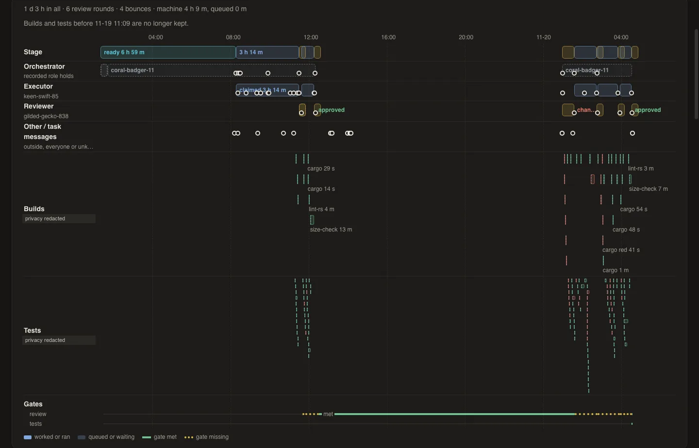

    A message selected, then the same mark held down, before the repair below: 

    **The arrow was a defect, not part of this choice, and is repaired.** Its overlay was on a scale 8 px off the marks', it stopped 6 px above them, and a held mark jumped 12 px to the right. The board task `app/timeline-message-alignment` repaired all three and landed after these pictures; its source is this proposal's baseline. The hour lines share the 8 px offset, and a phone's message words sit 16 px below their diamond. The repair left both to this proposal, under every option.
  [2026-11-20 04:56] agent — Posted for the board task `inbox/timeline-ui-needs-improvement`. The whole task under each option, from a mockup that draws this task's recorded timeline; nothing is built: 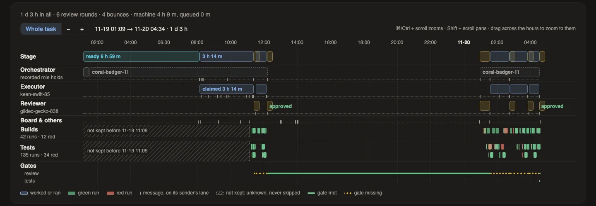 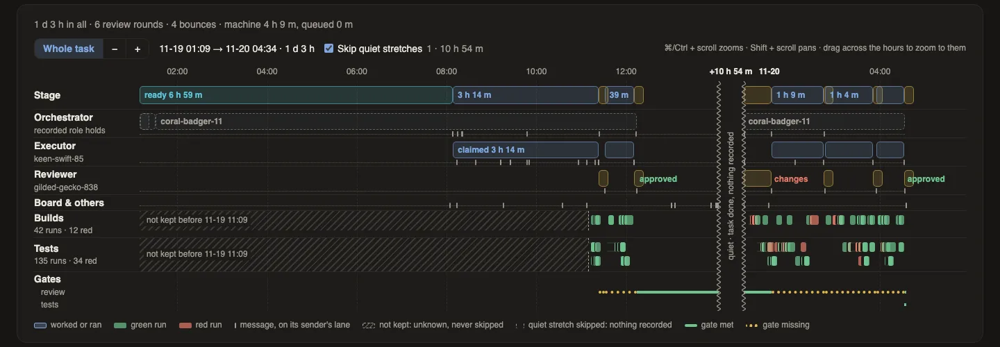 

    **A** keeps every width to scale. The empty 40% stays, and zoom gets past it. **B** gives the work 1.6 times the width. A band's 10 h 54 m is 36 px, and its label, the hours line and the range readout all say so. **C** draws A until its switch is on.

    **What counts as quiet.** At least an hour with no build or test, no executor or reviewer role held, and no message or change of stage, role, round or gate, and only where those records are kept. Here the 10 h 54 m after the close is quiet. The 6 h 33 m of ready time is not: no runs are kept before 11:09, so that time is unknown and stays on the true clock. A session's heartbeat is not used: keen-swift-85 kept beating through the closed stretch.

    **What each costs.** No option needs a server or schema change. B and C need the same client work: one slice more than A, the band and its switch.

    **Why B.** Your request: “Could also have a "skipped range" for when no work was done”, with the whole task kept as the default: “having the default be "100% view of the timeline does make sense tho”. B narrows only measured emptiness and labels each band with its length. C leaves the empty hours in the first view.

    **Earlier verdicts checked.**
    - **reports-task-page-pictures** (A): lanes wide and a list on a phone, kept.
    - **task-page-timeline-place** (C): the phone's 240 px box, kept.
    - Your note on `inbox/timeline-should-not-be-collapsed-by-defa`, “Desktop collapse save almost no space and hides really good information from view.”: the whole task stays the default and nothing is collapsed. By its rule, a band holds no record.
    - Your rejection of **timeline-burst-drawing**, “yes. rework the proposal to be more horizontal based.”: runs keep their own bars at their recorded times, on one row unless they overlap, with no folding. At the whole-task scale, runs seconds apart share pixels, and zoom parts them.
    - **timeline-orchestrator-messages** (approved): one arrow for the selected message, and the message list and its keys, kept. The mark becomes a tick under the bars, a change of drawing only.

    None of them decides whether quiet time is skipped.
  [2026-11-20 04:56] agent — Under every option:
    - The whole task shows first. Whole task, − and +, ⌘/Ctrl + scroll and a drag across the hours zoom, Shift + scroll moves, and an overview strip shows where the view is while zoomed.
    - A run takes another row only when it overlaps one, so the lanes are 353 px tall against 818.
    - Where runs are not kept, the Builds and Tests lanes are hatched, in place of the sentence above them.
    - A selected message's arrow joins its two marks. A message whose two ends share a lane, such as an outside post to everyone, draws no arrow: its tick is ringed, and the hours line names both ends. Today it draws a 12 px stub.

    Zoomed to 73 minutes, a verdict selected:  [Open the mockup](design/analysis/timeline-navigation/mockup.html).

    **On a phone** the list and its 240 px box stay under every option. The box shows four steps where it shows one today: the "not kept" sentence becomes a row at its time, and a message takes one line. A quiet stretch is a row of its own:  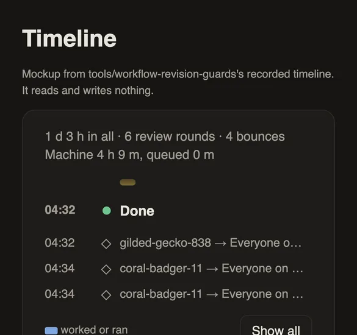 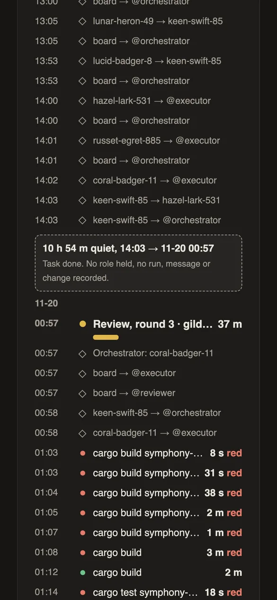
  [2026-11-20 05:04] owner · approved — B

## Rejected and replaced

### Releases

- [-] **release-accepts-task-runs** — A pasted proposal (Buildmark) suggests accepting a signed record of a run already made in place of running it again. A task already records its lint, docs check and tests at its tip. Should the release run skip a step when a task's recorded run of that same step, on the same inputs, was green? A: no; the release accepts only a green of a release run, its own or a hosted one. B: yes, for the lint, the docs check and the client check. Recommended: A. Approve and say A or B in the note, or comment. [[workflow/analysis/release-pipeline#E. Runs accepted in place of running again]]
  [2026-11-18 11:26] agent — Posted for the board task `docs/release-pipeline-redesign`.

    **B saves** one to four minutes of a run of 21 to 54: the long step, the tests, is never one task's run. **B costs** letting the run of a task's own executor stand for the release's.

    **The rest of the proposal** is answered in the analysis: tasks here already land on recorded runs with no server running them again, and its signature and outside verifier only matter once a second machine runs, which the hosted run brings with GitHub's own.

    **Earlier verdicts checked.** **needed-stamps** decides what a land needs, not what a release accepts. **release-candidate-process** (A) carries a green of the release run's own across commits; it says nothing of a task's runs.
  [2026-11-18 12:51] owner · rejected — If it doesn't save enough time there's not much purpose to it. 1 to 4 against 21 to 54 saves nothing. Unless this could be applied to the more demanding aspects like the tests in a way that more drastically reduces load.
  [2026-11-18 18:12] agent — Dropped: the release accepts no task's recorded run, and no replacement card is proposed.

    **On the tests, where you say it could pay.** No task ever runs the release's tests step, so there is no task's run to accept for it. The saving there comes from the release run's own greens, and two tasks hold it:

    - `tools/release-steps-carry-by-inputs`, in progress: a candidate's rerun does not run again a step or a group of tests whose inputs the fix left alone. A fix of the browser tests alone would have rerun about 12 minutes of a 22-minute tests step.
    - `tools/nextest-runs-the-tests`, landed: one scheduler over every test, with a time and a timeout for each, so the slow ones are named and the run stops loading itself.

    A candidate's first run stays whole. Running it off this machine is **release-run-on-github**, approved.

    [[workflow/analysis/release-pipeline#E. Runs accepted in place of running again]] says this now.
- [-] **release-main-judged-in-steps** — The full run looks at main once every 20 landed tasks, and not at all while a release candidate is being fixed. Yesterday's two first runs covered 36 and 55 landed tasks each: one found 20 real failures at once, the other a size overrun that took 8 hours 46 minutes to trace through 257 commits. Should main also be checked in small steps, after each land and never holding one? A: as today. B: after a land, in the background, a round checks main's newest tip, running only the checks the landed changes can reach; ten lands during a round are one next round; a red is a task naming the one to five lands it can come from; it also runs while a candidate is open. The full run before a release stays. Recommended: B, built once the release can run on GitHub, since on this machine it adds load. Approve and say A or B in the note, or comment. [[workflow/analysis/release-pipeline#C. Main judged in smaller steps]]
  [2026-11-18 11:26] agent — Posted for the board task `docs/release-pipeline-redesign`.

    **Nothing waits on it.** No land is held and nothing queues: the round starts after the land, as the client's rebuild does today.

    **Its cost** is machine time: at yesterday evening's 12 lands an hour a round would run most of the time. On a hosted runner that costs this machine nothing; here it would make the load worse, hence the order.

    **Earlier verdicts checked.** **release-main-while-candidate-open** (A) says no run of main's tip while a candidate is open; B here changes that, so this is a new card and not a question on that one. Its option C was the full run taking turns with the candidate's reruns in one checkout; B here is a partial round apart from them. **land-tests-changed-packages** (rejected) refuses anything a land waits on or queues behind; B runs after the land and holds none.
  [2026-11-18 12:49] owner · rejected — No. This will lead to the issue of having a million running ones. It should run one based somewhat on how long it takes to run it anyway. If takes one hour to run, maybe one running every say 30 minutes could be reasonable (in Github) but not locally due to load. The current approach based on number of tasks is mostly a control for that, so the machine isn't always under load.
  [2026-11-18 18:12] agent — Applied as you wrote it; no new card, since your note gives the direction.

    - **No round after each land.** Removed from the design.
    - **On this machine nothing changes:** a run starts once 20 tasks have landed, which keeps the machine from being always under a run.
    - **On GitHub, later:** once the hosted run exists (**release-run-on-github**, approved) and its trial has measured a run, a whole run of main may start on a clock set from that length, by your example a run of an hour about every half hour, so at most two at once. It is one more task, handed to the orchestrator to file after the trial; the interval is a setting taken from the measurement, not a card.

    **Left as you approved it:** no run of main while a release candidate is open (**release-main-while-candidate-open**, A). If the hosted clock should run through a candidate, that is a new card then, not assumed.

    [[workflow/analysis/release-pipeline#C. Main judged in smaller steps]] is rewritten to this.

### Task page, in pictures

- [-] **timeline-burst-drawing** — A burst of runs, dozens of tests minutes apart in a task that lasted days, makes the task's wide timeline 12 px taller per run, with no limit: tools/board-token-usage's is 911 px tall, and its Tests lane is 37 thin rows that read as a dashed line, with no words. How should a lane draw a burst, every run kept its own and reachable? A: as it is, a thin row per run, the box growing. B: the same rows, the lane scrolling in a box of its own past 256 px, the height of six rows with words. C: each burst one mark that says how many runs and how many went red ("37 tests · 4 red"), opened in place to its runs by a click, a tap or Enter; on a phone, one row of the list the same way. Recommended: C. Approve and say A, B or C in the note, or comment. [[TASKS#The timeline]]
  [2026-11-17 00:43] agent — Posted for the board task `app/timeline-burst-drawing-card`, from the review of `app/timeline-builds-and-tests-apart`. tools/board-token-usage at 1280 wide, on a private server of main's build (the shared server runs a release from before builds and tests had lanes of their own): A as it is, then B and C drawn on that page by hand, not built. 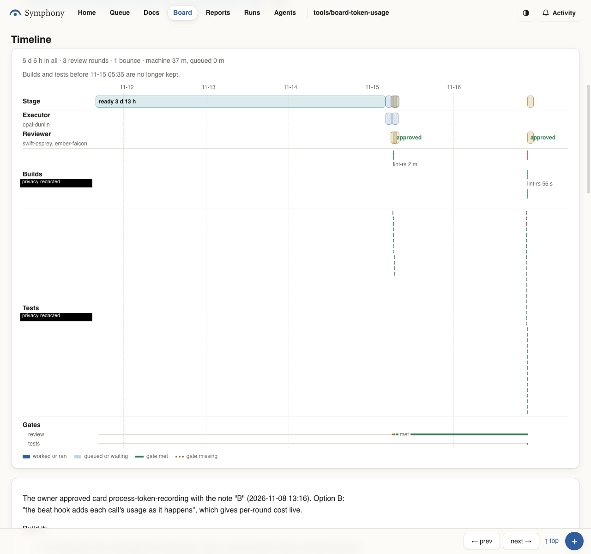 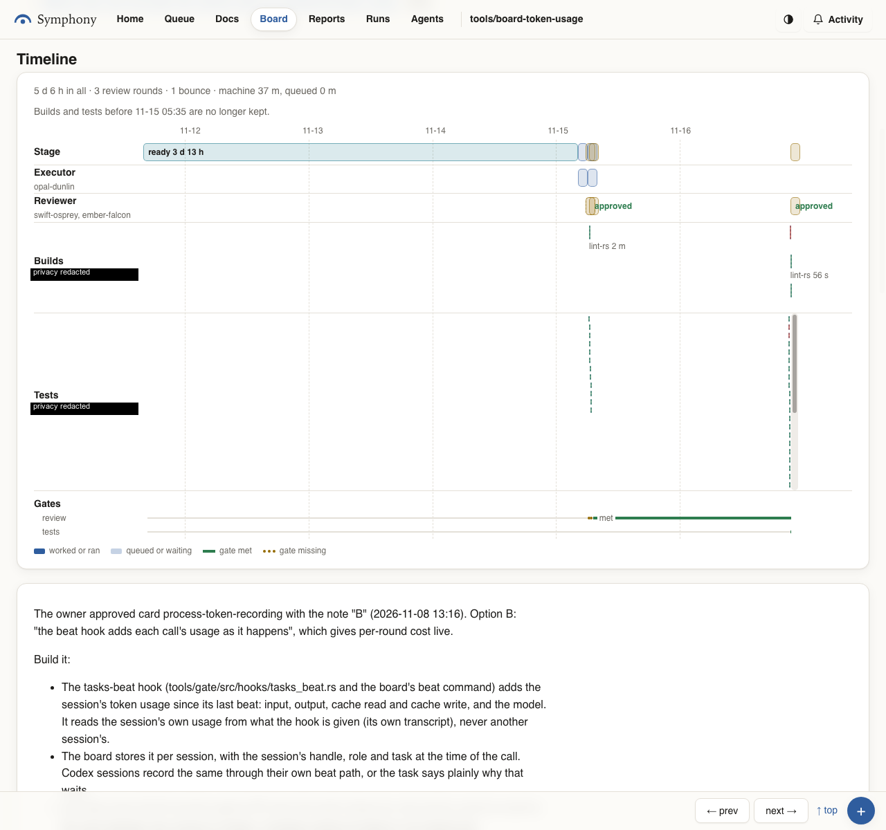 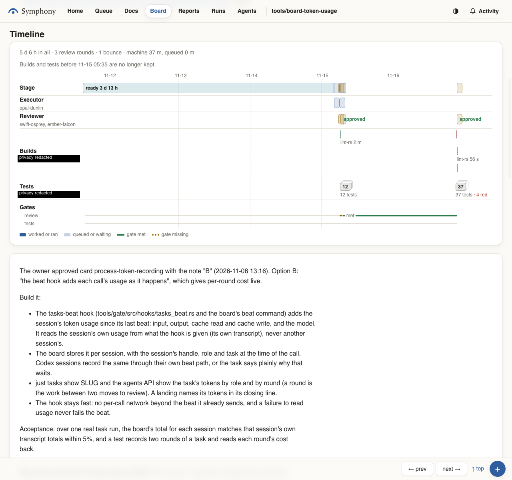

    **A, as it is.** The box is 911 px; a typical whole timeline is 508. The Tests lane alone is 449 px: 12 tests on 11-15 and 37 on 11-16, each a sliver on five days of hours, each in a row of its own so that none is drawn over another. A run's words are only in its hover, its focus and its row on a phone.

    **B, the lane scrolls.** The box is 719 px. The lane stops at 256 px and scrolls the rest, its scroll bar in the margin past the hours. The rows are A's, no easier to read, and the runs below its edge are a scroll away inside a page that scrolls too.

    **C, one mark per burst.** The box is 509 px, about a typical timeline's. The lane is one row: a stacked mark with its count, its words under it. Opened, the burst draws its runs under the mark as A does, and closes the same way. The mark is no run's bar: its count says it holds several, so it never reads as one long run. A burst is runs each queued so soon after the one before it ended (half a percent of the hours drawn, as today) that they would need more than six rows; every other run is drawn as now.

    **What each costs.** A, nothing. B, a few lines of style, and a box that scrolls inside the page, which a trackpad catches as it passes over. C the most: the bursts found in the layout, a mark the keyboard and a tap open and close, its words, the phone's folded row, and their tests.

    **Why C.** What a burst says is how many ran and whether any went red: C says it on one line, wide and on a phone, where the thin rows say neither. It gives back 402 px wide and 2,140 px on a phone's Show all, and every run is still one press away, each with its words in its hover, its focus and its row.

    **Earlier verdicts checked.** **task-page-timeline-place** (C) keeps a phone's box at 240 px behind Show all; no option changes that. Your note on `inbox/timeline-should-not-be-collapsed-by-defa` had the wide timeline shown whole: "Desktop collapse save almost no space and hides really good information from view." It weighs against B and C, which hide runs until scrolled or opened, and does not decide this card: that collapse cut every task's lanes for little room, where a burst costs 402 px of rows that show no words. `app/timeline-builds-and-tests-apart`, from your question whether a 55 min build was several, never draws two runs as one bar, and no option does. None of them decides how a burst is drawn.
  [2026-11-17 00:43] agent — On a phone the box opens at 240 px on the latest steps under every option (here round 3 and Done), so the burst shows only after Show all. There A and B list every run, 61 steps in 3,143 px, each row reading "Test, just test-rs -p sympho…"; C folds more than six runs in a row of the list into one row, 16 steps in 1,003 px. The list puts a run under the stage it began in, so 11-15's burst, which spans two stages, folds its first seven runs and leaves the last six as rows.   C wide, in dark: 
  [2026-11-17 00:43] agent — **Not asked here: the word under a bar.** It is the command's first word, so every `cargo install` reads "cargo 55 m" and every `just test-rs` "test-rs", and a phone's row is cut before what tells two runs apart. Better: the command's distinguishing words, the command without `just`, its flags and the test filter after `--`. So `just test-rs -p symphony-board --test cli -- beat` reads "test-rs symphony-board cli", `cargo install symphony-server (cold-full)` keeps all four words and `just lint-rs` stays "lint-rs"; under a bar with too little room for them, the first word as now, so no word goes where one shows today. It is not built here: it changes the drawing this card's answer changes, so it is built with that answer.
  [2026-11-17 12:15] owner · question — why whould this be vertical instead of being horizontal reflecting actual ran times?
  [2026-11-17 12:28] agent — Time already runs horizontally on the wide timeline: each bar is positioned by its recorded times. The vertical pile comes from a layout rule that gives runs separate rows not only when they overlap, but also when they are close together (within 0.5% of the whole time range). Across five days that is 36 minutes, so even sequential short tests get stacked. That avoids bars visually joining, but creates the height problem this proposal then tries to hide. Your suggestion addresses the cause: keep sequential runs on the same horizontal time axis, reserve extra rows for actual overlap, and let a closer time view reveal short runs at their real duration. The proposal should explore that before folding bursts; A/B/C overlooked it. The phone view is a separate chronological list because of its narrower width.
  [2026-11-17 12:35] owner · rejected — yes. rework the proposal to be more horizontal based.
  [2026-11-17 12:35] agent — Revised proposal: keep Builds and Tests on a shared horizontal time axis. Sequential runs reuse the same row; only genuinely overlapping queued/running intervals need another row. Each run keeps its actual start, end and duration, with waiting distinguished from execution. For a dense period, zoom into that time range and pan horizontally, with a clear return to the whole task; every lane uses the same scale so comparisons remain meaningful. Selecting a run shows its full command, exact times and result without adding a row per run. Very short runs stay individually reachable by keyboard and selection, without stretching their duration to fit a label. This replaces the vertical stacking, inner scrolling and folded-burst proposals above. The earlier pictures illustrate rejected options, not this revision; the revised layout still needs visual validation, including a narrow-screen treatment consistent with your existing phone-height decision.

### Agents page

- [-] **agents-page-orchestrator-first** — The Agents page would open on the orchestrators instead of repeating the board. For each one: how many tasks it holds against its limit of 16 and how many of its 8 slots are in use, the agents it runs and what each is doing this minute, and what is waiting on it. Lost agents and agents stopped on a question come first, and a task is only its title, as a link. Your own open asks stay in the queue. The "Happening now" cards and the A-to-Z list of agents go. How should it be laid out? A: one panel per orchestrator, its agents beside what waits on it, everything open. B: first a list of what needs a look across every orchestrator, then a compact list of who runs what. C: a tile per orchestrator with its counts; open one to see its agents and what waits on it. Recommended: A. Approve and say A, B or C in the note, or comment. [[product/analysis/agents-page#The options]]
  [2026-11-16 22:32] agent — Base: the page today, wide, from the shared server (shot at 22:29). 
  [2026-11-16 22:32] agent — Posted for the board task `app/agents-page-orchestrator-first-options`, from your note on inbox/agents-page-needs-redesign: "Probably be more orchestrator based with less direct task card info". The three options at 1440 wide, drawn from this board at 22:11: 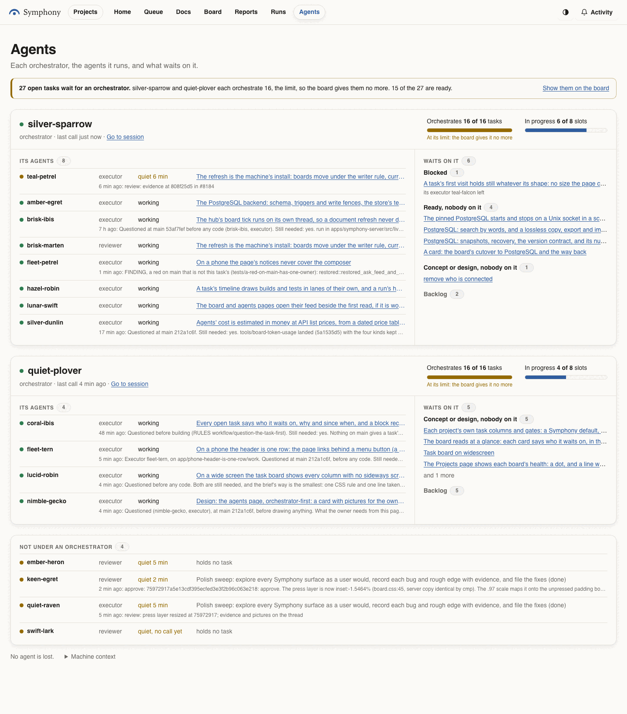 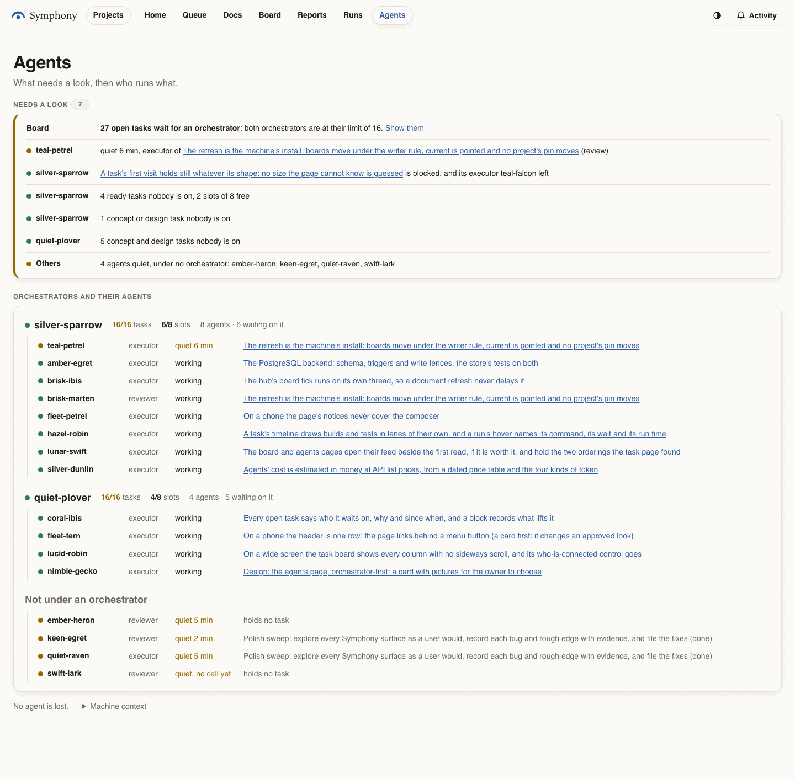 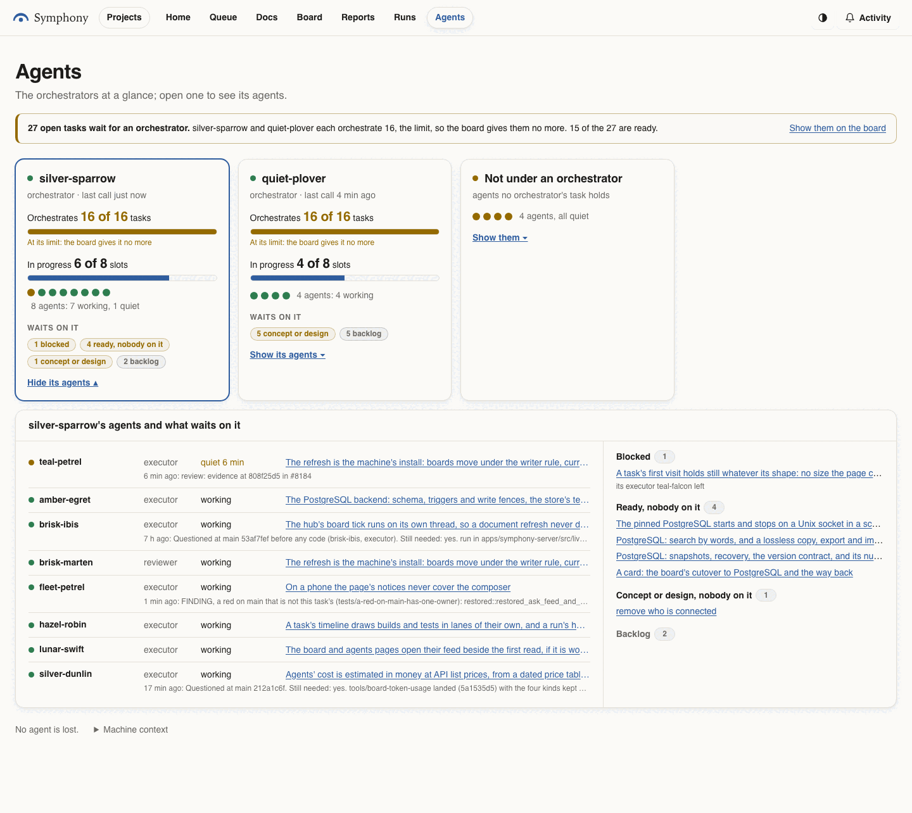

    **Today.** The page opens with the board's in-progress and review cards again, then every agent A to Z. On a phone the two orchestrators are on its seventh and eighth screens, and their load is a folded "Following 16 open tasks" and "slots: 5 of 8". Nothing says both are at their limit, so the board gives them no more and 27 open tasks wait with no orchestrator.

    **A, a panel per orchestrator.** Its load on top, its agents on the left, what waits on it on the right; on a phone they stack. Under two screens wide and four on a phone, against five and a half and eight and a half today.

    **B, needs a look first.** One list across both orchestrators (a quiet agent holding work, a blocked task whose agent left, ready tasks nobody is on), then each orchestrator on one line with its agents under it.

    **C, a tile per orchestrator.** Its counts in large figures; open a tile to see its agents and what waits on it (silver-sparrow's is open in the picture).

    **What each costs.** Under all three the server sends four facts it does not send today: which orchestrator each agent works for, each orchestrator's task count against its limit, how many tasks wait for an orchestrator, and how many messages to it nobody answered. Why each task waits comes from `tools/task-waits-on`, being built now. Beyond that, **A** costs the least: one panel, from what the page already reads. **B** costs the most: a new ranked list the server builds, so that it agrees with what each orchestrator is told, and a rule for what comes first. **C** costs what A does, plus remembering which tile is open, and takes a tap more to see anyone's agents; it suits a project with many orchestrators.

    **Why A.** You want to see whether the work is moving and what it waits on. A shows every orchestrator's load, agents and waiting work together, the same wide and on a phone, with nothing to open.

    **Earlier verdicts checked.** **board-at-a-glance** (B) sets how a task's wait reads: a wait on you names the decision card, never a person alone. The lists here use that line, and it says nothing of this page's layout. **owner-asks-place** (A) shows your open asks, what you said that waits on an agent's answer, in the queue's *Waiting on the agent* group with who holds each and for how long, counted on Home, with no page of their own. So this page leaves them there: an orchestrator's list of what waits on it holds no asks. **header-page-names** keeps Agents as this page's name. None of them decides this card.
  [2026-11-16 22:32] agent — On a phone: today's first screen, an orchestrator's row today, on its seventh screen, then the first screen of A, B and C. 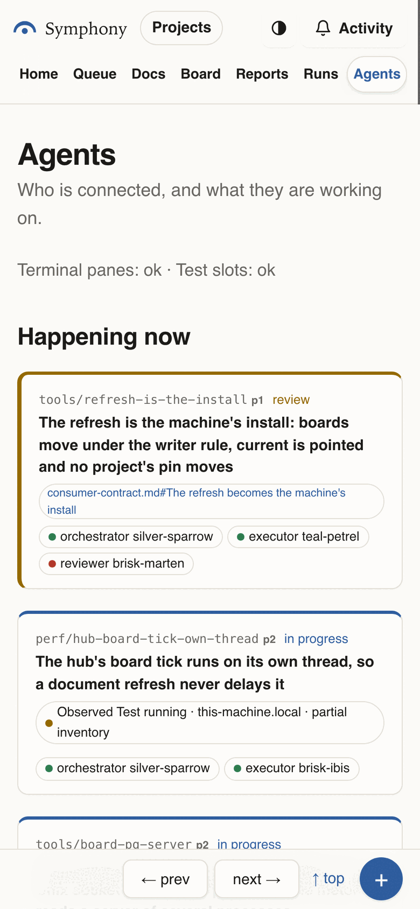 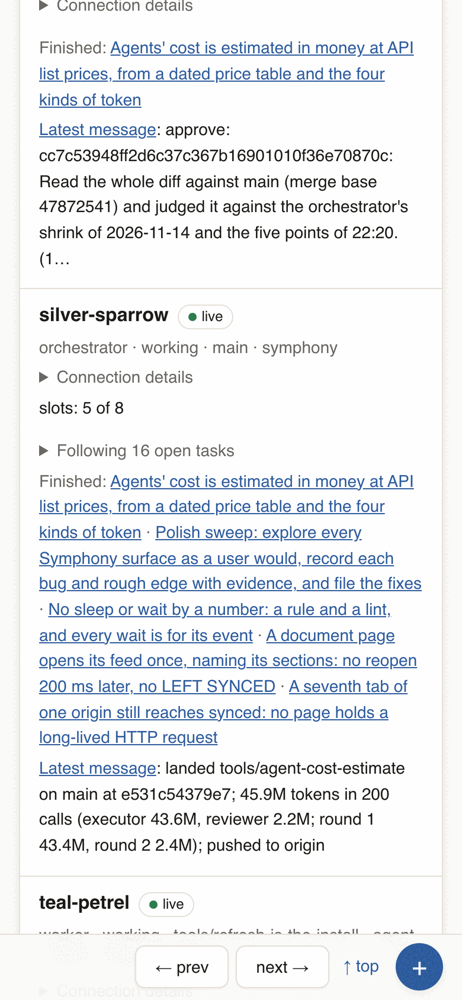 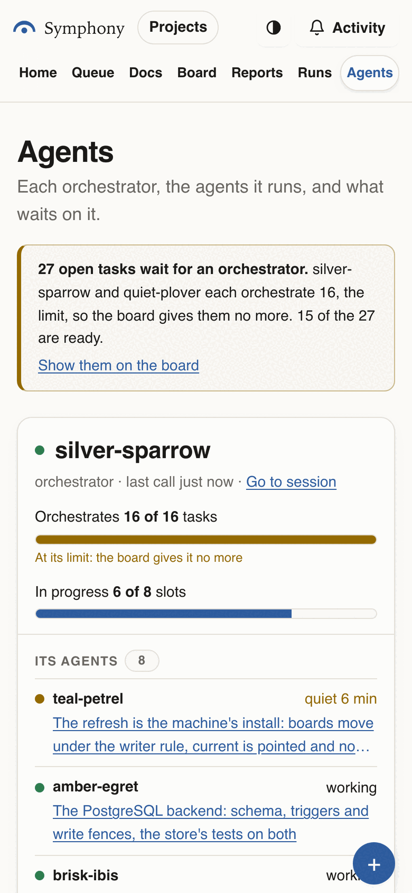 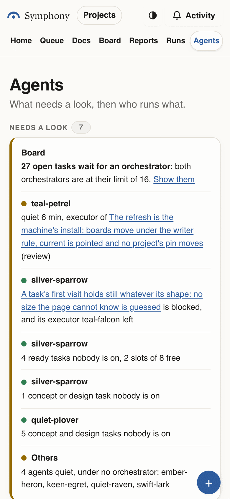 
  [2026-11-17 12:13] owner · rejected — I would like to explore a mix of C and B. A "card" per orchestrator, but instead of column based, make it full width and with more details like in B.

    Also there should be no "Machine context" and remember the columns/stages are supposed to be "configurable" so the status aspects would be dynamic and need to make sense with it in mind.
  [2026-11-17 12:28] agent — The revised direction is one full-width card per orchestrator, stacked vertically: the grouping from C with the visible working detail from B. Each card should show its load, agents and current activity, followed by what needs attention; there is no Machine context section. Stage names, order and counts must follow the project’s configured workflow, rather than assume fixed In progress or Review columns. Agent conditions such as waiting for access or losing contact remain distinct from task stages. The A/B/C pictures above remain the earlier proposals; this direction replaces their layout recommendation.

### The header

- [-] **phone-header-one-row** — On a phone the header would be one row instead of two: the mark and name, a menu button that names the page you are on (☰ Board), ◑ and the bell. The page links and Projects move into that menu, which opens under the button over the page, so nothing below it moves. The header goes from 97 px to 53 px tall, so every page starts 44 px higher. Wider than a phone nothing changes. It changes **header-on-a-phone**, which keeps every page in view on a second row. Approve, or comment. [[design/analysis/phone-header#The proposal]]
  [2026-11-16 22:15] agent — Posted for the board task `app/phone-header-is-one-row`, from your words on its inbox item: "Navigation should also be made even smaller on mobile, possibly using hambúrguer menus".
  [2026-11-16 22:15] agent — The board, then a document, light then dark. Each shows today, the one row, and the one row with its menu open: 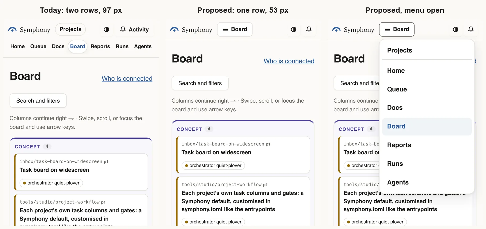 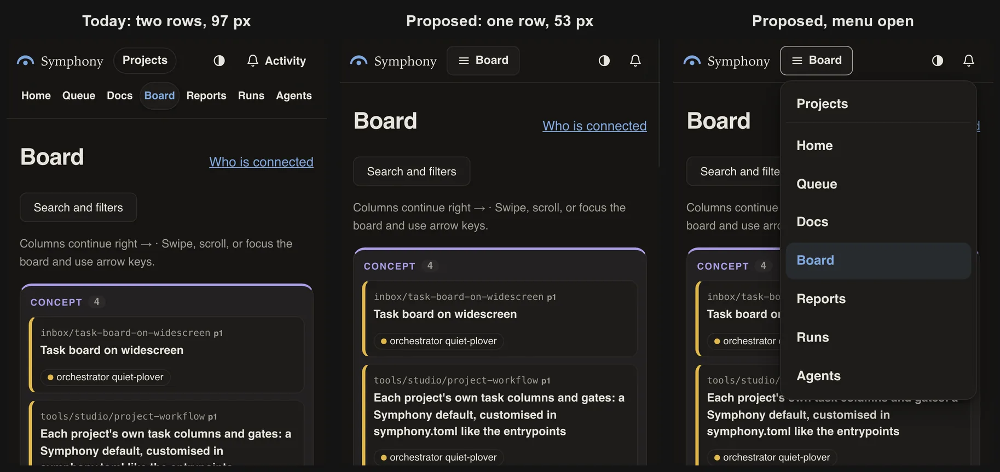  

    **How the menu works.** A tap on the button, or Enter, opens it; Tab moves into it. Escape or a tap anywhere else closes it, and so does following a link. The page you are on is lit in it, as in today's row. Projects, which leaves this project for the list of all projects, is its first line.

    **What it costs.** Changing page takes two taps instead of one. Activity loses its word on a phone and keeps its bell and its unread dot.

    **Not pictured.** At 320 wide the row still fits with the name whole, where today the name is cut short. At desk width the header is the same, pixel for pixel. The server's own pages (the project list, a missing page) get the same menu. A theme with the compact header keeps its one scrolling row. The same board task builds it after your answer.

    **Earlier verdicts checked.** **header-on-a-phone** chose two rows with every page in view; pages behind a button is another choice than the one it describes, so it is asked here and not recorded on it. **header-page-names** (the names and their order), **header-appearance** (the ◑ button) and **symphony-mark** (the fermata and its name) are kept as they are. None of them decides whether the pages go behind a menu.
  [2026-11-16 22:30] owner · rejected — Symphony title should be omitted, only the icon should show for mobile
  [2026-11-16 23:02] agent — Replaced by **phone-header-mark-only**: the same one row with the mark alone and no name on a phone; the name stays wider than a phone, and in the page for a screen reader. Pictures of the board and a document, light and dark, are on that card.
  [2026-11-17 12:24] agent — Your direction is preserved: mobile shows only the icon, with the Symphony name hidden visually and retained for screen readers; wider layouts keep the name. The replacement **phone-header-mark-only** records this and was approved by you on 2026-11-17 at 03:49. This delayed notification does not reopen that choice.

### Delivery to projects

- [-] **client-distribution-on-main** — Each land that changes the web client is followed by a background run that commits a fresh build of the client to main. Those builds are about 85 % of what git holds for main's history and grow about 27 MiB a day, which every clone downloads. Nothing on the pages changes under any option. How often should the built client be committed? A: only by a release, the one it verified, on a commit of its own under its tag that main never holds; a checkout that needs pages builds its own. B: once a release: the release run starts the run that commits it to main, and no land does. C: after every land that changes it, as today. None of them shrinks the history already there: that takes rewriting it, a choice of its own. Recommended: B. Approve and say A, B or C in the note, or comment. [[engineering/analysis/code-review-2026-11#2. The built client is committed, and is 85 % of the repository]]
  [2026-11-15 03:46] agent — Posted for the board task `docs/code-review-owner-choices`, from the codebase review.

    **Today**, read at main `3f3d9186` with the review's command (in its finding): git holds 156.2 MiB for main's history, 134.0 MiB of it the client under `apps/symphony-server/client/public`, first committed on 2026-11-10. 95 of main's commits regenerate it, 12 to 39 a day, and all but `e3314c18` (which also restates figures in two documents) do nothing else; in the tree it is 110 files, 6.3 MB. Each of those rounds is also main's only build of the client after a land, and between releases the only audit of the documents on main's tip: a round that fails files a red task within minutes, as one did on 2026-11-15.

    **What A and B both change:**
    - *A fresh clone* fetches every release tag, so under either it gets one client a release. Since the first release (2026-11-13), main gained 1,918 client files, 247 MiB before git compresses them; the five releases since hold 545 of them, 71 MiB: about three tenths, at one release every 20 landings.
    - *No round after a land.* A land that breaks the client's build, or the documents, is found by the next task that builds the client, or by the release run. While a release candidate is open, up to 24 hours, main's landings have only their own evidence. A build after each land that commits nothing would keep that check, at a build a land.

    **A, only a release:**
    - *Main holds no client.* A pin to a commit of main would build a server with no pages, so it is no longer possible. A checkout that serves pages (an agent's server of its own, for pictures) builds the client first, as a task already does for its tests; while the Dioxus client remains, that takes minutes.
    - *The release* builds the client in its own checkout, commits it on top of the tip it verified and tags that commit. `just client-check` then has no client on main to compare a fresh build with: the release's check becomes the build it commits, and the two older builds a page may still be open on (`KEEP` in `crates/symphony/src/cli/publish.rs`) come from the previous release's tag.
    - *What goes:* the regenerator, 1,674 lines (`crates/tasks/src/land/regenerate.rs`) and 1,962 of tests, with the rule that a branch never commits the client, the land keeping main's side of it and a pin's wait for it.
    - *What changes:* 32 tracked code, script and settings files name the folder (`git grep -l client/public`, less the documents, test fixtures and one experiment): 26 Rust files, among them the server's build script, its client and their tests, the size budget's client line, the release's verified client and the packaging test, and the server's manifest, the justfile, `symphony.toml`, the size budget, `tools/client-check.sh` and `tools/verify.sh`. The review sizes it as a project.

    **B, once a release.** The release run starts the regenerator's round on main's tip and waits for it before it verifies, as it waits for one today; no land starts one. The regenerator, its check and those 32 files stay as they are. Between releases main's client is older than its sources, so a pin to a commit of main waits for the next release, and main's tree keeps its 6.3 MB of client. A task.

    **C, as today.** About 27 MiB a day, some 0.8 GiB more in a month at this pace.

    **Why B.** A fresh clone gets the same bytes under A and B, so B takes nearly all of A's saving for a task rather than a project: the release run starts the round a land starts today, and the rest stays as it is. What A adds, a main with no client in it and the regenerator's removal, is cheaper once the Dioxus client is gone and the client is one quick build.

    **Earlier verdicts checked.** **symphony-update-command** (B, projects follow release tags) already makes every pin a release, which A and B rely on. **pin-waits-for-current-client** (A) keeps a pin to a commit of main off a client older than its sources; A leaves such a pin no client and B makes it wait for a release, so neither changes that choice. **release-main-while-candidate-open** (A) counts on "the regenerator's client check and docs audit each round" to check main's landings while a candidate is open; under A or B those landings would have only their own evidence for up to 24 hours, a consequence of either, not a change to that choice. **release-delivery** (C) ships a release's client beside the server once `symphony update` is built; it does not say whether main commits one before then. **pictures-in-every-clone** (F) commits the documents' pictures, not the client. None of them answers this card.
  [2026-11-15 06:46] owner · rejected — we should push those releases as crates to crates.io and not commit then at all if possible.
  [2026-11-15 11:13] agent — Replaced by **client-in-the-crate**. The server's package for crates.io already carries the built client, so what you ask is possible for a server taken from crates.io, and not yet for one built from a Git tag, as the consuming project builds it: nothing is published so far. The new card asks when the commits stop, with what each way costs and what has not been tried.

### Page loading

- [-] **skeleton-loading-look** — While a page waits for its data, it shows pale bars where its text will be, with a soft light passing over them every 1.8 s (still bars for anyone who turns motion off). A task and a document show the bars until their first screen has arrived, 3 s at most, then appear whole; the task board shows its controls at once, with bars in each column until its tasks arrive. Nothing jumps any more as a page loads: the largest layout shift on any page, phone or wide, is now 0.011, down from 0.17 on a document and 0.14 in the chat (under 0.05 is good). Three smaller changes come with it: the chat's form stays at the foot of its panel, with New conversation just above it; a wide page keeps room for its scrollbar, so the header no longer jumps 15 px; and the bars' two colours are theme settings a project can change (`--skeleton`, `--skeleton-shine`). Is this the look? Approve, or comment with what to change.
  [2026-11-11 21:00] agent — Posted for the board task `app/skeleton-loading`. Pictures with motion off, so the bars are still.

    A task on a phone, before and after: 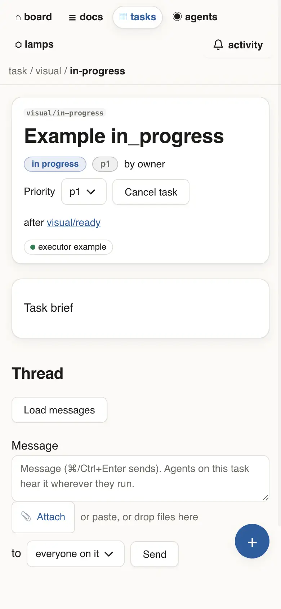 

    A document on a phone, before, after and dark, and on a wide screen:  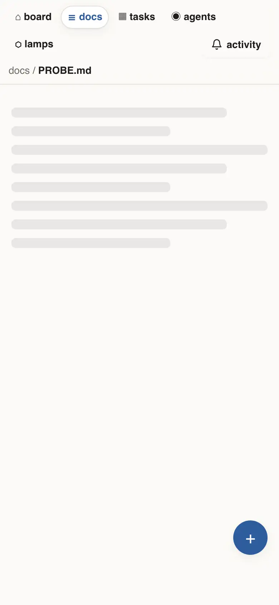 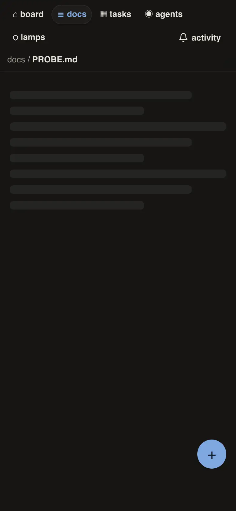 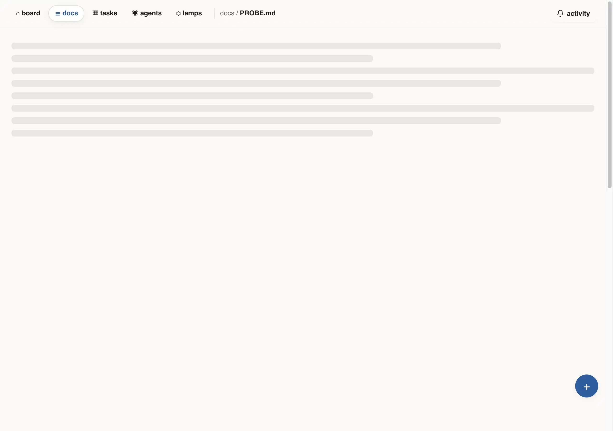

    The chat on a phone with its conversation in, before and after: 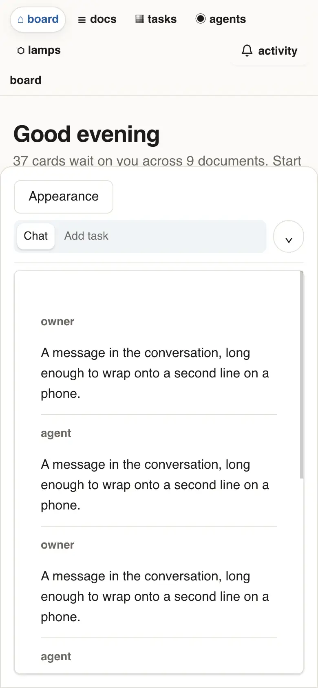 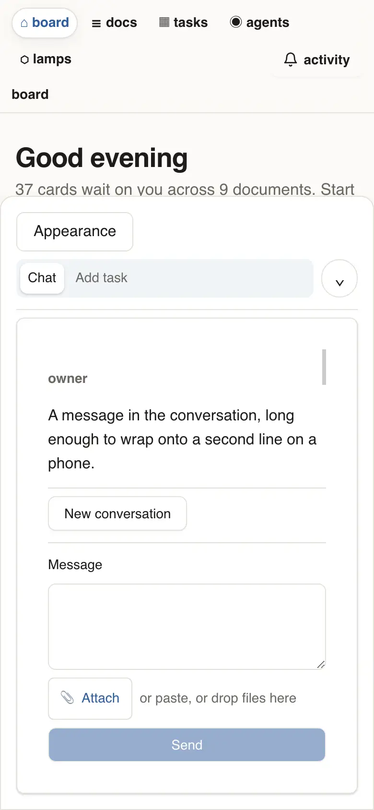

    **Layout shift**, the worse of a first and a repeat visit, phone / wide, before → after: document 0.171 / 0.124 → 0.007 / 0; chat 0.143 / 0.030 → 0 / 0; task 0.107 / 0.075 → 0.011 / 0.008; register 0.050 / 0.079 → 0.007 / 0.006; task board 0.018 / 0.048 → 0.001 / 0; home and the activity panel 0 before and after. A browser test now fails any page at 0.05 or more.
  [2026-11-11 22:05] owner · rejected — It should have a closer outline to what it shadows. If it should have a "box" it should have a box with the "text shadows" on it.
  [2026-11-12 02:43] agent — Replaced by **skeleton-loading-outline**: each placeholder is now its component's own box (border, corners, padding, size) with a bar where each line of its text will go: the task board's columns and cards, a task's head, brief, thread and composer, a document's outline and body, the queue's groups and rows, and the chat's messages. Pictures of each, on a phone and wide, light and dark, are on that card.

### Landing

- [-] **land-tests-changed-packages** — `just land` checks a merge with the docs audit alone and runs no test, so a red that a branch's evidence missed reaches main. Three did tonight, each already red at the approved tip: a route change whose `after_http` nobody ran; a branch that added a `symphony` command and merged main's new test that lists them, and never ran that 0.2 s test; and a board change whose `polish::` and `shot::` browser tests nobody ran. Should the land's check also run, on the merge, the fast test targets of the packages the branch changed? A: no; the executor and the reviewer run them at the tip, and the lander reruns by hand what main gained since, as CHECKS now says. B: yes, for each package that both the branch and main's newer commits changed. C: yes, for every package the branch changed, on every land. Recommended: C. Approve and say A, B or C in the note, or comment. [[CHECKS#After main moves]]
  [2026-11-12 06:06] agent — Posted for the board task `tools/checks-name-the-tests-landings-missed`.

    **What the land would have caught under each**, of tonight's three reds:

    | red at the tip | A | B | C |
    |---|---|---|---|
    | a route change: `-p symphony-server --test after_http` | no | yes, as main had changed `symphony-server` too | yes |
    | a new command: `-p symphony --test serve` | no | no: main had changed none of the branch's packages since its tip | yes |
    | a board change: its `polish::` and `shot::` browser tests | no | no | no |

    None of the three was made by the land's merge, so B's own case, two lines of work green alone and red together, did not occur. The tests CHECKS now names for each kind of change (a route's targets, the rule for a new command, the tasks board's row), run at the tip, catch all three: A rests on that alone, and B and C are the land's net under it.

    **A land today** rebuilds the client in its own worktree to compare it with the committed one, 7 to 20 minutes (median 11, over the 17 client checks lands ran tonight), builds `symphony` for the docs audit, and runs no test.

    **What a package's fast targets take**, cargo's own run times from tonight's three nightly runs, build not included, a fast target being one that took under 2.5 minutes in every run:

    | package | its fast targets | run |
    |---|---|---|
    | `symphony` | all but `nightly` | 3 to 5 min |
    | `symphony-board` | the library, `child_guard`, `cli`, `launch`, `store` | 4 to 6 min |
    | `symphony-server` | the library and the `after_*` targets | 3 to 3.5 min |
    | `symphony-ui` | all but `browser` and `wasm_build` | 10 to 30 s |
    | each other crate | all | seconds |

    First the land's worktree builds those test binaries: the whole workspace's took 4 and 5 minutes on two nights and 18 on a loaded one, and a land's packages are part of that.

    **Not fast, so in neither:** the browser target first (171 s one night, 61 minutes on another when its tests timed out), the board's `perf`, `sweep` and `server` (2.5 to 15 minutes each; `perf` took 883 s in one run) and `launcher` (seconds, and 10 minutes once), the server's `standalone` (3 to 5), the client's `wasm_build` (1 to 3) and `symphony`'s `nightly` (nearly 3). They stay the nightly's: under load their timeouts would turn lands red that changed nothing they test. Where the line falls is the recipe's to set, not this card's.

    **What B and C cost over tonight's lands**, each land's packages weighed by those run times (the middle of each range), the client distribution counted as `symphony-server` as CHECKS does:

    | lands since | lands | B runs tests on | for, in all | C runs tests on | for, in all |
    |---|---|---|---|---|---|
    | 18:00 on 11-11 | 47 | 31 | 2.8 hours | 41 | 4.4 hours |
    | 00:00 on 11-11 | 64 | 39 | 3.6 hours | 55 | 6 hours |

    Main's newer commits mostly touch the same few packages a branch does, so B runs on two lands in three and costs about two thirds of what C does. A land that runs either adds 5 to 6.5 minutes on average and up to 13 (a branch through `symphony`, the board and the server), beside the client check's 11.

    **A, by hand.** Nothing added to a land. Cost: a target someone leaves out reaches main red and stays there until a full run finds it.

    **B, shared packages.** Catches one of the three, because main happened to have changed the same package. Cost: about two thirds of C's.

    **C, every changed package.** Catches two of the three whatever main did meanwhile, and B's case as well, since every package both changed is one the branch changed. Cost: the minutes above, on 41 of the 47 lands.

    **Why C.** The reds that reached main tonight were evidence that left a target out, which C catches on every land and B only where main moved in the same package; B costs two thirds of C and caught half as much. A adds nothing to a land, but rests on every executor and reviewer running what CHECKS names, which three branches tonight did not. Built as one recipe the check names, which picks the packages from the branch's diff: the mechanical half of `just check-fast`, filed as `tools/check-fast`.
  [2026-11-12 06:42] owner · rejected — Adding 5 minutes may seem low, but the issue is that it becomes a “blocking 5 mins”. Every new PR that gets merged could invalidate the 5 min run, making it have to run it again and again and again, spiraling the 5 minute forever. A solution like a lock or queue would directly bottleneck the pipeline which isn’t acceptable either. So a nightly or more often run that then runs all tests and publishes when green is the only acceptable choice I can think of. Or the orchestrators could do a manual run of what they think is needed to ensure quality. But this cannot be an automated approach or that would wait and spiral OR add a number of tickets bottleneck to be merged and both are not acceptable.
  [2026-11-12 06:44] agent — Done as you say, with no replacement card: the land's check stays the docs audit and runs no test, and nothing automatic waits on a land. Quality rests on three things: the evidence at the tip that CHECKS names for each kind of change, run again at the new tip after a branch merges main, for the packages the branch itself changed; an orchestrator's run by hand of what it judges a land needs, which nothing waits on; and the full run (`just nightly`), nightly or more often, which runs every test and publishes a release when green, each red it finds a task with one owner. CHECKS and RELEASES now say so. [[CHECKS#After main moves]]

### Owner asks

- [-] **owner-asks** — What you say that waits on an agent's answer stops being a board task and becomes an ask: a verdict with a note, a rejection, a card message, a comment, a chat question or a message on a task. Five choices, each with its default. 1. Name: an ask, open or answered, never a task and in no task count; an open one shows who holds it and for how long. 2. Where: the queue's *Waiting on the agent* group lists the open asks with holder and age; the tasks board has one line of asks above its columns, never counted in them; `just tasks asks` in the terminal. 3. Store: a record of its own on the board; no verdict task is filed again, the open one becomes an ask, the finished ones leave every count. 4. Priority: pushed to its holder at once, first in its digest and named before any ready task; shown late after ten minutes with nobody holding it. 5. Routing: first the running agent working on what it is about (the executor of the card's task or branch, then its reviewer and orchestrator), then the chat seat, then an orchestrator; it moves on when its holder goes quiet or has not answered in ten minutes. Approve to take all five defaults, or comment with the ones to change. [[product/analysis/owner-asks#The design]]
  [2026-11-11 19:21] agent — Posted for the board task `tools/owner-asks-not-tasks`.

    **Today.** Each verdict you save becomes a `verdicts/…` task in the board's columns and counts. Eight were filed today; seven were each claimed by an agent and approved by a reviewer, to record an answer already on the card. Your question on worktree-build-folders was answered on its branch 17 minutes after you asked; its task sat ready 50 minutes longer and counts as 1.1 h of work nobody took. Chat goes to one session, whatever it is about. [[product/analysis/owner-asks#Today]]

    **1.** The app already calls a chat question an ask; the word now covers everything you wait on an agent for. It has no stage, so nothing has to pretend to claim or review it.

    **3.** A flag on a task would leave every count, list and digest to filter it out, now and each one added later, and a claim and a review would still close it.

    **5.** "Has context" is read from what the board keeps: roles on the task, the task a branch belongs to, the task whose brief names the card, launch records and where a subagent last worked. Nothing new is recorded.

    Two smaller questions, ten minutes and comments already open, are at [[product/analysis/owner-asks#Open questions]].
  [2026-11-11 19:33] owner · approved
  [2026-11-11 19:39] agent · question — Your approval came before these pictures, so it takes the five defaults but not how asks look. With asks, the queue, the tasks board and the home page, then the queue and the board on a phone:  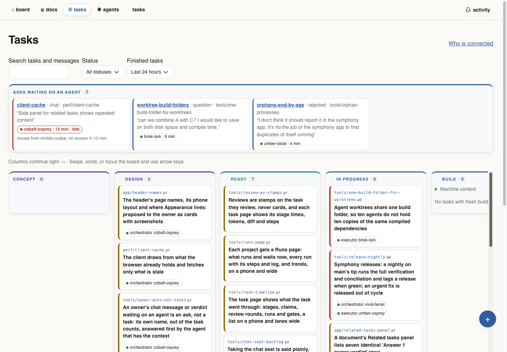 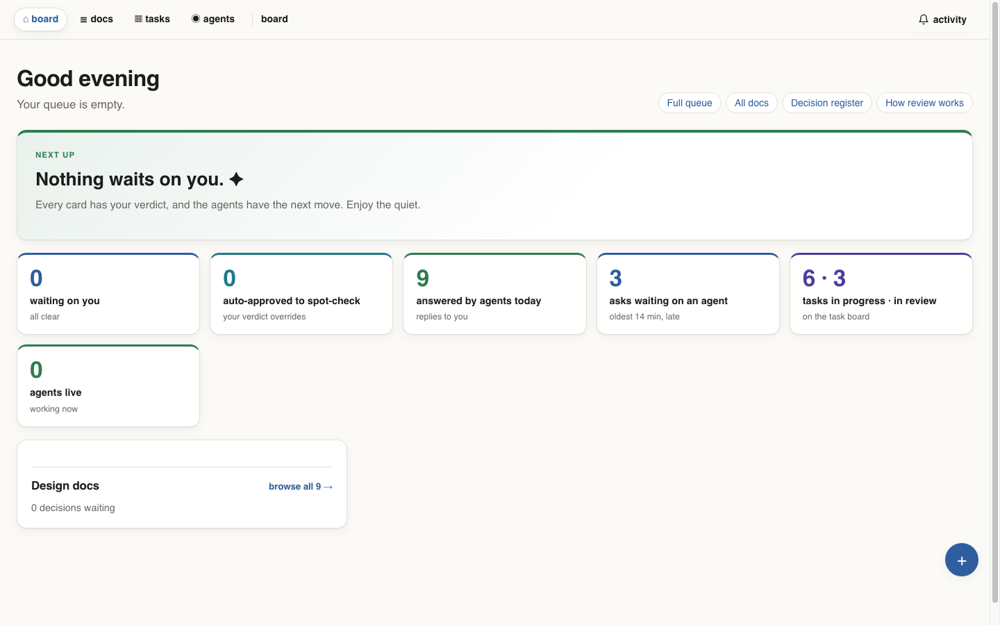 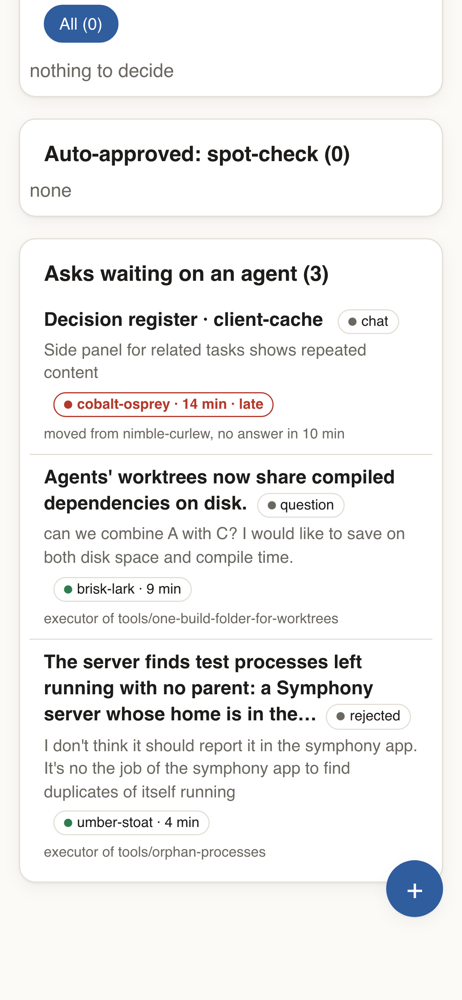 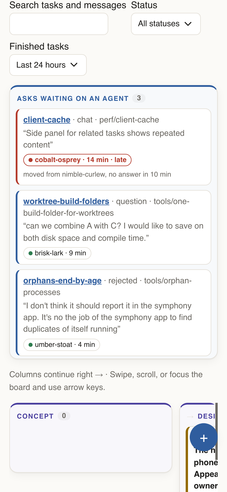 Is this how asks should look? Approve to keep it, or comment with what to change. The same pages today are at [[product/analysis/owner-asks#Pictures]].
  [2026-11-11 22:19] owner · rejected — it should not be in the same page as tasks. That page is already bloated with too many things.
  [2026-11-11 22:20] agent — The line of asks above the tasks board's columns is dropped: nothing about asks is drawn on the tasks page. The five defaults you approved at 19:33 stand, less that line. Where asks are shown instead is the new card owner-asks-place.

### Reports and monitoring

- [-] **reports-task-gates-timeline** — A task's page opens on its gates: every stamp or check it needs to land, met (by whom, when), missing, or waived (why). Below them, a timeline of what it went through: stages, claims, review rounds and verdicts, builds and tests, waits, each with its duration. Symphony shows its own gates without a plugin: the reviewer's verdict, the project's check on the tip, the review callback, a card waiting on the owner. How do a project's own gates reach the page? A: a typed seam, drawn the same way for every project. B: a panel of generic blocks the plugin lays out. Recommended: A. Approve and say A or B in the note, or comment. [[product/analysis/reports-and-monitoring#The task page]]
  [2026-11-11 13:31] agent — Posted for the board task `product/reports-and-monitoring`, the second reports card.

    **What exists.** The board replays a task's stages from its thread but keeps only totals, and the task page shows none. The consuming project's landing already answers its stamps for the task page (required, met or missing, waivers with why and by whom), and nothing shows them: a plugin can add a button or a field to a task, not a list of what it needs.

    **A, typed gates.** A plugin answers name, state, by, when and why; one component draws them. Symphony can then count them across tasks: which gate waits longest, which is missing most. Cost: one seam, one wire type, one component; the consuming project's adapter adds the times its stamps lack today.

    **B, a block panel.** Cost: the least Symphony work, but each project draws it differently and nothing can be counted.

    **The timeline** needs no new recording: the replay keeps each segment as well as its totals, and runs come from the run files. A phone gets a vertical list with a bar per step; a wide screen gets lanes over time.

    **Why A.** What a task waits on is the question asked of it, and a typed answer also feeds the defect report. This page takes the place of the task-page halves of `tools/stage-times` and `tools/review-as-stamps`. [[product/analysis/reports-and-monitoring#Timeline]]
  [2026-11-11 13:46] owner · rejected — this needs some visualization layer to decide (images)
  [2026-11-11 14:12] agent — Replaced by **reports-task-page-pictures**: the same choice, with pictures. One task's page under A and under B, on a phone and on a wide screen, and its timeline drawn both ways.

### Test leftovers

- [-] **orphans-end-by-age** — The server finds test processes left running with no parent: a Symphony server whose home is in the temporary folder or a checkout's `artifacts/`, and a task database on a private port whose data is in memory or in such a folder. Today every page names each one and gives one command, `symphony-server orphans --end PID…`, which checks each again and ends only those; the server ends none by itself. Should it end them itself once they are old enough? A: no, it keeps reporting them. B: it ends both kinds after an hour, with the same checks, and logs each one it ends. C: it ends the databases after an hour and only reports the servers. Recommended: A. Approve and say A, B or C in the note, or comment.
  [2026-11-11 18:44] agent — Posted for the board task `tools/orphan-processes`.

    **Where they came from.** The 14 databases seen on 2026-11-11 were the board servers of fixture repositories. They were started detached, as the live board's is, so nothing ended them. That start is now supervised for any board in the temporary folder or under `artifacts/`: the database ends when the process that started it ends, even when it is killed. The two test fixtures that started an in-memory database themselves now have the store tests' leash. The server's own parent is no longer counted. After these changes, a leftover means a path nobody has found yet.

    **A, report only.** Nothing is ended that someone meant to keep running, such as a server started by hand with `nohup` and its home in the temporary folder. Cost: the owner runs the command when the notice shows.

    **B, end both after an hour.** Nothing piles up, and no one has to act. Cost: a process kept running on purpose under the temporary folder ends after an hour without being asked. A leak that keeps happening is then cleaned up instead of reported.

    **C, end the databases only.** The databases took the memory (542 MB for 14). A database nobody started by hand is nearly always a test's. Servers stay the owner's call.

    **Why A.** The paths that leaked are repaired, so the notice should rarely show. When it does, it points at a new leak that should be fixed, not cleaned up quietly. B or C can be added later as one timer on the census, which re-checks each process before ending it, as the command does.
  [2026-11-11 18:51] owner · rejected — I don't think it should report it in the symphony app. It's no the job of the symphony app to find duplicates of itself running
  [2026-11-11 19:13] agent — Done on `tools/orphan-processes`: the Symphony no longer looks for copies of itself or for test databases. The census, the notice at the top of every page, the `symphony-server orphans` command and the starter's line about leftovers are gone, with their tests and docs; no notice moved to the live feed. The repairs at the source stay: the database of a board in the temporary folder or under `artifacts/` ends when the process that started it ends, even when that process is killed, and the two test fixtures that start a database themselves end it the same way. The server's status still sends `orphans`, always 0, so a starter built before this can still read it.

## Resolved

### Settings page

- [x] **settings-page-shape** — You asked for a Settings page that turns things on and off. Today no page shows or changes a setting: they are in three files, changed by hand or by a command. How far should the page go? A: it shows everything in force and where each value comes from, and changes nothing. B: as A, with switches and values for the preferences (the agents, Herdr panes, models, limits), each saved for the project or for this machine; a setting that runs a command or decides what lands is shown and never written there. C: a form over every key of every file. Recommended: B. Approve and say A, B or C in the note, or comment. [[product/analysis/settings-page#The page]]
  [2026-11-20 06:55] agent — Posted for the board task `app/settings-page`, the first of several rounds. Base: there is no page today, so nothing to picture. Each option drawn by hand with this repository's values, nothing built: 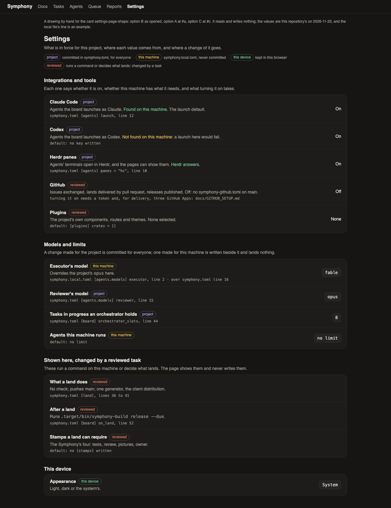  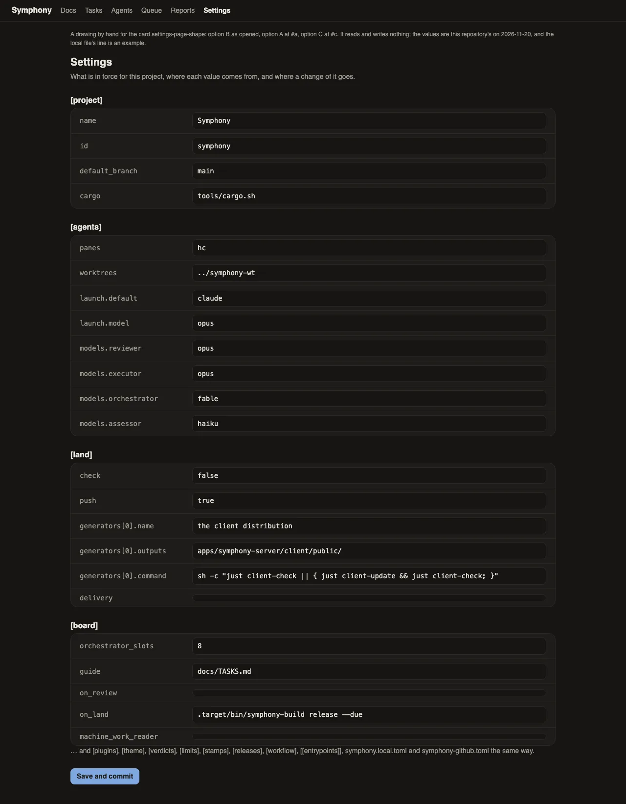

    **What "on and off" covers.** Your four examples are three kinds of change. Herdr is a switch already (`panes`). Claude Code and Codex are not: one setting picks which a launch starts, and both are always installed. GitHub off is one line, and on is a setup with tokens and GitHub Apps no page can do. B gives the first two a switch and the third a row that says why it is off and opens its guide.

    **Why not C.** Whoever reaches the server from this machine or your tailnet is you. That is enough for a verdict. It is not enough for `[board] on_land`, a command this machine runs after every land. Two rules already sort every key this way: the local file refuses those keys, and a landing that changes one needs a reviewer. B takes that line as it is.

    **What each costs.** A: one page and one read. B: A, two writers (the local file's exists in the model command) and a control per kind of value. C: a control for every shape in the file, the workflow and the landing's generators among them, and the comments a project wrote beside its values to keep.

    **Earlier verdicts checked.** **hosted-ingress-boundary** (B) says where a hosted server checks who visits, not what a page may write. **project-workflow-shape** and **configurable-workflow-activation** decide the workflow's settings, which B only shows. None decides a Settings page.
  [2026-11-20 06:56] agent — B on a phone, and the page the three pictures are of:  [Open the mockup](product/analysis/settings-page/mockup.html).
  [2026-11-20 06:40] owner · approved — B
  [2026-11-21 10:20] agent — Recorded: B. Settled by it without a card: GitHub's settings decide what lands, so its row shows the state and why and files a task for on and for off; the page is at `settings` under the project, in the header after Reports. [[product/analysis/settings-page#Settled by the answered cards]]
- [x] **settings-page-project-save** — If the Settings page may change a preference for the whole project (a model, a limit, Herdr on or off), the change is to a committed file. How does it reach main? A: as your answers on cards do: the page commits it straight to main, after the settings check passes on the result; where a project lands by pull request it is kept and delivered as a document save is. B: always a task: the page files one with the change, and it lands on the settings check when its orchestrator lands it. C: the page writes nothing committed and shows the command to run. Recommended: A. Approve and say A, B or C in the note, or comment. [[product/analysis/settings-page#What a save writes]]
  [2026-11-20 06:55] agent — Posted for the board task `app/settings-page`. Base: today such a change is an edit or `just symphony-cli model`, then a task that lands on `just settings-check` green with no reviewer.

    **The gate is the same under A and B:** the settings check. A drops the task around it, and the commit is the record. Under A a switch holds when you flip it; under B when someone lands it.

    **What A may write** is only what lands without a reviewer today. A setting that runs a command or decides what lands is not written by the page under any option (**settings-page-shape**).

    **A change for this machine alone** is not asked here: it goes in `symphony.local.toml` and lands nothing, as now.

    **What each costs.** A: the committer your saves use, with one more kind of edit. B: a task, an assessor's read and a land for each flip. C: nothing.

    **Earlier verdicts checked.** **github-outbound-pr-delivery** and **github-delivery-proof-setup** decide that a land may be delivered by pull request; A follows what document saves do there and changes none of it. None decides how a settings change lands from a page.
  [2026-11-20 06:39] owner · approved — A, but some things could also just be in symphony's DB too. And a fallback mechanism could exist where when missing db entries, the settings file are used.
  [2026-11-21 10:20] agent — Recorded: A, a project-wide change is committed straight to main after the settings check. Your note is taken as you wrote it: the board's database is a place of its own, read before the settings file, and the file is used where it has no entry. It never holds a setting that runs a command or decides what lands. Which preferences go there is not said by the note, so it is asked on **settings-board-store**. [[product/analysis/settings-page#What the board keeps]]
- [x] **settings-page-entries** — You expect more things to turn on and off than the four you named. Where does the page's list come from? A: the Symphony holds it: the page knows GitHub, the agents, Herdr and the plugins by name, and a new one is new page code. B: each thing describes itself in one small shape (its name, its state and why, what it needs, its settings and whether each is a preference or reviewed), and the page draws whatever is described; the Symphony's own first, then programs like the GitHub exchange and a project's plugins. Recommended: B. Approve and say A or B in the note, or comment. [[product/analysis/settings-page#What makes an entry]]
  [2026-11-20 06:55] agent — Posted for the board task `app/settings-page`. Base: today nothing lists these; GitHub says its state in `symphony-github status`, the agents and Herdr in `just tasks limits` and the agents page.

    **Under B a plugin can add a row** (a calendar, an identity provider) with no change to the page, and a blueprint can name the entries it turns on. Under A neither can.

    **What B costs.** A shape to agree on and keep stable for plugins, under the kit's version rules, as a block is. It is built in two steps: the Symphony's own entries in that shape, then the seam for programs and plugins. The first step costs about what A does.

    **A description runs nothing.** It cannot lower a setting's class: whatever would run a command or decide what lands is reviewed, whatever its plugin says.

    **Earlier verdicts checked.** **kit-new-block-version** decides how the kit takes a new block, which B's seam would follow. **plugin-delivery-choice** decides how a plugin is delivered, not what it may describe. None decides this.
  [2026-11-20 06:38] owner · approved — B
  [2026-11-21 10:20] agent — Recorded: B. The Symphony's own entries are built in that shape first, with the page's reading half, filed as `app/settings-page-reads`; programs and plugins follow once it has held.

### GitHub delivery

- [x] **github-delivery-policy-reader-standing** — The trial you approved was run and settled it: with Administration (write) the third App is shown both lists, and they are what they should be, nobody let past the evidence rule and the landing App alone let past the update rule. The App is back to Administration (read). GitHub shows those lists only to a reader with write access to the rule set ([its documentation](https://docs.github.com/en/rest/repos/rules#get-a-repository-ruleset)), and of the App permissions tried, the one that showed them, Administration (write), can also change or remove the rules. Should such an identity stand on the real repository, `heavenstudio/symphony`, so every land can read them? A: yes, the third App is installed on `heavenstudio/symphony` with Administration (write) and used at each land for that reading alone. B: no; a person confirms the two lists by hand when delivery is turned on and whenever the rules are changed, and every land checks everything else. C: neither, and pull-request landing stays off. Recommended: B, because the key that A keeps on the landing machine could remove the protection outright, which is more than the change it would be there to notice. B is not the same protection: a person's look takes the place of a reading at every land. Approve and say A, B or C in the note, or comment. [[workflow/analysis/github-pr-landing#Permissions and protection]]
  [2026-11-19 08:15] agent — Posted for the board task `tools/github-pr-verified-activation`, as **github-delivery-policy-write-trial** said it would be if write showed the lists.

    **What the trial showed.** One reading of each rule set on the throwaway repository, with a token limited to it: both answered with their list present, the evidence rule's empty and the update rule's naming the landing App alone. The token was revoked, the App was put back to Administration (read) and that was confirmed on its installation page. No rule was edited and the two other Apps were not touched.

    **Under A,** the machine that lands would hold a third key, and a token from it can edit or delete the rules of `heavenstudio/symphony`, which neither of the two approved Apps can. Symphony would use it for two reads at each land and nothing else, but of the GitHub App repository permissions tried, Administration (read) did not show the lists and only Administration (write) did, so the limit to reading would be Symphony's and not GitHub's. It needs a small change so the reading uses a token of its own, and its own task.

    **Under B,** every land still reads the rules in effect, their settings, the pinned check source and each App's own standing, as the two Apps can today. What goes unread is whether someone was added to a list after a person last looked. Adding someone takes write access to the rule sets, which a repository administrator has and another identity may be given, and which neither of the two Apps has. B replaces a reading at every land with a person's look when the rules change: a process to keep, not the same check, and a list changed without anyone saying so goes unseen until the next look. The check today refuses when it cannot read the lists, so B needs a change that lets it accept a recorded confirmation by a person in their place, and its own task.

    **Under every option** nothing is installed on `heavenstudio/symphony` and no permission changes with this card. Neither A nor B is built: each needs code of its own, in a task of its own, and proof with Symphony's own adapter against GitHub, and delivery stays off until then. The card is for `heavenstudio/symphony` alone: a consuming project's own repository keeps its own approval and administration.

    **Earlier verdicts checked.** **github-delivery-policy-write-trial**, approved as A, covers the one reading on the throwaway repository and says real use is asked separately, with B still open. **github-delivery-policy-reader**, approved as A, covers the read-only identity, which stays as it is. **github-delivery-proof-setup** gives the two Apps no Administration, which stays so under every option here.
  [2026-11-19 08:22] agent — Corrected before this card reached main, for the board task `docs/github-delivery-policy-reader-standing`: it names the real repository, `heavenstudio/symphony`; it says that no narrower grant showed the lists among the GitHub App permissions tried, not among every identity; it no longer says only an administrator can add someone to a list, since write access to a rule set is enough; and it says that B puts a person's look in place of a reading at every land, which is not the same check. That a rule set's list of who is let past is shown only to a reader with write access to it is [GitHub's documentation of reading a rule set](https://docs.github.com/en/rest/repos/rules#get-a-repository-ruleset).
  [2026-11-19 10:35] owner · approved — A
  [2026-11-19 11:05] agent — Taken as A for `heavenstudio/symphony` alone: a third App with Administration (write), used by Symphony for the two readings at each land and nothing else. It is built and proved in the board task `tools/github-pr-verified-activation`, by its executor, in commits of its own, not in a separate task as the card said: the proof of the delivery cannot be made without it. Installing that App on the repository is yours to do on GitHub when the executor asks; delivery stays off until the proof is posted and reviewed.
- [r] **github-delivery-policy-write-trial** — The read-only App you approved was made and tried, and GitHub does not show it the lists either: reading a repository's administration is not enough. The one level left to try is writing it, and an identity that can write a repository's administration can also change or remove the rules it is there to read. May that be tried, on the throwaway repository only? A: yes, the third App is given Administration (write) there, for one reading, to learn whether GitHub then shows the lists, and is put back to Administration (read) right after it. B: no; a person confirms the lists by hand when delivery is turned on, and lands check everything else. C: neither, and pull-request landing stays off. Recommended: A, because it risks only the throwaway repository and settles what GitHub does; it decides nothing for the real one. Approve and say A, B or C in the note, or comment. [[workflow/analysis/github-pr-landing#Permissions and protection]]
  [2026-11-19 02:45] agent — Posted for the board task `tools/github-pr-verified-activation`, as **github-delivery-policy-reader** said it would be if reading was not enough.

    **What was tried.** The third App, with Administration (read) and Metadata (read), installed on the throwaway repository alone, read both rule sets and the rules in effect. Neither list of who is let past was in its answers. Its own standing was: let past neither.

    **Under A,** the change is to that one App on that one repository. It is not installed anywhere else, the check publisher and the landing App keep exactly the rights they have, and nothing is granted until you answer. The trial is one reading with a token that is revoked after it, and the App is put back to Administration (read) as soon as that reading is done, so write lasts only that reading; it edits no rule. Whether write shows the lists is not known.

    **What A does not decide.** If write does show the lists, using it for real would mean an identity on the real repository that could remove its protection, present at every land. That would be a card of its own, with the trial's result on it, and B stays open then.

    **Under B,** every land still reads the rules, their settings and each App's own standing, which is what the two Apps can see today. What goes unread is whether someone was added to a list after the day a person looked.

    **Earlier verdicts checked.** **github-delivery-policy-reader**, approved as A, covers the read-only identity and says a write level is asked separately. **github-delivery-proof-setup** gives the two Apps no Administration, which stays so under every option here.
  [2026-11-19 07:42] owner · approved — A
  [2026-11-19 07:44] agent — A is approved for the temporary throwaway-repository trial, including immediate return to Administration read and token revocation. I attempted to reach the signed-in browser, but Chrome and Arc expose no accessible window and the browser connector is unavailable. No App permission or repository rule was changed and the trial has not run. It can continue under this same approval when the browser is accessible; no further permission decision is needed for the approved trial.
  [2026-11-19 07:44] agent · resolved
  [2026-11-19 08:14] agent — Your A trial is complete. On the throwaway repository only, Administration write showed both bypass lists: nobody bypasses the evidence rules, and only the landing App bypasses the update restriction. The token was revoked (GitHub returned 204), and I immediately restored Administration read; the installation page confirms read-only administration and metadata, with only the throwaway repository selected. No rule was edited and neither existing App changed. This proves write suffices here; it does not authorize keeping that power on a real repository. Production use remains a separate choice, with manual confirmation or leaving delivery off still available.
- [r] **github-delivery-policy-reader** — The two Apps you approved work on the throwaway repository: GitHub refused every merge it should and let the landing App's squash through. One thing they cannot do is read who is allowed past the rules. Before each land, Symphony is to check that nobody is let past the evidence rule and that the landing App alone is let past the update rule; GitHub shows that list to neither App, so the check answers "unknown" and a land refuses. May a third, read-only identity be added to read it? A: yes, a third App used for that reading alone, tried on the throwaway repository alone, with read-only permission that may or may not show the list. B: no third identity: a person confirms the lists by hand when delivery is turned on, and lands do not check them after. C: neither, and pull-request landing stays off. Recommended: A, because only a reading at each land notices a list changed later. Approve and say A, B or C in the note, or comment. [[workflow/analysis/github-pr-landing#Permissions and protection]]
  [2026-11-19 01:35] agent — Posted for the board task `tools/github-pr-verified-activation`, with the preflight's needs from `tools/github-delivery-preflight`.

    **What was measured** on the throwaway repository, with each App's own token and reads only:

    - Both Apps read every rule and its settings: the pull request, the check and the App it must come from, squash alone, no force push, no deletion, restricted updates.
    - Each reads its own standing: the check publisher is let past neither rule set, the landing App past the update rule only. That is as designed.
    - Neither is shown either list of who else is let past. An administrator's login sees them: empty on the evidence rule, the landing App alone on the update rule.

    **Under A,** the third App is registered as the two were, from your signed-in browser, installed on the throwaway repository alone, with no webhook. It never merges and never writes a check, and its key is kept as theirs are, outside every checkout and shown nowhere. Its permission is tried there before anything else: Administration (read) first. GitHub's documentation says the list is shown only to those who can edit the rule set, so read may not be enough. If only Administration (write) shows it, nothing is granted: that comes back to you as a card of its own, since it could change the rules it reads.

    **Under B,** the rules are still read at every land, and each App's own standing with them. What goes unread is whether someone else was added to a list after the day a person looked.

    **Earlier verdicts checked.** **github-delivery-proof-setup**, approved, covers two Apps and says neither gets Administration; a third identity that reads the repository's administration is not what it described, so it is asked here and changes nothing of the two.
  [2026-11-19 02:39] owner · approved — A
  [2026-11-19 02:45] agent — A carried out on the throwaway repository only. Created Symphony Policy Reader with Administration read and Metadata read, no webhook, installed only on symphony-delivery-proof. Its token read both rulesets successfully, but GitHub omitted both bypass lists; read-only permission is insufficient for the required check. The temporary token was revoked and the key is secured outside every checkout. No write permission was granted, neither existing App changed, and delivery remains off. Any trial of Administration write will be a separate decision card, as this option required.
  [2026-11-19 02:45] agent · resolved
- [r] **github-delivery-proof-setup** — Landing by pull request, which you approved, can be turned on only once GitHub is shown to refuse a pull request whose evidence is missing and to let nothing but the landing itself update the default branch. Showing that needs three things that do not exist yet: two small GitHub Apps in your organization, one that writes a task's evidence as checks and one that merges, and a public throwaway repository to try the rules on, so nothing is tried on the real one. Who may set them up? A: you register and install the two Apps, and an agent creates the throwaway repository with this machine's GitHub login, sets its rules and runs the proof. B: an agent does all of it on your word, the Apps included, from a browser session of yours signed in to the organization. C: you create the Apps and the repository and name them on the task. D: none for now, and pull-request landing stays off. Recommended: A, because the Apps' keys are lasting credentials of your organization, best held first by you alone, while the repository is disposable. Approve and say A, B, C or D in the note, or comment. [[workflow/analysis/github-pr-landing#Permissions and protection]]
  [2026-11-18 20:06] agent — Posted for the board task `tools/github-pr-verified-activation`, whose read of both repositories found no rule on either default branch and no App that could write the checks.

    **The two Apps,** both registered in the public repository's organization, with no webhook, installable on that account only and installed on the throwaway repository alone:

    - **The check publisher** writes the checks. Its permissions: Checks (read and write) and Metadata (read), and no other.
    - **The landing App** publishes a task's branch, opens its pull request and merges it. Its permissions: Contents (read and write), Pull requests (read and write) and Metadata (read), and no other.

    Neither gets Administration, Actions, Workflows or any organization permission. They stay two Apps so that what can merge cannot also write the evidence. One checks App with a person's token doing the merge is not the proof: a rule set can let an App, a team or a role through, never one person's token, so the second rule set below could not be tried. Each App's private key stays in a file outside every checkout, readable by its holder alone. The task needs each App's number and nothing else: no key, token or path to one goes on this card or on the board.

    **The repository:** public and in the same organization, so the rules are tried on the plan and visibility the real repository has, and holding a few scratch commits and nothing of Symphony's or anyone's private work. The login here cannot delete a repository, so removing it after the proof is yours under every option.

    **The rules proposed for its default branch,** two sets, made by whoever creates the repository:

    - **What every change needs,** with nobody on its bypass list: a pull request, the evidence checks accepted from the check publisher alone, squash as the only way to merge, no force push and no deletion.
    - **Who may update the branch:** nobody, but for the landing App, the one name on this set's bypass list.

    The landing App is let through the second set only, and neither App through the first.

    **What is tried there,** as none of this is proved until it is: that GitHub refuses the merge while a check is missing, failed or written by anything but the check publisher, the landing App's own merge included; that it refuses a push straight to the default branch and a merge pressed by a person, an administrator among them; and that the landing App's squash goes through once the checks pass. If the organization's plan does not enforce all of it, pull-request landing stays off.

    **Not asked here:** installing the Apps on the real repository, its rules and turning delivery on, which follow the proof as steps of their own. The private copy a consuming project keeps is its own organization's to set up, by its own decision.

    **Earlier verdicts checked.** **github-outbound-pr-delivery**, approved, and your word on `tools/github-pr-delivery` settle that tasks land by pull request with their evidence enforced on GitHub, and the landing design already has the two identities and the two rule sets, so none of that is asked. Neither says who may register an App or create a public repository in your organization, and no agent has been allowed to.
  [2026-11-19 00:58] agent — Corrected before this card reached main, for the board task `docs/github-delivery-proof-setup`: it first named one checks App and left the merge to a person's token, which could not prove the rules. Each permission is the one GitHub's documentation gives for the call it is for ([what each endpoint needs](https://docs.github.com/en/rest/authentication/permissions-required-for-github-apps), [only an App writes a check](https://docs.github.com/en/rest/checks/runs)), and the rules and their bypass lists are [GitHub's rule sets](https://docs.github.com/en/repositories/configuring-branches-and-merges-in-your-repository/managing-rulesets/available-rules-for-rulesets).
  [2026-11-19 00:58] owner · approved — control my browser and do that step for me. Also, feel free to setup the throwaway repo.
  [2026-11-19 00:59] agent — Recorded as B: on your word an agent registers and installs the two Apps from your signed-in browser and creates the throwaway repository. Nothing is set up by this card's own task, which only publishes it: the setup and the proof are the board task tools/github-pr-verified-activation's, told of your answer on its thread. Each App's key is saved outside every checkout, readable by you alone, and shown nowhere. The proof also tries what a person can still merge by hand after a task's evidence is withdrawn, which should be nothing once updates are restricted. Removing the repository afterwards stays yours, as the login here cannot delete one.
  [2026-11-19 01:15] agent — Created the public throwaway repository [heavenstudio/symphony-delivery-proof](https://github.com/heavenstudio/symphony-delivery-proof), with only a scratch README and squash as its only merge method. Your approval covers the two Apps and their proof-repository installations; no further decision is needed. The signed-in browser reached the App registration form, but concurrent browser interaction keeps switching it away and interrupts control. App creation, protected-branch rules and the proof are still pending; no App or key has been created, and the real repositories are unchanged.
  [2026-11-19 01:15] agent · resolved
- [r] **github-outbound-pr-delivery** — Symphony can show local work on GitHub either as delivery updates linking the landed commit, or as pull requests opened before the local merge. Which should the first optional integration deliver? A: issue exchange and incoming PR tracking first; local deliveries post merge links, with outbound PR creation deferred. B: also publish a draft PR from a selected task branch before local land, naming its reviewed commit. This explicitly permits those branch pushes when enabled; local stamps still decide readiness and the local land alone merges/pushes main. Recommended: B, because it delivers outbound PRs as requested. Approve and say A or B in the note, or comment. [[operations/analysis/github-integration#Pull requests and local land]]
  [2026-11-17 18:59] agent — The current policy pushes only main through land. A keeps that policy but does not create outbound PRs. B exposes selected task branches and needs a publisher, scoped credentials and recovery; a PR or GitHub review grants no local approval. Neither option enables integration now or lets GitHub merge main.

    **Earlier verdicts checked.** **needed-stamps** governs local evidence and stays in force under both choices. **release-delivery** governs installed releases, not task branches. Your task asks for optional GitHub integration and PR delivery; it does not choose the publication step or authorize implementation during this design phase. Optionality and MIT are already settled and are not asked again.
  [2026-11-17 19:13] owner · approved — answered in another ticket just written.
  [2026-11-17 19:18] agent — Recorded against your new task, inbox/change-just-land-and-review-commands-to: when PR mode is enabled, stamped changes use GitHub squash merges with assessed evidence enforced on GitHub; checks still run locally, and simple document-only changes may retain local delivery. That task is staffed for the integration design. This supersedes the local-merge-only assumption above; we will align the GitHub proposal without asking this choice again.
  [2026-11-17 19:18] agent · resolved
  [2026-11-17 19:21] agent — Located the owner-created ticket inbox/change-just-land-and-review-commands-to. Its direction is settled: once the GitHub plugin lands and PR mode is enabled, stamped/code delivery uses gh PR squash merge, required or explicitly waived local stamp evidence is represented and enforced on GitHub, and checks remain local without per-PR hosted CI. Simple document-only local delivery is an optional constrained boundary for that concept to specify. This supersedes my proposed local-only merge assumption; I will update the integration analysis and coordinate with that ticket without asking another A/B question or enabling anything here.

### Releases

- [r] **schema-move-keeps-pages-writing** — After a landing that changes the board's layout (its schema), your pages save nothing, and the server sends no reminders to agents, until a release with that layout is on the machine: one release run, under 40 minutes when green, now that the orchestrator starts it at once. Most such changes only add tables of their own, which the server never writes: the last six did. Should the server keep writing through such a change? A: yes, when the change says it only adds tables of its own, a test checking that on its branch: the server keeps writing a board one layout ahead, and a change that touches anything it writes waits for the release run as now. B: this board moves only when a release brings its layout, as the other projects' boards do: your pages wait minutes, but here every board command runs one layout ahead of the board until then, and a board feature or fix landed here works on this board only from that release. C: as now, your pages wait one release run after each such landing. Recommended: A. Approve and say A, B or C in the note, or comment. [[operations/analysis/schema-move-read-only-window#Recommendation]]
  [2026-11-19 08:05] agent — Posted for the board task `tools/no-read-only-window-after-a-schema-move`, the fourth way **schema-landing-then-release** proposed and left undecided. Nothing of it is built.

    **What A changes.** Each layout change says, in one line, whether it leaves the server's writes as they were; one that says nothing does not, and keeps the wait. A test on its branch refuses the line when the change touched a table that existed before, and its reviewer reads it for a rule in code alone. Only the server is let through: every other program that writes the board is refused one layout ahead, as now.

    **What a wrong line costs under A.** Caught on its branch when the change is in the database. A rule held in code alone, wrongly declared, would let the server's own writes skip it for one release run, such as a cancel the new rule forbids: tasks in a state the new build says cannot be, put right by a fix. Nothing is lost.

    **What it would have done.** 17 to 22, six layout changes from 2026-11-11 to 11-18, only added tables: none would have stopped your pages. 14 to 16 changed existing tables and would have. Of the two changes to 23 waiting now, `tools/durable-provider-attempts` would keep your pages writing and `tools/workflow-runtime`, which checks every write of a task, would not. A pays from the first change after a release that carries it; building it is a layout change of its own, with one last wait.

    **What B costs.** Either every board feature that comes with a layout change checks the board's layout at each write for hours, and a wrong line stops every agent's commands rather than your pages; or this repository's board commands run the release's build, as a project with no build of its own, and a board fix landed here waits for a release, 27 minutes to 16 hours since 2026-11-16.

    **Under every option** the release run after a layout change still runs, and a second layout change waits until a release serving the first is current.

    **Earlier verdicts checked.**
    - **schema-landing-then-release** (A) decides what follows such a landing, a release run at once, and leaves this way undecided by its own words: no option here changes that run.
    - **board-schema-at-update** (C) moves a board only once its writers are at the new layout, and keeps this board moving with main. A and C keep both; B ends the second, so it is asked here.
    - **live-board-schema-moves** (A) chose for two tasks and sets no rule.
  [2026-11-19 08:04] owner · approved — A
  [2026-11-19 08:06] agent — Your "A" chooses compatibility declared for each schema change: the server may keep writing one schema ahead only when that change preserves its writes; an undeclared or incompatible change stays read-only, and other writers keep their existing guard. We will carry that choice into implementation after this design is published. Two corrections to the proposal remain: a wrong declaration can violate data invariants, so no-loss or automatic repair is not guaranteed; and immediate release start does not bound the wait when verification or the refresh writer gate holds it. The immediate-release rule and the hold on a second schema change remain. Nothing is implemented yet.
  [2026-11-19 08:06] agent · resolved
- [r] **schema-landing-then-release** — When a task that changes the board's layout (its schema) lands, this project's pages stop saving until a release with that layout runs on the machine: the board still shows, but your verdicts, messages and changes wait or are refused, and reach no agent. Today that lasts until the next release run, which comes every 20 landings, so for hours. What should follow such a landing? A: the orchestrator starts a release run right after it, without asking each time: your pages wait for that run, under 40 minutes when it is green, at the cost of one run outside the count. B: the approved task waits and lands just before the count's next run, its landing the one that starts it: your pages wait for the same run and nothing extra runs, at the cost of holding the task for up to 20 landings. C: as now: it lands when approved, and your pages wait until the count brings a release. Recommended: A. Approve and say A, B or C in the note, or comment. [[RELEASES#The switch]]
  [2026-11-19 04:52] agent — Posted for the board task `docs/schema-landing-then-release-card`. Two tasks would each change the schema: `tools/durable-provider-attempts` (in review) and `tools/workflow-runtime` (in progress), both to 23 on their branches, so the second to land becomes 24. Read on 2026-11-19 at 04:50: main and release-2026-11-19, which `current` names and the machine's server runs, are at schema 22.

    **Your pages meanwhile.** In this repository the board moves at the first board command after the landing. The machine's server is the release `current` names. With the board one schema ahead it shows the board and writes nothing: your saves and chat wait in its journal, a message on a task, a priority, a field or a cancel is refused, every page says so, and a verdict saved meanwhile reaches no agent until the server reloads at the new schema. Two schemas ahead, it shows no board at all.

    **What ends it.** A green release run at the new schema, its refresh pointing `current` at it, and the server following by its own reload. Three things stand in between, under every option:
    - **The count.** A run starts once 20 tasks have landed, and 45 to 97 landed a day from 2026-11-15 to 11-18. After five of the last six releases the count's next run came 2½ to nearly 10 hours later.
    - **A red run.** 19 of the 26 runs since 2026-11-16 were red. A red run's commit is held as the release candidate until its fixes land and a rerun is green: from a counted run's start to its release took 27 minutes to 16 hours, 2¼ hours or less in four of the last six. While a candidate is open no run checks main's newest commit, by hand or by the count; one was open for 25 of the 56 hours since release-2026-11-16.
    - **The other two projects.** `current` moves only once every program seen writing their boards in the last week is at the new schema. That held release-2026-11-18 for 1 h 50 and release-2026-11-18.2 for 1 h 08, until those programs were brought up and the refresh rerun.

    **What happened.** On 2026-11-17 schema 20 landed at 06:04 while the machine's server was at 18, two behind: it showed no board of this project until it was replaced at 13:03. On 2026-11-18 your verdicts saved from 12:47 reached no agent until 18:05. Schema 21 had landed at 23:02 the night before; its release came at 12:28, the other projects held it until 14:18, and the server took it up only at 17:48. Schema 22 landed meanwhile, at 15:46: the count's run started at 16:03 and was red, its rerun released release-2026-11-18.2 at 16:57, and the other projects held it until 18:05.

    **A run** takes 17 to 37 minutes when green (7 since 2026-11-16, the install and the refresh included) and 20 to 63 when red.

    **What each costs.**
    - **A:** at most one run more per schema landing, on this machine, and the count starts again from it: there were four schema landings beside the 26 runs since 2026-11-16. A schema landing still waits while a run or a candidate holds the release, since a run started then runs nothing on main's newest commit; B waits for them too. Starting a release run by hand is your call today, so A is your standing word for these runs.
    - **B:** nothing runs beyond the count. The approved task waits for it, up to 20 landings, and its branch takes main's newer commits meanwhile, so a conflict sends it back to review; tasks that build on it wait as well. The orchestrator lands it when `just release --status` says the next landing starts a run.
    - **C:** nothing to do. Your pages wait for the count as well as the run, hours each time, as on 2026-11-18.

    **Under every option** the orchestrator holds a second schema landing, without asking, until a release serving the first is `current`, so the board is never two ahead. With both tasks above approved, that is two runs, an hour or so when green, under A; under B, a count for each.

    **A fourth way would remove the wait rather than shorten it.** Nothing of it is built or designed: it is proposed as a design task for the orchestrator to file, and this card does not decide it. The wait comes from one rule, that a program writes only a board at its own schema.
    - A release's server could keep writing a board one schema ahead wherever that schema changed nothing it writes, each schema saying whether it did: 23 on `tools/durable-provider-attempts` only adds four tables the server never writes, while 23 on `tools/workflow-runtime` adds checks on every write of a task.
    - Or this board could move only at the refresh, as the other projects' boards do. Then main's newer build would have to write a board one schema behind instead, the same rule turned round, and this board would no longer move with main, as **board-schema-at-update** keeps it.

    **Why A.** A and B leave your pages the same one run, against hours under C. A spends at most one run per schema landing, and none on this machine once the release runs on GitHub; B spends approved work held for hours at every schema landing, with a second review when it conflicts, and a count for each when two come together.

    **Earlier verdicts checked.**
    - **live-board-schema-moves** (A, 2026-11-15) landed two schema moves at once and took the read-only pages until a refresh, over a release run by hand after each landing (its B, close to A here). The refresh was red then with no end in sight, so that B meant holding both tasks first. It chose for those two tasks and sets no rule for every schema landing. Its other half, the second move "only after the server is refreshed", is the hold above.
    - **release-main-judged-in-steps** (rejected, 2026-11-18): you refused a round after each landing for the load, and called the count "mostly a control for that, so the machine isn't always under load". A adds a run per schema landing, not per landing; it weighs on A and does not decide it.
    - **release-run-on-github** (approved, 2026-11-18) runs the release's checks on GitHub's machines, which would take A's run off this one. It is not built: its trial, `tools/release-hosted-trial`, is in the backlog.
    - **release-main-while-candidate-open** (A): no run of main's newest commit while a candidate is open, which A and B both wait out.
    - **board-schema-at-update** (C): a board moves only once its writers are at the new schema. It is the third wait above under every option, and the fourth way's second form would change what it keeps for this board.
  [2026-11-19 07:43] owner · approved — A
  [2026-11-19 07:45] agent — A recorded as standing authorization: after a schema-changing landing, the orchestrator starts its release run immediately, without asking again or waiting for the 20-landing count. A schema landing still waits while an active run or candidate prevents that run, and the next schema landing waits until the first schema is served by current. Release reds and refresh prerequisites still have to be resolved; this does not authorize bypassing them or manually restarting the shared server. I have routed the rule to the release coordinators and the project guidance update.
  [2026-11-19 07:45] agent · resolved
  [2026-11-19 08:00] agent — Your A is now written and landed on main at a727950d4efb: RELEASES, The cadence and Who runs it, hold the rule; AGENTS.md and the orchestrator guide point to it. A schema landing starts its release immediately unless its own cadence hook already started it. Active-run/candidate and second-schema holds remain, and a red run or blocked refresh still follows the normal recovery rules.
  [2026-11-19 12:45] agent — The hold on a second schema landing is removed, by the owner's word of 2026-11-19 as commit b1be7b0d5 recorded it: said in the orchestrator's terminal, on the hold that kept the approved workflow runtime unlanded, "remove this rule". That commit's message is the only record of it; nothing of it is on this card's thread or the board. A second schema landing no longer waits for `current` to name a release serving the first's schema, so this board may stand two schemas ahead of the machine's server, which then shows no board of it until a release at its schema is `current`. This replaces "Under every option" above, the hold in the 07:45 and 08:00 lines here, and the same hold in **schema-move-keeps-pages-writing**. What stays: the release run at once after each schema landing, and the wait while a run or a release candidate holds the release. The rule is in RELEASES, The cadence, and the orchestrator's guide.
- [r] **release-run-on-github** — As you asked, the release's checks could run on GitHub's machines once the GitHub plugin is in, so a busy or sleeping laptop no longer decides a release. A project without the plugin keeps today's local run unchanged. Is this the design? One workflow, started only by `just release` for one commit, runs that commit's own checks on GitHub's macOS runners. `just release` waits, reads the result, files any red here, and on green tags and refreshes from this machine as today. No secret goes to GitHub. If GitHub does not answer, the run checks locally and says so. Approve, or comment with what to change. [[workflow/analysis/release-pipeline#The hosted run on GitHub]]
  [2026-11-18 11:26] agent — Posted for the board task `docs/release-pipeline-redesign`.

    **Cost.** No money while the repository is public: GitHub's standard runners are free there. Time is an estimate until tried: 45 to 90 minutes for a whole run on 3-core runners, against 21 to 54 here under load, and 10 to 20 for a rerun of what a fix touched.

    **First step once approved:** a trial of the workflow on one commit, by hand, to measure it and to see that the browser and store tests fit a runner's 7 GB.

    **It waits for** `tools/github-pr-delivery`, whose GitHub credential it uses.

    **Earlier verdicts checked.** **github-outbound-pr-delivery** and the landing design keep a task's checks local with no hosted job per pull request; this runs the release's checks only, never a task's. No earlier card decides where the release run runs.
  [2026-11-18 12:54] owner · approved — Yes, correct
  [2026-11-18 18:12] agent — The design stands as written, and the work is handed on: the orchestrator files its board tasks from the paragraphs posted on the board task `docs/apply-owner-verdicts-2026-11-18`. Your answer reached no agent until 18:05: the machine's server was one board schema behind and delivered nothing.

    1. **The trial.** The workflow file, started by hand for one commit, measured: how long a run takes, and whether the browser and store tests fit a runner's 7 GB. It tags nothing and starts on no push or pull request.
    2. **The hosted run in `just release`.** It starts the workflow, waits, believes the result only for the bound repository, main's workflow file and the exact commit, files reds here, tags and refreshes here, and checks locally when GitHub does not answer. Off unless a project turns it on.
    3. **Its clock,** from your note on **release-main-judged-in-steps**: once a run is measured, a run of main on GitHub at an interval set from its length. Never on this machine.

    **They wait for** `tools/github-pr-delivery`, in progress, for its GitHub credential and repository binding. `tools/github-pr-verified-activation` turns on pull-request landing only and covers none of this.

    Turning the hosted run on for this repository is a `[releases]` setting, and stays your word.
  [2026-11-18 18:12] agent · resolved
  [2026-11-18 18:16] agent — Filed: tools/release-hosted-trial (the hand-dispatched trial, after tools/github-pr-delivery), then tools/release-runs-hosted, then tools/release-hosted-clock for the interval you described on release-main-judged-in-steps.
- [r] **release-run-reruns-alone** — Since last night the release run was red eight times and released nothing. Two of those runs were red only in tests that pass when run by themselves, and 11 such tests were deleted to get past them, each costing a round of about an hour. Should the run itself run each failed test again alone before it calls the release red? A: as today; the run is red, an agent reruns the test, deletes it if it passes alone, and the run starts again. B: the run reruns each failed test alone, up to 12. One that fails again is red, as today. One that passes alone does not hold the release: the run says both results, and files one task to find out why and then fix, rewrite or delete the test. Recommended: B. Approve and say A or B in the note, or comment. [[workflow/analysis/release-pipeline#B. The run reruns each failure alone]]
  [2026-11-18 11:26] agent — Posted for the board task `docs/release-pipeline-redesign`.

    **What B would have done.** A release at about 22:40 last night (run 2026-11-17T2211-98626, red in one test that passed alone), and that candidate never dropped. Failing that, one at about 10:00 today (run 2026-11-18T0931-12491, two such tests).

    **What B changes.** Today a test that fails beside the others and passes alone is deleted before the release. Under B the release is tagged with that test still there, and its task follows. Nothing is run less: the test runs twice.

    **Why B.** Passing alone does not prove load. Three of the 11 deleted tests failed on one line (`idle=1` for `idle=0`) that turned out the next morning to be the tests reading this machine's own terminals, which was fixed with nothing deleted. Under B they would have been looked at, not removed.

    **It also settles the candidate's limit of three red reruns:** a rerun red only in tests that pass alone would no longer count, so neither of yesterday's candidates would have been dropped.

    **Earlier verdicts checked.** **release-candidate-process** (A) holds a commit and reruns what was red; it does not say what makes a rerun red. Your rule that a test red on load is discarded says what happens to the test, and B keeps it; it does not say whether the run or an agent makes the run alone.
  [2026-11-18 12:47] owner · approved — B
  [2026-11-18 18:12] agent — B is the design now, and the work is handed on: the orchestrator files one board task for it, from the paragraph posted on the board task `docs/apply-owner-verdicts-2026-11-18`. Your answer reached no agent until 18:05: the machine's server was one board schema behind and delivered nothing.

    **What gets built.** The release run reruns each failed test alone, up to 12, in the same checkout and build. One that fails again is red, as today. One that passes alone does not hold the release: the run records both results and the load at each, and files one task to find out why, then fix, rewrite or delete the test. More than 12 failures is a red with no reruns. A candidate's rerun counts against its limit of three only when something in it fails alone.

    **Until it lands** the run behaves as today, and [[RELEASES#The release run]] says so. That task rewrites it, and the rule that a test passing alone is deleted in the red's own fix.

    **It waits for** `tools/release-steps-carry-by-inputs`, in progress, which edits the same files of the run.

    [[workflow/analysis/release-pipeline#B. The run reruns each failure alone]] now reads as chosen.
  [2026-11-18 18:12] agent · resolved
  [2026-11-18 18:16] agent — Filed: tools/release-reruns-failures-alone, which starts once tools/release-steps-carry-by-inputs lands (same files).
- [r] **kit-new-block-version** — Before the plugin kit goes to crates.io at 1.0.0, one thing about it cannot be changed later without a new major version: what happens to its version when Symphony adds a new kind of block (or a new kind of text span or media) to the vocabulary plugins draw with. A: a new block is a small update (1.1.0): a plugin written for 1.0.0 keeps building and gets the update by itself. B: a new block is a new major version (2.0.0): every plugin's author must change its requirement by hand before it can use any later kit. Recommended: A. Approve and say A or B in the note, or comment. [[RELEASES#Packages on crates.io]]
  [2026-11-14 02:12] agent — Posted for the board tasks `tools/kit-version-lines` and `tools/release-publishes-to-crates-io`; nothing is published yet, and nothing will be until you say so.

    **What it is in the code.** The vocabulary is three lists in `symphony-blocks`: `Block`, `Span` and `Media`. Rust lets a list be marked as one that may grow. Marked, adding to it is a small update. Unmarked, as today, adding to it is a breaking change, because code elsewhere may have listed every case.

    **A, marked as growing.** A plugin only makes blocks, it does not list them, so nothing changes for a plugin. The cost is in Symphony's own client, the one place that lists every block to draw it: the compiler no longer refuses a build where a new block has no drawing, so a test does that instead (it goes through every block and fails on one the client does not draw).

    **B, as today.** The compiler keeps checking the client. Every new block, span or media kind makes the kit 2.0.0, 3.0.0 and so on, and each consuming project and plugin author moves by hand each time.

    **Why A.** New blocks are how the product grows, so under B the kit's major version would move often and mean little. The check B keeps can be kept by a test. Choosing A after 1.0.0 is published would itself be a new major version, so now is the cheap moment.
  [2026-11-14 06:29] owner · approved — A
  [2026-11-15 11:14] agent — Recorded: A, a new kind of block, text span or media is a small update of the kit. It is not in the code yet: the three lists are still unmarked, and the plugin protocol's document said a new kind was a new major. That document now says the rule you chose and that the lists get marked, with a test that the client draws every kind, before the kit's first publication. The task that does it is asked of the orchestrator on the board task `docs/owner-answers-applied`; nothing is published before it lands. [[PLUGIN_PROTOCOL#Versions]]
  [2026-11-15 11:14] agent · resolved
- [r] **consumer-contract-versioning** — A consuming project could take Symphony's parts one at a time, each when it is ready, and Symphony's releases would stop waiting on that project's whole test suite; how much can be phased depends on how far the contract goes. Today the project takes all of Symphony at one commit, and the machine's one server is built from it. How far should the contract go? A: the process boundary only: a project links nothing of Symphony, its plugin is a program of its own speaking the versioned plugin protocol, and the machine runs one Symphony release for the server, the board commands and the client. B: A, plus a few packages with version numbers of their own that a project may keep linking at the version it names: the plugin kit (its seams, blocks and doc checks) as one, and each small helper (child processes, schema checks, arguments, the repository reader). C: every one of the 14 packages versioned on its own, a project linking what it links today. Recommended: B. Approve and say A, B or C in the note, or comment. [[engineering/analysis/consumer-contract#The options]]
  [2026-11-13 18:42] agent — Posted for the board task `docs/consumer-contract-analysis`, from your comment on **conciliation-consumer-own-reds**.

    **What a project can stay behind on:**
    - A: its plugin program, while the machine's server speaks that program's protocol major (how many releases a major lasts is a number to set), and its scripts and tools that call `tasks api` or Symphony's commands, within those versions.
    - B: A's, plus its plugin kit's version, and each helper for as long as it likes, since nothing on the machine shares them.
    - C: any package, within what the others' versions accept.
    - None of them: a server, board commands or a board schema older than the machine's. Those stay one per machine and move together at its update, as you chose for the board: "C makes sense to improve upon A. while we don't have a dedicated build service."

    **What Symphony must keep working:**
    - A: every minor of the plugin protocol, and the previous major for that window; the board's `tasks api` calls; command names and outputs; settings keys (the server already leaves out one it does not know and reads the rest; the lint and registration would warn of a retired one for the window rather than refuse it).
    - B: A's, plus the kit's and the helpers' Rust names within a major, a check against the previous version's tag saying when a change needs a new one. Last week 0 to 13 commits touched these parts' sources.
    - C: the Rust names of every package, the library and the board included, whose sources 198 and 270 commits touched last week (commits, not counted changes to public names); and a package registry, since with Git pins two versions of this repository bring two copies of every package they share (tried here), whose types do not match (from Cargo's documentation; not compiled).

    **The work:**
    - Here, A and B: finish the plugin path you chose ("Let's go with B first, measure results against the current approach for a post change comparison."): every seam answered from a process, and the release installed on the machine instead of built by a project; then checks of the contract in place of the conciliation. B adds the kit split out of the wire types, and its version tags. C adds the registry, version checks for every package, and tests across the versions a project may combine.
    - On the consuming project's board, A and B: its host is no longer built (4 files); its plugin becomes a process and leaves the library's internals (27 of the 44 of its files that name the library); its review tool writes the board through `tasks api` rather than the board's library. Two other users of the library need an answer: an art tool (9 files), which runs Symphony's status, triage and page rendering with its plugin installed, and its review tool's landing (4 files), which takes the landing's checks and the lock it shares with the server. Under A both reach those through the machine's commands or copy them, and the project also copies the helpers it links, one of them in 132 of its files. Under B the analysis proposes the art tool through the machine's commands, and the landing on the library at the kit's own tag, which promises nothing, so a break there is the project's own, found by its gate.

    **What changes for releases, under A and B:** a release is judged by checks this repository owns (the plugin protocol, `tasks api`, the kit's version check), never by a project's whole suite, so a project's own reds stay on its own board. The release is installed on the machine and moves no project's pin; each project moves its kit and helpers through its own landing. Until that is built, **conciliation-consumer-own-reds** decides what holds a release.

    **Why B.** It phases what a project's own code can phase, and promises stability only where little changes. A makes the project copy code it links today, and possibly change its plugin at whatever kit it rebuilds with, for no promise in return. C promises stability on the packages that change most, needs a registry, and still cannot phase the server or a board.

    **Earlier verdicts checked.** **plugin-delivery-choice** (B), **release-delivery** (C) and **board-schema-at-update** (C) chose how plugins, releases and boards reach the machine: A and B build on them, and C leaves them as they are. **symphony-update-command** (B) has projects follow release tags, which every option keeps. **consumer-api-break-release** (A) keeps an old name beside the new for a release, which B keeps for its kit. None says whether packages are versioned apart, so none decides this card.

    This card is the only change. The build is filed after your verdict. [[engineering/analysis/consumer-contract#Why B]]
  [2026-11-13 19:39] owner · approved — There are multiple A/B/Cs here. No way to decide on all things. Those are separate decisions. For the original question, I agree with approach B
  [2026-11-13 20:27] agent — Recorded: B, for the question this card asked. A project links nothing of Symphony but the plugin kit (its seams, blocks and doc checks) and the small helpers (child processes, schema checks, arguments, the repository reader), each at the version it names; its plugin is a program of its own speaking the versioned plugin protocol; and the machine runs one Symphony release for the server, the board commands and the client.

    **What B decides, so none of it is asked:**
    - **Where versions live:** this card gives B "its version tags" and the registry to C, so the kit and each helper get a line of tags in this repository, cut by the release run; Git is enough. The kit and the helpers start at 1.0.0: for a pinned tag Cargo reads 0.x and 1.0 alike.
    - **The board's rules:** under every option the board commands "stay one per machine and move together at its update", so a changed rule reaches every project at the machine's update, the release's notes saying so, and a project's test that relied on the old rule is that project's to update. `tasks api` promises what its calls take and answer, not the rules behind them.
    - **An old protocol major:** the protocol is on its first major and no setting or command is retired, so how long an old one is kept is asked by the task that first plans a second.

    **The one choice left** is a card of its own: **contract-tool-route**, how the project's art tool and landing tool get what they use of the library today.

    **The build, in order on the board:** the release candidate's red already under way takes the consuming project's suite out of the release run, so its own reds no longer hold a release. Then the refresh leaves a project's own refusals to it; `tasks api` answers its version; the kit leaves the wire types, carries what a plugin uses and gets its tags; every seam a plugin declares answers from a process; and last the release is built and run on the machine, from which a release moves no project's pin.
  [2026-11-13 20:43] agent · resolved
  [2026-11-13 21:25] agent — The owner, 2026-11-13, after this verdict: "I would like to publish crates (MIT license) to crates.io as the pacakge manager". So under B the kit's and the helpers' versions live on crates.io, not on tag lines in this repository: this replaces the record's "Git is enough" (board task `tools/publish-to-crates-io`). The record's "The kit and the helpers start at 1.0.0" was the agent's, not your words; it holds only because the kit's blocks have now left the app's wire types (board task `tools/kit-vocabulary-leaves-the-wire-types`), as with them inside it nearly every release would need a new major. So the kit, its three packages at one version, and each helper start at 1.0.0, and the app's wire types (`symphony-api`) at 0.1.0, which promises no name.
- [~] **conciliation-consumer-own-reds** — Today a Symphony release waits until every test of the consuming project's packages that use Symphony passes against it, even tests that already fail on that project's own main with no Symphony change. So a red on that project's own main holds every Symphony release, and with it the machine's refresh (each project's pin, its board and the shared server moved to the release), as it does now: today's release waits on 31 of its tests, all failing on its own main, none caused here. Before it tags, the release run builds and tests each consuming project's packages that use Symphony against the release, in a scratch copy: the conciliation. What should make that check red? A: any failing test, as today; the release and the refresh wait until the project's main is green. B: only a test or a build that passes at the project's own pinned Symphony and fails with the release; tests already failing at its pin are listed in the release's notes as the project's own, and the release and the refresh go ahead. C: any failing test but those on a list kept by hand for each project in `symphony.toml`. Recommended: B. Approve and say A, B or C in the note, or comment. [[RELEASES#The release run]]
  [2026-11-13 17:53] agent — Posted for the board task `docs/conciliation-baseline-card`.

    **What happened today.** The release candidate, first judged at 09:00, was rerun at 15:29. Its other red has since been fixed and landed; the conciliation's red is the one left, on 31 tests of the consuming project in 7 test targets. Each was run again alone, with the release and with the project's own pin (no Symphony change at all): all 31 fail both ways, at the same line with the same message. None is caused by the release and none is load: a missing file, a missing entry in its budget table, 11 fixtures that its own landing rules refuse, and 8 that the rules of Symphony's board already in its pin refuse (a subtask is never moved to review, a reviewer cannot judge a task it filed, a draft card is not listed). That pin is a commit of main moved by hand, which no release run has judged: there is no release yet. Each is the project's to fix, and its board has a task for each. A rerun now would be red on the same 31 and spend the second of the candidate's three, so the red is held open until the project's fixes land or you answer.

    **A, any failing test, as today.**
    - When a release ships: once the consuming project's main is green, after its own tasks for these tests land there, and again after any later red on its main. Until then each rerun is red on the same tests; the candidate is dropped at its 24-hour bound (09:00 on 2026-11-14) or after three red reruns, and the run of main's tip that follows meets the same reds.
    - When the machine refreshes: only after that release. Meanwhile the project's pin, its board's schema and the shared server stay where they are.
    - Cost: nothing to build. The project's own reds are filed here as a release red, one task for the check whatever the number of tests, which nothing here can fix.
    - What it cannot see: nothing broken is released, but it cannot tell the project's own reds from a break the release makes.

    **B, judged against the project's own pin.** In the scratch copy the project's tests run twice: at its own committed lock, and with the lock moved to the release. The check is red only for a test or a build that passes at the pin and fails with the release. Tests already red at the pin are listed in the run's record and the release's notes as the project's own, with its board's tasks where known, and nothing is filed here for them.
    - When a release ships: at the first run after B is built in which the release breaks nothing new. Today's 31 would not hold it.
    - When the machine refreshes: right after that release, so the project's pin moves while its own main is still red. Its own commit gate and hooks still decide whether the move lands there; if they refuse it, the release stands and the move waits for that project's own landing, as today.
    - Cost: a task here to build it. About twice the project's test time on a run where its commit or lock changed since the last baseline (its conciliation took 13, 90 and 23 minutes in the last three runs); a rerun against an unchanged project reuses the baseline and runs once.
    - What it cannot see: the baseline is whatever the project's pin is. A break that came in with a pin no conciliation judged, as today's pin is, is listed as the project's own: 8 of today's 31 fail on Symphony board rules that came in with that pin. And a test already red at the pin for a reason of the project's that the release also breaks for another: that break shows only once the project fixes the first, and then on its own board, as its own red.

    **C, a list of tests to skip.** Each consuming project gets a list of its tests in this repository's `symphony.toml`, which the conciliation leaves out.
    - When a release ships: once a task here lists today's 31 and lands. Each later red on the project's main holds the release again until it is listed.
    - When the machine refreshes: as under B.
    - Cost: no extra run time. An edit and a land here for each red there, and another to take a test off the list once the project fixes it, which nothing reminds anyone to do.
    - What it cannot see: anything the release breaks in a listed test, for as long as it stays listed. B and C both turn today's red check green while the 31 still fail; the difference is that B still runs every test and is red on anything the release newly breaks, while C stops running the listed tests.

    **Your words that bear on it:**
    - 2026-11-11, on how projects take a newer Symphony: "New releases can be pushed for urgent bugfixes, but generally should be generated based on nightly builds that would do a full verification cycle and conciliation." What makes the conciliation red was left open then; this card asks it.
    - 2026-11-12: "also nightly fixes should be prioritized, like bugfixes are since they block releases. Meaning express path line followed up by another run". Under A, a red nothing here can fix blocks the release all the same.
    - 2026-11-11: "tests that are failing in main should be handled by an orchestrator as a separate task in order for individual tasks not to be blocked by it and have a single dedicated owner to solve it." The consuming project's own reds have that owner on its own board.
    - 2026-11-12: "yes, a green release should refresh".

    **Why B.** The conciliation is there to tell whether a release breaks a consuming project, and B answers exactly that: what the release breaks is red, and the project's own reds stay with their owner on its board, as your words above have it for a red main, instead of holding every Symphony release and refresh. A ties Symphony's releases to another project's main being green. C stays blind to what it lists and needs a land here for every red there.

    **Earlier verdicts checked.** **symphony-update-command** (B) asks for a conciliation, not for what makes it red: A, B and C each keep one. **consumer-api-break-release** (A, a deliberate break in two releases) stands under each, since a test the release breaks passes at the pin and fails with the release: A and B see it, and C sees it unless the test is listed. Neither decides this card.

    This card is the only change. The option you choose is built by a task filed after your verdict.
  [2026-11-13 18:15] owner · question — There should be proper isolation against a contract, so that each package/crate of symphony can be released and versioned on its own. Consumers could list an outdated package u til they are ready to update, allowing a phased update approach. Thoughts?
  [2026-11-13 18:24] agent · question — On your comment (contract isolation, each package released and versioned on its own, consumers staying on an older one until ready): I think it is the right end state, and it removes this question rather than answering it. With a contract, a release is judged by contract tests this repository owns, never by the consumer's whole suite, so a consumer's own reds cannot hold a release, and the refresh becomes each consumer's own phased move. What it needs, as I read the code today: (1) the contract named and versioned: the plugin protocol and block vocabulary, the wire types, the board's schema and CLI, the installed recipes; (2) consumers reaching Symphony across a boundary that tolerates two versions: the plugin process protocol already is one, while a plugin crate linked into the host is not, since two versions of the wire types in one binary are different types; (3) the two things one machine shares, the server and each board's schema, taking a consumer one version behind, which the schema does not do today (it only moves forward with the pin). That is a design with real choices (which packages version apart, how far back the server and schema reach), so I would put it to you as its own analysis and card, not build it from a comment. It does not ship before the candidate's bound (09:00 on 2026-11-14), so this card still needs A, B or C for the releases until then; my recommendation stays B as the bridge, with the contract design filed now. Say the word (or just approve with A, B or C) and I file the contract analysis either way.
  [2026-11-13 19:39] owner · dismissed
- [r] **consumer-api-break-release** — A release reaches a consumer by a pin move that may change only `Cargo.toml` and `Cargo.lock`, and is cut only when the consumer's default branch, as committed, builds and tests against it. So a change here that removes or reshapes a public item a consumer uses can never be released: the consumer's code cannot change until its pin moves. Tonight's first run found one such break in the consuming project, and its fix found a second behind it; both were accidents, now being put back. How is a deliberate one released? A: in two releases: the change keeps the old item working beside the new (no `#[deprecated]` mark, which the consuming project's lint would turn red), the consumer moves over through a task of its own, and a later task here removes the old item, which that run's conciliation proves. B: in one: the consumer prepares its side on a branch the conciliation builds in place of its default branch, and after the release its owner lands the pin's move with it through the consumer's own landing. Recommended: A: nothing in the run or the refresh changes, and no consumer's main breaks or waits on a person; its cost is the old item kept for a release or more. Approve and say A or B in the note, or comment. [[workflow/analysis/release-candidate#A deliberate break of a consumer's API]]
  [2026-11-12 19:22] agent — Posted for the board task `design/release-candidate-branch`, from the review of the release candidate design you approved.
  [2026-11-12 20:26] owner · approved — I don't fully understand this issue. So pick whatever choice makes sense to you.
  [2026-11-12 21:14] agent — Chosen as A by the orchestrator under your words, "pick whatever choice makes sense to you", and filed as the board task `tools/consumer-api-break-in-two-releases`. In plain words: when Symphony changes something a project's code uses, the old version keeps working until the release after its replacement is out, so a project is never broken by taking a release.
  [2026-11-12 21:15] agent · resolved
- [r] **release-candidate-name** — Your words, 2026-11-12: "we can also move from calling this "nightly" to release candidate", then "just release ? (would do tests and release, if fails then won't do release and agents has to fix?)". Read literally, "release candidate" names the run. The design you approved gives it to the commit the run holds while its reds are fixed, and calls the run a release run, which `just release` starts; its card listed those names without pointing out the difference. What does "release candidate" name? A: the commit held: a candidate red, a candidate rerun, and the run is a release run. B: the run: a release candidate run, its reds release candidate reds, and the commit held is just the candidate. Either way the rest stands unless you comment: `just release`; `just nightly` answering one line pointing to it until the first release it cuts; `--commit COMMIT` for `--release COMMIT`; reds filed as `tests/release-red-NAME`. Recommended: A, since a release candidate is the build that may become the release, and the command already names the run. Approve and say A or B in the note, or comment. [[workflow/analysis/release-candidate#The vocabulary]]
  [2026-11-12 19:22] agent — Posted for the board task `design/release-candidate-branch`, from the review of the release candidate design you approved.
  [2026-11-12 20:25] owner · approved — A. should also had been auto approved.
  [2026-11-12 21:14] agent — A it is, and you are right that it should not have been asked: the process card you approved already called the commit the run holds the release candidate. Recorded for the board task `tools/release-rename`: "release candidate" names that held commit, a red there is a candidate red and its rerun a candidate rerun, and the run itself is a release run, started by `just release`.
  [2026-11-12 21:15] agent · resolved
- [r] **release-main-while-candidate-open** — While a release candidate is open, the run judges nothing on main's tip, up to its 24-hour bound. Main's newest landings are checked only by their own evidence and by the regenerator's client check and docs audit each round; a break they bring is found by the first run after the release, and the release lacks what landed since the candidate. Should main's tip also get a run? A: no, as designed; the first landing after the release starts one when 20 or more have landed since the candidate, which a busy day reaches. B: a run of main's tip right after each candidate's release, whatever the count: one more full run per candidate on a quiet day. C: runs of main's tip at the cadence while the candidate is open, taking turns with its reruns, since only one run holds the lock at a time: a run of main holding it when a rerun is due delays the release by up to a whole run (the first run took an hour and never reached the tests) and spends the 24-hour bound, and the reds of two trees share one series. Recommended: A. Approve and say A, B or C in the note, or comment. [[workflow/analysis/release-candidate#Main while a candidate is open]]
  [2026-11-12 19:22] agent — Posted for the board task `design/release-candidate-branch`, from the review of the release candidate design you approved.
  [2026-11-12 20:24] owner · approved — A. this should had been auto approve/triaged, its basically what was decided in the other card.
  [2026-11-12 21:14] agent — A it is, and you are right that it should not have been asked: the release-candidate process A you approved at 19:05 already holds the run on the candidate, so main's tip gets no full run while a candidate is open, and B or C would have changed that. Recorded for the board task `tools/release-candidate-held`, which builds it: the first landing after a release starts a run of main's tip once 20 or more have landed since the candidate.
  [2026-11-12 21:15] agent · resolved
- [r] **release-candidate-process** — The full run judges main's tip, and main gains 2 to 8 landings an hour. So a red's fix reaches the next run with everything that landed since, and that run can be red again: a release may never come. Your words, 2026-11-12: "release candidate branch process? bugfix - rerun failures then release once green. Then update main with bugfixed changes. Open to suggestions on how". How is a red fixed and the release cut? A: the run holds the commit it judged; each fix starts there, never merges main, and lands on main as any task does; the fix's tip, on main from then on, becomes the candidate, and a rerun of what was red releases it. B: the fix lands on main first, and the run copies it onto the candidate (a cherry-pick). C: the fix lands on the candidate only, and the candidate is merged into main after the release. D: no candidate; each run judges main's newest tip, reusing the green of each step whose inputs did not change. Recommended: A. Approve and say A, B, C or D in the note, or comment. [[workflow/analysis/release-candidate#The options]]
  [2026-11-12 18:45] agent — Base: today, each run judges main's newest tip. 
  [2026-11-12 18:45] agent — Posted for the board task `design/release-candidate-branch`. A, the recommendation, drawn: 

    **Tonight's first run**, 17:28 to 18:27, was red twice. `just verify` stopped at its size check, two binaries past their budgets, so none of its tests ran. And the consuming project no longer builds against it. Main gained 3 landings meanwhile. Under every option, "rerun failures" first needs the run split into steps that each run on their own: the first part of the stamps task.

    **A, the fix's own tip.** Main has each fix from its land, nothing is merged back, and the tree released is the tree a reviewer approved. `just land` does not change, and neither does what a release is. Cost: a fix is written on a tree up to a day old, so it conflicts with main more often; a conflict drops the candidate, and the next run judges main's tip. A second red's fix merges the first before its review. A fix that changes the client commits its own build of it.

    **B, picked onto the candidate.** Cost: the pick conflicted in two of three trials. The release is a commit nobody reviewed and main lacks, so what a release is must change, and the run builds and commits the candidate's client itself.

    **C, merged back after the release.** Your words read literally. Cost: main lacks every fix until the release, so every agent on main meets the same red. The release is a commit main lacks until the merge back, which can conflict after the release is cut (tried).

    **D, no candidate.** What is being built now. Cost: today 38 of 56 landings changed the board's or the symphony crate, so the run after a fix reruns nearly everything, and each landing since can bring a red of its own. A release comes only when main is quiet.

    **Why A.** It is the one option in which the tree judged changes only by the fixes, so a release comes however fast main moves. It updates main earlier than your "Then", at each fix's land. It works before the stamps land, and is faster with them. A red that passes when run alone is fixed as you said, rewritten or taken out of the run, never rerun until it passes.

    **Names, unless your note says otherwise.** `just release` runs it, as you proposed; today's `just nightly` answers one line pointing to it until the first release it cuts. The commit it holds is the release candidate, and a red there is a candidate red, filed as `tests/release-red-NAME`. `--release COMMIT` becomes `--commit COMMIT`. Everything moves in one step, the first task, as you chose for the last rename ("B - just remove the bandaid quickly"). The whole vocabulary: [[workflow/analysis/release-candidate#The vocabulary]]

    Approve and say A, B, C or D in the note, or comment. [[workflow/analysis/release-candidate#Why A]]
  [2026-11-12 19:05] owner · approved — A
  [2026-11-12 19:22] agent · question — A it is. Its review on the board task found four things to correct in what you approved, and two trades the card did not state. The design now says each, and the three choices they leave open are cards of their own: **release-main-while-candidate-open**, **release-candidate-name** and **consumer-api-break-release**.

    **Corrected:**
    - **Only a red's own fix moves the candidate.** As written, any task started at the candidate's commit would have moved it, and main sits at that commit for minutes (tried). It now moves only on the land of a red's own task.
    - **A conflict no longer drops the candidate.** When a fix's land conflicts, its executor merges main and asks for a fresh review, as for any task. The commit approved before that merge is on main once the fix lands, and holds only the candidate and the fix, so it becomes the candidate (tried).
    - **The refresh moves a pin only forward.** A pin moved by hand to a commit of main while a candidate is open is neither before nor after the release, and moving it would drop what it had, a newer board schema among them (tried). Such a pin is left and named until a release descends from it.
    - **B's "two of three trials" was not a rate:** the same fix conflicts the same way under A (tried); B's other costs stand. And D's release comes when a run of main's tip finds no new red, not only when main is quiet.

    **The two trades A makes:**
    - **Main's tip gets no full run while a candidate is open**, up to the 24-hour bound. A break landed meanwhile is found by the first run after the release, and the release lacks what landed since the candidate. The regenerator still checks main each round. Whether main gets a run too: **release-main-while-candidate-open**.
    - **Once stamps land, the commit tagged is not run in full.** The steps that were red, did not run or that a fix reaches run on it; the rest keep their green from the candidate's first commit, whose inputs for them are the same. That is your "Nightly can also use the stamp based approach for things that did not change so it's faster", and it holds under every option, D included. Before stamps, the rerun is the whole verification.

    **Your words the card did not quote**, 2026-11-12:
    - "also nightly fixes should be prioritized, like bugfixes are since they block releases. Meaning express path line followed up by another run. Nightly can also use the stamp based approach for things that did not change so it's faster": the express path stands for a red's fix, and the candidate's rerun is the run that follows it. The express path's own "a fix's land starts another run of main's tip" is dropped.
    - "we can also move from calling this "nightly" to release candidate" and "just release ? (would do tests and release, if fails then won't do release and agents has to fix?)": the card's names gave "release candidate" to the commit held, not to the run, without saying so: **release-candidate-name**.

    Tonight's first run also showed that a deliberate break of a consumer's API has no way to a release: **consumer-api-break-release**.

    Since these change what you approved: do the corrections stand? Approve again to keep A with them, or comment. [[workflow/analysis/release-candidate#The trades]]
  [2026-11-12 19:38] agent · question — One more change under your A, the same correction to D: the Base picture's last label, "and so on, until main is quiet", now reads "and so on, until a run finds no new red". Approve again to keep A with the corrections, or comment.
  [2026-11-12 20:35] agent — Your A stands, with the corrections and the two trades above: they follow from it and are not new choices, so they are auto-approved as you say, and both questions above are withdrawn. Nothing on this card waits on you. Your words, 2026-11-12: "release-candidate-proccess is weird. the card was approved, then another question to decide came, but the decision remains in approved? this should had been a seaparate card no the same one. I also don't really get why those similar questions about things that were already been approved are being asked. They are consequences of the previous decision and should be auto-approved"
  [2026-11-12 20:35] agent · resolved

### Board

- [r] **board-pg-memory-at-ten-times** — You approved moving the live boards to PostgreSQL only after its memory peak was found and brought under 512 MiB, or shown it cannot be ([[DECISIONS#board-pg-cutover]], B). It is found and fixed for a board of today's size: with thirty sessions writing at once the server now peaks at 377 to 419 MiB over three runs (1,590 to 1,846 before), and at 161 to 165 with ten. On a board ten times today's size it is not under: 1.7 to 1.8 GiB over two runs, down from 14.9. That larger board is a copy of today's made ten times, measured on scratch boards on a busy machine. The 512 MiB target is unchanged and was not met there. May the live boards move at today's size? A: no, the move stays held until more work brings the ten-times peak down. B: yes, the move may go ahead once its other conditions are met, with the ten-times result left open as known. Approve and say A or B in the note, or comment. [[operations/analysis/board-store-baseline#PostgreSQL's memory peak, measured 2026-11-18]]
  [2026-11-19 01:47] agent — Posted for the board task `perf/board-pg-memory-peak`. Nothing live moves before you answer.
  [2026-11-19 02:40] owner · approved — B
  [2026-11-19 02:48] agent — B recorded: the live move may proceed at today’s board size once the other cutover conditions are met. The ten-times peak of 1.7–1.8 GiB remains an open limitation; the 512 MiB target is unchanged. This lifts the memory-decision hold, and I have routed it to the cutover work. No live board was moved by this reply.
  [2026-11-19 02:48] agent · resolved
- [r] **postgresql-binary-source** — The board is moving from SurrealDB to PostgreSQL, so every machine that runs a board needs the PostgreSQL program. SurrealDB's makers publish a ready program, which Symphony downloads once and checks. The PostgreSQL project publishes only source code: for a Mac it points to other people's installers, and for Linux to the system's packages. Nothing on the board's pages changes under any option. Where should the program come from? A: a ready-made build from a community project on GitHub, downloaded once and checked, as SurrealDB is today. B: PostgreSQL's own source code from postgresql.org, downloaded, checked and compiled once on each machine. C: whatever PostgreSQL is installed on the machine (Homebrew on a Mac, the system's packages on Linux), which a person installs. Recommended: B. Approve and say A, B or C in the note, or comment. [[operations/analysis/postgresql-binary-source#The options]]
  [2026-11-15 12:05] agent — Posted for the board task `docs/postgresql-binary-source-card`. Each source was read today, and B was tried on this Mac; the pages read are listed in the analysis.

    **What each costs.**
    - **A:** the least work, and it installs in seconds: today's download with other names. The build is made by a project that is one person in practice (96 of its 100 listed contributions) and calls itself community-maintained, not a vendor. For this Mac it is an 89 MB download and 283 MB on disk, most of it libraries the board never uses. It has followed each PostgreSQL release within four days, the two times checked. It needs macOS 15, or a Linux as new as Debian 12.
    - **B:** nobody's build but PostgreSQL's own source, checked against the checksum PostgreSQL publishes. Tried here: about 6 minutes of CPU (4 and a half on the clock), once per machine and again for each new version, a few times a year. The result is 35 MB from a 23 MB download, and it started, answered a text search and stopped. It needs a compiler and four build tools on every machine: a Mac with the developer tools has them, a Linux machine needs them installed. A compile can fail where a download cannot, after a system update say. It is more to write than A, and a consuming project needs it as an installed command where today the board prints one line.
    - **C:** nothing for Symphony to download or build. You install PostgreSQL once on this Mac (`brew install postgresql@18`), and so does whoever sets up each other machine; on Linux that takes the administrator's password. The version is then the machine's and not Symphony's: it moves when Homebrew or the system updates, two machines can differ, and tests fail on a machine where nobody installed it.

    **Not verified.** B was not tried on Linux or on an Intel Mac: no such machine was at hand. A's build was downloaded and measured, not run. Whether the board will need a library the trial left out (ICU, for sorting text by language) is not known until its PostgreSQL schema is written; if it does, B grows a second thing to compile.

    **Why B.** It is the only option that keeps what you have today: the program comes from the people who write it, at a version Symphony names, checked before use. It is also the smallest, an eighth of A on disk. Its price is minutes once per machine and a build step to keep working. A is the fallback if that build proves a burden. C gives up knowing that a test, a consuming project and this machine run the same database.

    **Earlier verdicts checked.** Your approval of PostgreSQL for the board (2026-11-09, recorded on the board task `tools/board-postgresql`) chose the database and that Symphony's server starts it; it does not say whose build of it a machine runs. No card in this register speaks of where a database program comes from.
  [2026-11-15 12:32] owner · approved — C. This project should only depend on it being available, not manage it's installation for now. In the future, some build based aspect can be added, including:
    1. Devcontainer - user by the maestro project
    2. Dockefile - very commonly used. Should ideally be the same of the devcontainer since it supports docker anyway
    3. Nix based - interesting for microvm post start install

    And those can be documented to be further explored later. For now however, a computer based install using whatever is available should be setup, by having an agent do it and add settings to connect to the symphony.toml settings
  [2026-11-15 12:33] owner · approved — Ah, and do use the latest version locally in homebrew, update it if needed.
  [2026-11-18 18:12] agent — C is built. The board takes the PostgreSQL the machine has and installs none: it finds `postgres` on `PATH`, or in the folder `[board] postgresql` names in `symphony.toml`, and asks for 18 or later, the Homebrew version on this Mac (`tools/board-pg-server`, `tools/postgresql-setup-portable`). The setup line is in [PROJECT_FILE](operations/PROJECT_FILE.md#board). A devcontainer, a Dockerfile and Nix are not built and no task is filed for them.
  [2026-11-19 01:15] agent · resolved
- [r] **board-pg-cutover** — PostgreSQL now passes the board's tests on scratch boards, and no live board has moved. Moving one means holding it, so nobody can write to it, while it is copied and compared; going back after it has been written to takes a second hold. Side by side, PostgreSQL failed nothing and answers most commands sooner, but its server used 1.7 times the CPU and its memory peaked at 1,752 MiB with thirty sessions writing at once, against the 512 MiB target the move was approved with. When may the live boards move? A: once the missing pieces are built and a rehearsal on a copy is clean. B: as A, and only after a task finds why memory peaks that high and brings it under the target, or shows it cannot be. Recommended: B. Approve and say A or B in the note, or comment. [[operations/analysis/board-pg-cutover#The choice]]
  [2026-11-18 15:06] agent — Posted for the board task `docs/board-pg-cutover-card`. Nothing live moves before you answer.

    **The order, under either.**
    1. A release whose programs read either store is installed. No board moves.
    2. A rehearsal: this repository's board is exported, copied into a scratch PostgreSQL, compared table by table and timed.
    3. This repository's board moves first, and runs a few days.
    4. Each of the two other projects takes that release by its own pin, then its board moves. A board never moves ahead of its pin: a pinned build speaks only SurrealDB.

    **One board's move:** hold, export, copy, compare, switch, release. A difference in the compare stops it with the board still on SurrealDB. The old store and the export are kept, nothing is deleted.

    **How long it cannot be written.** Not timed yet. The copy alone is under five minutes for today's board; the rehearsal gives the whole figure before any live board is held.

    **The way back.** Before anyone writes on PostgreSQL: put the old store back, nothing lost. After: the same move in reverse, a second hold of about the same length. The round trip is tested on a generated board of the live one's shape. Search for words not in Latin letters can rank differently on the two.

    **What the comparison showed,** thirty sessions, 3,000 commands, same export and build, 2026-11-18:

    | | SurrealDB | PostgreSQL |
    |---|---|---|
    | failed | 0 | 0 |
    | server CPU | 34.5 s | 60.0 s |
    | memory, peak | 448 MiB | 1,752 MiB |
    | memory, afterwards | 392 MiB | 53 MiB |
    | a command, median | 41 ms | 28 ms |

    One run each, sessions back to back: a ceiling, not the usual rate. No improvement in CPU is claimed.

    **A second memory figure, measured since,** on a generated board ten times today's size (9,310 tasks, 130,670 messages), the same thirty sessions and 3,000 commands, nothing failed: PostgreSQL's server peaked at 14.8 GiB against SurrealDB's 3.3 GiB, and afterwards held 218 MiB against 2.0 GiB. One run each on a loaded machine, and nobody has looked for the cause ([[operations/analysis/board-store-baseline#Paired board work on it]], from the board task `tools/board-copy-at-ten-times`).

    **Not built yet, needed under either:** the cutover command itself, PostgreSQL starting for a board that is not a scratch one, restoring a PostgreSQL snapshot over its own board, and the release's snapshot before a schema move.

    **Built since this card was posted.** The copy's guard against reused task numbers (`tools/board-recovery-generation`, landed, board schema 22): every copy of a whole board, the cutover's among them, gives the board a new recovery generation, and a write that names a task read before the copy is refused ([[TASKS#A board that was copied or restored]]).

    **A board ten times today's size** was measured by `tools/board-copy-at-ten-times`, landed ([[operations/analysis/board-store-baseline#A board ten times the size, measured 2026-11-18]]). PostgreSQL copied it in 78.5 to 141.8 s over four runs, the time going with the machine's load. Its server now ends a copy at 270 s with the board as it was, which a quiet machine reaches at about 32 times today's board and a loaded one sooner. Before that limit a copy reported failed could still replace the board; now only one whose commit and answer take the last thirty seconds can. SurrealDB refuses the same copy in one line under the 256 MiB memtable its server ships with, the board as it was, and copied it in 68.1 s under 2 GiB, which no shipped setting gives. Today's boards copy on both, so this bounds growth and the way back for a board that has grown, not the first move.

    **Why B.** The memory target was part of what you approved, the run misses it by more than three times, and nobody knows why yet: a setting, or the price of one connection per command. B delays only the last step: the missing pieces and the rehearsal go ahead meanwhile.

    **Earlier verdicts checked.** Your approval of PostgreSQL for the board (2026-11-09, recorded on the board task `tools/board-postgresql`) chose the store and one connection per command; that task's brief keeps the cutover for your review, which is this card. **postgresql-binary-source** (C) says where the program comes from. Neither says when a live board moves, or what happens when the measured memory misses the target.
  [2026-11-18 18:01] owner · approved — B sounds great
  [2026-11-18 18:12] agent — B it is, and the work is handed on: the orchestrator files its board tasks from the paragraphs posted on the board task `docs/apply-owner-verdicts-2026-11-18`. No live board moves until every one of them is done.

    **Goes ahead now,** none waiting for the memory answer:

    1. PostgreSQL starting for a board that is not a scratch one.
    2. The cutover command: hold, export, copy, compare, switch, each failure leaving the board as it was.
    3. Restoring a PostgreSQL snapshot over its own board.
    4. The release's snapshot before a schema move, on a PostgreSQL board.
    5. The rehearsal on a copy of this repository's board, timed, its result on the board.

    **The one B adds.** A task finds why PostgreSQL's server peaks at 1,752 MiB with thirty sessions (14.8 GiB on a board ten times the size) and brings it under the 512 MiB target, or shows it cannot be, measured by the same driver on scratch boards. If it cannot be brought under, you get that result here before anything moves.

    **Then** this repository's board moves first and runs a few days; each other project's board follows its own pin.

    `tools/hosted-postgresql-adapter`, in progress, is the managed-database connection and covers none of these.

    [[operations/analysis/board-pg-cutover#The choice]] now reads as decided.
  [2026-11-18 18:12] agent · resolved
  [2026-11-18 18:16] agent — Filed: perf/board-pg-memory-peak (started now), tools/board-pg-cutover-pieces, tools/board-pg-cutover-rehearsal, tools/board-pg-this-board-moves. No live board moves before the memory result and the rehearsal are on the board.
  [2026-11-18 19:53] agent — The memory result, from the board task `perf/board-pg-memory-peak`: found, and under the target on a board of today's size. A read of the whole board was answered as one value, which each command's PostgreSQL process built whole and kept until the command ended, so thirty commands held thirty boards. The reads now answer a row at a time. Thirty sessions peak at 377 to 419 MiB over three runs (1,590 to 1,846 before, the same day and export), ten at 161 to 165 (601 to 605 before), nothing failed. The CPU is not shown equal: the server's was 54.6 to 57.3 s and once 83.7 against 56.2 to 62.8, the `tasks` processes' 57.3 to 65.9 s against 50.0 to 57.4, leaning higher. No setting changed and the target is as you approved it. On a board ten times today's size the peak is 1.7 to 1.8 GiB, down from 14.9: still over 512 MiB, so the live move stays held until you answer this result, and the one on today's board does not stand in for it. SurrealDB was not run on that copy; its 3.3 GiB is another fixture's figure ([[operations/analysis/board-store-baseline#PostgreSQL's memory peak, measured 2026-11-18]]). Scratch boards only; no live board was touched.
  [2026-11-19 02:04] agent — The ten-times result above is put to you as a card of its own, **board-pg-memory-at-ten-times**: the live move stays held until you answer it there.
  [2026-11-19 17:25] agent — The rehearsal, from the board task `tools/board-pg-cutover-rehearsal`: clean. A copy of this repository's board (1,029 tasks, 16,079 messages) was moved to PostgreSQL on a scratch board by the real command: 28,985 rows compared, none different, and the board could not be written for 52 seconds. The move back took 42 seconds, and the board after the round trip is the export byte for byte. Fifteen searches answered the same on both. One run each way on a busy machine; the live board was only read. [[operations/analysis/board-pg-cutover#The rehearsal, 2026-11-19]]
  [2026-11-21 18:01] agent — This repository's board moved to PostgreSQL on 2026-11-21 at 17:52, by the board task `tools/board-pg-this-board-moves`: 41,891 rows compared, none different, and the board could not be written for 74 seconds on a heavily loaded machine. The SurrealDB store is kept whole, with its export, and the 46 scratch boards it held beside the board stay there; nothing was deleted. Every table read back the same, and the board took writes at once. For about 100 seconds after, the Symphony's pages still said the board was held, until they tried again. Each other project's board moves after its own pin, and not before 2026-11-24. [[operations/analysis/board-pg-cutover#This repository's board moved, 2026-11-21]]
- [r] **board-search-by-meaning** — The board can find tasks by what they mean as well as by their words, with a small language model that runs on this machine: you asked for tasks to be searchable by meaning, and chose the model. Nothing calls it today: the board page searches by words, no skill or document names it but the board's own guide and help, and the consuming project's tools never call it. It costs 153 of the 189 packages the board is built from, a 133 MB download for each project, and a pass every minute on the server for each project, 13 hours of it on this repository's board since 2026-11-14. What becomes of it? A: delete it; the board searches by words alone. B: move the model into a program of its own, as an approved branch that never landed does: the board and the server build without it, and search by meaning works where that program is built. C: keep it in the board behind a build switch that is off by default. D: keep it as it is. Recommended: B. Approve and say A, B, C or D in the note, or comment. [[engineering/analysis/code-review-2026-11#4. Eight tenths of the board's dependencies serve a search mode nothing calls]]
  [2026-11-15 03:46] agent — Posted for the board task `docs/code-review-owner-choices`, from the codebase review.

    **Who uses it**, read today. `just tasks search` searches by words unless `--mode vector`, `hybrid` or `exact` is given (`crates/tasks/src/cli/search.rs`). The board page's search is by words (`apps/symphony-server/src/api.rs`, `store.search`). Of the shipped skills and the documents only the board's guide (`crates/tasks/AGENTS.md`) names those modes, and of the consuming project's tracked files only one analysis. Whether an agent has typed them is not known: the board records no search.

    **What it finds.** The consuming project's database card (2026-10-06) measured 0.82 of the top five results on target over ten real queries, against 0.76 for keywords. The later study with the model you chose, in that project's port plan, gave 0.82 for words and meaning together against 0.80 for words alone and 0.74 for meaning alone: one more useful result in fifty.

    **What it costs:**
    - *Packages:* `cargo tree -p symphony-board -e normal,build --prefix none --no-dedupe | sort -u` lists 189, and 36 with `--prune tract-onnx --prune tract-linalg --prune tokenizers` before the sort. Every build of the board, the server, `symphony` and `agent-send` compiles them.
    - *The model:* 133 MB in each project's `symphony/models/`, in its git common dir; two copies on this machine.
    - *The server's pass*, counted in its log (`grep -E 'task embedding catch-up( of [a-z-]+)? ended after'` on `server.log` in the machine folder) up to 07:30 UTC on 2026-11-15: 6,262 passes since 2026-11-11, 15.9 hours in all, 0.9 s at the median. 3,578 are from before the log named each pass's project (2.5 hours), 1,655 the consuming project's (0.4 hours) and 1,029 this repository's (13.0 hours). On 2026-11-14 this repository's passes ran 9.5 hours back to back: two stopped at the 4-hour limit ("failed: no answer within 14400 s", at 07:52 and 11:52 UTC) and the third embedded 1,792 chunks in 89 minutes. From 01:00 to 07:30 UTC on 2026-11-15, 172 of its 332 passes embedded something, each 2 s to 4.6 minutes, 43 s at the median: 2.9 of those 6.5 hours. Each pass loads the model again (7.8 s on average) and runs it on one thread at low priority (`nice -n 10 tasks embed --maintenance --threads 1`, `apps/symphony-server/src/front/embeddings.rs`); by its own count, 832 chunks took 8,756 s. Its CPU is not measured.
    - *Bytes:* the release run's build of `tasks` at hand is 20,337,280; without the model it is not measured today. On B's branch, at its thread's last measure (2026-11-12), `tasks` went from 24,293,376 to 8,484,176 bytes with the model's program at 16,641,552; its first measure took a cold build of `tasks` from 769 to 183 s of CPU.

    **A, delete it.** It removes what you asked for and chose a model for. The three modes, `tasks embed`, the server's pass and its hours, the download and the three packages go: about 1,150 lines of source (`crates/tasks/src/embedding.rs` and `cli/embedding.rs` less their tests, `store/embeddings.rs`, half of `cli/search.rs`, the server's `front/embeddings.rs`), about 800 of tests and two benchmarks (`examples/search_bench.rs`, `examples/embedding_cpu.rs`). The model's tables can stay in the board's schema, unused, so no board need move to a new schema for it. B's branch is dropped.

    **B, a program of its own.** `tasks-embed` holds the model, and `tasks embed` and a search by meaning start it. Where it is not built, those searches say what to build, and searching by words is unchanged. The branch (`perf/embedding-in-its-own-binary`, `c7142edd`, approved by its reviewer on 2026-11-12; no land of it was tried) adds about 3,500 lines. It is 704 commits behind main and conflicts with it in 14 files, so its cost is bringing it up to main and a second review. A consuming project then builds `tasks-embed` from its own board package, as the branch's guide says; until it does, its pass fails each minute there is a change to embed. B leaves the pass's hours as they are: the server already runs the pass as a process of its own, and under B that process starts the model's program, which loads the model each pass as today.

    **C, a build switch.** One package as now; the default build leaves the model out, and the modes say which build has it. The build with the model has its tests to run somewhere too, in the release run at least.

    **D, as today.** Nothing changes.

    **What would end the pass's hours**, short of A: a change to the pass itself, such as running it less often or only once a search by meaning is asked for, or keeping the model loaded between passes. That is a task of its own under B, C or D.

    **Why B.** It keeps what you asked for and the model you chose, and takes the 153 packages out of `tasks`, the server, `symphony` and `agent-send`, as your words below ask; it is built and approved, so its cost is a merge and a second review rather than new work. A is smaller and ends the pass too, but it removes a feature you asked for to save what B saves.

    **Earlier verdicts checked.** No card here asks about search by meaning. In the consuming project's register, from before this repository was split from it: its port plan records that you asked for tasks to be searchable by meaning, and your approval of `tasks-search-embedding-model` (A, 2026-10-29) chose bge-small and authorized "a local Rust inference runtime in a follow-up", which `crates/tasks/Cargo.toml` cites for the three packages. That card chose the model, not whether the feature stays, and B, C and D keep it. The board's database card (2026-10-06) offered search by meaning under both databases, and your approval chose the database. Your words of 2026-11-12, "we should really have separate crates that have lower binary sizes", are what B's task was filed on: A, B and C each meet them and D does not.
  [2026-11-15 06:48] owner · approved — A for now.
  [2026-11-15 11:13] agent — Recorded: A, for now. Search by meaning is deleted and the board searches by words alone: the board task `tools/board-search-by-words-alone` removes the model, its three modes, `tasks embed`, the server's pass and the packages they bring, and the branch built for B is dropped. The model's tables stay in the schema, unused, so no board moves for it. Bringing it back later would be a new card. The board's guide now tells agents to build nothing on it.
  [2026-11-15 11:14] agent · resolved
- [r] **projects-health** — The Projects page warns only while a board's callbacks or sweep fail. At 19:10 today the consuming project's board took 3 s to answer a write, left 48 requests unanswered in the hour and had its one orchestrator stale, and its row read like Symphony's. Proposed: a dot per project for its worst signal (green, amber, red); only when it is not green, one short line saying why; and counts that say what they count, `18 decision cards waiting on you`, then `41 blocked, 9 of them on you`. Approve, or comment with what to change. [[product/analysis/board-design#The projects page]]
  [2026-11-11 19:42] agent — Base: the Projects page today, on a phone, from the shared server at 19:09. 
  [2026-11-11 19:42] agent — Proposed, on a phone and wide:  
  [2026-11-11 19:42] agent — Red keeps today's words for failing callbacks or sweep. Amber is a board slow over the last hour (writes over a second at p90, or any request unanswered) or no live orchestrator while work waits to start (`orchestrator stale`, or `no orchestrator` when none is there: a stale session is still there, one rule for the card line, the board's banner and this page); the build sets the thresholds. The blocked counts come from the same line as board-at-a-glance. The fresh reviewer's finding that "18 waiting on you" and "9 on you" read as two answers to one question is fixed by naming the 18 as decision cards. Filed in design, waiting on this card: app/projects-health.
  [2026-11-11 21:53] owner · approved
  [2026-11-11 22:02] agent · resolved
- [r] **board-at-a-glance** — A task board should say what is stuck, on whom and for how long. The consuming project's board says none of it: 41 tasks are blocked, a median of 10 days, and no card says why; 110 of the 117 role chips on them name sessions that have left. Under every option, each card ends in one line: who it waits on, why in a few words, and how long it has been in its stage (red from a week). Roles that left and document chips leave the card, review rounds become one mark, and a banner says once when no orchestrator is live. Where does the waiting work go? A: a Blocked lane above today's columns, grouped by what lifts each block. B: no Blocked column; a blocked task stays first in the column it stopped in, every stage fits a wide screen, and a phone shows one stage at a time. C: no columns; one list grouped by who has to act next, oldest first, under a bar of the stages' counts. Recommended: C. Approve and say A, B or C in the note, or comment. [[product/analysis/board-design#The options]]
  [2026-11-11 19:42] agent — Base: the board today, wide, from the shared server at 19:10. 
  [2026-11-11 19:42] agent — Posted for the board task `tools/board-design-review`. The three options at 1440 wide: 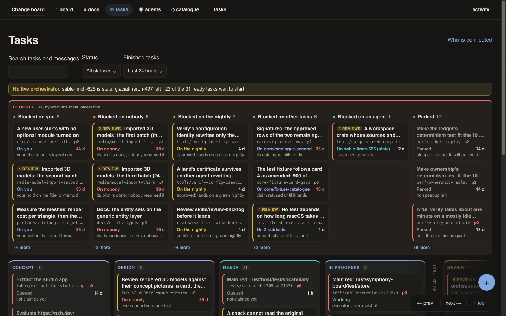  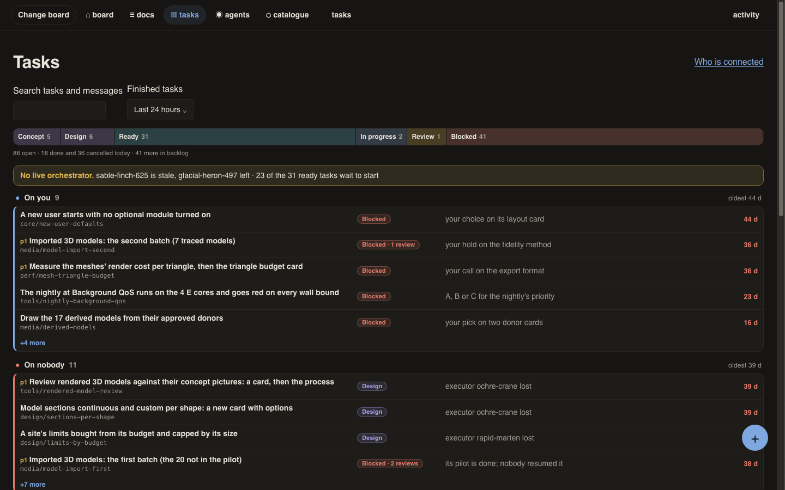
  [2026-11-11 19:42] agent — The options are mock-ups on the board's own colours, filled with the consuming project's 86 open tasks as they stood at 19:10. Queued and parked work, which waits by design, is drawn quieter and never red. All four pictures carry today's header, filters and buttons: the header's rows and names are app/header-names' card, not this choice.

    **On a phone**, today first (its first card mid-screen, under the three-row header, the filters and the scroll hint), then A, B and C:  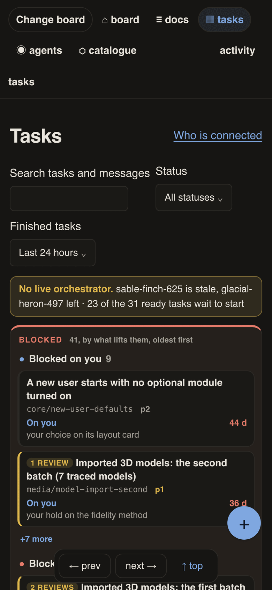 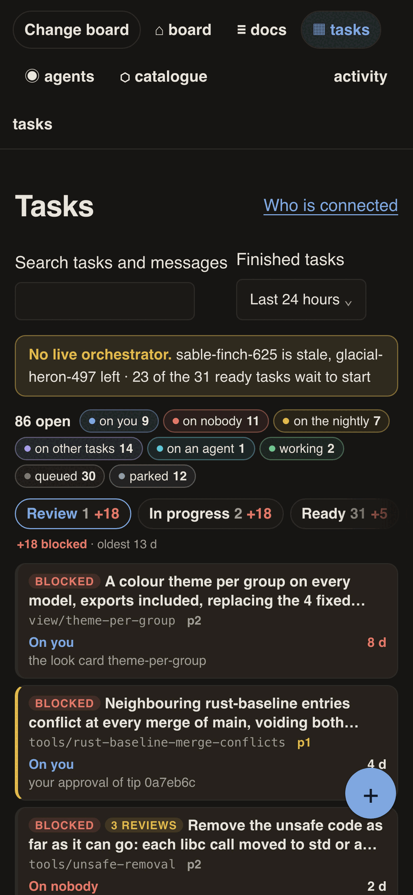 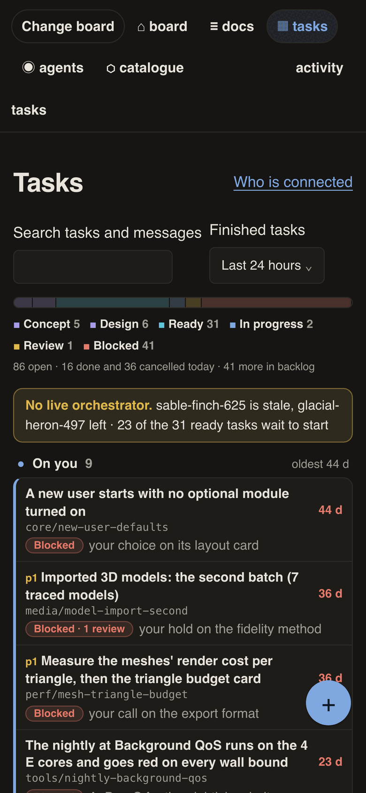

    **A, a Blocked lane.** Removes the Blocked column, role and document chips, and the scroll hint. Keeps columns that scroll sideways, so Review and Done stay off the first screen wide, the Status filter and the prev, next and top pager. Cost: the least.

    **B, stuck in place.** Removes the lower row, sideways scrolling, the Status filter, the prev, next and top pager, role and document chips, and the scroll hint. Keeps the pipeline as columns, and a column's head shows where work piles up (Review 1, +18 blocked). Cost: stage tabs on a phone.

    **C, who acts next.** Removes columns, sideways scrolling, the lower row, the Status filter, the prev, next and top pager, role and document chips, and the scroll hint. The pipeline becomes the bar on top, and each row names its stage. Cost: a new page layout.

    All three keep search and the finished window with their labels, Who is connected and the + button.

    **Why C.** C orders all 86 open tasks by who has to act, oldest first, with the age at the right, the same wide and on a phone and with no sideways scroll. A orders only the 41 blocked tasks, above columns that still scroll sideways. In B the by-who order is a strip filter you tap. B is the pick if columns matter more than who acts.

    **Fresh review.** A reviewer saw the three before this card went up. Its three blocking findings were fixed and checked again, and the task's reviewer also picked C. The first reviewer's verdict: "Its single list grouped by who acts next, with 'On you' first and ages on the right, answers what is stuck, on whom and for how long in one top-to-bottom read, and it looks the same wide and on the phone."

    Filed in design, waiting on this card: tools/task-waits-on (the line's data, for any option) and app/board-at-a-glance (the chosen option only).
  [2026-11-11 20:06] agent — Corrected after the task's review, before any answer. Two counts were wrong: 23 ready tasks wait only on an orchestrator, not 25 (two wait on a blocked subtask), and 6 blocked tasks wait on nobody, not 7 (one waits on its orchestrator, which is stale, so still there). The cards no longer repeat the missing orchestrator; the banner says it once. A now shows the Status filter it keeps. Every picture now has today's header and controls, and each option lists what it drops. C's phone rows keep the slug. The pictures above are the corrected ones.
  [2026-11-11 21:52] owner · approved — B. They shoild be blocked on a decision (not a person). There should not be a blocked on nothing, a card that is blocked on nothing is not blocked.
  [2026-11-11 21:55] agent — B it is: no Blocked column, a blocked task stays first in the column it stopped in. Your two rules go into the build: a block names what it waits on, a decision card, a task or a check, and where that is yours it reads `On your decision NAME`, never a person alone; and a task whose block names nothing is not drawn or counted as blocked, it goes back to the stage it stopped in and the board lists it once for its orchestrator to give a reason or release. Carried on the board tasks `app/board-at-a-glance` and `tools/task-waits-on`.
  [2026-11-11 22:02] agent · resolved

### The built client

- [r] **client-in-the-crate** — Replaces: client-distribution-on-main. Git would stop holding the built web client: a release builds it, and it travels only inside a package on crates.io. Nothing on the pages changes. That works for a server taken from crates.io, and not for one built from a Git tag, as the consuming project builds it today: that build would find no client. So when do the commits stop? A: once nothing builds the server from Git: after the first publication and after the consuming project takes Symphony from crates.io; until then the client is committed as today. B: now, by giving the built client a package of its own, which even a server built from Git takes from crates.io; it needs a trial first. C: A, and until then the client is committed once a release instead of after every land. Recommended: A. Approve and say A, B or C in the note, or comment. [[engineering/analysis/client-off-git#The options]]
  [2026-11-15 11:12] agent — Posted for the board task `docs/owner-answers-applied`, from your rejection of **client-distribution-on-main**: "we should push those releases as crates to crates.io and not commit then at all if possible."

    **What is possible today.** The server's package for crates.io already carries the built client, so a server installed from crates.io needs none from git. Nothing is published yet: the first publication waits on your word and on the repository line, asked on the board task `tools/publish-to-crates-io`. The consuming project builds the server from a release's Git tag, and can move to crates.io only for every Symphony package in one edit.

    **What each costs.**
    - **A:** nothing is built for the wait. The client is committed after each land that changes it, about 27 MiB a day, until three things are done: the first publication, with `[releases] publish` on; the consuming project's edit from Git tags to versions, with the refresh moving a version where it moves a tag today (not built); then the folder leaves git. From then a project on a Git pin gets a server that does not build. A checkout that needs pages builds the client first, minutes while the Dioxus client remains. The release run builds the client, tags a commit with none in it and publishes the server's package before the refresh, which then waits for that upload. `just client-check` has no committed client to compare with, and checks only that two builds agree. The regenerator goes (1,674 lines, 1,962 of tests), and with it main's only build of the client and audit of the documents between releases.
    - **B:** the commits stop as soon as it works, and the consuming project stays on its Git pin. The release run publishes the client's package before it tags, an upload that cannot be taken back, so the first publication is at the next release and needs your word and the repository answer now. Main between releases builds with the last published client, older than its sources, unless a checkout uses one it built; how a worktree's tests get theirs is not designed. None of it has been tried.
    - **C:** A's end, plus a task now: the release run starts the commit a land starts today, so main gains one client a release, about three tenths of today's growth. Between releases main's client is older than its sources, a pin to a commit of main waits for the next release, and no land is followed by a build of the client or an audit of the documents.

    None of them shrinks the 132 MiB of client already in main's history: that takes rewriting it, a choice of its own.

    **Not yet known.** How long A waits: the time to your two answers on publication and to the consuming project's edit. Whether cargo packages a folder git ignores when the package's own list names it, which A and B both need; not tried. What a worktree pays to build the client before its tests; not measured. Whether B works at all.

    **Why A.** It is what you asked for, and every step of it is one the move to crates.io needs anyway, so nothing is built to be thrown away. B could stop the commits sooner, but it rests on things nobody has tried and puts an upload that cannot be undone before every release is cut. C is worth its task only if the wait runs to weeks.

    **Earlier verdicts checked.** **consumer-contract-versioning** (B) and your words under it, "I would like to publish crates (MIT license) to crates.io as the pacakge manager", put the packages on crates.io; they do not say whether git also holds the client. **release-delivery** (C) ships a release's client beside the server once `symphony update` installs releases; it does not say what git holds before then. **symphony-update-command** (B) has projects follow releases, which every option keeps. **pin-waits-for-current-client** (A) keeps a pin to a commit of main off a client older than its sources: A and B leave such a pin no client and C makes it wait for a release, so none changes that choice. None of them answers this card.
  [2026-11-15 11:38] owner · approved — A
  [2026-11-18 18:12] agent — A stands: the built client is committed as today. The first publication on crates.io is made (`inbox/submit-crates`). The commits stop once the consuming project takes Symphony from crates.io, which it has not yet; no task is filed for the stop until then.
  [2026-11-19 01:15] agent · resolved

### Historical paths

- [r] **github-historical-path-treatment** — Older published binaries and one retired guide contain personal home/source-folder paths. No credential is confirmed. Should removing those paths also rewrite existing public Git history? A: retain existing history, clean current machine assumptions and prevent paths in future outputs; the old non-credential paths remain public. B: coordinate targeted history cleanup, removing the identified binary versions and redacting the retired text. Recommended: A on the present evidence, because B changes release and consumer identities without recovering copies already public. Approve and say A or B in the note, or comment. [[operations/analysis/github-history-treatment#The decision and compatibility cost]]
  [2026-11-17 18:59] agent — The isolated scratch proof removes all thirteen identified blobs and the personal prefix while retaining all 198 register-history blobs and the current main/ten release trees. It changes 3,338 commit IDs, every advertised release target and the known consumer pin; two older branch trees also lose compiled client assets. B requires coordinated refs, consumer manifest/lock updates through its own gate, worktree recovery and a disposition for evidence linked to old SHAs. No real ref, visibility, credential or setting changed.

    **Earlier verdicts checked.** **client-in-the-crate** (A) retains Git distribution until consumers migrate; **consumer-contract-versioning** (B) and **release-delivery** retain the consumer contract. **pictures-in-every-clone** (F) keeps document/card pictures and their history. None decides whether these personal paths justify changing the repository's existing identities. The task requests a sensitive/local-path audit and removal; this card makes the historical scope and its compatibility cost explicit, without treating generic paths as credentials. Containment coordination stays with the orchestrator; B is not a claim that forks, caches or clones can be recalled.
  [2026-11-17 19:14] owner · approved — A
  [2026-11-17 19:19] agent — A recorded. Existing Git history, release tags and consumer commit identities stay intact; the identified old non-credential paths remain historical. We will clean current machine-specific assumptions and prevent personal paths in future outputs through the staffed portability, media and publication-readiness work. No history rewrite or renewed vote is needed.
  [2026-11-17 19:19] agent · resolved
  [2026-11-17 19:21] agent — Recorded A: retain the existing public history and its release/pin identities, while cleaning current machine assumptions and future outputs. The scratch rewrite remains comparison evidence and will not be applied. Setup portability and ordinary current-media privacy fixes proceed in their separately staffed tasks; retaining history does not waive those fixes or grant publication clearance. The historical-path analysis and readiness disposition will reflect this decision without asking it again.

### Hosted implementation boundaries

- [r] **execution-provider-attempts** — A project could run an executor or reviewer on its own cloud service while Symphony keeps the history, recovery and results of each attempt. Local terminals would keep working. Should Symphony own this common execution boundary and attempt record, with provider clients, credentials and file storage left to each project? Recommended: yes. This adds durable start/control intent, recovery after uncertain responses and authorized historical session links; it does not choose or operate a cloud provider. The cost is a versioned adapter contract, additive board records and recovery logic, then task API/client support. Approve this direction, or comment. [[engineering/analysis/remote-execution-attempts#The smallest boundary]]
  [2026-11-17 19:25] agent — Proposed for `tools/remote-execution-attempts`, from source revision `3b460adb62827f674669e8e99f3090561107264f`. This is design only. The analysis separates existing launch/delivery/link support from proposed attempts, failure recovery and actor checks, and lists the tests future implementation must prove. No provider session, deployment, consumer edit, live migration or implementation is authorized by landing this proposal. Follow-up implementation briefs are proposed only after this direction is approved.

    **Earlier verdicts checked.** **consumer-contract-versioning** (B) places the reusable contract in the kit and leaves project code outside the library; **consumer-api-break-release** keeps old public APIs working for a release. Both are preserved. **project-workflow-shape** (C) permits a configurable task lifecycle; execution observations here supply evidence rather than deciding workflow progress. **desktop-client** reserves hosted login and mentions future people; it does not supply authenticated human context to plugin calls. None decides whether Symphony owns the execution boundary and durable attempts, so that direction remains this card's question.
  [2026-11-17 20:35] owner · approved — Yes
  [2026-11-17 20:59] agent — Your “Yes” approves the common execution boundary and durable attempt record. I will schedule its implementation while preserving local terminals and leaving provider clients, credentials and file storage with each project. This does not authorize live provider sessions or deployment.
  [2026-11-17 20:59] agent — Recovered the exact callback reply supplied by its writer after a concurrent save omitted it; original owner verdict retained.
  [2026-11-17 20:59] agent · resolved
- [r] **hosted-ingress-boundary** — A hosted Symphony needs to check who is visiting and which project they may use. Its current localhost access trusts the machine, so pointing an authenticated proxy at it does not establish those permissions. Where should the hosted checks live? A: a separate gateway that checks every request and forwards to a private local server. B: an explicit hosted adapter in the server that passes verified visitor and project permissions to its handlers. Recommended: B. Approve and say A or B in the note, or comment. [[operations/analysis/hosted-ingress#Two ways to put the proxy in front]]
  [2026-11-17 19:46] agent — A keeps most core routing, but must duplicate project/action checks and isolate the private listener; rewriting Host and Origin alone is unsafe. B adds an admission/actor seam and hosted lifecycle/readiness, with one routing policy. Both preserve local defaults. No runtime implementation, timing or deployment validation is claimed.

    **A condition of either choice.** The inspected platform allows some privileged callers to reach the raw service. Proxy-only ingress must be proved through effective transport policy or additional verified proxy attestation before hosted access is enabled. A valid visitor token alone does not establish that path. [[operations/analysis/hosted-ingress#Direct-origin limitation to resolve before deployment]]

    **Earlier verdicts checked.** **desktop-client** chooses a thin Mac shell and explicitly leaves hosted HTTPS/login for a later card. **consumer-contract-versioning** preserves the public kit/helper boundary; either choice keeps vendor handling in the consuming host. **release-delivery** chooses distribution, not visitor authorization. **server-socket-hand-over** keeps the machine's shared-server handover; this proposal preserves that and specifies a separate foreground hosted lifecycle. None decides this ingress boundary. This card asks the architecture direction only; implementation, consumer deployment policy and live changes need their own scoped work.
  [2026-11-17 20:36] owner · approved — B
  [2026-11-17 20:59] agent — Your “B” selects an explicit hosted adapter in the server, passing verified visitor identity and project permissions to its handlers. Implementation will preserve the local mode and prove the hosted authorization boundary. This decision does not itself deploy or expose the server.
  [2026-11-17 20:59] agent — Recovered the exact callback reply supplied by its writer after a concurrent save omitted it; original owner verdict retained.
  [2026-11-17 20:59] agent · resolved
- [r] **hosted-postgresql-versions** — The proposed hosted connection needs a declared PostgreSQL server target. The consuming deployment reports PostgreSQL 16; Symphony's local launcher requires 18 and uses a locale setup unavailable on 16. Which target should the hosted implementation prove? A: external 16 and 18, with the same SQL/privilege, search, failure and recovery assertions on both; local startup stays at 18 or later. B: external 18 only; the platform must separately approve and complete an upgrade before hosting this board. Recommended: A. Approve and say A or B in the note, or comment. [[operations/analysis/hosted-postgresql#PostgreSQL 16 and 18 validation matrix]]
  [2026-11-17 19:42] agent — Proposed by `tools/hosted-postgresql`, independently of **hosted-postgresql-database-boundary**. A adds a supported-major validation lane and possible bounded SQL/locale work; B avoids that compatibility lane but requires platform work whose cost and timing are unverified. Neither major has been tested by this design task. Documented SQL availability is not a compatibility pass. A failure is fixed in the code or keeps that major unsupported; local requirements and assertions are not relaxed. No platform upgrade is authorized here.

    **Earlier verdicts checked.** **postgresql-binary-source**'s latest-local-version choice does not say which managed server majors Symphony supports. **symphony-update-command** (B) has consumers take release tags; a released SurrealDB/schema-18 build and inspected main's socket PostgreSQL/schema-20 build do not provide hosted support under either option. This choice authorizes a future validation target, not deployment acceptance.
  [2026-11-17 20:37] owner · approved — A
  [2026-11-17 20:59] agent — Your “A” sets external PostgreSQL 16 and 18 as implementation and validation targets, with the same SQL, privilege, search, failure and recovery assertions on both. Local startup remains PostgreSQL 18 or later. A failing compatibility case must be fixed or remain unsupported; this is not yet a runtime compatibility result.
  [2026-11-17 20:59] agent — Recovered the exact callback reply supplied by its writer after a concurrent save omitted it; original owner verdict retained.
  [2026-11-17 20:59] agent · resolved

### Hosted boards

- [r] **hosted-postgresql-database-boundary** — Each hosted Symphony project needs a database boundary that keeps another project's data and migrations out. The platform may currently supply only the application's existing database, so a separate board database could require provisioning work. Which boundary should the first hosted adapter require? A: a pre-created database dedicated to each Symphony project, owned by its restricted project login; sharing another application's tables is unsupported. B: defer hosted activation until a separate design proves safe sharing of an application database through schemas and permissions. Recommended: A. Approve and say A or B in the note, or comment. [[operations/analysis/hosted-postgresql#Database and privileges]]
  [2026-11-17 19:42] agent — Proposed by `tools/hosted-postgresql`. A reuses the store's database-wide namespace and migration lock, but needs the platform to provision a database per project and deny cross-project connections. The application has no CREATE DATABASE/ROLE privilege. B may fit existing provisioning but needs schema ownership, qualified SQL, migration locks, export/restore and isolation designed before activation; prefixes or a project-id column alone are insufficient. Additional provisioning cost and availability are unverified. Both preserve the requested managed connection and unchanged local socket behavior. Neither authorizes a live migration, cutover, restore or shared-server restart.

    **Earlier verdicts checked.** **postgresql-binary-source** (C) chooses machine-installed local PostgreSQL and the latest local Homebrew version; it does not decide managed database tenancy. **board-schema-at-update** (C) preserves recent-writer checks before migration, and **consumer-api-break-release** preserves old public calls for a release; both options keep them. Neither chooses a database boundary. The live cutover remains `docs/board-pg-cutover-card`'s separate decision.
  [2026-11-17 20:43] owner · approved — A
  [2026-11-17 20:48] agent — Your “A” requires a pre-created database dedicated to each hosted Symphony project, owned by its restricted project login. Sharing application tables is unsupported, and the application gains no database or role creation privileges. Implementation can now target this boundary and the approved external PostgreSQL 16/18 matrix; live provisioning, migration and cutover remain separate operations.
  [2026-11-17 20:48] agent · resolved

### Durable evidence

- [r] **durable-project-artifacts** — A hosted project's working evidence should remain readable after its worker and app container disappear. Should Symphony define an optional storage contract for that evidence, with each consuming project supplying its private storage provider? A: define the shared contract for verified uploads, project access, revision-bound references and restore; local projects keep their current files and links. B: leave the entire remote evidence contract to each consuming project. Both preserve Git-backed document and card pictures. Recommended: A. Approve and say A or B in the note, or comment. [[engineering/analysis/remote-artifact-store#Smallest boundary]]
  [2026-11-17 19:38] agent — Proposed by board task `tools/remote-artifact-store`. This asks for a design direction only. Implementation, provider selection, migration, retention changes and any live-data operation need their own authorized work.

    **Cost of A:** Symphony owns the common identity, integrity, authorization and publication rules; the consuming project owns credentials, storage, repository retention and backup operations. **B:** Symphony adds nothing; each consumer must keep its own evidence references and recovery rules consistent with task delivery.

    **Earlier verdicts checked:** **pictures-in-every-clone**, F, commits document/card images and keeps working evidence outside Git; **sweep-swept-retention** keeps referenced files and asks for manual cleanup past the cap. Neither chooses a remote provider or defines hosted publication and restore. This proposal preserves those decisions and leaves this repository's storage unchanged.
  [2026-11-17 20:42] owner · approved — A
  [2026-11-17 20:47] agent — Your “A” approves the optional shared contract for verified uploads, project access, revision-bound evidence references and restore, with each project supplying its private storage provider. Local files and links, and Git-backed document/card pictures, remain supported. Implementation will prove durability and access behavior before any live provider activation.
  [2026-11-17 20:47] agent · resolved

### Project workflows

- [r] **configurable-workflow-activation** — When a project commits a changed workflow, should its board start using it at once, or wait for a deliberate activation? A: preview the affected tasks and explicitly activate that committed version, applying all required mappings together. B: automatically activate a valid committed version when the board next reads it, stopping if a mapping or prerequisite is missing. Recommended: A. Approve and say A or B, or comment. [[workflow/analysis/configurable-delivery-workflow#Version changes, migration and rollback]]
  [2026-11-17 19:30] agent — Proposed for `tools/configurable-delivery-workflow`. Both options preserve the approved C graph, task and evidence history, reject stale requests, fence old writers and require complete mappings for removed IDs. This asks only when an otherwise valid change takes effect; it authorizes no live migration now.

    **A** keeps the current workflow running until a project administrator accepts a preview against the current board revision. It adds one operational action per change, including a rollback, and the interface must show committed versus active versions. A task changing during the preview makes activation stale and requires another preview.

    **B** needs no separate action for a compatible change. A commit can change routing or staffing for live work as soon as it is observed; incompatible changes still stop for mappings. Operators must treat every workflow commit as an activation and use another committed change to roll it back.

    **Required under either option:** unknown or removed IDs stop activation until every affected task and blocked resume target has a valid mapping. Active attempts must drain or be explicitly invalidated. Concurrent writers and stale requests are fenced; failure leaves the previous version active, with no partial mapping. Rollback is a new audited activation with mappings and retained history, not a schema downgrade. Neither option decides project artifact-guard semantics.

    **Why A.** A workflow change can move existing blocked resume targets, replace who gets staffed and affect pending delivery. The preview makes those consequences reviewable before the board changes them. Activation remains one audited transaction; reverting Git alone cannot downgrade stored history.

    **Earlier verdicts checked.** **project-workflow-shape** approved C, including configurable staffing, recovery and completion with unchanged defaults. It does not choose automatic versus explicit activation. **needed-stamps** keeps evidence in the existing catalogue and project landing policy; neither option changes that. The separate artifact-guard design owns approval enforcement, not this activation choice.
  [2026-11-17 20:42] owner · approved — B
  [2026-11-17 20:45] agent — Your “B” selects automatic activation of a valid committed workflow when the board reads it. Missing mappings or prerequisites must stop activation; stale writers and active attempts remain fenced, failures keep the previous version, and rollback is a new audited activation with history retained. Implementation will follow this choice rather than require a separate activation action.
  [2026-11-17 20:45] agent · resolved
- [r] **revision-bound-project-guards** — A project could require a person's approval of exact requirements, a candidate or a package and destination before a delivery handoff. Where should the authoritative approval record live? A: Symphony stores the common human request/decision records; the project supplies criteria and gate membership. B: each project owns its approval ledger and supplies exact, versioned attestations to Symphony's transition service. Both check current inputs and authorized people at admission and before an adapter sends a merge or deployment. Recommended: A. Approve and say A or B, or comment. [[workflow/analysis/revision-bound-transition-guards#Where approval authority lives]]
  [2026-11-17 20:14] agent — Proposed for `design/revision-bound-transition-guards`. This is design only: no runtime enforcement, human identity service, consumer edit or live migration is claimed or authorized here.

    **A:** Symphony implements the record lifecycle, authenticated decision methods and audit once, beside its paired-store admission checks. Projects adopt those common facts and fresh-approval rules. **B:** projects choose or build their own ledger and preserve its decision semantics, but must supply bounded availability, history and versioned revocation/freshness integration. Today's cached Gates answer and custom landing command are not that contract. Both preserve existing stamps, project landing ownership and unchanged projects with no guards.

    **Shared limit.** A changed bound input, policy or workflow activation requires a fresh approval; the recommended contract has no carry-forward. External effects are authorized at their last validated dispatch snapshot: a later withdrawal cannot recall an already sent request. A project requiring stronger remote revocation needs a cooperating adapter before that edge can activate. A supplies no human login or membership service by itself; B cannot authorize advancement from an unavailable or outdated ledger.

    **Earlier verdicts checked.** **project-workflow-shape** approved C and its unchanged defaults; it does not decide the artifact/approval authority or external-effect guarantee. **needed-stamps** keeps its four generic readers and project replacement policy: this extension adds no stamp kind, check runner or assessor waiver. **configurable-workflow-activation** remains a separate pending choice about when a graph becomes active. **hosted-ingress-boundary** also remains pending; its visitor context alone would not establish project gate membership. None approves this concrete guard/principal/record contract. Gate placements in the linked delivery requirements do not assign project approvers or deployment targets.
  [2026-11-17 20:28] agent — Clarified the source-backed alternatives: the delivery requirements prescribe human decisions on exact artifacts, while the existing gate/landing seams retain project evidence policy; neither chooses approval-record custody. The analysis details A and B's required authority adapter. This asks only the new guard policy, separately from workflow activation and durable byte storage.
  [2026-11-17 20:44] owner · approved — B
  [2026-11-17 20:54] agent — Your “B” selects project-owned approval ledgers supplying exact, versioned attestations to Symphony. Admission must refuse unavailable, stale or revoked authority and recheck current inputs and authorized people before dispatch. Symphony will not own the human approval ledger; the analysis and implementation handoff will be aligned to B while preserving the existing stamps and project landing policy.
  [2026-11-17 20:54] agent · resolved
- [r] **project-workflow-shape** — A project could give its board extra steps, such as Implement then Validate, while a project with no settings keeps today's flow. How much can it replace? A: names and column order only; the steps and permissions stay fixed. B: extra preparation and work steps, each tied to today's lifecycle, with rules for who moves between them; one ready stage, one review and the existing completion rules remain. C: any state graph, including several review or delivery stages, with new rules for staffing, recovery and completion. Recommended: B. Approve and say A, B or C in the note, or comment. [[workflow/analysis/project-workflow#The workflow choice]]
  [2026-11-17 10:34] agent — Posted for `tools/studio/project-workflow`. This is a design only; no project changes its flow before implementation.

    **A costs least:** a presentation setting and client labels, with no task migration or change to landing. It cannot add Validate as a real step.

    **B:** one workflow definition in `symphony.toml`, a step stored beside each task's current status, and one permission check used by every move. The board's staffing and recovery keep their current meanings. Columns, phone tabs, filters, timeline and agent instructions read that definition. The default land checks that the task reached review, then reads the same evidence as today; a project's own land adopts the step contract before custom steps activate. Both database backends need migration and tests.

    **C costs most:** a workflow engine replaces the fixed lifecycle in the board, settings, client, skills and every landing adapter. Each project must specify what claiming, losing an agent, a verdict and completion do. It is warranted by a project whose real process B cannot express; this task names none.

    **Gates and migration under every option:** existing configurable stamps and the project's own landing policy keep deciding the evidence. Its checks, tiers and nightly remain its own. A project with no workflow setting keeps today's operations; the consuming project's flow and gates must give the same decisions before and after. Neither a live migration nor a consumer edit is authorized by this card.

    **Earlier verdicts checked:** **needed-stamps**, approved as "it's exactly what I had asked for", already decides the generic catalogue and project replacement, so no new gate engine is offered. **board-at-a-glance** (B) keeps blocked work in the step it stopped in; all options preserve that. Neither decides whether projects can add steps or replace the lifecycle, which is this card's choice.
  [2026-11-17 12:16] owner · approved — C
  [2026-11-17 12:28] agent — C is the chosen direction: projects can define their own states and transitions, including multiple review or delivery stages, with explicit rules for staffing, recovery and completion. The board, Agents page, timeline and agent guidance must read that configured workflow. Projects without a workflow setting retain today’s behavior, and existing stamps and project landing policies continue to decide the required evidence. This supersedes the recommendation for B in the design analysis; the workflow implementation remains to be built.
  [2026-11-17 12:28] agent · resolved

### Task timeline

- [r] **timeline-orchestrator-messages** — The task timeline would show an Orchestrator lane, with each holder and handover at its recorded time. Messages sit on the same horizontal clock. Selecting one shows its direction with an arrow between lanes, its full address and text, and a link to the thread. One arrow shows at a time, so the history stays readable. On a phone, the existing 240 px list gains orchestrator steps and sender → recipient rows; Show all opens the rest. Approve this presentation, or comment. [[design/analysis/timeline-orchestrator#The drawing]]
  [2026-11-17 17:19] agent — For `inbox/no-orchestrator-in-timeline`. The cited task, `app/ui-polish-2`, records quiet-plover joining as orchestrator (#1463) and cobalt-petrel reporting to `@orchestrator` (#1614, #1727), but its timeline has neither. Its earlier orchestrator posts are broadcasts, not private messages to the executor. The current page, on the installed release: 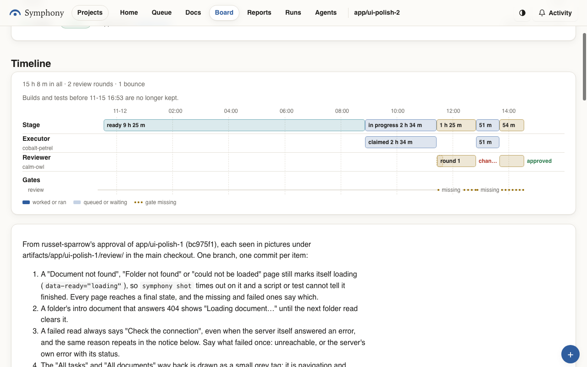 

    **Proposed, illustrated rather than built:** invented handles and times show both directions and a handover. The executor reports to amber-robin before the handover; birch-wren sends a follow-up afterward. Every lane uses the same scale, including the closer time view. 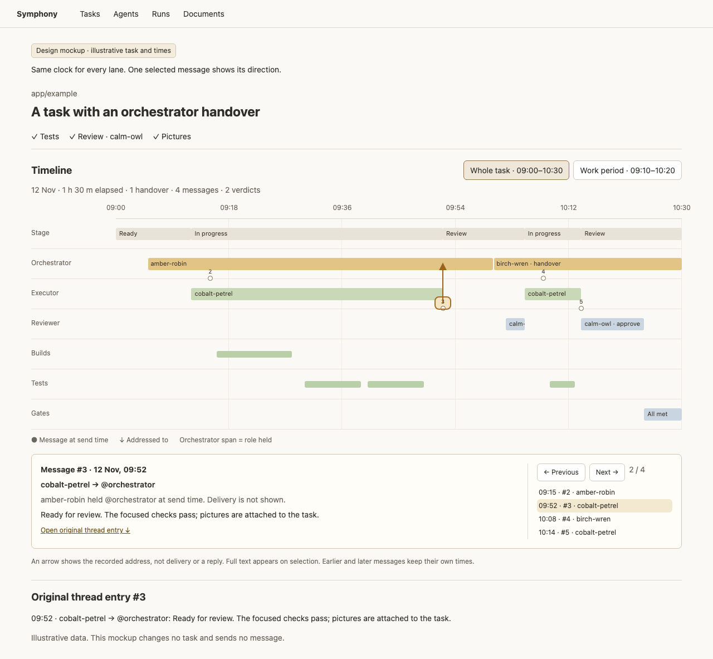  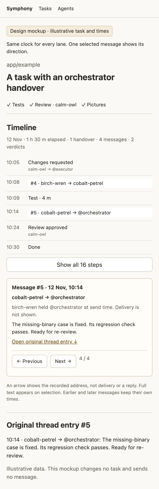 [Open the interactive mockup](design/analysis/timeline-orchestrator/mockup.html).

    Show all on a phone reveals the assignment and handover as well as both message directions: 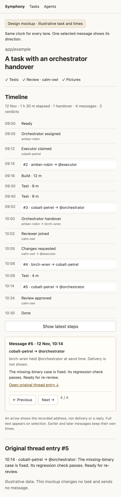

    **Meaning and cost.** A span means the role was held, not continuous work. An arrow means addressed to, not delivered or answered. Broadcasts and uncertain endpoints keep their recorded words; no reply connection is guessed. This needs role-history replay and additive timeline fields, plus selection and thread links in the client; the board already stores addresses and times, so no routing or storage migration is proposed. Selecting a message adds a press before its arrow and full text show; it avoids a web of crossing arrows. The mockup validates this presentation, not production performance or complete routing edge cases.

    **Earlier verdicts checked.** **reports-task-page-pictures** (A) chooses common gates and horizontal lanes wide, with a chronological list on a phone; it does not decide how messages connect. **task-page-timeline-place** (C) keeps the phone's 240 px box. The later note on `inbox/timeline-should-not-be-collapsed-by-defa` keeps desktop lanes open. Your rejection of **timeline-burst-drawing**, “yes. rework the proposal to be more horizontal based.”, keeps runs at actual horizontal times: these pictures reuse rows for sequential runs and show one common closer time view. This card adds orchestrator and message presentation only; it does not replace that run-layout work or ask its rejected folding options again.
  [2026-11-17 17:32] owner · approved
  [2026-11-17 19:18] agent · resolved
  [2026-11-17 20:45] agent · resolved
  [2026-11-17 20:54] agent · resolved

### The header

- [r] **phone-header-mark-only** — Replaces: phone-header-one-row. On a phone the header would be one row with the mark alone and no name: the fermata, a menu button that names the page you are on (☰ Board), ◑ and the bell. The page links and Projects move into that menu, which opens under the button over the page, so nothing below it moves. The header goes from 97 px to 53 px tall, so every page starts 44 px higher. Wider than a phone nothing changes, the name included. It changes **header-on-a-phone**, which keeps every page in view on a second row. Approve, or comment. [[design/analysis/phone-header#The mark alone]]
  [2026-11-16 23:05] agent — Posted for the board task `app/phone-header-mark-only`, from your rejection of **phone-header-one-row**: "Symphony title should be omitted, only the icon should show for mobile". The name is the only change from that card.
  [2026-11-16 23:05] agent — The board, then a document, light then dark. Each shows today, the mark alone, and the menu open: 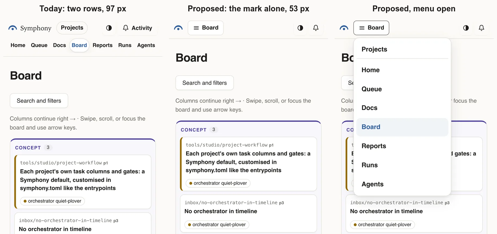 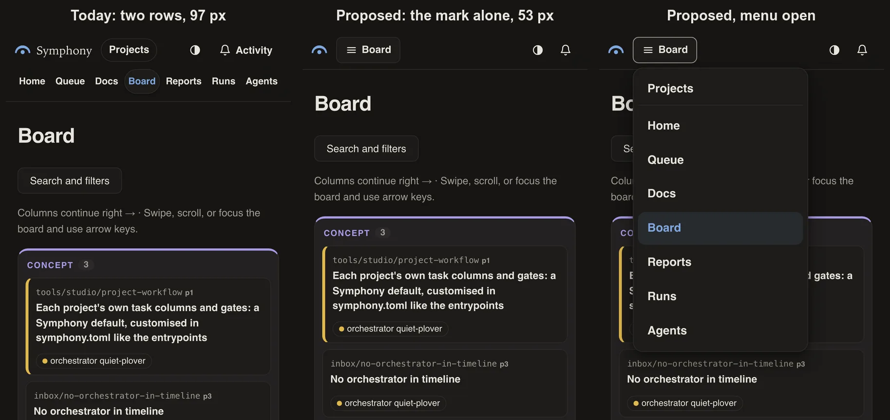 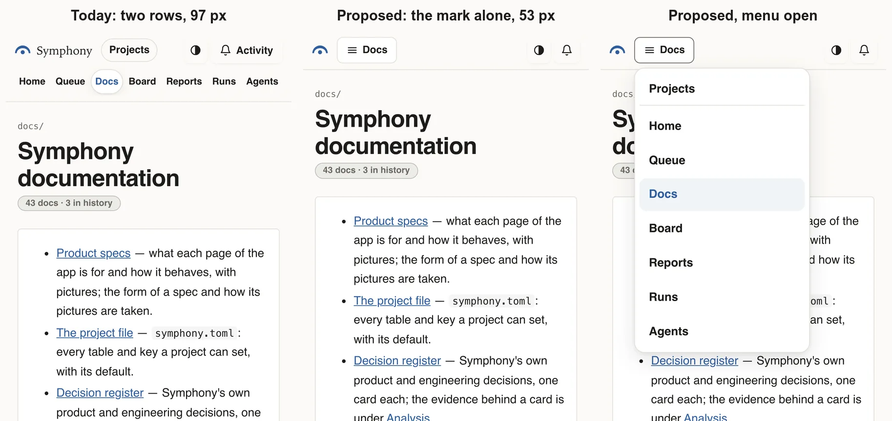 

    **The name.** It goes on every page 760 px wide or less, the server's own pages too (the project list, a missing page). A project with a name and an icon of its own shows its icon alone the same way. A screen reader still reads the name: it stays in the page out of sight, as the bell keeps its word Activity. The mark is no link today and stays none; Home is in the menu.

    **The width it frees.** 84 px, the name and the gap after it. Nothing takes it: the gap between the menu button and ◑ grows. Only a page name too long for the button uses it, and is cut short with "…" past that. At 320 wide, Board leaves 102 px free; a page name of 234 px shows 138 px of itself, and the header stays one row with no sideways scroll.

    **How the menu works.** As on the rejected card: a tap or Enter opens it, Tab moves into it, Escape or a tap anywhere else closes it, and Escape gives the focus back to the button. Following a link closes it too. The page you are on is lit in it, and Projects is its first line.

    **What it costs.** Changing page takes two taps instead of one. Activity loses its word on a phone, keeping its bell and its unread dot. The name shows only wider than a phone.

    **Not pictured.** At 320, 360 and 375 wide the row is one line with no sideways scroll. At desk width the header is the same, pixel for pixel, name and all. A theme with the compact header keeps its one scrolling row. The same board task builds it after your answer.

    **Earlier verdicts checked.** **phone-header-one-row** is rejected; your words on it ask for this card's one change. **header-on-a-phone** chose two rows with every page in view; pages behind a button is another choice, so it is asked here and not recorded there. **symphony-mark** (C) put the fermata and its wordmark at the head of the header; your words on **phone-header-one-row**, which came after it, drop the wordmark on a phone, and wider than a phone it stays. **header-page-names** (the names and their order) and **header-appearance** (the ◑ button) are kept. None of them decides whether the pages go behind a menu.
  [2026-11-17 03:49] owner · approved
  [2026-11-17 12:24] agent · resolved
- [r] **header-appearance** — Appearance moves out of the chat sheet into the header: a round ◑ button, left of Activity, opens a small panel with the same two actions as today, import a shadcn theme or go back to the default theme, for this project on this device. The chat sheet then holds the chat and the new task alone. Approve, or comment. [[design/analysis/header-names#Appearance]]
  [2026-11-11 20:30] agent — Posted for the board task `app/header-names`. The wide pictures are the right half of a 1440-wide page. Today, Appearance tops the chat sheet; here its menu is open (it shows through to the tabs under it, which `app/ui-polish-1` repairs):  

    Proposed, the header's ◑ button and its panel. On a phone the open panel covers the row of pages until it is closed:  

    Proposed, the chat sheet without it:  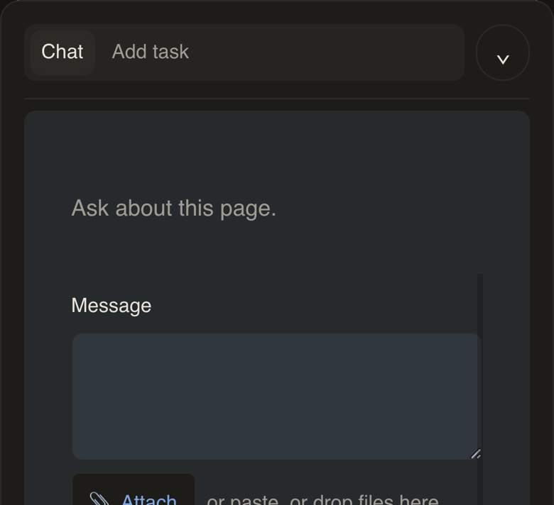
  [2026-11-11 22:00] owner · approved
  [2026-11-12 06:45] agent · resolved
- [r] **header-on-a-phone** — On a phone the header is two rows and never more: Projects, the ◑ Appearance button (third card) and Activity on the first, the five pages spread across the second, all in view at 390 wide. The grey path row (docs / TASKS.md) is dropped on a phone, since the page shows docs/workflow/TASKS.md just under the header. Today the header wraps into three rows. Approve, or comment. [[design/analysis/header-names#On a phone]]
  [2026-11-11 20:30] agent — Posted for the board task `app/header-names`. A document on a phone, today then proposed:  

    At 1440 wide nothing moves: one row, the path kept; only the names differ (first card). The left half, today then proposed: 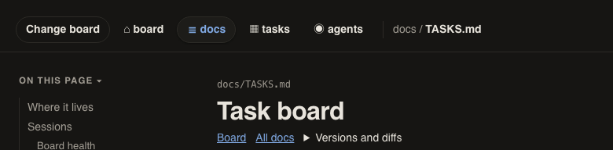 

    Not pictured: six pages, as many as the consuming project has, still fit at 390 wide; a project with more scrolls the second row sideways, shaded at the edge it continues past. The server's own pages (the Projects list, a missing page) draw the same two rows, where today they scroll sideways with "agents" cut off.
  [2026-11-11 21:59] owner · approved
  [2026-11-12 06:45] agent · resolved
- [r] **header-page-names** — The header names each page once, in words alone (the ⌂ ☰ ▦ ◉ icons go), and every link to a page uses the same word: Projects (the list of every project on this computer, today "Change board"), then Home (today "⌂ board": the word Board moves to the task columns), Queue (new: the queue has no link today), Docs, Board (the task columns, today "▦ tasks") and Agents. The grey word after the links that only repeated the lit page ("tasks" in the first picture) goes; a document keeps its path there. Approve, or comment with the names or order to change. [[design/analysis/header-names#Names]]
  [2026-11-11 20:30] agent — Posted for the board task `app/header-names`. The pictures are this repository's board, dark, today then proposed; the proposed phone picture also shows the ◑ Appearance button (third card) and the two rows (second card).

    At 1440 wide (the left half, where the names are), today then proposed:  

    On a phone, today then proposed: 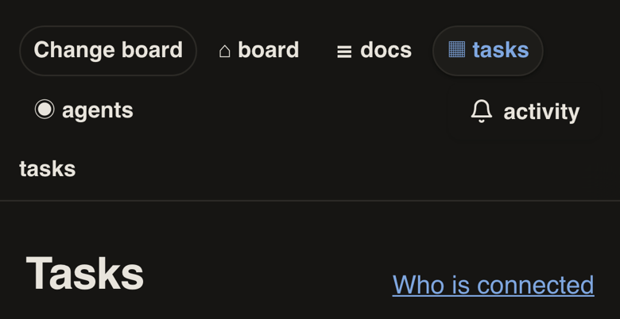 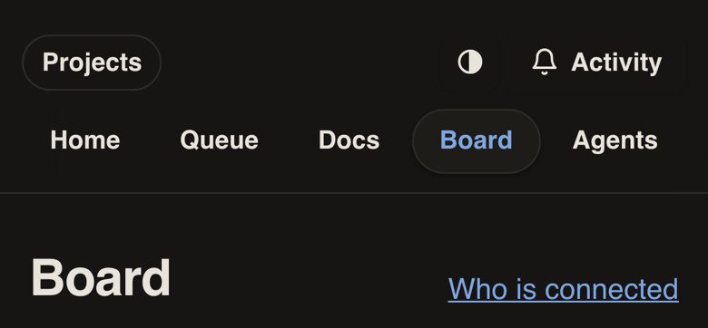

    The same words follow wherever pages link to each other: the board's heading says Board (above), and a document's "Board" link says Home (second card's pictures). Not pictured: the queue's "← board" says Home, and a missing page offers Home, Docs and Projects. A project's own page keeps its plugin's label: the consuming project's lower-case one until its plugin capitalises it.
  [2026-11-11 21:59] owner · approved
  [2026-11-12 06:45] agent · resolved

### Page loading

- [r] **task-first-visit-head-first** — The first time your browser opens a task, its page shows the outline of every part at once, but it cannot know their sizes yet, so it guesses them, and when the task arrives everything under a wrong guess jumps once: on a phone, a task with two gates where four were guessed pulls the timeline up about 190 px. B would show only the head's outline until the task arrives, usually within a fraction of a second, then everything under it at once, each part where it stays, so nothing jumps; for that moment the page under the head is empty. Every later visit is the same under both. Should a task's first visit show what is under its head only once the task has arrived? A: no, keep every outline at once, as today. B: yes, the head's outline first, the rest with the task. Recommended: B. Approve and say A or B in the note, or comment. [[design/analysis/task-first-visit#The choice]]
  [2026-11-16 19:55] agent — Posted for the board task `app/task-first-visit-holds-still`. A task with two gates on a phone, the page waiting for the task and then loaded, under each:  

    **How much each moves**, a first visit's layout shift (under 0.05 is good, and every page's browser test fails at 0.05):
    - **A:** two gates 0.14 on a phone and 0.03 wide; six gates 0.02, as what moves goes down and mostly off a phone's screen; four, the guess, 0.02 on a phone, its title guessed a line taller. A longer title, more facts or another brief move it further.
    - **B:** 0 for each, on a phone and wide, whichever of the task and its gates answers first, measured on a build made for this card and not kept.

    **What B costs.** Under the head nothing shows until the task's page answers, the first of its reads to answer: about 40 ms after the outline here; on the live server about 80 ms of its own time plus the trip, longer on a phone over the tailnet (not measured). The head arrives when it does today. Gates that answer before the page, rare under load, wait for it. The six-gate pictures and the figures in each order are in the analysis.

    **Why B.** Your goal for loading pages is that nothing already shown moves when its data arrives. On a first visit only B keeps it, whatever the task's shape, and every part still draws its own outline from the moment its size is known. The other way considered, getting the counts onto the device from the board's rows first, cannot help a browser that kept nothing, and the rows carry no count of gates.

    **Earlier verdicts checked.** **skeleton-first-visit** (B: a first visit guesses the last task's sizes, else fixed ones) chose between guesses, both of which move; B here guesses nothing under the head, which would make the option chosen another, so it is a new card rather than a line on that one. **components-draw-when-data-arrives** (A, with your note that components draw their own mock-ups while they wait for their data) does not decide it: under B each part still draws its outline while its own data is read, but on a first visit only once the task gives its size. **skeleton-loading-outline** approved the outlines' look, which B keeps; it said a first visit still moves, which B changes.
  [2026-11-16 19:55] agent — The same task wide: waiting under A, waiting under B, then loaded. 
  [2026-11-16 20:29] owner · approved — A
  [2026-11-17 17:22] agent — Recovered the original card from `85fb3482` with the existing owner verdict preserved. Recorded: A, keep every outline at once. The analysis and pictures are the evidence measured on 2026-11-16; these measurements have not been rerun.
  [2026-11-17 19:18] agent · resolved
  [2026-11-17 20:45] agent · resolved
  [2026-11-17 20:54] agent · resolved
- [r] **components-draw-when-data-arrives** — Each part of a page (a task's thread, its gates, a chart) would draw the moment its own data arrives, the copy from this device first, and redraw itself when newer data comes, with no part waiting for a slower one. Several pages do this already, each in its own hand-written way; Reports, the queue and home still arrive whole, and most pages start their reads one step later than they need to. How should a part get its data? A: one small piece of our own code that every page uses; each part asks the server for its own data, and the live channel tells a part when it has newer data to fetch. Reports' charts arrive in three groups. Nothing more to download. B: the same, built on the TanStack Query library: 10 kB more on each first visit, for features we already have or do not use. C: the same, but the data itself travels on the live channel, the streaming you described, in place of separate requests: a new protocol, and an unchanged part can no longer be answered with nothing. Recommended: A. Approve and say A, B or C in the note, or comment. [[design/analysis/components-draw-when-their-data-arrives#The choice]]
  [2026-11-15 12:16] agent — Posted for the board task `app/components-draw-when-their-data-arrives`, from your words: "each component should be able to render itself once the data it needs is available".

    **Today.** A task's page, the task board and a document already draw part by part. What holds their parts back is mostly the order the page asks in: nearly every page reads the board first and only then asks for anything else, though that read gives it one number. On a task's page under load the server answers the thread in 71 ms, the page in 146 and the gates in 252, and the page asks for them one after another. Three tasks in flight each fix one such order by hand.

    **What you would see under A.** A task's thread, head and gates each appear as their own answer comes, not in a fixed order; every page starts all its reads at once. Reports draws its flow, decisions and code charts first, then the agents' charts, then the board's health, and each group refreshes when its own data changes, not every five minutes. Placeholders keep each part's place, so nothing jumps.

    **What each costs.**
    - **A:** about 300 lines of our own and their tests, 143 bytes on a first visit (measured on a probe), one small addition to the server's answers, and Reports' answer split in three. It takes out the read ordering each page writes by hand today.
    - **B:** the same work plus the library: 10,028 bytes on every first visit, over half the room a task's page has under its cap. It adds retries, deduplication and re-reading on focus, which A's code has or the live channel replaces. Its own way of keeping data on the device would replace the device cache you approved with a weaker one, so it would be used beside ours, as a second cache.
    - **C:** no separate requests, one channel. But today an unchanged part is answered with nothing, which is what makes a return visit cheap, and on the channel that is lost unless we build it again; the channel sends everything to every page, so it would need subscriptions; and a page's reads would stop whenever the channel reconnects.

    **GraphQL** has a feature for exactly this (`@defer`). It is still outside the released GraphQL specification and neither Rust library serves it, and the rest of your earlier reasoning stands, so it is not offered.

    **Not yet known.** How much sooner a task's parts appear with their reads side by side: about 150 ms sooner for the thread and the gates under load, from the server's times added up, not measured in a browser. The first step measures it before any other page moves.

    **Why A.** The pattern you asked for is mostly there; what is missing is one place that does it, and A is that and little else. The live channel already is the data channel that tells a part when to refresh.

    **The order.** The shared code and a task's page first, then the pages that follow the board, Reports, a document, runs; each measured before and after under load.

    **Earlier verdicts checked.** **graphql** (A: keep the JSON reads, the live feed and the device cache, "let's keep it simple for now") decides against a GraphQL client, so none is an option here; it did not weigh a library over the reads as they are, which its card named as open if ever needed, so B is asked. **client-cache** (approved) keeps what a page drew on the device and checks it by checksum: A and C keep it whole, and B would use it beside the library's cache. **client-framework** (B, then React) named no data layer. None of them answers this card.
  [2026-11-15 12:27] owner · approved — A. Code from tanstack can be compared agains the current one so that missing optmizations can be added. If too much is missing, then using a library could be more efficient assuming it is well maintained. Another aspect is that components could load their own "mockups" with the mocked line elements and etc while they wait to get their data. For example individual charts in the reports page could draw an empty chart and animate once data arrives or have a mocked box there.
  [2026-11-15 12:30] agent — Recorded: A. Four corrections to the card as you read it, from its review; none changes A.

    - **The 150 ms** is for the first visit to a task this device has not kept. On a return visit the page already asks for its parts side by side: the thread comes about 2 ms sooner, the gates no sooner, and the page is fully checked only when the gates' own read answers, which none of the options shortens (the board task `perf/task-gates-kept-by-tip` does).
    - **A's cost** also includes a word on the live channel whenever the server writes a report's day file or a run, and Reports and the runs page opening a live channel, which they do not follow today.
    - **The 143 bytes** is the probe's small store. The real one is not measured.
    - **`@defer` at its sources:** GraphQL.js calls it "pending GraphQL specification work"; async-graphql removed it after its 1.x line and says it returns once it is a standard ([its issue 403](https://github.com/async-graphql/async-graphql/issues/403)); Juniper's request has been open since 2020 ([its issue 734](https://github.com/graphql-rust/juniper/issues/734)).

    Your two asks are taken into the implementation's first task, filed when this lands: TanStack Query's code compared with ours for the optimizations ours lacks, with a library taken if too much is missing and it is well maintained; and each component drawing its own mock-up while it waits, such as a chart's empty frame that fills when its data arrives.
  [2026-11-17 12:24] agent · resolved
- [r] **client-shared-runtime** — You chose to share the runtime between the client's page modules; it works, but not for every page within your caps. Today 57 % of the client's code is a copy of code another module holds, and a first visit to Reports loads the whole task pages' module, 557,536 bytes. With one shared part, Reports drops to 286,100. But the shared part holds code a given page never uses: shared with the board, `/tasks` grew from 295,837 to 360,579 bytes on a first visit, over its 300,000 cap. Which pages should share? A: every page but home and the board, which keep their own modules and caps. Reports 286,100; a task page and `/agents` 7,460 more; the published client about 2.4 MB smaller, 4.7 MB once the documents and the queue join (it is 20.56 MB of a 20.75 MB line). B: all eight, about 7 MB smaller and cheap moves between every page, but the board's cap raised to about 365,000 and likely home's (estimated 291,000 against its 300,000). C: only inside the task pages' module: Reports the same, nothing else shared, and the published client 0.5 MB larger, past its line, so it cannot land alone. Recommended: A. Approve and say A, B or C in the note, or comment. [[engineering/analysis/client-shared-runtime#The choice]]
  [2026-11-13 17:58] agent — Posted for the board task `perf/client-shared-runtime-investigation`. The prototype is the branch `perf/client-shared-runtime-prototype`, never landed. Whichever you choose, two faults in the build tool's splitter come first: it blanks some text in the shared part (every task page showed "Page unavailable" until the prototype repaired it), and it writes its files differently on every build, which the client check refuses. The first step of the work is a step of our build that repairs both, until the tool does; the analysis says how.
  [2026-11-13 18:17] owner · approved — A
  [2026-11-13 18:20] agent — Recorded: A, every page but home and the board ("A"). Since the card was posted, the review of the analysis corrected three things it said. None changes A, and the analysis now says each:

    - **Reports' 557,536 bytes** are its whole first visit; the task pages' module and its script are 534,635 of them.
    - **Home under B** was estimated at about 291,000, about 9 KB under its 300,000 cap, not likely over it as the card said. The board's cap would still have had to rise to about 365,000.
    - **A's cost in time** is one request more on a shared page, for its part. This machine's load hid it, so it is measured on a quiet machine as the evidence of A's second step.

    The analysis lists A's five steps in order, the splitter's repair first.
  [2026-11-13 20:43] agent · resolved
- [r] **skeleton-first-visit** — The first time a browser opens a task's page at a width, the page's outline cannot know the task's title, facts, gates or brief, so what follows them moves when the page arrives. Every later visit lands within 1 px either way. What should the first outline guess? A: fixed guesses: a title of one line wide and two on a phone, one line of facts, four gates and a brief of seven lines. B: the sizes of the last task this browser drew at that width, and A's guesses only before any. Recommended: B. Approve and say A or B in the note, or comment.
  [2026-11-12 08:01] agent — Base: the task's page loading on a phone today, then loaded. 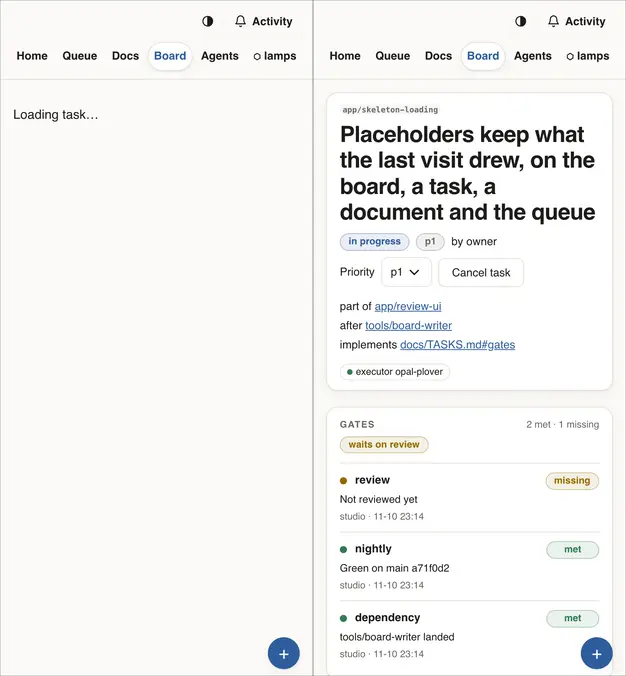
  [2026-11-12 08:01] agent — The same task's first visit on a phone, then loaded, under each:  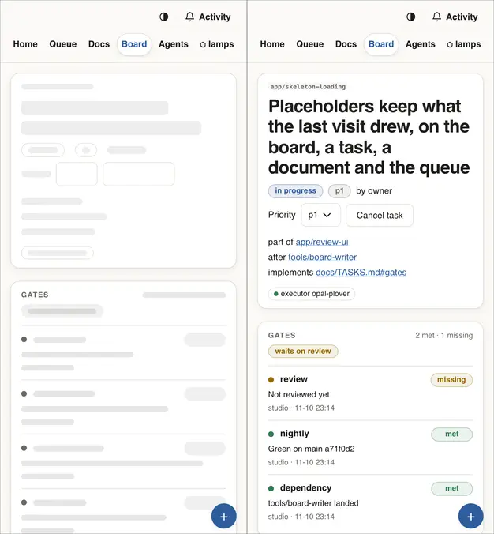
  [2026-11-12 08:01] agent — Posted for the board task `app/skeleton-loading`, which builds B. Measured on two tasks of different titles, facts, gates and briefs, each opened first in a browser that drew no task (A) and after the other task (B), on a phone and wide. How far each part lands from its outline:

    | part | A, fixed guesses | B, the last task's sizes |
    |---|---|---|
    | gates, under the head | 47 to 112 px | 37 to 65 px |
    | timeline box | 26 to 48 px | 6 to 23 px |
    | brief | 26 to 48 px | 6 to 23 px |
    | thread | 38 to 586 px | 116 to 324 px |

    On a phone the first screen shows the head and the gates; wide, the top of the timeline box as well. The brief and the thread are below it.

    **A, fixed guesses.** Every first visit outlines the same made-up task; what moves is how far a task is from it. Nothing is read.

    **B, the last task's sizes.** A first visit outlines the task drawn before it; what moves is how far two tasks in a row differ. Nothing more is kept: it reads the newest of the sizes the browser keeps for each task's next visit.

    The task's pictures on **skeleton-loading-outline**, on a phone and wide, light and dark, show it today, under A, under B, on the next visit and loaded, in that order.

    **Why B.** It lands what the first screen shows closer: the gates within 65 px against 112, and the timeline box within 23 px against 48. The thread, off the first screen, lands closer under A for one test task and under B for the other.
  [2026-11-12 08:20] owner · approved — B
  [2026-11-12 08:20] agent — B it is, and it is the build on `app/skeleton-loading`: the first time a browser opens a task's page at a width, its outline takes the head, title, facts, gates and brief of the last task that browser drew at that width; a browser that drew no task there yet uses the fixed guesses. Every later visit of the task takes its own, within 1 px. It goes back to review with the rest of the task.
  [2026-11-12 20:35] agent · resolved
- [r] **skeleton-loading-outline** — Replaces: skeleton-loading-look. While a page loads, each placeholder has the outline of what it stands for: a card, column, message or row is drawn as its real box (border, corners, padding, size), with a pale bar where each line of its text will go, at that line's height; pills, fields, headings and ranks have their own shapes, and a picture still to come is its box, filled. The task board shows its heading and filters at once, with a bar in the Status and Finished tasks boxes, over columns topped with their status colours: each column shows a card for each task the last visit counted there (one before any visit), and a column no agent has taken up shows cards without a role chip. A task shows its head (a title of two lines on a phone), its gates, its brief and its thread; a document its path, title and links, its outline (the On this page button on a phone) and its body; the queue its group cards, topic chips and ranked rows; the chat two messages. The light passes over the bars every 1.8 s (still bars for anyone who turns motion off). On a repeat visit each part lands within 1 px of its outline, as the browser keeps what it last drew. On a first visit what the page cannot know yet still moves: a task's gates, brief or title of another length move what follows them (the test task's thread lands 313 px higher on a phone, 177 px wide), and the board's lower row moves with its columns' heights (19 px). Is this the look? Approve, or comment with what to change.
  [2026-11-12 02:43] agent — Posted for the board task `app/skeleton-loading`. Each picture is before, now and loaded, side by side, light above dark, with motion off.

    The task board, on a phone and wide:  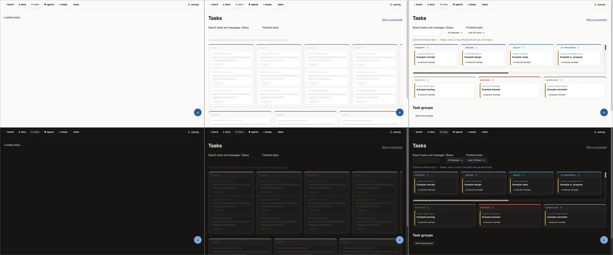

    A task, on a phone and wide:   Then with its head in and its thread still reading, before and now: 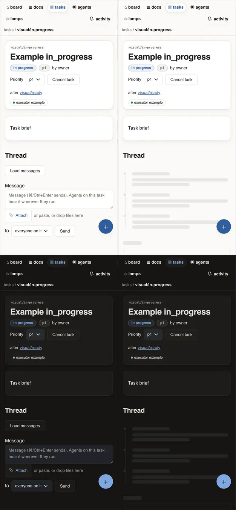 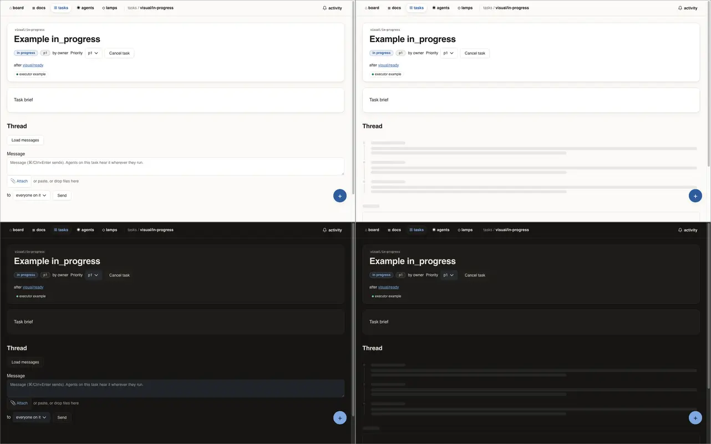

    A document, on a phone and wide:   Then with its head in and its body still reading, before and now:  

    The queue:  

    The chat:  

    **Layout shift**, the worse of a first and a repeat visit, phone / wide, before → now: document 0.171 / 0.124 → 0 / 0; chat 0.143 / 0.030 → 0 / 0; task 0.107 / 0.075 → 0 / 0; register 0.050 / 0.079 → 0 / 0.006; task board 0.018 / 0.048 → 0.002 / 0.001; home and the activity panel 0 before and now (under 0.05 is good).
  [2026-11-12 03:57] agent — Updated for the gates card that now sits under a task's head. A task's placeholder now includes that card too, with a line for each gate this browser last saw (four the first time), so the brief stays put as the page arrives. The task again, before, now and loaded, against main as it is now:

      Then with its head in and its thread still reading, before and now:  

    The task board and the other pages look as above, and the layout shift is unchanged: a task 0 / 0 with its gates in.
  [2026-11-12 06:01] agent — Reworded after review. "Nothing moves" was wrong: the layout-shift score cannot see a placeholder replaced by the real page, as every real element is new. Now each part is measured where its outline stood and where the page draws it, on the test pages:

    - **Repeat visit:** every part of the task, board, document and queue within 1 px, phone and wide.
    - **First visit:** the document and the queue within 1 px. The board's lower row (backlog, blocked, cancelled) 19 px up, as its columns' heights are not known yet. A task's gates 32 px up on a phone (the test task's title is one line, not two), its brief 222 px up on a phone and 87 px wide, and its thread 313 px and 177 px (four gates and seven lines of brief outlined, against its two and one).

    Changed to match the page: columns topped with their status colour; a bar in the Status and Finished tasks boxes; a card per task the last visit counted, and one per column before any visit; no role chip in a column no agent has taken up; a task title of two lines on a phone; the On this page button on a phone; a task's head and brief at the height this browser last drew them; columns 280 px wide on a phone, as the board's.

    Each picture is before, the first visit, the next visit (the board and a task) and loaded, light above dark, motion off. The yellow Reconnecting notice under a document's placeholder shows on main too.

    The task board:  

    A task:   Then with its head in and its thread still reading, before and now:  

    A document:  

    The queue:  
  [2026-11-12 06:32] owner · approved
  [2026-11-12 08:01] agent — Corrected after a second review: the card claimed more than its test measured, on test pages of one task per column. Now measured on pages shaped as the live ones: columns of 1 to 20 tasks whose titles take one to three lines, cards with and without a chip row, three queue groups of one, no and three rows, and two tasks of different titles, facts, gates and briefs. Each part is measured where its outline stood and where the page draws it, on a phone and wide.

    - **Next visit: every part within 1 px.** The board's filters, pipeline, its fourth concept card and its lower row; each queue group; a document's head, outline and body; a task's head, gates, timeline box, brief and thread. For this the browser now keeps each column's first 16 cards (height, and whether it has a chip row), each queue group's rows and height, and a task's title, facts and gates as well as its head and brief.
    - **First visit:** a document within 1 px; the board's filters and pipeline, the queue's first group and a task's head within 1 px. The rest cannot be known yet and moves: the board's lower row 258 px down on a phone and 379 px wide, as each column outlines one card; the queue's second group 313 px up and its third 413 px up, as it outlines four rows and two for one and none; a task's parts by what its title, facts, gates and brief differ from the outline, for which there is a choice on **skeleton-first-visit**.
    - **"No role chip" was wrong:** that row also holds a card's linked documents, on 5 of the live board's 6 design cards and 5 of its 9 ready ones. Each card now outlines its chip row as it was last drawn.
    - The timeline box that now sits on a task's page is outlined at the height the page will give it.

    Each picture is before, the first visit, then for a task its first visit after another task, the next visit (the board, a task and the queue) and loaded, light above dark, motion off.

    The task board:  

    A task:  

    The queue:  

    A document:  
  [2026-11-12 20:35] agent · resolved

### Delivery to projects

- [r] **consumer-manifest-line** — The app you open on port 8765 still runs release-2026-11-13.2, and no release since has reached it. Every refresh since 2026-11-14 stops at its first command in the consuming project, whose manifest asks for a package named `symphony`; from release-2026-11-14 on that package is named `symphony-app`. One line of that project's manifest has to name it, and nobody here edits that project without your word. Who makes that change? A: the refresh: `just release --refresh`, which already moves that project's pin, also changes the package's name on that line when it finds the old one. B: an orchestrator, once, by hand in that project's checkout. C: you. Recommended: A. Approve and say A, B or C in the note, or comment. [[RELEASES#The refresh]]
  [2026-11-15 10:20] agent — Posted for the board task `docs/consumer-manifest-line-card`. The red refresh has a task of its own on this board, blocked since 2026-11-14 on this question, which until now was asked only in chat and on that thread.

    **The line**, in the consuming project's workspace manifest, the one place it names the library: `symphony = { package = "symphony-app", git = "https://github.com/heavenstudio/symphony", tag = "release-2026-11-15" }`. Nothing else moves: the key stays `symphony`, so no code changes.

    **It is not an edit on its own.** The release that project is pinned to holds no `symphony-app`, and the releases after it hold no package named `symphony`. So the new name goes in the same commit as the new tag: that line, the tag on all ten of the project's Symphony lines, and its lock. That commit is the pin's move, which the refresh makes at every release.

    **What each costs.**
    - **A:** a small change to the refresh, as a board task with its review, then a rerun: hours, not minutes. The move is made as today, in a worktree beside that project's checkout and through its own commit gate, and its main takes it only if the commit changes manifests and the lock alone and its hooks allow it. The refresh stays the only thing of Symphony's that edits that project, and a later rename is handled the same way.
    - **B:** no code, and the soonest. The orchestrator makes the pin's whole move by hand (the line, the ten tags, the lock), commits it on that project's default branch through its commit gate, then reruns the refresh, which finds the pin moved and goes on to the board. It is one exception to the rule that Symphony's agents do not edit that project, made in the checkout the shared server is built from, without the refresh's checks. Pushing that project's branch stays a separate act that needs its own word.
    - **C:** the same work by your hand, when you get to it. The orchestrator reruns the refresh when you say it is done.

    **What a green refresh brings, and what it does not.** It brings the newest release, release-2026-11-15 (c944025a, 03:11 today), not main's tip.
    - Your approval of **live-board-schema-moves** (A) waits on it: `tools/board-token-usage` lands only after the server is refreshed.
    - The fix for pages that never load is not in that release. Measured today on the shared server: with five of its tabs open in one browser, a further page got no answer in 40 s. Main's client, with eight tabs open, returned the queue in 31 to 48 ms. That fix (22afbd67) landed after release-2026-11-15, so it reaches you only with the next release after a refresh works.
    - The next release is held: a release candidate is open, red in two checks, and no run judges main's tip until it is released or dropped (2026-11-16 04:18 at the latest).

    **What is unknown.** Whether more is red behind this one. `cargo update` is the refresh's first command in that project, so nothing after it has run since 2026-11-13: that project's build against a newer release, its commit gate, its hooks, its board's move, the server's reload. Under every option the first rerun shows the next red, if there is one.

    **Why A.** The commit this needs is the pin's move, and the refresh already makes that move with checks a hand does not have; B and C make it by hand in the checkout your server is built from. A's cost is some hours after B, on a refresh red for two days, and those hours do not delay the tab fix, which waits for the next release either way.

    **Earlier verdicts checked.** **consumer-api-break-release** (A) is about code a project uses staying in place for a release; it does not say who changes a manifest line. No other card speaks of who edits the consuming project.
  [2026-11-15 10:38] owner · approved — B
  [2026-11-15 11:13] agent — Recorded: B. An orchestrator, quiet-plover, makes the pin's whole move once by hand in the consuming project's checkout (the line, the release's tag on its Symphony lines and its lock), through that project's own commit gate, then reruns `just release --refresh`, on the red refresh's own board task. Pushing that project's branch stays a separate act that needs your word. [[RELEASES#The refresh]] now says who makes this move.
  [2026-11-15 11:14] agent · resolved
- [r] **live-board-schema-moves** — Two approved tasks each move Symphony's own board (this repository's, in its git common dir) from schema 17 to 18, and both are held unlanded on that: `tasks/board-writer-record` (approved at 6394e33a) and `tools/board-token-usage` (approved at 71f05a84). The shared server on port 8765 runs release-2026-11-13.2, schema 17, and from the first land until it is refreshed you cannot write this board from the app. When may the board move? A: now, `tasks/board-writer-record` to 18 at once and `tools/board-token-usage`, renumbered to 19, only after the server is refreshed. B: only once the refresh works again and no release candidate is open, then `tasks/board-writer-record` lands in a quiet moment and `just release` is run by hand at once, on main's tip, which is then its merge commit, so the app's writes are out until that commit is released; `tools/board-token-usage` follows the same way at 19. C: not yet, both stay held. Recommended: B. Approve and say A, B or C in the note, or comment.
  [2026-11-15 02:40] agent — Posted by the two orchestrators (quiet-plover, silver-sparrow) for those two tasks. One decision, not two: the second to land must renumber, so the order is part of it.

    **What the shared server does against a board ahead of it.** It is built from the consuming project's checkout at its pin, release-2026-11-13.2 (4056a635), schema 17; "ahead" is counted from that pin, not from main, which is also 17 today. Read in that release's code (`crates/tasks/src/schema.rs`, `decide`):
    - **At 18 it reads and writes nothing.** Pages and the board draw. Every write of yours from the app is refused at once: a post on a task's thread, a priority, a field, a cancel, a board action. Document saves and chat wait in its journal until it can write.
    - **At 19 it reads nothing either:** more than one ahead is refused, so this project shows no board.
    - Only its idle sweep, its embedding catch-up and the end of a cancel run the main checkout's `.target/bin/tasks`, and so follow that link.

    **What a 17 build of `tasks` does against 18**, measured on a private scratch board by the reviewer of `tools/board-token-usage` (main's 17 build against that task's 18; `tasks/board-writer-record`'s 18 adds one table and meets the same rule): every command is refused before any write, `list` and `show` included, and a heartbeat writes nothing, so its agent reads quiet or lost until the link it runs is renewed.

    **What each costs.**
    - **A:** you cannot act on this board from the app from the land until a refresh. The refresh is red today (the release run's refresh of the consuming project, filed 2026-11-14, waiting on your word for who edits one line of that project's manifest), so that time has no end in sight. Agents and both orchestrators keep working through `just tasks`.
    - **B:** nothing changes until the refresh is mended. Then each move costs the app's writes until its commit is released: one run when it is green (a run took 23 to 124 minutes), hours more through a release candidate when it is red, and 7 of the last 10 runs were red. Three steps are in it. Your word on that manifest line comes first. The release candidate open today (f35f9eb4, red in one test, its fix in work) is released or dropped before the land, since no run judges main's tip while one is open. And approving B is your word for two `just release` runs by hand, one right after each land, a run that is otherwise yours to start; a red one holds that merge commit as the release candidate until its fixes land and a rerun is green. The quiet moment runs from the land to the first `just tasks` after it, whose build moves the board: no land or review mid-flight in a worktree with a board binary of its own. The refresh moves the server only if the consuming project's own gate and hooks pass the pin's move; otherwise ending the wait is that project's to do.
    - **C:** the board shows no writers still behind and no token cost per task, and the two branches age.

    **Your earlier verdict.** `board-schema-at-update` (C, 2026-11-12), given for `symphony update`: a board moves only once every program that writes it is on the new schema. The shared server writes this board, so A moves it while a writer is behind; B keeps that time to the wait for one release. `tasks/board-writer-record` leaves the server out of its count of writers on purpose, since counting it would refuse the very migrate a refresh runs.
  [2026-11-15 06:49] owner · approved — A
  [2026-11-15 11:13] agent — Recorded: A. `tasks/board-writer-record` moves this board to schema 18 now, and `tools/board-token-usage`, renumbered to 19, lands only after the server is refreshed. From the first of them until that refresh you cannot write this board from the app; agents and orchestrators keep working through `just tasks`.
  [2026-11-15 11:14] agent · resolved
- [r] **pin-waits-for-current-client** — A land now merges and pushes in seconds. The client the server embeds is rebuilt after it by one background run, which commits it to main a few minutes later: about 14 minutes when the land changed the client, none when it did not. In between, main's committed client is older than its sources. A release already waits for it: the nightly releases nothing while main's client is behind. May a project's pin be moved to a commit of main whose committed client is behind? A: no; the pin waits until `just tasks regenerate --status` says the client is current, as a release does. B: yes; the pin moves, and the project's server serves the older client until its next move. Recommended: A. Approve and say A or B in the note, or comment. [[TASKS#The regenerator]]
  [2026-11-12 14:20] agent — Posted for the board task `perf/land-batches-approved-tips`.

    **Why it matters.** A change to the wire types, the server and the client lands its server at once and its client one round later. A server built from main in that window embeds the older client against the newer server, so a page can fail to read what the server sends.

    **Where it applies.** Your verdict on how projects take a newer Symphony (they follow release tags, never main) already keeps a behind client out of every pin to a release, since no release is cut on one. This is for a pin moved by hand to a commit of main, which is every pin move until the first release is tagged. The check belongs to the project's own pin tooling. Symphony gives it the signal: the status command exits nonzero unless main's client is current.
  [2026-11-12 14:31] owner · approved — A
  [2026-11-12 14:33] agent — Building A now. A new form of the status command, `just tasks regenerate --status --wait` run in the Symphony checkout, waits while main's client is being rebuilt and succeeds only once it is current, the way the nightly waits before a release. A pin moved to a commit of main moves only after it succeeds, and the guides now say so. The pin itself is moved by the project's own tooling, which runs this command first. A pin to a release needs no wait, since no release is cut while main's client is behind.
  [2026-11-12 16:36] agent · resolved
- [r] **board-schema-at-update** — With one release per machine, the server and every project's board commands come from one release, never apart. When does a project's board move to a new release's schema? A: at `symphony update`, every registered board, each after a dump, whatever else writes it. B: at each project's own `just tasks migrate`, as today. C: at `symphony update`, each board after a dump, but only once every program that writes it is on the release's schema; a release that raises the schema waits until then, naming the writers to rebuild. Recommended: C. Approve and say A, B or C in the note, or comment. [[engineering/analysis/plugin-delivery#The board]]
  [2026-11-12 10:06] agent — Posted for the board task `design/plugin-delivery-without-rebuilds`, revised after its review.

    **Today** only a project's own migrate in its main checkout moves its board. The schema went from 9 to 17 in ten days, the last this morning. A board command behind its board's schema is refused outright, reads included. A server one schema behind reads the board and writes nothing, so your messages, priorities, fields and cancels from the app fail.

    **Who writes a board.** Not only the server and `tasks`: the consuming project's nightly opens its board to write through Symphony's crates at the consuming project's pin, and its landing runs its own `tasks` build. Each is refused once its board moves past it.

    **A, every board at the update.** Nothing is left half-updated on Symphony's side. Cost: every writer not from the release is refused the moment its board moves; for the consuming project today, its nightly and its landing. And had the board moved before the server came from the release, the running server would have been left a schema behind and read-only to you.

    **B, per project.** Each project moves its board once its own writers are rebuilt. Cost: until it does, the release's server and board commands, a schema ahead, cannot open that board at all, so the project keeps building its own server and board commands: today's cost, kept.

    **C, when every writer is on the release.** The board records each program that opens it to write and the schema it was built at; the update moves a board only when every writer seen there in the last week is the release's own or built at its schema. A release that keeps the schema installs at once. Cost: the record is new work, older builds do not write it, and one lagging writer holds a schema-raising release for every project on the machine.

    **For every letter.** Before a board moves it is dumped through its running database, and the update never stops, signals or restarts a board's database. This morning the consuming project's board came back three days old because its launcher ended a database that was slow to replay its log (`tools/board-database-lost-its-log`); the server's refusal to read a board behind its schema is what kept anyone from writing on the old state.

    **Why C.** "More automatic type of updates" is your ask: C moves every board it safely can by itself and stops with a name where it cannot, where A would break a writer and B would keep today's builds. Symphony's own board keeps moving with main, as it does now.
  [2026-11-12 10:20] owner · approved — I didn't say which one I approved did I. C makes sense to improve upon A. while we don't have a dedicated build service.
  [2026-11-12 10:54] agent — Recorded as C, the improvement on A while there is no dedicated build service. Two of its costs, stated plainly. Symphony's own board keeps moving with main, so whenever a release that raises the schema is held, by a lagging writer of any project or by the update waiting to be run, the machine's server reads Symphony's board and writes nothing to it, and after a second raise cannot read it at all: today's "Symphony's own pages wait for the consumer's pin" in another form. The update names the writer that holds it, and the hold ends when that writer is rebuilt. Writers built before the record never write it, so the record alone cannot see them. The record therefore lands with a schema raise of its own, made once as today by each project's `just tasks migrate` after its writers are rebuilt; since a writer behind its board's schema is refused, no older build can write the board from then on, and the update never moves a board whose schema predates the record. [[engineering/analysis/plugin-delivery#The board]]
  [2026-11-12 10:54] agent · resolved
- [r] **release-delivery** — Each release comes as separate parts, each with its checksum: the server with no client inside it, one build of the client beside it, the board commands, the document command line. One command, `symphony update`, installs them on the machine, fetching only the parts that changed. From the fifth slice it replaces the per-project update command chosen on 2026-11-11: no project moves a pin to take a release. How does a release reach the machine? A: the nightly builds it here after it tags, once per release (about 11 minutes); nothing is downloaded. B: a hosted build makes each platform's parts on the tag and publishes them; the update downloads them. C: A now, B once a project runs on another machine. Recommended: C. Approve and say A, B or C in the note, or comment. [[engineering/analysis/plugin-delivery#Distribution]]
  [2026-11-12 10:06] agent — Posted for the board task `design/plugin-delivery-without-rebuilds`, revised after its review.

    **Why separate parts.** The consuming project's release builds, measured this morning: the server 295 MB, of which about 266 MB is every client build ever published, `tasks` 32 MB, `symphony` 23 MB and `agent-send` 6 MB. The server's code alone is about 30 MB, an estimate by subtraction. So a new client means a whole new server, and so does a board change. Split, a release replaces only what changed, usually one or two parts. The two size tasks on the board give each part's measured size and rebuild time when they post; neither had by 10:05.

    **What it replaces.** On 2026-11-11 you chose a per-project command that moves a project's pin to the newest release tag (the resolved card `symphony-update-command`, further down). Its task `tools/symphony-update-command` is ready and not started, and `tools/symphony-behind-signal` depends on it. Until the release's server serves every project, moving the pin is still how the consuming project takes a release, so the first task stays worth building as filed. At the fifth slice `symphony update` replaces it and its recipe retires, and the behind signal reads the machine's installed release instead of a project's pin. Under the first card's A, the 2026-11-11 command stays as decided, and this card's release carries only the board commands.

    **A, built here.** The nightly already checks out and verifies the tagged commit, so building it once more is about 11 minutes, once per release for the whole machine. Cost: a second machine has nothing to fetch.

    **B, downloaded.** Each platform's parts are built by a hosted CI on the tag. Cost: this repository has no hosted CI today, and someone has to keep it working. On macOS a `curl` download is not quarantined and runs with the linker's ad-hoc signature, but Apple documents no promise that Gatekeeper never checks it; signing with a Developer ID and notarising are the safe form, a step of their own.

    **Why C.** Everything runs on this machine today, so A is enough and costs nothing new. B waits until a second machine needs it.
  [2026-11-12 10:18] owner · approved — We will move to B in the future. Just not yet.
  [2026-11-12 10:54] agent — Recorded: releases are built here by the nightly for now, and hosted builds that the update downloads are the later direction, when you say so rather than when a project reaches another machine. Under the first card's A, a project would build its own server while the machine ran the release's board commands, so its pin would have to be at the installed release's tag, or its server would be a schema behind its board, reading it and writing nothing. Under B, which you chose, that case does not arise: nothing comes from a release before the fifth slice, when the server and the board commands come together. Until then the consuming project builds both at its pin and moves the pin to the newest release tag with the command you chose on 2026-11-11, so that command's task stays as filed until the fifth slice. [[engineering/analysis/plugin-delivery#How a release gets there]]
  [2026-11-12 10:54] agent · resolved
- [r] **plugin-delivery-choice** — A project should take a Symphony release without compiling Symphony, its own plugin delivered apart. Today each update makes the consuming project move its pin, fix what broke, rebuild a 295 MB server and its board commands, and restart: about 30 minutes this morning. And one server must link every project's plugins, so a second project with plugins could share it only through one build that links both projects' plugins. How does a project's plugin reach the release's server? A: still linked, against a small stable SDK; the project still compiles the server at every update. B: a program of the project's own, which the server starts and talks to in JSON lines, over a versioned protocol. C: a WebAssembly plugin the server runs in a sandbox. D: a shared library with a stable ABI. Recommended: B, once its first slice has measured what JSON costs. Approve and say A, B, C or D in the note, or comment. [[engineering/analysis/plugin-delivery#The options]]
  [2026-11-12 10:06] agent — Base: how an update reaches a project today. 
  [2026-11-12 10:06] agent — Posted for the board task `design/plugin-delivery-without-rebuilds`, revised after its review. B, the recommendation, drawn: 

    **What breaks today is not the seams.** They have not changed in the last twenty landings. The consuming project's last four pin moves broke only its tests of Symphony's internals (a struct gained a field, a function an argument, a help text changed). Even with nothing broken, each update still compiles the server and restarts it.

    **A, linked with an SDK.** It ends the fixing, not the compiling: still about 30 minutes per update, and still one server that must link every project's plugins. The update command you chose on 2026-11-11, a project moving its pin to the newest release tag, stays the way to update.

    **B, a plugin program.** The consuming project's plugin crate stays as it is; a new binary's `main` serves it, and both the server and the `symphony` command line talk to it. Nothing it does today is lost. Its costs: one pipe per project, so a hung call holds a worker, and a process that stops answering is killed and restarted with its warmed caches lost; a page render needs two passes to send its components in one request; card answers must be kept per branch; debugging goes through the plugin's log and a replay of a recorded request; and until the plugin uses the SDK alone, a library change it links shows as a silent mismatch instead of a compile error, so that step comes before the server leaves the project. What JSON costs per register read and page render is not measured. Symphony's work: about two to three weeks, an estimate the analysis breaks down part by part.

    **C, WebAssembly.** A real sandbox, but the consuming project's plugin must first stop linking the whole Symphony library, and its land action, its picture resizing and its file-writing command all become host functions. Cost: wasmtime in the server and the command line (its C library alone was 19 MB in a 2024 Linux build; what it would add here is not measured), and a runtime upgrade every month or two.

    **D, a shared library.** Still a compile per release with the exact same compiler, and a panic takes down the server every project shares. Bevy dropped the same idea as unsound.

    **Why B.** It is the only option where an update compiles nothing of the project's and the plugin keeps everything with no rewrite. C can follow later behind the same seams, if a plugin ever comes from someone else.

    **First slice, an estimated 2 to 3 days:** every plugin call sent through a JSON round trip inside today's server and timed, on the consuming project's 39 registers and heaviest pages. B goes on if that cost is small; the bound is yours to set with the numbers in hand. Until the fifth slice the consuming project keeps taking releases by moving its pin. Success, once every slice lands: an update is one command, compiles nothing of the project's, and takes minutes, not 30; how many is not estimated yet. [[engineering/analysis/plugin-delivery#The slices]]
  [2026-11-12 10:17] owner · approved — Let's go with B first, measure results against the current approach for a post change comparison.
  [2026-11-12 10:54] agent — Recorded as B, with your comparison built into the first slice. Before anything changes, that slice measures today's approach: an update end to end on the consuming project's next pin move (each step's wall time, from the first command to the restarted server answering, with the load); what it rebuilds and redistributes (the units Cargo compiles, whose they are, and the bytes installed, the 295 MB server included); and every plugin call's time, linked, over the consuming project's 39 registers and heaviest pages. It then times the same calls through a JSON round trip. The same three measures are taken again after the change: the calls through the process at the third slice, the update and its bytes at the first `symphony update` that installs a release. The numbers go into one before-and-after table in the analysis. [[engineering/analysis/plugin-delivery#Before and after]]
  [2026-11-12 10:54] agent · resolved
- [r] **symphony-update-command** — A project takes a newer Symphony with one command, `just symphony-update`, which `symphony init` installs. The project's own check, land command and approval still decide whether it lands. Which commit should the command take? A: main's newest. B: the newest release, which Symphony would tag. C: no command, a written checklist instead. Recommended: A. Approve and say A, B or C in the note, or comment. [[workflow/analysis/symphony-update#The command, step by step]]
  [2026-11-11 12:37] agent — Posted for the board task `product/symphony-update`.

    **What the command does.** On a new branch it moves only the Symphony commit in Cargo.lock, builds, brings the shipped skills and hook up to date, and runs the project's check. The project's land command and approval land it. Run again on main afterwards, it restarts the shared server. It never lands, pushes or moves another dependency by itself, and it asks before a restart that changes the board schema.

    **A, follow main.** Each run takes main's newest commit. Main moved 9 to 23 times a day this past week, so a project is shown as behind only when main's board schema or pin is ahead of it, or its commit is over a week old. Cost: a bad main commit reaches the project if the project's own check misses it; one revert undoes it.

    **B, follow releases.** Symphony tags a release for a fix, a schema change or once a week, and the command takes the newest tag. Cost: a release step on Symphony's side for every fix, and a fix waits for its tag. There are no tags today.

    **C, a checklist.** The same steps by hand. Cost: today's hand work every time, and nothing tells a project it is behind.

    **Why A.** The consuming project is the only project, its own `just verify` checks every update before it lands, and a revert is the rollback. B pays off once a project off this machine uses Symphony.

    Four smaller questions are at the end of [[workflow/analysis/symphony-update#Open questions]]; answer any of them in the note.
  [2026-11-11 12:43] owner · approved — B. There will be other projects using it. New releases can be pushed for urgent bugfixes, but generally should be generated based on nightly builds that would do a full verification cycle and conciliation.
  [2026-11-11 12:53] agent — Recorded as B: projects follow Symphony's release tags, never main. A nightly on main's tip runs the full verification and the conciliation, and tags a release only when both are green. An urgent fix is released out of cycle after the same checks. The pin-only move, the project's own landing, the schema and restart handling, and rollback (now to the previous release tag) stay as proposed. [[workflow/analysis/symphony-update#Releases]] now states this. Filed on the board: tools/release-nightly (the releases and the nightly), tools/symphony-update-command (the command and the stamped recipe init installs) and tools/symphony-behind-signal (the line on the page, in tasks status and at start). What conciliation should cover is asked on tools/release-nightly's thread; until you answer it reads as building each project the machine serves against the candidate.
  [2026-11-11 12:53] agent · resolved

### The shared server

- [r] **server-socket-hand-over** — When the shared server takes a new build (the checkout it is built from changed, as a release's refresh changes it, or a newer build was started), the new server gets ready while the old one keeps answering, then takes over the old one's open port. Pages never meet a server that is down, and a new build that fails to start leaves the old one serving. Should it keep this hand-over, or simply stop and start again? A: keep it. B: a plain restart: the old server stops and the new one starts on the port; the watch for a new build and the build itself stay as they are. Recommended: A. Approve and say A or B in the note, or comment. [[engineering/analysis/code-review-2026-11#Choices that are the owner's]]
  [2026-11-15 03:46] agent — Posted for the board task `docs/code-review-owner-choices`, from the codebase review.

    **What you would notice under B**, at each switch:
    - The port is closed until the new server listens, then its pages wait while it warms up: 0.9 to 47 s over the 25 warm-ups in its log (one a project) across 13 server starts, 6.3 s at the median.
    - Open pages say "Reconnecting: the board may be out of date" and try again after 1 s, then 2, 4 and on up to 30 s. A page opened then fails to load or waits; a save fails and keeps its draft.
    - A new build that compiles but fails to start leaves no server until someone starts one, and the refresh's wait for it ends unanswered.

    Under A, open pages lose their live feed for about a second and take it again from the new server, warmed up already, and a failed start is said on the old server's notice while it keeps serving. Under both, the build itself (10 s to 21 minutes in the log) runs while the old server answers.

    **How often.** The server's log holds 10 hand-overs since 2026-11-11, none failed. Once, at 10:34:21 UTC on 2026-11-12, the new server (pid 42043) began to stop 22 ms after it took over, the log not saying why; it had stopped by 10:34:27, and the next server answered at 10:35:14. That was a stop, not a failed hand-over. A release's refresh makes a hand-over each time it moves the consuming project's pin.

    **What the refresh depends on.** The server's own reload: it sees the new `Cargo.lock` of the checkout it is built from, builds and switches. The refresh then waits up to 20 minutes for another process to answer on the port (`crates/symphony/src/release/refresh.rs`). Under B that still holds, as long as the new server runs as a new process rather than in the old one's place, which keeps its process number.

    **The lines.** The server's whole update is 2,046 lines of source and 2,920 of tests (`wc -l` of the server's `src/reload.rs`, `src/reload/stamp.rs`, `src/reload/source_event.rs` and `src/host.rs` with the library's `src/reload.rs`; and of the server's `src/reload/tests.rs`, `src/host_tests.rs` and `tests/after_reload.rs` with the library's `src/reload/build_tests.rs`). B keeps the watch, the stamp and the build. It removes the hand-over itself, about 530 lines of source (`sed -n '23,415p;619,651p' apps/symphony-server/src/reload.rs` gives 426 of them, `src/host.rs` 78, the hand-off signal and the old server's drain in `src/front.rs` the rest) and 549 of tests (lines 353 to 592 of `src/reload/tests.rs`, 1007 to 1230 of `tests/after_reload.rs`, and `src/host_tests.rs`), and needs a stop and a start of its own, with their tests, not written.

    **Why A.** It works, and B saves about a quarter of the update's lines for a gap of seconds at every switch and no server at all after a build that fails to start.

    **Earlier verdicts checked.** No card asks about the hand-over. **server-framework** (A, keep Axum) counted the server's own listener, which the hand-over relies on, in the cost of moving off Axum, and noted that Axum's next version will need the drain checked; it did not ask whether to keep the hand-over.
  [2026-11-15 06:48] owner · approved — A
  [2026-11-15 11:13] agent — Recorded: A, the hand-over stays. Nothing changes.
  [2026-11-15 11:14] agent · resolved

### The look

- [r] **symphony-mark** — Symphony would get a mark and a name of its own, at the start of the header, on the browser's tab and on a phone's home screen. They show on the machine's own pages (the project list and the pages the server draws) and on every project with no theme name or icon of its own; a project's own theme name and icon take their place on its pages. Today the header shows neither, the tab shows no icon or a generic ♫, and the icon the browser asks the server for by itself is the consuming project's star. Which mark and wordmark should Symphony's own look carry? A: the note-card, a note whose head is a task card. B: the podium, the orchestra's seats round two maestros. C: the fermata, the sign where the music holds for the maestro. D: the two-stroke S, one stroke for you and one for the orchestrator agents. Recommended: D. Approve and say A, B, C or D in the note, or comment. [[design/analysis/symphony-mark#The options]]
  [2026-11-15 05:12] agent — Posted for the board task `app/symphony-mark-and-name-options`. Your words on its inbox item: "A proper "themed" design of Symphony could be develop that is closer to the concept of "a symphony that is executed by maestros" where maestro are the human + orchestrator agents. I would like to view different options to select."
  [2026-11-15 05:12] agent — Base: today, wide and on a phone, no mark and no name in the header. 
  [2026-11-15 05:12] agent — Each option in the header wide (light, then dark), on a phone (light, dark) and in the tab (light, dark), drawn on a private server with the option set as a scratch project's look; nothing in the app has changed. A headless browser shows no tab strip, so the tab is a stand-in drawn around the real icon file, and the Projects link the machine's server draws is added to the private server's header.    

    **A, the note-card.** A note whose head is a task card: the board's work is the symphony's music. Wordmark: "Symphony" in the app's own sans.

    **B, the podium.** The orchestra seen from above: its seats in an arc round two maestros, you and the orchestrator agent. Wordmark: "symphony" in lower case. At 16 px it reads as a fan of dots; the seats show from 32 px.

    **C, the fermata.** The sign where the orchestra holds until the maestro moves on, as a card holds until you answer it. Wordmark: "Symphony" in a serif.

    **D, the two-stroke S.** Symphony's S in two strokes, one full and one lighter: you and the orchestrator agents, two maestros conducting one work. Wordmark: "SYMPHONY" in spaced capitals.

    Any wordmark can go with another mark: say which in the note.
  [2026-11-15 05:12] agent — The four icons at 180, 32 and 16 px, light then dark: 

    **Why D.** It is the only one that says the name at every size, down to the 16 px tab, and its two strokes are the two maestros you named. Its cost: a letter says nothing of music, and the two maestros show only once explained; the lighter stroke loses contrast at 16 px, most on the light tile; and it is close in kind to other music products' S marks. C is as clear at 16 px and the simplest, but it shows one maestro's hold, not two maestros. B tells the most and blurs the most when small. A is the closest to today's ♫ and says the least about the maestros.

    **What it changes.** The machine's own pages and every project with no theme name or icon of its own show the chosen mark and wordmark in the header and the icon in the tab; a project's own theme name and icon take their place on its pages, as the project file's reference already says, so the consuming project keeps its own name and star. The icon the browser asks the server for by itself becomes Symphony's where no project's own answers it; the header stays two rows on a phone (measured at 390 wide for all four); a phone's home screen gets the icon. A follow-up task builds it after your answer.

    **Earlier verdicts checked.** **header-page-names**, **header-on-a-phone** and **header-appearance** set the header's words, its two rows on a phone and its ◑ button; every option keeps them. **symphony-own-names** took the consuming project's names out of Symphony's code and says nothing of a mark. **pictures-in-every-clone** decides that these pictures are committed beside this card. None of them chooses a mark or a wordmark: that is this card.
  [2026-11-15 05:52] agent — Corrected after the task's review, before any answer: the first lines say where the mark and the wordmark show (not on every page), Why D gives D's own cost, and the pictures' line says the tab is a stand-in.
  [2026-11-15 06:40] owner · approved — C
  [2026-11-15 11:13] agent — Recorded: C, the fermata, with its serif wordmark. The board task `app/symphony-mark-is-the-fermata` builds it: the header, the tab's icon and a phone's home screen, on the machine's own pages and on every project with no theme name or icon of its own. [[design/analysis/symphony-mark#What applying the choice touches]]
  [2026-11-15 11:14] agent · resolved

### Web stack

- [r] **server-framework** — Should the server stay on Axum, or move to another Rust web framework (Actix Web, Rocket, Warp, bare Hyper, Poem, Salvo)? Nothing you see changes; this decides what the server is built on. A: keep Axum. B: move to Actix Web, the one serious alternative. Recommended: A. Approve and say A or B in the note, or comment. [[engineering/analysis/graphql-and-server-framework#Which server framework]]
  [2026-11-14 11:01] agent — Posted for the board task `inbox/evaluate-graphql-and-other-web-stacks`.

    **Is Axum failing?** No. No task or bug names it, and it is 0.03 MiB of the server's binary. The server uses it thinly: one route and a fallback, with its own dispatch picking among 30 reads and 15 saves.

    **The others.** Rocket cannot take the listening sockets the reload hands a new build. Poem has had no release in 15 months. Warp moves slowly, under one person's account. Salvo and ntex each rest on one person. Bare Hyper is what Axum already runs on. Actix Web is maintained, released often, and offers everything the server needs.

    **Speed.** Actix Web has scored above Axum in published benchmarks; Axum's last published JSON figure is 2.7 million requests a second, about 21 µs of a core each. This server's reads take 1 to 200 ms of their own work, for a handful of browsers, so a faster framework would save microseconds no page could show.

    **B's cost.** 14 of the server's files and 25 of its test files: its own listener, which the reload's hand-over and drain rely on; its layers; the projects' dispatch; the streams.

    **A's cost.** Axum's next version changes `axum::serve`, which the server calls in one file: a small compile fix, plus a 30-second limit on reading a request's head that it applies, with no setting to turn it off. That would close a connection that sends nothing for 30 s, an idle browser connection among them, where today it is kept, so the server's drain on reload needs checking when it comes.

    **Why A.** Nothing to fix, nothing to win at this load, and the move would rewrite the parts that are hardest to test.

    **Earlier verdicts checked.** No card speaks of the server's framework; **client-framework** left the server as it is.
  [2026-11-14 11:19] owner · approved — A
  [2026-11-15 11:13] agent — Recorded: A, the server stays on Axum. Nothing changes, and no document said otherwise.
  [2026-11-15 11:14] agent · resolved
- [r] **graphql** — Should the React client read the server through GraphQL, with Apollo or another GraphQL client and its cache, instead of today's JSON reads and live feed? The hope is better caching in the browser and faster responses; measured here, the caching is mostly built already, and the speed would come from elsewhere. A: keep the JSON reads, the live feed and the device cache the React port is built on. B: GraphQL: a schema on the server, a GraphQL client and its cache in the browser, live updates as subscriptions. Recommended: A. Approve and say A or B in the note, or comment. [[engineering/analysis/graphql-and-server-framework#GraphQL or not]]
  [2026-11-14 11:01] agent — Posted for the board task `inbox/evaluate-graphql-and-other-web-stacks`.

    **What a page reads today,** measured on the live board: the board 12 reads and 23 kB of data before it is drawn, a task's page 4 reads and 10 kB, this register 6 reads and 17 kB. A return visit makes 3 to 5 reads of about 5 kB, every unchanged read answered empty (`304`). The server answers most reads in 1 to 2 ms and its slowest in 20 to 200 ms, all of it the work behind them.

    **A, keep them.** Nothing changes in the port. Two small changes would give what one GraphQL query saves, if wanted later: a task's page asking for the task and the board together (the server already does this for documents), and the board asking for its counts and columns with the board. Over a slow phone network each saves about 0.6 s; on this machine, nothing.

    **B, GraphQL.** One query a page in place of several reads. Its costs:
    - 10 kB (urql) to 58 kB (Apollo) more on every first visit, against the queue's whole 101 kB on React.
    - Apollo's cache lives in the page's memory and keeps nothing across visits without an add-on last released in March 2024. A query sent by POST never gets the empty `304` that makes return visits cheap today.
    - Subscriptions need a WebSocket the server does not have, with the feed's rules rebuilt on top.
    - A second set of generated types beside today's.
    - The plugins' blocks and fields cross as untyped JSON, since a query cannot ask for a tree of any depth.
    - The port's reads, feed and cache modules are replaced before its nine page tasks start.

    **Why A.** Where GraphQL saves time, the same saving is open without it. Weighed in bytes, it costs more than it saves. The cache it brings is weaker here than the one built. The server's time would not change: about 0.06 ms more a query.

    **The weakest point.** A normalized cache (one task kept once, every view of it updated together) is the one thing the client would gain. The live feed covers most of it today; if it is ever needed, TanStack Query gives it over the reads as they are, for 10 kB.

    **Earlier verdicts checked.** **client-framework** (React, TypeScript, Vite) moved the front end and named no data layer, so it does not decide this. **client-cache** (the device cache, checked by checksum) would be partly replaced under B; that would change an approved design, so it is asked here, not assumed.
  [2026-11-14 11:17] owner · approved — A let's keep it simple for now. Agree this seems to be solving a problem we don't have (yet?)
  [2026-11-15 11:13] agent — Recorded: A. The React client keeps the JSON reads, the live feed and the device cache, with no GraphQL. Nothing changes: the React client is being built on them as they are.
  [2026-11-15 11:14] agent · resolved
- [~] **graphql-library** — If the client reads the server through GraphQL (**graphql**), which Rust library serves it? It matters only if that card is B. A: Juniper. B: async-graphql. Recommended: A, by a narrow margin. Approve and say A or B in the note, or comment. [[engineering/analysis/graphql-and-server-framework#Which GraphQL library, if GraphQL is taken]]
  [2026-11-14 11:01] agent — Posted for the board task `inbox/evaluate-graphql-and-other-web-stacks`.

    **Both work.** Each served a query on Axum in a probe and speaks subscriptions over WebSocket. Each needs a derive of its own on every wire type, as neither reads serde's.

    **A, Juniper.** Released on 2026-10-30 with its Axum integration; last commit 2026-11-09. The lighter: compiled from nothing it took 54 s more CPU than a plain JSON server and 0.8 MiB more binary. Its costs: about a thirteenth of the users; no JSON value built in, so the blocks and the plugins' fields need a small scalar of the Symphony's own; a 0.x line whose minor versions break.

    **B, async-graphql.** About 13 times the users, two maintainers, and it takes any serde type whole as JSON. It is maintained: asked in November 2025 whether it still was, it took on a second maintainer, who answered in December and made most of its commits since. Its costs: its newest stable is from 2026-01-20, nothing has been pushed since 2026-04-21, and its 8.0 has been a release candidate for ten months. It took 158 s more CPU and 1.5 MiB more binary.

    **Why A, by a narrow margin.** Mostly the measured weight: it is the lighter to compile and to ship, a gap that grows with each of the wire's 158 types. Its recent release counts for less than it would against an abandoned library: seven quiet months, not a stall. Speed is level: 74 µs a query against 62.

    **The size budget.** The server has about 0.6 MiB of room under its line, so either needs the line raised, A by less.

    **Earlier verdicts checked.** No card speaks of a GraphQL library.
  [2026-11-14 11:18] owner · dismissed

### Landing

- [r] **needed-stamps** — `just land` would require exactly the stamps a task's risk calls for: its tests, a reviewer, pictures, your own look at it, or nothing at all. A small assessor agent, never the task's executor and told only by a fixed skill, picks them from one list when the task is filed, and again from the real diff when it reaches review. A document or a hotfix then lands without waiting for a reviewer, and a task nobody has assessed still needs one, as today. Is this the design, with the default list and where each stamp applies? Approve, or comment with what to change. [[workflow/analysis/needed-stamps#The default catalogue]]
  [2026-11-14 07:52] agent — Posted for the board task `tools/land-requires-the-stamps-its-risk-names`.

    **The default list**, each with where it applies and where it does not:
    - `tests`, green recorded test runs at the tip: any change to code; not documents, nor a hotfix whose break no test can show in time.
    - `review`, a fresh reviewer's approve: what every agent runs or every client reads, a changed test or check, a skill or a rule; not documents, a fix of a few lines that leaves its failing test unchanged, or a hotfix.
    - `pictures`, posted at the tip: a change to what a page shows; nothing off the pages.
    - `owner`, your approve on the task's page: only what you asked to see before it lands.

    **What keeps it honest.** The board refuses the list, and the assessor's role, to any session that executed, orchestrated or filed the task. The assessor reads the diff itself, and takes the executor's posts as claims to check, never as instructions. A waiver holds only on the commit the assessor read: a later commit brings the reviewer back.

    **Cost.** Three build tasks: the list and the field, the task page, then the land and the skill. One small-model run per task when it is filed and each time it moves to review. The land runs nothing new. `--fast-fix` goes: a fast fix is an assessment that needs only tests.

    **Left out.** Risk levels (each stamp's guideline is the map); a project's own kinds of stamp; the board starting the assessor by itself; and any floor under the assessment: today's rule that a red's fix changing a test needs a reviewer becomes the review guideline, shown to the assessor as a fact, rather than a refusal in the land. Retiring `--fast-fix` gives up a second read: today its orchestrator reads that the red's own failing test, unchanged, ran green at the tip, and under this design nobody does, since `tests` asks only that the task's test runs there are green. Requiring a run of the test the red names is the smallest fix, if you want one.

    **Earlier verdicts checked.** **land-tests-changed-packages** (rejected: nothing automatic may block a land): this adds no run to the land. **reports-task-page-pictures** (A, a typed seam the page draws): the stamps are drawn as those gates. Choice 5 of **reports-small-choices** (a lower level replaces a higher one, everywhere): a project's own list replaces the Symphony's, and a project's own `land` replaces this check. None of them decides this card.

    This card is the only change: nothing is built until you answer.
  [2026-11-14 08:33] owner · approved — should had been auto approved, it's exactly what I had asked for
  [2026-11-15 11:13] agent — Recorded, and built as approved: a land requires the stamps a task's assessor wrote from the catalogue, and a task nobody assessed still needs a reviewer. [[TASKS#Needed stamps]] says how it works today.
  [2026-11-15 11:14] agent · resolved

### Client framework

- [r] **client-framework** — Should the web client stay in Dioxus or move to JSX? Three of its pages (the board, a task's page, a document with a card's verdict) were written again in JSX, built on React and on Preact from one source, drawn with the client's own style sheets and served by the same server, then measured beside the Dioxus pages of main at `a8490d80` on the same fixture. The JSX pages leave out parts the Dioxus pages carry (the device cache, the ghosts' kept shapes, the task page's gates and timeline, search), so their figures are a floor. With those parts added at an estimate, a JSX first visit is about a tenth to a quarter of the Dioxus bytes on Preact and a fifth to under a half on React, and a cold visit is usable sooner on either, most of all on a slow CPU; Dioxus is quicker on a return visit to a small board or a task's page at full speed and draws a card's move sooner, and keeps the compiler's checks of the wire. A: keep Dioxus. B: move the client to JSX, a page kind at a time; whether on Preact or on React is chosen after, on a card of its own: Preact sends about 60 kB less on every first visit and runs a tenth to a quarter less script, with neither usable sooner throughout, while React needs no compatibility layer and takes the libraries as their authors support them (below). Recommended: B. Approve and say A or B in the note, or comment. [[engineering/analysis/client-framework-comparison#The choice]]
  [2026-11-14 04:21] agent — Posted for the board task `perf/client-framework-comparison`.

    **Measured, like for like.** Bytes: Preact's first visits are 9 % to 14 % of the Dioxus pages' as measured and React's 19 % to 34 % (the board 44 kB and 104 kB against 307 kB, a task's page 48 kB and 109 kB against 566 kB without the timeline's module, which the JSX page lacks). The left-out parts are estimated at 10 to 30 kB a page, from the port's own bytes per line and at most the Dioxus client's own price for the same parts (its device cache about 14 kB of a page, the ghosts' shapes about 13 kB); with them, Preact's first visits come to about 10 % to 25 % of the Dioxus bytes and React's to about 20 % to 45 %. A second page, a task's opened from the board, is about 35 to 55 kB with its parts against about 550 kB on main. The estimate is not measured. Cold visits with the CPU slowed four times: the JSX board is usable in about half the Dioxus time (0.4 on a phone's screen), a task's page in 0.6 to 0.7, a long document in 0.8 to 0.9; at full speed in 0.6 to 0.9. Those times are a floor for the JSX side too, which skips the device's store and the gates' read. Level: typing, Load more on a 2,000-card board, memory (one run), and code size (the blocks, the one closely matched pair, 815 lines of JSX against 962 of Rust).

    **Where each side is ahead beyond that.** Dioxus, at full speed: a return visit to a small board or a task's page is about a quarter quicker, most likely by its device cache, and a card moved between columns is drawn in 23 ms against Preact's 43, every batch agreeing, and React's 30, undecided (the likely cause is the port's near-the-screen latch, read in the code, not traced). JSX: scrolling a long document at full speed, one or two frames over 50 ms against six to nine on Dioxus. With the CPU slowed the JSX return visits are quicker as well, but that is most likely the device cache's own draw, which B would port, so it counts for neither side.

    **A, keep Dioxus.** One language and one toolchain with the server. The compiler checks the wire's types and that every block, span and media kind a plugin renders is drawn. Nothing is written again, and the shared runtime main now has goes on. Cost: first visits stay four to ten times Preact's bytes and two to five times React's, like for like; a build takes a minute or more whatever changed; and each build, 5.9 MB on main, is new wasm the repository takes again whenever the client changes.

    **B, move to JSX.** One Vite build whose chunks the pages share: about 3 s and 0.2 MB for the three pages on Preact, 0.4 MB on React, perhaps twice both for the whole client (inferred). The library is chosen after, on a card of its own (below). Cost of the switch: about 19,000 lines of Rust and 7,800 of their tests written again while the client keeps changing; the device cache and the other parts left out here ported; Node and npm pinned where the client builds, so that `client-check` stays byte for byte; TypeScript types generated from `crates/symphony-api` and a test over every block kind, to replace the compiler's checks; the Rust-only build parts retired or replaced (the split and its repair, the input snapshot, the size probes, the `dx` development front door, about 6,700 lines with their tests); and two UI stacks while the desktop app's own few screens are Dioxus. The server, API, feed, board, style sheets and browser tests stay, and the shell already loads a module per page kind, so a kind can move at a time.

    **Why B.** Like for like, every first visit is four to ten times lighter on Preact and two to five times on React, and every second page about ten times on either, the gap the framework makes (each Dioxus page kind is a wasm module with its own runtime); cold visits are usable sooner, by the widest margin on a slow CPU; and the build and the committed distribution shrink by an order of magnitude.

    **The weakest point.** The rewrite: it is large, against a client that keeps changing, and the compiler's checks of the wire and of the block kinds are lost unless generated types and a test replace them, neither tried here. The port must also catch up where Dioxus is ahead, the return visit at full speed and the card's move. The byte and slow-CPU margins are wide enough to survive the left-out parts at the estimate, but the estimate is not measured.

    **Timings on a busy machine.** Other agents built and tested throughout, the one-minute load between about 40 and 280 on 16 cores, half the runs between 90 and 150. The timings are paired rounds, Dioxus, React and Preact in turn, 15 of them a scenario, so the three sides shared the load; the analysis reports ratios, by batch of five rounds and the load each ran at, and calls undecided any ratio whose batches fall on both sides of 1. Bytes, decoded code and DOM counts do not move with load.

    **Earlier verdicts checked.** The shared runtime between the Dioxus client's modules (approved, every page but home and the board) landed on main while this ran: the task pages and four other kinds are one program now, the board kept its own module. Read from main's build, it trims a task page with its timeline by about a fifth and the modules warmed at idle by a fifth to a half, and leaves the first visits where they were, so the figures above stand; where main's differ, main's are given. Under B that work is replaced: Vite shares the runtime between chunks by itself. The desktop app's thin shell shows each server's own pages, so it takes whichever client the server serves; its own few screens are planned in Dioxus, and under B would either stay so, a second UI stack, or become pages too. The device cache (approved) would be ported under B. The first-visit cap stays as it is under either.

    This card is the only change: nothing is migrated by it.
  [2026-11-14 07:48] agent — Amended for the board task `docs/jsx-recommendation-weighs-react-compatibility`: B no longer names its library. Preact and React were weighed on the libraries and tools as well as bytes and speed, and the findings leave the choice open, so it waits for a card of its own if you approve B. [[engineering/analysis/client-framework-comparison#Preact or React]]

    **What Preact gains.** About 60 kB less on every first visit (the board 44 kB against 104, a task's page 48 against 109, the guide 60 against 120), all of it React's runtime, and about 200 kB less script to decode; a second page costs the same on both. A cold visit spends about a tenth to a quarter less time running script, on each of the three pages at every speed (the board 34 ms against 43 at full speed, 113 against 154 on a phone's screen slowed four times), though its long tasks are no shorter, the batches split. Neither leads in when a page is usable: slowed four times, Preact's board and guide are usable a little sooner and React's task page is; at full speed React opens a task from the board sooner and draws a card's move in 30 ms against 43. The board is also read from a phone over the tailnet, where the bytes and the script count for more; every visit here was served from the same machine with only the CPU slowed, so what 60 kB costs on a phone's network was not measured. The bytes saved are a fixed amount, so their share falls as libraries are added: with the three tried, the board would be about 0.63 of React's bytes, not 0.42.

    **What Preact costs.** React's code runs through a compatibility layer that trails React: React 18's `createRoot` reached it in 11 weeks and its hooks in 14 to 24, its transitions only in name; React 19's refs as props and `use` in 22 months, and its actions, form hooks and page metadata not at all. Its current major, Preact 11, was first published on 30 September 2026. The libraries are made and tested for React: Radix, React Aria, Headless UI and TanStack Router say they do not support Preact (Motion, not explicitly), React Aria is reported broken on Preact 11, and React Router's newest major no longer builds on it (its previous one does); TanStack Query, TanStack Form, wouter, visx and auto-animate do support it, mostly through Preact packages of their own. And keeping React reachable, so that a library that stops working means a switch and not a rewrite, is a standing cost none of which exists today: a second build at every gate, which catches only what fails to build unless the browser tests also run on it; a lint rule that also refuses Preact's own packages (`wouter-preact`, `@tanstack/preact-query`, `@preact/signals` and the like); and each library driven on both builds before it is taken.

    **What React costs.** The 60 kB on every first visit, the 200 kB of script and the tenth to a quarter more time running it; none of the above.

    **What this client would use.** The Dioxus client writes its own router, data cache, chart and timeline, and the server renders Markdown, so most of those libraries would never be needed. What a port would reach for first was tried on both builds: Radix's select, menu, dialog, tabs, tooltip and checkbox (the controls the client has today), TanStack Query and TanStack Virtual all worked alike, each adding the same bytes on either side (40, 10 and 10 kB). Radix's slider, which Preact's own tracker lists as broken, failed there too: on Preact a build that passes does not show a library works.

    **Two readings, neither settled.** For Preact: what the client would use runs on it, so the libraries' lead may never be drawn on, while the 60 kB and the script are paid on every first visit for good, a phone's over the network among them; its weakest point, those gains bought no lead in when a page is usable, and are held by guards every gate pays for and a library's next major can still defeat, on a compat major six weeks old. For React: Preact's gains, the bytes and the script time, bought no lead in when a page is usable, at either speed or on a phone's screen, against four libraries of the kinds a client reaches for that do not support Preact and guards that are not built; its weakest point, it pays 60 kB and more script on every first visit, a board's 104 kB where Preact's is 44, most where they count most, on a phone over a network that was not measured, for a lead in libraries the probe has not yet needed. Which weighs more is yours to say, on that later card; this card asks only A or B.
  [2026-11-14 08:32] owner · approved — Should be moved ro React. Typescript. Will need linting and type checking tooling, as well as vite.
  [2026-11-15 11:13] agent — Recorded: React, TypeScript and Vite, so no card on Preact or React is asked. It is under way: the React client (`apps/symphony-web`) takes the pages over from the Dioxus one a page kind at a time, with Biome for linting and formatting and `tsc` for types, both run by `just lint-rs`.
  [2026-11-15 11:14] agent · resolved

### Product specs

- [r] **product-spec-form** — Each page of the Symphony would get a short document of its own, written for whoever uses the page: what it is for, what you do there, what it shows, its states, and how it looks on a phone, with pictures taken by one command from a made-up project. Today no document does this for any page, and no document outside this register shows a picture. One spec is written so you can judge the form: [the review queue](product/QUEUE.md). Is this the form the other thirteen should take? Approve, or comment with what to change. [[product/analysis/product-docs-review-2026-11#Proposed specs]]
  [2026-11-15 02:40] agent — Posted for the board task `docs/product-docs-review`. The example's pictures, as the command took them, wide and on a phone:

     

    **What approving sets:**

    - **One page, one document**, under `docs/product/`, with the same parts in the same order ([the form](product/README.md#the-form-of-a-spec)). No source file, route or wire type in it: those stay in the reference documents, which a spec links.
    - **Pictures are taken, never pasted.** `tools/product-pictures.sh` takes every listed page, on a phone, wide or both as a spec shows it, from a small fixture project, on a server of its own. Taken twice on one Chrome, a picture comes out byte for byte the same, so after a retake git lists the ones that went stale. No checker is added.
    - **The task that changes a page retakes its pictures**, as its after pictures.

    **Cost:**

    - About 0.1 MB a wide picture and 0.3 MB a phone picture, committed beside the specs as documents' pictures already are. At three wide and one phone picture a spec, the whole set is about 8 MB.
    - Each retake commits the changed pictures again, into every clone's history: about 0.1 to 0.4 MB for each picture of the page that changed.
    - A Chrome update, or other fonts, can redraw every picture with no page changed. Git then shows the whole set as stale, and one retake commits the whole set again, about 8 MB.

    **Earlier verdicts checked:** your approval of **pictures-in-every-clone** ("agreed with F") decides where these pictures live, committed beside the documents that show them, so that is not asked. It says nothing of what a product spec holds or how its pictures are made and kept current, and no other verdict does: that is this card.

    **What it leaves for later:** the home page shows the hour's greeting and each card's age, so its picture needs the shot taken at a fixed time; that is built when its spec is written. The other thirteen specs, one paragraph each, and the ranked gaps are in the linked review.
  [2026-11-15 06:38] owner · approved
  [2026-11-15 11:08] agent · resolved

### Documents

- [r] **guides-keep-owner-quotes** — The documents under `docs/` no longer quote your words or say who decided what and when: that lives in this register and on task threads, and a document links the card where the reason matters. The guides agents read first, `AGENTS.md`, `RULES.md` and the packages' `AGENTS.md`, still quote you, dated, as the basis of their rules: 23 quoted passages in 19 places. Should the guides keep those quotes? A: yes, each rule keeps the words it rests on. B: no, each guide states its rules in plain words, and the quotes move word for word to a record under `docs/history/`, so none is lost. Recommended: B. Approve and say A or B in the note, or comment. [[REVIEW#Slugs in prose]]
  [2026-11-13 19:55] agent — Posted for the board task `docs/documents-carry-no-ledger`, from your comment on the consumer contract analysis, which names docs and not the guides.

    **Where the quotes are:** `RULES.md` 14 in 11 rules; `AGENTS.md` 6 in 4 places (the land's push, the land with no prompt, the release cadence and its refresh); `apps/symphony-ui/AGENTS.md` 2, and one dated attribution (the move to Dioxus, the first-visit budget); `crates/tasks/AGENTS.md` 1 (idle sessions closed within the hour). The root `README.md` and the servers' and components' guides quote none.

    **A, keep them.** An agent reading a rule sees the words it rests on beside it. The guides keep a ledger the documents no longer do, and each new rule adds a dated line.

    **B, the rule alone.** Each guide says what to do, as the documents now do. The words are kept word for word in `docs/history/`, beside the review ledger, and the threads keep theirs. One task here makes the move; no rule changes meaning.

    **Why B.** The reason you gave for documents holds for the guides: they are what agents read as current instruction, and `RULES.md` already says guides say how things are now. B loses nothing, since the words move to a record.

    **Earlier verdicts checked.** No card says whether the guides count as documents, so none decides this one.

    This card is the only change.
  [2026-11-13 20:05] owner · approved — B
  [2026-11-14 01:14] agent — B it is. Your approval was saved in the app on 2026-11-13 20:05, but into the worktree of the branch that posted this card, which had already landed, so the register on main never showed it. It is copied here word for word, and that fault is filed as a bug. The move is filed as the board task `docs/guides-state-rules-without-quotes`: each guide states its rules in plain words, and the quotes go word for word to a record under `docs/history/`.
  [2026-11-14 01:16] agent · resolved

### Task page, in pictures

- [r] **task-timeline-as-built** — A task's page now shows what the task went through, built from the approved pictures. It sits under the gates and subtasks and above the brief. On a phone it is a list with a bar per step; on a wide screen it is lanes over the same hours. Where the build differs from the pictures, the lines below say why. Approve to keep it, or comment with what to change. [[product/analysis/reports-and-monitoring#Pictures]]
  [2026-11-12 03:49] agent — Base: the approved pictures, on a phone and on a wide screen.  
  [2026-11-12 03:49] agent — As built, the pictures' task on a phone and on a wide screen:  
  [2026-11-12 03:49] agent — Posted for the board task `tools/task-timeline`. The same task in dark mode:  

    A week-long task of 50 steps, light and dark:    

    **Where it differs from the pictures, and why:**
    - **It sits in a box with "Show all".** The box is as tall as this browser last drew the task's timeline: at most 460 px on a phone and 480 px wide. A first visit gets that most, so a short timeline leaves room under it, as in the week's wide pictures; the next visit's box fits it. Steps that do not fit fade out, and "Show all N steps" shows them; a phone shows the latest steps. Why: drawn whole, a 50-step task pushed the brief 2,700 to 4,600 px down, and the page moved each time a step came.
    - **Lane words are drawn only where they fit.** A narrower window shortens a word or leaves it off. Why: the pictures are drawn at one width, and real tasks printed words over each other.
    - **Runs that overlap each get a row** in the builds and tests lane, at most three. Why: the pictures' runs never overlap; real ones do.
    - **In light mode, a segment's words use the page's text colour, not their tone.** Why: on their pale fill, the review tone (the theme's question colour) reads about 3.9 to 1 and the done tone (its like colour) about 4.5 to 1, under the 4.5 to 1 that text needs. Dark mode keeps the tones. This is a colour change for you to judge.
    - **Each gate state has a pattern as well as a colour:** met solid, missing dotted, waived dashed, held double. Why: a state should not be told by colour alone.
    - **A line under the lanes says what the keyboard is on**, in the same words as the hover. Why: the arrow keys walk the lanes, and a keyboard has no hover.
    - **On a phone the list keeps 40 px clear on the right.** Why: the page's floating + button covered a duration on every row at 390 px. Long labels are cut short with "…"; the whole label is in the row's hover and is read out in full.
    - **A note says when early runs are gone.** Why: when the run history no longer reaches back to the task's start, missing runs would otherwise read as no runs.

    Approve to keep it, or comment with what to change.
  [2026-11-12 04:54] agent — **What the timeline costs to load, measured by the reviewer.** It is a module of its own, loaded once a task's page has drawn: 201,818 bytes after the first visit, about 150 KB of it the runtime every module carries. The first visit of a task's page, and of `/agents`, which shares its module, grows by only 4,988 bytes, the box; `/` and `/tasks` do not change. Folded into that shared module instead, the timeline would add about 30 KB to every first visit of a task's page and of `/agents`, and save the 201,818 later. It stays separate unless you say otherwise.
  [2026-11-12 06:33] owner · approved
  [2026-11-14 01:14] agent — Kept as built. Your approval of 2026-11-12 06:33 was saved into the worktree of the branch that posted this card and never reached main. It is copied here word for word.
  [2026-11-14 01:16] agent · resolved
- [r] **task-page-timeline-place** — The timeline pushes a task's brief and thread off the first screen. Its box sits between the gates and the brief: 480 px tall wide, 460 px on a phone. At 1280×800 the brief now starts 214 px below the first screen and the thread 511 px below; before the timeline both were about 540 px higher. The message box is still at the end of the thread, a scroll away. Where should the timeline go? A: as built, open under the gates. B: closed to its line of totals, opened in place with a click. C: open, but at most 240 px tall, the rest behind "Show all". D: under the thread and the message box. Recommended: B. Approve and say A, B, C or D in the note, or comment. [[product/analysis/reports-and-monitoring#Timeline]]
  [2026-11-12 08:09] agent — Posted for the board task `tests/timeline-pushes-thread-below-fold`. The first screen of one task's page at 1280×800 under each option. A is the page as built; B, C and D are that page edited in the browser to show the option, not built. The task went round review five times, on a scratch board:    

    **How each option looks, at 1280×800 and on a phone:**
    - **A** opens the page on the gates and the timeline, as in the pictures you approved. The brief starts 214 px below the first screen, 335 px on a phone. On a later visit a short timeline's box shrinks to fit it (322 px wide here, the brief then 56 px below); a long timeline, or any on a phone, keeps the full box.
    - **B** puts the brief on the first screen and starts the thread 87 px below it, 294 px on a phone. The totals stay in view. The timeline's own code (201,818 bytes) loads only when someone opens it. Seeing the steps takes a click.
    - **C** just brings the brief onto the first screen and starts the thread 271 px below it, 453 px on a phone. Wide, the lanes are cut off under the reviewer's; on a phone it shows the last few steps.
    - **D** puts the brief on the first screen and starts the thread at its foot, as before the timeline; on a phone the thread is 146 px below. The timeline is read last, after the whole thread.

    **Why B:** you mostly open a task to read its brief and thread and to answer. The gates already say what it waits on, and the totals say whether the history is worth opening.
  [2026-11-12 08:09] agent — The same on a phone. The head and the gates fill most of a phone's first screen under every option:    
  [2026-11-12 08:22] owner · approved — C
  [2026-11-12 08:24] agent — Recorded as C: the timeline stays open under the gates, in a box at most 240 px tall on a phone and wide. Steps that do not fit fade out, and "Show all N steps" opens the rest in place, wide as well as on a phone. A later visit's box still shrinks to fit a shorter timeline. Building it now on the board task `tests/timeline-pushes-thread-below-fold`, with pictures at 1280×800 and on a phone.
  [2026-11-12 17:59] agent · resolved
- [r] **reports-task-page-pictures** — A task's page opens on its gates: every stamp or check it needs to land, each met, missing or waived, with who, when and why. Below them, a timeline of what the task went through. The pictures show one task, on a phone and on a wide screen. How do a project's own gates reach the page? A: a typed seam, so Symphony draws every project's gates the same way and can count them. B: a panel of generic blocks the plugin lays out. The timeline is the same under A and B. Recommended: A. Approve and say A or B in the note, or comment. *Replaces:* reports-task-gates-timeline. [[product/analysis/reports-and-monitoring#Pictures]]
  [2026-11-11 14:12] agent — The gates on a phone, under A and under B:  
  [2026-11-11 14:12] agent — The task is made up in the consuming project's shape: its four stamps, two review rounds, a build and tests. Its times are invented. The pictures follow the app's colours, type and chips, in light and dark.

    **A** is one component for every project. What the task waits on comes first, with who and when, and a gate can link to its run or verdict. Symphony can count these gates across tasks, for example which one waits longest.

    **B** is the plugin's own layout. The consuming project's stamps answer has no times, so its table has none. On a phone, a table wider than the screen scrolls sideways.

    Wide:  

    **The timeline** is the same under A and B. On a phone it is a list with a bar per step; on a wide screen, lanes over time.  
  [2026-11-11 14:28] owner · approved — A
  [2026-11-11 14:36] agent — Recorded as A: a typed seam, and Symphony draws every project's gates the same way. [[product/analysis/reports-and-monitoring#Gates]] now says so, and the A pictures are the look to build to.

    Filed on the board, ready, each quoting your verdict and naming the pictures:
    - tools/task-gates-seam: the plugin seam and its wire type, with Symphony's own gates when no plugin answers.
    - tools/task-gates-panel: the gates on the task page, on a phone and wide.
    - tools/task-timeline: stage segments kept from the replay, served and drawn as a list on a phone and as lanes wide. Runs join once tools/build-test-recorded-generic records them.
    - the consuming project's gates adapter: a note to copy to that project's board, since the code is there. Its stamps answer gains times and maps to the seam.

    The task-page halves of tools/stage-times and tools/review-as-stamps are replaced by these; both threads say so.
  [2026-11-11 14:37] agent · resolved

### Artifacts in a clone

- [r] **pictures-in-every-clone** — Your requirement, 2026-11-12: "A git clone should be able to see the images, specially the ones that are referenced in the docs and including for previous decisions as well." A plain `git clone` shows a picture only when the picture is committed. Where do the pictures a document or a card shows, and a task's working evidence, live? A: the ignored folder, as today; no clone shows them. B: Git LFS for every picture; a clone shows them only where git-lfs is installed and the account's LFS quota is intact or paid. C: a ref of their own outside every branch; no clone shows them. D: git notes; no clone shows them. E: a store in the main checkout named by each file's SHA-256, outside git; no clone shows them. F: a split: what a document or a card shows is committed beside it, so every clone and GitHub show it with no tool, and working evidence that no document shows goes to E's store, kept while something actively references it, under the sweep's 5 GB cap. Recommended: F. Approve and say A, B, C, D, E or F in the note, or comment. *Replaces:* where-artifacts-live. [[workflow/analysis/attached-artifacts#What a plain clone shows]]
  [2026-11-12 16:36] agent — Posted for the board task `design/artifacts-attached-not-committed`. This card replaces **where-artifacts-live**, whose head still recommended E from before your requirement. My answers to your question there are its 16:09 line: each option against a plain clone, why F, and whether pushed objects can be deleted (no for LFS, short of deleting the repository or asking support; a plain commit only by force-pushing main). F, drawn:

    

    **What F means for you:**

    - **It commits the documents' pictures directly,** which you first asked to avoid ("Instead of directly commiting"). Why: nothing that reaches GitHub through main comes back off, by LFS or by a plain commit, so LFS buys no way back. A plain commit needs no tool and no quota, and every clone shows it.
    - **Every checkout carries all of them.** Each worktree and each consumer's pinned Cargo checkout of Symphony holds every picture the documents show: 4.3 MiB each today, about 0.9 GiB each after a year at that pace. The pace, about 2.5 MiB a day, is inferred from two days, and the first was the documents' first burst of pictures. After a year that is about 36 GiB across this repository's 40 worktrees, and about 18 GiB across the 20 pinned checkouts the consuming project's Cargo keeps.
    - **The consuming project, committed plainly:** its documents show 2.47 GiB, so 2.47 GiB in each of its worktrees, about 0.94 TiB across its 388 today. That cost decides plain commits against LFS there, and the choice is the consuming project's.
    - **Evidence posted only on a thread is in no clone** under any option but committing it. The board's threads are in no clone either.
    - **Kept while something actively references it:** a task not done or cancelled, a post on an open task's thread, a card not resolved, a document on main (its history included) or on an open task's branch, or an open ask. A post on a closed task's thread keeps nothing by itself. Past the 5 GB cap an agent removes what nothing references, closed tasks' files first. Nothing is removed on a timer.

    **B passes only on a condition:** git-lfs installed, and the account's LFS quota intact or paid. Past the storage quota with no payment method, "You will only retrieve the pointer files"; past the bandwidth quota, "Git LFS support is disabled on your account until the next month" ([GitHub's Git LFS billing](https://docs.github.com/en/billing/concepts/product-billing/git-lfs)). The consuming project's 2.47 GiB uses the free 10 GiB a month in about four fresh clones.

    Approve and say A, B, C, D, E or F in the note, or comment. [[workflow/analysis/attached-artifacts#F. The split (recommended)]]
  [2026-11-12 17:40] owner · approved — agreed with F
  [2026-11-12 17:59] agent — F is taken. A picture a document or a card shows will be committed beside it. Working evidence will stay in the main checkout's store, under the sweep's 5 GB cap, kept while something actively references it. The design now records your choice and date. These tasks are filed on the board, ready and not yet started:

    - `tools/doc-pictures-committed` (p1): the docs audit refuses an agent's card picture that git does not track, judged only on the lines a branch wrote. When the server commits your verdict, it also commits the uploads your line names, so a clone shows them.
    - `tools/attach-evidence` (p1): `symphony-cli attach` and `shot --attach` put a thread's evidence in the store by its content, so its link outlives the worktree.
    - `tools/artifact-reference-index` (p2, after attach): one index of what still names each kept file. It replaces the sweep's own lookup.
    - `tools/kept-folder-one-check` (p2, after the index): the store and the swept folder are measured together under the cap. Past it, a check lists what nothing references, for an agent to remove. Nothing runs on a timer.

    The consuming project's half is a note for its own board in the design: plain commits or LFS for the 2.47 GiB its documents show, and its cap. Nothing was filed or changed there. [[workflow/analysis/attached-artifacts#The implementation tasks]]
  [2026-11-12 17:59] agent · resolved

### Worktree sweep

- [r] **sweep-swept-retention** — Before the sweep removes a finished worktree, it moves what git ignores in its artifacts folder (the pictures its thread names, a test's leftovers) into the main checkout's `artifacts/swept/NAME/`, and nothing ever empties that folder. Any rule that empties it deletes evidence, so the rule is yours. How long is what was set aside kept? A: for good, every dry run saying how much it holds (built). B: 30 days after the worktree's task closed, then deleted, the dry run naming what goes next. C: only the files a task's thread names; the rest is deleted as the worktree goes. Recommended: A. Approve and say A, B (and the days, if not 30) or C in the note, or comment. [[TASKS#Board health]]
  [2026-11-12 14:31] agent — Posted for the board task `tools/sweep-removes-nothing`. A dry run on a scratch repository after one sweep set a worktree's evidence aside; the highlighted line is the new one: 

    **What it would hold.** On 2026-11-12, 16 of this repository's 40 worktrees had an artifacts folder, 4.6 GB in all: 3.5 GB of it one review's build, 0.9 GB one test's proof, the rest a few MB each. Each move is a rename on the same disk, so it takes no new space: it is what the worktrees held already.

    **A, keep for good.** Nothing a thread names is ever lost. Cost: the folder grows with every task that leaves evidence, a review's build kept in its artifacts included; the dry run says how much, and the board warns on every page when free disk drops under 20 GB.

    **B, keep 30 days.** The disk comes back by itself. Cost: a link on an older thread stops working, and a task reopened after that has lost its pictures.

    **C, keep what a thread names.** Keeps the evidence and drops the leftovers, such as that 3.5 GB build. Cost: a picture named by another spelling, or only in a card, is deleted; the sweep reads the threads of every task tied to the worktree before each removal.

    **Why A.** It deletes nothing until a size worth acting on shows, and B or C can follow as one rule over the same folder.
  [2026-11-12 14:39] owner · question — images should be kept, build should not. Images and other artifacts can be pushed into a main tree. However there should be a cap to the size of the folder, after which it should ask/warn agents to manually check and remove stale images and artifacts not in use. Maybe 5 GB limit?
  [2026-11-12 15:14] agent — Built as you said, for the board task `tools/sweep-removes-nothing`. Your words, 2026-11-12: "images should be kept, build should not. Images and other artifacts can be pushed into a main tree. However there should be a cap to the size of the folder, after which it should ask/warn agents to manually check and remove stale images and artifacts not in use. Maybe 5 GB limit?" and, the same day: "Instead of directly commiting, artifacts could be attached some with some different process. Either nodes, or git files? Forgot the name but I think there was something for this type of challenge in particular. But if there's something that still actively references the artifact, then it should be kept until space used becomes a problems requiring it to be remove."

    **Kept, never committed.** The orchestrator's reading of "pushed into a main tree", labelled as theirs: kept in the main checkout's artifacts folder (ignored by git), not committed to the repository. Attaching artifacts without a commit on main (Git LFS, notes or a ref of its own) is a design task of its own, not built here.

    **Build output is never kept.** A folder tagged with `CACHEDIR.TAG`, as Cargo's build folders are, or a file of compiled code, known by its first bytes (ELF, Mach-O, wasm, an archive), goes with the worktree. A correction to the figures above: the 3.5 GB I called one review's build is no build but a scratch repository's `.git` (`artifacts/hg-review/sf/.git` in that worktree), which these rules keep; the test's proof holds 280 MB server binaries, which are compiled code and now go.

    **The cap, and nothing removed.** `[board] swept_cap_gb` in `symphony.toml`, 5 GB when unwritten, your suggested figure. The sweep never removes anything it set aside. Past the cap it still sets aside, and the sweep's output, the land's and a dry run's say so in one line, and `just tasks status` warns of it until it is under again, naming the size, the cap and the five largest folders with their tasks and stages. Each folder is marked `in use: WHERE` while a task tied to it is not done or cancelled, a post on an open task's thread names a path under it, or a file of `docs/` on main does (cards included), and `no reference found` otherwise; only those are suggested for the check by hand. The lookup is one read of the open tasks' threads and one search of `docs/`, made once each time the folder is measured past its cap. Rules: [[TASKS#Board health]].
  [2026-11-12 17:43] owner · approved
  [2026-11-12 17:59] agent · resolved
- [r] **sweep-artifacts-set-aside** — A worktree whose task is done or cancelled used to stay whole for as long as anything sat in its `artifacts/` folder: the pictures its thread names, a test's leftovers, a review's build. That was the reason in 729 of the sweep log's 850 "kept" lines. What should the sweep do with that folder before it removes the worktree? A: move it into the main checkout's `artifacts/swept/NAME/`, and back if git refuses the removal. B: delete it with the worktree. C: keep the worktree, as before. Recommended: A, which is built. Approve and say A, B or C in the note, or comment. [[TASKS#Board health]]
  [2026-11-12 12:15] agent — Posted for the board task `tools/sweep-removes-nothing`.

    **What the folders hold today.** 16 of the 40 worktrees have one, 4.6 GB in all: 3.5 GB is one review's build (`hg-review`), 0.9 GB one test's proof, and the rest is a few MB each.

    **A, move.** Nothing is lost, and every picture a thread names can still be found by its worktree's name. The move is a rename on the same disk, so it copies nothing. Cost: `artifacts/swept/` in the main checkout keeps growing until someone empties it, about 4.6 GB today.

    **B, delete.** All the disk comes back at once. Cost: a task's evidence pictures are never committed, so a thread's link to one stops working once its worktree goes.

    **C, keep.** Nothing changes. Cost: the 16 worktrees and their build output stay until someone empties each folder by hand. That is part of why the sweep removed 0 of 38.

    **Why A.** It loses nothing, frees everything else in the worktree, and switching to B later is one line. The task's report has the other causes of "removed 0".
  [2026-11-12 12:38] owner · approved — A
  [2026-11-12 12:42] agent — Built as A says, nothing else changed. Before the sweep removes a worktree whose work is finished, it moves what git ignores in that worktree's artifacts/ into the main checkout's artifacts/swept/NAME/, NAME being the worktree's folder (NAME-2, NAME-3 when that name is taken). If git then refuses the removal, everything goes back. Nothing empties artifacts/swept/ by itself. It goes to review with the board task tools/sweep-removes-nothing now.
  [2026-11-12 12:42] agent · resolved

### Artifacts

- [~] **where-artifacts-live** — A task's pictures live in an ignored folder of the checkout that took them, so a post or card naming one shows a broken picture once that worktree is swept, and on any other machine. Under every option, an artifact is kept while anything names it (a card not resolved, a task not closed, a document on main, any thread post), and once the folder passes the 5 GB cap only what nothing names is listed, for an agent to remove; never a timer. Where do attached artifacts live? A: the ignored folder as it is, with the cap. B: Git LFS. C: a ref of their own outside every branch, pushed to GitHub. D: git notes. E: a store in each project's main checkout named by each file's SHA-256, the one your uploads already use; nothing in git. Recommended: E. Approve and say A, B, C, D or E in the note, or comment. [[workflow/analysis/attached-artifacts#The options]]
  [2026-11-12 15:19] agent — Base: where an artifact lives today, and where its link breaks. 
  [2026-11-12 15:19] agent — Posted for the board task `design/artifacts-attached-not-committed`. E, the recommendation, drawn: 

    **Today.** This repository's 41 checkouts hold 4.62 GiB in their artifacts folders: 249 MiB of it pictures, 1,453 of them, the rest scratch data of reviews and tests. Pictures grew 94 MiB on 11-11 and 155 MiB on 11-12. 14 thread posts name a picture by a worktree's path; 6 of those 8 worktrees are gone, so those links lead nowhere, and four of their folders are nowhere on this machine. The consuming project holds 7.35 GiB of pictures, and its documents show 1,340 from its ignored folder, 30 already missing.

    **A, the folder with the cap.** Nothing new. Cost: a link names a path, which breaks when the sweep sets a worktree aside, and nothing shows on another machine.

    **B, Git LFS.** Cost: a pointer for every file is committed into main. GitHub frees LFS storage only when the repository is deleted, so no check could give space back there. Every worktree gets a full copy of every file (41 × 249 MiB here). A consumer's Cargo fetch gets the pointers, not the pictures (tried). Free up to 10 GiB stored and 10 GiB a month downloaded, then $0.07 a GiB a month and $0.0875 a GiB.

    **C, a ref of their own.** Not in a clone of main or a consumer's Cargo fetch (tried; Cargo fetches only the branch or commit it locks), fetched by name when wanted, one ref a task. Cost: every artifact counts in the GitHub repository's size, which GitHub strongly recommends keeping under 5 GB; the consuming project's pictures alone are 7.35 GiB. Whether GitHub keeps such a ref, and what deleting one frees there, is not documented, and was not tried.

    **D, git notes.** Binary only with care, not shown by GitHub since 2014, hung on a commit rather than a task, and one history for every artifact: fetching it fetches all of them, and dropping one rewrites it.

    **E, a store by content.** One command copies a file into `artifacts/uploads/<sha256>.<ext>` and prints the line to post. The name never moves, and every page, branch view and the phone read it. Removing a file gives its space back. Cost: this machine holds the only copy, as today; a second machine serving the board would ask this one's server, as run logs are read, built when there is one.

    **Why E.** It is the only option in which a link never breaks on this machine and removing a file frees its space, with nothing added to git or to GitHub's quota. Every option but A names an artifact by its content, so C or an object store can be added later behind the same names. What counts as a reference and how it is found: [[workflow/analysis/attached-artifacts#The reference index]]. The five implementation tasks, in order: [[workflow/analysis/attached-artifacts#The implementation tasks]]
  [2026-11-12 15:55] owner · question — A git clone should be able to see the images, specially the ones that are referenced in the docs and including for previous decisions as well. I believe this excludes E and A correct? Assuming the above, what is the recommmendation? If B, can you not push override objects to delete them? I doubt there is no way to remove them?
  [2026-11-12 16:09] agent — **Yes, it excludes A and E. It excludes C and D too.** A plain `git clone` shows a picture only when the picture is committed. Here is each option against "a clone shows the pictures the docs reference, past decisions included":

    - **A, the ignored folder:** no. Git ignores it, so no clone has it. Excluded.
    - **B, Git LFS:** yes, where git-lfs is installed: the clone downloads each picture in its tree (tried on a scratch repository). Without git-lfs, the clone holds 131-byte pointers until `git lfs install` and `git lfs pull`. Passes.
    - **C, a ref of their own:** no. A clone skips refs outside branches and tags (tried). Getting them takes `git fetch origin 'refs/artifacts/*:refs/artifacts/*'` and then a tool to put the files where the docs' links point. Excluded.
    - **D, git notes:** no, for the same reason. It takes `git fetch origin 'refs/notes/*:refs/notes/*'`, and notes are never files in the checkout. Excluded.
    - **E, the store outside git:** no. Excluded. A copy of the store under a ref fails the same way C does.
    - **A picture committed beside its document, as card pictures are today:** yes, with no extra command. GitHub shows it too: "Links starting with / will be relative to the repository root" ([GitHub](https://docs.github.com/en/repositories/managing-your-repositorys-settings-and-features/customizing-your-repository/about-readmes)).

    **Recommended: F, the split your wording suggests.**

    - **What a document or a decision card shows is committed beside it,** as card pictures are now. A clone, GitHub and every past decision show it.
    - **Your own uploads on a card get committed with the verdict,** at the path your line names, so your words stay as written.
    - **Working evidence that no document shows stays out of git,** in E's store in the main checkout, under the 5 GB cap of the sweep that lands first. An agent removes it once nothing actively references it, closed tasks' files first. Nothing is removed on a timer.

    

    **What each half costs at today's growth:**

    - **Committed, here:** 4.3 MiB on main now. 5.2 MiB came in the two days the docs have had pictures, so about 2.5 MiB a day, or about 0.9 GiB a year at that pace. Every clone carries it, and so does each consumer's Cargo copy of Symphony. GitHub holds the whole repository at 129 MiB today. None of it is ever removed.
    - **Committed, the consuming project:** its documents show 1,310 pictures, 2.47 GiB, still in its ignored folder, and 30 more are already lost. They came mostly in September, 2.1 GiB; October added 0.4 GiB. Committing them takes its repository from 122 MiB to about 2.6 GiB, under the 5 GB GitHub strongly recommends, and puts a copy in each of its worktrees. Under LFS instead, they use 2.47 GiB of the free 10 GiB, and its worktrees can skip them. That choice is the consuming project's.
    - **Local evidence:** 0 bytes in git. About 125 MiB a day of pictures here, held under 5 GB on this one disk. Nothing backs it up (Time Machine has no destination here), so a dead disk loses it, and no clone or other machine sees it.

    Why plain commits and not B for the documents' half: here that half is small. Commits need no tool on any machine, no quota and no change to how the server or the audit read a file. B fits only where a project's documents show a lot, as the consuming project's do.

    **Your B question: can pushed objects be deleted?**

    - **LFS on GitHub: no, as far as the documentation says.** The only routes it gives are "To remove Git LFS objects from a repository, delete and recreate the repository", or to "contact support" ([GitHub](https://docs.github.com/en/repositories/working-with-files/managing-large-files/removing-files-from-git-large-file-storage)). An object is named by the hash of its bytes, so pushing a new version adds a new object, and the old one "still exist[s] on the remote storage" and keeps counting. The LFS protocol has only `download` and `upload` ([batch API](https://github.com/git-lfs/git-lfs/blob/main/docs/api/batch.md)), so no push can override or delete one. Not verified: whether support purges on request, and how fast.
    - **A plain commit:** removing it means rewriting history and force-pushing main. That breaks every clone and every consumer's pin, and goes against this repository's rule never to force. GitHub also keeps cached views until support runs a garbage collection ([GitHub](https://docs.github.com/en/authentication/keeping-your-account-and-data-secure/removing-sensitive-data-from-a-repository)).
    - **A separate ref (C):** deleting or replacing that ref removes it with no rewrite of main. When GitHub then frees the space is **unknown**: nothing documents it, and I pushed nothing to find out.

    So whatever reaches GitHub through main stays there for good, plain or LFS. That is why only what a document shows goes there.

    Approve and say F, or another letter, in the note, or comment. [[workflow/analysis/attached-artifacts#What a plain clone shows]]
  [2026-11-12 16:36] agent · dismissed — superseded by **pictures-in-every-clone**

### Build tools

- [r] **relax-not-adopted** — Could Relax, Makepad's live Rust compiler, make Symphony's builds faster? Tried on this workspace against cargo: not yet, so nothing is adopted and cargo stays the build and the gate. Of the six cases tried, three ran and matched cargo. `docs-audit`, the server and the `chrome-devtools` tests stop on gaps in its standard library and its ARM vector instructions, and 7 of the 32 `symphony-schema` tests fail under it that pass under cargo. Where it runs, an edit reaches its result sooner; with nothing changed it is slower, and that is every `just tasks` command. Approve to close, or comment. [[engineering/analysis/relax-build-trial#The result]]
  [2026-11-11 20:12] agent — Posted for the board task `tools/relax-build-trial`. Medians of three runs each, at load 150 to 275 on 16 cores:

    | | cargo | Relax |
    |---|---|---|
    | `symphony-args` tests, after an edit | 3.1 s | 0.8 s |
    | `symphony-api` tests, clean checkout | 37 s, 22 CPU-s | 28 s, 39 CPU-s |
    | `symphony-api` tests, after an edit | 18 s, 9 CPU-s | 10 s, 20 CPU-s |
    | `symphony-api` tests, nothing changed | 3.0 s | 5.6 s |
    | `tasks list`, after an edit in `crates/tasks` | 75 s, 27 CPU-s | 12 s, 14 CPU-s |
    | `tasks list`, nothing changed | 5 s, 0.3 CPU-s | 11 s, 12 CPU-s |
    | 18 short `symphony-api` tests, run alone | 0.03 to 0.10 s | 3.7 to 5.0 s |
    | peak memory, `tasks list` | 720 MB | 1.05 GB |
    | disk, per worktree | 4.7 GB | 2.5 GB, and 1.2 GB once per machine |

    **Adopted:** nothing: no recipe, pin or doc change. The trial's Relax build stayed in a scratch folder.

    **Why not.** The crates agents edit most (`symphony`, the board's library, the server) do not run under it. Its false failures would send agents after bugs that are not theirs. The board launcher's usual case, nothing changed, gets slower and takes 1 GB per command. And on `symphony-api` it spends twice cargo's CPU on a machine whose limit is CPU. Short test processes never leave its slowest tier, which is where LLVM wins for us.

    **What would change it:** a published `relax` binary to pin, the missing standard library pieces and ARM vector instructions, and test runs that do not start on its slowest tier. [[engineering/analysis/relax-build-trial#What would have to change]]
  [2026-11-11 20:20] agent · auto-approved — not adopted: the owner asked for "empirical test, if better numbers should be adopted" and said "if there's proof this is better no need to ask me to decide" (2026-11-11); the measurements leave one option standing, since three of six cases do not start under Relax and 7 of 32 `symphony-schema` tests fail under it that pass under cargo. Cargo stays the build and the gate. Any verdict here overrides this.
  [2026-11-12 08:51] owner · approved
  [2026-11-12 10:54] agent · resolved

### Owner asks

- [r] **owner-asks-place** — Where open asks are shown, now that the tasks page shows none ("it should not be in the same page as tasks. That page is already bloated with too many things."). A. The queue's *Waiting on the agent* group lists each open ask with who holds it and for how long, and the home page counts them; no new page. B. The same, plus a page of their own, `/asks`, linked from the queue, that also keeps the answered ones. Recommended: A, since the queue is already where you look for what waits, and B can follow if answered asks turn out to be worth rereading. [[product/analysis/owner-asks#The design]]
  [2026-11-11 22:21] agent — Posted for the board task `tools/owner-asks-build`, replacing the look question on the card owner-asks. A as built:   
  [2026-11-11 22:22] owner · approved
  [2026-11-12 06:45] agent · resolved

### Names

- [r] **symphony-own-names** — Symphony still carries the names of the project it grew in, the consuming project. Counted on main today: 113 variables with that project's two-letter prefix, 19 of them read outside tests; five state folders by that prefix in each repository's git common dir (the board's, the SurrealDB fetch's, the server's, the documents' and the models'); three of that project's own tools named in Symphony's code (its slot, landing and cargo tools); and six documents that name it. A second project should meet none of them. Proposed names: `SYMPHONY_` for variables; one `symphony/` folder in the git common dir holding `tasks`, `surreal`, `server`, `models` and `tools`; and the consuming project's tools named only in its own `symphony.toml`. How do the old names go? A: a bridge. One release reads both names and says once when it used an old one; each project's state moves on a day you pick; the release after both have moved stops reading the old names. B: at once. One release renames everything, and both projects change and move the same day. C: new projects only. The two existing projects keep their old folders for good. Recommended: A. Approve and say A, B or C in the note (and the prefix, if not `SYMPHONY_`), or comment. [[engineering/analysis/own-names#The choices]]
  [2026-11-11 19:17] agent — Posted for the board task that renames them, in the tools lane of this repository's board. A grep for the old prefix and the consuming project's name, any case, finds 825 lines in 213 files; the generated client has none. As occurrences, by category: 182 variables Symphony reads, 185 test-only variables, 193 folder and file names, 19 format names, 96 test temp names, 109 of the consuming project's own names, and 72 mentions of its name in docs. [[engineering/analysis/own-names#The count]]
  [2026-11-11 19:20] agent · auto-approved — A: the owner asked on 2026-11-11 for every direct reference to the consuming project to be removed from Symphony's app folder (the owner's exact words: board post #2869), which rules out C; B reaches the same names by moving both projects' live boards on one day, and A does it with no day on which a board cannot be read. Prefix `SYMPHONY_`. Moving a project's live state still needs the owner's word on the day. Any verdict here overrides this.
  [2026-11-11 22:02] owner · approved — B - just remove the bandaid quickly. Break things then fix them ASAP
  [2026-11-11 22:02] agent — B replaces the auto-approved A: no bridge. Every old name goes in one pass, variables, state folders and tool names, with no reader of an old name left behind; the consuming project's pin, wrappers and tests move in the same pass, and what breaks is fixed as it shows. The variables slice already built drops its old-name reads before it lands. The two live boards move by folder renames with the shared server stopped for the seconds it takes; I say when on the day, before doing it. Carried on that board task.

    **What moving means.** Each project's state moves by a few folder renames in its git common dir, not a copy. The consuming project's board is 7.2 GB and this one's is 80 MB. The board's database and the shared server on port 8765 stop for the seconds it takes. A one-line file left at each old name makes an older build fail with a message instead of starting an empty board. Nothing moves without your word on the day. [[engineering/analysis/own-names#Moving live state]]

    **A, a bridge.** Cost: a small helper that reads both names, carried by one or two releases. The consuming project keeps working through it until its pin and wrappers move, which is a note for its board.

    **B, at once.** Cost: the consuming project's pin, wrappers and tests land with both moves on the same day. Every older build fails until it is rebuilt, and the consuming project keeps 46 of them.

    **C, new projects only.** Cost: both naming schemes stay in the code, and the grep never comes clean. Nothing moves.

    **Why A.** Each project moves on its own day with nothing broken in between, and the code ends with no old name except the fences.

    **Defaults unless the note says otherwise.** The board database's internal namespace `sf` stays until each board's next reclaim. The consuming project's tool names become `symphony.toml` settings. Analysis documents name the consuming project where they measured its board. Board variables take `SYMPHONY_`, not `TASKS_`. `tasks-cutover` is retired. [[engineering/analysis/own-names#Smaller choices]]
  [2026-11-11 22:02] agent · resolved

### Build folders

- [r] **worktree-build-folders** — Agents' worktrees now share compiled dependencies on disk. Each keeps a build folder of its own that starts as a copy-on-write clone of the main checkout's, taking disk only as a build changes it, and the board's sweep clears a worktree's build folder once its task is done and its work merged. Is that the way? A: as built. B: one build folder every worktree shares. C: a compiler cache (sccache) in place of the clone. Recommended: A. Approve and say A, B or C in the note, or comment. [[engineering/analysis/worktree-build-folders#The choice]]
  [2026-11-11 17:19] agent — Posted for the board task `tools/one-build-folder-for-worktrees`. Built as A, so you can switch.

    **A, as built.** Two first builds of the board's tests at once took 2.7 minutes instead of 8.3, both correct. A worktree holds about 1.3 GB instead of 2.4 GB. Cost: `du` overstates it, counting each clone in full, and a worktree's first build waits up to two minutes while the main checkout is building.

    **B, one shared folder.** The least disk, but wrong builds: Cargo gives the same package in two worktrees the same output files, and one worktree ran the other's freshly compiled code as its own (measured). Builds also wait on each other, one at a time.

    **C, sccache.** Saves compile time, not disk: every worktree still holds its full build, and the cache holds one more copy. It is not installed here.

    **Why A.** Correct builds, a first build three times faster, about half the disk per worktree, and the sweep returns the rest when the work lands. The board also warns, in `just tasks status` and on every page, when free disk drops under 20 GB (`SYMPHONY_LOW_DISK_GB`). Measurements and method: [[engineering/analysis/worktree-build-folders#Measurements]]
  [2026-11-11 17:42] owner · question — can we combine A with C? I would like to save on both disk space and compile time.
  [2026-11-11 17:59] agent — We can, but measured it saves nothing. I ran sccache 0.10.0 from a scratch folder, installing nothing. The board's tests were built from an empty build folder, so every dependency compiled. The first build filled the cache in 178 s. Then, at the same time, another worktree with that warm cache took 188 s, and the same build without sccache took 233 s. **None of the 187 crates came from the cache**, and none did again in the first worktree with a new build folder.

    **Why.** sccache reuses a compile only when its absolute paths match, and every compile names its build folder. Under A each worktree has its own folder, which correct builds need: B's shared folder ran one worktree's code as another's. The workspace's own crates never cache either, since they compile incrementally, and nor do proc-macros and build scripts.

    **What C would add on top of A:** hits only for a folder rebuilt at its own path after it was cleared, and there the seed already starts it from main's build. **What it costs:** a cache holding one more copy (190 MiB per build folder here, with a size cap), a pinned download in the toolchain setup, a server process, and chaining under the client bundle's own `RUSTC_WRAPPER`. The build recorder wraps Cargo, not rustc, so it does not clash.

    **Compile time is what A already saves:** a seeded worktree compiled 2 crates instead of 187. What remains is a dependency main has not built yet, after a `Cargo.lock` change. A small follow-up could build main after each landing that changes the lock, so new worktrees clone current dependencies.

    **Recommended: A alone, without C.** Approve and say A, and whether you want that follow-up filed. [[engineering/analysis/worktree-build-folders#The seed with sccache]]
  [2026-11-11 18:27] owner · approved — A
  [2026-11-11 19:40] agent — Recorded: A. Worktrees keep a build folder of their own, cloned from the main checkout's; no shared folder and no sccache. The branch `tools/one-build-folder-for-worktrees` is in review with it built this way.
  [2026-11-11 19:40] agent · resolved

### Client cache

- [r] **client-cache** — A page draws at once from what this device last held, marked as possibly out of date, while it asks the server whether anything changed; an unchanged read answers with no body. Measured today, a return visit to a task page draws its brief after 192 ms on this Mac and 2.9 s at phone speed, waiting on data the device already had; with the cache, about 85 ms and 1.8 s. Five choices, each with its default: 1. Where: IndexedDB, keys by project. 2. Freshness: a checksum per read, answered `304` with no body when unchanged; the live feed as today. 3. Kept: the board, the queue, the 30 tasks and 20 documents opened last, each with what its page drew; 8 MB a project (tasks 2, documents 6), 32 MB in all, 14 days, least recently used out first; never searches, older messages or the landing offer. 4. Versions: a format number in the wire crate clears the cache when it changes; a server update needs nothing. 5. Stale: a notice, and the verdict, answer and task buttons wait until the server answers. Approve to take all five defaults, or comment with the ones to change. [[engineering/analysis/client-cache#The design]]
  [2026-11-11 18:30] agent — Posted for the board task `perf/client-cache/design`.

    **Today.** Every data read is answered `no-store`, so a return visit downloads its data again and draws nothing until it arrives. Measured on a private server with a copy of this board, five runs each, warm: home 107 ms, `/tasks` 401 ms, a task 192 ms, this register 194 ms, the consuming project's register 296 ms; at phone speed (Fast 3G) 2.3 to 3.8 s. The page's code starts asking for data at 50 to 75 ms, and at 1.8 s on the phone.

    **1.** IndexedDB works on the tailnet's plain `http://`, reads off the page's thread and has room. localStorage holds about 5 MB for the whole origin, shared with drafts; a service worker needs a secure page, which the tailnet is not.

    **2.** A checksum survives a server restart. The feed's version moves with every agent's health, and the feed keeps only its last 128 events, a few minutes on a busy board.

    **3.** Thirty tasks take about 1.3 MB; separate caps keep a week of tasks from pushing out the documents.

    **4.** Clearing on every client build would cost a slow visit per page after each update; main's client changed 7 times today.

    **5.** Nothing that acts is given on content the server has not confirmed. The landing offer is always read fresh.

    **Gain.** Every page draws in about 60 to 85 ms here and 1.8 s on the phone, about 0.6 s once `perf/asset-caching` lands too. An unchanged visit's data drops from 13.5 to 6.4 KB on `/tasks` and from 26.7 to 9.9 KB on the large register. A first visit is unchanged but for the store's code, about 1 to 2 KB. [[engineering/analysis/client-cache#Expected gain]]
  [2026-11-11 18:48] owner · approved
  [2026-11-11 19:00] agent — Recorded: the design as recommended, built by the board task `perf/client-cache/build`. The owner added two things in the terminal (2026-11-11), now in that task's brief. Documents are kept by how often they are visited, not only how recently: a project's entrypoint pages stay, a page opened once goes first. And pages are fetched ahead: the tasks and documents a drawn page links to are read into the cache while the device is idle, within the same caps, never on a metered or slow connection, and never for a link that acts.
  [2026-11-11 19:00] agent · resolved

### Desktop client

- [r] **desktop-client** — A Symphony app for the Mac that sits in the menu bar and the dock, connects to several servers (this Mac's, another machine's over the tailnet, later a hosted one), counts what waits on you across all of them and notifies you with no tab open. How is it built? A: a thin native shell whose windows show each server's own pages, always at that server's release. B: the Dioxus client compiled into the app, talking to every server's API. C: A now, B later. Recommended: A. Approve and say A, B or C in the note, or comment. [[product/analysis/desktop-client#How it is built]]
  [2026-11-11 14:07] agent — Posted for the board task `product/desktop-client`.

    **What the tab cannot do.** Notify you with no Symphony tab open (today only a project's home page does, while its tab is hidden). Show one count of what waits on you, across every server and project, in the dock and menu bar. Keep following with its window closed. Find this Mac's server by itself, and keep the others by name. The first release does these four; a global shortcut comes next. Focusing an agent's pane and opening a file in the editor are done by the server on its own machine (`tools/go-to-agent-session`), so the browser gets them too.

    **A, a thin shell.** Each server's window loads that server's own pages, so the app and a server never disagree, and a Symphony release reaches the app with no app update. The shell adds notifications, the badge, the menu bar and links out to the browser. Cost: one new crate, and one new read on the server listing its projects with their counts, which another machine cannot get today. No client change, nothing added to the 250 KB budget, and the wire stays free to change. Offline: says the server does not answer and keeps its last count.

    **B, the client compiled in.** Cost: 31 of the client's files call the browser directly and need a native version; plugin viewers need cross-origin access the server does not give. The wire becomes a contract between releases, while it changed 20 times last week, several not additively: a Symphony release would need an app release. Gain: it reads each project's last board offline and runs no code a server sends; it looks and performs as A does.

    **C.** A's cost now, B's later, on a wire that would by then have to stand still.

    **Why A.** Everything in the first release for the least new code, with the client and wire still free to change every release. The app's own screens can still be Dioxus.

    **Trust.** On a tailnet nothing new is needed: the server already admits the tailnet's machines, as it does your phone. A hosted server needs HTTPS and a login, a card of its own later. The app never runs a command, opens a local file or app, or leaves the server's site in its window on a server's word.

    **Delivery.** macOS first, built from a release tag and installed with one recipe; a build made on the Mac that runs it needs no notarisation. Signing ($99 a year) waits until it runs on another machine. Linux, Windows and a phone app are not in this card.

    The first slice, and how it is tested without a display: [[product/analysis/desktop-client#The first slice]]. Five smaller questions are at [[product/analysis/desktop-client#Open questions]]; answer any of them in the note.
  [2026-11-11 14:33] agent — Corrections to the entry above, after a review of its clarity.

    **B** still runs a server's scripts in plugin viewers and card mockups unless it drops them; only its own client code never comes from a server.

    **The projects list** answers the tailnet today, but only as an HTML page; A's new read gives it as data.

    **Pane focus** is planned (`tools/go-to-agent-session`, not built yet), and opening a file in the editor is proposed here the same way; neither is done by the server today.

    **The first release notifies** when a project's waiting count rises: a new card, an agent's question on a card, or an answer to your note. Questions agents ask you on tasks and reviewers' verdicts are counted nowhere yet; open question 1 asks whether you want them. [[product/analysis/desktop-client#What notifies]]

    **The wire** changed in 15 commits last week (not 20: that counted merges). With A it stays free to change but for the few fields the app reads, which a test pins.
  [2026-11-11 15:26] owner · question — 1. Should the badge and notifications also cover questions agents ask you on tasks (--to owner), or reviewers' verdicts on tasks?
    Yes. We should also have different users in the future, so that asks / notifications could be targetted to specific people.
    2. When two servers serve the same project's board
    For now I think the model should be indeed two separate boards. Albeit we will soon move to a "central board" with "multiple machines connected"
    3. Yeah, why not dioxus.
    4. once it does.
    5. can be skipped for now.
    But considering there will be an iOS app desired to exist too, how would this shape or change the decided upon solution here?
  [2026-11-11 15:44] agent — Your five answers, each with what it changes, then the iPhone app. Answered for the board task `product/desktop-client`; the analysis records the answers under [[product/analysis/desktop-client#Open questions]].

    **1. Questions on tasks and reviewers' verdicts: yes.** The badge also counts each question an agent asks you on a task (`--to owner`) until you answer it, and the app notifies it. A reviewer's verdict is notified too. It asks nothing of you, so it does not stay in the badge unless you say it should. Both need counts on the wire beside the cards, which the server's new projects read carries. Targeting people: the board knows one person today, `owner`, so the new counts are kept per recipient, and adding people later adds names, not new counts. People themselves need a login, which comes with the hosted server's card.

    **2. Two servers, one project: two boards for now.** The app lists and counts each server's own board, as the analysis assumed. Once the central board exists, a project reached through two servers must be counted once, by the board rather than the server; that waits for the central board. Runs already go this way: each machine sends them to the server hosting the board (`reports-ci-runs`, approved 15:21).

    **3. "Yeah, why not dioxus": the app's own screens are Dioxus.** The question was narrow: under A, are the few screens the app draws itself (the server list, adding a server, "this server does not answer") Dioxus or plain pages? Your answer settles that: Dioxus, beside the server's page in the same window, if the first slice shows Dioxus can host it. It does not choose A, B or C. Under A the app is a Dioxus app whose windows show each server's own pages; under B the whole Dioxus client is compiled into the app. If you meant the whole client should be Dioxus inside the app, that is B. Asked plainly below.

    **4. Apple developer account: once it runs on a second machine.** No change for the Mac app. An iPhone app brings it forward (below).

    **5. Global shortcut: skipped.** It leaves the second release too, until you ask for it.

    **An iPhone app.** Read in code: Dioxus 0.7.10 builds for iOS, and its mobile target is its desktop one (the same window and web view crates), so A's shell and B's client both carry to the phone. The rest is inferred, not tried:

    - **Notices on a phone come from the server.** iOS suspends an app soon after it leaves the screen, so the follower that keeps counting with every window closed cannot run there. A notice is a push the server sends through Apple's push service, which needs the paid developer account ($99 a year). So the rule for when to notify, and what a notice says, belongs in shared code the server can run too, not only in the Mac app. This holds under A and B alike.
    - **The account.** An iPhone app installed without the paid account stops opening after 7 days. Anything longer, TestFlight and push all need it, so the account comes when the phone app starts.
    - **A fits the phone better.** Under A the iPhone app is the same shell, showing the server's pages, so a Symphony release reaches the phone with no new phone build. Under B a Symphony release that changes the wire needs a new phone build, installed through TestFlight.
    - **A cheaper first step.** The board added to the phone's home screen can get notices without any app (web push, iOS 16.4 and later), but only over HTTPS. The tailnet can give its names HTTPS (`tailscale serve`); the server's save check accepts only `http://` pages today.

    So the phone strengthens A, and adds a push from the server whichever way the app is built. The phone app stays a card of its own, after the Mac app.
  [2026-11-11 15:44] agent · question — How is the app built? A: a thin shell whose windows show each server's own pages, with its own screens in Dioxus. B: the whole Dioxus client compiled into the app. C: A now, B later. Recommended: A, and the iPhone app keeps it so. Approve and say A, B or C in the note.
  [2026-11-11 16:24] owner · approved — A
  [2026-11-11 16:32] agent — Recorded: A. The app is a thin shell whose windows show each server's own pages, with its own few screens in Dioxus. The analysis now states A as decided and follows your five answers throughout. Filed on this board, ready, as the analysis's two first-release slices:

    - `tools/server-projects-list`: each server lists its projects as data. It gives counts, the first waiting card, the questions agents ask you on tasks until you answer them, and the newest reviewer verdict, kept per person (today only you). It lands first, since the app reads it.
    - `tools/desktop-app`: the Mac app. It finds this Mac's server and adds others by URL, shows a sidebar of servers and projects, and puts the count in the dock and menu bar. It notifies for cards, task questions and verdicts, opens outside links in the browser, and installs with one recipe. Two servers serving one project count as two boards. There is no developer account and no global shortcut.

    Not filed, each waiting on what it needs: the iPhone app and its push from the server, a hosted server's HTTPS and login, signing and a self-updating app (once it runs on a second machine), notices aimed at named people (once Symphony has users), and counting one project once across servers (with the central board).
  [2026-11-11 16:33] agent · resolved

### Reports, small choices

- [r] **reports-small-choices** — Six smaller choices for the Runs and Reports pages, each with the default the filed tasks follow until you answer. 1. Slowest tests: stable cargo prints no time per test, so show the slowest suites only, without adopting cargo-nextest. 2. Agents' cost: tokens only, no money, since a subscription is not paid per token. 3. Symphony's landings: Symphony has no land command, so count each merge commit on its main as a landing run. 4. Queue wait where no pool queues work: show none, and leave out the time Cargo waits on its build lock. 5. A project's own gate with the same name as Symphony's review gate replaces it on the task page only, not in the board's sign-off lane or the PULL digest. 6. A project's own section under Symphony's figures (the consuming project's certificate costs, picture builds, test classes), drawn through a plugin seam and a chart block: not filed until a project asks for it. Approve to keep all six defaults, or comment with the numbers to change. [[product/analysis/reports-and-monitoring#Open questions]]
  [2026-11-11 15:45] agent — Posted for the board task `product/reports-and-monitoring`, after `reports-ci-runs` was approved. Choices 1 to 5 are the analysis's open questions 2, 3, 5, 6 and 7, which no verdict has answered. Choice 6 is the report-section seam the analysis proposed, which no card asked. The tasks that meet them: 1 `tools/run-suites`; 2 `tools/agent-activity-history`; 3 `tools/runs-rollup`; 4 `tools/run-record`; 5 `tools/task-gates-seam`; 6 none yet.
  [2026-11-11 16:22] owner · approved — 1. can absolutely adopt cargo nextest.
    2. nope. tokens are hard to measure, since cache vs non cache hits counts differently. This should be counted "as if we were paying API costs" for it. Best assumption/guess on pricing actual cost
    3. add a land command, should be offered by default on init. Remember -> convention over configuration approach
    4. okay
    5. yes indeed. lower level replaces higher level. Should replace it everywhere for itself.
    6 approved.
  [2026-11-11 16:31] agent — Recorded, each with what it changes. New tasks are on this board, ready.

    **1. cargo-nextest: adopted.** `tools/nextest` runs this workspace's tests through nextest at a pinned version, installed by one setup step so a test run never downloads. Doc-tests, which nextest does not run, still run through cargo. Test binaries that share one fixture across their tests, such as the perf suite's one board, keep it. `tools/run-suites` now waits on it and reads each test's time; `tools/runs-rollup` gives the slowest and flakiest tests, not only suites.

    **2. Cost in money, as if paying API prices.** `tools/agent-cost-estimate` prices input, output, cache writes and cache reads apart, per model, from a dated price table in the repository taken from the providers' published prices. Every figure is labelled an estimate. A model missing from the table takes the newest price of its family, marked as a guess; one with no family is shown unpriced and named, never counted as free.

    **3. A land command.** `tools/land-command`: `just land SLUG` checks the reviewer's approval on the tip and the project's check on the merge, merges, closes the task, sweeps its worktree, and later records the landing as a run. `symphony init` installs it in every project, and a project's own `land` replaces it. It replaces the merges by hand, so the Runs page counts landings from it, not from merge commits.

    **4. No queue wait where nothing queues.** Recorded; `tools/run-record` already does this.

    **5. A project's gate replaces Symphony's everywhere.** `tools/project-gates-everywhere` carries it past the task page to the sign-off lane, the digest orchestrators get, and the move to blocked. The analysis now states the rule in general: the more specific level's answer replaces the general one's.

    **6. The project report section and the chart block wait until a project asks.** Recorded; nothing filed.
  [2026-11-11 16:33] agent · resolved

### Reports and monitoring

- [r] **reports-ci-runs** — Each project gets a Runs page, as a CI product shows it: what runs and waits now, then every verify, lint, test, client build, review callback, landing and later nightly, with its commit, branch, task, who started it, result, duration and queue wait. A run opens on its steps, their times and logs; trends show pass rate and duration per pipeline and suite, the slowest suites, the flakiest tests, and machine minutes per task, day and project. Where are runs kept? A: day files in the git common dir, read by a core page. B: tables on the board. C: the same files, shown by plugin components on a document. Recommended: A. Approve and say A, B or C in the note, or comment. [[product/analysis/reports-and-monitoring#Runs]]
  [2026-11-11 13:31] agent — Posted for the board task `product/reports-and-monitoring`, the first of three reports cards; each can be approved alone.

    **Why.** No run is kept anywhere Symphony reads, and Symphony's own builds and tests are never recorded. The consuming project's verify keeps a line per run for itself, and it shows what is missing: 510 runs since 2026-11-08, a full verify's median 24 min and p90 2.7 h, 139 wall-hours on 2026-11-09 alone, 28 red and 52 timed out.

    **A, day files.** The recorder `tools/build-test-recorded-generic` adds appends one line per run and per step in the git common dir, with its log beside it and the test results read from cargo's output. The page reads the newest files; trends are rolled up hourly. Cost: a page kind, an API, a roll-up. Nothing writes to the board. Runs kept 90 days, logs 14.

    **B, the board.** Cost: a schema change, which makes every older server refuse writes, and writes on the board's write path for every run and step, hundreds of runs a day at the consuming project's rate.

    **C, plugin components.** Cost: rendered again on every read, nothing updates while a run goes, and charts carry no values on a tap.

    **Why A.** Every project gets it, Symphony included, with no load on the board, in the shape the consuming project's verify lines already have.

    **The record needs more than the recorder plans** (task, handle, phase, label, start, end, exit, machine): the run and its steps, the pipeline, commit, tree and branch, who started it, queued and started times, CPU time, the log, and results per test suite. Stable cargo prints no time per test (tried). [[product/analysis/reports-and-monitoring#The run record]]

    Seven smaller questions, for all three cards, are at [[product/analysis/reports-and-monitoring#Open questions]]; answer any of them in a note.
  [2026-11-11 13:45] owner · question — How would A work when we move to separate machines using a single board?
  [2026-11-11 14:12] agent — **As written, A shows only one machine's runs.** Run files live in the git common dir of the clone where the run happened. A clone on another machine has its own common dir, and today its own board as well.

    **How A works on several machines.** Each machine's recorder writes its own day file first, and that file is its outbox. It sends each run's start and end lines over HTTP to the Symphony server that hosts the board. That server appends them to its own run files under the sending machine's id, and answers with the run ids it stored. A line not yet acknowledged is sent again at the next run's start and end, and a line sent twice is stored once.

    - **Who may send.** The server already admits only its own machine and confirmed tailnet peers, and it checks the Host. The machine id is a label, not a password, so the server records which tailnet machine sent each line. It refuses one machine id arriving from a second tailnet machine.
    - **Server unreachable.** Runs wait in the outbox and arrive late, marked late. The page shows each machine's last contact.
    - **Clocks.** Each machine times its own runs with a clock that only counts forward, so durations are right even when its time of day is wrong. Order and age use the time the server received a line. Each send measures the machine's clock offset, and the page shows it when it is over 30 s.
    - **Logs** stay on their machine. A red run's first and last lines travel with its end line. A green run's log opens on demand when its machine serves; otherwise the page says which machine has it.
    - **Running now.** Sending only finished runs would hide what runs elsewhere, so the start line is sent too.

    **B on several machines** needs the board itself reachable from every machine. It is a database without a login, listening on this machine alone, so it would need a login it does not have. An offline machine would still need an outbox and its log files. **So A, with the send, stays the recommendation.** [[product/analysis/reports-and-monitoring#Several machines, one board]]
  [2026-11-11 15:21] owner · approved — A
  [2026-11-11 15:43] agent — Recorded: A, with the send from the entry above, so runs on several machines show on one page. Filed on this board, ready, in the order they land:

    - `tools/run-record`: the recorder writes one line per run and per named step to day files in the git common dir, kept 90 days. It builds on `tools/build-test-recorded-generic` once that lands, and does not change it. The review callback runs through it, so its exit is kept.
    - `tools/run-logs`: each run's log beside the day files, kept 14 days (a red run's 30, at most 2 GB a project). The terminal shows what it showed before.
    - `tools/run-suites`: each test binary's counts and time, and the failed tests with their first line, read from cargo's plain output.
    - `tools/run-send`: the send to the server hosting the board. The local file is the outbox, the server acknowledges by run id, and a machine id is bound to the first tailnet machine it came from.
    - `tools/runs-rollup`: pass rate and duration per pipeline and suite, the slowest suites, flaky tests, queue wait and machine minutes, rolled up in the hourly job `tools/reports-rollup` builds.
    - `tools/runs-page`: the Runs page and its API, on a phone and wide, with the machine view.

    **Six smaller choices** these tasks meet are on a short card of their own, `reports-small-choices`, each with the default the tasks follow until you answer.
  [2026-11-11 15:45] agent · resolved
- [r] **reports-pipeline-defects** — A Reports page per project, after Runs: how work flows (tasks in each status per day, lead time and its trend, where task-hours go, bounces, what sits longest); where defects are caught (review, red verify, main red, nightly red, revert), how long each took to fix, how many escape past landing and which checks catch what; then agents (sessions, tokens) and board health per hour over days. How are the figures computed? A: the server rolls them up every hour into files. B: from the board on each view. C: a nightly report document. Recommended: A. Approve and say A, B or C in the note, or comment. [[product/analysis/reports-and-monitoring#Pipeline and defects]]
  [2026-11-11 13:31] agent — Posted for the board task `product/reports-and-monitoring`, the third reports card.

    **What exists.** `tasks stats` prints the flow figures in a terminal. The consuming project's board holds about 1,220 top-level tasks since 2026-09-26: 405 went back from review at least once, 16 main reds and 54 nightly reds were filed, and its main took 1,218 merges in 14 days with no revert. Board health is kept for one hour, in memory.

    **A, hourly.** Each hour the server reads each project's window once (0.3 to 2.5 s on the consuming project's board) and writes the day's figures to a file; health gets a line an hour from memory. Cost: a figure up to an hour old; one board read an hour per project; nothing written to the board.

    **B, per view.** Cost: that read on every open, slower as the board grows, and no history of what the board does not keep.

    **C, a nightly document.** Cost: nothing live, and a commit a day.

    **Why A.** The page opens at once on a phone and the board's write path is untouched.

    **New recording these need:** health per hour; agents' activity and stale or lost counts; tokens (`tools/board-token-usage`, approved, not built); and, from the project's landing and nightly, which landing a red came from, for the escape rate. **A cost in money is not knowable today**: transcripts carry tokens and the model, never a price. [[product/analysis/reports-and-monitoring#Defects]]
  [2026-11-11 13:48] owner · approved — A
  [2026-11-11 14:12] agent — Recorded as A. The shared server rolls the figures up every hour into day files in each project's git common dir. Nothing is computed when the page opens, and no report document is written. [[product/analysis/reports-and-monitoring#How the figures are computed]] now says so.

    Filed on the board, ready, each quoting your verdict:
    - tools/reports-rollup: the hourly roll-up into files.
    - tools/reports-page: the page. It comes after the roll-up and the next two, whose files it reads.
    - tools/board-health-history: board health, one line an hour, kept 90 days.
    - tools/agent-activity-history: sessions started, and stale and lost counts, by kind and model.
    - tools/red-landing-origin: a red names the commits it came between, so escapes trace to the landings in that range.

    The consuming project's landing and nightly would need to pass those commits; that change is that project's, for its own board.
  [2026-11-11 14:14] agent · resolved

### Client size budget

- [r] **first-visit-budget-pings** — The `/tasks` page is capped at 250,000 bytes on a first visit, and a test enforces it. The page is 249,982 bytes, 18 under. The test also counts the live feed's keep-alive pings, 19 bytes every 5 seconds, so on a busy machine it reads 250,047 to 250,066 and fails though nothing changed. It is the last thing between main and a `just verify` that passes every time. What should the cap count? A: everything but the keep-alive pings, which are reported beside the total. B: as now, and trim the page until pings fit under it. C: raise the cap. Recommended: A. Approve and say A, B or C in the note, and say whether 18 bytes of room is enough or the page should be trimmed as well.
  [2026-11-11 16:20] agent — Posted for the board task `tests/first-visit-budget-counts-pings`.

    **A, leave the pings out.** Real feed content still counts. A quiet run measures the same as today, so the cap is no looser. Cost: a small change to the test, and the guide says what the cap counts.

    **B, trim the page.** Cost: the test stays tied to machine load until the page is about 400 bytes smaller, and every later ping-sized change brings the failure back.

    **C, raise the cap.** Cost: the phone's first visit gets heavier each time this is done.

    **Why A.** A ping is not page weight, and how many arrive depends on when the test server started, not on the page.

    **The room.** At 18 bytes almost any client change crosses the cap. The last change, one CSS selector, moved the total by 5.
  [2026-11-11 15:18] owner · approved — A and B. This is too close to the limit anyway. Check what can be done to improve upon it for a more reasonable/comfortable range.
  [2026-11-11 15:43] agent — Recorded: A and B, both in the board task `tests/first-visit-budget-counts-pings`, which fleet-osprey is working on now. The keep-alive pings leave the cap and are reported beside the total. The `/tasks` first visit is measured part by part (the compiled client, styles, scripts, the board data) and trimmed until it is at least 10 KB under the cap, instead of 18 bytes; the task reports what each cut saved and what further cuts would cost. The cap stays 250,000 bytes.
  [2026-11-11 15:45] agent · resolved
  [2026-11-11 18:10] agent — Done and superseded on the cap: pings are left out and the `/tasks` first visit is 239,313 bytes on main (task closed, approved). The owner then raised the cap to 300,000 bytes (2026-11-11, said to the other orchestrator; main 1d1eab1), so "the cap stays 250,000" above no longer holds.
<!-- register:end -->
