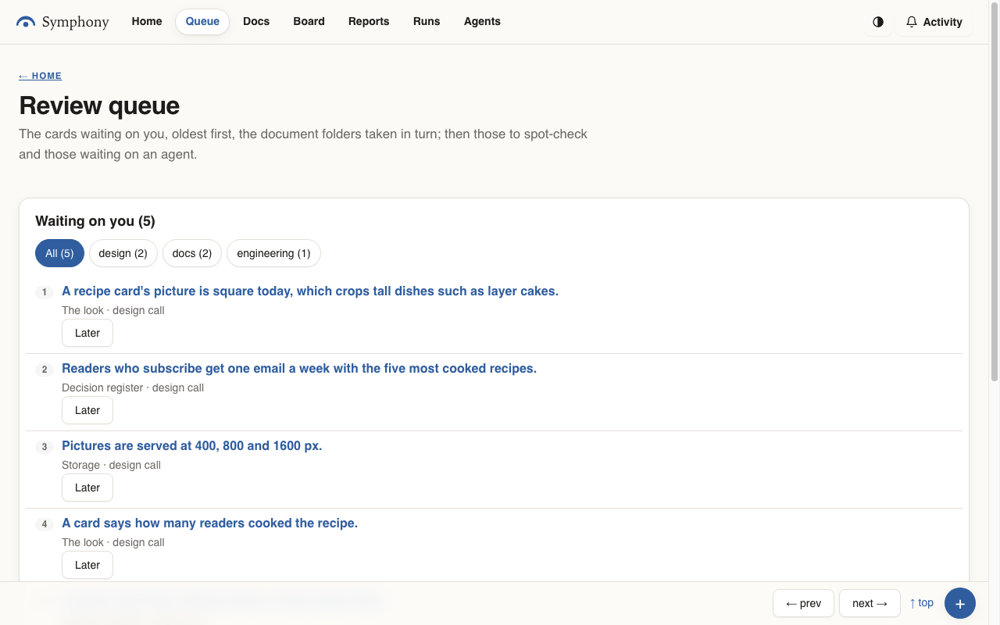

# Getting started

Symphony on a project of your own, in the order to do it: install the commands, set the project
up, write a first document and a first decision, answer it in the app, run a first task to its
landing, then put agents on the work. Each step names the document that holds the rest.

You need git, [`just`](https://just.systems), a Rust toolchain (1.99 or later) with Cargo, and a
shell with `curl`, `tar` and `shasum` or `sha256sum`. Agents are Claude Code or Codex sessions,
which you install and sign in to yourself. Chrome is needed only for pictures of pages
(`symphony shot`).

## 1. Install the commands

A project runs four commands: `symphony` (documents and review), `tasks` and `agent-send` (the
board), and `symphony-server` (the app).

```sh
cargo install --locked --config profile.release.strip=true --config profile.release.codegen-units=1 symphony-app symphony-board symphony-server
```

That installs the version last published on crates.io, which `symphony --version` prints; the
documents on the main branch describe main, which may be ahead of it
([taking a release](RELEASES.md#taking-a-release)). To run main itself, clone the repository and
build:

```sh
cargo build --locked --release --bin symphony --bin tasks --bin agent-send --bin symphony-server
```

and put its `.target/release/` on `PATH`.

## 2. Set the project up

In the project's main checkout, a git repository:

```sh
symphony init
```

It writes the agents' skills (`.agents/skills/`, linked for Claude Code under `.claude/skills/`),
their permissions and hooks (`.claude/settings.json`, `.codex/rules/`), the recipes
(`symphony.just`, imported by a `justfile` it makes when there is none) and three lines of
`.gitignore`. It ends with `Next:`, the list of what is left for you. Do each line and run
`symphony init` again, until it says `Next: nothing`:

- **`symphony.toml`**, the project file. Every key is optional; two lines are enough to start, and
  [the project file](PROJECT_FILE.md) lists the rest.

  ```toml
  [project]
  name = "Lamp Shop"
  ```

  A project whose agents are Claude Code sessions also says so, as a launch starts Codex
  otherwise:

  ```toml
  [agents]
  launch = { default = "claude" }
  ```

- **`docs/`**, the folder of documents the app serves.
- **The board's database.** The board keeps its tasks in a SurrealDB server it starts itself, in
  the repository's git folder. `init` prints the one line that fetches the version it runs and
  checks its SHA-256; paste it as it is. Nothing else is installed for the board: PostgreSQL is
  not needed.
- **The board itself**, which its first command makes: `just tasks list`.
- **The registration** with the machine's server, which step 4 does.

Then commit what was written:

```sh
git add .agents .claude .codex .gitignore justfile symphony.just symphony.toml docs
git commit -m "Symphony installed"
```

This matters: each agent works in a linked worktree of its task's branch, which holds only what
is committed. Without the commit a worktree has no `justfile`, and every `just tasks` there fails.

`symphony init` is safe to run again at any time, and is how a project takes the skills and
recipes of a newer version.

## 3. A first document and a first decision

A document is a Markdown file under `docs/`; `docs/README.md` is the folder's front page. A
decision you are asked to make is a *card*, one line in a *register*. The register is
`docs/DECISIONS.md` unless the project file names another. A whole register with one card:

```markdown
# Decisions

<!-- register:start -->
## Needs your decision

### General

- [ ] **lamp-count** — Sell twelve lamps at launch, or twenty? A: twelve. B: twenty. Approve and say A or B in the note, or comment.
<!-- register:end -->
```

All three parts are needed: the two `register` comments around the cards, the group's heading,
and the card's line starting at the first column with `- [ ]` and its name in bold. A card under
no group heading is counted but cannot be answered on its page; `just symphony-status --tidy`
writes the headings of a register that lacks them. Normally an agent writes cards and you answer
them; [REVIEW](REVIEW.md#start-with-the-decision-register) has the marks, the groups and the
lines a card collects.

Commit the documents, then check them:

```sh
just symphony-status           # the cards and comments, counted by where they wait
just symphony-status --lint    # a card's name used outside a register, and other slips
just symphony-cli docs-audit --check   # every document renders and every waiting card can be answered
```

## 4. Open the app and answer

```sh
just symphony
```

starts the machine's one server when it is not running, registers this project with it and prints
the project's address, `http://127.0.0.1:8765/<id>/`, where `<id>` is the project's name made a
slug. The same server serves every project you register, each under its own address, and stays up
until `just symphony --stop`. It answers this machine and the peers of your tailnet, so the same
address opens on a phone. `just symphony --port 0` runs a private server for this checkout alone,
in the foreground, on a port it prints.



**Queue** lists every card waiting on you. Open the card, press **Verdict / message**, write `A`
in the note and press **Approve**. The app writes your verdict as a dated line under the card in
`docs/DECISIONS.md` and commits it:

```markdown
- [x] **lamp-count** — Sell twelve lamps at launch, or twenty? …
  [2026-11-21 17:24] owner · approved — A
```

That line is what agents read. One answers with a line of its own, and a tidy pass files the card
under *Resolved*:

```sh
just symphony-status --open    # what still waits on an agent
just symphony-reply docs/DECISIONS.md lamp-count "Recorded: twelve at launch."
just symphony-status --tidy
```

What each page is for is in the [product specs](product/README.md): [the queue](product/QUEUE.md),
[a document](product/DOCUMENT.md), [cards and verdicts](product/CARDS.md).

## 5. A first task, by hand

Every session on the board has a handle, which it passes as `--as`. Doing one task by hand shows
what agents do:

```sh
just tasks register                     # prints a handle, say calm-swift
just tasks create ui/first-task "The first task" --as calm-swift
just tasks claim ui/first-task --as calm-swift
git switch -c ui/first-task             # the branch is named after the task
# … change something and commit it …
just tasks say ui/first-task "Added the greeting; its test passes." --as calm-swift
just tasks move ui/first-task review --as calm-swift
```

Review is someone else's: a second handle, which did not write the work, approves the branch's
tip by its full commit id.

```sh
just tasks register                     # a second handle, say ember-sparrow
just tasks role ui/first-task reviewer --as ember-sparrow
just tasks verdict ui/first-task approve "$(git rev-parse ui/first-task): does what it says" --as ember-sparrow
```

Then, with the main checkout back on `main`:

```sh
git switch main
just land ui/first-task --as calm-swift
```

`just land` merges the branch, closes the task and pushes `main` when the repository has an
`origin`. The task, its thread and its timeline are on the app's **Board**.

`just tasks help` lists every board command and `just tasks help COMMAND` explains one;
[the commands](COMMANDS.md) says which to reach for, and [TASKS](TASKS.md) is the board's full
reference.

## 6. Put agents on it

The skills `symphony init` installed are what an agent session follows. Open Claude Code or Codex
in the project's main checkout (trust the folder when Claude Code asks: its permissions count
only in a folder you trust) and type a skill's name, with `/` in Claude Code and `$` in Codex:

| You type | The session then |
| --- | --- |
| `/task-orchestrator` | runs the pipeline: files tasks with complete briefs, starts an executor and an independent reviewer on each, and lands what is approved |
| `/tasks` | joins the board, and pulls, claims or reviews work as you tell it |
| `/create-task` | files one task from what you describe |
| `/work SLUG HANDLE` | does one task as its executor, by its brief alone |
| `/review-task SLUG HANDLE` | reviews one task and records a verdict |
| `/assess-task SLUG HANDLE` | says which approvals a task needs before it lands |
| `/chat-doc` | answers what you write in the app: questions on a document, messages on a card |
| `/apply-review` | applies your verdicts to the documents they decide |
| `/triage` | shortens your queue: ranks the cards and settles those you already decided |

One orchestrator session is the usual start: tell it what you want built, and it files the tasks
and staffs them with subagents of its own, each in a worktree of its task's branch. You follow
along in the app: [**Board**](product/BOARD.md) shows who
holds what and what is stuck on whom, **Agents** who is alive, and [a task's page](product/TASK.md)
its thread, where a message you write reaches the agent holding it.

An agent in a terminal of its own, which `just tasks launch SLUG` starts in a worktree under
`<project>-wt/` beside the main checkout and the pages can link to, needs the Herdr terminal app
and its `hc` command, and `panes = "hc"` under `[agents]` in the project file. Without Herdr,
agents run as subagents of the session you opened.

## Where next

- [The project file](PROJECT_FILE.md): models for each role, limits, what a landing checks.
- [The commands](COMMANDS.md): the recipes and what each is for.
- [Review](REVIEW.md) and [the board](TASKS.md): the full references.
- [Taking a release](RELEASES.md#taking-a-release): moving to a newer Symphony.
- [Setting up GitHub](GITHUB_SETUP.md): issues as proposals, a landing delivered as a pull
  request. Optional.
- [Writing a plugin and a theme](PLUGIN_WRITING.md): a project's own card kinds, pages and
  theme, from a first plugin to its component on a page.
- [The Mac app](../apps/symphony-desktop/README.md): the servers you follow in the dock and the
  menu bar.
