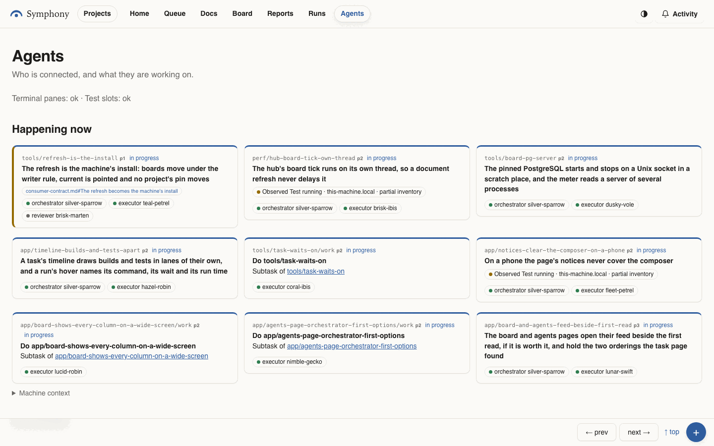
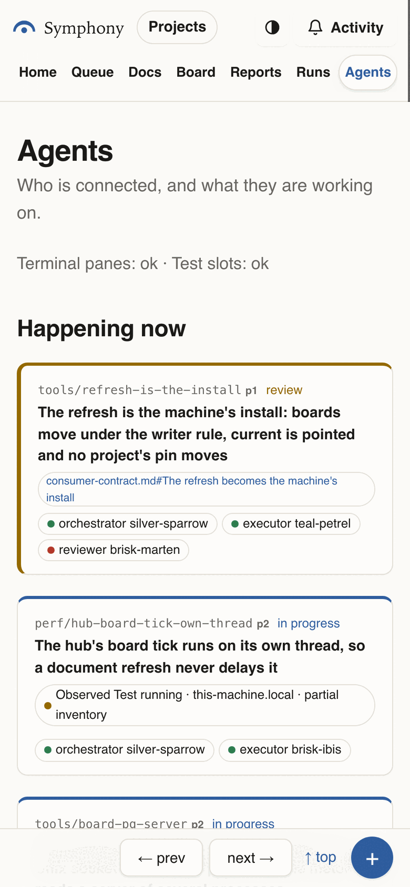
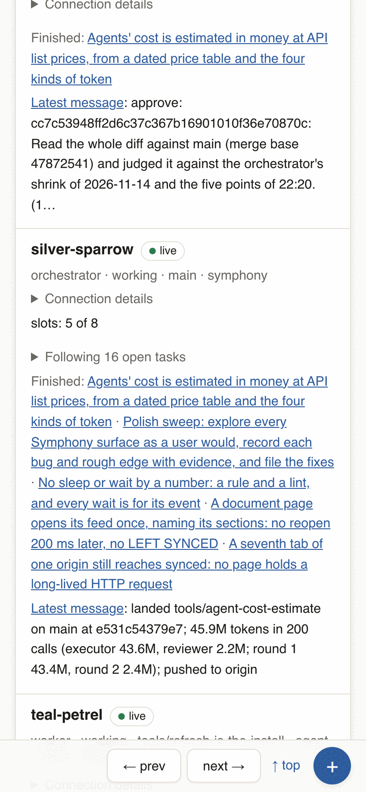
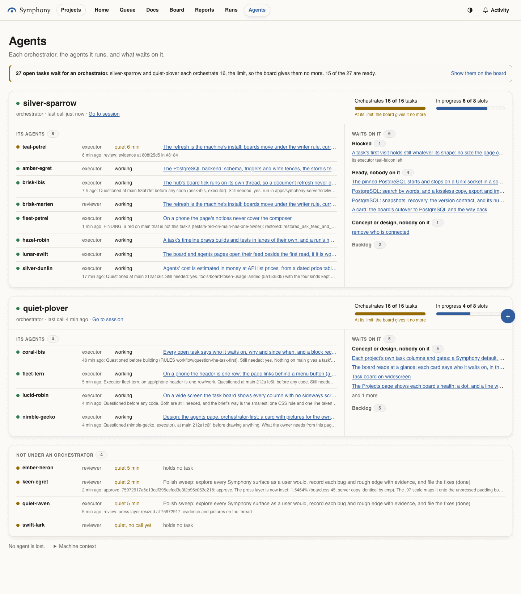
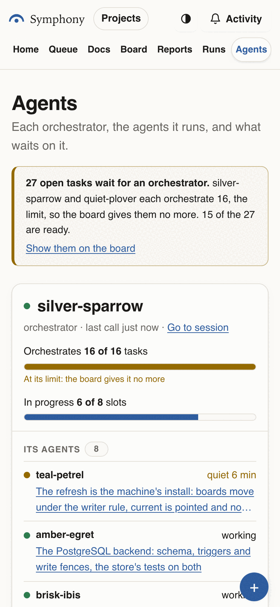
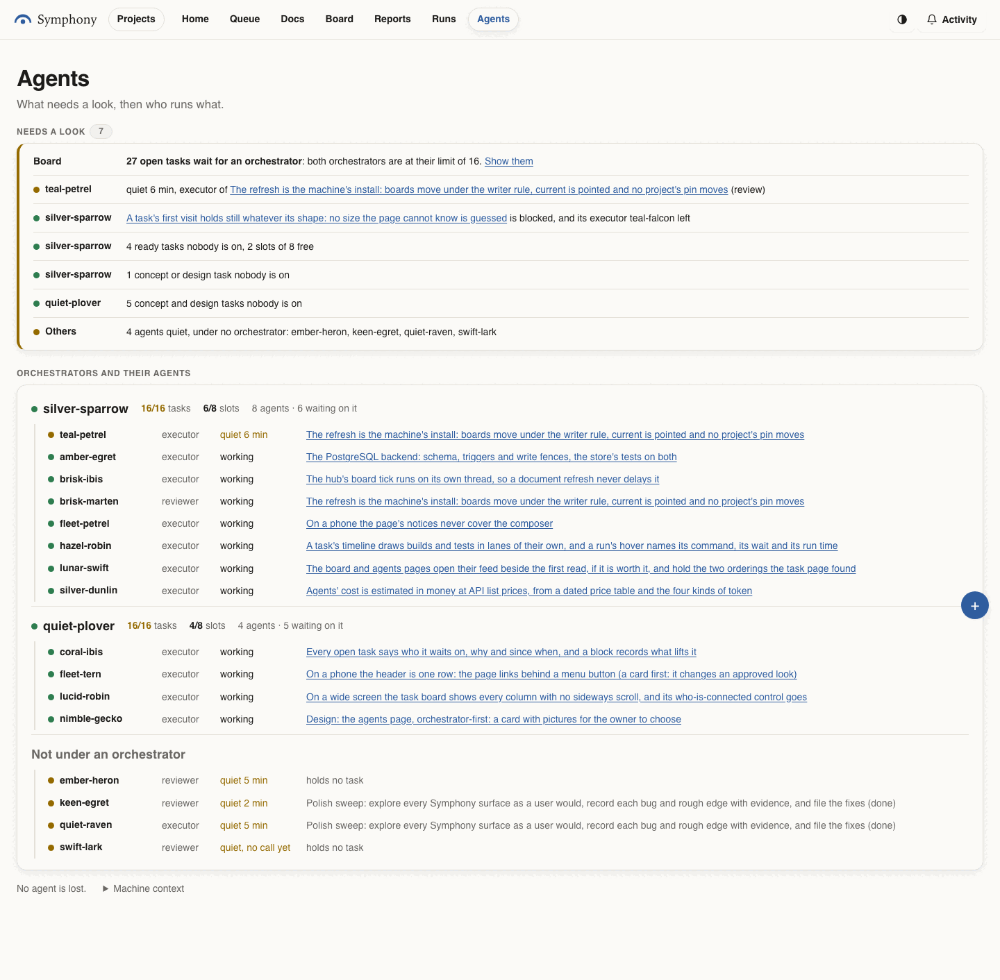
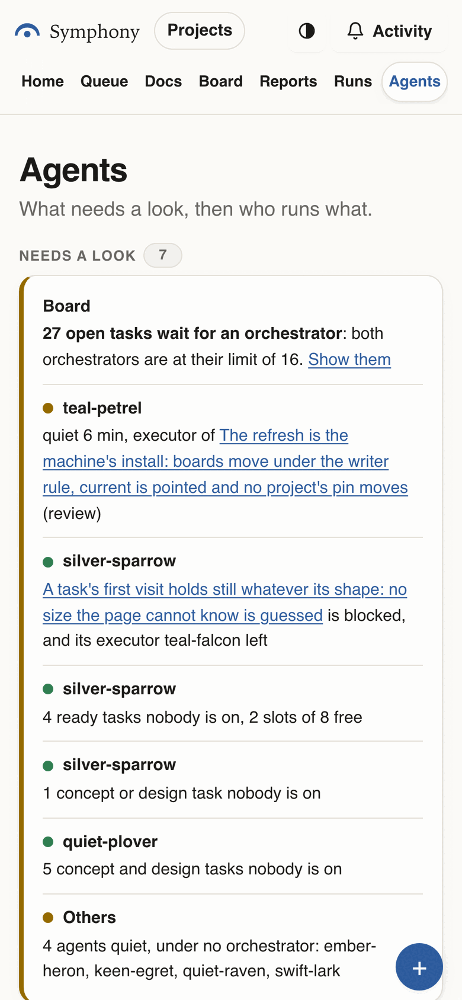
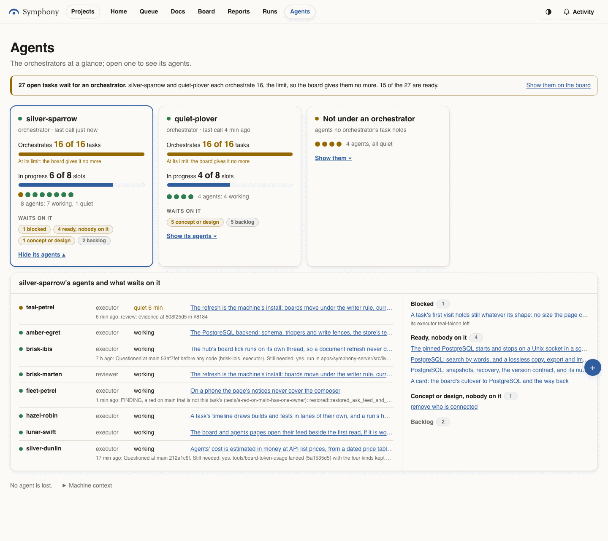
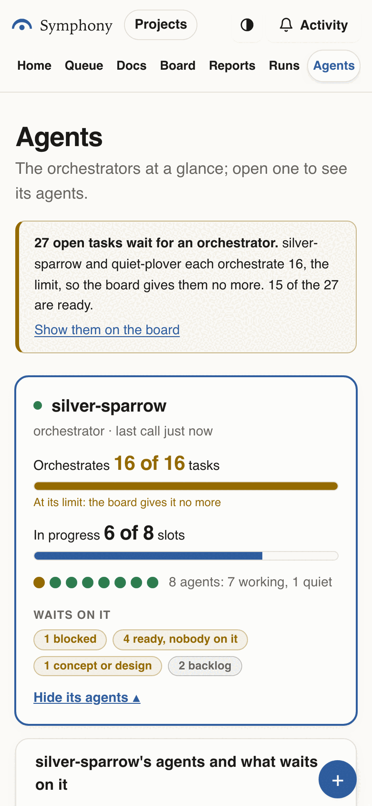

# The agents page, orchestrator-first

What the Agents page would show if it opened on the orchestrators rather than on task cards: three
layouts, put to the owner on the
[agents-page-orchestrator-first](#agents-page-orchestrator-first) card, and the board they were
drawn from. Every figure is this repository's own board as the shared server answered it on the
evening of 2026-11-16, read only.

The ask is the owner's note inbox/agents-page-needs-redesign: the page looks like the task board
rearranged, and should be more orchestrator based, with less task card information. The page was
ported to React as it was drawn (app/client-moves-to-react/agents-page), and no task has changed
its layout since.

## What the owner needs from it

The board answers "where is each task". This page should answer "is the work moving, and what is it
waiting on". That means three things for each orchestrator:

- its load against its limits;
- which agents it runs, and what each is doing this minute: building, testing, stopped on a question
  in its terminal, gone quiet or lost;
- what is stuck waiting on it: a blocked task, a ready task nobody claimed, a review nobody took, an
  executor who left, a message nobody answered.

Each orchestrator is told that last list by its PULL digest (`crates/tasks/src/cli/pull.rs`), and
nothing shows it to the owner. What waits on the owner is the queue's, not this page's: his decision
cards, and his open asks (what he said that waits on an agent's answer), which owner-asks-place
put in the queue's *Waiting on the agent* group, each with who holds it and for how long.

## What the page shows today

The client's page is `apps/symphony-web/src/agents.tsx` with `agents-live.ts`, and the server's
answer is `/api/agent-page` (`apps/symphony-server/src/api/agent_page.rs`). Measured at 22:24;
the pictures, light, are from 22:29, the machine's name in them replaced:

- **It opens on the board.** "Happening now" draws the board's in-progress and review cards again
  (11 at 22:24, 9 in the picture), from y 247 to 1,045 wide and to 2,336 on a phone.
- **Then every agent, A to Z.** "Connected" lists every connected agent (17) in one list, the two
  orchestrators filed among the workers by name. Wide, they sit at y 3,779 and 4,403, on the fifth
  screen of a 5,050 px page; on a phone at 5,200 and 6,149, the seventh and eighth screens of
  7,143 px.
- **An orchestrator's load is two lines.** "Following 16 open tasks", folded, and "slots: 5 of 8".
  Nothing says that 16 is the limit (`[limits] orchestrator_tasks`, 16 by default), nor that both
  orchestrators are at it, so the board gives neither of them more work and 27 open tasks wait with
  no orchestrator.
- **What waits on an orchestrator is nowhere.** The Following fold lists its 16 tasks by title,
  without what each waits on.
- **An agent's row leads with history.** Under its health and its connection details (folded), a
  "Finished:" run of up to five task titles as one paragraph of links, then its latest message: on a
  phone, an orchestrator's row is mostly finished titles.
- **Lost agents are folded at the bottom**, under "Lost agents", read a page at a time apart from the
  rest.

## The board it was drawn from

`/api/agents` and the open tasks, read at 22:11:

- **Two orchestrators, both at their limit.** silver-sparrow orchestrates 16 tasks, 6 of its 8 slots
  in use; quiet-plover 16, 4 of 8. **27 open tasks wait for an orchestrator**, 15 of them ready.
- **18 agents**: the 2 orchestrators, 12 under silver-sparrow's or quiet-plover's tasks (8 and 4),
  and 4 under none (two reviewers holding no task, two whose task is done). 13 are working, 5 quiet,
  none lost or stopped on a question.
- **What waits on silver-sparrow**: 1 blocked task whose executor left, 4 ready tasks nobody is on,
  1 concept task nobody is on, 2 in backlog. On quiet-plover: 5 concept or design tasks nobody is on,
  5 in backlog.

An agent is put under the orchestrator of the task it works, or of the task that task is a subtask
of, by the board's own rule (`Owners::of`, `crates/tasks/src/orchestration.rs`), else under the
session that started it when that is an orchestrator. "Nobody on it" is a task with no live or quiet
executor on it or its subtasks.

## Under every option

All three draw the same facts; they differ in how much is open at once and in what comes first.

- **Orchestrators first.** Each shows its health, its last call and its *Go to session* link, and
  two loads: the tasks it orchestrates against `[limits] orchestrator_tasks`, amber at the limit
  with "the board gives it no more", and its slots in use against `[board] orchestrator_slots`.
- **Its agents, one line each**: a health dot, the handle, the role, what it is doing now (working;
  a test running or waiting for a slot; stopped on a question in its terminal; quiet N min; lost),
  and the task it works as its title alone, a link to the task's page. No task card. Lost first,
  then stopped on a question, then quiet, then working.
- **What waits on it**, in groups, each task a title that links: blocked (and why), in progress or
  in review with nobody on it, ready with nobody on it, concept or design with nobody on it,
  messages to it nobody answered, and the backlog as a count. Why and on whom is the one line
  tools/task-waits-on gives every open task, the board's wording included: a task waiting on the
  owner names the decision card, never a person alone. The pictures predate that line, so they
  cannot tell a design task waiting on a card from one nobody is on; with it, those read "on your
  decision NAME". The owner's open asks an orchestrator holds are not among these groups: the
  page leaves them to the queue, where owner-asks-place put them.
- **A banner** while tasks wait for an orchestrator because every orchestrator is at its limit,
  with a link to those tasks on the board.
- **Agents under no orchestrator**, together, last.
- **The foot**: how many agents are lost ("No agent is lost") and Machine context, folded, which
  also takes the "Terminal panes · Test slots" line.
- **Gone**: "Happening now", the A-to-Z list, and the finished titles and Following fold on each
  row. An agent's handle opens today's details for it, folded: its connection and finished tasks.

## The options

The pictures are a throwaway HTML page over the client's own built stylesheet and today's header,
filled with the board as read at 22:11, at 1440 wide (the whole page, the floating + hidden, as a
whole-page shot would set it mid-page) and on a phone (390 wide, the first screen), light.

### A: a panel per orchestrator

One panel per orchestrator, all open: its head and two meters on top; its agents on the left, each
with its latest message on a line beneath when wide; what waits on it on the right. On a phone the
meters stack and the waits follow the agents. Then the agents under no orchestrator.

- **Length:** 1,639 px wide (under two screens), 3,271 on a phone (four screens), against 5,050
  and 7,143 today. The first orchestrator's load is on the first screen of both.
- **Reads:** what the page reads today, plus each orchestrator's own task list for its waits (the
  list today's Following fold reads), one read each.
- **Cost:** the least: one panel, drawn from the facts every option needs.

### B: needs a look first

A list across every orchestrator of what needs a look, in one order: the board-wide wait, quiet
agents holding work, blocked tasks whose holder left, ready tasks nobody is on while slots are free,
concept and design tasks nobody is on, quiet agents under no orchestrator. Under it, who runs what
as a compact tree: each orchestrator on one line (16/16 tasks · 6/8 slots · 8 agents · 6 waiting on
it), its agents indented under it.

- **Length:** 1,412 px wide, 2,452 on a phone (three screens).
- **Reads:** the same facts, and the list itself.
- **Cost:** the most: a new ranked list, built on the server so it agrees with what each
  orchestrator's PULL digest tells it, and a rule for what comes first to agree on. What waits on
  one orchestrator is spread through the list rather than beside its agents.

### C: a tile per orchestrator

A tile per orchestrator with its two loads in large figures, a dot per agent, and what waits on it
as counts. Opening a tile shows its agents and its waits below the tiles, wide, and under the tile
on a phone; one is open at a time. A tile for the agents under no orchestrator.

- **Length:** 1,284 px wide, 2,664 on a phone with the first tile open.
- **Reads:** the same facts as A, but one orchestrator's agents and waits at a time, when its tile
  opens.
- **Cost:** A's, plus which tile is open, kept in the browser for each viewer. A tap more to see
  anyone's agents.

### Recommended: A

The owner's question of this page is whether the work is moving and what it waits on. A answers it
for every orchestrator at once: its load, its agents and what waits on it read together, the same
wide and on a phone, nothing to open. It is the cheapest: one panel over the facts every option
needs.

B is the choice if the page should be a to-do list across orchestrators, at the cost of the most new
logic. C is the choice for a project that runs many orchestrators, as it reads one at a time.

- [-] **agents-page-orchestrator-first** — The Agents page would open on the orchestrators instead of repeating the board. For each one: how many tasks it holds against its limit of 16 and how many of its 8 slots are in use, the agents it runs and what each is doing this minute, and what is waiting on it. Lost agents and agents stopped on a question come first, and a task is only its title, as a link. Your own open asks stay in the queue. The "Happening now" cards and the A-to-Z list of agents go. How should it be laid out? A: one panel per orchestrator, its agents beside what waits on it, everything open. B: first a list of what needs a look across every orchestrator, then a compact list of who runs what. C: a tile per orchestrator with its counts; open one to see its agents and what waits on it. Recommended: A. Approve and say A, B or C in the note, or comment. [[analysis/agents-page#The options]]
  [2026-11-16 22:32] agent — Base: the page today, wide, from the shared server (shot at 22:29). 
  [2026-11-16 22:32] agent — Posted for the board task `app/agents-page-orchestrator-first-options`, from your note on inbox/agents-page-needs-redesign: "Probably be more orchestrator based with less direct task card info". The three options at 1440 wide, drawn from this board at 22:11:   

    **Today.** The page opens with the board's in-progress and review cards again, then every agent A to Z. On a phone the two orchestrators are on its seventh and eighth screens, and their load is a folded "Following 16 open tasks" and "slots: 5 of 8". Nothing says both are at their limit, so the board gives them no more and 27 open tasks wait with no orchestrator.

    **A, a panel per orchestrator.** Its load on top, its agents on the left, what waits on it on the right; on a phone they stack. Under two screens wide and four on a phone, against five and a half and eight and a half today.

    **B, needs a look first.** One list across both orchestrators (a quiet agent holding work, a blocked task whose agent left, ready tasks nobody is on), then each orchestrator on one line with its agents under it.

    **C, a tile per orchestrator.** Its counts in large figures; open a tile to see its agents and what waits on it (silver-sparrow's is open in the picture).

    **What each costs.** Under all three the server sends four facts it does not send today: which orchestrator each agent works for, each orchestrator's task count against its limit, how many tasks wait for an orchestrator, and how many messages to it nobody answered. Why each task waits comes from `tools/task-waits-on`, being built now. Beyond that, **A** costs the least: one panel, from what the page already reads. **B** costs the most: a new ranked list the server builds, so that it agrees with what each orchestrator is told, and a rule for what comes first. **C** costs what A does, plus remembering which tile is open, and takes a tap more to see anyone's agents; it suits a project with many orchestrators.

    **Why A.** You want to see whether the work is moving and what it waits on. A shows every orchestrator's load, agents and waiting work together, the same wide and on a phone, with nothing to open.

    **Earlier verdicts checked.** **board-at-a-glance** (B) sets how a task's wait reads: a wait on you names the decision card, never a person alone. The lists here use that line, and it says nothing of this page's layout. **owner-asks-place** (A) shows your open asks, what you said that waits on an agent's answer, in the queue's *Waiting on the agent* group with who holds each and for how long, counted on Home, with no page of their own. So this page leaves them there: an orchestrator's list of what waits on it holds no asks. **header-page-names** keeps Agents as this page's name. None of them decides this card.
  [2026-11-16 22:32] agent — On a phone: today's first screen, an orchestrator's row today, on its seventh screen, then the first screen of A, B and C.     
  [2026-11-17 12:13] owner · rejected — I would like to explore a mix of C and B. A "card" per orchestrator, but instead of column based, make it full width and with more details like in B.

    Also there should be no "Machine context" and remember the columns/stages are supposed to be "configurable" so the status aspects would be dynamic and need to make sense with it in mind.
  [2026-11-17 12:28] agent — The revised direction is one full-width card per orchestrator, stacked vertically: the grouping from C with the visible working detail from B. Each card should show its load, agents and current activity, followed by what needs attention; there is no Machine context section. Stage names, order and counts must follow the project’s configured workflow, rather than assume fixed In progress or Review columns. Agent conditions such as waiting for access or losing contact remain distinct from task stages. The A/B/C pictures above remain the earlier proposals; this direction replaces their layout recommendation.

## The data

What each fact comes from, on `/api/agents` (the document `just tasks agents --json` prints) and
`/api/agent-page`, and what would be added. The additions are the same under every option, but for
the last two rows.

| Fact | Today | Added |
|---|---|---|
| An agent's health and what it is doing | `health`, `state`, `state_detail`, `last_tool_call` | nothing |
| The task it works, as a title and link | `task`, `role`; titles in `/api/agent-page`'s tasks | nothing |
| Its latest message | `last_message` | nothing |
| *Go to session* | `go`, where the server resolved the control goes (the session's web address or pane, else its parent's) | nothing |
| An orchestrator's slots in use | `slots` (`open`, `cap`) | nothing |
| Which orchestrator an agent works for | not sent: `parent` names one for 4 of the 16 | `orchestrator` on each agent, by `Owners::of`, else `parent` when that is an orchestrator |
| Tasks orchestrated against the limit | `following` counts them; the limit is not sent | `orchestrates` (`open`, `limit`): `orchestration::orchestrated` and `[limits] orchestrator_tasks`, the figures of the PULL digest's `orchestrates=OPEN/LIMIT` |
| Tasks waiting for an orchestrator | not sent | a count of open top-level tasks with no orchestrator |
| Lost agents among the rest | read apart (`?health=lost`), paged | lost agents holding an open task in the same read; agents read all at once, not 20 at a time (18 here), those that left still out |
| What waits on an orchestrator | its open tasks with roles and health, `/api/task-board?holder=H&role=orchestrator&open=1&older=1` | each task's `waits_on`, from tools/task-waits-on (being built); grouped in the client |
| Messages to it nobody answered | not sent | a count per orchestrator, by the PULL digest's rule (`crates/tasks/src/store/unanswered.rs`) |
| B: the needs-a-look list | not sent | the list, ordered on the server by one rule the PULL digest shares |
| C: the open tile | | kept in the browser, per viewer |

## The owner's design resources

The resources named on product/polish-sweep were applied only where this page breaks them. At 390
and 1440 wide it has no sideways scroll, no text field and no popup, and its press and hover
feedback is the shared sheet's, which that task put right for every page. What it breaks is what
every option removes: a page that repeats another page (the board's cards), and finished task
titles set as one paragraph of links, small targets close together on a phone. One fault is every
page's, not this one's: on a phone the floating + and the prev and next pager cover the end of a
line beneath them (today's second and third pictures); it is not part of this choice.

## Not in this design

- The header and its names: they keep Agents as this page's word.
- What waits on the owner, his open asks included: the queue, and Home's counts.
- Trends and cost (tokens, hours by agent): the Reports page.
- The board's own layout and its wait line: app/board-at-a-glance and tools/task-waits-on.
- When the page's reads start: app/board-and-agents-feed-beside-first-read.
