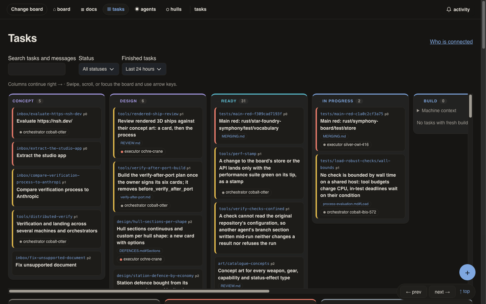
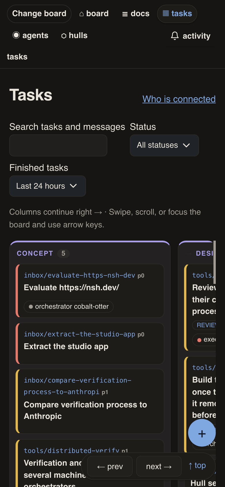
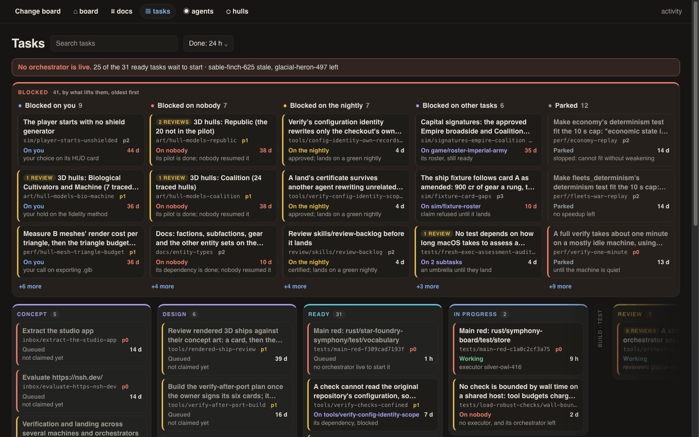
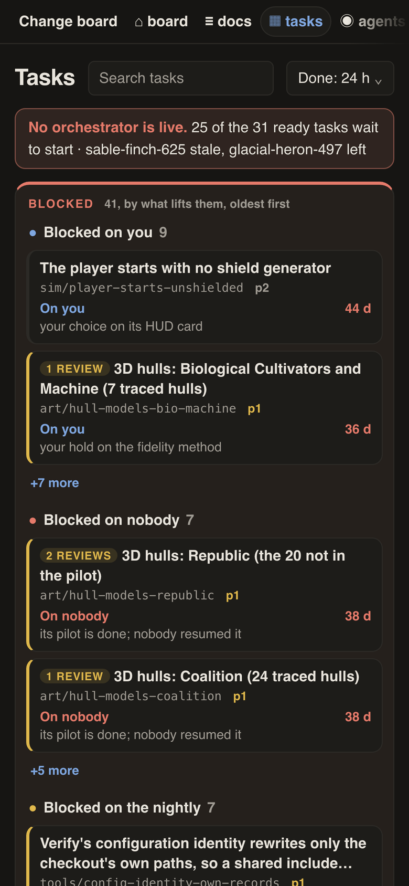
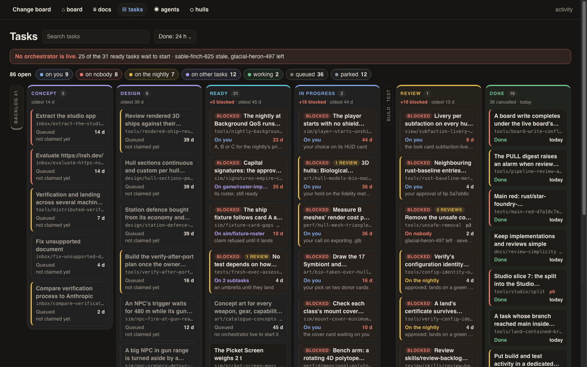
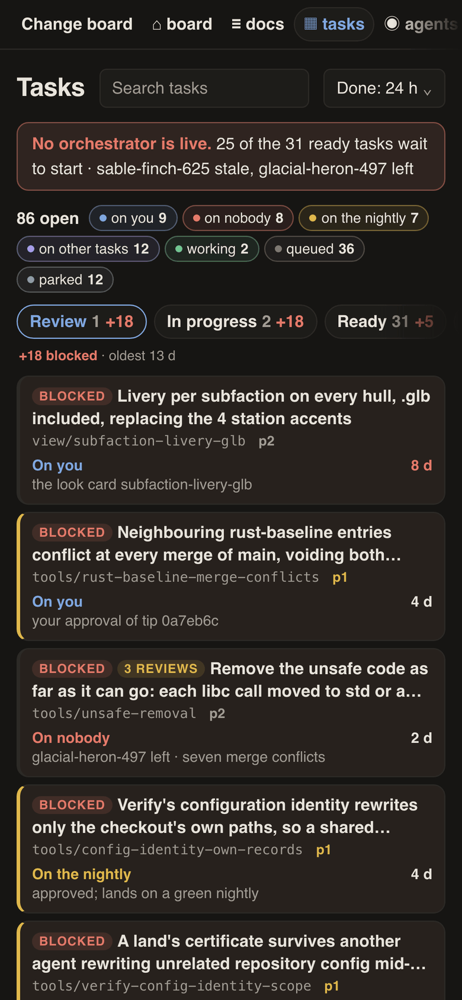
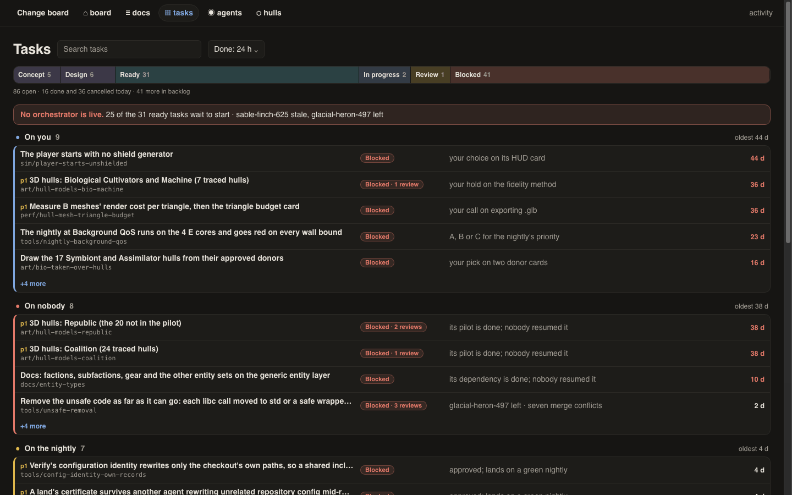
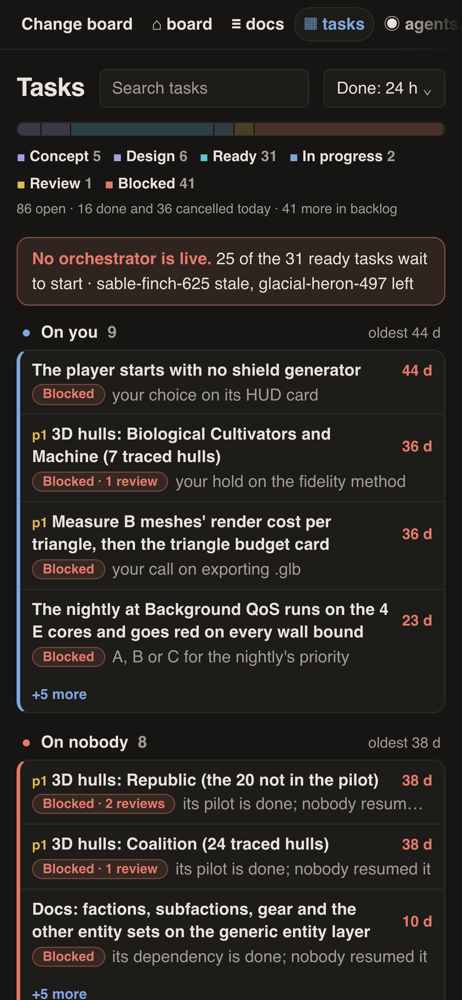
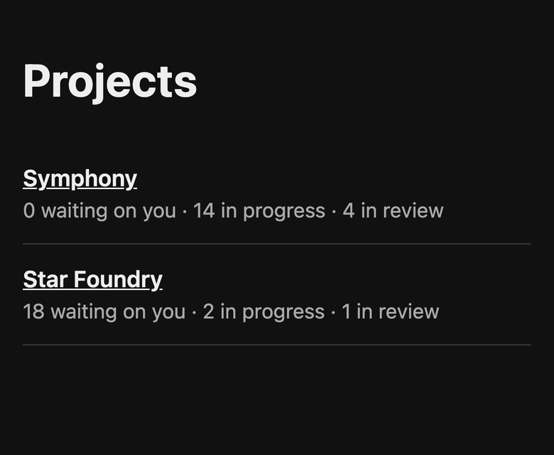
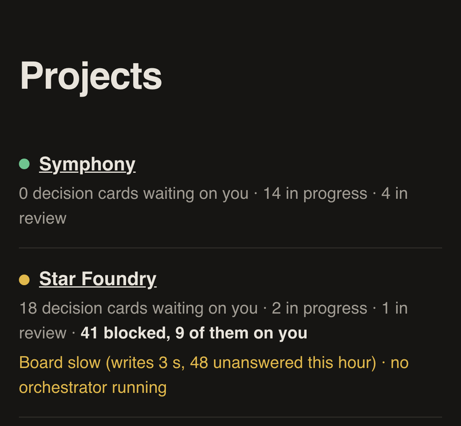

# The board at a glance

What it takes for a project's task board to say, before anything is opened, what is stuck, on whom
it waits and for how long; the three layouts proposed on the board-at-a-glance card in
[DECISIONS](../DECISIONS.md), the Projects page's health line on the projects-health card, and the
board they were measured on. "Read 2026-11-11" marks Star Foundry's board as the shared server
answered it at 19:10 that day.

The ask, the owner, 2026-11-11: "The design of the board isn't great." The board task
`tools/board-design-review` names what operating Star Foundry's board showed: blocked work with no
reason, owner or age on its card; dead sessions keeping their roles, so a task reads as staffed;
review rounds as cards of their own; no age in stage; and a Projects page with counts but no health.

## What the board shows today

Read 2026-11-11 on Star Foundry's board, through the shared server's own pages and API, read only:

- **86 open tasks** at the top level (5 concept, 6 design, 31 ready, 2 in progress, 1 in review,
  41 blocked), 41 in backlog. **2 are being worked** by an agent that is there.
- **41 blocked**, a median of 10 days in blocked, the oldest 44 days: 18 were moved there from
  review, 18 from in progress, 5 from ready. Read from each thread by hand, 9 wait on the owner (the
  oldest 44 days), 7 on the nightly, 6 on other unfinished work, 12 are parked on purpose (a cost
  exemption that stays, a recurrence, a quiet machine) and 7 on nobody: 3 whose orchestrator or
  agent left, 4 whose blocker has finished with nobody resuming them.
- **None of that is on a card.** The move to blocked is a line with no reason (`X moved it review →
  blocked`); the reason is in a post near it, often several hundred words long. The Blocked column
  sits in a lower row, below the first screen on a wide screen.
- **Roles that left stay.** The 41 blocked cards draw 117 role chips, 110 of them for sessions that
  left or were lost; 24 blocked tasks show a reviewer no longer there, one card 8 reviewers, all gone.
  Of the 31 ready tasks none has an executor, and the orchestrators they name have left: Star
  Foundry has no orchestrator live (one stale, one left), so nobody will start the 25 of them that
  wait on nothing else. Nothing on the page says so.
- **Ages.** Ready tasks have waited a median of 6.5 days. Nothing on the page shows an age.
- **Review rounds.** Of the 73 subtasks under the blocked, in-progress and review tasks, 24 are
  review rounds (`review`, `adversarial`, `rereview`, …); one task has 6. Over 14 days, 233 of 328
  subtasks were review rounds (tools/stage-times' measurement).
- **The first screen.** Wide (1440), it shows Concept, Design, Ready, In progress and an empty Build
  column; Review and Done are off to the right, the lower row below. On a phone it is the header (three
  rows), the filters and the scroll hint; the first card starts at the bottom edge.
- **Health.** Star Foundry's board answered writes in 3.0 s at p90 over the last hour, with 95 slow
  requests and 48 unanswered; Symphony's in 7 ms with none. The Projects page shows neither: it
  warns only while callbacks or the sweep fail.

## Who a task waits on

The same under every option. Each open task's card ends in one line: who it waits on, why in a few
words, and for how long, the age in its current stage (red from a week).

| line | when | colour |
|---|---|---|
| Working · executor amber-heron | someone there holds the role the stage needs | `--like` |
| On you · your choice on its HUD card | a card of the owner's the task names, a block naming the owner | `--primary` |
| On the nightly · lands on a green nightly | a block naming a check, or land's hold on a stamp | `--question` |
| On tools/unsafe-removal · its dependency, blocked | an open dependency, or a block naming a task | `--decision` |
| On nobody · its pilot is done; nobody resumed it | the role the stage needs held by one who left, a block naming one who left, a block whose task finished, a block with no reason | `--dislike` |
| Queued · not claimed yet | concept, design or ready work with no holder and nothing open before it: it waits to be staffed | muted |
| Parked · until the machine is quiet | a block naming no one on purpose (`--on parked`): a recurrence, an exemption that stays | muted |

Queued and parked work is drawn quieter than stuck work, its age never red: it waits by design.

- **One cause is said once.** When no orchestrator is live on the board while queued work waits,
  a banner above the board says so (`No orchestrator is live. 25 of the 31 ready tasks wait to start ·
  sable-finch-625 stale, glacial-heron-497 left`), rather than 25 cards each saying it.
- **Only present roles are drawn.** A role held by a session that left or was lost is not drawn on the
  card; when it is the role the stage needs, the line says so (`On nobody · executor amber-heron left
  2 h ago`). The task page keeps every role.
- **A block names what it waits on.** Moving work to blocked records who can lift it and why, in a
  few words: `just tasks move SLUG blocked --on owner|check:NAME|task:SLUG|HANDLE|parked --why "…"`. The
  board's own blocks fill it themselves (a cancelled dependency names the task; land's hold names the
  stamp, or the owner). A block written without one reads `On nobody · no reason recorded`, so an
  orchestrator sees which to triage. A block naming a task that has since finished reads `On nobody ·
  its dependency is done`.
- **Review rounds are one mark** on the task (`3 reviews`), as tools/review-as-stamps' third slice
  has it; review subtasks are never cards.
- **Documents and roles leave the card**; the slug stays, under the title, with the priority in
  words beside it (`p1`) as well as on the card's edge.

The rule for each line is the one the PULL digest already applies for orchestrators
(`crates/tasks/src/cli/pull.rs`: ready with no live executor, in progress with none, review with no
reviewer, dependency blocked), so the board and PULL never disagree.

The strip that counts these kinds keeps one order everywhere: what needs someone first (on you, on
nobody, a check, other tasks), then work going on, then work that waits by design (queued, parked).

## The options

All three draw the same cards, the same line and the same banner; they differ in where the waiting
work goes. The pictures are HTML mock-ups (this folder) on the board's own tokens, filled with Star
Foundry's board as read 2026-11-11, at 1440 wide and at a phone's 390, dark. The header is the app's
compact one with today's names: its names and phone layout are app/header-names' cards.

### A: a Blocked lane

Today's board with the Blocked column lifted into a lane above the columns, in five groups by what
lifts the block (blocked on you, on nobody, on the nightly, on other tasks; parked), oldest first,
three a group and `+N more`. Its counts are of blocked tasks only (on nobody 7); B's strip and C's
groups count all open work (on nobody 8, one of them in progress).

- **Removes:** the Blocked column, role and document chips, the scroll hint.
- **Keeps:** columns 288 px wide that scroll sideways, so Review and Done stay off the first screen
  wide; Backlog and Cancelled in the lower row; the Status filter.
- **Cost:** the least: the client groups what the line already says.

### B: stuck in place

No Blocked column: a blocked task stays in the column of the stage it stopped in, first in it (parked
work last), with a `blocked` mark. Every stage fits a wide screen; a column's head gives its own
count, then `+N blocked` and its oldest age, so the bottleneck shows (Star Foundry: Review 1 +18
blocked). A strip counts the open work by who it waits on, and each count filters the board to it.
On a phone, tabs show one stage at a time (`Review 1 +18`).

- **Removes:** the lower row (Blocked goes into the stages; Backlog becomes a narrow rail; Cancelled a
  count under Done), sideways scrolling wide, the Status filter (the strip and tabs replace it), role
  and document chips, the scroll hint.
- **Keeps:** the pipeline: where each task is.
- **Cost:** the stage a blocked task came from, kept by the stages replay (`crates/tasks/src/stages.rs`)
  and put on the wire; tabs on a phone.

### C: who acts next

No columns. The open work is one list grouped by who has to act next (you, nobody, a check, other
tasks, then working, queued and parked), oldest first; each row has its stage, its reason and its
age. The stages are a bar of their counts on top that filters the list.

- **Removes:** columns and sideways scrolling, the lower row, the Status filter, the scroll hint.
- **Loses:** the pipeline as a picture: where work piles up is the bar of counts, not columns.
- **Cost:** a new page layout and a grouped read; the list pages by group.

### Recommended: C

The owner's question of the board is who has to act and how long it has waited, and C is the only
layout whose first screen answers it, wide and on a phone: the first group is the owner's, oldest
first, with the age at the right. Every stuck task reads the same way whatever its stage, so 41
blocked tasks are five short groups rather than 41 cards spread over columns. The pipeline is not
lost: the bar on top keeps each stage's share and filters to it, and each row carries its stage. It
is also the plainest to build on a phone: one list, no tabs, no sideways scroll. The fresh reviewer,
shown the three without a recommendation, picked C for the same reason.

B is the choice if the pipeline as columns matters more than who acts: it fits a wide screen and
shows the bottleneck as a column's count, at the cost of phone tabs. A is the cheapest and keeps the
problem of a board wider than the screen.

## The projects page

The machine's Projects page lists each project with its counts. While a board's callback dispatch or
idle sweep is failing it already says so under the project's name (`⚠ The task board is unwell: …`,
`apps/symphony-server/src/projects.rs`, `list_row`, from `live/health.rs`). It says nothing of a board
that answers slowly or of one nobody orchestrates: at 19:10 on 2026-11-11 Star Foundry's writes took
3.0 s at p90, 48 requests went unanswered that hour, and no orchestrator was live, while its row read
like Symphony's.

It gains a dot per project, its worst signal (green, amber, red) and, only when the dot is not green,
one short line saying why, from the health the server already keeps in memory (`/api/health`,
`crates/tasks/src/board_health.rs`) and who is connected:

- **red:** what the row says today, callbacks or the sweep failing, in the same words;
- **amber:** writes at p90 of a second or more, or requests unanswered in the last hour (`Board slow
  (writes 3 s, 48 unanswered this hour)`); no orchestrator live while work is queued (`no
  orchestrator running`).

The counts say what they count, `18 decision cards waiting on you` (as today, the owner's cards),
and gain the blocked tasks, `41 blocked, 9 of them on you`, from the line above, in bold.
tools/server-projects-list's `/api/projects` carries the same health for the desktop app ("whether it
is refused, or its board unwell"), so both read one function.

## What the build touches

Filed on the board in `design`, each waiting on its card, each brief complete:

1. **tools/task-waits-on** (every option): the block record (`move … blocked --on --why`, kept in the
   task's `fields._board`, which older readers keep and ignore, so no schema change), the line's
   derivation on the server shared with PULL, and a `waits_on` on the wire (`kind`, `who`, `why`,
   `since`), with `from` for a blocked task and the board's live orchestrators for the banner. The
   age is tools/stage-times' `in_status_since`.
2. **app/board-at-a-glance**: the card, the banner and the chosen layout in `apps/symphony-ui`
   (`tasks.rs`, `board_live.rs`, `board.css`).
3. **app/projects-health**: the dot and line on the Projects page.

Built on, not repeated: tools/stage-times (the age), tools/review-as-stamps (review rounds as marks),
app/build-test-columns (the Build and Test columns, drawn as its rail here), app/header-names (the
header), app/skeleton-loading (placeholders while columns load), tools/server-projects-list (health on
`/api/projects`).

## The data

`board-design/sf-board.js` is the board the pictures draw: Star Foundry's open top-level tasks and
the last day's done ones, read 2026-11-11 19:10 from the shared server's `/api/task-board` and each
task's `/api/task-thread`, read only. The age is from each task's last status line; who a task waits
on is from its roles and dependencies, and for a blocked task from the posts beside its move to
blocked, shortened by hand to a few words (a block whose post says it is parked, stopped on purpose
or waiting on a recurrence reads parked; unclaimed concept, design and ready work reads queued). The
pictures are the `.html` pages here, shot with `symphony shot` at `--phone` and at 1440 wide, and
reduced to 256 colours; "Projects today" is the shared server's own page at 19:09.

## Not in this design

- The header and its names: app/header-names.
- The task page: tools/task-gates-panel and tools/task-timeline.
- Trends (lead time, where hours go): the Reports page, tools/reports-page.
- Thresholds (a week is red, a second is slow): set in the build, not cards.
