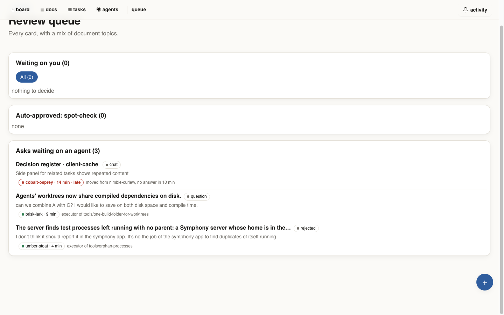
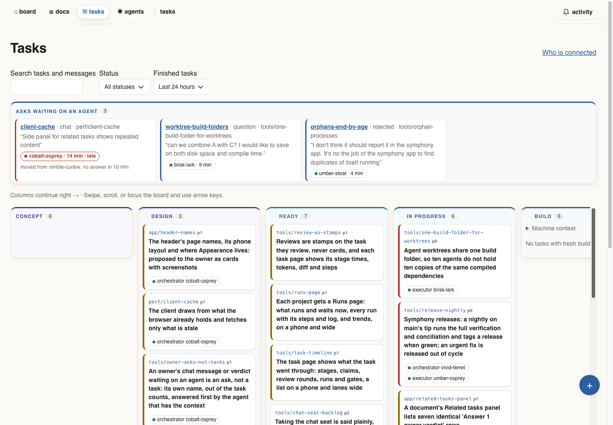
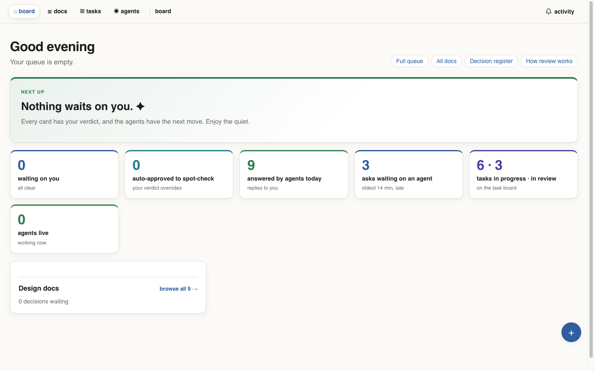
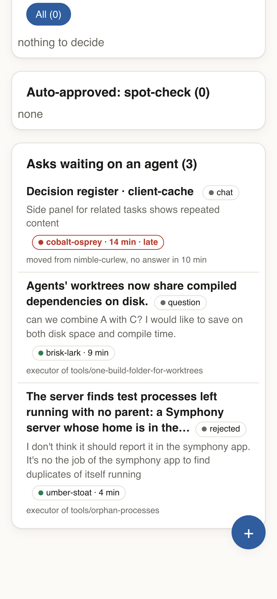
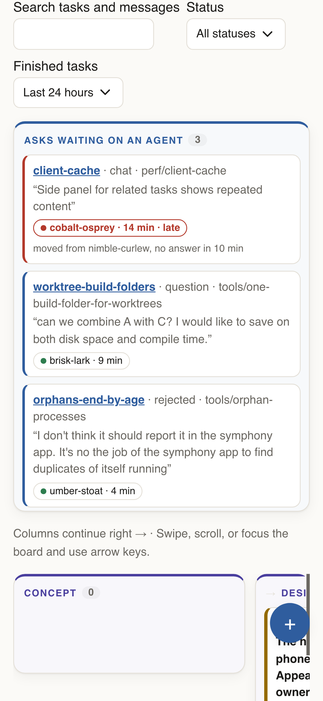
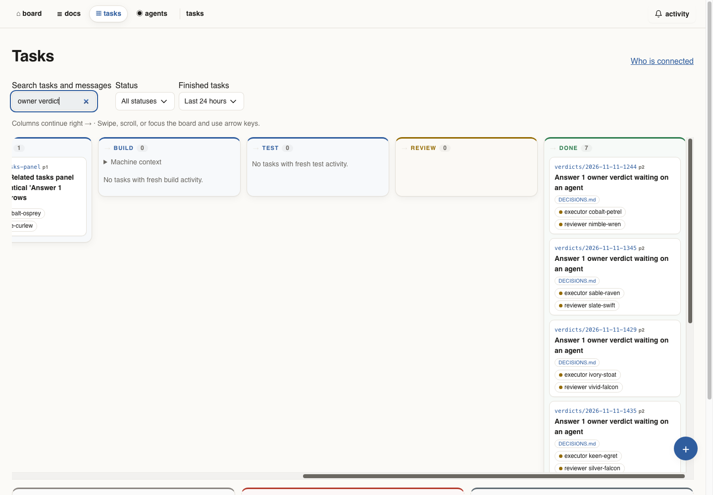
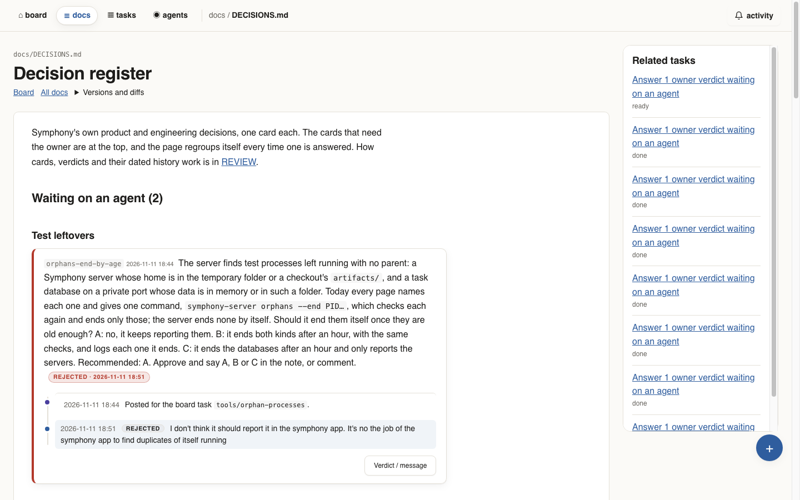
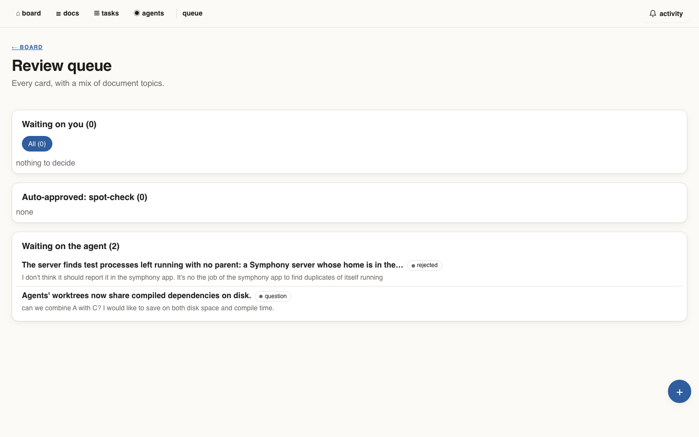

# Owner asks

What becomes of what the owner says that waits on an agent's answer, as proposed on the owner-asks
card in [DECISIONS](../DECISIONS.md), and what the proposal rests on. Each fact about the code names
the file and function it was read in, at main `7ad7376` and still so at `58309d8`. "On this
board, 2026-11-11" marks this repository's own board that day.

The ask: answering the owner's chat is work, but not the same kind as a task. It needs a name of
its own and stays out of the task counts; it has no status as other things have; and it is
generally answered first, routed to an agent that has the context, if one is running.

## The design

Five choices, each taken at its default: the card was approved before the [pictures](#pictures)
were added. The [open questions](#open-questions) stay open.

1. **The name: an ask.** Everything the owner says that waits on an agent's answer is an ask: a
   verdict with a note, a rejection, a message on a card, a comment in a document, a chat question,
   a message on a task. The app already calls its chat questions asks; the word now covers the rest.
   An ask is never a task. It has no stage, no priority and no column, and no task count includes
   it. It is **open** or **answered**: an open ask says who holds it and for how long ("silver-marten
   · 4 min", or "nobody · 1 h 12 min"), an answered one who answered and how soon.
2. **Where it shows.** The queue's *Waiting on the agent* group becomes the list of open asks,
   oldest first, each with its holder and age. The tasks board has one line above its columns: how
   many asks are open and each one's holder and age, beside the column counts and never added to
   them. A task's page shows the open asks about that task. In the terminal, `just tasks asks` lists
   them, `just tasks status` names the count and the oldest, and an agent's PULL begins with the asks
   it holds.
3. **In the store: a record of its own on the board.** One table of asks beside the tasks: what the
   ask is about, the owner's line and when, who holds it and since when, who held it before, and who
   answered and when. The owner's words and the answer stay where they are written (the card, the
   comment, the ask thread, the task's thread). No verdict task is filed any more: the open ones
   become asks and are cancelled, the finished ones stay as history and leave every count.
4. **Priority.** An ask reaches its holder at once and before its other work: pushed when it opens
   or moves, first in the holder's PULL and `tasks wait`, and named by `tasks next` before any ready
   task. An open ask shows its age wherever it shows, and past ten minutes it shows as late.
5. **Routing.** An ask goes first to a running agent that has its context: the executor of the task
   it is about (the task whose branch the card is on, the task that posted the card, the task the
   message is on), then that task's reviewer, then its orchestrator. With none of them running, it
   goes to the chat seat, then to an orchestrator. A holder that goes stale, lost or left passes it
   on at once; one that has not answered within ten minutes passes it on, and may still answer.
   Anyone's answer closes it.

- [-] **owner-asks** — What you say that waits on an agent's answer stops being a board task and becomes an ask: a verdict with a note, a rejection, a card message, a comment, a chat question or a message on a task. Five choices, each with its default. 1. Name: an ask, open or answered, never a task and in no task count; an open one shows who holds it and for how long. 2. Where: the queue's *Waiting on the agent* group lists the open asks with holder and age; the tasks board has one line of asks above its columns, never counted in them; `just tasks asks` in the terminal. 3. Store: a record of its own on the board; no verdict task is filed again, the open one becomes an ask, the finished ones leave every count. 4. Priority: pushed to its holder at once, first in its digest and named before any ready task; shown late after ten minutes with nobody holding it. 5. Routing: first the running agent working on what it is about (the executor of the card's task or branch, then its reviewer and orchestrator), then the chat seat, then an orchestrator; it moves on when its holder goes quiet or has not answered in ten minutes. Approve to take all five defaults, or comment with the ones to change. [[analysis/owner-asks#The design]]
  [2026-11-11 19:21] agent — Posted for the board task `tools/owner-asks-not-tasks`.

    **Today.** Each verdict you save becomes a `verdicts/…` task in the board's columns and counts. Eight were filed today; seven were each claimed by an agent and approved by a reviewer, to record an answer already on the card. Your question on worktree-build-folders was answered on its branch 17 minutes after you asked; its task sat ready 50 minutes longer and counts as 1.1 h of work nobody took. Chat goes to one session, whatever it is about. [[analysis/owner-asks#Today]]

    **1.** The app already calls a chat question an ask; the word now covers everything you wait on an agent for. It has no stage, so nothing has to pretend to claim or review it.

    **3.** A flag on a task would leave every count, list and digest to filter it out, now and each one added later, and a claim and a review would still close it.

    **5.** "Has context" is read from what the board keeps: roles on the task, the task a branch belongs to, the task whose brief names the card, launch records and where a subagent last worked. Nothing new is recorded.

    Two smaller questions, ten minutes and comments already open, are at [[analysis/owner-asks#Open questions]].
  [2026-11-11 19:33] owner · approved
  [2026-11-11 19:39] agent · question — Your approval came before these pictures, so it takes the five defaults but not how asks look. With asks, the queue, the tasks board and the home page, then the queue and the board on a phone:      Is this how asks should look? Approve to keep it, or comment with what to change. The same pages today are at [[analysis/owner-asks#Pictures]].
  [2026-11-11 22:19] owner · rejected — it should not be in the same page as tasks. That page is already bloated with too many things.
  [2026-11-11 22:20] agent — The line of asks above the tasks board's columns is dropped: nothing about asks is drawn on the tasks page. The five defaults you approved at 19:33 stand, less that line. Where asks are shown instead is the new card owner-asks-place.

- [r] **owner-asks-place** — Where open asks are shown, now that the tasks page shows none ("it should not be in the same page as tasks. That page is already bloated with too many things."). A. The queue's *Waiting on the agent* group lists each open ask with who holds it and for how long, and the home page counts them; no new page. B. The same, plus a page of their own, `/asks`, linked from the queue, that also keeps the answered ones. Recommended: A, since the queue is already where you look for what waits, and B can follow if answered asks turn out to be worth rereading. [[analysis/owner-asks#The design]]
  [2026-11-11 22:21] agent — Posted for the board task `tools/owner-asks-build`, replacing the look question on the card owner-asks. A as built:   
  [2026-11-11 22:22] owner · approved
  [2026-11-12 06:45] agent · resolved

## Today

### A verdict becomes a task

After every verdict and card message it saves, the Symphony runs `symphony verdict-tasks --file`
(`crates/symphony/src/save.rs`, `Saves::start`). That lists the cards waiting on an agent that no
open task has named since the owner's last line on them (`crates/symphony/src/verdicts.rs`,
`untasked`) and puts them on a task: the one `verdicts/…` task still ready and untaken
(`roll_up`), or a new one, `verdicts/YYYY-MM-DD-HHMM`, titled "Answer N owner verdicts waiting on an
agent" and linked to each card's document (`file`). The same save also sends the owner's words as
chat (below), so the agent that receives the chat and the agent that takes the task can differ.

The board gives such a task no kind of its own: no parent, no orchestrator, `instruction` false. So
it is counted and listed as work everywhere:

| Reader | What a verdict task does there |
|---|---|
| `tasks list` | listed like any task (`crates/tasks/src/cli/commands/list.rs`) |
| `tasks stats`, stage times | counted: the read takes every top-level task (`store/stage_lines.rs`); stages replay its thread (`stages.rs`) |
| the board's columns and counts | a card in Ready, In progress, Review and Done; counted per status (`symphony-api/src/task_queries.rs`, `apps/symphony-server/src/api/task_board.rs`, `project`) |
| a document's Related tasks panel | one row per task linking the document, finished ones too (`apps/symphony-ui/src/doc_components.rs`, `DocumentWithTasks`; `symphony/src/docview.rs`, `linked`) |
| the PULL digest | `ready_unstaffed`, then `in_progress_orphaned` or `review_unreviewed` rows, heard by every orchestrator, since nobody orchestrates it (`cli/pull.rs`, `digest_on`; `orchestration.rs`) |
| new work | a `NEW verdicts/… ready` line to every orchestrator (`cli/attach/events.rs`) |
| `tasks next` | offered as ready work, in an area named `verdicts` (`store/work.rs`) |
| slots and the pipeline alarm | one slot while in progress or in review, and counted by the alarm (`slots.rs`, `cli/pull/pipeline.rs`) |
| closing it | `done` is refused for top-level work: it is claimed, moved to review and approved by a reviewer (`store/mod.rs`, `store/work.rs`); in a project with `[board] on_review`, the move to review starts that command for a branch named after the slug, which does not exist (`on_review.rs`) |

`app/related-tasks-panel`, in progress, leaves `verdicts/` tasks out of the Related tasks panel.
Every other reader above still counts them.

### On this board, 2026-11-11

Eight verdict tasks were filed by 19:19. The seven finished ones each took a claim, a move to
review and a reviewer's approve, 14 board roles in all, to record answers that were already on the
cards:

| Task | Cards | Ready before a claim | How it ended |
|---|---|---|---|
| `verdicts/2026-11-11-1244` | symphony-update-command, on branch `product/symphony-update` | 0.2 h | answered on the card at 12:53 by the branch's executor; the task claimed at 12:54 and approved the same minute |
| `verdicts/2026-11-11-1345` | three cards of `product/reports-and-monitoring` | 0.1 h | answered by that task's executor, 0.5 h in progress |
| `verdicts/2026-11-11-1429` | reports-task-page-pictures | 0.0 h | the same executor |
| `verdicts/2026-11-11-1435` | desktop-client (a branch's question), first-visit-budget-pings, reports-ci-runs, desktop-client again | 0.9 h | three tasks' cards on one task, all answered by the executor of `product/reports-and-monitoring`; desktop-client's own executor had gone quiet |
| `verdicts/2026-11-11-1622`, `-1624` | reports-small-choices; desktop-client | 0.0 h, 0.1 h | one commit answered both |
| `verdicts/2026-11-11-1742` | worktree-build-folders, on branch `tools/one-build-folder-for-worktrees` | 1.1 h | answered on the card on that branch at 17:59, 17 minutes after the owner's question; the task sat ready 50 minutes more, then was claimed, moved to review and approved at 18:49 |
| `verdicts/2026-11-11-1851` | orphans-end-by-age, on branch `tools/orphan-processes` | still ready at 19:19 | the branch's executor, silver-marten, raised the owner's rejection with its orchestrator at 18:52 and answered on the card at 19:13; the task stays ready, unclaimed |

The answer was on the card each time, and the task recorded it with a claim and a review. Where the
card's own agent was running, it acted on the owner's words before anyone took the task (1244, 1742,
1851).
Where it was not, the agent that took the task answered cards of other tasks as well. In the stage
figures, `verdicts/2026-11-11-1742` reads as 1.1 h of ready work nobody took.

### Who hears the owner

**Chat goes to one session.** A save of an ask, an ask's follow-up, a card message or a comment, and
a verdict with a note, is journalled as chat (`crates/symphony/src/save.rs`, `post_inner`), and the
shared server hands each one to the board as a chat event (`crates/symphony/src/callbacks.rs`,
`flush`; `crates/tasks/src/store/callbacks.rs`, `owner_callback`). The board sends every chat event
to one recipient (`store/callbacks.rs`, `recipient`, `chat_recipient`):

1. the session that took the seat with `tasks callback --chat`;
2. else one registered with `--chat --if-free`;
3. else the live orchestrator with a native channel and the smallest handle;
4. else the live orchestrator reading by `tasks wait` with the smallest handle.

With nobody, every orchestrator's `tasks pull` and `tasks inbox` list it, and the first to take it
takes it for all (`unheard_owner_events`). Nothing routes by what the words are about. The event
names the document, the card's slug and the worktree (`scope=`), never a task; once delivered, its
text is cleared, and nothing records whether it was answered.

**A message on a task** goes to every session holding a role on that task (`store/messages.rs`), not
as chat. The board counts a post as waiting for an answer only when it is addressed to the executor
or the reviewer, and calls it overdue only once that session is lost (`store/unanswered.rs`).

**What the app shows.** The queue's *Waiting on the agent* group lists the open comments and the
cards waiting on an agent: title, verdict and the owner's last words, with no holder and no age
(`apps/symphony-ui/src/queue.rs`, `QueueGroup`; `crates/symphony/src/dashboard.rs`). The home page
has no such group. Chat asks and task messages show in neither. The ask panel and the agents page
say who receives chat (`apps/symphony-ui/src/asks.rs`; `task_detail.rs`, `AgentRow`); the card's
own editor does not.

**Reported on this task's thread, 2026-11-11.** The owner's rejection of orphans-end-by-age reached
the other orchestrator's wait, not the orchestrator of its task. An owner question on desktop-client,
saved at 14:34 against a worktree's copy of the register, never reached main, and the owner asked
again on main at 15:26 (that line is on main). Two more are about cards, not asks, and this design
does not settle them: the owner was shown a worktree's cards while their agent was still writing
them, with pictures not yet on disk; and finished worktrees kept old copies of resolved cards in the
owner's counts until the worktrees were removed.

## What an ask is

One ask for each thing the owner is waiting on:

| Kind | The owner | About | Answered when |
|---|---|---|---|
| verdict | rejects a card, or gives any verdict with a note | the card, its document and branch | an agent's line follows the owner's on the card: the card leaves *Waiting on the agent* (`crates/symphony/src/register.rs`, `Decision::thread`) |
| card message | presses 💬 Send on a card | the card | the same |
| comment | leaves a `> [!comment]`, `[!question]` or `[!decision]` | the document and the block | a nested `[!resolved]` note |
| chat | asks with **Ask** or the `+` sheet, or follows up | the document, heading or card | an agent answers in the ask store (`just symphony-ask answer`) |
| task message | writes on a task's thread | the task | a later post on that thread by a session holding a role there, or the one it named |

A plain approval asks nothing, so it opens no ask, unless the project's card kinds say an approval
waits for an agent to apply it (`Plugins::approval_needs_agent`), as the card's own grouping already
does. A second owner line on a card whose ask is still open joins it; its age stays the first
line's. A line after the ask was answered opens a new one.

An ask has two states:

- **open**: held by a session since a time, or by nobody; its age is the time since the owner's
  oldest unanswered line;
- **answered**: by whom, when, and how long after the owner wrote.

Nothing else: no ready, in progress, review or done, no claim and no review. The answer is the
answer on the card, the comment, the thread or the ask; recording it needs no task.

## Where it shows

[Pictures](#pictures) below show each place, on a wide screen and a phone.

- **The queue**, `/queue`: the *Waiting on the agent* group becomes *Asks waiting on an agent*, the
  open asks, oldest first. Each row keeps its title, kind and the owner's words, and adds a chip
  with its holder and age, in the lost colour and marked *late* past ten minutes, or saying
  *nobody* when nobody can hold it, and a line saying why that agent holds it. Chat asks and task
  messages join the cards and comments already there.
- **The tasks board**, `/tasks`: one line above the columns, *Asks waiting on an agent*, with each
  ask's card or task and its holder and age; it is drawn like the sign-off lane but holds no task
  cards, and its count is never added to a column's. No ask is a card in a column, and the
  `verdicts/` tasks are gone from the columns.
- **The home page**: a tile, *asks waiting on an agent*, beside *tasks in progress · in review*,
  with the oldest one's age.
- **A task's page**: the open asks about the task, above its brief.
- **A document**: a card's own history already shows the owner's line; the card gains its ask's
  holder and age beside its verdict buttons.
- **The terminal**: `just tasks asks [--all] [--json]` lists open asks (all, with answered ones of
  the last day); `just tasks status` adds `asks: 2 open, oldest 1 h 12 min (orphans-end-by-age,
  nobody)`, one read of the board it does not make today (it reads only the health record,
  `crates/tasks/src/cli/status.rs`); the PULL digest begins with `ASKS` held by its reader, and
  asks nobody holds go to every orchestrator. No ask is counted with tasks anywhere.

## In the store

### The record

One table, `ask`, on the project's board, beside `chat_event`, which it grows from: a chat event is
delivered and forgotten, an ask is kept until it is answered. Each row holds:

- its id and kind, and what it is about: the document's path, the card's slug or the block's line,
  the worktree's branch, and the task's slug where there is one;
- the owner's first unanswered line, quoted short, and its time;
- the holder and since when, and each earlier holder with when it took it and why it moved;
- the answer's time, who gave it, and where it is (the card, the comment, the ask's id, the post).

The owner's words and the answers stay where they are written. The record says only who has the
ask and whether it is answered. Because it is on the board, an ask saved against a worktree's copy
of a card is listed and held like any other, by that branch's executor first, and stays open until
it is answered, whatever becomes of the copy.

A new table is one schema step, from 16 to 17 (`crates/tasks/src/schema.rs`, `VERSION`): additive,
run once by the first newer build that writes; until they update, older builds are refused writes,
and a Symphony one version behind still reads. `tasks-copy` and the board's dump learn the table,
since a copy refuses what it does not know (`crates/tasks/src/rows.rs`).

### Who writes it

- **Opening.** The Symphony's save already decides which owner words are chat (`save.rs`,
  `post_inner`); the same save opens the ask, or adds its line to the one still open, in the write
  that queues the chat event. A message on a task opens its ask in the board's own write of that
  message.
- **Closing.** An ask on a card or a comment closes when the Symphony's scan reads the answer: the
  scan that already moves cards between groups. An ask in the ask store closes as its answer is
  saved. An ask on a task closes in the write of the post that answers it. A close by hand, for an
  ask that needs no answer, is `just tasks asks close ID "why"`. Only a readable answer closes one:
  an ask whose card, comment, worktree or thread is gone stays open and is marked gone, saying
  what went and since when, and a scan that could not read (the worktrees not listed, a document
  not read) changes nothing. The register's lines name only `agent`, so the session that answered
  on a card or a comment is the one that wrote it with `symphony reply --as HANDLE`.
- **Moving.** The shared server's board clock, which already says STALE, LOST and the PULL digests,
  moves an ask on when its holder goes quiet or its ten minutes run out.

### The verdict tasks

- Filing stops: no save runs `verdict-tasks --file`, and the command is retired; `just tasks asks`
  is the list.
- An open verdict task (today `verdicts/2026-11-11-1851`): each card it lists that still waits
  becomes an ask, keeping the owner's time, and the task is cancelled with a line naming the asks.
  `just symphony-cli verdict-asks`, run once in the project's main checkout, does it; no server
  start does ([TASKS](../TASKS.md) says the steps a consuming project takes when its pin moves).
- The finished ones stay in the store as history. Stats, stage figures, the board's columns and
  counts, the Related tasks panel and the reports' roll-up leave out the `verdicts/` area; search
  still finds them.

### Each reader

| Reader | With asks |
|---|---|
| `tasks list`, `tasks next`, `tasks stats`, stage times | tasks only; `next` names the reader's held asks first |
| the board's columns and counts | tasks only; the asks line above them |
| a document's Related tasks panel | tasks only |
| the PULL digest and `tasks wait` | an `ASKS` section first, apart from every task count |
| new work, slots and the pipeline alarm | no ask is work: no `NEW` line, no slot, no alarm |
| reports (`product/reports-and-monitoring`) | the flow figures count tasks only; asks get a figure of their own later (asks a day, time to answer, who answered) |

## Priority

- **Pushed.** Opening or moving an ask pushes `ASK id kind about — "the owner's words" — answer: …`
  to its holder, with the command that answers it. An ask is something the holder must act on now,
  which `tools/callback-signal` keeps pushing (a post addressed to the recipient).
- **First.** The holder's PULL and `tasks wait` list its asks before any task; `tasks next` names
  them before offering work, without refusing a claim.
- **The skills.** The work, tasks and task-orchestrator skills say: answer an ask you hold before
  your next step. The chat-doc skill answers asks as it answers chat today.
- **Visible.** Every place an ask shows gives its age. Past ten minutes it is *late*: the lost
  colour in the app and a warning in `tasks status`. Once its route has no step left, it is also
  first in every orchestrator's PULL.

## Routing

### The order

1. **Agents with its context.** First the task the ask is about:
   - a task message: that task;
   - a card or comment on a branch (`/@<tree>/…`): the task whose branch it is, by the rule the
     branch card's task tag uses (`crates/symphony/src/branches.rs`, `task_names`: the task whose
     slug is the branch, else the task whose executor registered on it), or the task a launch
     record names for that branch (`store/branches.rs`, `tasks_for_branch`);
   - a card on main: the open task that posted it, by the rule of the sign-off lane: its brief or
     thread names the card's slug whole and it links the document (`crates/symphony/src/taskview.rs`,
     `signoff`);
   - a comment or chat on a document: the open task that links the document, the most recently
     active first.

   Then, from that task: its executor (a parent's `/work` subtask executor counts as its executor),
   its reviewer, its orchestrator. With no task found, or none of its holders running: the session
   whose last tool call ran in that worktree (`callback_state` binding, `store/sessions.rs`).
2. **The chat seat**: the session that took it with `--chat`, then one with `--chat --if-free`.
3. **An orchestrator**: the context task's orchestrator, if the first step did not try it, then the
   live orchestrator with the smallest handle, as chat falls back today.

### Running

A session counts as running when it is live (not stale, lost or left) and can be told now: it has a
native channel, it reads by `tasks wait`, or it is an in-process agent that reads its board inbox
between steps. An in-process holder's orchestrator hears the ask too, since it can resume that agent.

### Moving on

- The holder goes stale, lost or left: the ask moves to the next step at once.
- The holder has not answered in ten minutes: the ask moves to the next step, and the earlier holder
  is told it moved. It may still answer; the first answer closes the ask, whoever holds it.
- After the last step: the ask stays with that holder, *late*, and every orchestrator's PULL lists it.
- A session that answers an ask it does not hold closes it all the same.

### What has context, and where it is read

| Signal | Where it is kept | Gives |
|---|---|---|
| roles on a task | the `role` table, current holders only | executor, reviewer, orchestrator |
| the task a card belongs to | the branch's name, the slug in a task's brief or thread | the task |
| launch records | `task_session`, indexed by branch | who was started on a branch |
| a subagent's last checkout | `callback_state` binding: worktree, branch, when | who works in a card's worktree now |
| a session's registration | `session.worktree`, `session.branch` | where a session started |

The board does not record which session last touched a branch or which documents an agent read, and
a card's agent lines name no session (`crates/symphony-docs/src/syntax/card.rs` reads only `owner`
or `agent`). The routing uses what is kept and adds no recording.

## Pictures

Taken with `just symphony-cli shot` from a private server on a scratch board seeded with this
board's open tasks and today's verdict tasks; the *with asks* pictures are the same pages with the
proposed rows drawn in by the shot's own script, and their three asks are samples made from today's
cards. Light scheme; the machine's notice of leftover processes is hidden.

**Today.** The board searched for "owner verdict": the Done column holds seven identical *Answer 1
owner verdict waiting on an agent* tasks, each with an executor and a reviewer.

The decision register's *Related tasks*: one *Answer 1 owner verdict* row for each verdict task.

The queue's *Waiting on the agent* group: what waits, with no holder and no age.

**With asks.** The queue's group is *Asks waiting on an agent*, each ask with its holder, its age and
why that agent holds it; a late one is red and says whom it moved from.

The tasks board: one line of asks above the columns, which hold no verdict tasks and count none.

The home page: a tile with the open asks and the oldest one's age, beside the task tiles.

On a phone, the queue and the board.

## Not chosen

- **A flag on a task** (a field, as red work is marked, `crates/tasks/src/red.rs`): the cheapest
  start, but every reader that counts or lists tasks has to leave it out, now and each one added
  later; it keeps a status the owner says it does not have; and a claim and a review still close it.
- **The ask store alone** (`artifacts/asks/`): the board would not see it, so no PULL, `tasks next`
  or `tasks status`; it is pruned after a day without activity; and a second machine on a shared
  board would not reach it.
- **Routing by the seat alone**, as today: the seat need not know the work, and a busy seat holds
  everything.

## What building it takes

In this order, each landing on its own:

1. The ask record and `just tasks asks` on the board (data others read lands first, RULES.md
   `workflow/shared-data-lands-first`).
2. The Symphony opens and closes asks; verdict-task filing stops; open verdict tasks become asks.
3. Routing: the order, the ten-minute move, the push, the PULL section, `tasks next`, `tasks status`.
4. The app: the queue's holder and age, the board's asks line, the home tile, the task page.
5. The `verdicts/` area leaves every count; the skills (work, tasks, task-orchestrator, chat-doc,
   apply-review) say what an ask is and that it comes first.

`tools/chat-seat-backlog` and `tools/seat-holder-sees-held-chat` change who holds chat and what a
new holder is sent; with asks, the seat is the second step of a route, and both stay as they are.
`tools/board-design-review`, which is redrawing the board, places the asks line in its layouts.

## Open questions

1. Ten minutes before an ask moves on: right for a held ask, or should it be shorter for chat than
   for a verdict?
2. Comments already open in documents when this lands: opened as asks (this repository's open
   comments, aged from their dates), or only comments saved after it?

## Verified and inferred

- **Read in code:** each fact above that names a file and function, at main `7ad7376`; none of
  those parts changed by main `58309d8`.
- **Read on this board, 2026-11-11:** the verdict tasks, their threads and stage times
  (`just tasks show`), and the two branch cards' lines on their branches.
- **Pictures:** pages of the private server, with the proposed rows drawn in; nothing is built.
- **Inferred, not tried:** that the queue's scan can close card and comment asks without a read of
  its own (it already computes the groups the close is read from); the ten-minute move's load on the
  board clock.
- **Not built:** anything. The card is approved; building it is the work above.
