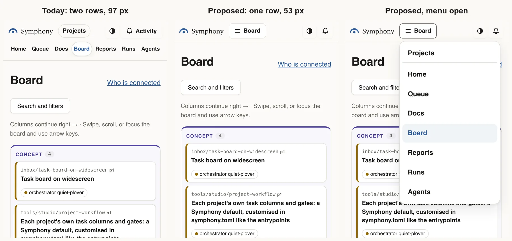
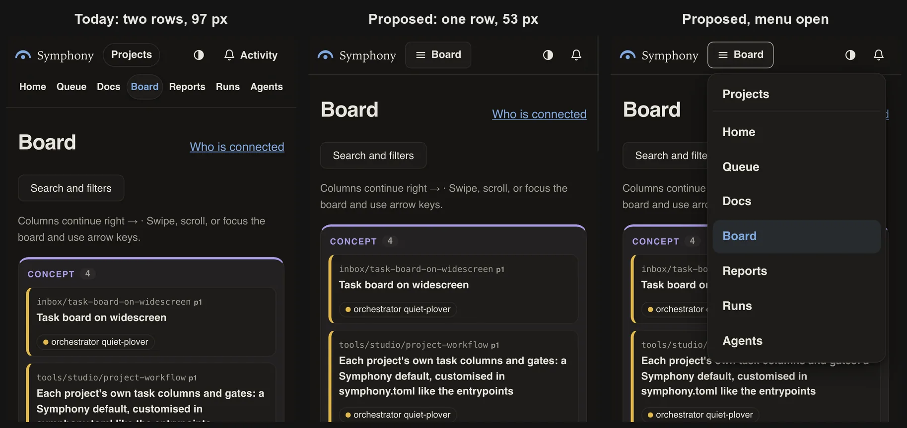
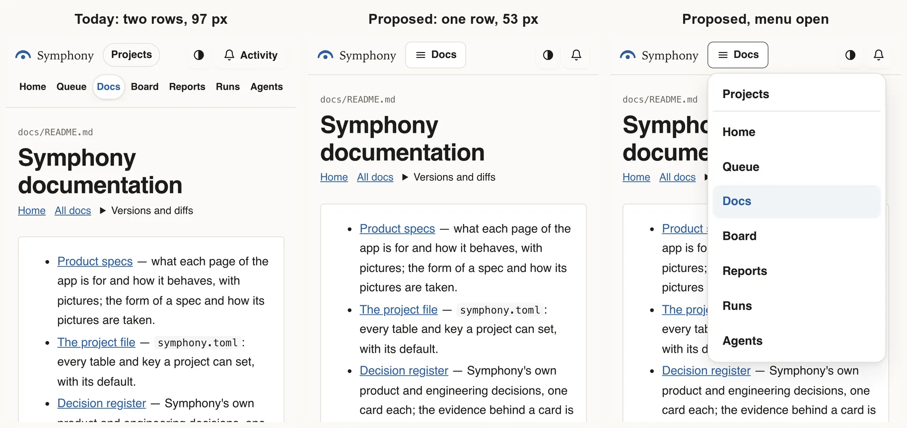
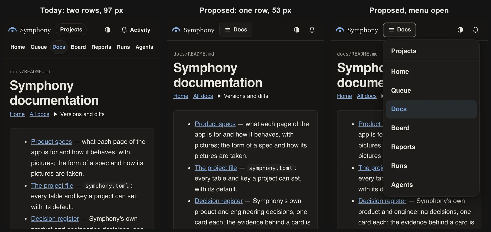
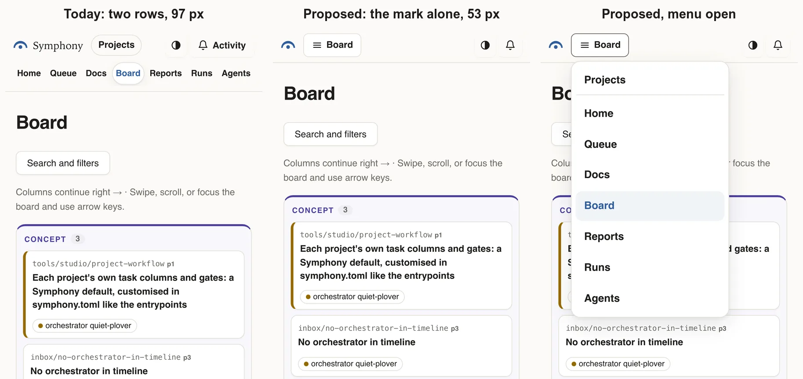
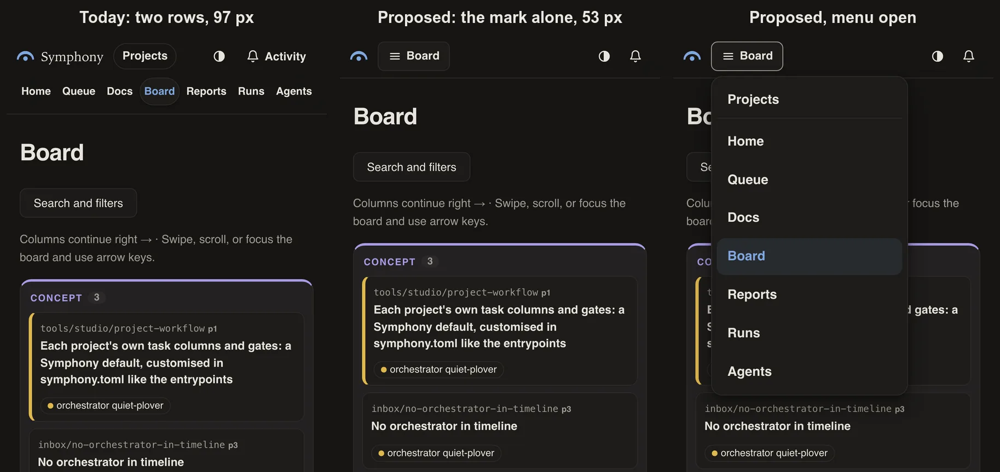
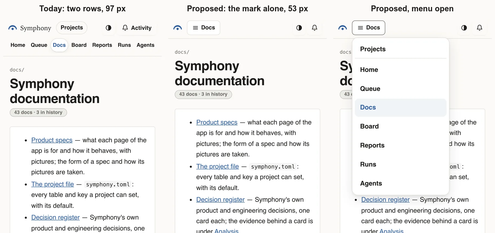
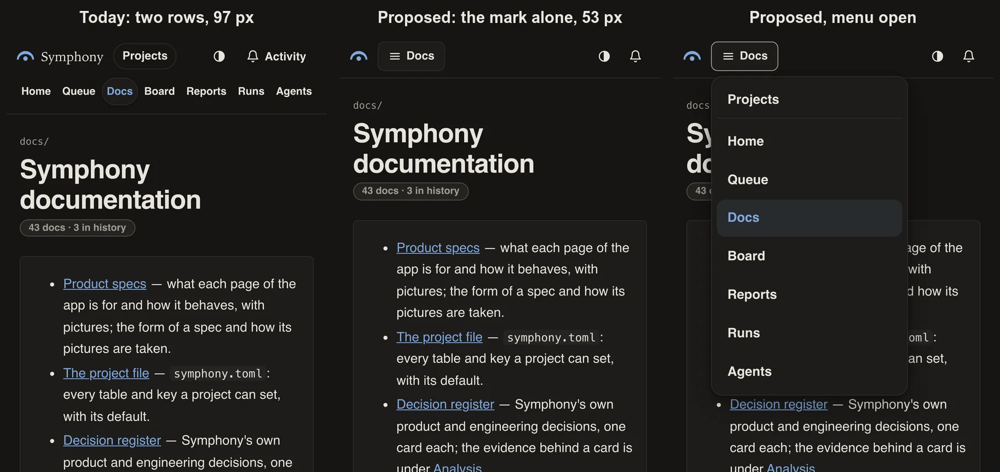

# The header on a phone, in one row

A smaller header for a phone, as proposed on the card
[**phone-header-one-row**](#phone-header-one-row). The header today is two rows on a phone, as
[The header](header-names.md#on-a-phone) describes; this would make it one. That card was rejected
for its name, which the owner wants gone on a phone; its replacement,
[**phone-header-mark-only**](#phone-header-mark-only), is [The mark alone](#the-mark-alone).

## The proposal

At 760 px wide or less (the width at which the header takes its phone layout today) the header is one
row, 53 px tall where today's two rows are 97 px:

- the fermata and the name, as today;
- a menu button, the ☰ sign and the name of the page shown (Board on the board and on a task,
  Docs on a document, a project's own page by its label, Pages where no page is lit);
- the ◑ Appearance button;
- the bell, without its word: Activity stays its name for a screen reader, and the unread dot
  stays on it.

The button opens a list under it, over the page, so nothing on the page moves: Projects first (on
the machine's server, where it is drawn today), then the pages in today's order, the page shown lit
as in today's row. Enter or a tap opens it, Tab moves into it from the button, Escape or a tap
anywhere else closes it, and Escape gives the focus back to the button. A link followed closes it.

It is the browser's own popover (`popover` on the list, `popovertarget` on the button), which
closes on Escape and on a tap outside with no script of the client's. So the server's own pages
(the project list, a missing page, a file no entrypoint serves), which carry no script, draw the
same menu. The list hangs from the button by CSS anchor positioning, and below the header where a
browser has none.

At desk width nothing changes: the button is not drawn and the row of pages is today's. A theme
that picks the compact header (`[theme.layouts] header = "compact"`) keeps its one row of pages at
every width.

- [-] **phone-header-one-row** — On a phone the header would be one row instead of two: the mark and name, a menu button that names the page you are on (☰ Board), ◑ and the bell. The page links and Projects move into that menu, which opens under the button over the page, so nothing below it moves. The header goes from 97 px to 53 px tall, so every page starts 44 px higher. Wider than a phone nothing changes. It changes **header-on-a-phone**, which keeps every page in view on a second row. Approve, or comment. [[analysis/phone-header#The proposal]]
  [2026-11-16 22:15] agent — Posted for the board task `app/phone-header-is-one-row`, from your words on its inbox item: "Navigation should also be made even smaller on mobile, possibly using hambúrguer menus".
  [2026-11-16 22:15] agent — The board, then a document, light then dark. Each shows today, the one row, and the one row with its menu open:    

    **How the menu works.** A tap on the button, or Enter, opens it; Tab moves into it. Escape or a tap anywhere else closes it, and so does following a link. The page you are on is lit in it, as in today's row. Projects, which leaves this project for the list of all projects, is its first line.

    **What it costs.** Changing page takes two taps instead of one. Activity loses its word on a phone and keeps its bell and its unread dot.

    **Not pictured.** At 320 wide the row still fits with the name whole, where today the name is cut short. At desk width the header is the same, pixel for pixel. The server's own pages (the project list, a missing page) get the same menu. A theme with the compact header keeps its one scrolling row. The same board task builds it after your answer.

    **Earlier verdicts checked.** **header-on-a-phone** chose two rows with every page in view; pages behind a button is another choice than the one it describes, so it is asked here and not recorded on it. **header-page-names** (the names and their order), **header-appearance** (the ◑ button) and **symphony-mark** (the fermata and its name) are kept as they are. None of them decides whether the pages go behind a menu.
  [2026-11-16 22:30] owner · rejected — Symphony title should be omitted, only the icon should show for mobile
  [2026-11-16 23:02] agent — Replaced by **phone-header-mark-only**: the same one row with the mark alone and no name on a phone; the name stays wider than a phone, and in the page for a screen reader. Pictures of the board and a document, light and dark, are on that card.
  [2026-11-17 12:24] agent — Your direction is preserved: mobile shows only the icon, with the Symphony name hidden visually and retained for screen readers; wider layouts keep the name. The replacement **phone-header-mark-only** records this and was approved by you on 2026-11-17 at 03:49. This delayed notification does not reopen that choice.

## How the pictures were made

On 2026-11-16, at main 212a1c6f, with `just symphony-cli shot --phone` (390 wide at 3x) against
two private servers over one scratch copy of this repository's board: one serving main's client,
one serving a throwaway build of the proposal (the frame's markup and its phone rules changed in
a worktree, built into a scratch folder, never committed). A private server has no project list,
so it draws no Projects link: today's pictures have it added to the page before the shot, and
the throwaway build draws it as the machine's server does. Each picture is cropped to the top of
the screen.

Measured on those builds:

| | Today | One row |
|---|---|---|
| Header height on a phone, 390 wide | 97 px | 53 px |
| Where the page starts, menu open | | 53 px, as closed |
| Header at 320, 360 and 375 wide | two rows | one row, the name whole, no sideways scroll |
| Header at 1440 wide | 57 px | 57 px, the same pixels |

## What building it touches

- `apps/symphony-web/src/frame.tsx`: the button, the list as the popover, Projects inside it, the
  bell's word kept for screen readers.
- `apps/symphony-web/src/styles/frame.css`, its phone rules, and the copy the server's own pages
  inline (`apps/symphony-server/src/frame.css`).
- `apps/symphony-server/src/pages.rs`: the same markup on the server's own pages.
- The browser tests that read the phone's two rows, and new ones for opening, closing, the focus
  and the page shown; every page's first screen moves up 44 px on a phone, so the tests of the
  ghosts' and the floating controls' places run again.

## Not in this proposal

A header that stays at the top as the page scrolls: on a phone it scrolls away with the page, as
today.

## The mark alone

The proposal above with one change: at 760 px wide or less the header shows the mark and not the
name. The rest is as above: one row, 53 px, the menu button naming the page, the list as the
browser's popover, ◑, the bell without its word, the desk header unchanged, and the compact header
keeping its scrolling row.

- **What goes.** The name is the wordmark, or a project's own theme name; the mark is the fermata,
  or the project's own icon. A project with its own shows its icon alone the same way. The name
  stays in the page as text, clipped out of sight (`position:absolute; width:1px; height:1px;
  overflow:hidden; clip-path:inset(50%)`), as the bell's word is, so a screen reader reads it where
  it does today: the header's first text, before the menu button.
- **The mark is no link.** It is none today: the React frame's `Brand` and the server's
  `mark::brand` draw a span, Home and Projects being links of their own, so the keyboard's first
  stop stays the first of them. Here the first stop is the menu button, and Home is in the menu.
  A mark that leads home would be a choice of its own, not made here.
- **The width freed** is 84 px at every phone width: the name's 76 px and the 8 px gap before it
  (the brand goes from 106 px to 22 px). It is left empty, taken by `#appearance`'s
  `margin-left:auto`. The menu button grows with its page name and may shrink below it
  (`flex:0 1 auto; min-width:0`), the name cut at its ellipsis only once the row has no more room.

Measured on the throwaway build:

| | Today | The mark alone |
|---|---|---|
| Header height, 390 wide | 97 px | 53 px |
| The brand, 390 wide | 106 px: the mark, the gap, the 76 px name | 22 px: the mark |
| Free between the menu button (Board) and ◑ | | 102 px at 320 wide, 142 at 360, 157 at 375, 172 at 390 |
| A page name of 234 px in the button | | cut short: 138 px shown at 320 wide, 208 at 390; the header 53 px, no sideways scroll |
| Where the page starts, menu open | | 53 px, as closed |
| Header at 1440 wide, board and document | 57 px | 57 px, no pixel of it different |
| A link followed in the menu, Board to Queue | | the menu closes, the page moves in place, the button names Queue |
| Escape on the open menu | | it closes, the focus on the button |

### How its pictures were made

On 2026-11-16, at main eea950ac, with `just symphony-cli shot --phone` (390 wide at 3x) against
two private servers on `--port 0`, each with a temporary machine folder, over one scratch board: a
private in-memory SurrealDB holding a copy of this repository's board (`tasks-copy --board --out`,
a read). One served main's committed client, the other a throwaway build of the mark alone: the
first card's mock-up (the frame's markup and its phone rules) with the brand's phone rules above,
built into a scratch folder with `just symphony-ui-dist` and put back, never committed. As for the
first card, today's pictures have the Projects link added before the shot, and the throwaway build
draws it as the machine's server does. Each picture is today, the mark alone, then its menu open,
cropped to the top 533 px of the screen.

### For the build

What building it touches is the list above, with two tests the first card's review asked for:

- **A followed link closes the menu in the React client.** The browser closes a popover by itself
  on Escape and on a tap outside, and on a link only where following it loads a page, as on the
  server's own pages. The React client moves page in place, so it hides the popover when a link in
  it is followed (the mock-up's click handler on the list does), and a browser test follows a link
  from the open menu and finds it closed, the button naming the new page.
- **A long name at 320 wide.** With the name out of the row, a project's long theme name can no
  longer crowd it: a test sets one and finds the row one line, 53 px, with no sideways scroll, and
  the name still the brand's text. The page name is the one thing left in the row to grow: a test
  with a long page label (a plugin page's) at 320 wide finds the button cut short at its ellipsis
  and the row one line. With the name in the row, both would have had to give way together; now
  only the page name does, which is the easier test to write and to keep.

The board task `app/symphony-mark-followups` drops the name on the narrowest phones only, and its
acceptance keeps the phone's two rows: the mark alone, once built, does its first item's work and
changes that acceptance.

- [r] **phone-header-mark-only** — Replaces: phone-header-one-row. On a phone the header would be one row with the mark alone and no name: the fermata, a menu button that names the page you are on (☰ Board), ◑ and the bell. The page links and Projects move into that menu, which opens under the button over the page, so nothing below it moves. The header goes from 97 px to 53 px tall, so every page starts 44 px higher. Wider than a phone nothing changes, the name included. It changes **header-on-a-phone**, which keeps every page in view on a second row. Approve, or comment. [[analysis/phone-header#The mark alone]]
  [2026-11-16 23:05] agent — Posted for the board task `app/phone-header-mark-only`, from your rejection of **phone-header-one-row**: "Symphony title should be omitted, only the icon should show for mobile". The name is the only change from that card.
  [2026-11-16 23:05] agent — The board, then a document, light then dark. Each shows today, the mark alone, and the menu open:    

    **The name.** It goes on every page 760 px wide or less, the server's own pages too (the project list, a missing page). A project with a name and an icon of its own shows its icon alone the same way. A screen reader still reads the name: it stays in the page out of sight, as the bell keeps its word Activity. The mark is no link today and stays none; Home is in the menu.

    **The width it frees.** 84 px, the name and the gap after it. Nothing takes it: the gap between the menu button and ◑ grows. Only a page name too long for the button uses it, and is cut short with "…" past that. At 320 wide, Board leaves 102 px free; a page name of 234 px shows 138 px of itself, and the header stays one row with no sideways scroll.

    **How the menu works.** As on the rejected card: a tap or Enter opens it, Tab moves into it, Escape or a tap anywhere else closes it, and Escape gives the focus back to the button. Following a link closes it too. The page you are on is lit in it, and Projects is its first line.

    **What it costs.** Changing page takes two taps instead of one. Activity loses its word on a phone, keeping its bell and its unread dot. The name shows only wider than a phone.

    **Not pictured.** At 320, 360 and 375 wide the row is one line with no sideways scroll. At desk width the header is the same, pixel for pixel, name and all. A theme with the compact header keeps its one scrolling row. The same board task builds it after your answer.

    **Earlier verdicts checked.** **phone-header-one-row** is rejected; your words on it ask for this card's one change. **header-on-a-phone** chose two rows with every page in view; pages behind a button is another choice, so it is asked here and not recorded there. **symphony-mark** (C) put the fermata and its wordmark at the head of the header; your words on **phone-header-one-row**, which came after it, drop the wordmark on a phone, and wider than a phone it stays. **header-page-names** (the names and their order) and **header-appearance** (the ◑ button) are kept. None of them decides whether the pages go behind a menu.
  [2026-11-17 03:49] owner · approved
  [2026-11-17 12:24] agent · resolved