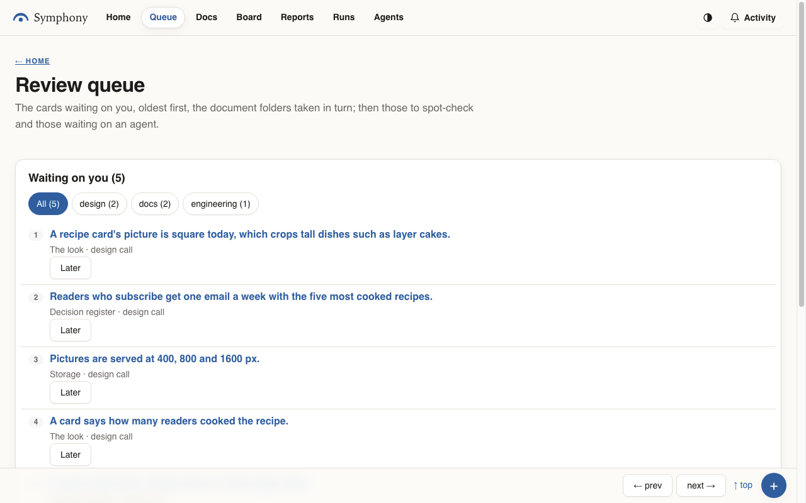
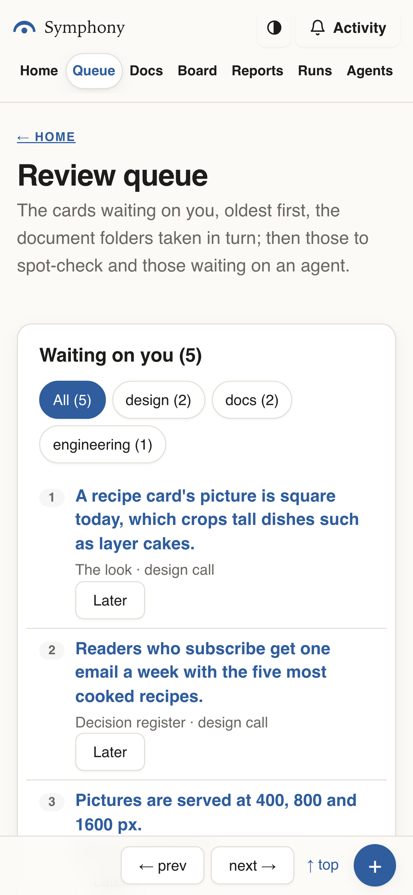

# Product documentation review, November 2026

What a person using the Symphony can read about it, measured on main on 2026-11-15 against the
running app (the shared server, read only), and what is proposed. The form proposed is shown by
one written spec, [the review queue](../product/QUEUE.md), and described in
[Product specs](../product/README.md).

## What exists

`docs/` holds twelve documents, about 700,000 bytes, a third of it the decision register.

| Document | Bytes | What it is |
| --- | ---: | --- |
| TASKS.md | 230,355 | the board's storage, sessions, APIs, landing, sweep, gates and asks, as one reference for agents and maintainers |
| DECISIONS.md | 205,220 | the register: a record, not a description |
| RELEASES.md | 72,849 | the release run, for whoever maintains Symphony |
| CHECKS.md | 43,721 | what a task here proves, for agents working on Symphony |
| REVIEW.md | 36,758 | cards, verdicts and comments; the nearest thing to a product document |
| PLUGIN_PROTOCOL.md | 25,546 | a wire protocol, for a plugin's author |
| MACHINE_WORK.md | 21,887 | the build and test recorder |
| RUNS.md | 20,563 | a file format |
| PROJECT_FILE.md | 15,285 | every key of `symphony.toml`; a good reference, for a project's owner |
| AGENT_ACTIVITY.md | 11,759 | a file format |
| PLUGIN_CALLS.md | 9,862 | a measurement setting and its record |
| README.md | 1,842 | the index |

None is a product spec. Not one says, for a page of the app, who it is for, what a person does
there, what it shows, its states and how it differs on a phone.

**Pictures.** No document outside the register shows a picture. The register's cards show 113
pictures and `docs/analysis/` holds the files, each taken once by hand for a decision: they show
options that were judged, several of them never built, and none is retaken when the page changes.
The words *phone* and *wide* appear 21 and 7 times in the eleven documents that are not the
register, and 97 and 65 times in the register: how a page looks on a phone is recorded only as
decisions.

## Each surface

Read against the app as served. *Stated* means a document says it as present behaviour, not as a
decision's text.

| Surface | For whom, and what they do | States and rules | Phone and wide | Pictures | Where the words are today |
| --- | --- | --- | --- | --- | --- |
| Projects (the picker at `/`) | no | no | no | none | a paragraph of the server's README; a card |
| Home | no | no | no | none | one sentence of REVIEW, which still calls the board the front page |
| Review queue | partly | topics and Later, well | no | none | REVIEW, between the server's storage details |
| A document, its contents and comments | partly | comments, well | a section on the cost of pictures only | none | REVIEW |
| The register, a card and its verdict | yes, for cards | groups, marks and history, well | no | none | REVIEW |
| Branch cards and branch pages | no | exhaustively, as merge rules | no | none | REVIEW, 100 lines no owner can use |
| Docs (the folder pages) | no | no | no | none | AGENTS.md, as routing |
| Board | no | no: its columns, cards, filters and what "stuck" shows are nowhere | no | none | cards; TASKS describes the data behind it |
| A task's page | no | gates and timeline as wire types and reads | one line | none | TASKS; cards |
| Asks | partly | the record, well | no | none | TASKS |
| Reports | no | no | no | none | an analysis and cards; a document is being written by another task |
| Runs (page being built) | no | the file format only | no | none | RUNS, an analysis |
| Agents | no | the API's keys, as a contract | no | none | TASKS |
| Activity panel and chat | no | delivery to agents only | no | none | REVIEW |
| The header, Appearance, the bar at the foot | no | no | no | none | cards |
| Themes | the keys | no: what a theme can change is not shown | no | none | PROJECT_FILE |
| A plugin's pages and blocks | no | the protocol only | no | none | PLUGIN_PROTOCOL, the kit's README |
| `tasks` as a product | the commands' own help | scattered through TASKS | n/a | n/a | `just tasks --help`, TASKS |
| `symphony` (the document CLI) | the commands' own help | `shot` and `init` only in AGENTS.md | n/a | n/a | AGENTS.md |
| `symphony init` and a first project | a walk-through | what init leaves to do | n/a | none | the root README |

## The gaps, ranked

Ranked by how much a person meets the surface and how little is written.

1. **The root README says what Symphony is in one sentence** and spends the rest on how to build
   it. It shows nothing. It is the first page a visitor reads. Rewritten in this task.
2. **The board has no description at all.** It is the page most used, by the owner and by every
   orchestrator. A spec says what a column is, what a card shows, what is flagged as stuck and
   after how long, the filters, and how a phone shows it.
3. **A task's page**: its gates, timeline, subtasks, thread and the box to write in, and what each
   gate state means to someone deciding whether a task can land.
4. **A document and its cards**: reading, commenting in place, the verdict box, attaching files,
   versions and diffs, and a branch's page. REVIEW holds the rules; no page says what the owner
   sees and presses.
5. **Home and Projects**: what the numbers count and where each leads.
6. **Agents**: what "live", "stale" and "lost" mean to the owner, what *Go to session* does.
7. **Reports and Runs**: what each chart counts, in the words of the page.
8. **The frame every page shares**: header, Appearance, Activity, the chat sheet, the bar at the
   foot (prev, next, top, the + button), and what "out of date" looks like.
9. **Getting started as a guide**: install, init, the first card and the first task, with
   pictures, split from the README's short version.
10. **The two CLIs as products**: what a person does with `tasks` and with `symphony`, by job
    rather than by command, linking each command's own help.
11. **Themes and a plugin's pages**: what a project can change and how it then looks.

## Existing documents

**Developer notes filed as product documents.**

- REVIEW.md is two documents in one. Its rules for cards are the owner's and good. Between them it
  holds a server's storage paths, request bodies (`POST /api/postpone`), a scan's timings, source
  file names and a hundred lines of merge precedence between a branch's copy of a card and main's.
- TASKS.md is the board's whole implementation reference under the name of the board. A person
  looking for what the board page shows finds storage, snapshots and recovery first.
- RUNS.md and AGENT_ACTIVITY.md are file formats; MACHINE_WORK.md, PLUGIN_CALLS.md and
  PLUGIN_PROTOCOL.md are for whoever builds on Symphony. They are right as they are, and belong
  under a heading that says so.

**Out of date.**

- REVIEW.md and TASKS.md both open by saying their commands are the consuming project's.
- REVIEW.md says the board is the front page (it is Home), names source files of the Dioxus client
  for media, says browser coverage "returns after the Rust migration", and gives examples from a
  game (in-game captures, a flight HUD, a gameplay mechanic, a lamp catalogue).
- The server's README calls the client "the Dioxus SPA".

**Repeats.**

- The root README, AGENTS.md and CHECKS.md each explain `just verify`, the client distribution and
  the release snapshot. AGENTS.md is the one that is kept current.
- What a card's picture must be is in REVIEW twice, and again in AGENTS.md.
- The default landing is in TASKS, AGENTS.md and RULES.md, each at length.

**History.** The documents themselves hold little; the lint keeps slugs and the owner's words out.
What remains is history by form: REVIEW's branch rules read as a list of cases met.

**The index** lists the twelve as one flat list. It would say who each is for: using the Symphony
(the specs), running it on a project (PROJECT_FILE, REVIEW's rules, the board's guide), and
building on or working on it (the rest).

## Proposed specs

One document each under `docs/product/`, in the form of the example. The one-paragraph outlines:

- **QUEUE** (written). Every card waiting on the owner, the order, topics, Later, the states.
- **BOARD.** The columns and what moves a task between them; a task's card and each mark on it;
  what is shown as stuck, on whom and since when; filters and search; the board with no database
  made; on a phone, one column at a time.
- **TASK.** The head, the gates and what each state means for landing, the timeline, subtasks, the
  brief, the thread and writing on it, attaching; a task that is done; a task not on the board.
- **DOCUMENT.** Reading a document, its contents list, commenting on a block, pictures and mockups,
  versions and diffs, a branch's page and its marks against main, a read-only Markdown page.
- **CARDS.** A card and its marks, the verdict box, notes, options, Later from a card, a draft on a
  branch, a card's history, a settled card folded; what each verdict starts.
- **HOME.** The greeting, *Next up*, the five numbers and what each counts, the design documents
  list; an empty queue; a project with no board.
- **PROJECTS.** The picker: each project's counts and health, a project whose root is gone.
- **AGENTS.** Who is connected, what each works on, health in the owner's terms, going to a
  session, the probes when one cannot be asked.
- **REPORTS** and **RUNS.** Each chart and table in the page's words, the window chooser, a run and
  its steps and log, what is running now.
- **FRAME.** The header on a phone and wide, Appearance, Activity, the chat sheet, the bar at the
  foot, the outline while a page loads, the "may be out of date" state, a server notice.
- **GETTING_STARTED.** Install, `symphony init` and its `Next:`, the first card answered, the
  first task landed, with a picture of each step's result.
- **CLI.** `tasks` and `symphony` by job: file work, do work, review, land, look at a page, check
  the documents.
- **THEMES.** What a project's theme changes, shown on one page in two themes.

REVIEW.md then keeps the rules of cards and loses what the DOCUMENT and CARDS specs say better and
what belongs to the server's guide; that is a task of its own after those two specs.

- [r] **product-spec-form** — Each page of the Symphony would get a short document of its own, written for whoever uses the page: what it is for, what you do there, what it shows, its states, and how it looks on a phone, with pictures taken by one command from a made-up project. Today no document does this for any page, and no document outside this register shows a picture. One spec is written so you can judge the form: [the review queue](../product/QUEUE.md). Is this the form the other thirteen should take? Approve, or comment with what to change. [[analysis/product-docs-review-2026-11#Proposed specs]]
  [2026-11-15 02:40] agent — Posted for the board task `docs/product-docs-review`. The example's pictures, as the command took them, wide and on a phone:

     

    **What approving sets:**

    - **One page, one document**, under `docs/product/`, with the same parts in the same order ([the form](../product/README.md#the-form-of-a-spec)). No source file, route or wire type in it: those stay in the reference documents, which a spec links.
    - **Pictures are taken, never pasted.** `tools/product-pictures.sh` takes every listed page, on a phone, wide or both as a spec shows it, from a small fixture project, on a server of its own. Taken twice on one Chrome, a picture comes out byte for byte the same, so after a retake git lists the ones that went stale. No checker is added.
    - **The task that changes a page retakes its pictures**, as its after pictures.

    **Cost:**

    - About 0.1 MB a wide picture and 0.3 MB a phone picture, committed beside the specs as documents' pictures already are. At three wide and one phone picture a spec, the whole set is about 8 MB.
    - Each retake commits the changed pictures again, into every clone's history: about 0.1 to 0.4 MB for each picture of the page that changed.
    - A Chrome update, or other fonts, can redraw every picture with no page changed. Git then shows the whole set as stale, and one retake commits the whole set again, about 8 MB.

    **Earlier verdicts checked:** your approval of **pictures-in-every-clone** ("agreed with F") decides where these pictures live, committed beside the documents that show them, so that is not asked. It says nothing of what a product spec holds or how its pictures are made and kept current, and no other verdict does: that is this card.

    **What it leaves for later:** the home page shows the hour's greeting and each card's age, so its picture needs the shot taken at a fixed time; that is built when its spec is written. The other thirteen specs, one paragraph each, and the ranked gaps are in the linked review.
  [2026-11-15 06:38] owner · approved
  [2026-11-15 11:08] agent · resolved

## Pictures

Tried in this task, with nothing new built: an 80-line script starts a server of its own over a
fixture project, and `symphony shot` takes each listed page on a phone and wide.

- Six pictures of three pages took 45 seconds on a heavily loaded machine.
- Taken twice, each picture came out byte for byte the same. So staleness needs no checker: after
  a retake, git lists the pictures that changed.
- A wide picture is about 100,000 bytes and a phone picture, at 3 pixels a point, about 280,000.
  Fourteen specs showing three wide pictures and one phone picture each would be about 8 MB
  committed (16 MB with both widths of every page, so a line names the widths a document shows),
  and each retake of a changed page adds its new bytes to history.
- The home page did not repeat: its greeting follows the hour and its card says "waiting 39 d".
  Such a page needs the shot taken at a fixed time before it is pictured. That is the one piece of
  code the specs would ask for, and only when HOME is written.
- A link to a card, `…#slug`, landed with the card's top under the header; a task in review
  repairs that.
- The fixture has no board, so the board, a task and the agents page need one made in the script's
  scratch folder, started and stopped by the script. That belongs to the BOARD spec's task.

What keeps a picture current is the rule tasks already follow: a change to how a page looks shows
before and after pictures. With specs, the after picture is the spec's, retaken by the one command
and committed with the change.
