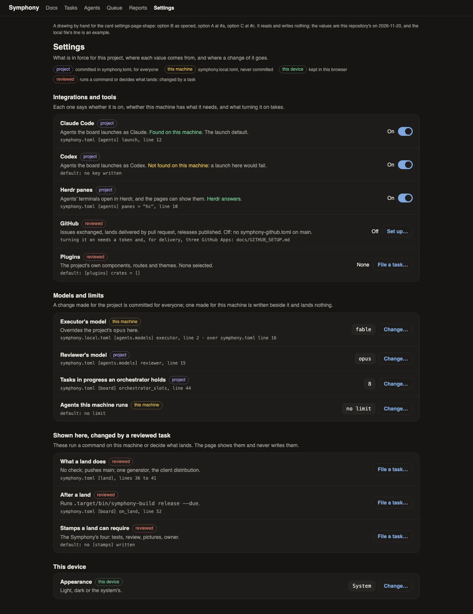
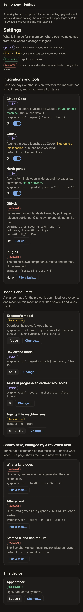
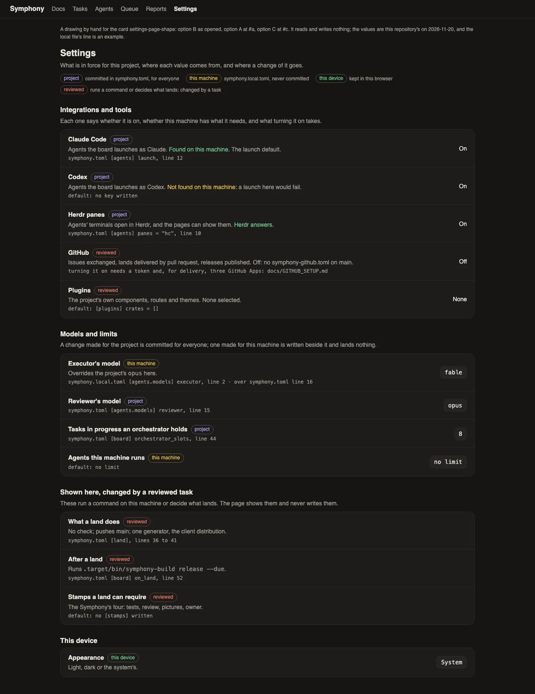
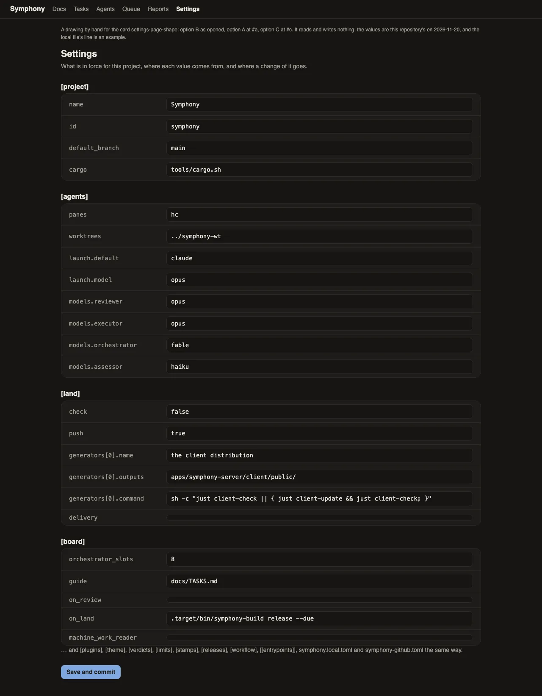

# A Settings page

A concept, not a design to build from: what a Settings page that turns a project's integrations
and tools on and off would be, questioned against the settings the Symphony has now. Nothing in
the product changes with it. Its choices go to the owner as cards a few at a time; the first three
are [what the page is](../DECISIONS.md#settings-page-shape), [how a change of the committed
project file lands](../DECISIONS.md#settings-page-project-save) and [what makes an entry of the
page](../DECISIONS.md#settings-page-entries). [Later rounds](#later-rounds) lists what is held
back until those are answered.

It is one of three concepts filed together, with blueprints (the board task `app/blueprints`) and
users and identity (`app/users-and-identity`); [how they meet](#how-it-meets-the-other-two-concepts)
says what each needs of this one.

## Today

No page shows or changes a setting. The app's own routes (`symphony_api::SYMPHONY_ROUTES`) hold no
settings route, and no save route (`symphony::save::ROUTES`) writes a settings file. A setting is
changed by an edit of a file, by `just symphony-cli model` for the models and the launch agent,
or by `symphony init` for the agents' files.

### Where a setting lives

| Place | Whose it is | What it holds | Who writes it | When a change holds |
| --- | --- | --- | --- | --- |
| `symphony.toml`, committed ([PROJECT_FILE](../PROJECT_FILE.md)) | the project, on every machine | 14 tables: the project's name and routes, plugins, theme, agents and their models, limits, the board's commands, the landing, the stamps, the workflow, releases | a hand edit; the model command | the board reads its limits, launch agent and models from the main checkout's file as it is on disk, and the stamps from the commit; the server reads the file again when it changes |
| `symphony.local.toml`, beside it ([the local settings file](../PROJECT_FILE.md#the-local-settings-file)) | one machine | the launch agent, the role models and `[limits]`, over the committed ones | a hand edit; the model command with `--local` | at once; nothing lands |
| `symphony-github.toml`, committed ([GITHUB](../GITHUB.md#turning-it-on)) | the project | whether the GitHub exchange is on, the repository, what is exchanged, where each token file is | a hand edit | once the default branch commits it: the program reads it from git's objects, never a checkout |
| `.claude/settings.json`, `.codex/rules/`, the skills and `symphony.just` | the project | what an agent's session may run without asking, its hooks, its skills | `symphony init`, which keeps its stamped files current | at an agent's next start |
| The machine folder | the machine | the registry of projects, the installed releases and `current`, the server's record | `symphony project add`, a release's refresh | at once; the server watches the folder |
| The server's state for a project | the owner, on that project | the queue's postponed order and such view choices | the pages | at once |
| The browser | one device | the appearance, a remembered filter | the pages | at once |

Three things follow from the table.

- **A setting has a scope**, and there are three a person meets: the project (committed, the same
  for everyone), this machine (never committed) and this device.
- **Two lists already sort the project file's keys by risk**, and they are the same list. A key
  that holds a command or a program the Symphony runs, or decides what lands, is refused in the
  local file (`PROTECTED` and `PROTECTED_KEYS` in `crates/tasks/src/local.rs`), and a change of
  it needs a reviewer where any other change of a value lands on the settings check alone
  ([the settings check](../PROJECT_FILE.md#the-settings-check), [needed
  stamps](../TASKS.md#needed-stamps)). The reason is said once there: a file no commit records
  must not change the landing gate or run a command.
- **Nothing answers "what is in force, and why" for the whole of it.** `just tasks limits` does
  for the limits, the launch agent and the models, naming the file and the line of each.
  `symphony-github status` does for the exchange. For the rest a person reads the file and the
  reference.

### What on and off mean today

The request names GitHub, Claude Code, Codex and Herdr. None of them is a switch of one shape.

| Thing | How it is on today | What off would mean |
| --- | --- | --- |
| GitHub | `enabled = true` in `symphony-github.toml` on the default branch, with a repository, a token file outside the repository and, for delivery, three GitHub Apps and two rulesets ([the setup](../GITHUB_SETUP.md)). The program is one no other package builds with, and no page runs it. | `enabled = false`, landed: one line. On is a setup of several steps on GitHub and on the machine, most of which no page can do. |
| Claude Code, Codex | Not a switch. `[agents.launch] default` picks which of the two a launch starts when its caller names none, and a caller may name either. `symphony init` installs both agents' files in every project. Whether the program is on the machine is never asked before a launch. | Three different things: the board refuses to launch it, init stops installing its files, or the pages stop offering it. |
| Herdr | `[agents] panes = "hc"`, else `"none"`. The agents page already probes whether Herdr answers. | `panes = "none"`: the one of the four that is a switch already. |
| A plugin | Named in `[plugins] crates`, with a command in `[plugins.process]` or a host that links it. | Its name taken out: the project's components, routes and theme from it stop answering. |

So "enable or disable" covers three kinds of change: a value among a few (`panes`), a name in a
list (a plugin), and a setup that ends in a value (GitHub). A page that offered one identical
switch for all of them would promise more than a click can do for the third.

## Questioning the idea

**Is a page needed?** Yes, for reading before writing. Each of the last settings added came with
its own way to see it (the limits command, the exchange's status), which is the sign that the
whole is hard to see. A project that is not this one has it harder: its people did not write the
reference. The reading half has no risk and no open choice of substance.

**Is it a form over the files?** No. The project file is a contract with a reference, comments a
project wrote beside its values, and tables (the workflow, the hosted database's budget, the
landing's generators) that are designs, not preferences. A form over every key would let a click
change what lands, would lose or have to preserve the comments, and would need a control for
every shape of value. The files stay the source, and a person who wants all of it edits the file.

**What must it never do?** Run a command, or let the browser choose one. Whoever reaches the
server is the owner: it answers this machine and the tailnet peers `tailscale whois` confirms,
and a write is held to its Host and Origin. That is enough for a verdict on a card. It is not
enough for `[board] on_land`, which is a command the machine runs after every land: a page that
wrote it would make every device that reaches the server able to run a program here. The two
lists above already draw this line, so the page takes it as it is: what the local file refuses
and a settings landing reviews, the page shows and never writes.

**What is the smallest thing that answers the request?** A page that lists what is in force and
its source, with a switch or a value for the settings both lists call preferences, written to the
scope the person picks. Everything else is shown with where it is changed.

## The page

The picture is a drawing by hand ([the mockup](settings-page/mockup.html)), with this
repository's values. It has four parts.

- **Integrations and tools.** One row for each thing that can be on or off. A row says its
  state, where the state comes from, and what this machine has of what it needs (Claude Code
  found, Herdr answering, the GitHub program built and its settings read). A preference has a
  switch. A setup has a button that opens its guide, and a reviewed one a button that files a
  task.
- **Models and limits.** The values `just tasks limits` prints, each with its source and its
  scope, and a control that asks which scope a change is for: the project or this machine.
- **Shown, changed by a reviewed task.** The landing, the board's commands, the stamps, the
  plugins, the workflow: what they are now, in a sentence, with the file and the line.
- **This device.** What the browser keeps, the appearance first.

Every row names its source as `just tasks limits` does (`symphony.local.toml [limits]
machine_agents, line 6`), and a value no file writes says it is the default.

[Its card](../DECISIONS.md#settings-page-shape) asks how far the page goes: reading alone,
reading with switches and values for the preferences, or a form over every key.

## What a save writes

By scope:

- **This device**: the browser, as now.
- **This machine**: `symphony.local.toml` beside the main checkout's project file, by the same
  edit the model command makes with `--local`, which keeps comments and order and never leaves
  the file as its readers would refuse it. Nothing lands. The file takes the launch agent, the
  models and the limits and nothing else, so the page offers this scope for those alone.
- **The project**: the committed file, which is the open choice.

A change of the committed file can reach the default branch three ways.

1. **As the owner's document saves do.** An answer on a card is committed straight to the default
   branch over a private index, never staging the checkout's other work
   (`crates/symphony/src/commit.rs`). A settings save would take the same road: the edit made,
   the settings check run on the result, a red one refused with its file and line and nothing
   written, a green one committed as one commit that says what changed. Where the project
   delivers its land by pull request, a document save is already kept, committed on a branch of
   its own and filed as the owner's task until its delivery is proved ([a document save under
   delivery](../TASKS.md#a-document-save-under-delivery)); a settings save would be kept the same
   way, and the page would say it is waiting.
2. **As a task, always.** The page files a task with the one-line change on a branch. Its assessor
   reads it as settings alone, it lands on the settings check with no reviewer, and its
   orchestrator lands it. The change holds when someone lands it, and the board records it like
   any work.
3. **Not at all.** The page writes nothing committed and shows the command or the line to change.

The first is the only one where a switch behaves as a switch. Its gate is the one a settings
landing has now, the settings check, so no change lands with less than it does today; what it
drops is the task around it, and the commit itself is the record. It also means one committer for
everything the pages write, with the delivery case solved once. [Its
card](../DECISIONS.md#settings-page-project-save) asks which.

One thing holds under any of them and is worth saying on the page: the board reads the limits,
the launch agent and the models from the main checkout's file on disk, so they hold from the
write, while the stamps and the GitHub settings are read from what the default branch commits.

## What makes an entry

The request expects more such things to come. Whether the page's list is written
in the Symphony or is declared by each thing decides how those others arrive.

- **A list the Symphony holds.** The page knows GitHub, the two agents, Herdr and the plugins by
  name. A new integration is new page code, and a project's own plugin cannot add a row.
- **Each thing describes itself.** One small description for every entry: its name, what it is
  for, its state and why, what it needs and whether the machine has it, and its settings, each
  with its key, its type, the scopes it may be written in and whether it is a preference or
  reviewed. The Symphony's own things describe themselves in that shape from the start. A program
  such as the GitHub exchange answers it with a command (it already says most of it in
  `status`). A plugin answers it at a seam of the kit, as it answers its components, and the
  client draws every entry with the one component. The page then never learns an integration's
  name.

The second costs a shape to agree on and to keep stable for plugins, which the kit's version
rules cover as they cover a block. It can be built in two steps without waste: the Symphony's own
entries in that shape first, the seam for programs and plugins once it has held for them. A
description declares; it runs nothing. An entry whose state needs a program run (the exchange's
`status`) is a separate choice of a later round, since the server runs no such program today.

The class of a setting is not the describer's to lower: a plugin may mark its own setting
reviewed, and anything it names that the Symphony would run or that decides what lands is
reviewed whatever it says. [Its card](../DECISIONS.md#settings-page-entries) asks between the
two.

## Who may change what

Today there is one owner, and everyone who reaches the server is them. The page needs no new
rule for that: preferences are the owner's to set, the rest goes through review, and the review
is what holds when the owner's device is not the one asking.

With several people, the three scopes and the one class line become the places a permission
attaches, with no new sorting:

| What | Today | With users |
| --- | --- | --- |
| This device | whoever holds it | each person, no role |
| This machine | the owner | whoever runs that machine's server; a hosted board has no such scope |
| The project's preferences | the owner | a role the identity concept names |
| Reviewed settings | a task and a reviewer | the same, the page never the way in |

## How it meets the other two concepts

**Blueprints.** A blueprint is a set of the same settings given a name. The page meets it in the
source of a value: today a value comes from the default, the project file or the local file, and
a blueprint is one more layer between the default and the project file. The page's source line
is then where a person sees which values are the blueprint's and which the project wrote over
it, and where "back to the blueprint's" is offered. Two things this concept asks of that one: a
blueprint's settings sort into preferences and reviewed by the same line, so taking a blueprint
that sets a command is a reviewed landing and never a click; and a blueprint lists the entries it
turns on by the names their descriptions give, which is a reason for descriptions.

**Users and identity.** The table above is what this concept hands it: four places a permission
attaches. Three things come back the other way. An identity provider is itself an entry of the
page, and its settings decide who gets in, so they are reviewed and the page never writes them.
A commit the page makes names who asked for it once there is more than one person. And a hosted
board has no checkout beside the server to write a local file in, so "this machine" is a scope
of the local server alone.

## Later rounds

Held until the first three cards are answered, since each depends on them:

- **What turning an agent off means**: refused at launch, not installed by init, or not offered,
  and whether it is the project's setting, the machine's, or both.
- **GitHub's row**: whether off is a switch while on stays a setup, and whether the server may
  run the exchange's `status` to say why it is off.
- **Where the page is**: its route (a new route of the Symphony's own wins over a project's
  entrypoint of the same name), its place in the header, and what of the machine (the registry,
  the installed release) it shows beside the machine's own page.
- **The description's shape** for plugins and programs, if descriptions are chosen.
- **The record of a change**: what the commit says, and whether the board or a report lists
  settings changes.
- **Who may change the project's preferences**, with the identity concept's roles.

## Not proposed

- A setting the Symphony does not read yet. Each of those is code and a task of its own.
- A change to the settings check, the local file's rules or what a landing reviews. The page
  reads those lines; it does not move them.
- An editor for the workflow, the stamps or the landing.
