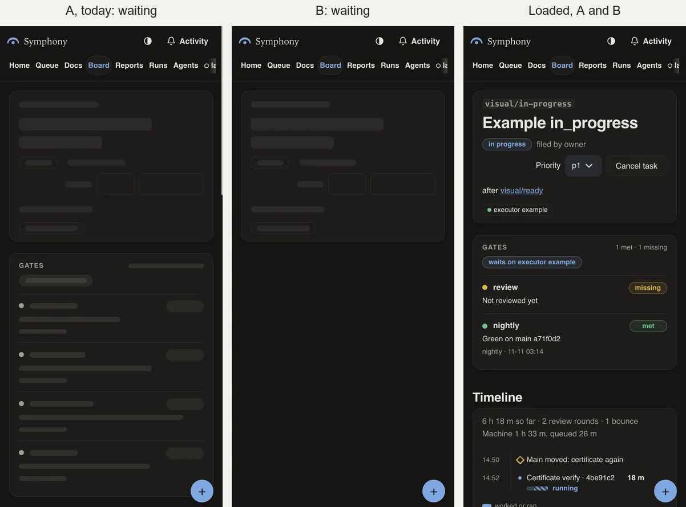
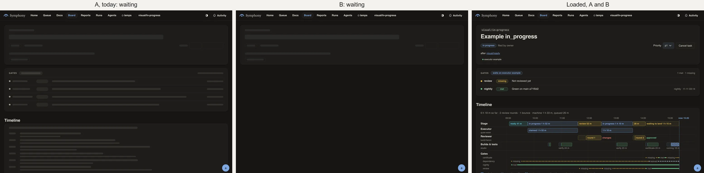
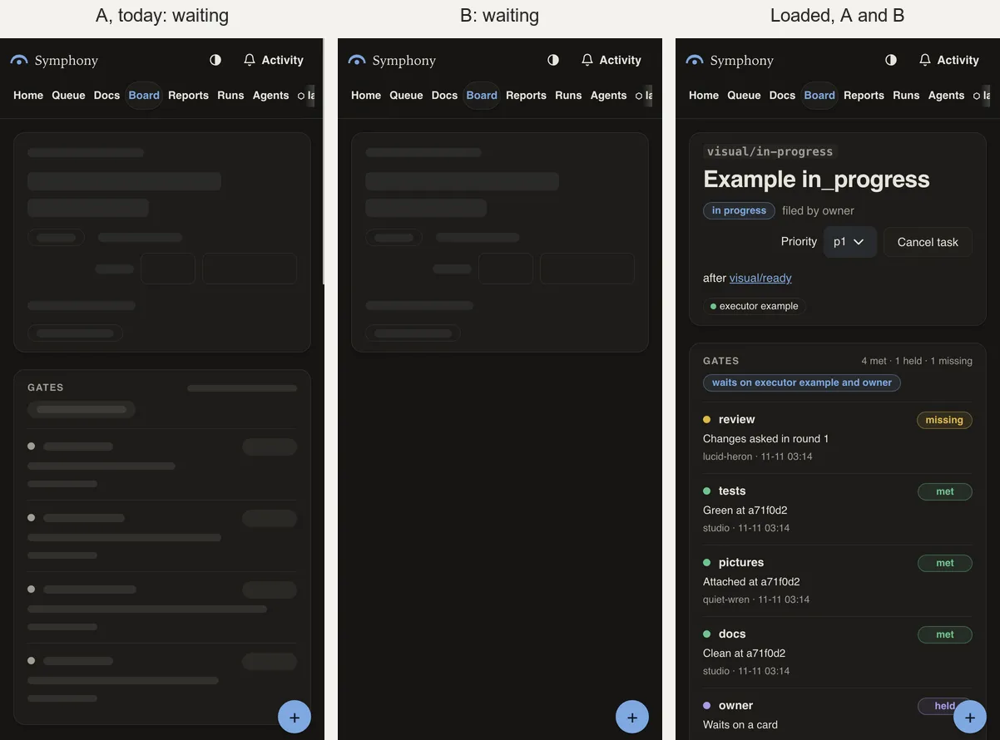
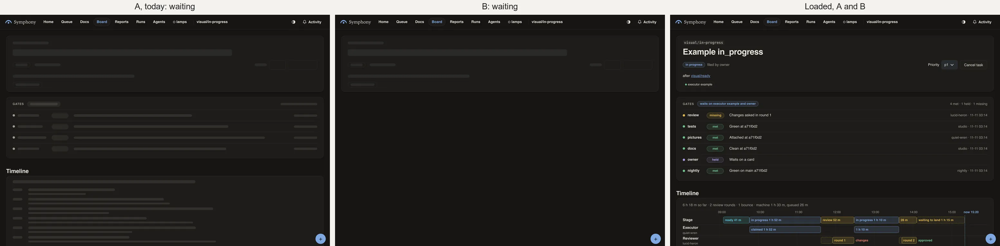
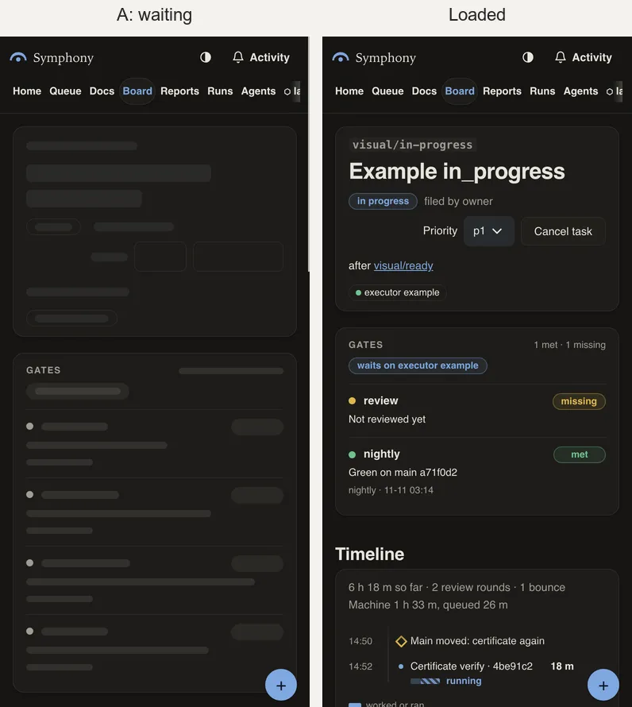
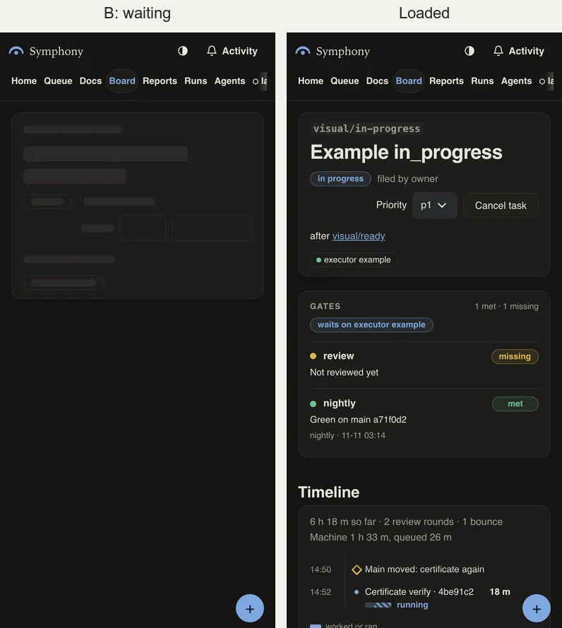

# A task's first visit

What a task's page shows the first time a browser opens it, before its reads answer, and what
moves when they do: today's way (A) against drawing what is under the head only once the task's
page has answered (B), as the card in [DECISIONS](#task-first-visit-head-first)
asks. Measured 2026-11-16 on this Mac in headless Chrome, against the browser target's stand-in
server and its fixture task (`apps/symphony-ui/tests/browser/layout_shift.rs`), at main `325f08f1`
for A and on a throwaway build of B made for this page and not kept.

## The choice

- **A, today.** Every part draws its outline at once: the head, the gates, the timeline's box, the
  brief, the thread and the composer. On a first visit their sizes are guesses: the head and the
  brief of the last task this browser drew at that width, the gates of the last task drawn there,
  else a title of one line wide and two on a phone, one line of facts, four gates with one waited
  on and a brief of seven lines. When the answers come, everything under a wrong guess moves once.
- **B, the head first.** While this browser holds neither the task's page nor the heights it drew
  of this task at this width, the page draws the head's outline alone. Once the task's page
  answers (from this device or the server) it draws everything under the head at once: the gates'
  outline at the count the page names until their own answer, the timeline's box, the brief, the
  thread's outline and the composer, each where it stays. Gates that answer before the page wait
  for it. Every later visit is as under A.

Pictures, each the waiting page under A, under B, then the page loaded (the same under both), dark,
motion off. A task with two gates, phone and wide:

A task with six gates, phone and wide:

- [r] **task-first-visit-head-first** — The first time your browser opens a task, its page shows the outline of every part at once, but it cannot know their sizes yet, so it guesses them, and when the task arrives everything under a wrong guess jumps once: on a phone, a task with two gates where four were guessed pulls the timeline up about 190 px. B would show only the head's outline until the task arrives, usually within a fraction of a second, then everything under it at once, each part where it stays, so nothing jumps; for that moment the page under the head is empty. Every later visit is the same under both. Should a task's first visit show what is under its head only once the task has arrived? A: no, keep every outline at once, as today. B: yes, the head's outline first, the rest with the task. Recommended: B. Approve and say A or B in the note, or comment. [[analysis/task-first-visit#The choice]]
  [2026-11-16 19:55] agent — Posted for the board task `app/task-first-visit-holds-still`. A task with two gates on a phone, the page waiting for the task and then loaded, under each:  

    **How much each moves**, a first visit's layout shift (under 0.05 is good, and every page's browser test fails at 0.05):
    - **A:** two gates 0.14 on a phone and 0.03 wide; six gates 0.02, as what moves goes down and mostly off a phone's screen; four, the guess, 0.02 on a phone, its title guessed a line taller. A longer title, more facts or another brief move it further.
    - **B:** 0 for each, on a phone and wide, whichever of the task and its gates answers first, measured on a build made for this card and not kept.

    **What B costs.** Under the head nothing shows until the task's page answers, the first of its reads to answer: about 40 ms after the outline here; on the live server about 80 ms of its own time plus the trip, longer on a phone over the tailnet (not measured). The head arrives when it does today. Gates that answer before the page, rare under load, wait for it. The six-gate pictures and the figures in each order are in the analysis.

    **Why B.** Your goal for loading pages is that nothing already shown moves when its data arrives. On a first visit only B keeps it, whatever the task's shape, and every part still draws its own outline from the moment its size is known. The other way considered, getting the counts onto the device from the board's rows first, cannot help a browser that kept nothing, and the rows carry no count of gates.

    **Earlier verdicts checked.** **skeleton-first-visit** (B: a first visit guesses the last task's sizes, else fixed ones) chose between guesses, both of which move; B here guesses nothing under the head, which would make the option chosen another, so it is a new card rather than a line on that one. **components-draw-when-data-arrives** (A, with your note that components draw their own mock-ups while they wait for their data) does not decide it: under B each part still draws its outline while its own data is read, but on a first visit only once the task gives its size. **skeleton-loading-outline** approved the outlines' look, which B keeps; it said a first visit still moves, which B changes.
  [2026-11-16 19:55] agent — The same task wide: waiting under A, waiting under B, then loaded. 
  [2026-11-16 20:29] owner · approved — A
  [2026-11-17 17:22] agent — Recovered the original card from `85fb3482` with the existing owner verdict preserved. Recorded: A, keep every outline at once. The analysis and pictures are the evidence measured on 2026-11-16; these measurements have not been rerun.
  [2026-11-17 19:18] agent · resolved
  [2026-11-17 20:45] agent · resolved
  [2026-11-17 20:54] agent · resolved

## What moves

Layout shift of a first visit in a fresh browser, in each order the page's and the gates' answers
can come in, the other held until the first is in (drawn; under B, whose gates wait for the page,
sent by the server); under 0.05 is the limit every page's browser test holds, and 0 is nothing
moved:

| task | way | phone, page first | phone, gates first | wide, page first | wide, gates first |
|---|---|---|---|---|---|
| two gates | A | 0.140 | 0.064 | 0.031 | 0.028 |
| two gates | B | 0 | 0 | 0 | 0 |
| six gates | A | 0.020 | 0.020 | 0.022 | 0.022 |
| six gates | B | 0 | 0 | 0 | 0 |
| four gates, the guess | A | 0.020 | 0.020 | 0 | 0 |
| four gates, the guess | B | 0 | 0 | 0 | 0 |

Under A, two gates where four were guessed shrink the gates' section by about 190 px on a phone,
bringing the timeline up into the screen; six gates grow it, pushing what is under it down and
mostly off a phone's screen, which the score counts less. The head's guess of a two-line title is
32 px taller than the fixture's one line: 0.020 on a phone in every shape. A longer title, more
facts, another brief or gates whose words wrap move what is under them as far as they differ from
the guess, so these figures hold only for the fixture's head and brief.

Under B nothing drawn moves in any of these: what is under the head comes once its sizes are known,
and the head's own outline has nothing under it to move. Its gates still show their outline, at the
right count, from the page's answer to theirs.

## What B costs

- **Less shows at first.** Under the head nothing shows until the task's page answers: here 32 to
  54 ms after the outline in the quiet runs, as under A, since the page answers first. On the live
  server the page's read is about 80 ms of its own time, plus the trip, more on a phone over the
  tailnet or a loaded server: not measured here.
- **The head is not later.** It is drawn from the same answer under both: 30 runs of each, from the
  page's start, at a median of 193 ms under A and 210 under B, the machine loaded by other work
  (the slowest runs took seconds under both), so the two are not told apart here.
- **Gates that come first wait.** Under load the server answers the page before the gates (146 and
  252 ms in [the parts' analysis](components-draw-when-their-data-arrives.md#what-makes-parts-wait));
  when the gates come first they are drawn with the page.
- **The work.** The task's page draws under its head only once the page is there, the reads under
  it asked as the page opens rather than as their parts mount, and the layout-shift test's "gates
  first" order waits for the gates' answer rather than their drawing.

## Why not the board's rows

Getting the counts onto the device before the task's own reads, for example with the board's rows,
does not do it. A first visit in a browser that kept nothing holds no rows, the board's task rows
carry no count of gates today, and nothing on the device sizes the head or the brief of a task never
drawn. Where the device does hold the task's page (read ahead from a link, or kept from a visit at
another width), B draws everything at once from it.

## Measured, read and inferred

- **Measured here:** every score in the table, by the layout-shift test's own meter, and the head's
  times, on the fixture task only; the pictures, from the same runs.
- **Read in code:** what each part guesses and when it draws (`task-page.tsx`, `gates.tsx`,
  `viewport.tsx`), and what a board row carries (`wire.ts`'s `Task`).
- **Inferred, not tried:** how long the empty space under the head lasts on a phone over the
  tailnet; how B scores for a task whose head or brief is far from the guess (it draws nothing
  under the head before both are known, so the size of the miss does not enter).
