# A task's cost on its card, its page and its timeline

A proposal for where a task's estimated cost shows ([What the tokens cost](../TASKS.md#what-the-tokens-cost)
says how it is estimated). Its total goes on the board card, on the time's line, and on the page,
after the task's total time. In the [timeline](../TASKS.md#the-timeline), each stage stretch's cost
goes after that stretch's time. The table at the page's foot goes.
[Its card](../DECISIONS.md#task-cost-after-time) asks for it. The three options drawn before it are
under [The choice](#the-choice).

Every picture is of one task, `tools/workflow-revision-guards`, the task the approved
[timeline navigation proposal](timeline-navigation.md) draws. Its tokens were read from the board on
2026-11-20 at 06:00, after it closed. Pictures of today come from a private server running main's build at
`0cf424663`, the first with the token pages: the shared server runs `release-2026-11-20`, which
has none yet. In them the machine's name under the Builds and Tests lanes is hidden, and the brief
and the thread are cut out and said so. Proposed pictures come from an [HTML mockup](token-cost/mockup.html)
that draws that task's recorded timeline as the approved proposal does (quiet stretches skipped) and
its recorded tokens, with no message bodies or machine names. Its address `#t` opens the design,
with `-zoom`, `-zoom-focus`, `-phone` or `-phone-all` for each picture's view; `#a`, `#b` and `#c`
open the first options, each with `-phone`, `-focus` or `-phone-all`. It reads and writes nothing,
and nothing in the product changes with this proposal.

## What the record holds

The board keeps a task's tokens by session: one row for each handle, role, model and round, with
its first and last model call, its calls, its tokens and their estimated dollars
([Where the tokens go](../TASKS.md#where-the-tokens-go)). This task has 13 rows: $80.02 in 884
calls, executor $62.42, reviewer $17.27, and $0.32 spent while the task was reserved, before its
claim.

- **No cost per build or test.** A build or a test spends no tokens of its own: the session that
  started it did, and its calls are not tied to the run. No build or test is given a cost.
- **No cost per call or per minute.** Only a row's first and last call are kept. A row is never
  split between two stretches: where its calls run past a stretch's edge, the record cannot say
  how much fell on each side.
- **Rounds are counted from the work, not the reviews.** The record's round 1 is the work before
  the first review, and round *n* + 1 is review *n* with the fixes after it. The timeline counts
  this task's reviews 1 to 6, and today's table its rounds 1 to 7.
- **Every figure is an estimate** at the API list prices read 2026-11-16, never money spent, and
  each says so where it is pointed at, tapped or focused.

## Today

The card, the section at the page's foot and the timeline, cut together from today's page in the
proposed pictures' layout. The page as it is, the brief and the thread cut out:

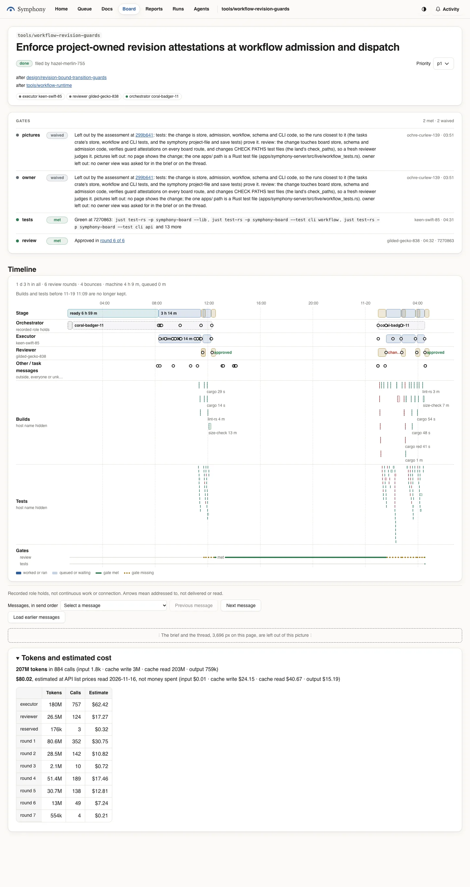

At 1440 wide the total time is the first line of the timeline: *1 d 3 h in all · 6 review rounds
· 4 bounces · machine 4 h 9 m*. The cost is the last part of the page, under the thread, closed:
on this task 1,143 px of brief and thread lie between the two (more where the thread is longer).
Opened, it says the tokens and the cost by kind in two lines, then a table of ten rows: three roles
and seven rounds, each with its tokens, calls and estimate.

On a board card the cost sits beside the slug, which gives way to it (`tools…-revision-guards
$80.02 p1`); the time is on the line under it, on the right.

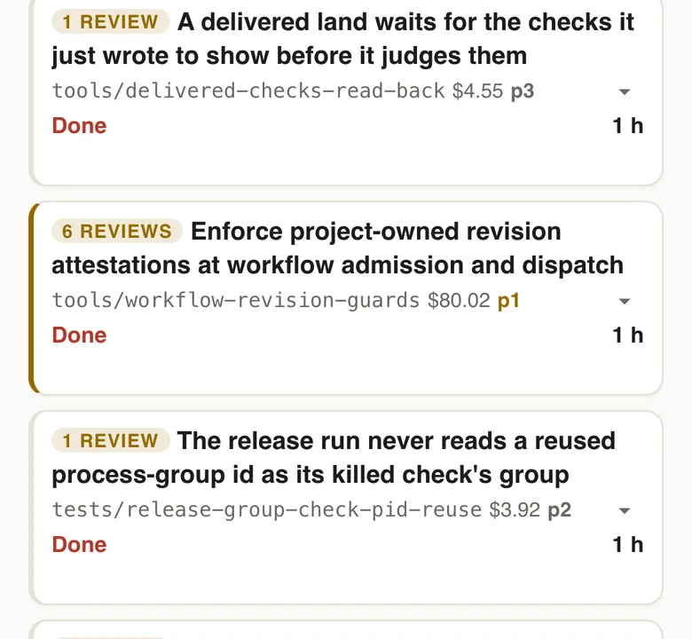

On a phone the cost table is the page's last part as well, under the 240 px timeline box:

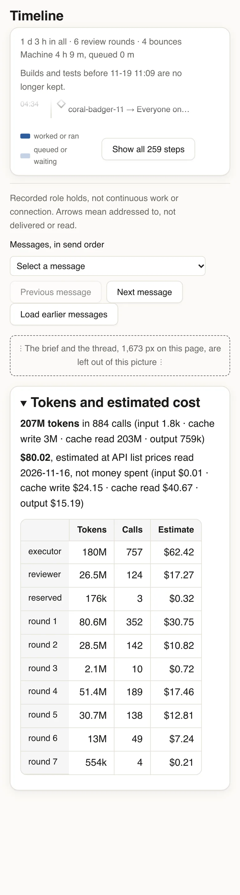

The same in dark: 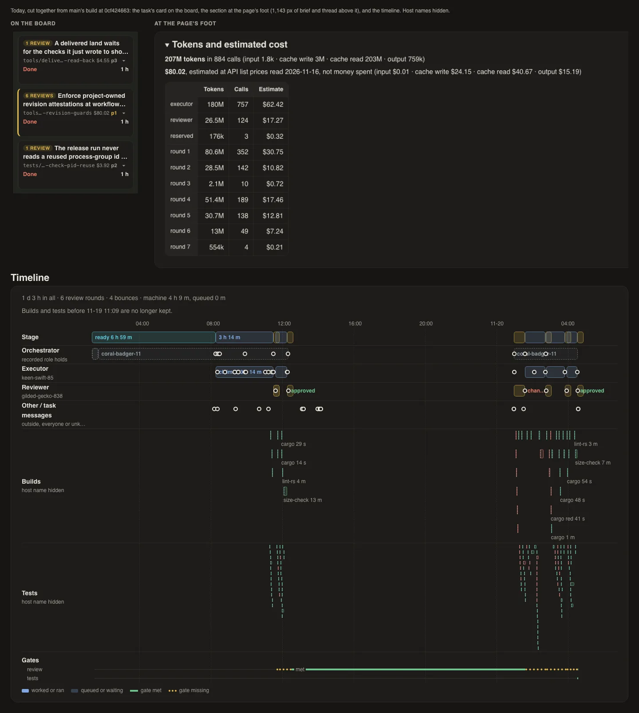
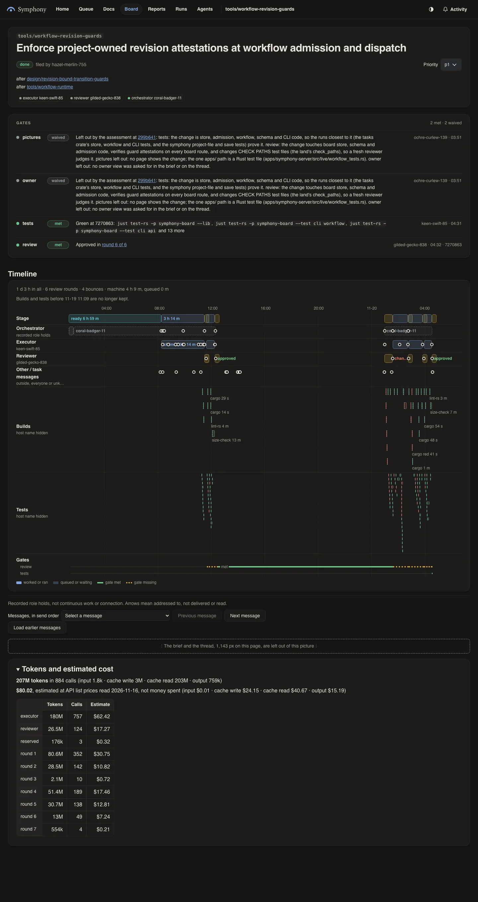
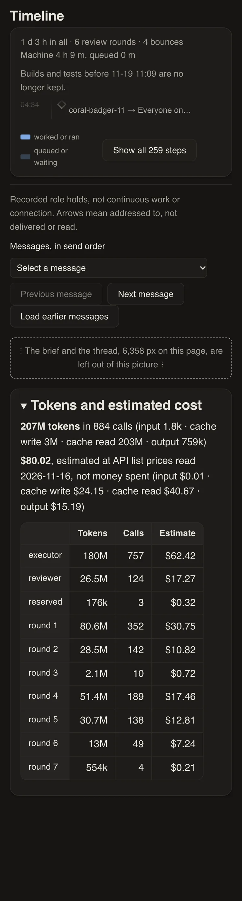

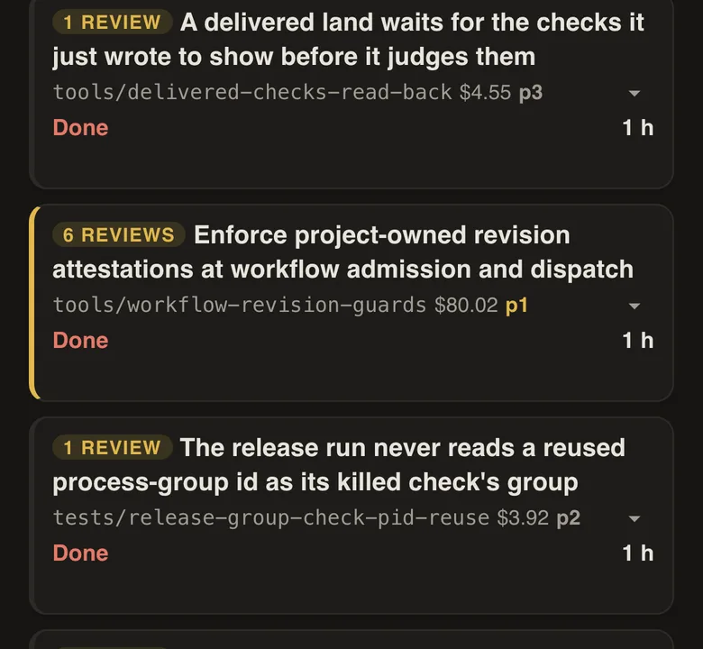

## The cost after the time

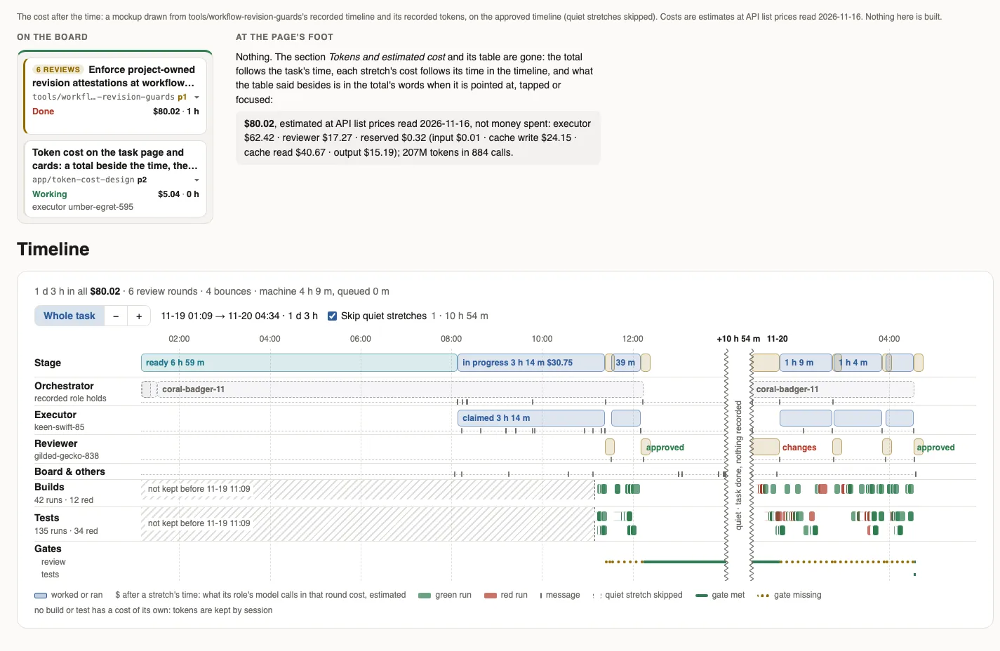

- **The card** carries its total on the time's line, `Done   $80.02 · 1 h`, and its slug line
  gets its room back.
- **The page's total follows the task's time** on the timeline's first line: *1 d 3 h in all
  $80.02 · 6 review rounds · 4 bounces…*. Pointed at, tapped or focused, it says what the table
  said besides: *$80.02, estimated at API list prices read 2026-11-16, not money spent: executor
  $62.42 · reviewer $17.27 · reserved $0.32 (input $0.01 · cache write $24.15 · cache read $40.67 ·
  output $15.19); 207M tokens in 884 calls.* A total with unpriced tokens keeps today's `$1.23+`,
  its words naming the models.
- **Each stage stretch's cost follows its time** on the Stage lane, in the label the timeline
  already fits to each stretch: its word and time, else its time alone. The cost goes where both
  fit: `in progress 3 h 14 m $30.75`, or `3 h 14 m $30.75`. A stretch with room for its time and
  not its cost shows the time, as today. Zoom draws more of them.
- **Every stretch says both in its words** when it is pointed at, tapped or focused, with whose
  calls they were and when those ran.
- **There is no summary line and nothing at the page's foot.** The total is the summary, and the
  stretches carry each round's cost, role by role.
- **On a phone** each stage row ends with its time and its cost, `3 h 14 m $30.75`; the totals'
  two lines and the box are today's.
- **A task with no tokens** shows no cost anywhere, and its lines stay as today.

At the whole task's scale, 1440 wide, only the first stretch of work has room for both:
`in progress 3 h 14 m $30.75`. The other stretches on the first day show `39 m`, and on the
second `1 h 9 m` and `1 h 4 m`. Zoomed to the second day's work, each stretch of 37 minutes or more
shows both, and a review of 5 minutes says it when pointed at:

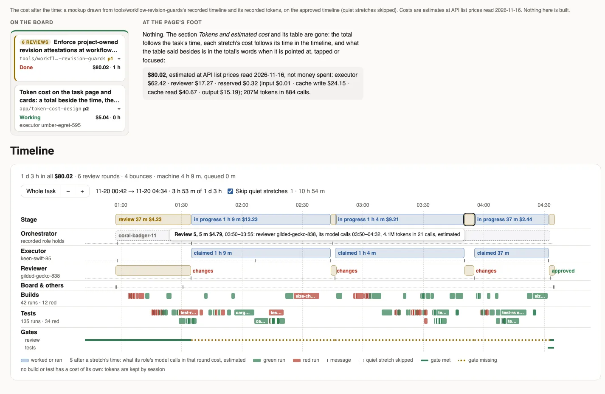

On a phone the box opens on the task's last steps, as today; Show all lists every step, each
stretch with its cost:

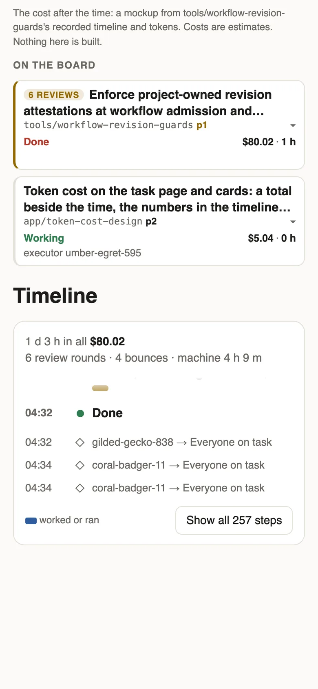
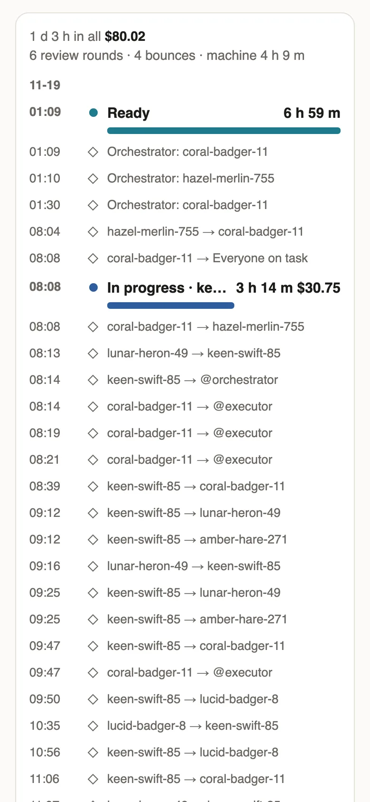
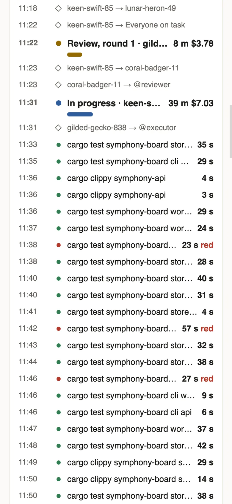

In dark: 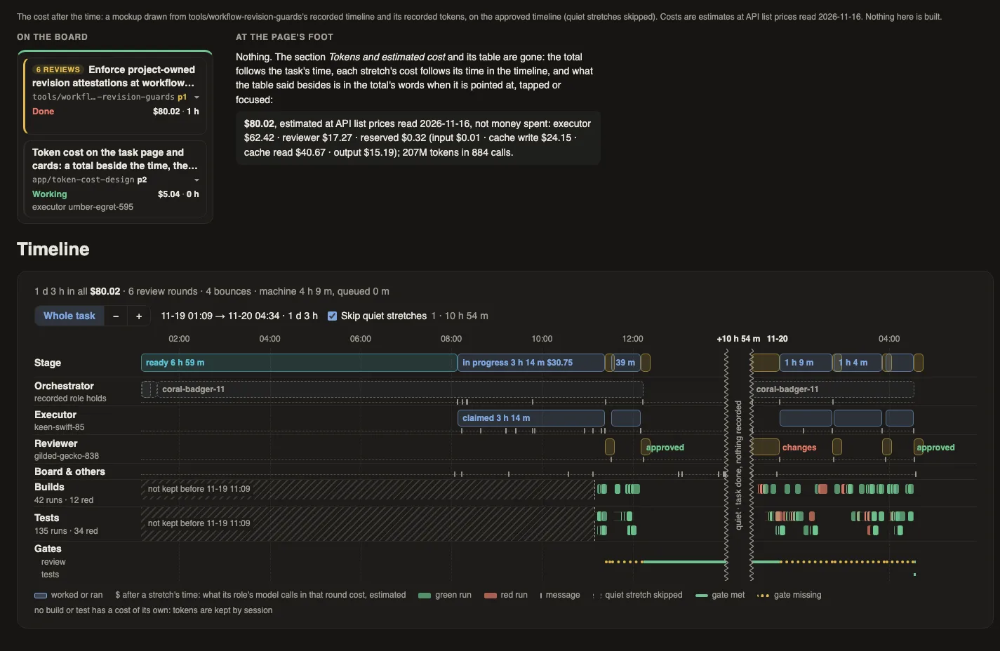
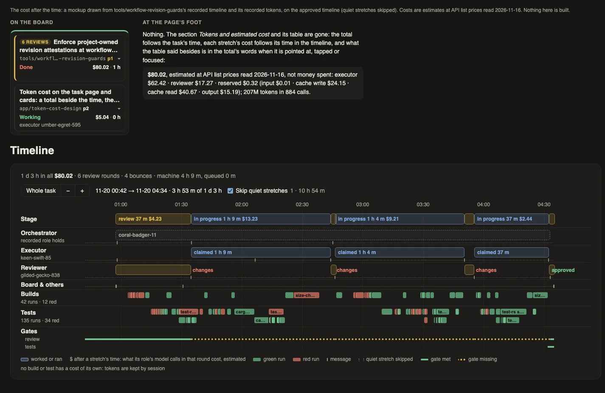
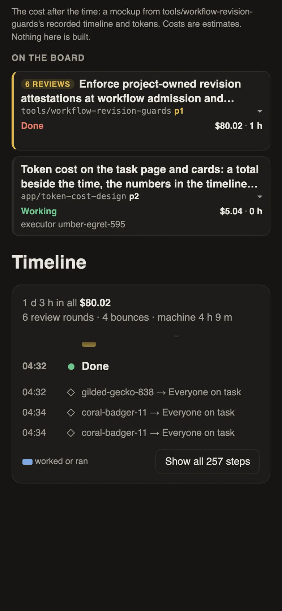
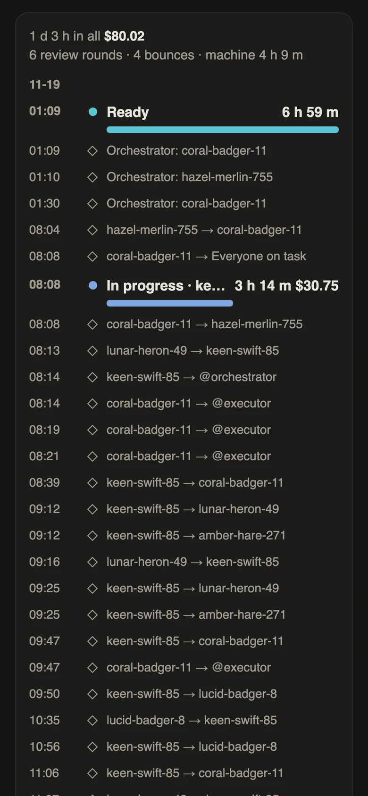

### Which stretch carries what

A stretch's round is one more than the reviews started before it. Each stretch carries what its own
role spent in its round:

- **An in-progress stretch** carries the executor's calls of its round, with what the claiming
  session spent while it held the task reserved, before the claim.
- **A review stretch** carries its reviewer's calls of the round it opens. It also carries the
  executor's calls of that round when no in-progress stretch follows: fixes made while an approving
  review ran.
- **Ready, blocked and done stretches** carry nothing. A round with two in-progress stretches, a
  block between them, carries its executor's cost on the last of them, and their words say so.

Every row goes on exactly one stretch, so the stretches add up to the total. On this task:

| Stretch | Time | Cost | Whose calls, and when they ran |
|---|---|---|---|
| ready | 6 h 59 m | | |
| in progress | 3 h 14 m | $30.75 | executor $30.43, 08:08–11:22, in 349 calls; reserved $0.32, at 08:08, in 3 |
| review 1 | 8 m | $3.78 | reviewer, 11:23–11:31, in 48 calls |
| in progress | 39 m | $7.03 | executor, 11:22–12:10, in 94 |
| review 2 | 4 m | $0.72 | reviewer $0.64, 12:13–12:14, in 8; executor $0.08, 12:10, in 2 |
| done | 12 h 43 m | | mostly skipped as quiet |
| review 3 | 37 m | $4.23 | reviewer, 01:30–01:35, in 29 |
| in progress | 1 h 9 m | $13.23 | executor, 00:57–02:43, in 160 |
| review 4 | 2 m | $3.60 | reviewer, 02:44–02:46, in 14 |
| in progress | 1 h 4 m | $9.21 | executor, 02:44–03:50, in 124 |
| review 5 | 5 m | $4.79 | reviewer, 03:50–04:32, in 21 |
| in progress | 37 m | $2.44 | executor, 03:50–04:32, in 28 |
| review 6 | 31 s | $0.21 | reviewer, 04:32, in 4 |
| **all** | **1 d 3 h** | **$80.02** | |

**What the record cannot split.** Each executor row after the first begins the minute its
review began: the executor's first call of round 4 was at 00:57, when review 3 started, and its
last at 02:43. All $13.23 is on the 1 h 9 m after that review. The same holds for rounds 2, 5 and 6.
Review 5's reviewer made calls until 04:32, 37 minutes after the review ended, while the fixes after
it ran: all $4.79 is on its 5 minutes. A stretch's words name the time its calls ran, so a reader
sees where a figure spills over; nothing is apportioned by time.

### What it costs to build

Nothing is recorded anew, and the board's schema stays.

- **The card** moves its cost from the slug line to the time's line.
- **The page** reads the task's token rows with its timeline. The rows are each handle, role and
  round with its first and last call, which `tasks show --json` gives and `/api/task-tokens` leaves
  out today. The page then puts each row on its stretch by the rule above, and adds the cost to the
  stretch's label at each width the label fitter tries (`in progress 3 h 14 m $30.75`, then
  `3 h 14 m $30.75`, then `3 h 14 m`), to its words and to its phone row.
- **The section at the page's foot** and its table go.
- **No other lane changes height**, and no lane is added.

## Earlier verdicts checked

- **timeline-navigation** (B): drawn on it, quiet stretches skipped and zoom kept. No recorded
  model call falls in this task's skipped 10 h 54 m. The build counts each token row's first and
  last call among the records the quiet rule reads, so a skipped stretch never hides a cost.
- **task-page-timeline-place** (C): the phone's box is today's; nothing is added to it.
- **reports-task-page-pictures** (A): lanes wide and a list on a phone, kept.
- **timeline-orchestrator-messages**: messages and their arrow, kept.

## The choice

The three options drawn first, each with its board card, its summary at the timeline's top and
its way of drawing the cost. The design above keeps A's board card.

### Under every option

- **The page's total sits beside its total time**, on the timeline's first line and in the same
  type: *1 d 3 h in all · **$80.02** estimated · 6 review rounds…*. On a phone it ends the first
  line, the rounds and machine time moving to the second.
- **The card's total moves off the slug line**, which gets its room back, and is drawn as the
  time is: bold, on the right.
- **The section at the page's foot goes**, table and all; what it said besides the figures is in
  the total's words.
- **A summary of one or two lines sits under the total**, in the type of the timeline's other
  lines. On a phone the summary lines sit above the steps and the box grows by their height.

### A: said, not drawn

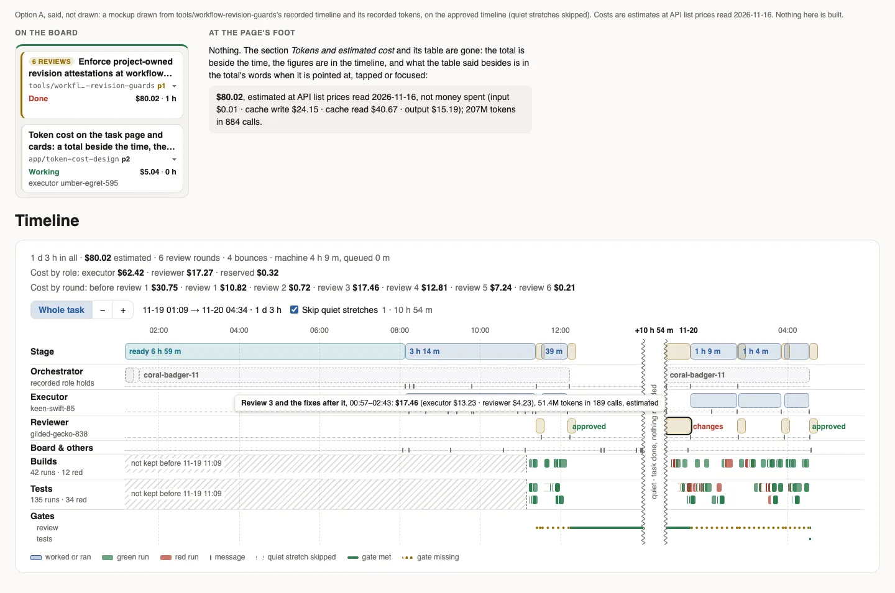

The card's total joins the time on its line: `Done   $80.02 · 1 h`. Two summary lines: *Cost by
role* and *Cost by round*, every figure the table held. The lanes draw nothing new: a review or a
claim pointed at, tapped or focused says its round's cost in its words, as above, *Review 3 and the
fixes after it, 00:57–02:43: $17.46 (executor $13.23 · reviewer $4.23), 51.4M tokens in 189 calls,
estimated*. Wide, the timeline is 48 px taller; on a phone the two lines wrap to five at 390 wide,
and the box grows about 110 px.

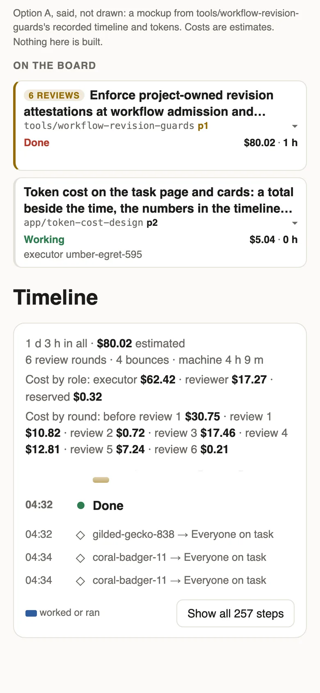

### B: a cost row by round

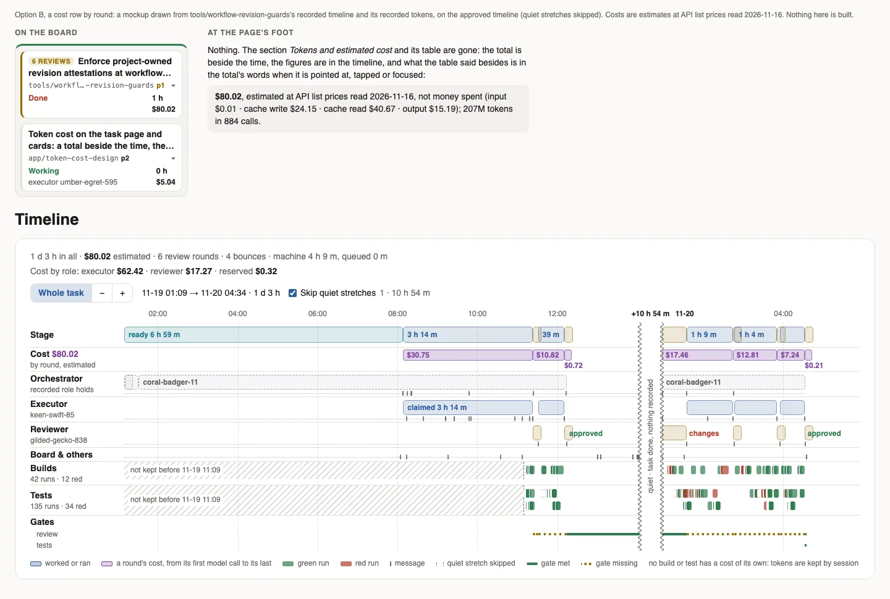

The card's total sits under the time, on the reason's line: `1 h` over `$80.02`. One summary line,
*Cost by role*. Under the Stage lane a **Cost** row, its name with the total, draws each round as a
bar from its first model call to its last, its dollars on it, or under its start where the bar is
too narrow: here all seven show at the whole-task scale, from *$30.75* before review 1 to *$0.21*
for review 6. Pointed at, tapped or focused, a round says what its words say under A:

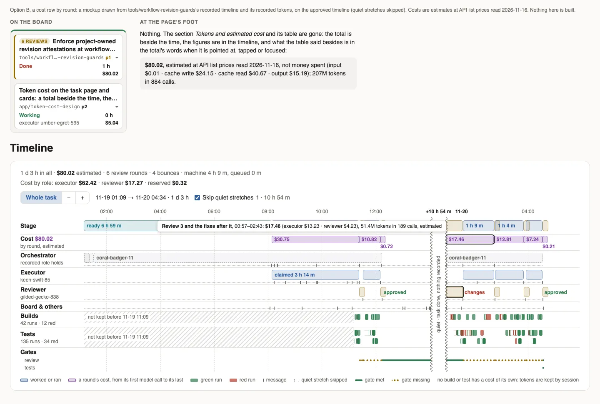

Wide, the timeline is 63 px taller: the line and a 38 px row. On a phone the line wraps to two and
the box grows about 50 px; the list gains one row per round, at its last model call, *Cost, review
3 · $17.46*, just before the review it led to:

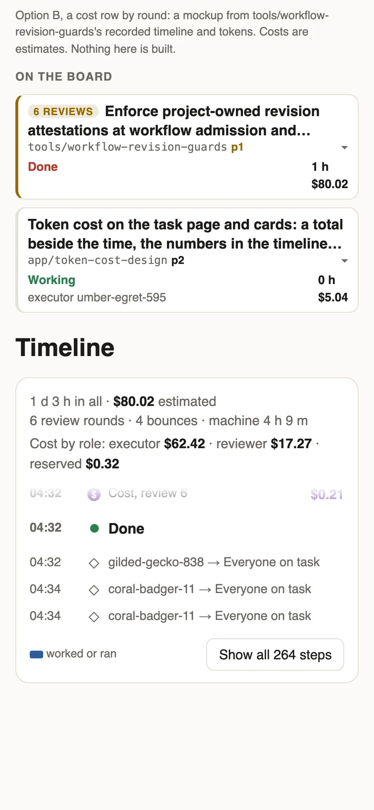
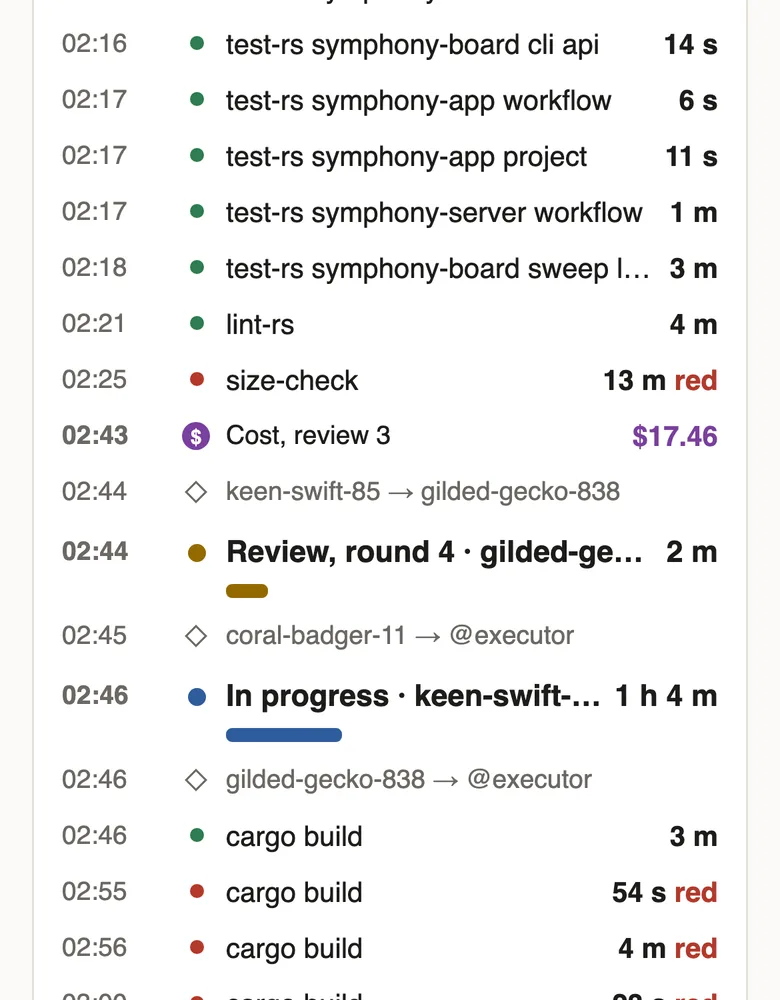

### C: cost on the role lanes

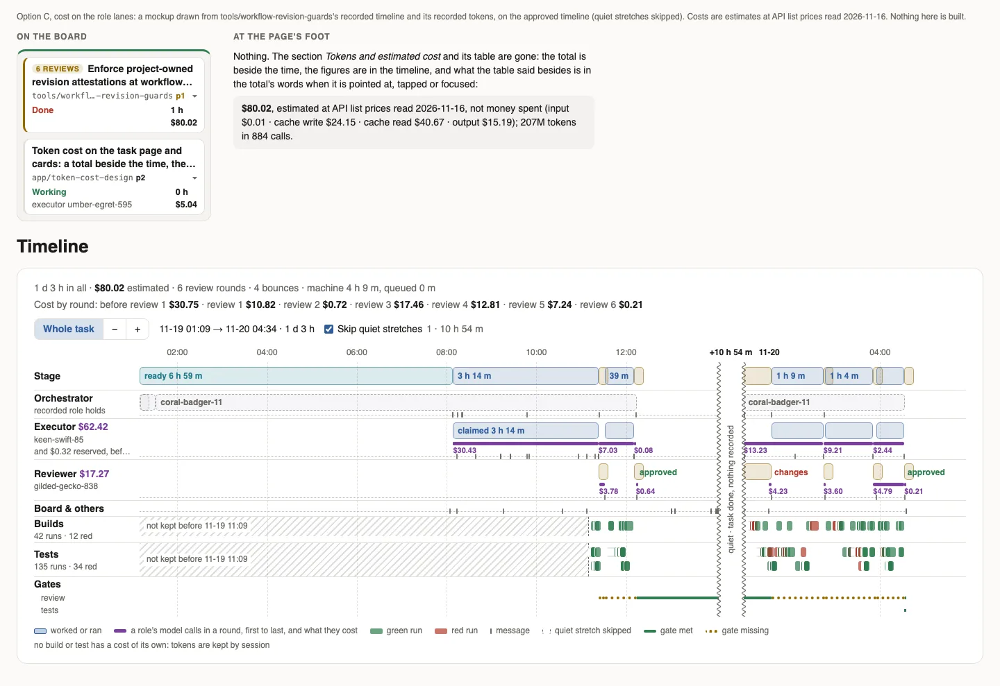

The card as B. One summary line, *Cost by round*. The Executor and Reviewer lanes each draw their
own rows under their bars, a thin bar from a round's first call to its last with its dollars, and
each lane's name carries its total (*Executor $62.42*, and *$0.32 reserved, before its claim*). The
two lanes are 18 px taller each. Most reviews are minutes long, so their bars are a few pixels. On a
phone each in-progress row ends with the executor's cost of its round and each review row with the
reviewer's:

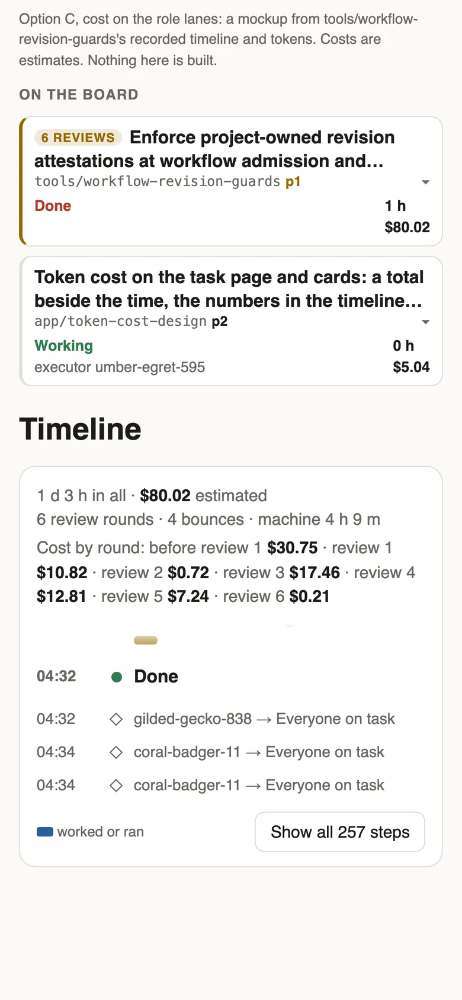
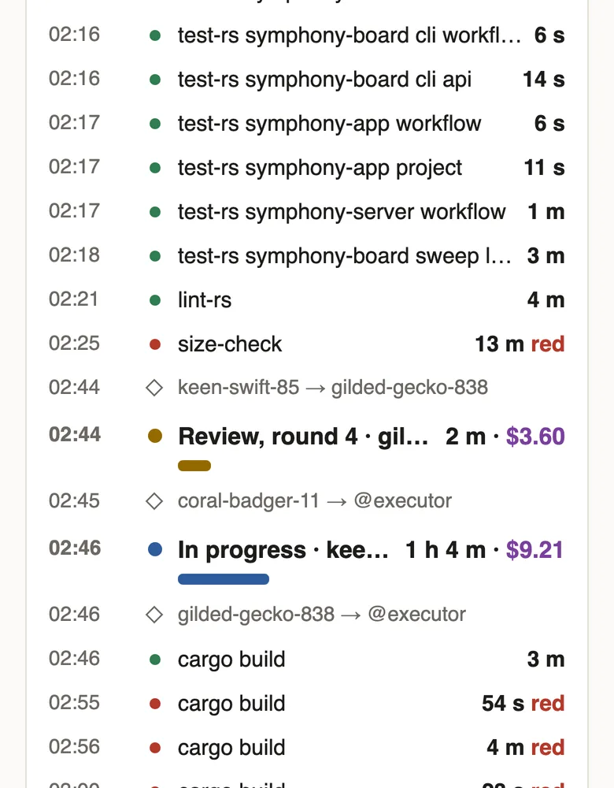

### Each in dark

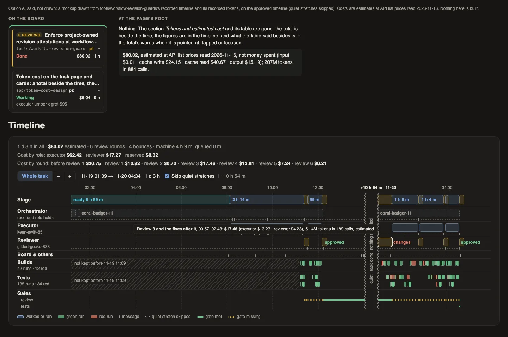 

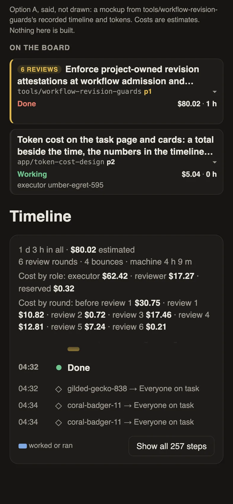 
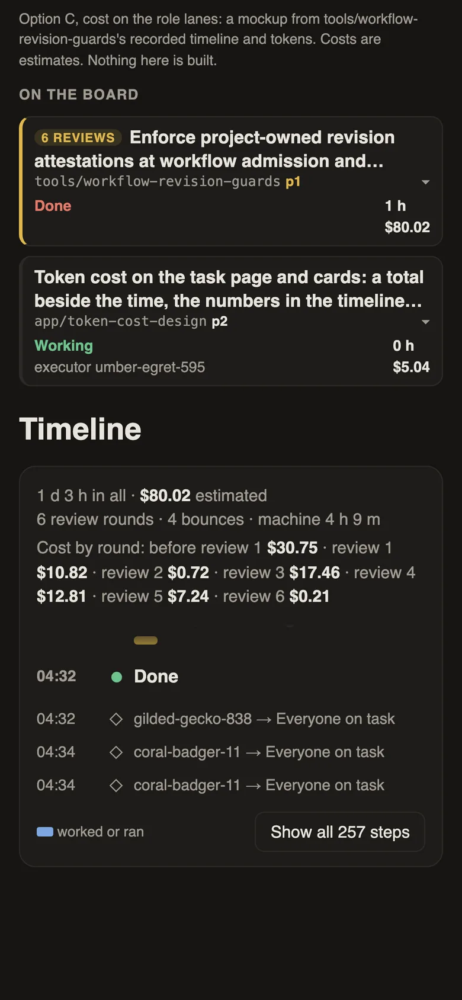
