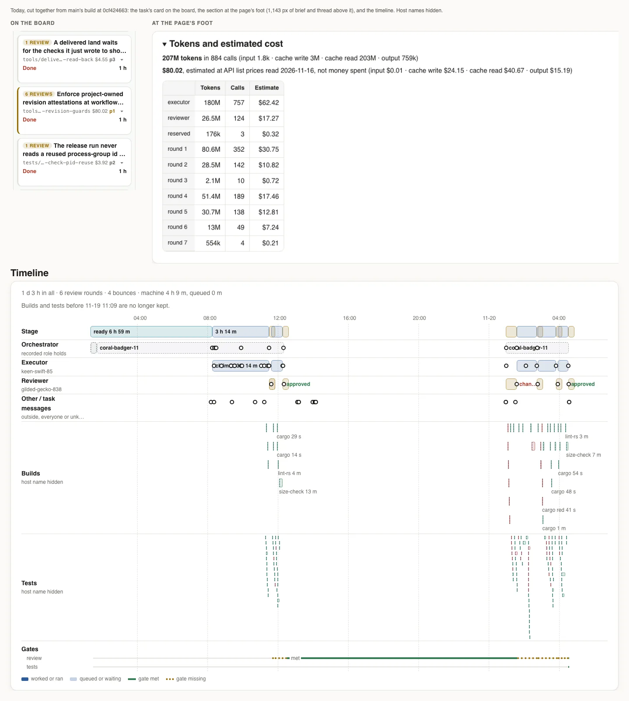
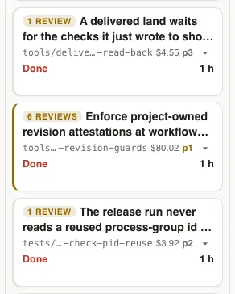
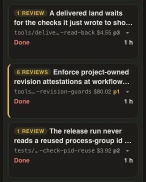
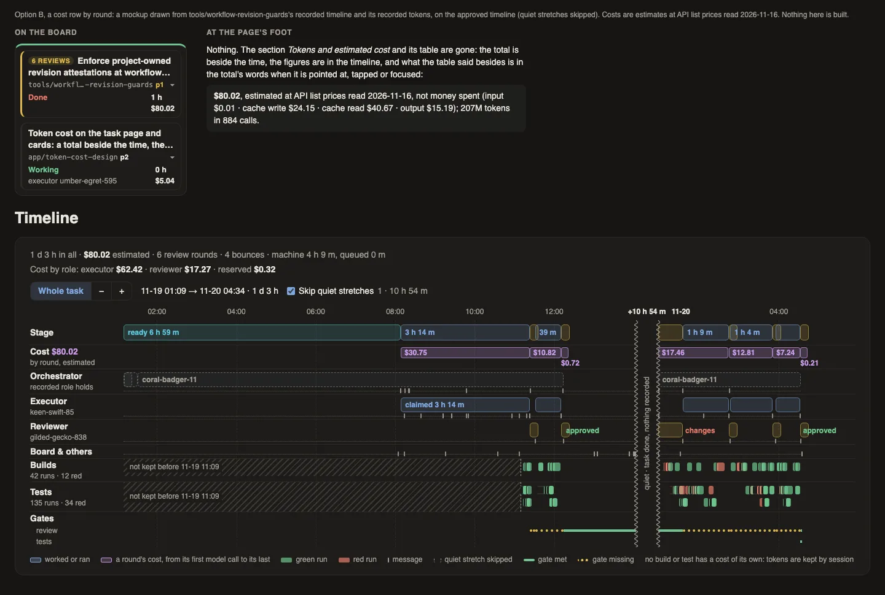
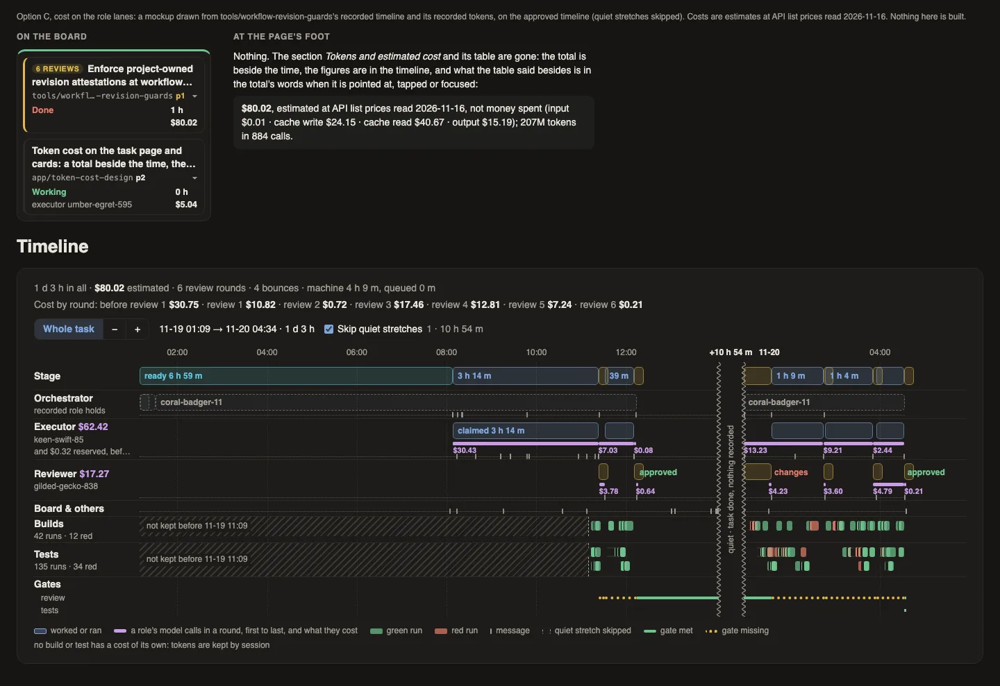
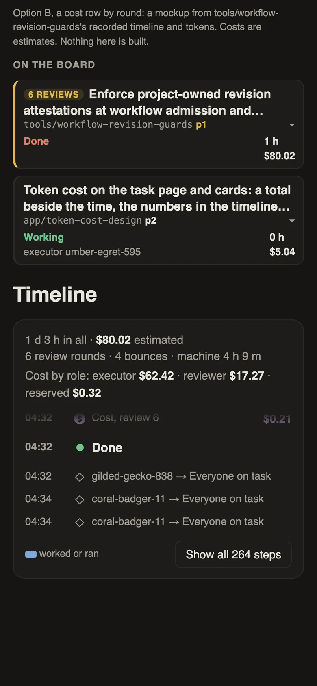

# A task's cost on its card, its page and its timeline

A proposal for where a task's estimated cost shows: its total on its board card and beside its
total time on its page, and the figures by role and by round in its
[timeline](../TASKS.md#the-timeline), in place of the table at the page's foot
([What the tokens cost](../TASKS.md#what-the-tokens-cost) says how they are estimated).
[Its card](../DECISIONS.md#task-cost-display) asks the one open choice: how the timeline shows the
figures, with the card's total placed to suit each option.

Every picture is of one task, `tools/workflow-revision-guards`, the task the approved
[timeline navigation proposal](timeline-navigation.md) draws. Its tokens were read from the board on
2026-11-20 at 06:00, after it closed. Pictures of today are a private server of main's build at
`0cf424663`, the first with the token pages: the shared server runs `release-2026-11-20`, which
has none yet. In them the machine's name under the Builds and Tests lanes is hidden, and the brief
and the thread are cut out and said so. Proposed pictures are an [HTML mockup](token-cost/mockup.html)
that draws that task's recorded timeline as the approved proposal does (quiet stretches skipped) and
its recorded tokens, with no message bodies or machine names. Its addresses `#a`, `#b`, `#c`, each
with `-phone`, `-focus` or `-phone-all`, open each picture's view. It reads and writes nothing, and
nothing in the product changes with this proposal.

## What the record holds

The board keeps a task's tokens by session: one row for each handle, role, model and round, with
its first and last model call, its calls, its tokens and their estimated dollars
([Where the tokens go](../TASKS.md#where-the-tokens-go)). This task has 13 rows: $80.02 in 884
calls, executor $62.42, reviewer $17.27, and $0.32 spent while the task was reserved, before its
claim.

- **No cost per build or test.** A build or a test spends no tokens of its own: the session that
  started it did, and its calls are not tied to the run. No option draws a cost on a run's bar.
- **No cost per call or per minute.** Only a row's first and last call are kept. A round's cost
  is drawn from its first call to its last, never spread over the hours as a curve, which the
  record would have to guess.
- **Rounds are counted from the work, not the reviews.** The record's round 1 is the work before
  the first review, and round *n* + 1 is review *n* with the fixes after it. The timeline counts
  this task's reviews 1 to 6, and today's table its rounds 1 to 7. The proposal names each round
  by the review it starts with: *before review 1*, *review 1*, … *review 6*.
- **Every figure is an estimate** at the API list prices read 2026-11-16, never money spent, and
  each says so where it is pointed at, tapped or focused.

## Today

The card, the section at the page's foot and the timeline, cut together from today's page in the
proposed pictures' layout. The page as it is, the brief and the thread cut out:

At 1440 wide the total time is the first line of the timeline: *1 d 3 h in all · 6 review rounds
· 4 bounces · machine 4 h 9 m*. The cost is the last part of the page, under the thread, closed:
on this task 1,143 px of brief and thread lie between the two (more where the thread is longer). Opened, it says the
tokens and the cost by kind in two lines, then a table of ten rows: three roles and seven rounds,
each with its tokens, calls and estimate.

On a board card the cost sits beside the slug, which gives way to it (`tools…-revision-guards
$80.02 p1`); the time is on the line under it, on the right.

On a phone the cost table is the page's last part as well, under the 240 px timeline box:

The same in dark: 

## Under every option

- **The page's total sits beside its total time**, on the timeline's first line and in the same
  type: *1 d 3 h in all · **$80.02** estimated · 6 review rounds…*. On a phone it ends the first
  line, the rounds and machine time moving to the second.
- **The card's total moves off the slug line**, which gets its room back, and is drawn as the
  time is: bold, on the right. Where it goes on that side is each option's (below).
- **The section at the page's foot goes**, table and all. What it said besides the figures, the
  cost by kind, the tokens and calls, the day the prices were read and any model with no price,
  is in the total's words when it is pointed at, tapped or focused:
  *$80.02, estimated at API list prices read 2026-11-16, not money spent (input $0.01 · cache write
  $24.15 · cache read $40.67 · output $15.19); 207M tokens in 884 calls.* A total with unpriced
  tokens keeps today's `$1.23+`, its words naming the models.
- **A summary of one or two lines sits under the total**, in the type of the timeline's other
  lines, never at the foot.
- **On a phone** the box keeps the room it gives its steps today; the summary lines sit above
  them and the box grows by their height.
- **A task with no tokens** shows no figure on its card and no summary; its first line stays as
  today.

## The choice

### A: said, not drawn

The card's total joins the time on its line: `Done   $80.02 · 1 h`. Two summary lines: *Cost by
role* and *Cost by round*, every figure the table held. The lanes draw nothing new: a review or a
claim pointed at, tapped or focused says its round's cost in its words, as above, *Review 3 and the
fixes after it, 00:57–02:43: $17.46 (executor $13.23 · reviewer $4.23), 51.4M tokens in 189 calls,
estimated*. Wide, the timeline is 48 px taller; on a phone the two lines wrap to five at 390 wide,
and the box grows about 110 px.

### B: a cost row by round

The card's total sits under the time, on the reason's line: `1 h` over `$80.02`. One summary line,
*Cost by role*. Under the Stage lane a **Cost** row, its name with the total, draws each round as a
bar from its first model call to its last, its dollars on it, or under its start where the bar is
too narrow: here all seven show at the whole-task scale, from *$30.75* before review 1 to *$0.21*
for review 6. Pointed at, tapped or focused, a round says what its words say under A:

Wide, the timeline is 63 px taller: the line and a 38 px row. On a phone the line wraps to two and
the box grows about 50 px; the list gains one row per round, at its last model call, *Cost, review
3 · $17.46*, just before the review it led to:

### C: cost on the role lanes

The card as B. One summary line, *Cost by round*. The Executor and Reviewer lanes each draw their
own rows under their bars, a thin bar from a round's first call to its last with its dollars, and
each lane's name carries its total (*Executor $62.42*, and *$0.32 reserved, before its claim*). The
two lanes are 18 px taller each. Most reviews are minutes long, so their bars are a few pixels, and
the executor's fixes made while a review ran (here $0.08 during review 2, the start of $13.23 during
review 3) sit under the review's stretch, not a claim. On a phone the line wraps to three and the
box grows about 70 px; each in-progress row ends with the executor's cost of its round and each
review row with the reviewer's, an executor's fixes made during a review added to that review's row
(`+$0.08`):

### Each in dark

 

 

### The card's place

A's `$80.02 · 1 h` adds no line, but the wait's words lose about 50 px, and two figures side by
side can read as a cost per hour. B and C put the cost under the time, on the reason's line,
which loses that much instead; the card keeps its 110 px. Either goes with any option.

## What each costs to build

None changes what the board records, and none needs a schema change. Under every option the card
reads its cost as today, from the board's cost read, and the page reads the task's tokens with its
timeline, where today they are read only once the section opens. A's summary needs only what
`/api/task-tokens` gives now; its words per round, and B's and C's drawing, need the rows that
answer leaves out (each role and round with its first and last call), which `tasks show --json`
already gives. B and C draw one more kind of mark in the lanes; C changes two lanes' heights.

## Why B

The figures are where the time is, at the timeline's top and on its clock, as asked, and a reader
sees at once where the money went: round 1 and review 3 hold 60% of it. Each round is one bar at
the scale of the whole task, so its dollars fit; C splits the same dollars over two lanes, whose
review bars are mostly too narrow to say anything without zoom. A draws nothing and keeps every
figure in two lines of text, the shape the table had. B's phone rows say each round's cost in the
order the work happened.

## Earlier verdicts checked

- **timeline-navigation** (B): every option is drawn on it, quiet stretches skipped and zoom
  kept. A stretch holding a recorded model call is not quiet: the build counts the task's token
  rows among the records the rule reads. None falls in this task's 10 h 54 m.
- **task-page-timeline-place** (C): a phone's box keeps 240 px for its steps; it grows only by the
  summary above them.
- **reports-task-page-pictures** (A): lanes wide and a list on a phone, kept.
- **timeline-orchestrator-messages**: messages and their arrow, kept.

None of them decides where the cost goes.
