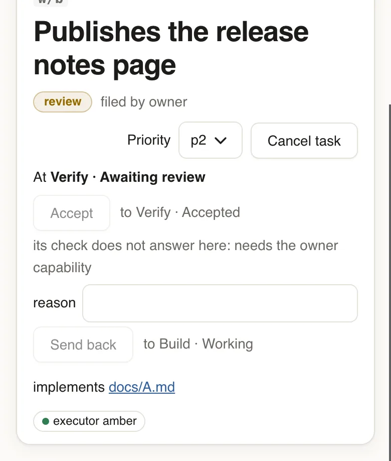
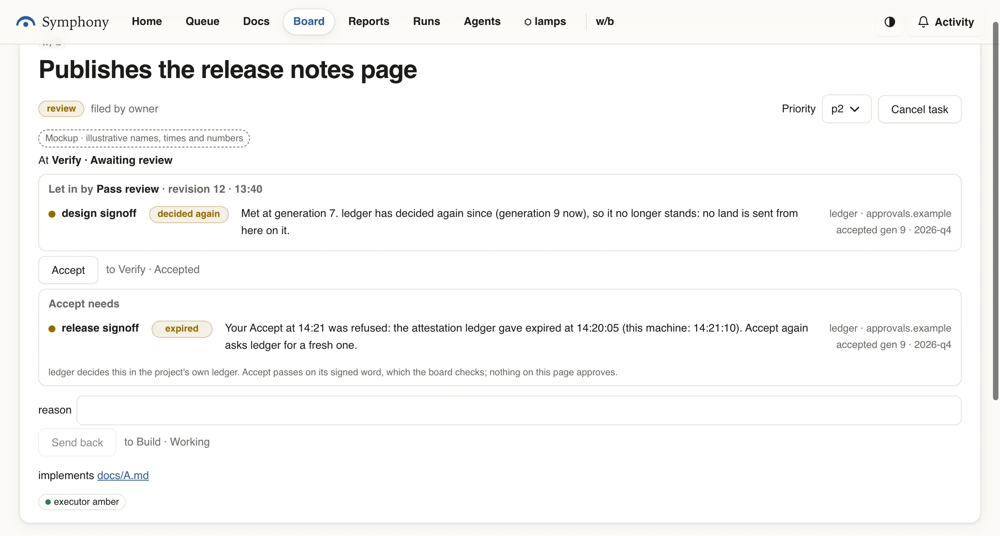
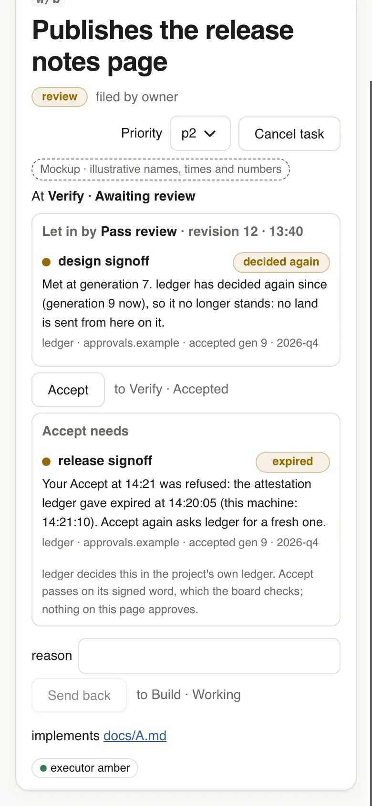
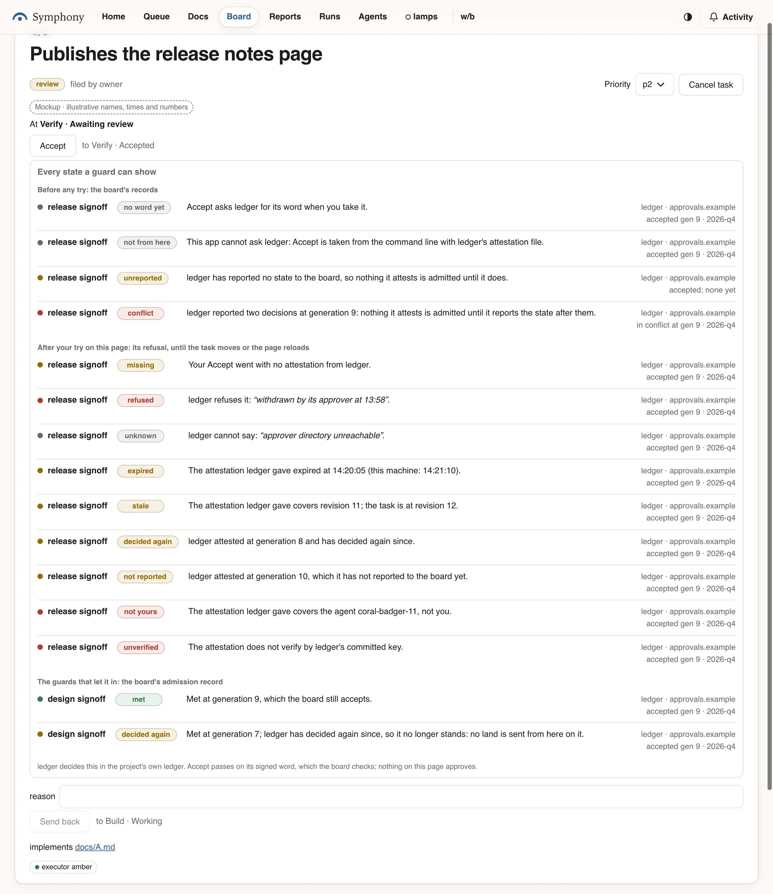
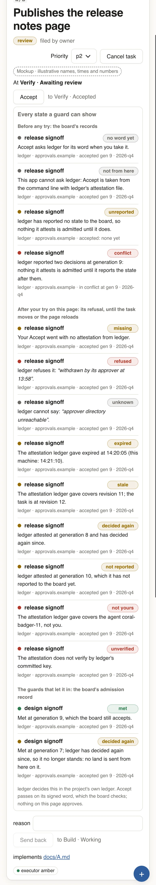

# The guard panel on a task's page

A project's workflow can hold an edge back behind a guard: a decision its own approval ledger
keeps, which the board admits only on the authority's signed word
([guards](../WORKFLOW.md#guards), [the design](revision-bound-transition-guards.md#Display and compatibility)).
This is the task page's view of those guards, proposed for
[its card](../DECISIONS.md#workflow-guard-panel). It is illustrated, not built: the pictures are
the real task page served by the browser tests' stand-in server, with the proposed panel drawn
into it, and every name, time and number in them is invented.

## Today

A guarded edge is an action like any other, its button disabled, its line saying
"its check does not answer here: needs the owner capability". The board previews every guarded
edge as `guard_unavailable`, since only an attestation given with the operation meets a guard,
and the page says nothing of which guard, whose authority, or what the board accepted from it.

## The panel

Inside the task's Workflow section, beside the actions it already lists:

- **Under each guarded action**, a box headed *ACTION needs*, one row for each guard its edge
  carries.
- **Above the actions**, while the task came into its pair by a guarded edge, a box headed *Let in
  by EDGE · revision N · time*: the guards that admission met, and whether each still stands.

Each row has the shape of a gate on the same page: a dot and the guard's name (its ID in words, as
a guard has no label), its state in one word, one line saying why, and on the right its authority
(the adapter and the issuer it signs as) with the state the board accepted from it: its
generation and epoch, `none yet`, or `in conflict`. Wide, a row is one line of bounded columns;
on a phone, three lines: name and state, why, then the authority. A line under the rows says who
decides: the authority, in the project's own ledger. The panel has no approve, grant, paste or
upload: taking the action passes on the authority's word, which the board checks.

The action's button follows what the host can do. Once
`tools/workflow-attestation-fetcher` lands, the owner's take asks the project's authority for its
attestation when the host answers that authority, and the button is enabled; where the host cannot
ask it, the button stays disabled and the row says `not from here`: the edge is taken from the
command line with the authority's attestation file.

## Each state and where it comes from

| Word | Tone | From | Says |
| --- | --- | --- | --- |
| no word yet | quiet | the board's records | Taking the action asks the authority. Nothing tried on this page. |
| not from here | quiet | the board's records | This host cannot ask that authority: the command line takes the edge. |
| unreported | amber | the board's records | The authority has reported no state, so nothing it attests is admitted. |
| conflict | red | the board's records | It reported two decisions at one generation: nothing it attests is admitted until it reports the state after them. |
| missing | amber | your last try | It went with no attestation from that authority. |
| refused | red | your last try | The authority attested `refuse`, its reasons quoted as it gave them. |
| unknown | quiet | your last try | The authority attested `unknown`, its reasons quoted. |
| expired | amber | your last try | The attestation's time ran out on this machine's clock (one issued ahead of the clock, or held too long, says that instead). |
| stale | amber | your last try | It covers another revision, pair, workflow or activation of the task, or other input revisions. |
| decided again | amber | your last try | It was decided at an older generation than the board accepts now. |
| not reported | amber | your last try | It was decided at a generation the authority has not reported yet. |
| not yours | red | your last try | It covers another principal than the one taking the edge. |
| unverified | red | your last try | It does not verify by the key the project commits for that authority. |
| met | green | the admission record | The guard that let the task in, at the state the board still accepts. |
| decided again | amber | the admission record | The authority has decided again since that guard was met, so it no longer stands: no effect, a land among them, is dispatched from here on it. |

The board never learns why a generation moved: any decision of the authority moves it, another
task's included. So a later generation reads `decided again`, never revoked. A revocation shows
only in the authority's own words, when it attests `refuse` with its reasons. An entry whose
authority is no longer committed, whose key changed or whose state the board no longer holds says
so in the same row, in the board's words for a dispatch it refuses.

## The last refusal, and how long it lasts

`your last try` is the owner's own take of that action on this page, and nothing else. The page
holds its refusal in memory beside the action until the task's revision moves (its actions are
read again), the page reloads, or the task is opened elsewhere. The board records no refusal: a
refused admission writes nothing, by design. So the panel claims no history across pages,
devices or sessions, and an agent refused at the command line never shows here.

## What it reads

- **The definition**, read already: each edge's guards and each guard's adapter.
- **A new owner read**, `GET /api/workflow-guards?slug=SLUG`: each authority the active activation
  commits (adapter, issuer, the epoch, generation and conflict the board accepted, and whether
  this host asks it), and the transition that last brought the task into its pair
  (`guard::entry`) with the guards its admission met (`Store::workflow_admission`), each with its
  standing, the cases `guard::unstanding` tells apart, as a word. The page asks it only for a task
  whose pair a guarded edge enters or leaves: a board with no custom workflow, or a workflow with
  no guard, asks nothing more. A hosted visitor is refused it, as the actions are. It is read with
  the actions, so an authority's report between two reads shows at the next (an observation moves
  no task and sends no feed event).
- **A typed refusal.** The owner route answers a refusal as `{"error": "guard_unavailable: …"}`
  alone. The smallest additive field is a wire type `GuardRefusal`: the guard, its adapter, a word
  for why (the rows above that come from a try) and the authority's reasons where it gave some,
  answered beside the error as `guard` for a guard's refusal only. The board's guard check builds
  it where it builds the text, and a store method beside `Store::apply_attested` returns it, so
  `apply_attested`, `admit::Refusal` and `store::Error` keep their shape. The error's text stays
  byte for byte what it is, every other refusal and route answers as today, the command line and
  `tasks api` are unchanged, and a client that reads only `error` reads what it reads now. The
  page reads the word, never the text.

A default board draws, sends and fetches what it does today.
