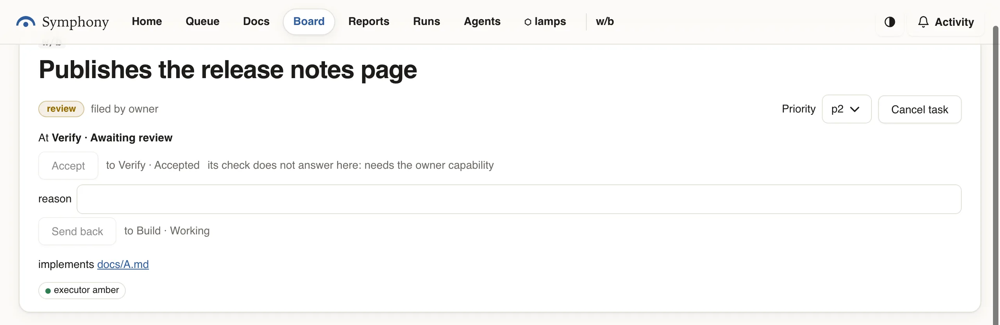
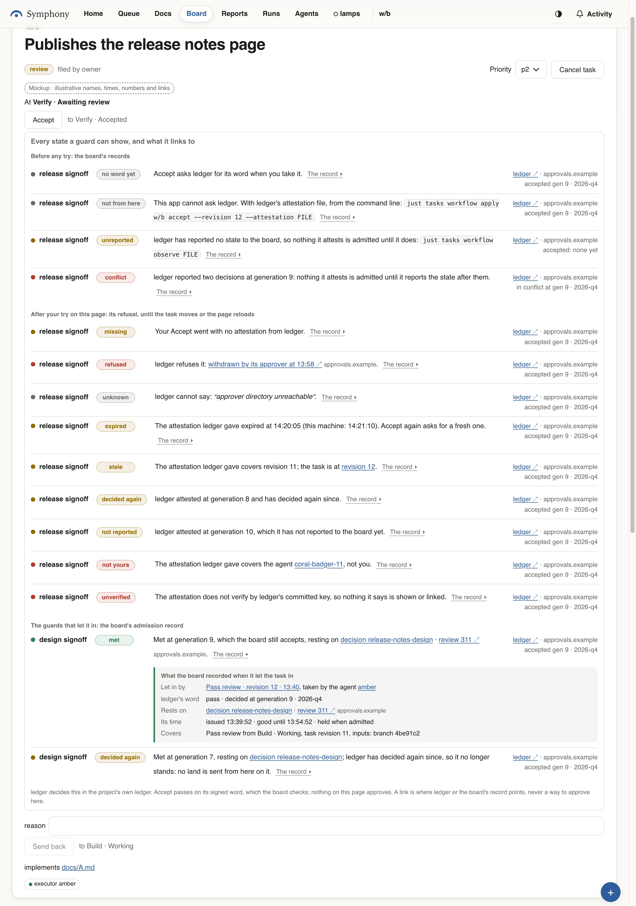
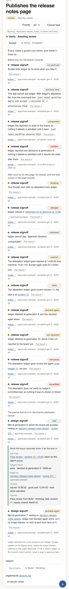

# The guard panel on a task's page

A project's workflow can hold an edge back behind a guard: a decision its own approval ledger
keeps, which the board admits only on the authority's signed word
([guards](../WORKFLOW.md#guards), [the design](revision-bound-transition-guards.md#Display and compatibility)).
This is the task page's view of those guards, proposed for
[its card](../DECISIONS.md#workflow-guard-panel-links). It is illustrated, not built: the pictures
are the real task page served by the browser tests' stand-in server, with the proposed panel drawn
into it, and every name, time, number and link in them is invented. The owner found the first look
([its card](../DECISIONS.md#workflow-guard-panel)) right but for one thing: a row said why and led
nowhere. [What a row links to](#what-a-row-links-to) is the answer, and the pictures are new.

## Today

A guarded edge is an action like any other, its button disabled, its line saying
"its check does not answer here: needs the owner capability". The board previews every guarded
edge as `guard_unavailable`, since only an attestation given with the operation meets a guard,
and the page says nothing of which guard, whose authority, or what the board accepted from it.

## The panel

Inside the task's Workflow section, beside the actions it already lists:

- **Under each guarded action**, a box headed *ACTION needs*, one row for each guard its edge
  carries.
- **Above the actions**, while the task came into its pair by a guarded edge, a box headed *Let in
  by EDGE · revision N · time*: the guards that admission met, and whether each still stands.

Each row has the shape of a gate on the same page: a dot and the guard's name (its ID in words, as
a guard has no label), its state in one word, one line saying why, and on the right its authority
(the adapter and the issuer it signs as) with the state the board accepted from it: its
generation and epoch, `none yet`, or `in conflict`. Wide, a row is one line of bounded columns;
on a phone, three lines: name and state, why, then the authority. A line under the rows says who
decides: the authority, in the project's own ledger. The panel has no approve, grant, paste or
upload: taking the action passes on the authority's word, which the board checks. A link leads to
where the authority or the board's record points, never to a way of approving on this page.

The action's button follows what the host can do. Once
`tools/workflow-attestation-fetcher` lands, the owner's take asks the project's authority for its
attestation when the host answers that authority, and the button is enabled; where the host cannot
ask it, the button stays disabled and the row says `not from here`: the edge is taken from the
command line with the authority's attestation file.

## What a row links to

Every row opens, and most lead somewhere. Four things, each from something that exists or is
named here as new:

- **The record, on every row.** *The record* opens in place, under the row, what the board holds
  for it, so there is always more to read even where nothing leads elsewhere. For a guard that let
  the task in: the transition, who took it, the authority's word and the generation it was decided
  at, what it rests on, its time and what it covers (`Store::workflow_admission`). For your last
  try: the same from the attestation the board read, and whether its signature verified. For a row
  from the board's records alone: the state it accepted from the authority and how many admissions
  rest on it.
- **What the authority points at.** An attestation already carries the authority's own
  references: the facts a pass rests on, and its reasons for a refusal or an unknown. Each is
  text, and stays text in the signed contract. The page draws one as the gates on this page draw
  theirs (`linkable`): a path of the app in it is a link named for what it is (a task, a decision
  card, a document, a run), and a web address at its end puts the link on the words before it,
  marked as leaving the app with its host beside it (a GitHub run, the ledger's own page for the
  decision). Text with neither is quoted as it is. Only an attestation that verified by the
  committed key is quoted or linked: an unverified one shows nothing it says.
- **The authority's own page.** The authority's name links to where its ledger shows this guard
  for this task, where the project commits that: a new optional `page` in
  `[[workflow_authorities]]`, a path of the app or a web address with `{task}` and `{guard}`
  filled in. It is the one link a row has before anything was tried (`no word yet`, `unreported`,
  `missing`): where to go to have it decided. A project that commits none shows the name as text.
  It is a new key, so a small change of the project file's reader with its consumer note, built in
  this task.
- **The board's own places.** *Let in by EDGE · revision N · time* links to that transition in the
  task's timeline, as does a revision a row names; an agent a row names links to the Agents page.
  Where the fix is a command (`not from here`, `unreported`), the row shows the command itself, to
  copy.

What is not linked, because nothing is kept to link to: the authority's accepted state has no
page of its own (the board keeps the state, not a log of its reports), and a refusal has no place
beyond this page ([below](#the-last-refusal-and-how-long-it-lasts)).

## Each state and where it comes from

Every row has its record and, where the project commits one, the authority's page. The last
column is what the row's own words link to besides.

| Word | Tone | From | Says | Its words link to |
| --- | --- | --- | --- | --- |
| no word yet | quiet | the board's records | Taking the action asks the authority. Nothing tried on this page. | nothing more |
| not from here | quiet | the board's records | This host cannot ask that authority: the command line takes the edge. | the command, to copy |
| unreported | amber | the board's records | The authority has reported no state, so nothing it attests is admitted. | the command that reports, to copy |
| conflict | red | the board's records | It reported two decisions at one generation: nothing it attests is admitted until it reports the state after them. | nothing more |
| missing | amber | your last try | It went with no attestation from that authority. | nothing more |
| refused | red | your last try | The authority attested `refuse`, its reasons quoted as it gave them. | each reason's reference |
| unknown | quiet | your last try | The authority attested `unknown`, its reasons quoted. | each reason's reference |
| expired | amber | your last try | The attestation's time ran out on this machine's clock (one issued ahead of the clock, or held too long, says that instead). | nothing more: the action again asks for a fresh one |
| stale | amber | your last try | It covers another revision, pair, workflow or activation of the task, or other input revisions. | the task's revision, in its timeline |
| decided again | amber | your last try | It was decided at an older generation than the board accepts now. | nothing more |
| not reported | amber | your last try | It was decided at a generation the authority has not reported yet. | nothing more |
| not yours | red | your last try | It covers another principal than the one taking the edge. | the agent it covers |
| unverified | red | your last try | It does not verify by the key the project commits for that authority. | nothing: what it says is not shown |
| met | green | the admission record | The guard that let the task in, at the state the board still accepts. | each fact it rests on, and its transition |
| decided again | amber | the admission record | The authority has decided again since that guard was met, so it no longer stands: no effect, a land among them, is dispatched from here on it. | each fact it rested on, and its transition |

The board never learns why a generation moved: any decision of the authority moves it, another
task's included. So a later generation reads `decided again`, never revoked. A revocation shows
only in the authority's own words, when it attests `refuse` with its reasons. An entry whose
authority is no longer committed, whose key changed or whose state the board no longer holds says
so in the same row, in the board's words for a dispatch it refuses.

## The last refusal, and how long it lasts

`your last try` is the owner's own take of that action on this page, and nothing else. The page
holds its refusal in memory beside the action until the task's revision moves (its actions are
read again), the page reloads, or the task is opened elsewhere. The board records no refusal: a
refused admission writes nothing, by design. So the panel claims no history across pages,
devices or sessions, and an agent refused at the command line never shows here.

## What it reads

- **The definition**, read already: each edge's guards and each guard's adapter.
- **A new owner read**, `GET /api/workflow-guards?slug=SLUG`: each authority the active activation
  commits (adapter, issuer, its page for this task and guard where the project commits one, the
  epoch, generation and conflict the board accepted, the admissions counted on it, and whether
  this host asks it), and the transition that last brought the task into its pair
  (`guard::entry`) with the guards its admission met (`Store::workflow_admission`), each with its
  standing, the cases `guard::unstanding` tells apart, as a word, and what its record shows: the
  principal, the attestation's result, facts, generation, times and the input revisions it
  covers. The page asks it only for a task
  whose pair a guarded edge enters or leaves: a board with no custom workflow, or a workflow with
  no guard, asks nothing more. A hosted visitor is refused it, as the actions are. It is read with
  the actions, so an authority's report between two reads shows at the next (an observation moves
  no task and sends no feed event).
- **A typed refusal.** The owner route answers a refusal as `{"error": "guard_unavailable: …"}`
  alone. The smallest additive field is a wire type `GuardRefusal`: the guard, its adapter, a word
  for why (the rows above that come from a try), and from an attestation that verified, what
  its record shows (its result, reasons, generation, times and what it covers), answered beside the error as `guard` for a guard's refusal only. The board's guard check builds
  it where it builds the text, and a store method beside `Store::apply_attested` returns it, so
  `apply_attested`, `admit::Refusal` and `store::Error` keep their shape. The error's text stays
  byte for byte what it is, every other refusal and route answers as today, the command line and
  `tasks api` are unchanged, and a client that reads only `error` reads what it reads now. The
  page reads the word, never the text.

- **The authority's page**, the new optional `page` of `[[workflow_authorities]]`: read with the
  project file, checked as `linkable` once `{task}` and `{guard}` are filled in, and refused by
  name otherwise. It names no key or issuer and decides nothing the board admits.

A default board draws, sends and fetches what it does today.
