# The header

What the header calls the Symphony's pages, how it sits on a phone, and where Appearance lives, as
proposed on the three header cards: [header-page-names](#header-page-names),
[header-on-a-phone](#header-on-a-phone) and [header-appearance](#header-appearance). The pictures
are this repository's own pages on a private server, dark, at 1440 wide and on a phone (390 wide
at 3x), taken with `just symphony-cli shot` on 2026-11-11. "Before" is main's client at 7ad7376;
"after" is the branch `app/header-names`, which builds all three proposals.

## What is wrong today

Found by the polish sweep (board task `product/polish-sweep/client-source`, 2026-11-11):

- "Change board" opens the machine's list of projects, whose heading says Projects.
- "⌂ board" is the review home. The board, the columns of tasks, is "▦ tasks", and its own
  heading says Tasks. The home's tile calls it "the task board".
- A document page calls the home "Board", and the queue calls it "← board".
- A crumb after the links names the lit page again: "board" on the home, "tasks" on the board.
- The queue has no link in the header at all.
- On a phone the header wraps into three rows. On the server's own pages (a wrong address, the
  project list) it is one row that scrolls sideways with no sign that it does, and "agents" is cut
  at the right edge.
- Appearance, the project's look on this device, is the first thing in the chat sheet.

## Names

One name for each page, used by the header and by every link to it (`symphony_api::page_names`,
which the client and the server's own pages both read).

| Page | Today | Proposed |
|---|---|---|
| The review home, `/` | ⌂ board; "Board" and "← board" elsewhere | Home |
| The owner's queue, `/queue` | no link | Queue |
| The documents, `/docs/` | ☰ docs | Docs |
| The task board, `/tasks`, and a task's page | ▦ tasks, its heading "Tasks" | Board, its heading "Board" |
| The agents, `/agents` | ◉ agents | Agents |
| The machine's list of projects | Change board | Projects |

The order is the review side first (Home, Queue, Docs), then the work side (Board, Agents), then
a project's own pages. The words stand alone: a glyph beside a word said nothing the word did
not, and words alone are what lets the phone keep every page on one row.

The server's own notices use the same words: a page that is not there offers this project's Home or
Docs, or another one from Projects, where today it offers "the board" and links the home.

A crumb now shows only what the lit link does not already say. The home, the queue, the board,
the agents and the documents' folder page have none; a document's page keeps its path
(`docs / DECISIONS.md`), and a task's page, under the lit Board, its slug whole.

A project's own page keeps the label its plugin gives it. The consuming project's one page has a
lower-case label (its plugin's `tools/symphony/src/lib.rs`), so its header would read "Home Queue
Docs Board Agents" and then that label in lower case until it is capitalised, a one-line change in
that project.

- [r] **header-page-names** — The header names each page once, in words alone (the ⌂ ☰ ▦ ◉ icons go), and every link to a page uses the same word: Projects (the list of every project on this computer, today "Change board"), then Home (today "⌂ board": the word Board moves to the task columns), Queue (new: the queue has no link today), Docs, Board (the task columns, today "▦ tasks") and Agents. The grey word after the links that only repeated the lit page ("tasks" in the first picture) goes; a document keeps its path there. Approve, or comment with the names or order to change. [[analysis/header-names#Names]]
  [2026-11-11 20:30] agent — Posted for the board task `app/header-names`. The pictures are this repository's board, dark, today then proposed; the proposed phone picture also shows the ◑ Appearance button (third card) and the two rows (second card).

    At 1440 wide (the left half, where the names are), today then proposed: 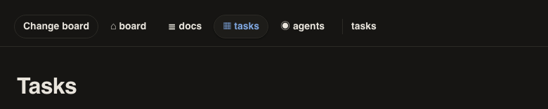 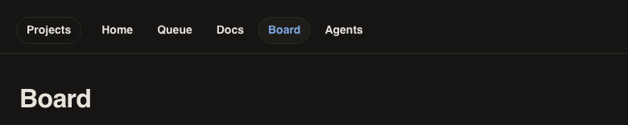

    On a phone, today then proposed: 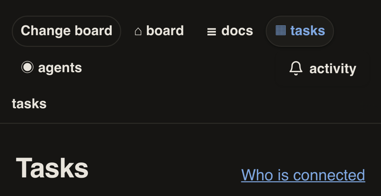 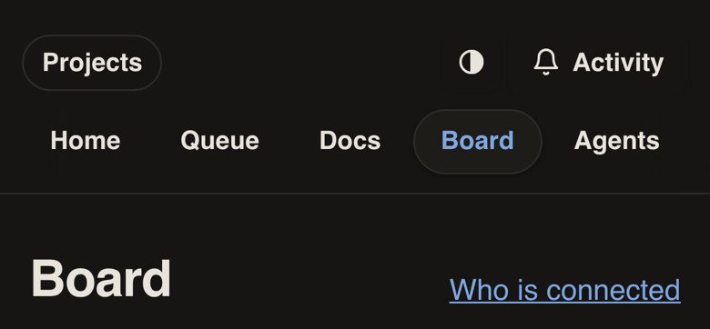

    The same words follow wherever pages link to each other: the board's heading says Board (above), and a document's "Board" link says Home (second card's pictures). Not pictured: the queue's "← board" says Home, and a missing page offers Home, Docs and Projects. A project's own page keeps its plugin's label: the consuming project's lower-case one until its plugin capitalises it.
  [2026-11-11 21:59] owner · approved
  [2026-11-12 06:45] agent · resolved

## On a phone

Two rows, and never more: the project switch and the two buttons (Appearance, Activity) on the
first, the pages spread evenly across the second. At 390 wide six pages fit, as many as the
consuming project has. A project with more pages than fit scrolls that row sideways, shaded at
the edge it continues past. The crumbs give way on a phone: a document's and a task's page already show
their path or slug at the top of the page. The server's own pages draw the same header.

A theme that picks the compact header (`[theme.layouts] header = "compact"`) keeps one row at
every width, as it does today.

- [r] **header-on-a-phone** — On a phone the header is two rows and never more: Projects, the ◑ Appearance button (third card) and Activity on the first, the five pages spread across the second, all in view at 390 wide. The grey path row (docs / TASKS.md) is dropped on a phone, since the page shows docs/workflow/TASKS.md just under the header. Today the header wraps into three rows. Approve, or comment. [[analysis/header-names#On a phone]]
  [2026-11-11 20:30] agent — Posted for the board task `app/header-names`. A document on a phone, today then proposed: 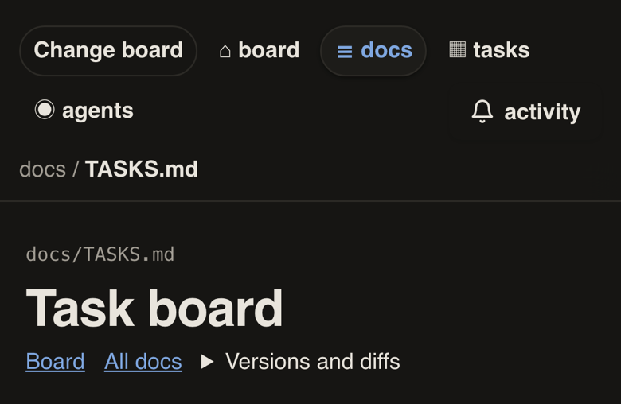 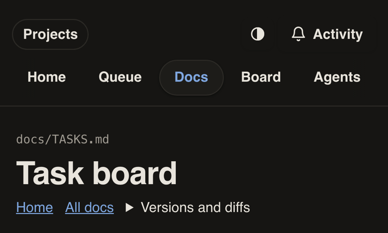

    At 1440 wide nothing moves: one row, the path kept; only the names differ (first card). The left half, today then proposed: 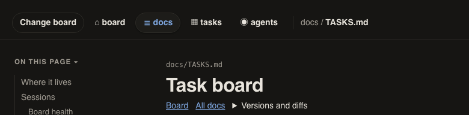 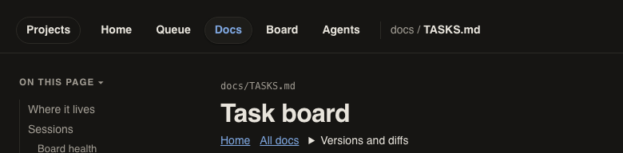

    Not pictured: six pages, as many as the consuming project has, still fit at 390 wide; a project with more scrolls the second row sideways, shaded at the edge it continues past. The server's own pages (the Projects list, a missing page) draw the same two rows, where today they scroll sideways with "agents" cut off.
  [2026-11-11 21:59] owner · approved
  [2026-11-12 06:45] agent · resolved

## Appearance

A round button in the header, beside Activity, opens a small panel under it with the two things
Appearance does: import a shadcn theme, or go back to the default. It applies to this project on
this device. The panel hangs from its button wherever the header sits, under a notice too, and
follows it as the page scrolls. Opened, it takes focus; Escape or × closes it and gives focus back to the button.
Activity and Appearance share the top right, so opening one closes the other. The chat sheet holds
the chat and the new task alone.

The panel is part of the deferred module the chat and Activity already load on first use, so a
first visit pays only for the button.

- [r] **header-appearance** — Appearance moves out of the chat sheet into the header: a round ◑ button, left of Activity, opens a small panel with the same two actions as today, import a shadcn theme or go back to the default theme, for this project on this device. The chat sheet then holds the chat and the new task alone. Approve, or comment. [[analysis/header-names#Appearance]]
  [2026-11-11 20:30] agent — Posted for the board task `app/header-names`. The wide pictures are the right half of a 1440-wide page. Today, Appearance tops the chat sheet; here its menu is open (it shows through to the tabs under it, which `app/ui-polish-1` repairs): 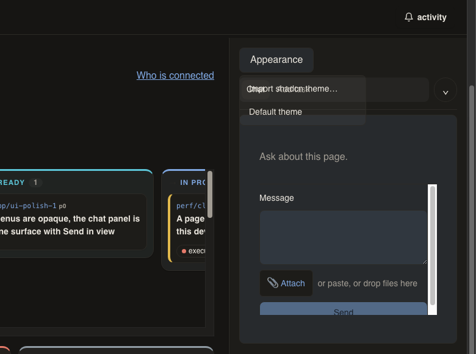 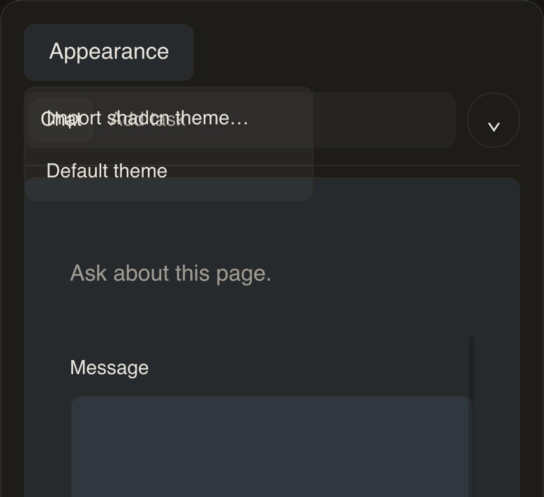

    Proposed, the header's ◑ button and its panel. On a phone the open panel covers the row of pages until it is closed: 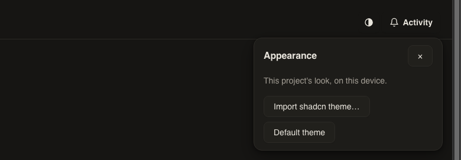 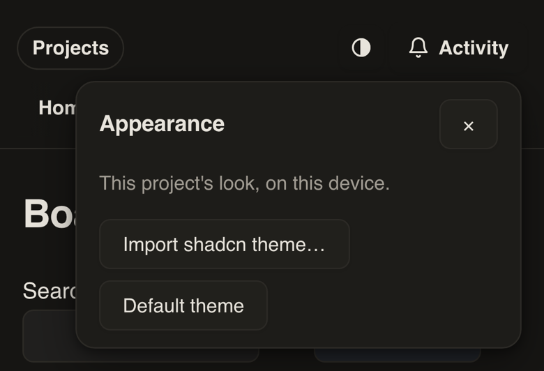

    Proposed, the chat sheet without it: 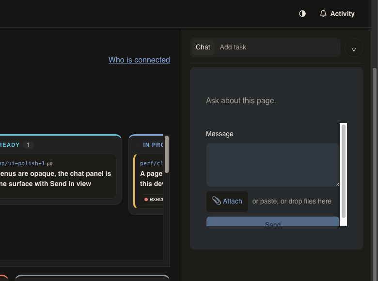 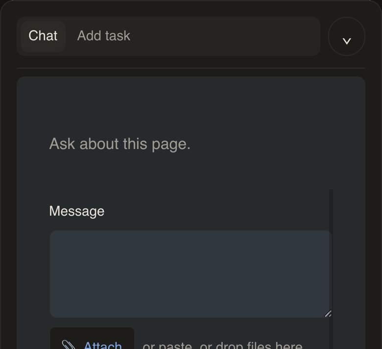
  [2026-11-11 22:00] owner · approved
  [2026-11-12 06:45] agent · resolved

## What the branch changes

- `crates/symphony-api/src/project.rs`: `page_names` and `ProjectView::own_pages`, the names and
  their order.
- `apps/symphony-ui/src/project.rs`: `header_links` and `crumbs`, the header's links and when a
  crumb shows; `frame.rs` draws them, and the Appearance button; `frame_panel.rs` the Appearance
  panel; `theme.rs` its two actions as buttons; `assets/frame.css` the phone's two rows and the
  panel; `assets/shell.js` loads the deferred module when Appearance opens.
- The home's word on a document page and the queue, the board's heading, the home tile's hint.
- `apps/symphony-server/src/pages.rs` and `pages.css`: the server's own pages draw the same header,
  and their notices link Home, Docs and Projects by name.
- `docs/workflow/TASKS.md`, the shipped tasks skill and the server's README name the pages by these names.

## Not in this proposal

The board task `app/ui-polish-1` landed on main after the "before" pictures, and the branch
carries it: a task page's slug is one crumb (here its only one), a popup no longer shows through
to what lies under it, and the chat sheet is one surface with Send in view. Those are its changes,
not this proposal's.
