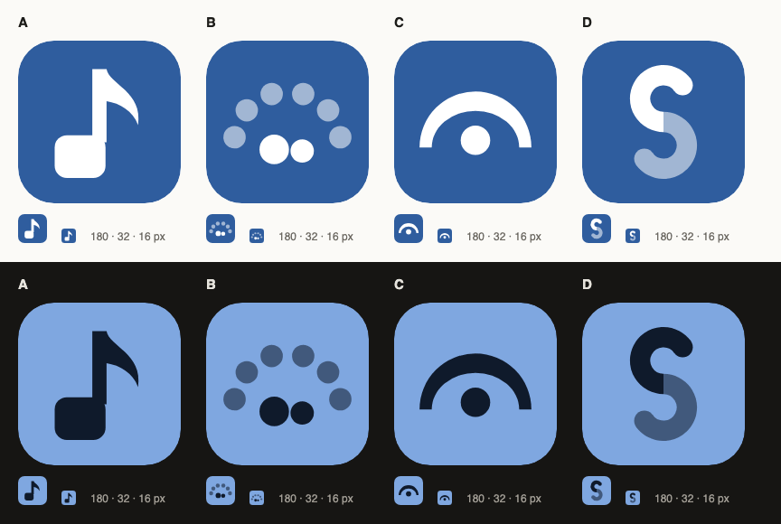
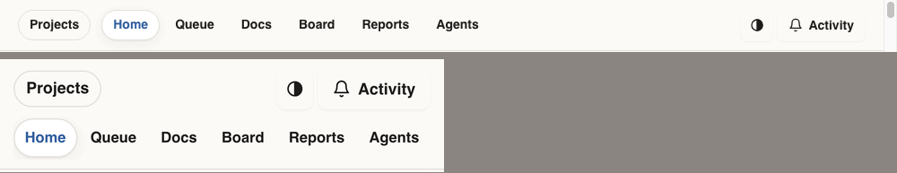
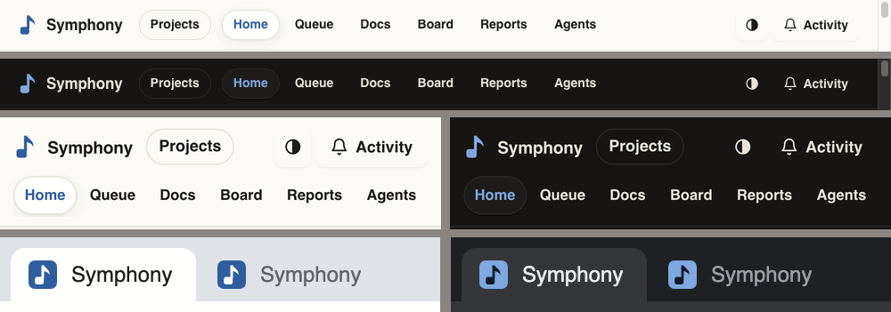
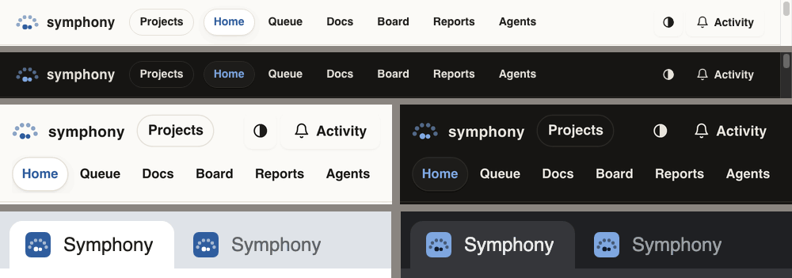
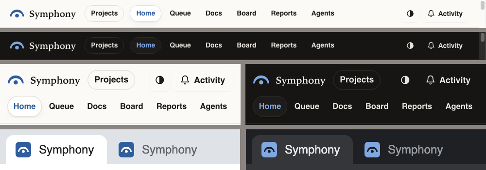

# Symphony's mark

Four options for the mark and the wordmark Symphony's default look carries. The mark is C, the
fermata, with its serif wordmark ([its card](#symphony-mark)); the board task
`app/symphony-mark-is-the-fermata` builds it. Each option was two files: an icon, the tab's
and the home screen's, a tile in the default theme's primary colour with the mark on it, its
light and dark colours chosen inside the file; and the bare mark, which the header
draws in the page's own `--primary` token, so it follows light and dark and a project's colours.
The fermata's two are the server's (`apps/symphony-server/src/mark/icon.svg` and `mark.svg`); the
other options' are not kept.

The pictures are a scratch project on a private server (port 0, a temporary machine folder), named
Symphony, with each option set as its theme: `[theme] icon` for the tab, and a stylesheet that puts
the mark and the wordmark at the start of the header. A private server serves one project and so
draws no Projects link; the pictures add the one the machine's server draws, as its markup is. A
headless browser shows no tab strip, so the tab is drawn beside the page from the same icon file,
at 2× as a Retina screen draws a 16 px icon. Taken with `just symphony-cli shot` on 2026-11-15 from
main at 3f3d9186.

## Where the name and the icon appeared before the mark

On main at 3f3d9186, when the options were drawn:

- **The tab's title** is the project's name: its theme's, else `[project] name`. This repository's
  pages say "Symphony", and so does the machine's project list.
- **The tab's icon** is the project's `[theme] icon`. A project with none gets no icon on its pages
  (the shell's empty `data:,` link) and two beamed notes, the generic ♫, on the pages the server
  draws itself: the project list, a page that is not found, a Markdown file no entrypoint serves.
- **The address's own icon**, `/favicon.ico` asked for outside any project, is answered from
  `tools/static/icon.svg` of a project (`apps/symphony-server/src/projects.rs`, where a path
  outside any project finds its owner): the project the request's Referer names, a page of the
  same server under `/ID/`, else the project the machine's server was started from. On this
  machine that last is the consuming project, so a request no project's page sent, such as a file
  opened raw (an image or a text served as itself, with no icon link of its own) or anything
  asking the address itself, gets that project's star. A page with an icon link of its own, the
  project list among them, is not asked for it.
- **The header** shows no mark and no name: it opens with Projects, then the pages. The project
  file's reference says a theme's name and icon are the header's and the tab's; only the tab
  shows them.
- **A phone's home screen** gets no touch icon and no web manifest, so a shortcut is a screenshot
  or a letter.
- **The README** opens with a `# Symphony` heading and no mark.

A project's own `[theme]` (its name, its icon, its package) is its own look and stays its own.
The options are Symphony's default, and they show in two places: on the machine's own pages (the
project list and the pages the server draws), and on a project with no theme name or icon of its
own. A project's own theme name and icon take their place on its pages, as the project file's
reference already says; the address's own icon is Symphony's where no project's answers it.

## The options

Each wordmark is the word set in a system font, so it loads nothing; any of them can go with
another option's mark.

| | Idea | Mark | Wordmark | At 16 px |
|---|---|---|---|---|
| A | A note whose head is a task card: the board's work is the symphony's music. | an eighth note, its head a rounded card | "Symphony", the app's sans, semibold | a note |
| B | The orchestra seen from above: its seats in an arc round two maestros, the person and the orchestrator agent. | six seats, lighter, round two dots, one larger | "symphony", lower case, sans | a fan of dots; the seats show from 32 px |
| C | The fermata, the sign where the orchestra holds until the maestro moves on, as a card holds until the owner answers it. | an arc over a dot | "Symphony", a serif (Iowan Old Style, else Palatino or Georgia) | an arc and a dot |
| D | The S of Symphony in two strokes, one full and one lighter: the two maestros, the person and the orchestrator agents, conducting one work. | a two-stroke S | "SYMPHONY", spaced capitals, sans, bold | an S |

The header keeps its two rows on a phone with every option: the mark and the wordmark sit first,
a step smaller, then Projects, Appearance and Activity (measured at 390 wide: Activity's top at 8
px, the header 97 px tall, as it is today).

- [r] **symphony-mark** — Symphony would get a mark and a name of its own, at the start of the header, on the browser's tab and on a phone's home screen. They show on the machine's own pages (the project list and the pages the server draws) and on every project with no theme name or icon of its own; a project's own theme name and icon take their place on its pages. Today the header shows neither, the tab shows no icon or a generic ♫, and the icon the browser asks the server for by itself is the consuming project's star. Which mark and wordmark should Symphony's own look carry? A: the note-card, a note whose head is a task card. B: the podium, the orchestra's seats round two maestros. C: the fermata, the sign where the music holds for the maestro. D: the two-stroke S, one stroke for you and one for the orchestrator agents. Recommended: D. Approve and say A, B, C or D in the note, or comment. [[analysis/symphony-mark#The options]]
  [2026-11-15 05:12] agent — Posted for the board task `app/symphony-mark-and-name-options`. Your words on its inbox item: "A proper "themed" design of Symphony could be develop that is closer to the concept of "a symphony that is executed by maestros" where maestro are the human + orchestrator agents. I would like to view different options to select."
  [2026-11-15 05:12] agent — Base: today, wide and on a phone, no mark and no name in the header. 
  [2026-11-15 05:12] agent — Each option in the header wide (light, then dark), on a phone (light, dark) and in the tab (light, dark), drawn on a private server with the option set as a scratch project's look; nothing in the app has changed. A headless browser shows no tab strip, so the tab is a stand-in drawn around the real icon file, and the Projects link the machine's server draws is added to the private server's header.    

    **A, the note-card.** A note whose head is a task card: the board's work is the symphony's music. Wordmark: "Symphony" in the app's own sans.

    **B, the podium.** The orchestra seen from above: its seats in an arc round two maestros, you and the orchestrator agent. Wordmark: "symphony" in lower case. At 16 px it reads as a fan of dots; the seats show from 32 px.

    **C, the fermata.** The sign where the orchestra holds until the maestro moves on, as a card holds until you answer it. Wordmark: "Symphony" in a serif.

    **D, the two-stroke S.** Symphony's S in two strokes, one full and one lighter: you and the orchestrator agents, two maestros conducting one work. Wordmark: "SYMPHONY" in spaced capitals.

    Any wordmark can go with another mark: say which in the note.
  [2026-11-15 05:12] agent — The four icons at 180, 32 and 16 px, light then dark: 

    **Why D.** It is the only one that says the name at every size, down to the 16 px tab, and its two strokes are the two maestros you named. Its cost: a letter says nothing of music, and the two maestros show only once explained; the lighter stroke loses contrast at 16 px, most on the light tile; and it is close in kind to other music products' S marks. C is as clear at 16 px and the simplest, but it shows one maestro's hold, not two maestros. B tells the most and blurs the most when small. A is the closest to today's ♫ and says the least about the maestros.

    **What it changes.** The machine's own pages and every project with no theme name or icon of its own show the chosen mark and wordmark in the header and the icon in the tab; a project's own theme name and icon take their place on its pages, as the project file's reference already says, so the consuming project keeps its own name and star. The icon the browser asks the server for by itself becomes Symphony's where no project's own answers it; the header stays two rows on a phone (measured at 390 wide for all four); a phone's home screen gets the icon. A follow-up task builds it after your answer.

    **Earlier verdicts checked.** **header-page-names**, **header-on-a-phone** and **header-appearance** set the header's words, its two rows on a phone and its ◑ button; every option keeps them. **symphony-own-names** took the consuming project's names out of Symphony's code and says nothing of a mark. **pictures-in-every-clone** decides that these pictures are committed beside this card. None of them chooses a mark or a wordmark: that is this card.
  [2026-11-15 05:52] agent — Corrected after the task's review, before any answer: the first lines say where the mark and the wordmark show (not on every page), Why D gives D's own cost, and the pictures' line says the tab is a stand-in.
  [2026-11-15 06:40] owner · approved — C
  [2026-11-15 11:13] agent — Recorded: C, the fermata, with its serif wordmark. The board task `app/symphony-mark-is-the-fermata` builds it: the header, the tab's icon and a phone's home screen, on the machine's own pages and on every project with no theme name or icon of its own. [[analysis/symphony-mark#What applying the choice touches]]
  [2026-11-15 11:14] agent · resolved

## What applying the choice touches

What the board task `app/symphony-mark-is-the-fermata` builds, with the fermata's icon and mark:

- **The default icon.** The icon file is the Symphony's own, embedded in the server: the
  icon of a project with no icon of its own, on its pages (in place of the shell's empty link) and
  on the server's own pages (in place of the beamed notes), and the answer to `/favicon.ico`
  outside any project. Its place in that answer's order is the follow-up's to set in
  `projects.rs` (the Referer's project, then the started one): after the Referer's project and
  before the started one. That order decides only what the address answers when no project's
  page asked; the project list's tab gets Symphony's icon by its own icon link, the beamed notes
  replaced.
- **The scheme.** The icon files choose their light and dark colours by the system's scheme
  (`prefers-color-scheme` inside the file), not by the app's Appearance choice, which a browser
  does not pass to a tab's icon; the header's mark, drawn in `--primary`, follows Appearance.
- **The header.** The mark, inline and drawn in `--primary`, and the wordmark at its start, in the
  React frame and in the server's own pages, with their sizes in the frame's stylesheet and its
  server copy; a project's theme name and icon take their place, as the project file says.
- **A touch icon**, the icon rendered as a 180 px PNG, for a phone's home screen.
- **The README**, its heading with the mark.
- **The product pictures** that show the header (`docs/product/pictures`: the queue wide, on a
  phone and with a topic chosen, and the register wide), shown in the README and the queue's
  spec, retaken with `tools/product-pictures.sh`: their fixture project sets no `[theme]`, so its
  header takes the default.
- **The words that say where the name and icon show**: the `[theme]` table's `name` and `icon`
  rows in [PROJECT_FILE](../../operations/PROJECT_FILE.md#theme) ("the header and the tab") and the comments on
  `name` and `icon` in `crates/symphony/src/theme.rs`, which then say what the default is.
- The tests that read the icon link and the header's markup, and the client distribution, which
  the regenerator rebuilds after the land.
