# Navigating a task's timeline

A proposal for the wide timeline on a task's page ([the timeline](../../workflow/TASKS.md#the-timeline)). It
covers zoom and sideways movement from a whole-task default, builds and tests laid out by their
recorded times, message marks that stay off the bars, and an optional skip for long stretches in
which the task's records hold nothing. It also covers what a phone's list gains from the same
records. [Its card](#timeline-navigation) asks the one open choice: whether quiet
stretches are skipped, and by default or on request.

Every picture is of one task, `tools/workflow-revision-guards`, read from the shared server on
2026-11-20 at 04:45, after it closed. Pictures of today are the page as served then, before the
alignment repair below landed. Proposed
pictures are an [HTML mockup](timeline-navigation/mockup.html) that draws that task's recorded
timeline: its stages, review rounds, role holds, message instants, 178 builds and tests, and
gates, with no message bodies or machine names. The mockup reads and writes nothing. Its toolbar,
⌘/Ctrl + scroll, Shift + scroll and band clicks change that page alone, and its `#fit`,
`#fit-true`, `#fit-selected`, `#zoom`, `#phone` and `#phone-all` addresses open each picture's
view. Nothing in the product changes with this proposal.

**Built.** Slices 1 and 2 and the phone's message row and not-kept row of slice 5, by the board
task `app/timeline-navigation`, slice 3, zoom and move, by `app/timeline-zoom`, and slice 4 with
the phone's quiet row, quiet stretches under B, by `app/timeline-quiet-bands`:
[the timeline](../../workflow/TASKS.md#the-timeline) says the drawing as built.

## Today

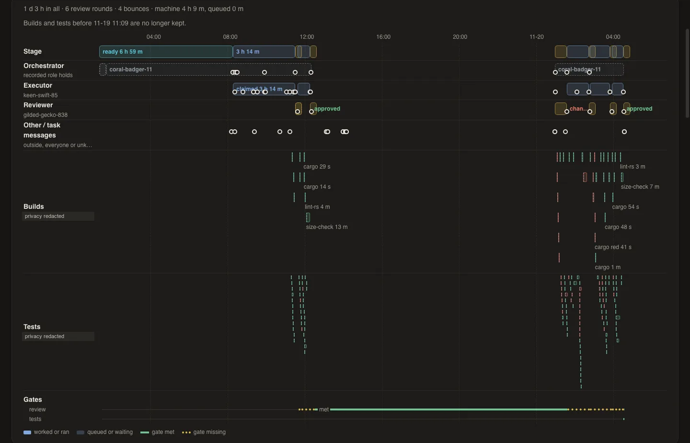

At 1440 wide the lanes are 818 px tall. The task's 42 builds take six rows with words under
them, 256 px. Its 135 tests take 20 thin rows with no words, 244 px. A run gets a row of its own
when it overlaps another, and also when it is queued within half a percent of the drawn hours of
another's end, so as not to read as one bar with it. On a task of 27 hours that is eight minutes,
so a stretch of back-to-back runs piles up downwards. The stretch from 11-19 14:03 to 11-20
00:57, when the task was done and nothing was recorded on it, takes 40% of the width. The
sentence above the lanes says builds and tests before 11-19 11:09 are no longer kept. Nothing in
the lanes shows where that unknown time is.

Messages are 10 px rings drawn on the bars of the sender's lane. They cover bar words ("claimed
3 h 14 m" above), and rings a few minutes apart overlap.

On a phone the 240 px box shows a single step under the totals and that sentence. Show all
draws 259 steps in 12,830 px. The 10 h 54 m stretch is only a date heading between two rows.

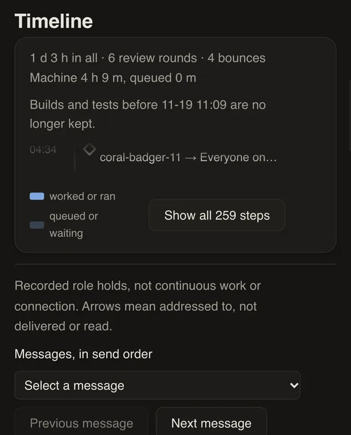
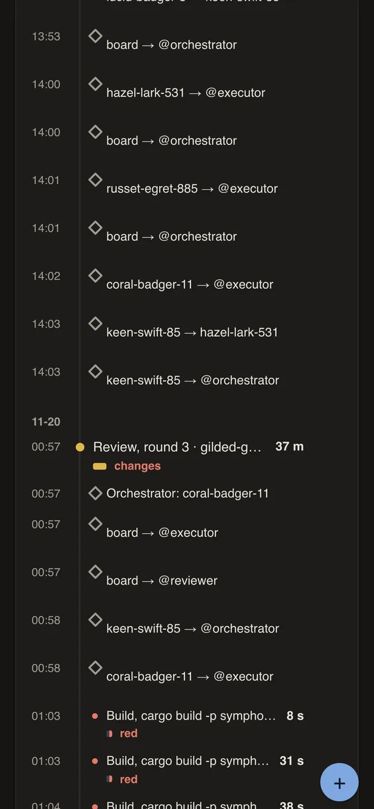

### The arrow and the held mark, before the repair

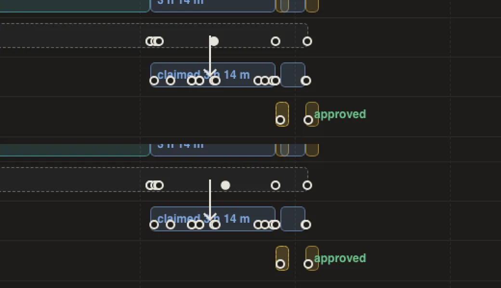

Message #15266 (coral-badger-11 to `@executor`, 11-19 09:47) selected, above, and held down,
below. These were defects, not choices. The task `app/timeline-message-alignment` repaired all
three, and landed on main at 512adedbd after these pictures, so its source is the baseline this
proposal builds on. Measured in the page before it:

- **Across.** The arrow's overlay started at the name column's width, 9rem. Each lane's name is
  9rem plus 8 px of padding, because the flex basis counts the content box. The arrow's scale
  was therefore 8 px wider and started 8 px further left than the marks'. The arrow drifted 0 to
  8 px left of its mark: 8 px at the task's start, none at its end, 4.4 px here.
- **Down.** The arrow ran between the centres of the two lanes' tracks. A mark's button laid
  out 36 px tall, not the 24 px its style set, and centred its ring, so every ring sat 6 px
  below its track's centre. The arrow started 6 px above its mark and stopped 6 px above the
  addressed lane's rings, over that lane's bar words.
- **Held.** Every pressed button gets `transform: scale(.97)` from the board's sheet. That
  replaced the mark's own `translateX(-50%)` while the button was down, so the mark jumped 12 px
  to the right. Here it ended 16.4 px from its arrow.

Each has its own cause, and all three are of one class: one geometry worked out in three
places. A page-wide press rule replaced the transform that positioned a mark. A button's least
height moved a mark's ring off its track's middle. The arrow's overlay and the tracks took their
origin from different boxes. The repair takes away each cause rather than its offset: a mark is
centred on its time by its margin, so a press's shrink composes with it; a mark is its own
height, so its ring is on its lane's middle; and the arrow is drawn from the mark's and the
recipient track's measured boxes, so a change to either moves it too. Its browser test selects a
mark, holds it down and compares the mark's centre with the arrow's, so a return of any of the
three fails there.

The repair moved the marks and the arrow alone. Two more findings share those causes and are
left to this proposal:

- **The hour lines** are a layer of their own on the same 9rem start, so they sit up to 8 px
  left of their tick labels and of the times the bars are drawn at.
- **A phone's message rows** are buttons and take the controls' least height, so their words
  sit about 16 px below their diamond and time (in the Show all picture above).

A message whose sender and recipient fall on the same lane, such as a post from outside to
everyone on the task, draws a 12 px stub downwards. What it draws instead is proposed below,
under every option.

## Other systems

- **Zoom and move.** Perfetto zooms and pans with W, A, S and D. Its mouse pans with Shift+drag
  and zooms with Ctrl+wheel, F fits the selection, and a drag over the timeline selects an area
  ([Perfetto UI](https://perfetto.dev/docs/visualization/perfetto-ui)). Chrome's Performance
  panel uses the same keys and two-finger swipes. Its "Modern" setting scrolls the page with the
  wheel and zooms only with Command/Control held. Dragging across its overview selects a range,
  and its breadcrumbs go back to a wider one
  ([Performance features reference](https://developer.chrome.com/docs/devtools/performance/reference)).
  vis-timeline's `zoomKey` zooms "only when an additional key is down", with `horizontalScroll`
  moving through time when it is set ([Timeline docs](https://visjs.github.io/vis-timeline/docs/timeline/)).
  Grafana zooms to a range dragged across a graph, zooms out with a double click or `t-`
  ([Use dashboards](https://grafana.com/docs/grafana/latest/dashboards/use-dashboards/)).
  Taken here: the whole task is the default view, a modifier is needed to zoom so the page
  still scrolls, dragging across the hours zooms to them, an overview shows where the view is,
  and one press returns to the whole task.
- **A selected event joined to another.** Chrome's panel draws an arrow from an initiator to the
  event it caused when one of them is selected, and a request's arrow from its initiator when it
  is clicked. Taken here: one arrow at a time, for the selection, ending on the marks it joins.
- **Skipped time.** Plotly's `rangebreaks` hide chosen periods of a date axis, such as weekends,
  holidays and hours outside trading, "to show an uninterrupted trading history"
  ([Time series](https://plotly.com/python/time-series/)). There the breaks are fixed periods
  named by the author. Here a break comes from the task's own records, and it is drawn and
  labelled rather than hidden without a trace.
- **Many marks in a few pixels.** vis-timeline's `cluster` groups overlapping items, and a double
  click centres on a cluster. This proposal does not group marks: the timeline-burst card's
  rejection asked for runs kept on their own times. Marks keep their exact times, and zoom pulls
  them apart.

## The proposal

Pictures, the same task, whole task with quiet stretches skipped, then zoomed to 11-19 11:05 to
12:18 with the reviewer's first verdict selected:

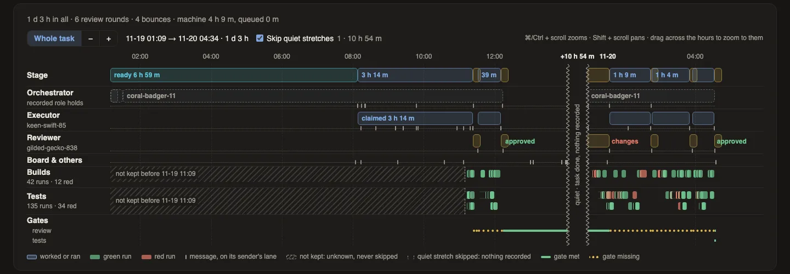
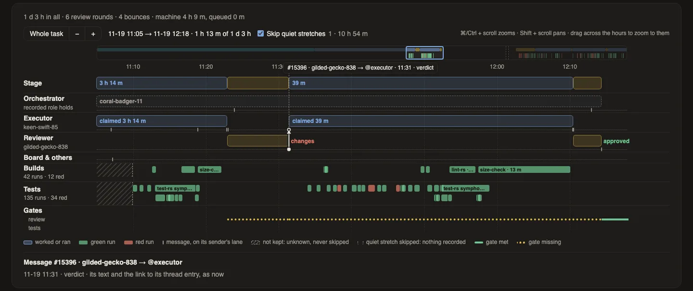

The whole-task view in the light theme, from the same tokens:

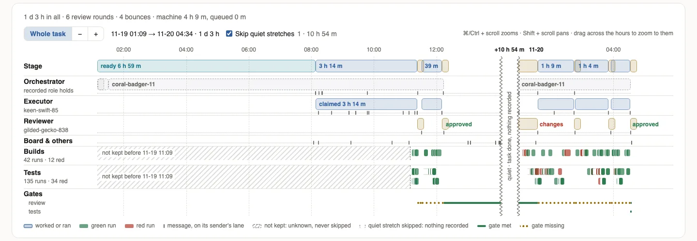

### Whole task first, then zoom and move

The box opens on the whole task, every lane on one scale, as today. One toolbar line above the
lanes holds the view controls:

- **Whole task, − and +.** The range shown is read beside them: "11-19 11:05 → 11-19 12:18 ·
  1 h 13 m of 1 d 3 h".
- **⌘/Ctrl + scroll** or a pinch zooms around the pointer. **Shift + scroll** or a sideways
  swipe moves while zoomed. A plain scroll scrolls the page, so the lanes never trap it.
- **A drag across the hours** zooms to the hours dragged. A double click on a stage bar zooms to
  that stage.
- **Keys.** While the lanes have the focus, + and − zoom and 0 shows the whole task. The arrow
  keys still step through the parts, and a part stepped to outside the view brings it into view,
  as a message chosen in the message list does.
- **The overview.** While zoomed, a 30 px strip above the hours shows the whole task: stages,
  runs and the window shown. Dragging the window moves it, and dragging its edges resizes it.

The view is the page's own. Each visit opens on the whole task. A read that brings a new step
while zoomed leaves the window where it is. On the whole task, the view grows to the new step
as today. Zoom and move are wide only: a phone keeps its list.

### Builds and tests on their own times

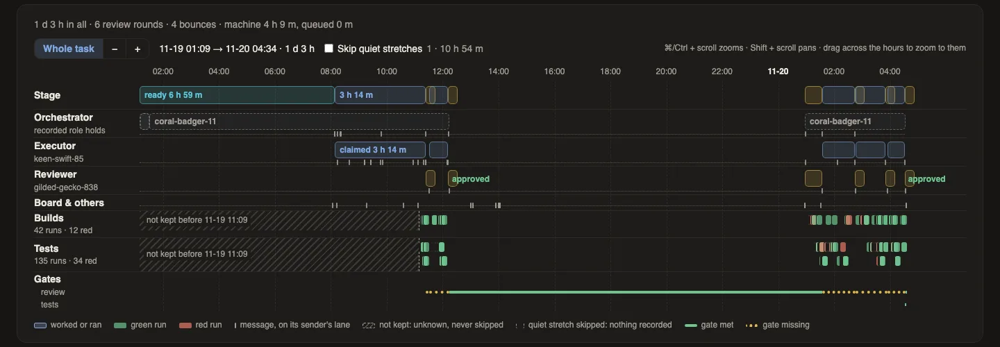

A run takes the first row free when it is queued, so only runs that overlap open another row.
Here builds need one row and tests two, and the lanes are 353 px tall against 818. Each run
keeps its own bar at its recorded start and end:

- **Bars.** A bar is 14 px tall and at least 2 px wide. A 1 px edge of the card's colour keeps
  two bars apart wherever a pixel lies between them.
- **The whole-task view.** Runs seconds apart share pixels and read as a band, its reds still
  showing. That is the cost of not giving each run a row. Each run stays its own in its hover,
  its focus, the phone's list and any zoom close enough to part it. Above, a zoom to 73 minutes
  parts most of them.
- **Words.** A run's words are its command's distinguishing words and its length: no `just`, no
  flags, the test filter kept ("test-rs symphony-board store · 6 m"). They go inside the bar
  once it is 30 px wide and are cut to fit. Otherwise they are in its hover and its focus, as
  today.
- **The lane's name.** It says the counts, "42 runs · 12 red", so the totals read at any zoom.
- **Not kept.** Where the recorder no longer keeps runs, the Builds and Tests lanes are hatched
  from the task's start to the first run kept, labelled "not kept before 11-19 11:09". This
  takes the place of the sentence above the lanes. That time is unknown, not empty.

- [x] **timeline-run-words-contrast** — The words inside a build or test bar on a task's timeline, such as "verify · 24 m", are hard to read on a light page. As built from the approved mockup, they are white on the bar's colour: about 2.9 to 1 on a green bar, 3.4 to 1 on a red one and 3.0 to 1 on a grey one, under the 4.5 to 1 that small text needs. On a dark page they read 3.6 to 4.6 to 1. A: keep the mockup's colours. B: draw each bar in its full colour, the words as they are: 5 to 1 or more on both pages, the bars darker on a light page and brighter on a dark one. C: the page's text colour for the words on a light page, as a stage's words already are, 5 to 1 or more there; a dark page stays as built, its red and grey bars still under 4.5 to 1. Recommended: B. Approve and say A, B or C in the note, or comment. [[analysis/timeline-navigation#Builds and tests on their own times]]
  [2026-11-26 15:53] agent — Posted for the board task `app/timeline-label-width-estimate`, from the review of `app/timeline-navigation`; nothing is built. Each picture is the pictures' task's builds and tests at 1280 wide, light above dark, drawn at twice their size, with one test made red and one grey so that every colour a run's words sit on shows. A, as built: 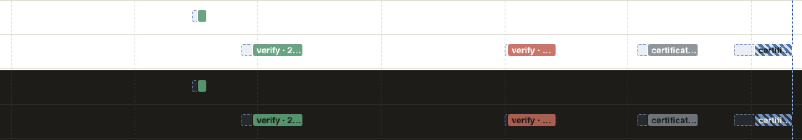 B, each bar in its full colour: 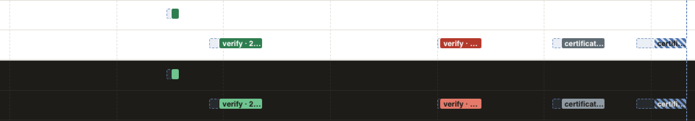 C, the page's text colour on a light page: 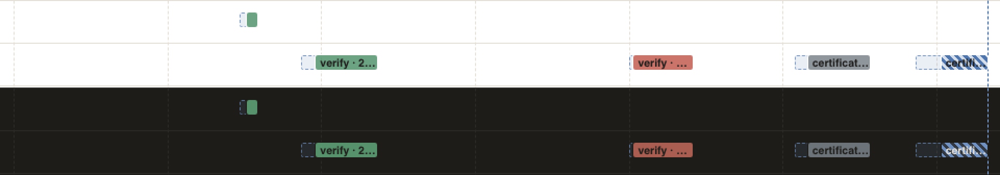

    **How each reads**, green, red and grey bars, against the 4.5 to 1 small text needs:
    - **A:** light 2.9, 3.4 and 3.0 to 1; dark 4.6, 3.6 and 3.6.
    - **B:** light 5.1, 5.9 and 5.5 to 1; dark 8.1, 5.9 and 5.9.
    - **C:** light 5.9, 5.1 and 5.8 to 1; dark as A.

    **Why B.** It is the one option that reads 4.5 to 1 on both pages, and it keeps the mockup's look: light words on a coloured bar. C mends the light page alone. On a dark page, at the bars' present strength, neither the page's text colour nor the card's reads 4.5 to 1 on a red or grey bar. No option needs more than a line of the timeline's style sheet.

    **Earlier verdicts checked.**
    - **timeline-navigation** (B) approved the drawing these colours come from. It asked about quiet stretches, not about these words.
    - **task-timeline-as-built** (approved) put a stage's words in the page's text colour on a light page for this same reason. That was a stage's pale fill, not a run's strong one, and on a dark page its answer does not reach 4.5 to 1 here.

    Neither decides this.
  [2026-11-27 07:45] owner · approved — B
  [2026-11-27 07:46] agent — Filed as `app/timeline-run-words-contrast` and staffed: each build and test bar in its full colour, the words as they are, measured at 4.5 to 1 or more on both pages before it lands.
  [2026-11-27 07:54] agent — Built as B in `app/timeline-run-words-contrast`: a finished build or test bar is its tone's full colour, its words the card's colour as before, in the runs lane's rule of `apps/symphony-web/src/timeline.css`. Green, red and grey bars read 5.05, 5.94 and 5.47 to 1 on a light page and 8.09, 5.94 and 5.94 on a dark one, held by the timeline's browser test `a_runs_words_read_at_four_and_a_half_to_one_on_its_bar_in_both_schemes`.

### Message marks

A message is a 2 × 8 px tick on a dotted line along the foot of its sender's lane, under the
bars, so it never covers a bar or its words. Board and outside senders share a 22 px lane of
that line alone, in place of today's 63 px lane of rings. Each tick keeps a press area of its own
of at least 24 px. Ticks at the same pixel overlap. The message list keeps each of them, with
Previous and Next as now.

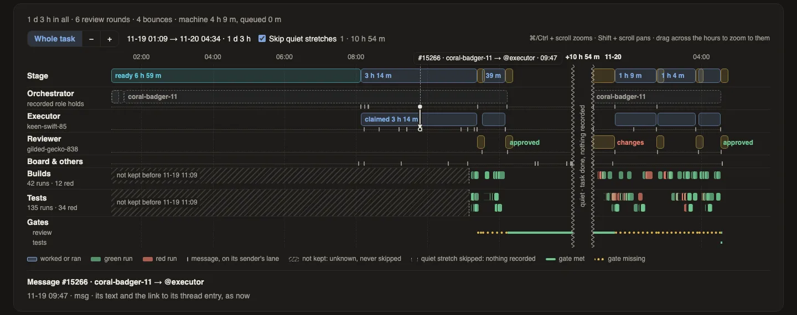

Selecting a message draws a filled dot on its tick and one arrow straight down or up to a ring
on the addressed lane's line, at the same instant. The arrow has a border of the card's colour,
so it reads across the bars it passes. The message's address and time sit on the hours line
above, with a dashed guide down to the arrow. Its text and the link to its thread entry stay
below the lanes, as now. The arrow's ends are the two marks' measured centres, so the drift and
offset measured above cannot recur in this drawing.

A message whose two ends fall on the same lane draws no arrow. Its tick takes the filled dot and
a ring around it, and the hours line names both ends. An arrow then always means a message
between two lanes, never a stub that points nowhere. Here a message from lunar-heron-49 to
keen-swift-85, sent after the task closed, when neither held a role on it:

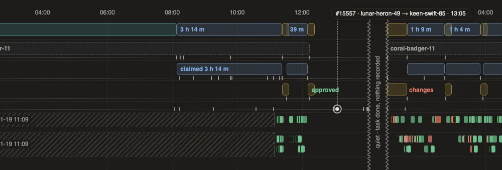

Every layer over the tracks (the hour lines, the not-kept hatch, a skipped stretch's band, the
ticks and the arrow) is drawn from the tracks' own start and width, so none can begin a few
pixels off the others, as today's hour lines do.

### Quiet stretches

A stretch is **quiet** when, for at least an hour, the task's records hold nothing in it:

- no build or test queued or running in it;
- no executor or reviewer role held across it;
- no message at any instant in it, and no change of stage, role, review round or gate.

An orchestrator's hold does not count against quiet, as it holds many tasks at once. A quiet
stretch is **measured** only where every record the rule reads is kept across it: the
recorder's runs from the time it keeps them, and a complete role and address history. Anywhere
else the same emptiness is **unknown**, and it is never skipped. A stretch that runs on to now
on an open task is not skipped either, as it is still going.

| On this task | Records | Reading |
| --- | --- | --- |
| 11-19 14:03 → 11-20 00:57, 10 h 54 m | Task done. No role held. No run, message or change. Runs kept. History complete. | Quiet, measured: skippable. |
| 11-19 01:31 → 08:04, 6 h 33 m | Ready. Orchestrator held. No message or change. Runs before 11:09 not kept. | Unknown: drawn on the true clock, its run lanes hatched. |
| 11-19 12:14 → 13:00, 46 m | Done. Nothing recorded. | Under an hour: drawn on the true clock. |

The rule reads only what the timeline's answer already holds (stages, claims, rounds, runs,
`runs_from`, gates, and `history` with its sources), so it needs no new read. A session's
health is not used. The server's agent activity lines show keen-swift-85 beating every few
minutes through the whole closed stretch, its line still naming this task. A live session is
not work on a given task. Neither are the machine's hourly counts of running sessions, which
are kept for a project and not for a task.

A skipped stretch is a 36 px band through every lane, its edges zigzagged. The hours line above
it reads its length ("+10 h 54 m"), and a day that changed inside it is written after it. The
band itself says why ("quiet · task done, nothing recorded"), and its hover gives the exact
start and end. A click on the band draws that stretch on the true clock. The toolbar's "Skip
quiet stretches" switch, with its count and total, draws them all either way. Bars that run
through a band, such as a gate state held through it, are drawn under it. Skipping changes
widths only, never what is drawn: by its rule a band holds no record. With this stretch skipped,
the rest of the task gets 1.6 times the width.

## The choice

- **A: the true clock always.** Nothing is skipped. Zoom and the overview are the way past an
  empty stretch. It costs nothing beyond the zoom, and every width is to scale. On this task
  the whole-task view stays 40% empty.
- **B: quiet stretches skipped by default.** The whole-task view shows the work, each band says
  its true length, and the switch or a click gives the true clock back. Widths across a band are
  not to scale: two hours either side of a band are as wide as two hours, but the band's
  10 h 54 m is 36 px. The range readout, the band's own words and the hours on either side say
  so.
- **C: skipped on request.** As B, but the switch starts off. The first view is A's, and the
  switch is one press away.

B is recommended. The request asks for skipped ranges where no work was done, and keeps the
whole task as the default view. Under C the skip is off in the very view where the empty hours
show.
B narrows only measured emptiness, never unknown time, and labels each band with its length,
so it does not pass off a gap as short.

- [r] **timeline-navigation** — A task's wide timeline would still open on the whole task, and gain zoom and sideways movement. Builds and tests would sit on one or two rows at their recorded times, not in a pile, and messages would be small ticks under the bars, not rings on them. One choice is open: what to do with a long stretch in which the task's records hold nothing. The 10 h 54 m after `tools/workflow-revision-guards` closed takes 40% of its width today. A: always the true clock, with zoom alone to get past such a stretch. B: such stretches skipped by default, each a narrow band that says its length, a click or a switch showing true time. C: as B, but off until switched on. Time the records do not cover is never skipped. Recommended: B. Approve and say A, B or C in the note, or comment. [[analysis/timeline-navigation#The choice]]
  [2026-11-20 04:56] agent — Base: today, `tools/workflow-revision-guards` at 1440 wide on the shared server. Its builds and tests take 26 rows, its messages are rings on the bars, and the 10 h 54 m after it closed is the empty 40% in the middle. 

    A message selected, then the same mark held down, before the repair below: 

    **The arrow was a defect, not part of this choice, and is repaired.** Its overlay was on a scale 8 px off the marks', it stopped 6 px above them, and a held mark jumped 12 px to the right. The board task `app/timeline-message-alignment` repaired all three and landed after these pictures; its source is this proposal's baseline. The hour lines share the 8 px offset, and a phone's message words sit 16 px below their diamond. The repair left both to this proposal, under every option.
  [2026-11-20 04:56] agent — Posted for the board task `inbox/timeline-ui-needs-improvement`. The whole task under each option, from a mockup that draws this task's recorded timeline; nothing is built: 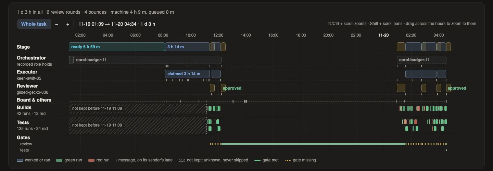  

    **A** keeps every width to scale. The empty 40% stays, and zoom gets past it. **B** gives the work 1.6 times the width. A band's 10 h 54 m is 36 px, and its label, the hours line and the range readout all say so. **C** draws A until its switch is on.

    **What counts as quiet.** At least an hour with no build or test, no executor or reviewer role held, and no message or change of stage, role, round or gate, and only where those records are kept. Here the 10 h 54 m after the close is quiet. The 6 h 33 m of ready time is not: no runs are kept before 11:09, so that time is unknown and stays on the true clock. A session's heartbeat is not used: keen-swift-85 kept beating through the closed stretch.

    **What each costs.** No option needs a server or schema change. B and C need the same client work: one slice more than A, the band and its switch.

    **Why B.** Your request: “Could also have a "skipped range" for when no work was done”, with the whole task kept as the default: “having the default be "100% view of the timeline does make sense tho”. B narrows only measured emptiness and labels each band with its length. C leaves the empty hours in the first view.

    **Earlier verdicts checked.**
    - **reports-task-page-pictures** (A): lanes wide and a list on a phone, kept.
    - **task-page-timeline-place** (C): the phone's 240 px box, kept.
    - Your note on `inbox/timeline-should-not-be-collapsed-by-defa`, “Desktop collapse save almost no space and hides really good information from view.”: the whole task stays the default and nothing is collapsed. By its rule, a band holds no record.
    - Your rejection of **timeline-burst-drawing**, “yes. rework the proposal to be more horizontal based.”: runs keep their own bars at their recorded times, on one row unless they overlap, with no folding. At the whole-task scale, runs seconds apart share pixels, and zoom parts them.
    - **timeline-orchestrator-messages** (approved): one arrow for the selected message, and the message list and its keys, kept. The mark becomes a tick under the bars, a change of drawing only.

    None of them decides whether quiet time is skipped.
  [2026-11-20 04:56] agent — Under every option:
    - The whole task shows first. Whole task, − and +, ⌘/Ctrl + scroll and a drag across the hours zoom, Shift + scroll moves, and an overview strip shows where the view is while zoomed.
    - A run takes another row only when it overlaps one, so the lanes are 353 px tall against 818.
    - Where runs are not kept, the Builds and Tests lanes are hatched, in place of the sentence above them.
    - A selected message's arrow joins its two marks. A message whose two ends share a lane, such as an outside post to everyone, draws no arrow: its tick is ringed, and the hours line names both ends. Today it draws a 12 px stub.

    Zoomed to 73 minutes, a verdict selected:  [Open the mockup](timeline-navigation/mockup.html).

    **On a phone** the list and its 240 px box stay under every option. The box shows four steps where it shows one today: the "not kept" sentence becomes a row at its time, and a message takes one line. A quiet stretch is a row of its own:  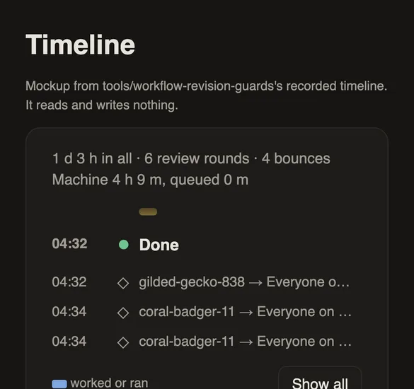 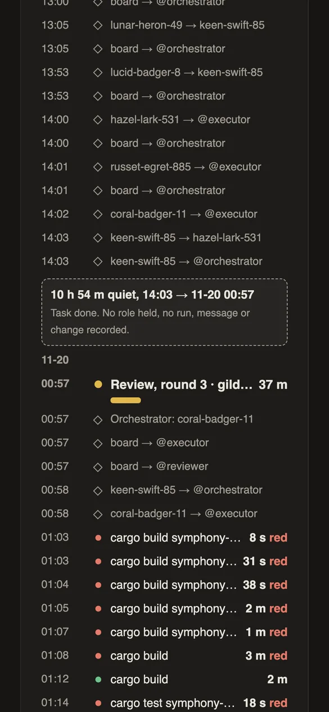
  [2026-11-20 05:04] owner · approved — B
  [2026-11-27 07:43] agent — Built as B and released in release-2026-11-26.2: the timeline's rows, message ticks and overview (`app/timeline-navigation`), zoom and sideways movement (`app/timeline-zoom`) and the quiet stretches skipped (`app/timeline-quiet-bands`). What the build left open is asked on the cards **timeline-run-words-contrast**, **timeline-drag-band** and **timeline-quiet-words**.
  [2026-11-27 07:43] agent · resolved

## On a phone

The phone keeps its list and its 240 px box under every option, as the box was chosen to keep
the brief and the thread near the top. The list gains the same readings:

- **Not kept** is a row at 11:09, "Builds and tests kept from here on", in place of the sentence
  above the list.
- **A quiet stretch** is a row of its own: "10 h 54 m quiet, 14:03 → 11-20 00:57", with the
  records that make it quiet. The list has no scale, so this row is there under A as well.
- **A message** is one line of 28 px, its time, diamond and words on one centred line in the
  muted colour, against about 50 px today with its words 16 px below its diamond. The whole row
  is its press area.
  A run's row carries its distinguishing words, its length and a red result on one line.

The box shows four steps in place of one. The mockup's list of the same stages, runs, role holds
and messages, 255 of today's 259 steps without its four "Orchestrator released" rows, is 7,531 px
tall against today's 12,830 px.

## What it costs, in slices

Each slice is client-only, in `apps/symphony-web/src/timeline-layout.ts`, `timeline.tsx` and
`timeline.css`. Each works from the answer the page already reads, with no server, wire or
schema change, and each is tested at its own layout functions and drawn in a browser test at
1440 wide and on a phone.

1. **Rows by overlap.** Drop the half-percent rule. Add bars with edges, the lane's counts, the
   not-kept hatch and the distinguishing words. The rows' tests cover overlap, back-to-back runs,
   a run still running, and a run queued long before it started.
2. **Ticks on a line.** Ticks at the foot of each lane and the 22 px Board & others lane. The
   arrow runs between measured marks, with its address on the hours line, and a message on one
   lane gets a ring and no arrow. The hour lines are drawn from the tracks' own start. This
   builds on the landed alignment repair.
3. **Zoom and move.** The view's window, the toolbar line, ⌘/Ctrl + scroll, Shift + scroll,
   pinch, the drag across the hours, the keys, the overview, and parts brought into view. The
   window's arithmetic is unit tested, and a browser test zooms, moves and returns.
4. **Quiet stretches,** under B or C. The rule is a pure function over the timeline, tested at
   its edges: open roles, a run running now, messages after closure, `runs_from`, a partial
   history, equal instants, a quiet tail on an open task, a stretch exactly an hour long. It
   draws the band, the switch and a band's click.
5. **The phone's rows.** One-line message rows with their words level with their diamond, the
   not-kept row, and the quiet row, which comes with slice 4 under every option.

Slices 1 and 2 stand alone, and slice 4 needs slice 3. Under A, slice 4 is the phone's quiet row
alone.

## Tradeoffs

- **Scale.** A skipped stretch is not to scale. Its band says its length, and the switch and a
  click restore the true clock.
- **Separation.** Reusing rows packs runs seconds apart into shared pixels at the whole-task
  scale. The rows that keep them apart today take 500 px on this task, against 76. Here zoom parts them, and the
  list, the hover and the focus keep each run its own.
- **Marks.** Ticks are smaller targets than rings. Each keeps a 24 px press area, the message
  list and its keys.
- **Controls.** One toolbar line, about 36 px, is always there. The overview, another 36 px,
  shows only while zoomed. Both fit in the 465 px the rows give back.
- **Keys.** Zooming needs a modifier, so a wheel never traps the page. A trackpad's sideways
  swipe moves the view only while zoomed.
