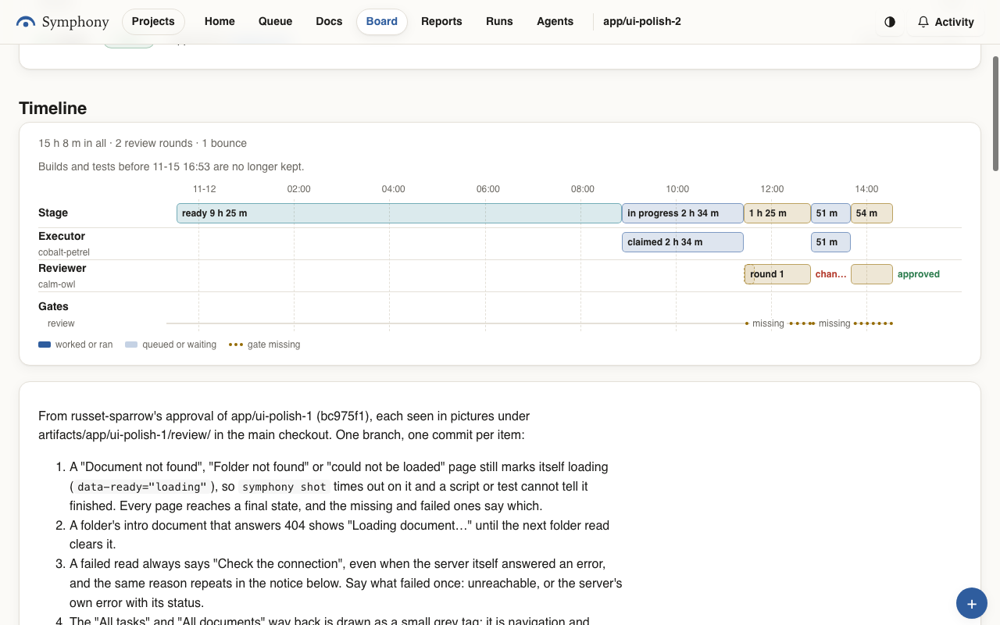
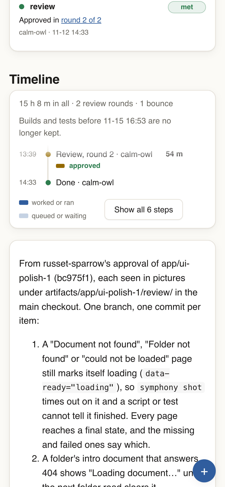
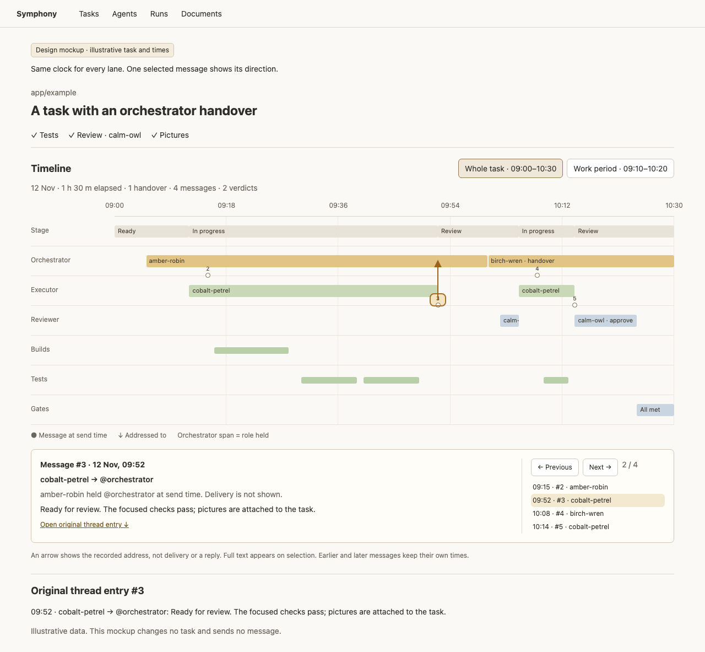
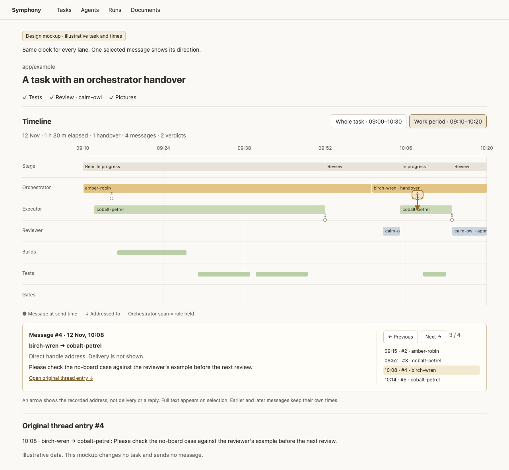
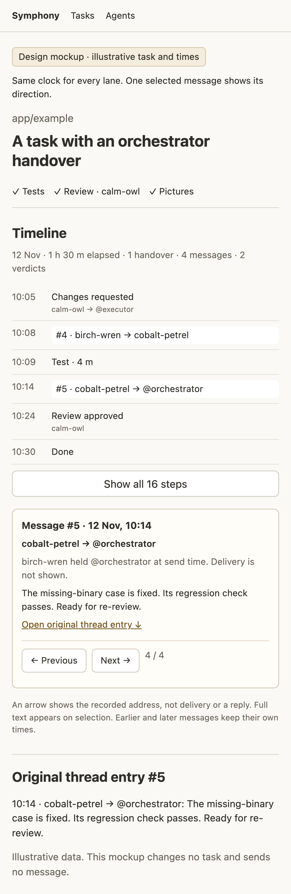
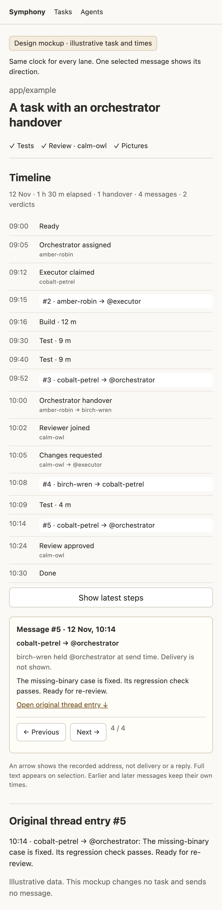

# Orchestrators and messages on a task's timeline

A proposed addition to [the task timeline](../../workflow/TASKS.md#the-timeline): show who orchestrated the
task and which way its messages were addressed, on the same clock as execution, review and
machine work. [Its card](#timeline-orchestrator-messages) asks about the drawing
and selection behavior. The [interactive mockup](timeline-orchestrator/mockup.html) uses invented
handles and times; it is a design example, not a working task page.

## The drawing

On a wide screen an Orchestrator lane sits between Stage and Executor. A named span means the
session held that task's role, not that it worked continuously or was connected throughout.
An assignment, join, takeover or handover starts a span; release ends it. A handover changes the
name at its recorded time. Gaps stay empty. All lanes share the same horizontal time scale.

Messages are instants, drawn as small selectable marks at their send times. Selecting a mark
draws one arrow from its sender's lane to the addressed lane, at that same time, and opens its
details below the lanes. The arrowhead says the direction. It does not join a message to a later
reply or represent time spent waiting. Selecting a different message replaces that arrow.
The details show the message number, full sender, original recipient, exact time, full text and
a link to the original thread entry. Text identifies both endpoints without relying on color.

Every message stays reachable in an ordered message chooser beside the details, with Previous
and Next controls and keyboard access. Marks at the same position retain their own chooser
entries. Selecting one scrolls or zooms the common time window to include it. A minimum hit area
around a mark is separate from the instant it represents. No event's time or duration is stretched
to make room for its words.

The mockup's Whole task and Work period views demonstrate one shared scale. Sequential machine
runs reuse a horizontal row; only actual overlaps need another. Choosing a shorter period changes
every lane together. This proposal adds no burst folding and does not ask the run layout choice
again. Its production zoom and pan controls belong to the coordinated horizontal timeline work.

- [r] **timeline-orchestrator-messages** — The task timeline would show an Orchestrator lane, with each holder and handover at its recorded time. Messages sit on the same horizontal clock. Selecting one shows its direction with an arrow between lanes, its full address and text, and a link to the thread. One arrow shows at a time, so the history stays readable. On a phone, the existing 240 px list gains orchestrator steps and sender → recipient rows; Show all opens the rest. Approve this presentation, or comment. [[analysis/timeline-orchestrator#The drawing]]
  [2026-11-17 17:19] agent — For `inbox/no-orchestrator-in-timeline`. The cited task, `app/ui-polish-2`, records quiet-plover joining as orchestrator (#1463) and cobalt-petrel reporting to `@orchestrator` (#1614, #1727), but its timeline has neither. Its earlier orchestrator posts are broadcasts, not private messages to the executor. The current page, on the installed release:  

    **Proposed, illustrated rather than built:** invented handles and times show both directions and a handover. The executor reports to amber-robin before the handover; birch-wren sends a follow-up afterward. Every lane uses the same scale, including the closer time view.    [Open the interactive mockup](timeline-orchestrator/mockup.html).

    Show all on a phone reveals the assignment and handover as well as both message directions: 

    **Meaning and cost.** A span means the role was held, not continuous work. An arrow means addressed to, not delivered or answered. Broadcasts and uncertain endpoints keep their recorded words; no reply connection is guessed. This needs role-history replay and additive timeline fields, plus selection and thread links in the client; the board already stores addresses and times, so no routing or storage migration is proposed. Selecting a message adds a press before its arrow and full text show; it avoids a web of crossing arrows. The mockup validates this presentation, not production performance or complete routing edge cases.

    **Earlier verdicts checked.** **reports-task-page-pictures** (A) chooses common gates and horizontal lanes wide, with a chronological list on a phone; it does not decide how messages connect. **task-page-timeline-place** (C) keeps the phone's 240 px box. The later note on `inbox/timeline-should-not-be-collapsed-by-defa` keeps desktop lanes open. Your rejection of **timeline-burst-drawing**, “yes. rework the proposal to be more horizontal based.”, keeps runs at actual horizontal times: these pictures reuse rows for sequential runs and show one common closer time view. This card adds orchestrator and message presentation only; it does not replace that run-layout work or ask its rejected folding options again.
  [2026-11-17 17:32] owner · approved
  [2026-11-17 19:18] agent · resolved
  [2026-11-17 20:45] agent · resolved
  [2026-11-17 20:54] agent · resolved

## On a phone

The chronological list stays in its existing 240 px step box until Show all. An orchestrator
assignment, release or handover is a step, and a message row names its sender and recipient with
a right arrow between the words. Selecting it opens the same details below the box. Show all
reveals the full list; it does not stretch a small message mark into a duration bar. The selected
message stays visible when the box is collapsed. The mockup shows the latest steps initially.

## What an arrow can say

| Recorded address or history | Drawing and details |
| --- | --- |
| A handle with one known role on this task at that time | Arrow to that role's span, naming the handle. |
| `@orchestrator`, `@executor` or `@reviewer` | Arrow to the addressed role. Name its holder only where the recorded history identifies one, labelled as the holder at send time. Keep the role address in the details. |
| No recipient | A message to Everyone on task, not a private arrow to the executor. |
| `owner`, `board`, an outside handle, or a sender with no known role | A mark on an Other / task messages row, with the exact endpoint named in details. Do not assign it a role from today's session list. |
| Missing history or several possible holders/roles | Keep the role address or handle as recorded and say the individual endpoint is unknown or ambiguous. Do not choose one. |
| Several messages at the same time | Separate chooser entries ordered by message id. Selection draws one directed message at a time. |
| A message after task closure | Extend the displayed time range to include it and leave the task's closed stage unchanged. Mark its time as after closure. |

An arrow means **addressed to**, not delivered, read, answered or caused. The board's message
record does not identify a reply parent or the historical set of actual recipients. A role's
holder inferred from its recorded span is context, never proof that a callback reached it.
Direct agent messages outside the task thread are outside this timeline's evidence.

For a subtask inheriting its orchestrator from a parent, the current parent holder cannot stand
in for history. Resolve the nearest recorded parent assignment at the message's time, with its
source task identified, or leave the individual unknown. Never backfill the task's whole life
with its current orchestrator. A closed task's role span ends at closure; a later message keeps
its sender's name without implying that the role remained active after closure. Reopening starts
another recorded stretch.

## Data and implementation boundary

The timeline wire type (`crates/symphony-api/src/timeline.rs`) adds optional `history` beside
stages, executor claims, review rounds, runs and gates. An absent `history` means the server
does not supply this projection, never that there were no messages. The existing timeline
and gates replay keeps its own semantics; `stages::roles` separately replays recorded role
events in message-id order, using `orchestration::moved` for handovers, takeovers and gives.

`history.sources` identifies each source task, its `first_id` and `last_id`, and its state:
`complete` for all recorded lines, `partial` for a cutoff or uncertain records, `unavailable`
for a failed read. Complete describes the records read, not a promise that every action was
recorded. Each source reads at most 256 newest lines, with one extra row to detect continuation,
through the thread's key range. Non-system message bodies are omitted; verdicts retain their
first 16 characters for replay. System event text is bounded to 2048 characters, with a cut
making its source uncertain. At most eight sources, including the task, are read; historical
parent moves name additional sources. `sources_complete` is false when this count or a failed
read leaves ancestry unexplored. Missing parents and cycles cannot supply a holder.

A source's `before` cursor names older entries still reachable through the existing
`/api/task-history?slug=SLUG&before=ID` read. Continue that read using its own `before` cursor;
each `TaskEntry.message` supplies the original id, address, timestamp and full text. Selecting
a metadata entry uses the same thread reads and rendering. Loading and failed reads keep their
own visible states; neither becomes an empty complete history. Earlier entries reached through
thread reads retain unknown individual endpoints unless their recorded role history is available.

`history.roles` holds executor and reviewer stretches and effective orchestration on the task.
Each span names `role`, `by`, its assignment's source task, and the exact boundary times and
global message ids (`from`, `from_id`, `to`, `to_id`). Inheritance starts at a recorded child
boundary, such as its creation or reparenting; source attribution identifies the ancestor whose
assignment supplies the holder. Closure suspends roles until a recorded reopening. Missing
boundaries stay unknown. Regressing clocks and conflicting duplicates mark spans `uncertain`;
they never produce corrected timestamps or definite durations.

`history.messages` keeps non-system entries' `id`, `at`, `sender`, original `recipient`, `kind`
and nullable `after_close` (unknown when the recorded range cannot say), ordered by exact
timestamp then id. Its `from` and `to` endpoints each have a
state (`known`, `ambiguous`, `unknown`, `everyone` or `outside`) and role candidates naming
their holder and source task. A partial nearer source prevents inference from a parent. Several
roles or holders remain candidates; current session and role rows supply none. An endpoint is
context for the recorded address, never evidence of delivery or reply causality. A client extends
its shared clock to include message instants after closure while retaining the closed stage.

This design changes neither board routing nor its storage schema. Its implementation should
prove assignment, release, handover, duplicate and out-of-order lines, gaps, multiple roles,
role-addressed and direct messages, broadcasts, outside actors, inherited and missing history,
equal-time events, closure and reopening. Client checks should cover both directions, selected
details, colliding marks, keyboard selection, phone Show all, and one time scale across lanes.
Desktop and phone browser evidence should use a scratch board with a handover and both message
directions. Test coverage belongs to that implementation; no production behavior is changed by
these mockups.
