# A task's cost on its card, its page and its timeline

A proposal for where a task's estimated cost shows ([What the tokens cost](../../workflow/TASKS.md#what-the-tokens-cost)
says how it is estimated). Its total goes on the board card, on the time's line, and on the page,
after the task's total time. In the [timeline](../../workflow/TASKS.md#the-timeline), each stage stretch's cost
goes after that stretch's time. The table at the page's foot goes.
[Its card](#task-cost-after-time) asks for it. The three options drawn before it are
under [The choice](#the-choice).

Every picture is of one task, `tools/workflow-revision-guards`, the task the approved
[timeline navigation proposal](timeline-navigation.md) draws. Its tokens were read from the board on
2026-11-20 at 06:00, after it closed. Pictures of today come from a private server running main's build at
`0cf424663`, the first with the token pages: the shared server runs `release-2026-11-20`, which
has none yet. In them the machine's name under the Builds and Tests lanes is hidden, and the brief
and the thread are cut out and said so. Proposed pictures come from an [HTML mockup](token-cost/mockup.html)
that draws that task's recorded timeline as the approved proposal does (quiet stretches skipped) and
its recorded tokens, with no message bodies or machine names. Its address `#t` opens the design,
with `-zoom`, `-zoom-focus`, `-phone` or `-phone-all` for each picture's view; `#a`, `#b` and `#c`
open the first options, each with `-phone`, `-focus` or `-phone-all`. It reads and writes nothing,
and nothing in the product changes with this proposal.

## What the record holds

The board keeps a task's tokens by session: one row for each handle, role, model and round, with
its first and last model call, its calls, its tokens and their estimated dollars
([Where the tokens go](../../workflow/TASKS.md#where-the-tokens-go)). This task has 13 rows: $80.02 in 884
calls, executor $62.42, reviewer $17.27, and $0.32 spent while the task was reserved, before its
claim.

- **No cost per build or test.** A build or a test spends no tokens of its own: the session that
  started it did, and its calls are not tied to the run. No build or test is given a cost.
- **No cost per call or per minute.** Only a row's first and last call are kept. A row is never
  split between two stretches: where its calls run past a stretch's edge, the record cannot say
  how much fell on each side.
- **Rounds are counted from the work, not the reviews.** The record's round 1 is the work before
  the first review, and round *n* + 1 is review *n* with the fixes after it. The timeline counts
  this task's reviews 1 to 6, and today's table its rounds 1 to 7.
- **Every figure is an estimate** at the API list prices read 2026-11-16, never money spent, and
  each says so where it is pointed at, tapped or focused.

## Today

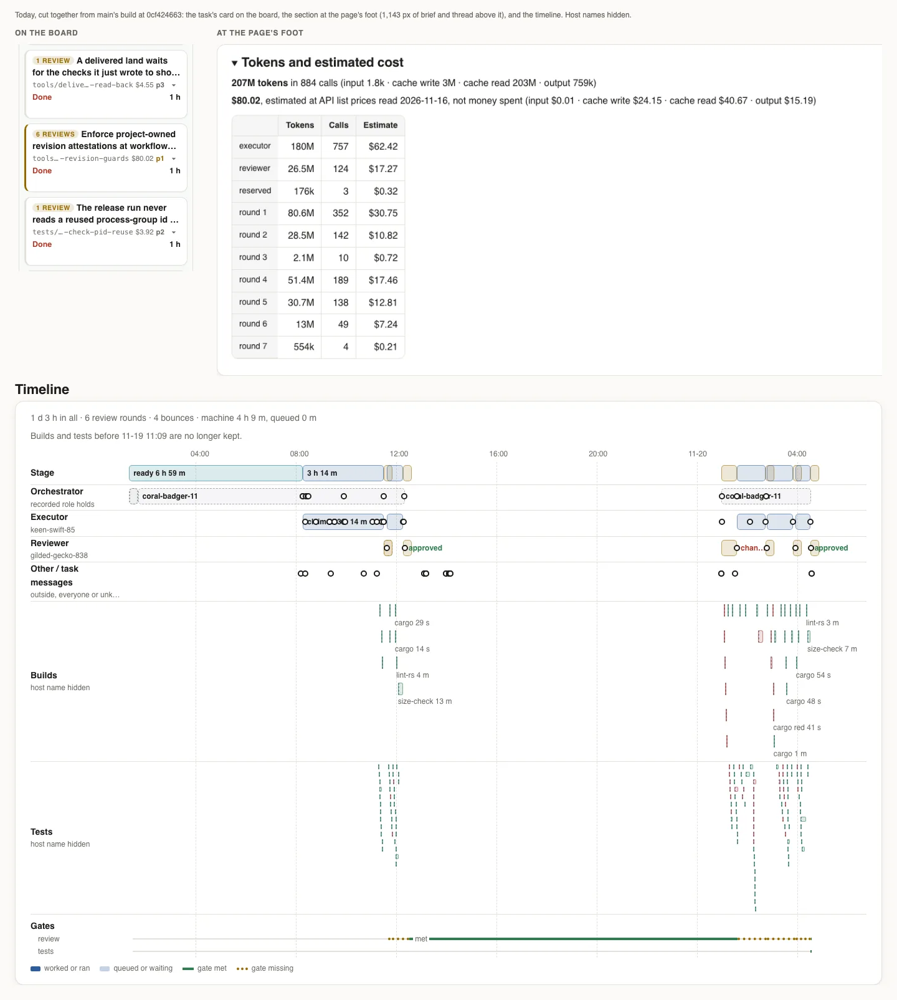

The card, the section at the page's foot and the timeline, cut together from today's page in the
proposed pictures' layout. The page as it is, the brief and the thread cut out:

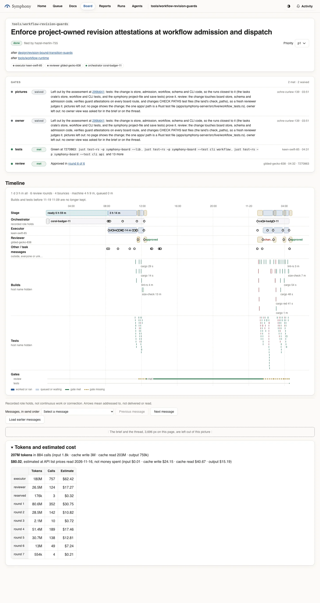

At 1440 wide the total time is the first line of the timeline: *1 d 3 h in all · 6 review rounds
· 4 bounces · machine 4 h 9 m*. The cost is the last part of the page, under the thread, closed:
on this task 1,143 px of brief and thread lie between the two (more where the thread is longer).
Opened, it says the tokens and the cost by kind in two lines, then a table of ten rows: three roles
and seven rounds, each with its tokens, calls and estimate.

On a board card the cost sits beside the slug, which gives way to it (`tools…-revision-guards
$80.02 p1`); the time is on the line under it, on the right.

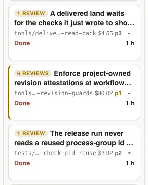
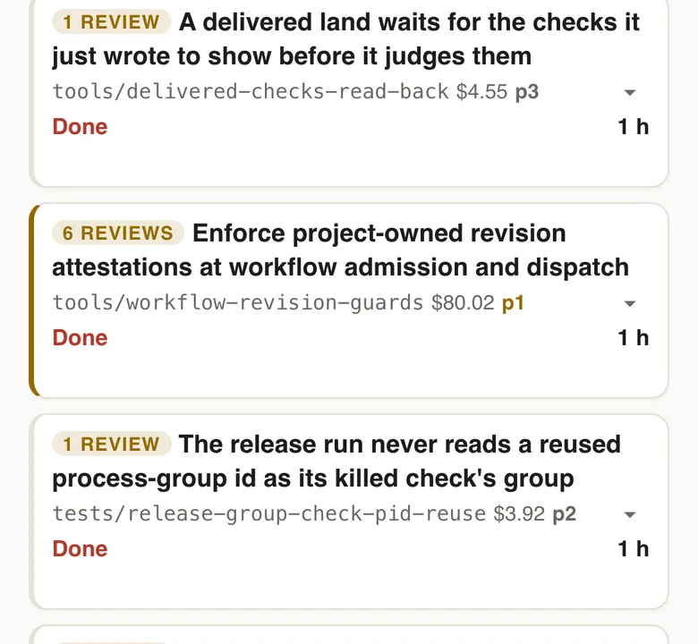

On a phone the cost table is the page's last part as well, under the 240 px timeline box:

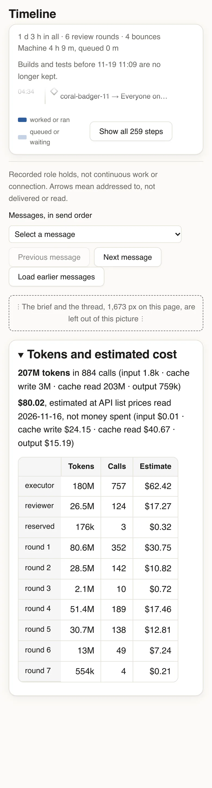

The same in dark: 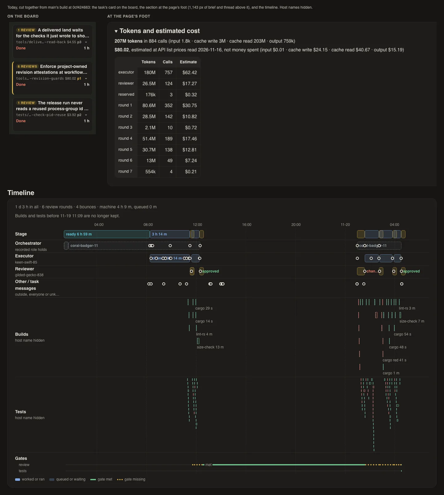
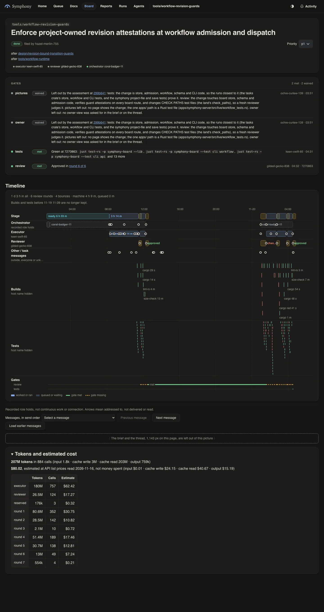
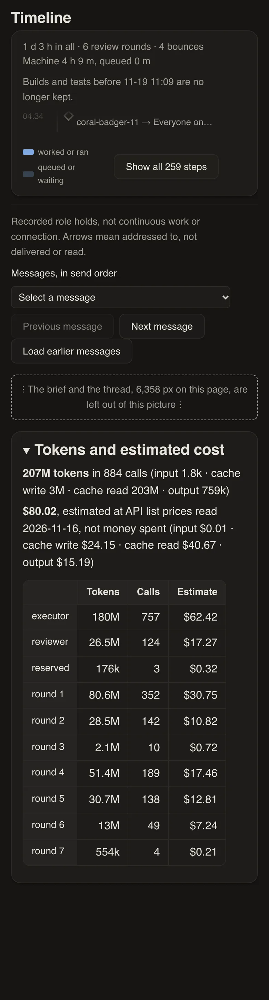
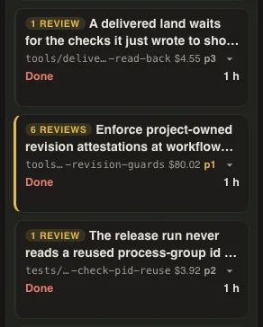
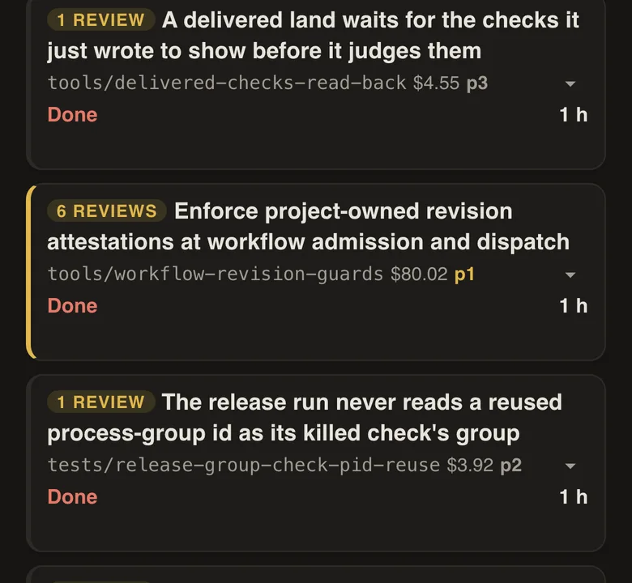

## The cost after the time

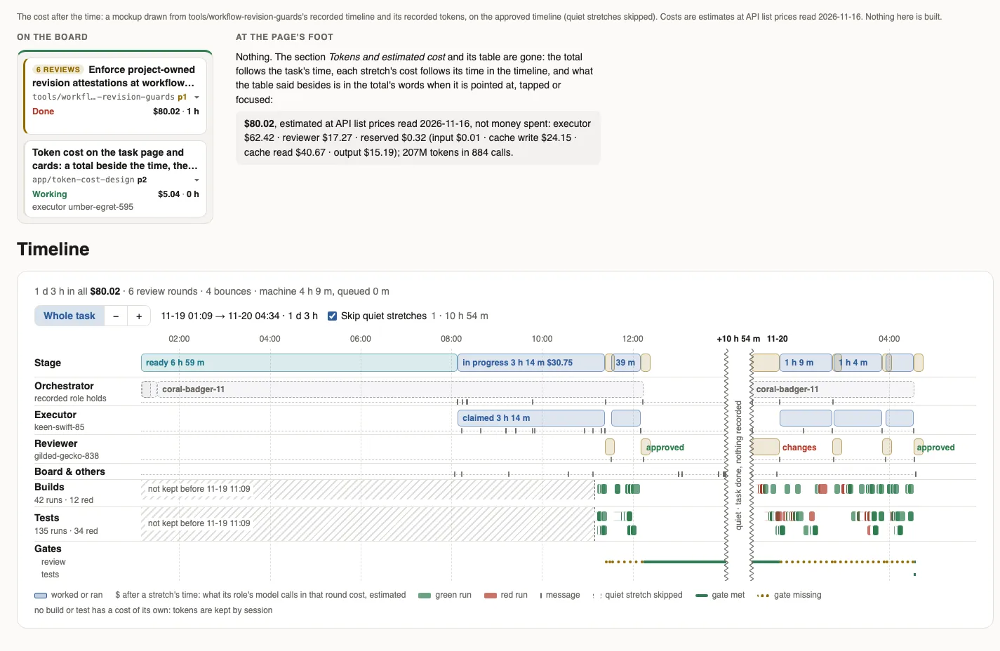

- **The card** carries its total on the time's line, `Done   $80.02 · 1 h`, and its slug line
  gets its room back.
- **The page's total follows the task's time** on the timeline's first line: *1 d 3 h in all
  $80.02 · 6 review rounds · 4 bounces…*. Pointed at, tapped or focused, it says what the table
  said besides: *$80.02, estimated at API list prices read 2026-11-16, not money spent: executor
  $62.42 · reviewer $17.27 · reserved $0.32 (input $0.01 · cache write $24.15 · cache read $40.67 ·
  output $15.19); 207M tokens in 884 calls.* A total with unpriced tokens keeps today's `$1.23+`,
  its words naming the models.
- **Each stage stretch's cost follows its time** on the Stage lane, in the label the timeline
  already fits to each stretch: its word and time, else its time alone. The cost goes where both
  fit: `in progress 3 h 14 m $30.75`, or `3 h 14 m $30.75`. A stretch with room for its time and
  not its cost shows the time, as today. Zoom draws more of them.
- **Every stretch says both in its words** when it is pointed at, tapped or focused, with whose
  calls they were and when those ran.
- **There is no summary line and nothing at the page's foot.** The total is the summary, and the
  stretches carry each round's cost, role by role.
- **On a phone** each stage row ends with its time and its cost, `3 h 14 m $30.75`; the totals'
  two lines and the box are today's.
- **A task with no tokens** shows no cost anywhere, and its lines stay as today.

At the whole task's scale, 1440 wide, only the first stretch of work has room for both:
`in progress 3 h 14 m $30.75`. The other stretches on the first day show `39 m`, and on the
second `1 h 9 m` and `1 h 4 m`. Zoomed to the second day's work, each stretch of 37 minutes or more
shows both, and a review of 5 minutes says it when pointed at:

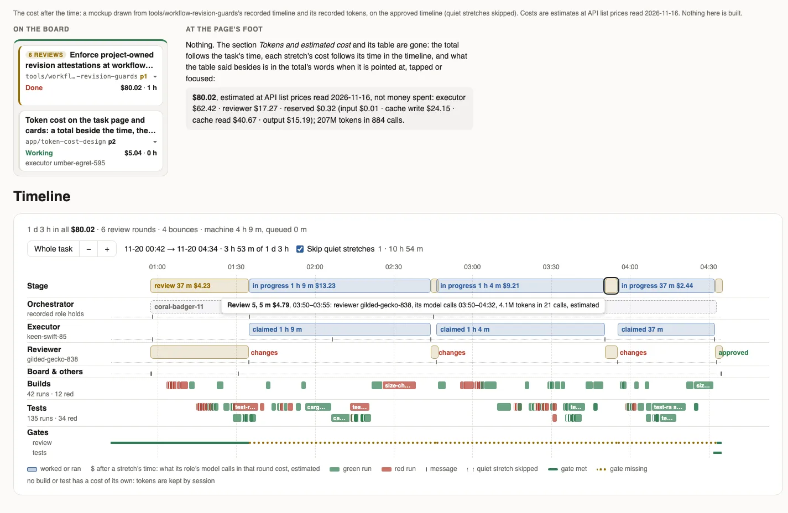

On a phone the box opens on the task's last steps, as today; Show all lists every step, each
stretch with its cost:

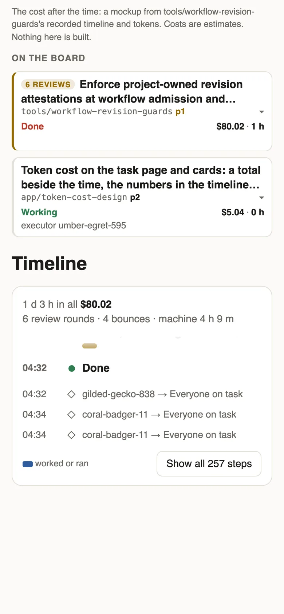
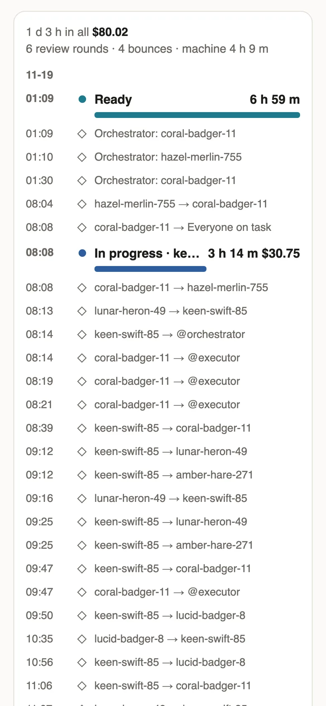
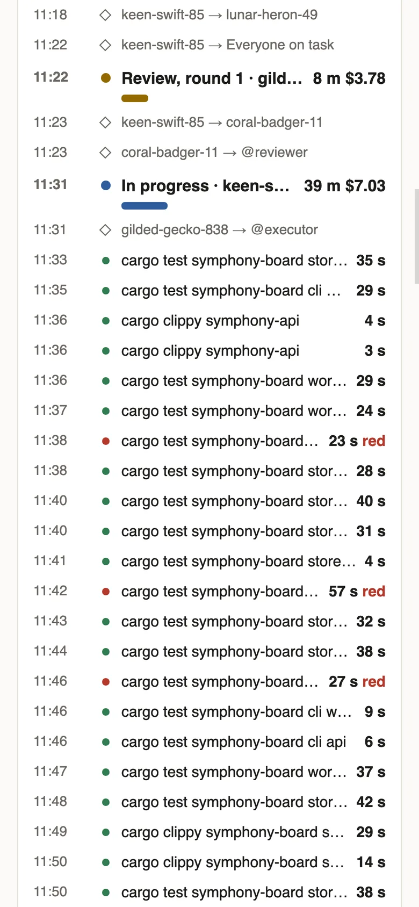

In dark: 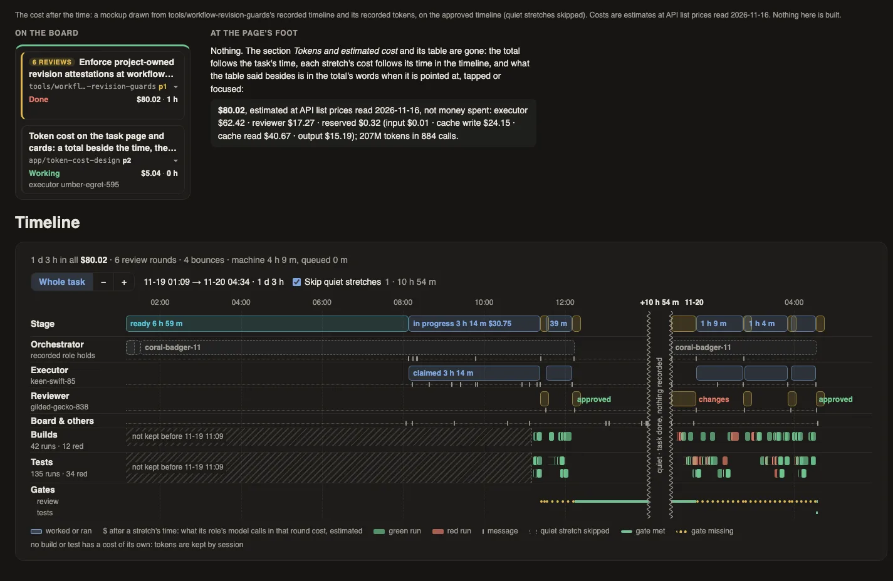
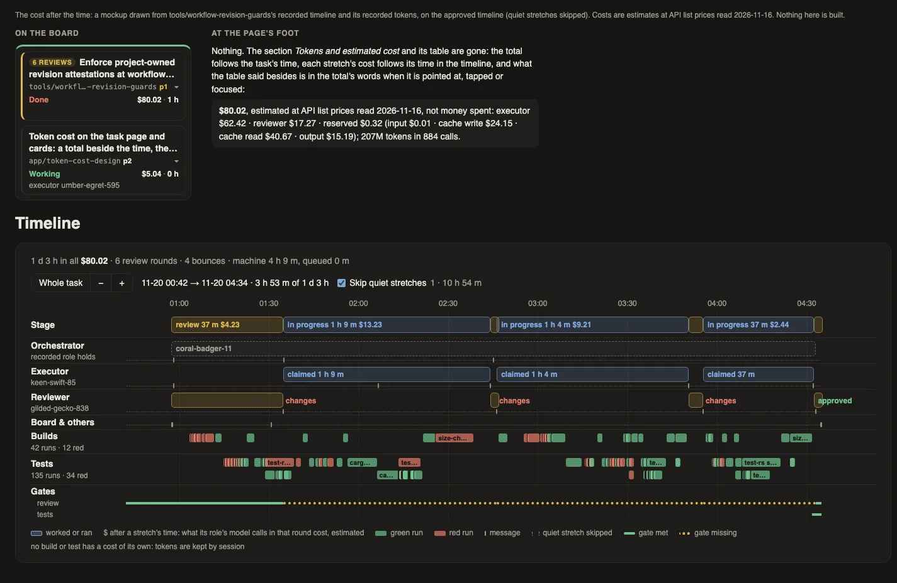
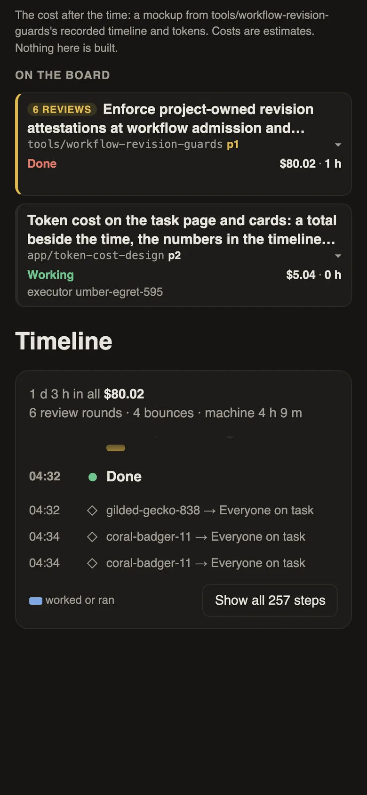
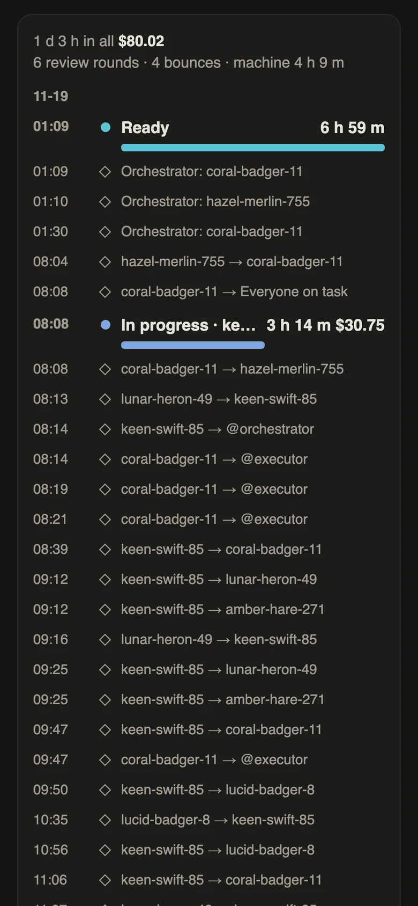

- [x] **task-cost-after-time** — Your note on **task-cost-display**, drawn. A task's estimated cost follows its time. On its board card it sits on the time's line, as in A (`$80.02 · 1 h`). On its page it follows the total time (`1 d 3 h in all $80.02`). In the timeline it follows each stage stretch's time (`in progress 3 h 14 m $30.75`) wherever both fit, in the label the stretch has today. Zoom draws more, every stretch says its cost when pointed at, tapped or focused, and on a phone each stage row ends with both. There is no summary line and nothing at the page's foot. Each stretch carries what its own role spent in its round, an in-progress stretch the executor's calls and a review the reviewer's, so the stretches add up to the total. The record keeps only a round's first and last call, so calls that run past a stretch's edge stay on it, and no build or test carries a cost. Approve, or comment. [[analysis/token-cost#The cost after the time]]
  [2026-11-21 13:14] agent — Base: today, `tools/workflow-revision-guards` at 1440 wide on a private server of main's build at `0cf424663`; the shared server's release has no token pages yet. On the card the cost sits beside the slug. The total time is the timeline's first line, and the cost is the page's last part, closed, 1,143 px further down, which opens to a table of ten rows. Cut together: 

    On a phone, from the timeline down: 
  [2026-11-21 13:14] agent — Posted for the board task `app/token-cost-design`. The same task, from a mockup that draws its recorded timeline (the approved navigation, quiet stretches skipped) and its recorded tokens; nothing is built. The whole task, the second day's work zoomed, and a phone's Show all:   

    At the whole task's scale only the first stretch of work has room for both: `in progress 3 h 14 m $30.75`, your example, which is $30.43 of the executor's calls and $0.32 its session spent while it held the task reserved, at the claim. The other stretches show their time, as today. Zoomed to the second day, every stretch of 37 minutes or more shows both.
  [2026-11-21 13:14] agent — **Which stretch carries what.** Every recorded row goes on exactly one stretch, so they add up to $80.02: in progress $30.75, review 1 $3.78, in progress $7.03, review 2 $0.72 (with the executor's $0.08 made while it ran, as no fixes followed), review 3 $4.23, in progress $13.23, review 4 $3.60, in progress $9.21, review 5 $4.79, in progress $2.44, review 6 $0.21. Ready and done carry nothing.

    **What the record cannot split.** It keeps a row's first and last call, not each call's time. Each executor row after the first starts the minute its review began: round 4's calls ran 00:57–02:43, and all $13.23 is on the 1 h 9 m after review 3. Review 5's reviewer made calls until 04:32, 37 minutes past its end, and all $4.79 is on its 5 minutes. A stretch's words name when its calls ran, so a reader sees where a figure spills over; nothing is apportioned by time. 

    **On a phone** the box opens on the last steps and keeps today's height:  

    In dark:    [Open the mockup](token-cost/mockup.html).
  [2026-11-21 13:14] agent — **What it costs to build.** Nothing is recorded anew and the schema stays. The card moves its cost to the time's line. The page reads the task's token rows with its timeline: each handle, role and round with its first and last call, which `tasks show --json` gives and `/api/task-tokens` leaves out. It puts each row on its stretch and adds the cost to that stretch's label, words and phone row. The foot's section goes, and no lane is added.

    **Earlier verdicts checked.** **timeline-navigation** (B): drawn on it; the build counts token rows among what the quiet rule reads, so a skipped stretch never hides a cost. **task-page-timeline-place** (C): the phone's box is today's. **reports-task-page-pictures** (A): lanes wide, a list on a phone. **timeline-orchestrator-messages**: messages kept. **task-cost-display**: A's board card, as you chose; the rest follows your note.
  [2026-11-21 17:30] owner · approved
  [2026-11-21 17:40] agent — Recorded: the design as drawn, built by the board task `app/task-cost-after-time`. Its brief carries the attribution rule and this task's figures as the test's oracle. It builds on today's timeline: **timeline-navigation**'s zoom, and its quiet rule counting token rows, come with that card's own build.

### Which stretch carries what

A stretch's round is one more than the reviews started before it. Each stretch carries what its own
role spent in its round:

- **An in-progress stretch** carries the executor's calls of its round, with what the claiming
  session spent while it held the task reserved, before the claim.
- **A review stretch** carries its reviewer's calls of the round it opens. It also carries the
  executor's calls of that round when no in-progress stretch follows: fixes made while an approving
  review ran.
- **Ready, blocked and done stretches** carry nothing. A round with two in-progress stretches, a
  block between them, carries its executor's cost on the last of them, and their words say so.

Every row goes on exactly one stretch, so the stretches add up to the total. On this task:

| Stretch | Time | Cost | Whose calls, and when they ran |
|---|---|---|---|
| ready | 6 h 59 m | | |
| in progress | 3 h 14 m | $30.75 | executor $30.43, 08:08–11:22, in 349 calls; reserved $0.32, at 08:08, in 3 |
| review 1 | 8 m | $3.78 | reviewer, 11:23–11:31, in 48 calls |
| in progress | 39 m | $7.03 | executor, 11:22–12:10, in 94 |
| review 2 | 4 m | $0.72 | reviewer $0.64, 12:13–12:14, in 8; executor $0.08, 12:10, in 2 |
| done | 12 h 43 m | | mostly skipped as quiet |
| review 3 | 37 m | $4.23 | reviewer, 01:30–01:35, in 29 |
| in progress | 1 h 9 m | $13.23 | executor, 00:57–02:43, in 160 |
| review 4 | 2 m | $3.60 | reviewer, 02:44–02:46, in 14 |
| in progress | 1 h 4 m | $9.21 | executor, 02:44–03:50, in 124 |
| review 5 | 5 m | $4.79 | reviewer, 03:50–04:32, in 21 |
| in progress | 37 m | $2.44 | executor, 03:50–04:32, in 28 |
| review 6 | 31 s | $0.21 | reviewer, 04:32, in 4 |
| **all** | **1 d 3 h** | **$80.02** | |

**What the record cannot split.** Each executor row after the first begins the minute its
review began: the executor's first call of round 4 was at 00:57, when review 3 started, and its
last at 02:43. All $13.23 is on the 1 h 9 m after that review. The same holds for rounds 2, 5 and 6.
Review 5's reviewer made calls until 04:32, 37 minutes after the review ended, while the fixes after
it ran: all $4.79 is on its 5 minutes. A stretch's words name the time its calls ran, so a reader
sees where a figure spills over; nothing is apportioned by time.

### What it costs to build

Nothing is recorded anew, and the board's schema stays.

- **The card** moves its cost from the slug line to the time's line.
- **The page** reads the task's token rows with its timeline. The rows are each handle, role and
  round with its first and last call, which `tasks show --json` gives and `/api/task-tokens` leaves
  out today. The page then puts each row on its stretch by the rule above, and adds the cost to the
  stretch's label at each width the label fitter tries (`in progress 3 h 14 m $30.75`, then
  `3 h 14 m $30.75`, then `3 h 14 m`), to its words and to its phone row.
- **The section at the page's foot** and its table go.
- **No other lane changes height**, and no lane is added.

## Earlier verdicts checked

- **timeline-navigation** (B): drawn on it, quiet stretches skipped and zoom kept. No recorded
  model call falls in this task's skipped 10 h 54 m. The build counts each token row's first and
  last call among the records the quiet rule reads, so a skipped stretch never hides a cost.
- **task-page-timeline-place** (C): the phone's box is today's; nothing is added to it.
- **reports-task-page-pictures** (A): lanes wide and a list on a phone, kept.
- **timeline-orchestrator-messages**: messages and their arrow, kept.

## The choice

The three options drawn first, each with its board card, its summary at the timeline's top and
its way of drawing the cost. The design above keeps A's board card.

- [-] **task-cost-display** — A task's estimated cost would sit on its board card where its time is, and on its page beside its total time at the top of the timeline. The table at the page's foot would go, and its figures by role and by round would move into the timeline. How should the timeline show them? A: said in two lines at its top and in each part's words when pointed at; nothing drawn; the card's cost on the time's line. B: a Cost row under the stage, each round a bar from its first model call to its last with its dollars on it, and the cost by role in one line at the top; the card's cost under its time. C: each role's lane draws its own calls in each round with their dollars, and the cost by round in one line at the top; the card as B. No option puts a cost on a build or a test: the board keeps tokens by session, not by run. Recommended: B. Approve and say A, B or C in the note, or comment. [[analysis/token-cost#The choice]]
  [2026-11-20 06:17] agent — Base: today, `tools/workflow-revision-guards` at 1440 wide on a private server of main's build at `0cf424663`; the shared server's release has no token pages yet. The total time is the timeline's first line. The cost is the page's last part, closed, with 1,143 px of brief and thread between them, and opens to a table of ten rows. On the card the cost sits beside the slug, which gives way to it; the time is on the line under it, on the right. Cut together in the options' layout: 

    The page as it is, the brief and thread cut out:  The card on a phone: 

    On a phone, from the timeline down: 
  [2026-11-20 06:17] agent — Posted for the board task `app/token-cost-design`. The same task under each option, from a mockup that draws its recorded timeline (the approved navigation, quiet stretches skipped) and its recorded tokens; nothing is built: 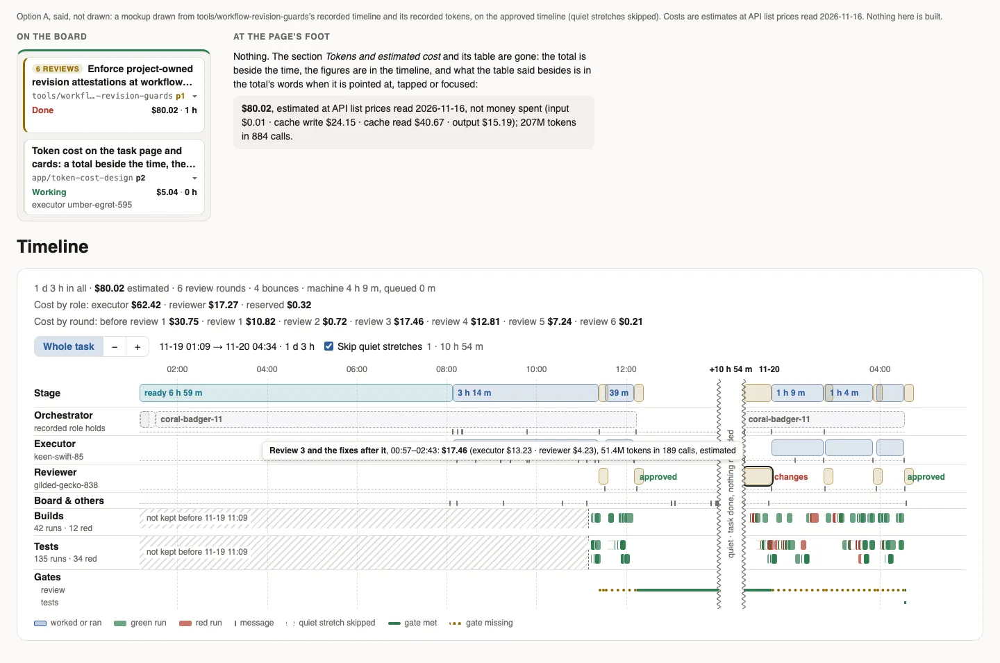 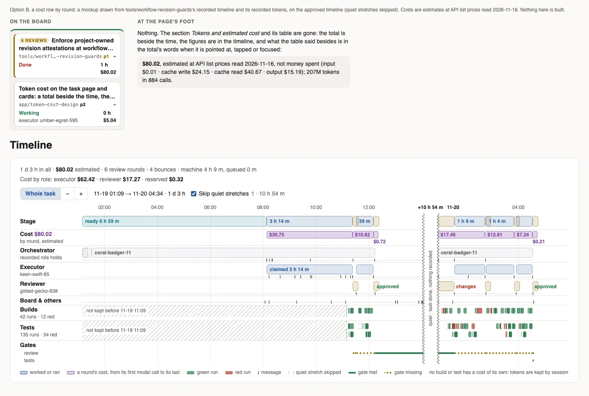 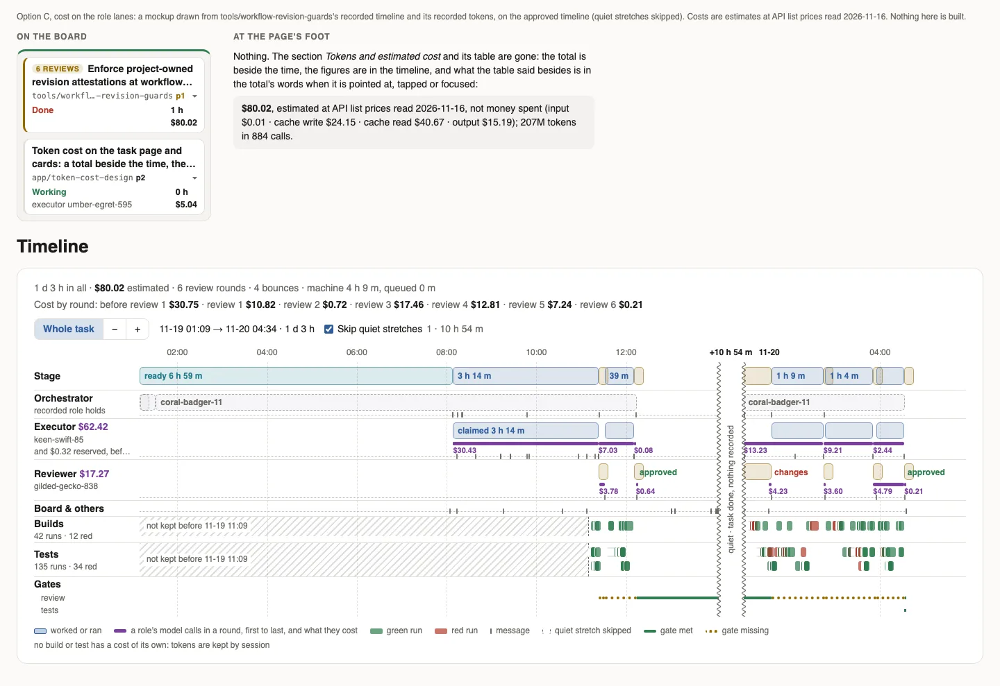

    **A** keeps every figure in text, the table's shape in two lines; the lanes say a round's cost only when pointed at, as in its picture. **B** draws seven bars on one 38 px row, all labelled at the whole-task scale, from $30.75 before review 1 to $0.21 for review 6. **C** splits the same dollars over the Executor and Reviewer lanes; most reviews are minutes long, so their bars are a few pixels wide.

    **Why B.** The figures sit on the timeline's clock, where you asked for them, and the eye finds where the money went: round 1 and review 3 hold 60% of this task's $80.02.
  [2026-11-20 06:17] agent — **On a phone** the box keeps its room for steps and grows by the summary: about 110 px under A (five lines), 50 under B, 70 under C. B adds a row per round to the list, C a figure to each in-progress and review row: 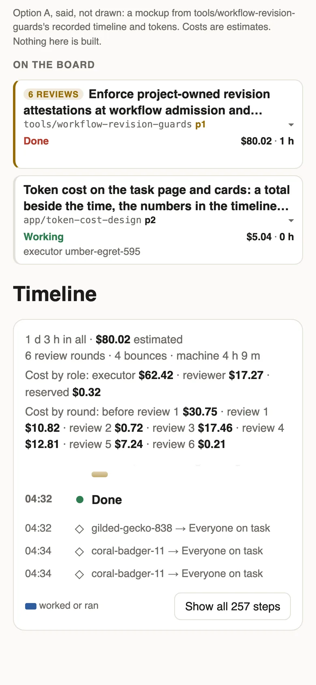 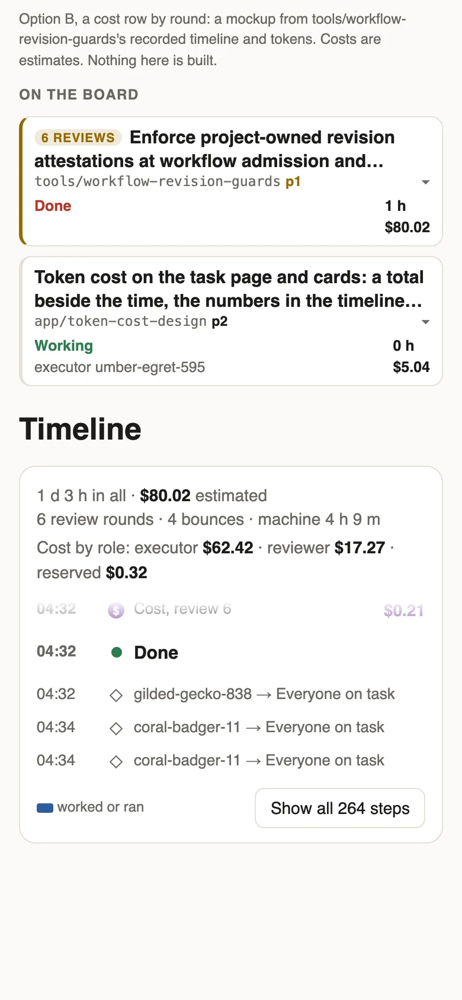 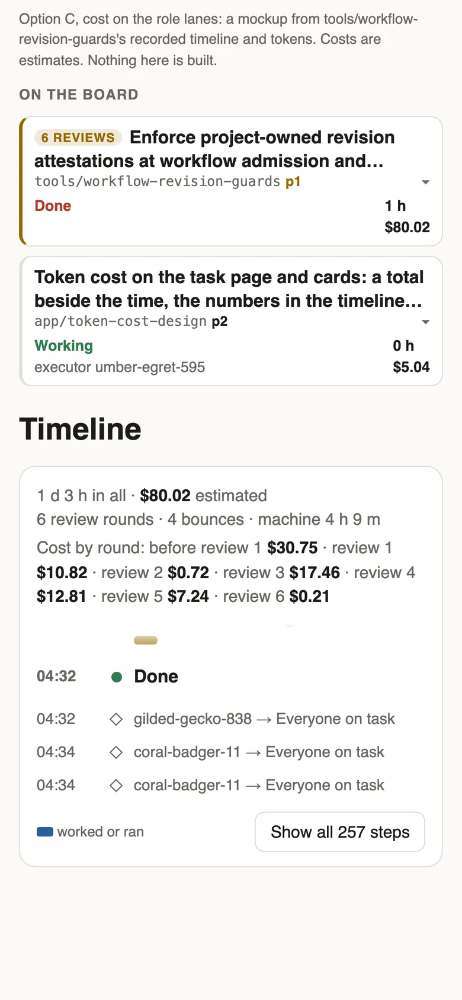 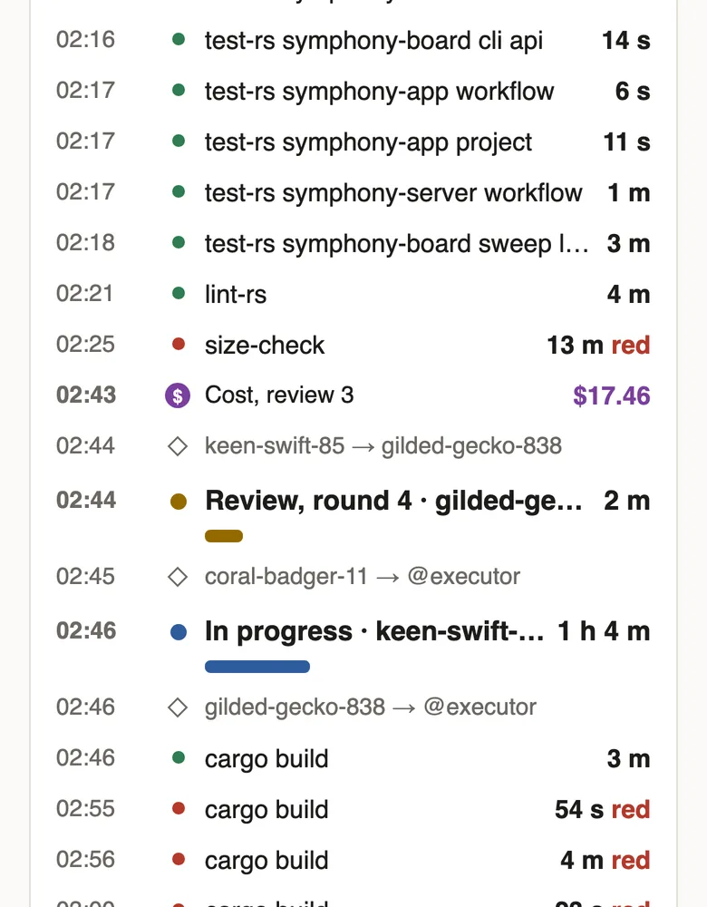 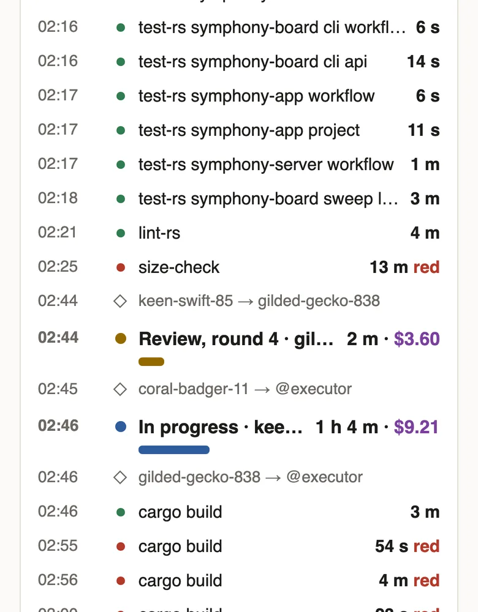

    In dark: 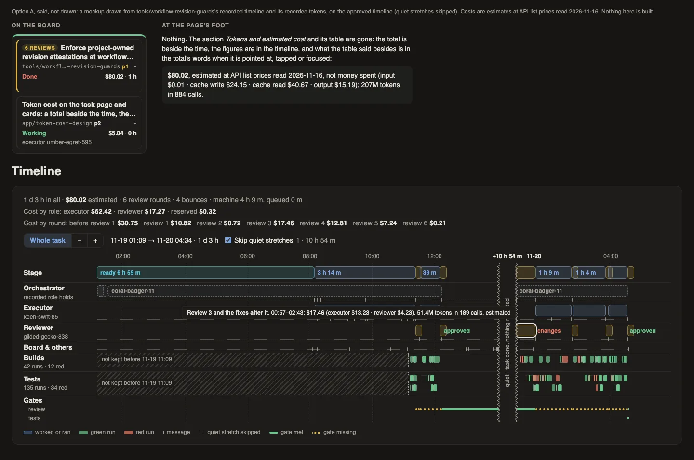 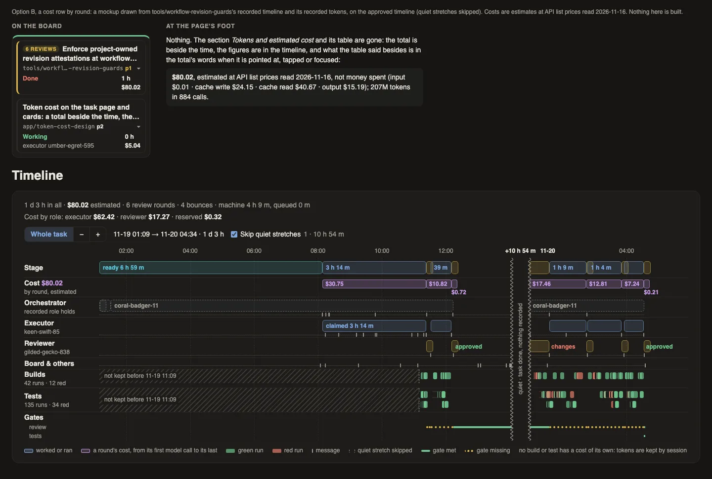 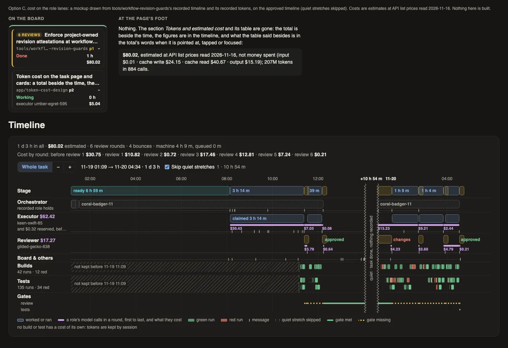 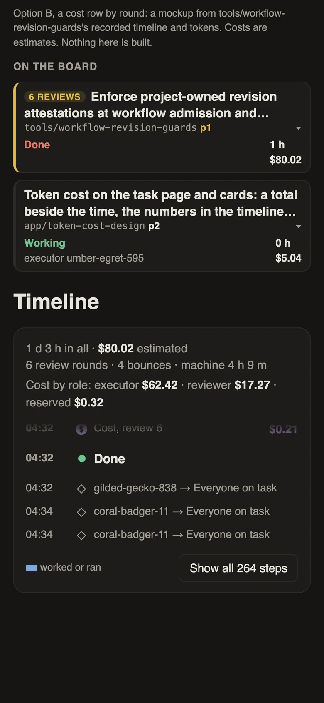 [Open the mockup](token-cost/mockup.html).
  [2026-11-20 06:17] agent — Under every option, from your words on `app/token-cost-on-pages`: “task cards is the task page should have the total current cost (in a similar way as we have the total time), the token cost numbers in a task view could be in the timeline, with a possible summary close to it at the top, not at the bottom”.
    - The page's total joins the time's line in its type: *1 d 3 h in all · $80.02 estimated · 6 review rounds…*.
    - The card's total leaves the slug line and is drawn as the time is. A puts it on the time's line (`$80.02 · 1 h`), B and C under the time; either goes with any option.
    - The section at the foot goes. What it said besides (cost by kind, tokens and calls, the day the prices were read, a model with no price) is in the total's words when pointed at, tapped or focused.
    - Rounds are named by the review they start with. The record's round 1 is the work before review 1, and its round *n* + 1 is review *n* and the fixes after it, so today's table says rounds 1 to 7 where the timeline says 6 reviews.
    - Nothing is recorded anew and the schema stays. The page reads the task's tokens with its timeline; B and C, and A's words per round, need the rows `tasks show --json` already gives and `/api/task-tokens` leaves out.

    **Earlier verdicts checked.** **timeline-navigation** (B): every option is drawn on it. **task-page-timeline-place** (C): the phone's box keeps its room for steps. **reports-task-page-pictures** (A): lanes wide, a list on a phone. **timeline-orchestrator-messages**: messages kept. None of them decides where the cost goes.
  [2026-11-20 06:36] owner · rejected — A for the card look, but for the cost, ideally could just add the cost after the time in the timeline, e.g.: 3h14m $30.75. The page's foot should indeed not exist at all.
  [2026-11-21 13:14] agent — Replaced by **task-cost-after-time**, drawn to your note: A's board card, each stage stretch's cost after its time in the timeline (`in progress 3 h 14 m $30.75`), and nothing at the page's foot or under the total.

### Under every option

- **The page's total sits beside its total time**, on the timeline's first line and in the same
  type: *1 d 3 h in all · **$80.02** estimated · 6 review rounds…*. On a phone it ends the first
  line, the rounds and machine time moving to the second.
- **The card's total moves off the slug line**, which gets its room back, and is drawn as the
  time is: bold, on the right.
- **The section at the page's foot goes**, table and all; what it said besides the figures is in
  the total's words.
- **A summary of one or two lines sits under the total**, in the type of the timeline's other
  lines. On a phone the summary lines sit above the steps and the box grows by their height.

### A: said, not drawn

The card's total joins the time on its line: `Done   $80.02 · 1 h`. Two summary lines: *Cost by
role* and *Cost by round*, every figure the table held. The lanes draw nothing new: a review or a
claim pointed at, tapped or focused says its round's cost in its words, as above, *Review 3 and the
fixes after it, 00:57–02:43: $17.46 (executor $13.23 · reviewer $4.23), 51.4M tokens in 189 calls,
estimated*. Wide, the timeline is 48 px taller; on a phone the two lines wrap to five at 390 wide,
and the box grows about 110 px.

### B: a cost row by round

The card's total sits under the time, on the reason's line: `1 h` over `$80.02`. One summary line,
*Cost by role*. Under the Stage lane a **Cost** row, its name with the total, draws each round as a
bar from its first model call to its last, its dollars on it, or under its start where the bar is
too narrow: here all seven show at the whole-task scale, from *$30.75* before review 1 to *$0.21*
for review 6. Pointed at, tapped or focused, a round says what its words say under A:

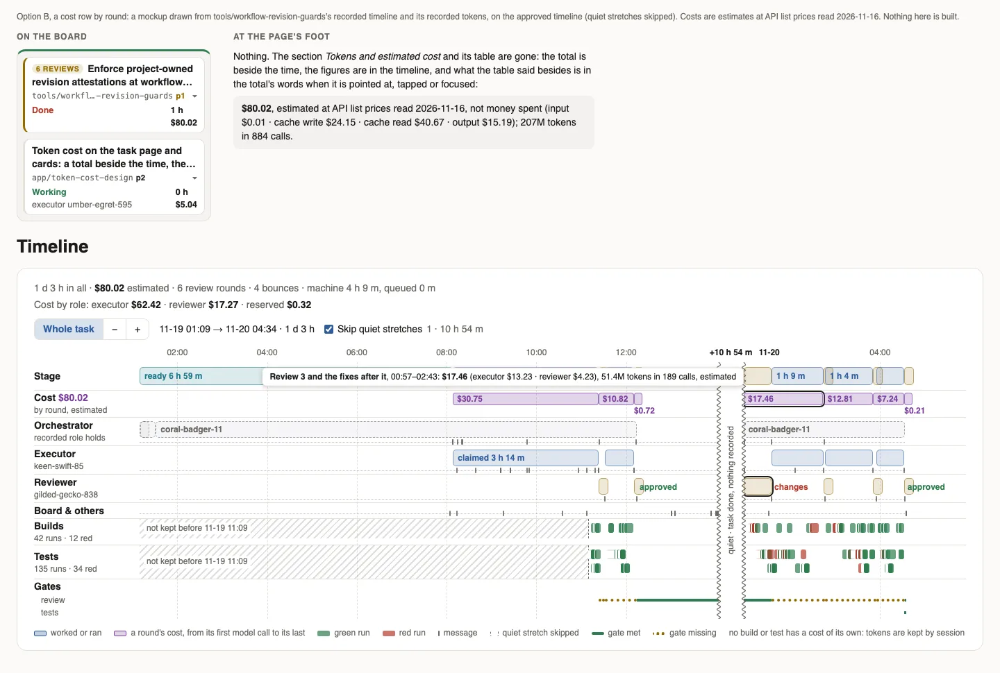

Wide, the timeline is 63 px taller: the line and a 38 px row. On a phone the line wraps to two and
the box grows about 50 px; the list gains one row per round, at its last model call, *Cost, review
3 · $17.46*, just before the review it led to:

### C: cost on the role lanes

The card as B. One summary line, *Cost by round*. The Executor and Reviewer lanes each draw their
own rows under their bars, a thin bar from a round's first call to its last with its dollars, and
each lane's name carries its total (*Executor $62.42*, and *$0.32 reserved, before its claim*). The
two lanes are 18 px taller each. Most reviews are minutes long, so their bars are a few pixels. On a
phone each in-progress row ends with the executor's cost of its round and each review row with the
reviewer's:

### Each in dark

 

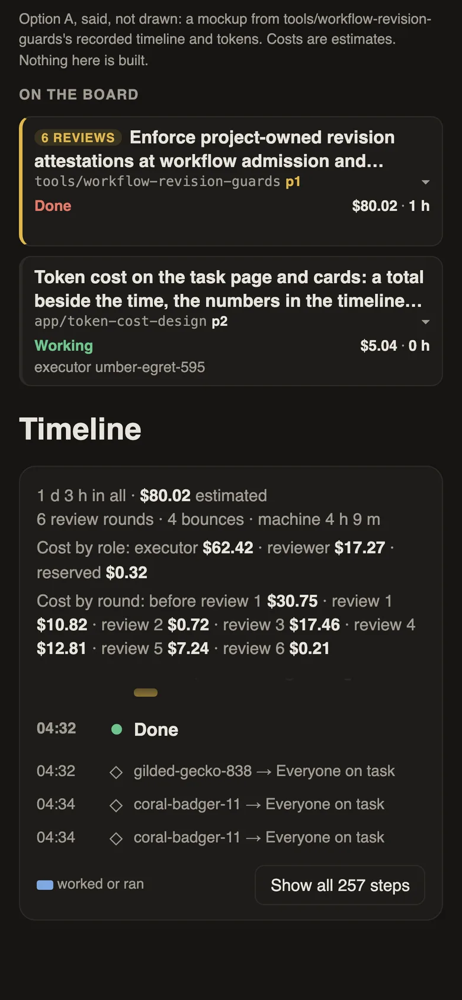 
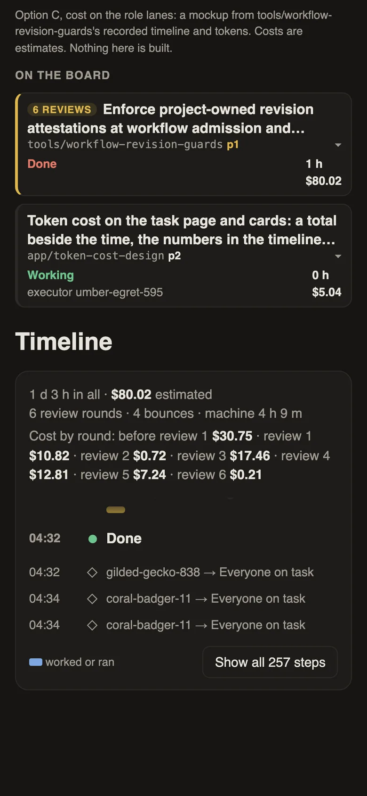
