# The guard panel on a task's page

A project's workflow can hold an edge back behind a guard: a decision its own approval ledger
keeps, which the board admits only on the authority's signed word
([guards](../../workflow/WORKFLOW.md#guards), [the design](../../workflow/analysis/revision-bound-transition-guards.md#Display and compatibility)).
This is the task page's view of those guards, as it is built
([the app](../../workflow/WORKFLOW.md#the-app), `apps/symphony-web/src/guards.tsx`). The owner chose its look
over two cards: the first ([its card](#workflow-guard-panel)) right but for rows
that said why and led nowhere, the second ([its card](#workflow-guard-panel-links))
right but for a separate link to the board's record, which is now the guard's own name. The
pictures are the built page in the browser tests, over their stand-in server: every name, time,
number and link in them is the wire types' sample.

## Before

A guarded edge was an action like any other, its button disabled, its line saying
"its check does not answer here". The board previews every guarded edge as `guard_unavailable`,
since only an attestation given with the operation meets a guard, and the page said nothing of
which guard, whose authority, or what the board accepted from it.

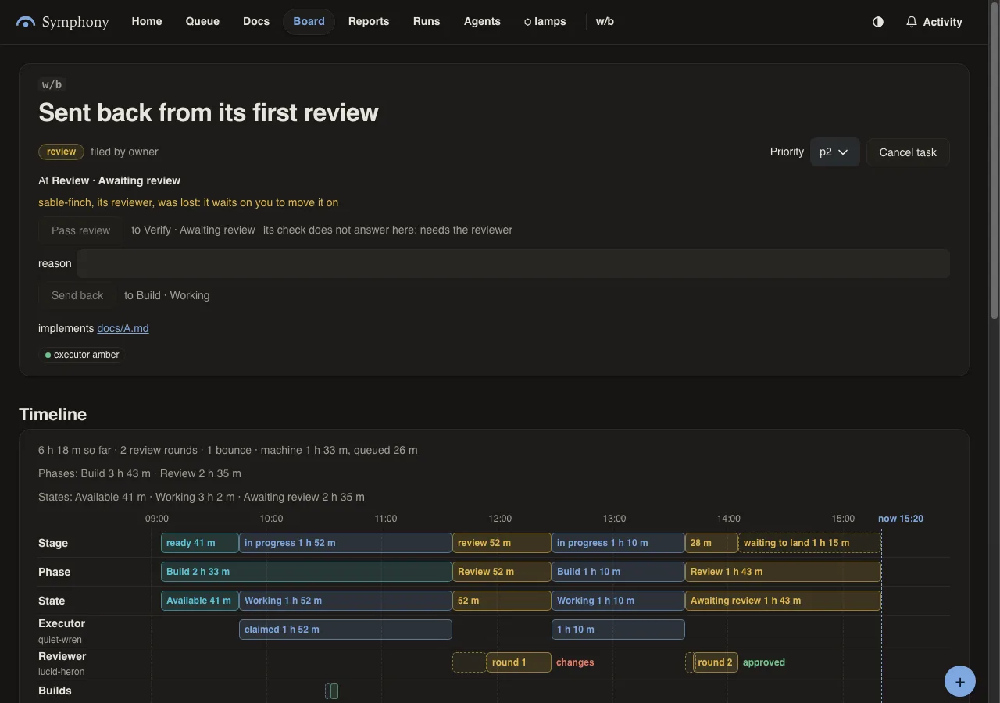
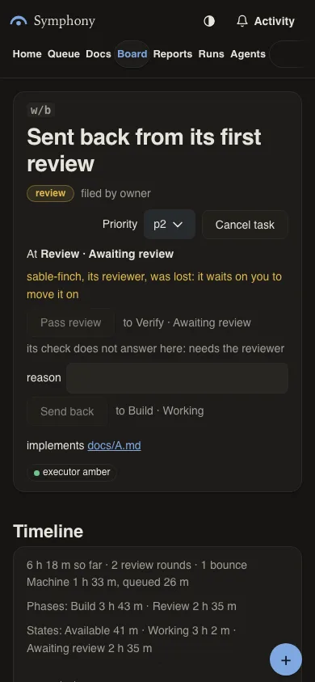

## The panel

Inside the task's Workflow section, beside the actions it already lists:

- **Under each guarded action**, a box headed *ACTION needs*, one row for each guard its edge
  carries.
- **Above the actions**, while the task came into its pair by a guarded edge, a box headed *Let in
  by EDGE · revision N · time*: the guards that admission met, and whether each still stands.

Each row has the shape of a gate on the same page: a dot and the guard's name (its ID in words, as
a guard has no label), its state in one word, one line saying why, and on the right its authority
(the issuer it signs as, and its adapter) with the state the board accepted from it: its
generation and epoch, `none yet`, or `in conflict`. Wide, a row is one line of bounded columns;
on a phone, three lines: name and state, why, then the authority. A line under the rows says who
decides: the authority, in the project's own ledger. The panel has no approve, grant, paste or
upload: taking the action passes on the authority's word, which the board checks. A link leads to
where the authority or the board's record points, never to a way of approving on this page.

The action's button follows what the host can do. The owner's take asks the project's authority
for its attestation when a plugin of the project answers for that authority's adapter, and the
button is enabled when that holds for every guard of the edge and nothing else holds it; where
the host cannot ask one, the button stays disabled and the row says `not from here`, and what
would let it go from this app. It gives no command: the command line takes an edge as an agent's
session, never as the owner, so none it could print would take the owner's edge.

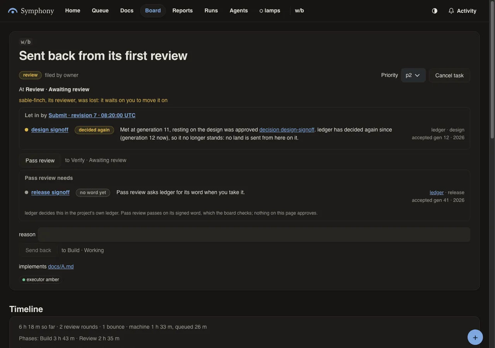
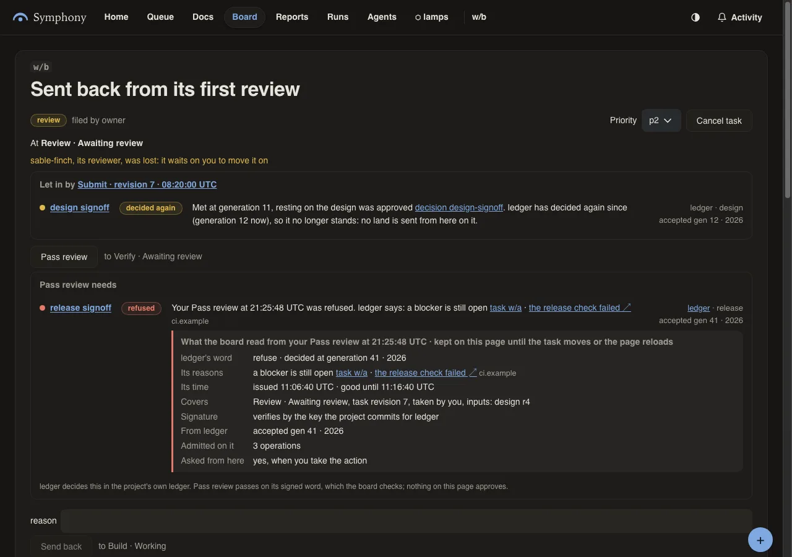
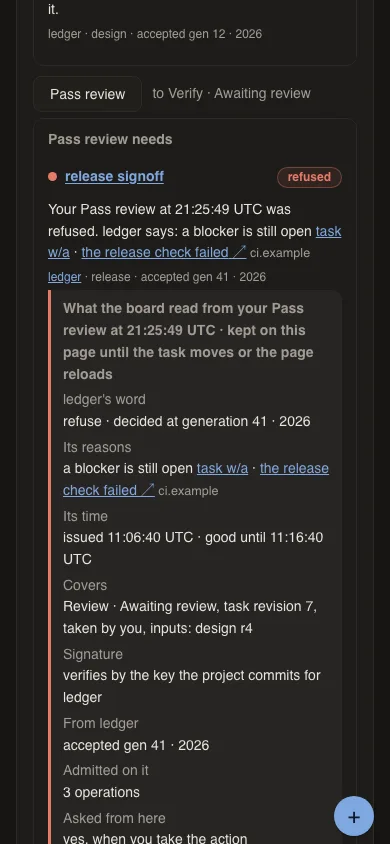
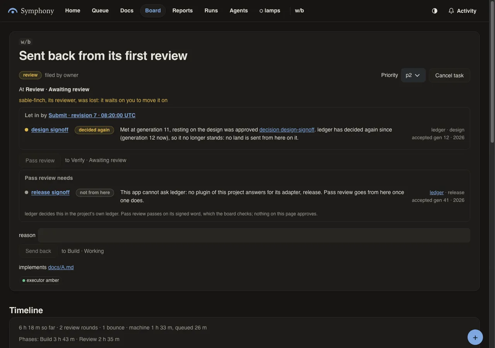

- [-] **workflow-guard-panel** — When a project's workflow holds an action back until its own approval ledger says yes (Accept, say), the task's page would show, under that action, each approval it waits on, whose ledger decides it and the last state the board took from that ledger, and why your own last try was refused (expired, stale, missing, refused by the ledger…), one word and one line each. Above the actions it shows the approvals that let the task in and whether they still stand. Nothing on it approves: the ledger decides, the page shows its word. Approve this look, or comment. [[analysis/workflow-guard-panel#The panel]]
  [2026-11-20 05:37] agent — For `app/workflow-guard-panel`. Today every such action is disabled and says only "its check does not answer here", naming no approval or ledger: 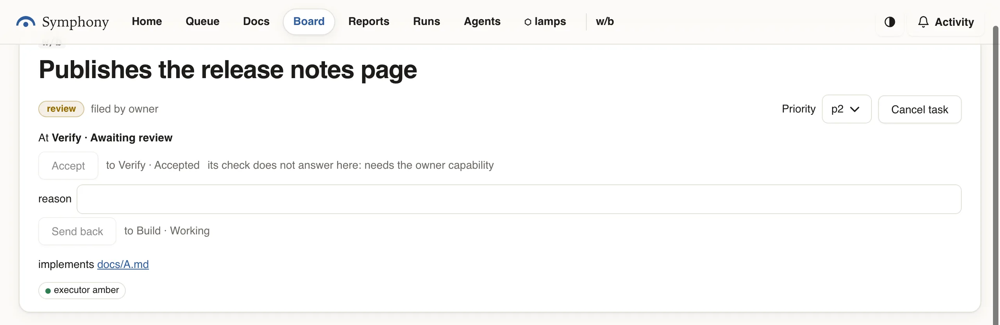 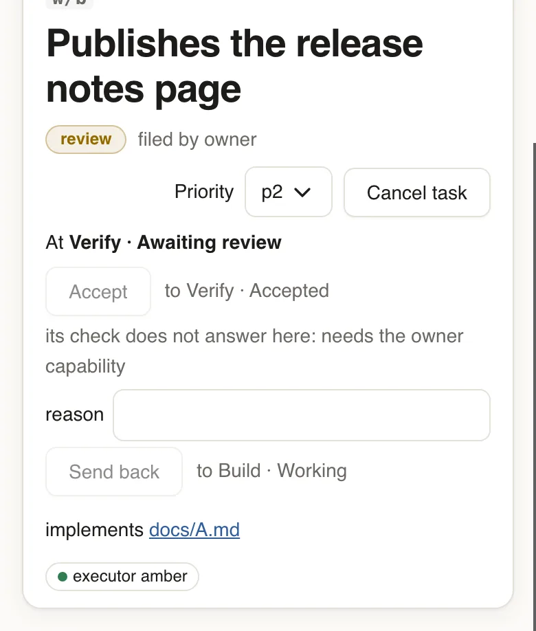

    **Proposed, drawn into the real page with invented names, times and numbers.** Accept needs "release signoff" from the ledger; your last Accept came back expired. Above, "design signoff" let the task in but the ledger has decided again since: 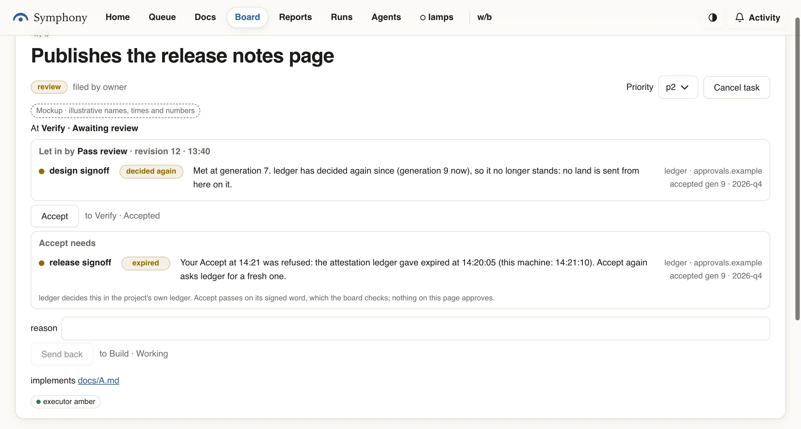 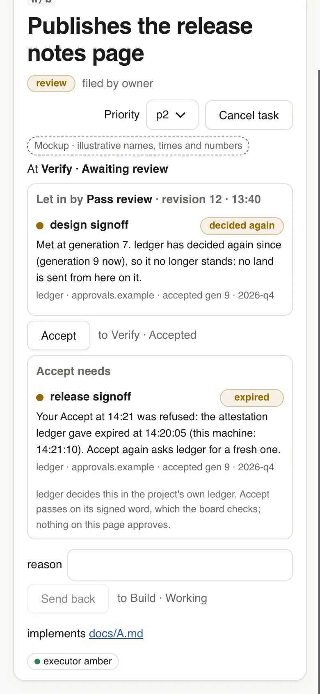

    Every state a row can show, grouped by where it comes from: 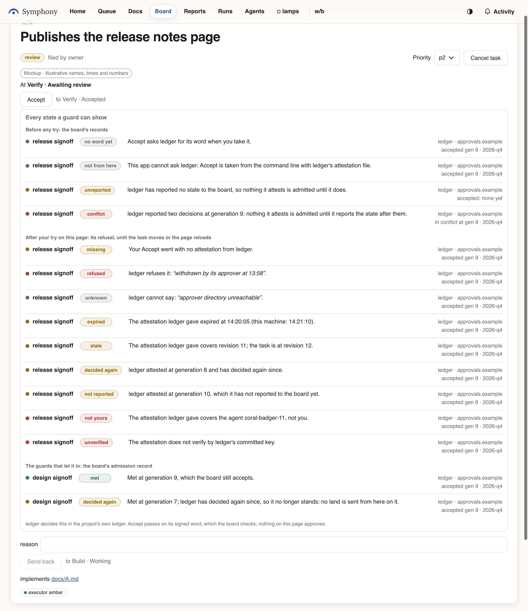 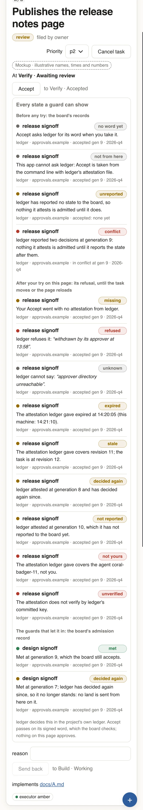

    **What it does not claim.** Your last try is this page's alone: it lasts until the task moves or the page reloads, and the board keeps no refusals, so nothing shows across devices and an agent's refusal never shows here. A later ledger decision reads "decided again", never "revoked": the board learns that the ledger decided, not what. A revocation shows only in the ledger's own words, as "refused". With the ledger not reachable from the app, the action stays disabled and says "not from here".

    **Earlier verdicts checked.** **revision-bound-project-guards** (B) puts approvals in the project's ledger, which this keeps; it says nothing of how a page shows them. **reports-task-page-pictures** (A) chose the gates' rows (met, missing or waived, with who, when and why), whose shape these rows reuse; it decides the gates, not guards. **project-workflow-shape** (C) lets a project add states and edges, not how they look. None decides this look. The same task builds it after your answer.
  [2026-11-20 06:30] owner · rejected — The design looks okay, but a lot of gates should probably link to something. An action, a log, a task, a decision card, a github run etc. In general, there should be a way for the user to click something that leads them to be able to see why something failed or not and get more info and context.
  [2026-11-21 10:22] agent — Redrawn with links, as you asked, and posted as a new card: **workflow-guard-panel-links**. Every row now opens the board's record of it, the ledger's reasons and facts link to the task, card, document or run they name, the ledger's name links to its own page, and "Let in by" links to the timeline. The rest of the look is kept. Nothing is built until you answer that card.

## What a row links to

Every row opens, and most lead somewhere:

- **The record, by the guard's name.** The name is a button that opens in place, under the row,
  what the board holds for it, and closes it again. For a guard that let the task in: the
  transition, who took it, the authority's word and the generation it was decided at, what it
  rests on, its time and what it covers. For the owner's last take: the same from the attestation
  the board read, and that its signature verified. For every row: the state the board accepted
  from the authority, how many admissions rest on it, and whether this host asks it.
- **What the authority points at.** An attestation carries the authority's own references: the
  facts a pass rests on, and its reasons for a refusal or an unknown. Each is text, and stays text
  in the signed contract. The page draws one as the gates on this page draw theirs (`linkable`):
  a path of the app in it is a link named for what it is (a task, a decision card, a document, a
  run), and a web address at its end puts the link on the words before it, marked as leaving the
  app with its host beside it. Text with neither is its text. Only an attestation that verified
  by the committed key is quoted or linked: an unverified one shows nothing it says.
- **The authority's own page.** The authority's name links to where its ledger shows this guard
  for this task, where the project commits that: the optional `page` of
  [`[[workflow_authorities]]`](../../operations/PROJECT_FILE.md#workflow_authorities), a path of the app or a
  web address with `{task}` and `{guard}` filled in. It is the one link a row has before anything
  was tried: where to go to have it decided. A project that commits none shows the name as text.
- **The board's own places.** *Let in by EDGE · revision N · time* links to the task's timeline,
  which draws that transition. Where the fix is a command (`unreported`), the row
  shows the command itself, to copy.

What is not linked, because nothing is kept to link to: the authority's accepted state has no
page of its own (the board keeps the state, not a log of its reports), a refusal has no place
beyond this page ([below](#the-last-refusal-and-how-long-it-lasts)), and a principal a row names
is said, not linked.

- [-] **workflow-guard-panel-links** — The guard panel you found okay, redrawn so each row leads somewhere, as you asked. Every row opens the board's own record of it in place. A reason or a fact the ledger gives becomes a link to what it names (a task, a decision card, a document, a GitHub run). The ledger's name links to its own page for this approval, and "Let in by…" links to that move in the task's timeline. Where the fix is a command, the row shows it to copy. Nothing on it approves, as before. Approve this look, or comment. [[analysis/workflow-guard-panel#What a row links to]]
  [2026-11-21 10:23] agent — For `app/workflow-guard-panel`; replaces **workflow-guard-panel**, which you rejected: "a lot of gates should probably link to something. An action, a log, a task, a decision card, a github run etc."

    **Proposed, drawn into the real page with invented names, times, numbers and links.** Your Accept was refused: the ledger's two reasons link to the open task and the failed run, and the row's record is open under it. Above, "design signoff" links to the decision it rested on: 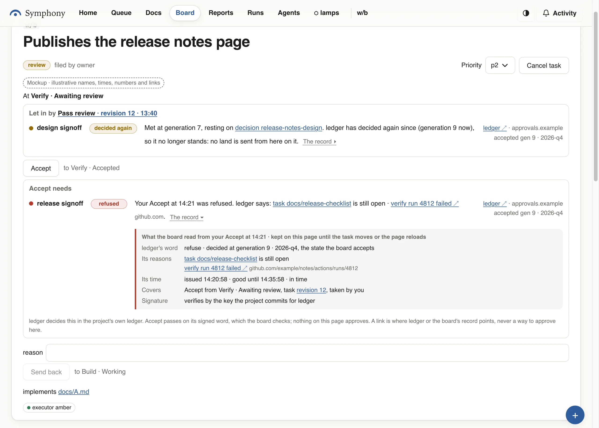 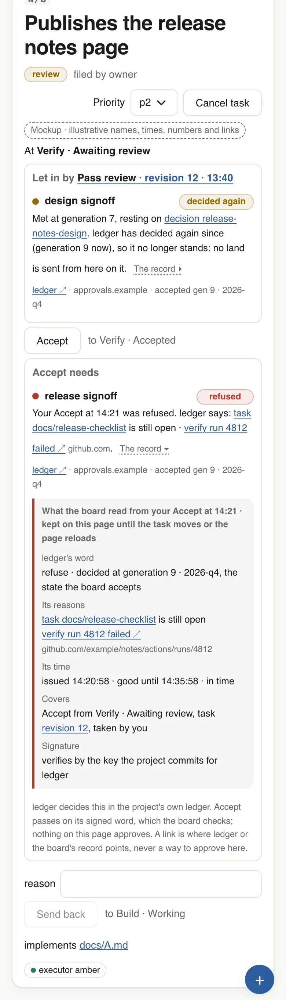

    Every state a row can show, each with what it links to, one record open: 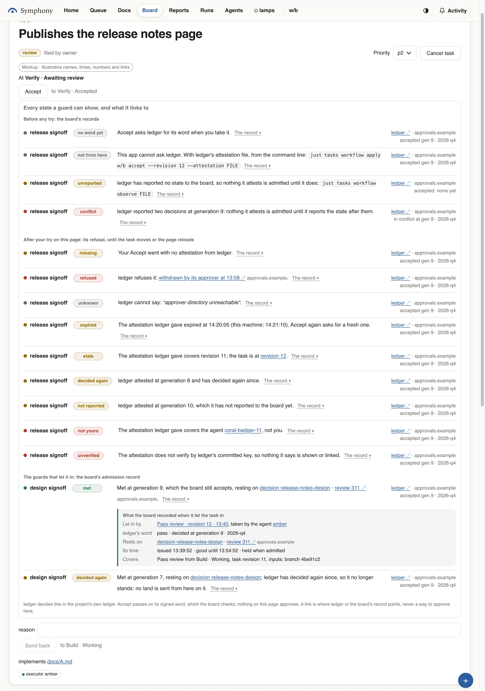 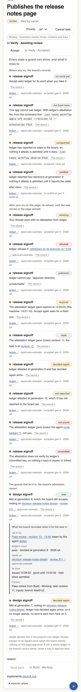

    **Where each link comes from.**

    - **The record** is what the board already keeps, or read from your try: who, when, the ledger's answer, what it rests on.
    - **Reasons and facts** are the ledger's own words, which it already sends. A task, card, document or web address in them becomes a link; plain words stay quoted. A link that leaves the app is marked and names its site.
    - **The ledger's page** needs one new, optional line in the project's settings saying where its ledger shows an approval. Without it the name is plain text.

    **What still links to nothing.** A row whose attestation failed its signature shows nothing it says. Expired, missing and conflict rows have their record and the ledger's page, and no more: the board keeps no log of the ledger's reports, and no refusal beyond this page.

    **Earlier verdicts checked.** **workflow-guard-panel**, rejected, asks for these links and calls the rest of the look okay, so the rows, words and colours are kept and only the links and the record are new. **revision-bound-project-guards** (B) keeps approvals in the project's ledger, which this keeps. **reports-task-page-pictures** (A) chose the gates' rows, whose way of linking this reuses. None decides how a guard's row links. The same task builds it after your answer.
  [2026-11-21 17:29] owner · rejected — What up with this stupid “the record” link? Put the link on the name of the gate.
  [2026-11-21 17:33] agent — Taken as you said: there is no separate "the record" link. A gate's name is the link, and it opens the board's record of that gate under its row. Everything else on the card stays as drawn. It is built now in the board task `app/workflow-guard-panel`, with no further card: the pictures of the built panel go on that task's review.

## Each state and where it comes from

Every row has its record, by its name, and, where the project commits one, the authority's page.
The last column is what the row's own words link to besides. A word the page does not know (a
newer server's) is said as `refused`, in the refusal's own words, or as `not standing`.

| Word | Tone | From | Says | Its words link to |
| --- | --- | --- | --- | --- |
| no word yet | quiet | the board's records | Taking the action asks the authority. Nothing tried on this page. | nothing more |
| not from here | quiet | the board's records | This host cannot ask that authority: no plugin of the project answers for its adapter. The action waits until one does. | nothing more |
| unreported | amber | the board's records | The authority has reported no state, so nothing it attests is admitted. | the command that reports, to copy |
| conflict | red | the board's records | It reported two decisions at one generation: nothing it attests is admitted until it reports the state after them. | nothing more |
| uncommitted | red | the board's records | The active workflow commits no authority for the guard, so nothing meets it. | nothing more |
| missing | amber | your last try | It went with no attestation from that authority. | nothing more |
| unanswered | amber | your last try | The host asked the authority, which gave no attestation in time. | nothing more |
| unfounded | amber | your last try | The authority passed it on no decision of its own, which the board admits nothing on. | nothing more |
| refused | red | your last try | The authority attested `refuse`, its reasons quoted as it gave them. | each reason's reference |
| unknown | quiet | your last try | The authority attested `unknown`, its reasons quoted. | each reason's reference |
| expired | amber | your last try | The attestation's time ran out on this machine's clock (one issued ahead of the clock says `early`, one held too long `held too long`). | nothing more: the action again asks for a fresh one |
| stale | amber | your last try | It covers another operation: another revision, pair, workflow or activation of the task, or other input revisions. The row names the revision it was given for and the one taken. | nothing more |
| decided again | amber | your last try | It was decided at an older generation than the board accepts now. | nothing more |
| not reported | amber | your last try | It was decided at a generation the authority has not reported yet. | nothing more |
| not yours | red | your last try | It covers another principal than the one taking the edge. | nothing more |
| unverified | red | your last try | It does not verify by the key the project commits for that authority. | nothing: what it says is not shown |
| met | green | the admission record | The guard that let the task in, at the state the board still accepts. | each fact it rests on, and its transition |
| decided again | amber | the admission record | The authority has decided again since that guard was met, so it no longer stands: no effect, a land among them, is dispatched from here on it. | each fact it rested on, and its transition |

The board never learns why a generation moved: any decision of the authority moves it, another
task's included. So a later generation reads `decided again`, never revoked. A revocation shows
only in the authority's own words, when it attests `refuse` with its reasons. An entry whose
authority is no longer committed (`uncommitted`), whose attestation no longer verifies by the
committed key (`unverified`), whose authority is in conflict (`conflict`) or whose state the board
no longer holds (`unreported`) says so in the same row.

## The last refusal, and how long it lasts

`your last try` is the owner's own take of that action on this page, and nothing else. The page
holds its refusal in memory beside the action until the task's revision moves (its actions are
read again) or the page loads again. The board records no refusal: a refused admission writes
nothing, by design. So the panel claims no history across pages, devices or sessions, and an
agent refused at the command line never shows here.

## What it reads

- **The definition**, read already: whether it declares a guard.
- **The owner's read**, `GET /api/workflow-guards?slug=SLUG` (`TaskGuards`): each authority the
  active activation commits (adapter, issuer, the epoch, generation and conflict the board
  accepted, the admissions counted on it, and whether this host asks it), each guard with its
  adapter and its authority's page for this task where the project commits one, the edges leaving
  the task's pair that carry guards, and the transition that last brought the task into its pair
  with the guards its admission met, each with its standing as a word and what its record shows.
  The page asks it only where the definition declares a guard or an action says a guard holds it:
  a board with no custom workflow, or a workflow with no guard, asks nothing more. A hosted
  visitor is refused it, as the actions are. It is read with the actions, so an authority's report
  between two reads shows at the next (an observation moves no task and sends no feed event).
- **The typed refusal.** A take a guard refuses answers `guard` beside its `error`, a
  `GuardRefusal`: the guard, its adapter, a word for why, and from an attestation that verified,
  what its record shows. The board builds it in a second read after the refusal, so the refusal's
  text is byte for byte what it was, every other refusal and route answers as it did, the command
  line and `tasks api` are unchanged, and a client that reads only `error` reads what it read. The
  page reads the word, never the text.
- **The authority's page**, the optional `page` of `[[workflow_authorities]]`: read from the
  checkout's project file when the guards are read, checked as `linkable` once `{task}` and
  `{guard}` are filled in, and refused by name otherwise. The board records none of it.

A default board draws, sends and fetches what it did.
