# Dioxus or JSX for the client

Whether the Symphony's web client is better kept in Dioxus, as it is, or moved to a JSX front end,
React 19 built by Vite first and Preact from the same source second, with only the front end in
question: the server, its API, the feed, the board and the tools stay as they are. Three of the
client's pages were written again in JSX ([below](#the-experiment)) and measured beside the Dioxus
pages they copy, on the same machine, server and fixture; the card that asks the question is in
[DECISIONS](../../DECISIONS.md).

## The choice

**Like for like.** The JSX pages leave out parts the Dioxus pages carry: the device cache, the
ghosts' kept shapes, the task page's gates and timeline, search, and the rest named
[below](#what-the-jsx-pages-leave-out). So every figure in this section either compares like with
like or says beside it what the JSX side lacks and what that would add. The left-out parts are
estimated at about 10 to 30 kB a page on the wire: from the port's own bytes of gzip per line of
JSX, and at most the Dioxus client's own price for the same parts (its device cache about 14 kB
of a page, the ghosts' shapes about 13 kB, the documents' cache on main about 30 kB). That
estimate is not measured. The Dioxus figures are the baseline's, main at `a8490d80`, unless they say main.

**A: keep Dioxus.** The client stays one language and one toolchain with the server. The
compiler checks the wire's types and that every block, span and media kind a plugin renders is
drawn. Nothing is written again, and the work under way on it (one runtime shared between its
modules, now on main) goes on. Where it is ahead today, at full speed: a return visit to a small
board or a task's page is about a quarter quicker, most likely by its device cache; and a card moved
between columns is drawn in 23 ms where the Preact board takes 43, every batch agreeing (React's
30 ms is undecided).

**B: move the client to JSX,** a page kind at a time, on Preact or on React: the library is a
choice of its own, made after this one ([below](#preact-or-react)). It costs a
rewrite of about 19,000 lines of Rust and 7,800 of their tests, Node where the client builds, and the
compiler's checks, which only TypeScript types generated from `crates/symphony-api` and a test
over every block kind would replace ([What a switch would cost](#what-a-switch-would-cost)).

**Recommended: B.** The reasons, each from the measurements below:

- **A first visit is a tenth to a quarter of the bytes on Preact, a fifth to under a half on
  React, like for like.** As measured, Preact's pages send 9 % to 14 % of the Dioxus pages' bytes
  and React's 19 % to 34 %, the task page set against its 566 kB without the timeline's module,
  which the JSX page lacks; with the left-out parts added at the estimate above, about 10 % to
  25 % on Preact, a quarter at worst on the board, and about 20 % to 45 % on React. A second page, a task's opened from the board, is 23 kB measured and about 35 to 55 kB
  with its left-out parts, where the Dioxus client fetches the next kind's code whole, about
  550 kB on main (6 % to 10 %). The gap is the framework's: each Dioxus page kind is a wasm module
  with its own runtime ([Size](#size)).
- **A cold visit is usable sooner, most of all on a slow CPU.** With the CPU slowed four times,
  the JSX board is usable in about half the Dioxus time (0.4 on a phone's screen), a task's page
  in 0.6 to 0.7 and the guide in 0.8 to 0.9; at full speed in 0.6 to 0.9; every batch agreeing on
  the board and the task page at loads from about 50 to 250. These are a floor for the JSX side:
  a Dioxus cold visit also opens the device's store and keeps what it drew, and its task page
  reads the gates, none of which the JSX pages do; what that costs was not measured apart
  ([Render](#render)).
- **The build and the repository.** A Vite build of the three pages takes about 3 s, where the
  Dioxus client's eight builds take a minute or more whatever changed; no `dx`, `wasm-bindgen`,
  one-path wrapper, input snapshot or split repair. The three pages build to 0.2 MB on Preact and
  0.4 MB on React, and a whole JSX client would be perhaps twice that (inferred), against 5.9 MB a Dioxus build on main, which
  the repository takes again, as new wasm, at every regeneration that changed the client
  ([Code and build](#code-and-build)).

**Level, or not a reason.** Typing is a tie, and Load more on 2,000 cards is level. Scrolling the
long document at full speed, the JSX pages have one or two frames over 50 ms where the Dioxus page
has six to nine, in 13 rounds of 15; a card's move is the reverse, quicker on Dioxus, as above.
Memory is a wash: one run, and the wasm module's reserved memory is not a live heap. With the CPU
slowed the JSX return visits are quicker, but that is most likely the cost of the device cache's
own draw, which the JSX pages leave out and B would port, so it counts for neither side. Plugins
are about level too: today's render to blocks on the server, which either client draws, and a
project's own script costs about the same on either, in the page or in a sandboxed frame; only JSX
could take a project's component into the client's own runtime, a small point for B at most, as
that form reaches the whole origin and can post as the owner
([Plugins and front-end extension](#plugins-and-front-end-extension)). The desktop app as decided
is level too: its shell shows whichever client each server serves, so the reason Dioxus was chosen
for, one code for the browser and the desktop window, goes unused, and only its own few screens
count, as the two UI stacks below ([The desktop app](#the-desktop-app)). Code size
is about level like for like: the one closely matched pair, the blocks, is 815 lines of JSX
against 962 of Rust (0.85), and the JSX is untyped where a port would be TypeScript
([Responsiveness](#responsiveness), [Code and build](#code-and-build)).

**The weakest point is the move itself.** The rewrite is large and the client keeps changing
meanwhile. The compiler's checks of the wire and of the block kinds are lost unless generated
types and a test replace them, which this experiment did not try: a renamed field becomes an
`undefined` at run time. The repository would keep two UI stacks while the desktop app's own few
screens are Dioxus. The port must catch up where Dioxus is ahead today, the return visit at full
speed and the card's move. The byte and slow-CPU margins are wide enough to survive the left-out
parts at the estimate above, but that estimate is not measured. And every time here was taken on
a busy machine: the ratios held across batches at different loads, but no absolute figure is a
quiet machine's.

### Preact or React

Inside B the library is a choice of its own, and the findings leave it open: this section gives
the trade like for like and the two readings of it, and settles neither
([the ecosystem](#the-ecosystem-preact-against-react) has the sources).

**What Preact gains.** About 60 kB less on every first visit, all of it React's runtime (the
board 44 kB against 104, a task's page 48 against 109, the guide 60 against 120), and about 200 kB
less script to decode; nothing on a second page, where both send 23 kB. A cold visit spends about
a tenth to a quarter less time running script, on each of the three pages at every speed, every
batch agreeing (the board 34 ms against 43 at full speed, 151 against 173 slowed four times, 113
against 154 on a phone's screen; [Render](#render)), though its long tasks are no shorter, the batches split (slowed,
163 ms against 146 on the board, 90 against 66 on a phone's screen). Neither leads in when a page
is usable: slowed four times, Preact's board and guide are usable a little sooner and React's task
page is; at full speed React opens a task from the board sooner and draws a card's move in 30 ms
against 43 ([the way back](#the-way-back)). The board is also read from a phone over the tailnet
([the desktop client](../../product/analysis/desktop-client.md)), so a first visit can cross a network to a phone-class
CPU, where the bytes and the script count for more than here: every visit here was served from
the same machine with only the CPU slowed, so what 60 kB costs on a phone's network was not
measured. The bytes saved are a fixed amount, so their share falls as libraries are added: with
the three probed, the board would be about 0.63 of React's bytes, not 0.42 (an estimate).

**What Preact costs.** React's code runs through a compatibility layer that trails React: React
18's `createRoot` reached it in 11 weeks and its hooks in 14 to 24, its transitions only in name
(they run at once); React 19's refs as props and `use` in 22 months, and its actions, form hooks
and document metadata not at all. Its current major, Preact 11, was first published on 30
September 2026, and much of what it answers React 19 with came in 11.x (refs as props, `use`, the
compiler's runtime). The libraries are written and tested for React: Radix, React Aria,
Headless UI and TanStack Router say they do not support Preact, React Aria is reported broken on
Preact 11, and React Router's newest major no longer builds on it. And keeping React reachable,
so that a library that stops working on Preact means a switch and not a rewrite, is a standing
cost, none of it in place today: a second build at every gate, which catches only what fails to
build unless the browser tests also run on it; a lint rule that refuses Preact's own packages as
well as `preact`; and every library driven on both builds before it is taken
([the way back](#the-way-back)).

**What React costs.** The 60 kB on every first visit, the 200 kB of script to decode and the
tenth to a quarter more time running it. It needs no compatibility layer, none of the guards
above, and takes the libraries and tools as their authors support them.

**The reading for Preact.** What a port would reach for first runs on it: the probe drove Radix's
six controls, TanStack Query and TanStack Virtual alike on both builds, each adding the same bytes
on either, and the Markdown, the charts, the timeline and the blocks need no library at all. So
the libraries' lead may never be drawn on, while the 60 kB and the script are paid on every first
visit for good, a phone's over the network among them. Its weakest point: those gains bought no
lead in when a page is usable, and they are held by guards that every gate pays for and that a
library's next major can still defeat, sometimes only when a control is drawn, on a compat major
six weeks old.

**The reading for React.** Preact's gains, the bytes and the script time, bought no lead in when a
page is usable, at full speed, slowed four times or on a phone's screen. Against them stand four
libraries of the kinds a client reaches for that say they do not support Preact, a router whose
newest major does not build on it, and guards that cost every gate and are not built. React
carries none of that. Its weakest point: it pays about 60 kB more on every first visit, a board's
104 kB where Preact's is 44, and more script, most where they count most, on a phone over a
network that was not measured, for a lead in libraries that the probe has not yet needed.

Which weighs more, the bytes and the script or the libraries' support, is a matter of what the
owner values more, and it is chosen after the move is, if the client moves to JSX.

- [r] **client-framework** — Should the web client stay in Dioxus or move to JSX? Three of its pages (the board, a task's page, a document with a card's verdict) were written again in JSX, built on React and on Preact from one source, drawn with the client's own style sheets and served by the same server, then measured beside the Dioxus pages of main at `a8490d80` on the same fixture. The JSX pages leave out parts the Dioxus pages carry (the device cache, the ghosts' kept shapes, the task page's gates and timeline, search), so their figures are a floor. With those parts added at an estimate, a JSX first visit is about a tenth to a quarter of the Dioxus bytes on Preact and a fifth to under a half on React, and a cold visit is usable sooner on either, most of all on a slow CPU; Dioxus is quicker on a return visit to a small board or a task's page at full speed and draws a card's move sooner, and keeps the compiler's checks of the wire. A: keep Dioxus. B: move the client to JSX, a page kind at a time; whether on Preact or on React is chosen after, on a card of its own: Preact sends about 60 kB less on every first visit and runs a tenth to a quarter less script, with neither usable sooner throughout, while React needs no compatibility layer and takes the libraries as their authors support them (below). Recommended: B. Approve and say A or B in the note, or comment. [[analysis/client-framework-comparison#The choice]]
  [2026-11-14 04:21] agent — Posted for the board task `perf/client-framework-comparison`.

    **Measured, like for like.** Bytes: Preact's first visits are 9 % to 14 % of the Dioxus pages' as measured and React's 19 % to 34 % (the board 44 kB and 104 kB against 307 kB, a task's page 48 kB and 109 kB against 566 kB without the timeline's module, which the JSX page lacks). The left-out parts are estimated at 10 to 30 kB a page, from the port's own bytes per line and at most the Dioxus client's own price for the same parts (its device cache about 14 kB of a page, the ghosts' shapes about 13 kB); with them, Preact's first visits come to about 10 % to 25 % of the Dioxus bytes and React's to about 20 % to 45 %. A second page, a task's opened from the board, is about 35 to 55 kB with its parts against about 550 kB on main. The estimate is not measured. Cold visits with the CPU slowed four times: the JSX board is usable in about half the Dioxus time (0.4 on a phone's screen), a task's page in 0.6 to 0.7, a long document in 0.8 to 0.9; at full speed in 0.6 to 0.9. Those times are a floor for the JSX side too, which skips the device's store and the gates' read. Level: typing, Load more on a 2,000-card board, memory (one run), and code size (the blocks, the one closely matched pair, 815 lines of JSX against 962 of Rust).

    **Where each side is ahead beyond that.** Dioxus, at full speed: a return visit to a small board or a task's page is about a quarter quicker, most likely by its device cache, and a card moved between columns is drawn in 23 ms against Preact's 43, every batch agreeing, and React's 30, undecided (the likely cause is the port's near-the-screen latch, read in the code, not traced). JSX: scrolling a long document at full speed, one or two frames over 50 ms against six to nine on Dioxus. With the CPU slowed the JSX return visits are quicker as well, but that is most likely the device cache's own draw, which B would port, so it counts for neither side.

    **A, keep Dioxus.** One language and one toolchain with the server. The compiler checks the wire's types and that every block, span and media kind a plugin renders is drawn. Nothing is written again, and the shared runtime main now has goes on. Cost: first visits stay four to ten times Preact's bytes and two to five times React's, like for like; a build takes a minute or more whatever changed; and each build, 5.9 MB on main, is new wasm the repository takes again whenever the client changes.

    **B, move to JSX.** One Vite build whose chunks the pages share: about 3 s and 0.2 MB for the three pages on Preact, 0.4 MB on React, perhaps twice both for the whole client (inferred). The library is chosen after, on a card of its own (below). Cost of the switch: about 19,000 lines of Rust and 7,800 of their tests written again while the client keeps changing; the device cache and the other parts left out here ported; Node and npm pinned where the client builds, so that `client-check` stays byte for byte; TypeScript types generated from `crates/symphony-api` and a test over every block kind, to replace the compiler's checks; the Rust-only build parts retired or replaced (the split and its repair, the input snapshot, the size probes, the `dx` development front door, about 6,700 lines with their tests); and two UI stacks while the desktop app's own few screens are Dioxus. The server, API, feed, board, style sheets and browser tests stay, and the shell already loads a module per page kind, so a kind can move at a time.

    **Why B.** Like for like, every first visit is four to ten times lighter on Preact and two to five times on React, and every second page about ten times on either, the gap the framework makes (each Dioxus page kind is a wasm module with its own runtime); cold visits are usable sooner, by the widest margin on a slow CPU; and the build and the committed distribution shrink by an order of magnitude.

    **The weakest point.** The rewrite: it is large, against a client that keeps changing, and the compiler's checks of the wire and of the block kinds are lost unless generated types and a test replace them, neither tried here. The port must also catch up where Dioxus is ahead, the return visit at full speed and the card's move. The byte and slow-CPU margins are wide enough to survive the left-out parts at the estimate, but the estimate is not measured.

    **Timings on a busy machine.** Other agents built and tested throughout, the one-minute load between about 40 and 280 on 16 cores, half the runs between 90 and 150. The timings are paired rounds, Dioxus, React and Preact in turn, 15 of them a scenario, so the three sides shared the load; the analysis reports ratios, by batch of five rounds and the load each ran at, and calls undecided any ratio whose batches fall on both sides of 1. Bytes, decoded code and DOM counts do not move with load.

    **Earlier verdicts checked.** The shared runtime between the Dioxus client's modules (approved, every page but home and the board) landed on main while this ran: the task pages and four other kinds are one program now, the board kept its own module. Read from main's build, it trims a task page with its timeline by about a fifth and the modules warmed at idle by a fifth to a half, and leaves the first visits where they were, so the figures above stand; where main's differ, main's are given. Under B that work is replaced: Vite shares the runtime between chunks by itself. The desktop app's thin shell shows each server's own pages, so it takes whichever client the server serves; its own few screens are planned in Dioxus, and under B would either stay so, a second UI stack, or become pages too. The device cache (approved) would be ported under B. The first-visit cap stays as it is under either.

    This card is the only change: nothing is migrated by it.
  [2026-11-14 07:48] agent — Amended for the board task `docs/jsx-recommendation-weighs-react-compatibility`: B no longer names its library. Preact and React were weighed on the libraries and tools as well as bytes and speed, and the findings leave the choice open, so it waits for a card of its own if you approve B. [[analysis/client-framework-comparison#Preact or React]]

    **What Preact gains.** About 60 kB less on every first visit (the board 44 kB against 104, a task's page 48 against 109, the guide 60 against 120), all of it React's runtime, and about 200 kB less script to decode; a second page costs the same on both. A cold visit spends about a tenth to a quarter less time running script, on each of the three pages at every speed (the board 34 ms against 43 at full speed, 113 against 154 on a phone's screen slowed four times), though its long tasks are no shorter, the batches split. Neither leads in when a page is usable: slowed four times, Preact's board and guide are usable a little sooner and React's task page is; at full speed React opens a task from the board sooner and draws a card's move in 30 ms against 43. The board is also read from a phone over the tailnet, where the bytes and the script count for more; every visit here was served from the same machine with only the CPU slowed, so what 60 kB costs on a phone's network was not measured. The bytes saved are a fixed amount, so their share falls as libraries are added: with the three tried, the board would be about 0.63 of React's bytes, not 0.42.

    **What Preact costs.** React's code runs through a compatibility layer that trails React: React 18's `createRoot` reached it in 11 weeks and its hooks in 14 to 24, its transitions only in name; React 19's refs as props and `use` in 22 months, and its actions, form hooks and page metadata not at all. Its current major, Preact 11, was first published on 30 September 2026. The libraries are made and tested for React: Radix, React Aria, Headless UI and TanStack Router say they do not support Preact (Motion, not explicitly), React Aria is reported broken on Preact 11, and React Router's newest major no longer builds on it (its previous one does); TanStack Query, TanStack Form, wouter, visx and auto-animate do support it, mostly through Preact packages of their own. And keeping React reachable, so that a library that stops working means a switch and not a rewrite, is a standing cost none of which exists today: a second build at every gate, which catches only what fails to build unless the browser tests also run on it; a lint rule that also refuses Preact's own packages (`wouter-preact`, `@tanstack/preact-query`, `@preact/signals` and the like); and each library driven on both builds before it is taken.

    **What React costs.** The 60 kB on every first visit, the 200 kB of script and the tenth to a quarter more time running it; none of the above.

    **What this client would use.** The Dioxus client writes its own router, data cache, chart and timeline, and the server renders Markdown, so most of those libraries would never be needed. What a port would reach for first was tried on both builds: Radix's select, menu, dialog, tabs, tooltip and checkbox (the controls the client has today), TanStack Query and TanStack Virtual all worked alike, each adding the same bytes on either side (40, 10 and 10 kB). Radix's slider, which Preact's own tracker lists as broken, failed there too: on Preact a build that passes does not show a library works.

    **Two readings, neither settled.** For Preact: what the client would use runs on it, so the libraries' lead may never be drawn on, while the 60 kB and the script are paid on every first visit for good, a phone's over the network among them; its weakest point, those gains bought no lead in when a page is usable, and are held by guards every gate pays for and a library's next major can still defeat, on a compat major six weeks old. For React: Preact's gains, the bytes and the script time, bought no lead in when a page is usable, at either speed or on a phone's screen, against four libraries of the kinds a client reaches for that do not support Preact and guards that are not built; its weakest point, it pays 60 kB and more script on every first visit, a board's 104 kB where Preact's is 44, most where they count most, on a phone over a network that was not measured, for a lead in libraries the probe has not yet needed. Which weighs more is yours to say, on that later card; this card asks only A or B.
  [2026-11-14 08:32] owner · approved — Should be moved ro React. Typescript. Will need linting and type checking tooling, as well as vite.
  [2026-11-15 11:13] agent — Recorded: React, TypeScript and Vite, so no card on Preact or React is asked. It is under way: the React client (`apps/symphony-web`) takes the pages over from the Dioxus one a page kind at a time, with Biome for linting and formatting and `tsc` for types, both run by `just lint-rs`.
  [2026-11-15 11:14] agent · resolved

## The experiment

`experiments/client-jsx/` at commit `a40751dc2428b708045ed2ad4d6e27c15d94c314`, removed from the
tree since, holds a JSX client of three pages, with a manifest and lockfile of its own (React
19.3.1, Preact 11.2.0, Vite 8.3.8, `@vitejs/plugin-react` 6.3.0, plain JSX, no TypeScript);
nothing the Symphony built, tested or served read it, and its README names the commands. It
reads three things outside its folder: its build copies a Dioxus distribution's style sheets
(`SYMPHONY_DIOXUS_DIST`, the [baseline's](#method)), its document page imports
`apps/symphony-ui/assets/attach.css`, and its bench builds the workspace's Chrome driver by path.
That style sheet left with the Dioxus client (`e82ca23a7`), before `a40751dc`, so it runs from a
checkout of commit `6cc256bfd05ab36822f02ef793ecbd8c501f0bdf`, main just before that merge, whose
`experiments/` is the same, with that revision's server:
`git worktree add --detach DIR 6cc256bfd05ab36822f02ef793ecbd8c501f0bdf`, then its README in
`DIR/experiments/client-jsx`. One source builds twice: `--mode react`, and `--mode preact`, where
Vite aliases `react` and `react-dom` to `preact/compat`.

- **The board** (`/tasks`): the counts, each column's first page once the column nears the
  screen, Load more, the cards as the Dioxus page draws them, and the feed's task events applied
  as they come, a change of the totals reading the counts again 750 ms on.
- **A task's page** (`/task/SLUG`): the head, the brief and its further chunks, the thread's
  newest page once it nears the screen and earlier pages on request, the message box posting a
  message, and the feed's messages, field changes and re-reads.
- **A document** (a Markdown file under an entrypoint): the outline, each section read when it
  nears the screen (the requests within 50 ms read together), the table of contents, the
  document feed, and a decision card's form, whose verdict posts and shows.

Each page copies the Dioxus page's DOM, its elements, classes, ids, ARIA and data attributes, so
that the Dioxus client's own style sheets, copied byte for byte from the baseline's build, draw
it, and the pictures of both sides match ([Pictures](#pictures)). The pages read the same API in
the same order, wait as the Dioxus pages wait (250 ms before a column's first page, 750 ms before
counts, 3 s at most under a page's ghost, 1 s doubling to 30 s after a lost feed) and post the
same JSON. The JSX client's shared parts are its own small versions of the Dioxus client's: the
frame (header, navigation, notices), the near-the-screen latch over one IntersectionObserver, the
feed's contract, the controls' markup, and a port of the wire's few functions the pages run (a
task's stage, the slug order, merging a task's fields).

**Served as the Dioxus client is.** The brief proposed a Vite dev or preview server proxying the
API to a private Symphony server. The builds are instead laid out as the server expects a client's
distribution, an `index.html` and content-hashed `assets/` (16 hex digits, the server's rule for
a file it caches for good), and served by the Symphony server itself through
`SYMPHONY_UI_DIST`. So both clients go through the same static handler, the same gzip at the best
level, the same cache headers and ETags and the same page injection (the theme and the project's
record), and a byte or a millisecond differs only by the client. Vite's own servers compress and
cache differently from the Symphony's, which would have measured the server, not the client.

**One fix the measurement asked for.** React holds a `Suspense` boundary's content back for up
to 300 ms after its fallback showed. With the page kinds loaded through `lazy` and `Suspense`, a
first visit waited that out: on React the board's first read started about 300 ms later than on
Preact from the same source, as the browser's resource timings showed. The client imports a kind's
chunk by hand instead (`src/main.jsx`), which any React client would.

### What the JSX pages leave out

Each page's first comment lists what it leaves out; the measurements are of what is there.

- **All three pages:** the device cache (a return visit drawn from the device before its reads);
  the ghosts' kept shapes (the ghosts use their default shapes); the chat, the menus and their
  modules, which the Dioxus client warms at idle after a first visit; the panel's and the
  frame's refresh on feed events; the server notice.
- **The board:** search and the Status and Finished filters (drawn, inert); the task groups tree
  (its button drawn, closed); the machine's build and test context and phase chips (the
  fixture's machine reports none, so both clients draw the unreported rail).
- **A task's page:** the gates; the timeline and its module; the landing offer; the owner's task
  actions (the priority select and Cancel task drawn, inert); subtasks beyond their heading and
  count; agents' Go to session; attachments; the recipient select's popup; `hold_place` on live
  updates. So the JSX task page reads four requests where the Dioxus page reads seven, and loads
  no timeline module.
- **A document:** asks (their heading drawn, nothing read); attachments (the controls drawn);
  versions, history and diffs; drafts and verdict taps kept on the device; the comment kind's
  select popup; folders; a worktree's `@scope`; the picture viewer; a file viewer's script and a
  mockup's sizing.

Solid was not tried. It is not a drop-in for the same source: a component runs once and state is
signals, not hooks, so it would be a third code base, and on these pages it would win only what
fine-grained updates save: the one place the JSX pages trail, the device cache aside, is a card's
move at full speed, by about 20 ms, whose likely cause, read in the code and not traced, is the
port's latch rather than its rendering ([a feed update](#a-feed-update-reaching-a-card)).

## Method

**Where.** One Mac (Apple M3 Max, 16 cores, 64 GB, macOS 26.6.2), headless Chrome
157.0.8103.79 driven by the workspace's own driver (`crates/chrome-devtools`) from a Rust program
(`experiments/client-jsx/bench` at commit `a40751dc2428b708045ed2ad4d6e27c15d94c314`, run as
[the experiment](#the-experiment) says), a fresh Chrome on a profile of its own for every run. Each
client was served by a Symphony server of its own, the worktree's development build of
`symphony-server` with `--port 0`, on a scratch project with a board of its own in a temporary
machine folder; every file of each client was asked for once before any timing, so the server's
one-time compression of a file is never timed.

**A busy machine.** Every timing here was taken while other agents built and tested on the same
machine: its one-minute load moved between about 40 and 280 on 16 cores, half the runs between
90 and 150, and no quiet hour was coming. So no millisecond here is what a quiet machine or an
owner's laptop would show, and none should be read as one. What the comparison needs is not an absolute time but how the two
sides compare under the same conditions, and that the method controls for:

- *Paired, interleaved rounds.* A round runs Dioxus, then React, then Preact, a fresh Chrome
  each, one after the other, so the three clients of a round see the same load within seconds;
  a scenario runs 15 rounds (fewer where a table says).
- *Ratios.* Each table gives every client's median and, in brackets, its lowest and highest
  round, then each JSX build's median over Dioxus's: the ratio, which a load that slows all three
  alike leaves where it is.
- *Batches.* The same ratio is given for each batch of five rounds, in the order they ran, with
  the one-minute load each batch ran at. A ratio that holds across batches at different loads is
  the evidence that the load did not decide it. A ratio whose batches fall on both sides of 1 is
  marked *undecided*, and no side is named the winner of it.
- *Counts load cannot move.* Beside the times, each table gives what the load does not change:
  the bytes on the wire, the script decoded, the DOM's nodes and changes, the heap and the wasm
  module's memory. The count of long tasks is given too but is not among them: a busy core makes
  more of a task cross 50 ms.

**The baseline.** Main at `a8490d80`, its client built by `just symphony-ui-dist` unchanged
(Dioxus 0.7.10, Rust 1.99.0, `-Oz`). The JSX builds take that build's style sheets. Main moved on
while this ran, sharing one program between the task pages and four other kinds; what that
changes is read from main's build under [Size](#size).

**The fixture.** Made by `experiments/client-jsx/fixture/make.mjs` at commit
`a40751dc2428b708045ed2ad4d6e27c15d94c314` (run as [the experiment](#the-experiment) says) from
a seeded generator, so every run sees the same words. `bench`: 120 tasks (ready 29, done 30, backlog 20, in progress 13,
review 8, concept 6, design 6, blocked 4, cancelled 4), with long briefs; the task
`bench/task-page`, an 80-message thread and a brief of several blocks; `docs/GUIDE.md`, 60
sections with lists, code and tables, 249 parts and about 34,000 px tall in a wide window; and
`docs/DECISIONS.md`, 12 open cards and 12 resolved. `big500` and `big2000`: 500 and 2,000 tasks
with short briefs (40 % ready, 20 % backlog, 10 % each done and in progress, 5 % each review,
concept and design, the rest blocked and cancelled).

**Speeds and screens.** "1x" is full speed in a 1440 by 900 window; "4x" is Chrome's CPU
throttled four times in the same window; the board also ran at 4x on a phone's screen (390 by 844
at 3x). The task page and the document stay in the wide window at 4x: on a phone the Dioxus task
page's gates and timeline, which the JSX page leaves out, fill about a screen above the brief, so
the thread nears the screen at a different moment on each side and the two would not do the same
work.

**What each figure is.**

- *First contentful paint*: the browser's own.
- *Usable*: the first frame in which the page's ready condition holds, timed in that frame's
  callbacks, after the page's work and before paint. The board: a card is drawn
  (`.taskcard`). A task's page: its first screen has settled with the thread's newest page and the
  message box (`.settle[data-settled=true]:has(#task-thread[data-pending=false] .entry):has(#task-message)`).
  A document: every section asked for is in (`.document-page[data-ready=document]`, set where
  each client marks `document-ready`).
- *Cold* is a fresh profile; *warm* is the same Chrome back on the page after `about:blank`,
  its HTTP cache full (the JSX client has no device cache; the Dioxus client's is in play here).
- *Bytes* are counted as the client's budget test counts them (`apps/symphony-ui/tests/browser`,
  `needed_bytes`): every response's bytes on the wire, head and gzip body, but pictures, cache
  hits, idle prefetches and the feed's keep-alive pings. The server sends gzip only, so the
  Brotli figures are the same files compressed at quality 11 off the wire.
- *A second page*: from the board, a click on the task's card to its page usable, and the bytes
  that read beyond the board's.
- *A feed update*: from the moment the feed's event arrives (a listener installed before the
  page's own) to the first frame that shows the change: a card's priority changed (`p0` to `p1`
  and back), and a card moved between two columns on the first screen and back. This is the
  brief's card move: the board has no move of its own for a person to make, so a move reaches it
  through the feed, as an agent's does.
- *Load more*: on the 2,000-card board, the Ready column's Load more clicked until it has every
  card, each click timed to the frame that draws the new rows, and from the read's answer to that
  frame.
- *Typing*: 44 keys at 60 ms intervals into the task's message box, each from the key event to
  the end of the next frame.
- *Scrolling*: a mouse-wheel gesture from the top of the guide to its end at 4,000 px a second:
  the intervals between frames, the long tasks, when every section had drawn, and the sections
  left waiting when a stalled frame carried the scroll past them whole.
- *Long tasks*: the browser's, over 50 ms each.
- *Memory*: the three boards open at once, in a Chrome each, while the board changed every
  three seconds for ten minutes (a message, a priority, a move, in turn): after a forced
  collection, the JavaScript heap, the wasm module's linear memory, the DOM's nodes and the
  event listeners. One run: all three share it, so its load is the same for each.

## Size

Bytes do not move with the machine's load: every round gave the same figures, to a few bytes of
a read's timestamps. Kilobytes are thousands of bytes.

| | Dioxus | React | Preact | React ÷ Dioxus | Preact ÷ Dioxus |
|---|---:|---:|---:|---:|---:|
| **the board**, first visit, on the wire as the budget counts | 307.3 | 103.8 | 43.5 | 0.34 | 0.14 |
| its page and code, gzip as served | 293.4 | 89.9 | 29.6 | 0.31 | 0.10 |
| the same, Brotli at quality 11 | 239.1 | 76.3 | 24.9 | 0.32 | 0.10 |
| return visit | 4.8 | 14.1 | 14.1 | 2.96 | 2.96 |
| a task's page after the board, by a card's click | 747.7 | 23.0 | 22.7 | 0.03 | 0.03 |
| **a task's page**, first visit | 768.0 | 108.9 | 48.4 | 0.14 | 0.06 |
| its page and code, gzip as served | 759.3 | 101.3 | 40.8 | 0.13 | 0.05 |
| the same, Brotli | 596.4 | 85.7 | 34.2 | 0.14 | 0.06 |
| return visit | 4.6 | 7.7 | 7.7 | 1.69 | 1.69 |
| **the guide**, first visit | 491.7 | 120.1 | 59.6 | 0.24 | 0.12 |
| its page and code, gzip as served | 474.9 | 106.9 | 46.5 | 0.23 | 0.10 |
| the same, Brotli | 366.1 | 91.0 | 39.4 | 0.25 | 0.11 |
| return visit | 17.0 | 13.3 | 13.3 | 0.78 | 0.78 |
| **after any first visit**, warmed at idle (the chat's, menus' and panel's modules) | 750 | – | – | | |

What the figures hold:

- **The code is the difference.** The pages read the same data, 14 to 15 kB of it on the board,
  so the gap is the code. The Dioxus board is one 263 kB wasm module on the wire, its glue and the
  shell; the Preact board is 19 kB of JavaScript in four chunks, React's 79 kB, the difference
  being the entry chunk that holds the runtime and the frame (72 kB on React, 11 kB on Preact). A
  second page costs the JSX client its own two chunks (11 kB), two style sheets (4 kB) and its
  reads; on the Dioxus client it is the next kind's module whole, 520 kB of wasm with its own copy
  of the runtime, and the timeline's module after it.
- **The task page's Dioxus figure includes its timeline,** a module of its own (186 kB of wasm,
  its glue, sheet and read, 202 kB in all), which the JSX page leaves out. Without it the Dioxus
  task page is about 566 kB, still 5 times React's and 12 times Preact's; the second page's
  748 kB includes the same module, 546 kB without it.
- **The JSX figures are a floor.** The parts the JSX pages leave out would add to them: about 10
  to 30 kB a page, estimated from the port's own gzip per line of JSX, and at most what the same
  parts cost the Dioxus pages (the device cache 14.0 kB of the board and 13.6 kB of a task page,
  the ghosts' shapes 13.3 and 13.0 kB, the documents' cache about 30 kB on main, by the client
  guide's `wasm_size` readings). Like for like, with the task page and the second page taken without the
  timeline, Preact's first visits come to about 10 % to 25 % of the Dioxus bytes (the board
  0.17 to 0.24, a task's page 0.10 to 0.14, the guide 0.14 to 0.18), React's to about 20 % to
  45 %, and a second page to about 6 % to 10 %. That is an estimate, not a measurement.
- **The return visit is the device cache, not the framework.** The Dioxus client asks each read
  with the checksum of what the device holds and gets an empty `304` back when nothing changed;
  the JSX client, which leaves the device cache out, reads the data again, 3 to 9 kB more. Ported,
  the cache would bring the JSX return visit to the Dioxus one's.
- **The warmed modules.** After a first visit the Dioxus client fetches, at idle, the modules of
  the chat, the menus and the panel, 750 kB at the baseline and 370 to 600 kB on main, so that
  opening them later is instant; the budget leaves them out. The JSX client leaves those parts
  out, so it warms nothing here; with them it would warm their chunks too, a fraction of those
  bytes as it would carry no runtime of their own, by how much not measured.
- **The budget.** The bench fixture's board is larger than the budget test's stand-in site, so
  307 kB here is not the 300,000-byte cap's figure; the cap is met on its own fixture.
- **Main since the baseline.** While this ran, main built the task pages, Reports, the chat, the
  menus and the timeline as one program, a shared module and a chunk per kind, and the board kept
  its own module, as decided. Read from the files of main's newest committed build (`fff4295f`),
  each gzipped at the best level, not measured in a browser: the board's wasm is the baseline's,
  264 kB; a task page's code is the program's script and wasm and the tasks chunk, 550 kB, with
  the timeline's chunk 51 kB after it, where the baseline's was 535 kB and 202 kB; the
  document's wasm grew from 434 kB to 465 kB with its device cache; the chunks warmed at idle
  (the overlay's and the panel's) are 370 kB, and 600 kB with the program after a board visit,
  where the baseline warmed 750 kB. A build is 5.9 MB, from 6.9 MB. So main trims a task page
  with its timeline by about a fifth and the warmed bytes by a fifth to a half, and leaves the
  board's and the document's first visits where they were or larger: the comparison stands for
  main as it is.

## Render

Times in milliseconds: each client's median over 15 rounds with its lowest and highest in
brackets, then the ratio of the JSX build's median to Dioxus's, overall and, in brackets, for
each batch of five rounds in the order they ran. Under 1 the JSX build was faster.

### Visits at full speed

The batches' one-minute load: the board 64–78, 63–72 and 50–165; a task's page 128–167,
100–137 and 75–134; the guide 79–96, 88–106 and 102–165.

| | Dioxus | React | Preact | React ÷ Dioxus | Preact ÷ Dioxus |
|---|---:|---:|---:|---|---|
| **the board**: first contentful paint, cold | 188 (88–1,160) | 96 (72–600) | 92 (48–140) | 0.51 (0.58, 0.55, 0.32) | 0.49 (0.45, 0.45, 0.24) |
| usable, cold | 608 (480–1,868) | 453 (385–923) | 449 (395–516) | 0.74 (0.68, 0.73, 0.43) | 0.74 (0.70, 0.80, 0.41) |
| usable, warm | 277 (220–355) | 371 (342–464) | 386 (370–511) | 1.34 (1.32, 1.32, 1.37) | 1.39 (1.40, 1.34, 1.49) |
| script time, cold | 92 (58–244) | 43 (36–84) | 34 (30–40) | 0.47 (0.49, 0.47, 0.48) | 0.37 (0.38, 0.34, 0.40) |
| a task's page after a card's click, usable | 262 (192–482) | 150 (135–1,819) | 260 (180–788) | 0.58 (0.45, 0.66, 0.60) | 1.00 (0.64, 1.26, 0.82), *undecided* |
| **a task's page**: first contentful paint, cold | 208 (112–2,148) | 112 (64–540) | 92 (52–620) | 0.54 (0.64, 0.73, 0.21) | 0.44 (0.58, 0.51, 0.22) |
| usable, cold | 523 (271–2,832) | 321 (221–921) | 407 (215–1,837) | 0.61 (0.69, 0.55, 0.30) | 0.78 (0.76, 0.64, 0.49) |
| usable, warm | 180 (134–423) | 207 (152–372) | 241 (202–349) | 1.15 (1.35, 1.15, 1.05) | 1.34 (1.59, 1.33, 1.25) |
| script time, cold (Dioxus's with the timeline's module and the gates) | 99 (78–838) | 34 (31–229) | 25 (23–869) | 0.35 (0.38, 0.53, 0.09) | 0.26 (0.31, 0.26, 0.07) |
| **the guide**: first contentful paint, cold | 128 (108–472) | 104 (72–796) | 92 (56–180) | 0.81 (0.81, 0.93, 0.90) | 0.72 (0.50, 0.89, 0.57) |
| usable, cold | 628 (509–972) | 545 (442–1,154) | 544 (413–793) | 0.87 (0.91, 0.76, 1.30), *undecided* | 0.87 (0.81, 0.99, 0.85) |
| usable, warm | 575 (477–771) | 438 (369–557) | 422 (365–651) | 0.76 (0.78, 0.69, 0.80) | 0.73 (0.85, 0.66, 0.77) |
| script time, cold | 158 (152–188) | 70 (65–89) | 63 (56–102) | 0.45 (0.45, 0.44, 0.44) | 0.40 (0.37, 0.40, 0.41) |

The counts beside them, which repeated in every round:

| | Dioxus | React | Preact |
|---|---:|---:|---:|
| **the board**: DOM changes over the cold visit | 428 | 424 | 387 |
| DOM nodes held after it, collected or not | 5,699 | 2,197 | 2,204 |
| script decoded (kB): JavaScript, wasm | 58, 605 | 245, 0 | 43, 0 |
| JavaScript heap (MB) | 1.7 | 3.5 | 3.2 |
| **a task's page**: DOM changes | 149 | 146 | 146 |
| DOM nodes held | 1,905 | 717 | 719 |
| script decoded (kB): JavaScript, wasm (Dioxus's with the timeline's) | 117, 1,748 | 268, 0 | 63, 0 |
| JavaScript heap (MB) | 2.4 | 2.4 | 1.8 |
| **the guide**: DOM changes | 454 | 438 | 440 |
| DOM nodes held | 4,881 | 3,784 | 3,834 |
| script decoded (kB): JavaScript, wasm | 72, 1,134 | 277, 0 | 72, 0 |
| JavaScript heap (MB) | 2.1 | 4.2 | 3.2 |

What they say:

- **Cold, the JSX pages are usable sooner,** at 0.6 to 0.8 of the Dioxus time on the board and
  a task's page, every batch agreeing; on the guide Preact's ratio holds at 0.87 and React's is
  undecided, one batch at 1.30. The first paint comes at about half the Dioxus time on the board
  and the task page, three quarters on the guide. The likely cause is the work before the first
  frame: the Dioxus page compiles and starts a wasm module before it draws, 0.6 MB decoded on the
  board, 1.1 MB on the guide and about 1.3 MB on the task page. The task page's 1.7 MB in the
  table counts the timeline's module too, about 0.45 MB decoded (estimated from its compressed
  size), which is fetched, compiled and run after the page is usable. The script time is read
  once every read has settled, so the Dioxus task page's also counts the timeline and the gates,
  which the JSX page never does, and every Dioxus page's counts its device-cache work.
  These cold times are a floor for the JSX side: a Dioxus cold visit also opens the device's
  store and keeps what it drew, and the JSX pages do neither; what that costs was not measured
  apart.
- **The batches where the load swung widest moved most.** The board's and the guide's third
  batches ran while the load rose to 165: the board's ratios fell to about 0.4 there, and the
  guide's React ratio rose to 1.30. The other batches agree with each other; these two are the
  ones to read with care, and the guide's React figure is left undecided because of it.
- **Warm, the Dioxus board and task page are sooner,** by about a quarter, every batch agreeing. The
  likely cause, read in the code and the requests and not traced, is the device cache, which
  draws a return visit from what the device holds before its reads come back; the JSX pages leave
  it out and wait for their reads. On the guide, where the cache draws
  less, the JSX pages are sooner warm too. A JSX client with the cache ported would be expected to
  match the Dioxus return visit, but that is inferred, not measured. The advantage holds only at
  full speed on a small board: slowed four times, or on 2,000 cards, the JSX return visits are the
  quicker ([below](#visits-with-the-cpu-slowed-four-times)).
- **The same work.** The DOM changes over a visit match to within 10 %, so both sides do the
  same drawing. Just after the visit the Dioxus pages hold two to three times the nodes on the
  board and the task page, but most are garbage not yet collected: after a forced collection the
  boards hold 2,230 nodes on Dioxus and about 1,700 on the JSX side ([memory](#memory)), and one
  board counted 1,942 nodes in the document on Dioxus and 1,595 on Preact. The JavaScript heap is
  larger on the JSX side, as their state lives there; the Dioxus client's lives in its wasm
  module's memory.
- **Opening a task from the board** is quicker on React, every batch agreeing, and undecided on
  Preact. Preact runs a component's effects after the next frame (`afterPaint` in its hooks),
  where React runs them at once after a click, and the JSX page starts its import and its reads
  from effects, so each step waits a frame on Preact; on a busy machine a frame is long. That is
  read in the code, not measured apart, and starting the import in the click instead would
  remove it.

### Visits with the CPU slowed four times

The same visits with Chrome's CPU throttled four times, for a phone-class device. The batches'
load: the board 81–128, 75–210 and 219–253; a task's page 136–200, 72–142 and 69–97; the guide
80–98, 83–113 and 94–113; the board on a phone's screen 102–195, 157–181 and 91–165. On the phone
the task's card is in a column off the first screen, so the second page is not timed there.

| | Dioxus | React | Preact | React ÷ Dioxus | Preact ÷ Dioxus |
|---|---:|---:|---:|---|---|
| **the board**: first contentful paint, cold | 304 (264–496) | 176 (156–780) | 156 (136–348) | 0.58 (0.67, 0.44, 0.54) | 0.51 (0.44, 0.41, 0.54) |
| usable, cold | 1,361 (1,147–1,634) | 708 (624–1,277) | 661 (573–914) | 0.52 (0.55, 0.52, 0.51) | 0.49 (0.47, 0.53, 0.45) |
| usable, warm | 2,289 (1,665–2,530) | 636 (562–772) | 648 (536–773) | 0.28 (0.28, 0.28, 0.27) | 0.28 (0.28, 0.28, 0.29) |
| script time, cold | 412 (369–529) | 173 (151–207) | 151 (136–183) | 0.42 (0.38, 0.40, 0.46) | 0.37 (0.36, 0.36, 0.36) |
| long tasks, cold (total) | 555 (450–822) | 146 (56–262) | 163 (84–231) | 0.26 (0.27, 0.26, 0.21) | 0.29 (0.25, 0.34, 0.30) |
| a task's page after a card's click, usable | 652 (595–1,091) | 280 (207–438) | 327 (294–777) | 0.43 (0.49, 0.39, 0.45) | 0.50 (0.56, 0.46, 0.52) |
| **a task's page**: first contentful paint, cold | 300 (248–1,008) | 192 (148–364) | 184 (136–316) | 0.64 (0.71, 0.51, 0.67) | 0.61 (0.67, 0.53, 0.65) |
| usable, cold | 846 (644–1,730) | 508 (473–1,126) | 592 (477–1,471) | 0.60 (0.59, 0.53, 0.63) | 0.70 (0.56, 0.62, 0.75) |
| usable, warm | 615 (555–763) | 486 (422–613) | 454 (405–543) | 0.79 (0.81, 0.80, 0.69) | 0.74 (0.74, 0.73, 0.71) |
| script time, cold (Dioxus's with the timeline's module and the gates) | 390 (341–449) | 144 (131–370) | 117 (99–144) | 0.37 (0.37, 0.40, 0.35) | 0.30 (0.30, 0.28, 0.29) |
| **the guide**: first contentful paint, cold | 296 (268–444) | 188 (172–244) | 192 (144–708) | 0.64 (0.64, 0.63, 0.68) | 0.65 (0.53, 0.71, 0.88) |
| usable, cold | 1,869 (1,730–2,304) | 1,628 (1,458–2,239) | 1,517 (1,288–2,312) | 0.87 (0.85, 0.83, 0.83) | 0.81 (0.76, 0.88, 0.82) |
| usable, warm | 1,886 (1,686–2,267) | 1,563 (1,387–1,724) | 1,413 (1,209–1,611) | 0.83 (0.79, 0.88, 0.78) | 0.75 (0.68, 0.79, 0.75) |
| script time, cold | 698 (672–750) | 319 (285–393) | 273 (242–333) | 0.46 (0.49, 0.46, 0.45) | 0.39 (0.39, 0.37, 0.42) |
| **the board on a phone's screen**: first contentful paint, cold | 776 (276–2,904) | 216 (176–1,308) | 204 (124–584) | 0.28 (0.24, 0.49, 0.26) | 0.26 (0.18, 0.41, 0.52) |
| usable, cold | 1,766 (1,065–3,832) | 697 (651–1,829) | 706 (592–1,084) | 0.39 (0.36, 0.46, 0.42) | 0.40 (0.34, 0.45, 0.47) |
| usable, warm | 2,315 (1,381–2,465) | 631 (553–688) | 611 (551–737) | 0.27 (0.30, 0.29, 0.26) | 0.26 (0.28, 0.27, 0.26) |
| script time, cold | 369 (277–2,490) | 154 (133–235) | 113 (90–155) | 0.42 (0.15, 0.45, 0.42) | 0.31 (0.11, 0.35, 0.30) |
| long tasks, cold (total) | 662 (423–2,753) | 66 (0–298) | 90 (67–223) | 0.10 (0.05, 0.11, 0.17) | 0.14 (0.11, 0.15, 0.13) |
| first visit (kB) | 300.8 | 97.3 | 37.0 | 0.32 | 0.12 |

**Slowed, the gap doubles and every ratio holds.** Cold, the JSX board is usable in half the
Dioxus time, a task's page in 0.6 to 0.7 of it and the guide in 0.8 to 0.9, every batch agreeing,
at loads from about 70 to 250; a task's page opened from the board comes in half the time. On a
phone's screen the gap is wider still: the JSX board paints first in about a quarter of the Dioxus
time and is usable in 0.4 of it, cold, and in about a quarter of it warm. The Dioxus pages spend
two to three times the script time and one and a half to ten times the time in long tasks.
**The warm visit turns over:** the Dioxus board's return, about a quarter quicker than the JSX board's at
full speed, is three and a half times slower here (2.3 s against 0.64 s), and slower than its own
cold visit; its reads, all answered `304`, finish at about 1.8 s where at full speed they finish
at 0.16 s, so the page is waiting on its own main thread, not the server. The device cache's draw
is the likely cost; that is inferred, not traced. The same holds on a phone's screen (2.3 s
against 0.6 s). A task's page and the guide are quicker warm on the JSX side too. If the cache's
draw is the cause, these return visits are not a result for either framework: the JSX pages
carry no cache, and B would port it with whatever its draw costs, so the recommendation does not
count them.

### A large board

The board of 500 and of 2,000 cards, at full speed, 15 rounds each. Both clients draw each
column's first page and leave the rest to Load more, so a larger board is more data in each read
and a fuller first screen, not 2,000 cards drawn. These ran at the busiest hour of the day: the
batches' load was 215–240, 193–245 and 104–182 for 500 cards, and 67–87, 83–150 and 139–221 for
2,000.

| | Dioxus | React | Preact | React ÷ Dioxus | Preact ÷ Dioxus |
|---|---:|---:|---:|---|---|
| **500 cards**: first visit (kB) | 312.3 | 108.8 | 48.5 | 0.35 | 0.16 |
| usable, cold | 571 (503–1,841) | 421 (375–1,042) | 433 (386–980) | 0.74 (0.32, 0.74, 0.79) | 0.76 (0.34, 0.77, 0.77) |
| usable, warm | 394 (362–465) | 366 (350–445) | 385 (371–426) | 0.93 (0.99, 0.87, 0.94) | 0.98 (1.09, 0.93, 0.96), *undecided* |
| script time, cold | 115 (109–741) | 45 (41–49) | 42 (38–81) | 0.39 (0.30, 0.41, 0.40) | 0.37 (0.30, 0.36, 0.38) |
| **2,000 cards**: first visit (kB) | 314.9 | 111.4 | 51.1 | 0.35 | 0.16 |
| usable, cold | 599 (544–744) | 443 (402–1,374) | 474 (443–667) | 0.74 (0.78, 0.71, 0.72) | 0.79 (0.77, 0.81, 0.79) |
| usable, warm | 477 (398–603) | 375 (368–423) | 419 (385–653) | 0.79 (0.81, 0.79, 0.79) | 0.88 (0.87, 0.89, 0.90) |
| script time, cold | 122 (109–147) | 53 (45–62) | 47 (44–53) | 0.43 (0.46, 0.41, 0.46) | 0.38 (0.39, 0.38, 0.40) |
| DOM changes over the cold visit | 638 | 629 | 589 | | |
| JavaScript heap (MB) | 1.5 | 4.3 | 6.1 | | |

**The ratios held from a load of 67 to one of 245.** Cold, the JSX boards are usable at three
quarters of the Dioxus time on both sizes, as on the bench board, in every batch but one: the
500-card board's first batch, at a load over 200, where Dioxus took three times as long (ratio
about 0.33). **Warm, the order turns** on a larger board: the Dioxus board's return visit, about
a quarter quicker on 120 cards, is about level on 500 (React a little quicker, Preact undecided) and
slower on 2,000, where the JSX boards are quicker
warm too (0.79 and 0.88, every batch agreeing). That its device cache has more to draw before the
reads on a larger board is the likely cause, inferred and not traced. The JSX boards' JavaScript heap grows with the board, to 4 to 6 MB at 2,000 cards; the
Dioxus board's data is in its wasm memory ([memory](#memory)).

### A feed update reaching a card

The board open, then four changes made on the board through its command line, one every few
seconds: a card's priority changed and changed back, and a card moved from Concept to Design and
back, both columns on the first screen. Each is timed from the feed's event to the first frame
that shows it; then the page is left to settle, which on both sides reads the counts and the
columns in view again 750 ms on. 15 rounds at each speed, two changes of each kind a round; the
batches' load 66–106, 42–68 and 48–101 at full speed, 80–129, 112–135 and 82–129 slowed.

| | Dioxus | React | Preact | React ÷ Dioxus | Preact ÷ Dioxus |
|---|---:|---:|---:|---|---|
| **full speed**: a priority change, event to drawn | 9 (3–28) | 10 (2–16) | 11 (2–17) | 1.14 (0.70, 1.35, 1.34), *undecided* | 1.28 (0.98, 1.37, 1.28), *undecided* |
| a card moved, event to drawn | 23 (14–33) | 30 (16–37) | 43 (31–51) | 1.29 (0.98, 1.41, 1.38), *undecided* | 1.85 (1.71, 2.16, 1.82) |
| **slowed four times**: a priority change | 21 (3–70) | 11 (7–45) | 12 (9–28) | 0.55 (0.58, 0.53, 0.57) | 0.60 (0.63, 0.60, 0.57) |
| a card moved | 60 (44–106) | 52 (36–92) | 53 (38–72) | 0.87 (0.90, 0.75, 0.91) | 0.88 (0.78, 0.92, 0.79) |
| DOM changes to draw a priority change | 4 (4–109) | 10 (7–13) | 5 | | |
| the same with the re-read after it | 4 (4–109) | 19 to 34 | 22 | | |
| DOM changes to draw a move | 8 | 10 | 7 | | |
| the same with the re-read after it | 14 | 24 to 39 | 29 | | |

**At full speed Dioxus draws a move sooner; slowed, the JSX boards draw both sooner.** At full
speed a move reaches the screen in 23 ms on Dioxus and 43 ms on Preact, every batch agreeing, and
the other three ratios are undecided. Slowed four times, every ratio is under 1 in every batch: a
priority change in about 0.6 of the Dioxus time, a move in 0.9. The JSX move hardly slows with the
CPU (43 ms to 53 ms on Preact) where the Dioxus one nearly triples (23 ms to 60 ms), so what the
JSX board adds at full speed is a wait, not work. The code says which: the JSX board wraps each
card in its column's near-the-screen latch, so a card that changes columns mounts afresh behind
the latch and draws a frame or two later, when the latch's observer has reported it. That is read
in the code, not traced; drawing a card that is already in view without the latch would remove
it. The DOM changes to draw a change are the same on all three (4 to 10); after the re-read that
follows a change, the JSX boards change two to eight times the nodes the Dioxus board does for the
same reads, which costs no time the tables show; why was not traced.

## Responsiveness

### Load more on a large board

The 2,000-card board's Ready column, 800 cards, paged to its end with Load more: 30 cards a page,
26 clicks on each side. 6 rounds at full speed, each a run of 26 clicks, so two batches, of five
rounds and of one; their load 51–178 and 81–147.

| | Dioxus | React | Preact | React ÷ Dioxus | Preact ÷ Dioxus |
|---|---:|---:|---:|---|---|
| a click to its rows drawn, every page | 330 (291–44,659) | 343 (290–2,445) | 339 (302–12,088) | 1.04 (1.04, 1.04) | 1.03 (1.02, 1.04) |
| the read's answer to its rows drawn, every page | 57 (21–44,390) | 62 (21–2,176) | 57 (34–11,801) | 1.08 (1.07, 1.12) | 1.00 (0.99, 1.06), *undecided* |
| the same, the last page (780 rows already drawn) | 132 (110–150) | 154 (127–172) | 130 (120–155) | 1.17 (1.14, 1.43) | 0.99 (0.94, 1.41), *undecided* |
| DOM changes per page of rows | 54 | 57 | 54 | | |

**Level.** A click takes about a third of a second on every side, most of it the 250 ms both
clients wait before a column's read and the read itself; drawing the new rows takes about 60 ms,
and about 130 ms once 780 rows are drawn. React trails by a few milliseconds a page in both
batches, the second only one round; Preact is undecided. The worst pages, of 2 to 44 seconds, are the machine's stalls,
which fell on each side in turn.

### Typing in the thread's box

44 keys at 60 ms intervals into a task's message box, each timed from the key's event to the end
of the next frame. 15 rounds at each speed; the batches' load 93–105, 102–151 and 85–123 at full
speed, 138–203, 164–219 and 144–174 slowed.

| | Dioxus | React | Preact | React ÷ Dioxus | Preact ÷ Dioxus |
|---|---:|---:|---:|---|---|
| **full speed**: a round's median key | 12 (9–17) | 12 (9–15) | 12 (9–672) | 0.99 (0.93, 0.98, 1.24), *undecided* | 0.98 (0.98, 0.97, 1.02), *undecided* |
| a round's 95th percentile | 21 (16–1,350) | 21 (18–427) | 20 (16–2,008) | 1.00 (0.91, 0.98, 1.04), *undecided* | 0.93 (0.90, 1.01, 0.97), *undecided* |
| **slowed four times**: a round's median key | 18 (16–20) | 18 (16–21) | 17 (15–20) | 1.02 (1.03, 0.94, 1.13), *undecided* | 0.98 (0.98, 0.93, 1.06), *undecided* |
| a round's 95th percentile | 31 (26–36) | 30 (26–41) | 27 (25–34) | 0.98 (1.05, 0.97, 0.89), *undecided* | 0.90 (0.94, 0.92, 0.86) |
| DOM changes per key | 1.6 | 3.7 | 2.7 | | |

**A tie.** A key reaches the screen within the next frame or two on all three, at the median and
at the 95th percentile, at either speed; every ratio's batches straddle 1 but Preact's slowed 95th
percentile, 0.90, a few milliseconds. The rare second-long keys came on each
side in turn, in the rounds where the machine stalled, not on one client. The JSX box, a
controlled text area, changes a node or two more per key, which costs nothing measurable here.

### Scrolling the guide

The guide, about 33,700 px tall in the wide window, scrolled from its top to its end by one
mouse-wheel gesture at 4,000 px a second, 11.2 s of wheel events on every side. Both clients
draw a section only as it nears the screen, so the scroll is also the page's drawing. 15 rounds
at full speed, the batches' load 93–129, 123–276 and 112–276. The same scroll with the CPU slowed
four times is left out: in its one complete round the gesture outran the drawing on every side
(15, 18 and 88 sections left waiting, and 77 to 102 frames over 50 ms on each, no side ahead),
and in the next, at a load of 250, Chrome gave no reply to the gesture within the minute the
driver allows a command.

| | Dioxus | React | Preact | React ÷ Dioxus | Preact ÷ Dioxus |
|---|---:|---:|---:|---|---|
| frames over the scroll | 620 (611–2,302) | 640 (636–2,351) | 642 (627–2,481) | 1.03 (1.03, 1.05, 1.03) | 1.04 (1.04, 1.04, 1.03) |
| frame interval, 95th percentile (ms) | 33 (17–33) | 17 (17–17) | 17 (17–17) | 0.51 (0.50, 0.51, 0.51) | 0.51 (0.50, 0.51, 0.51) |
| frames over 50 ms | 8 (1–9) | 2 (0–3) | 1 (0–4) | 0.25 (0.13, 0.25, 0.13) | 0.13 (0.13, 0.13, 0) |
| long tasks, all rounds | 4 | 5 | 4 | | |
| every section drawn, from the scroll's start (ms) | 11,206 | 11,222 | 11,206 | 1.00 | 1.00 |
| rounds that left sections waiting (how many) | 2 (80, 129) | 4 (19 to 71) | 1 (36) | | |
| DOM nodes at the end | 14,456 | 12,484 | 12,545 | 0.86 | 0.87 |

**At full speed the JSX pages drop fewer frames.** All three keep up with the gesture: every
section has drawn as the wheel stops, and a frame's median interval is 17 ms on each. But more
than one Dioxus frame in twenty takes two intervals, and a scroll has about eight frames over
50 ms where the JSX pages have one or two, every batch agreeing. Long tasks are rare on all
three, and fall in the rounds where the machine stalled. In a few rounds on every side a stalled
frame carried the scroll past whole sections, which then waited off the screen, drawn only when
scrolled back to: both latches watch a margin of 600 px around the screen and draw what crosses
it, and a jump past the margin crosses nothing. That is the latch's, not a framework's, and the
same on both sides.

### Memory

The three boards open at once at full speed, each in a Chrome of its own, for ten minutes while
the board changed every three seconds: 166 changes, a message, a priority and a move in turn,
and 168 or 169 feed events on each. One run, at a load of 105 to 130, which all three shared.
Megabytes after a forced collection:

| | Dioxus | React | Preact |
|---|---:|---:|---:|
| JavaScript heap, at the start | 1.4 | 2.5 | 1.8 |
| JavaScript heap, after ten minutes | 1.5 | 3.1 | 2.0 |
| wasm linear memory reserved, at the start | 3.1 | – | – |
| wasm linear memory reserved, after ten minutes | 3.4 | – | – |
| the heap and the wasm module's reserved memory, after ten minutes | 4.9 | 3.1 | 2.0 |
| growth over the ten minutes, the same | 0.4 | 0.6 | 0.2 |
| the browser's own memory for the page (embedder heap) | 6.9 | 5.0 | 5.0 |
| DOM nodes, at the start and after ten minutes | 2,213, 2,230 | 1,681, 1,701 | 1,697, 1,717 |
| event listeners | 48 | 162 | 16 |

**A wash.** The totals look apart, 4.9 MB on Dioxus against 3.1 on React and 2.0 on Preact, but
they add unlike things: the wasm figure is the module's reserved linear memory (the size of its
buffer, a fixed stack and its data included), which grows and never shrinks, where a JavaScript
heap is what is live after a collection. The Dioxus JavaScript heap alone is the smallest, 1.5 MB
against 2.0 and 3.1. What compares is the growth: 0.4, 0.6 and 0.2 MB over ten minutes, and the
DOM's 20 nodes or fewer on each, so none of the three leaks in a way ten minutes shows. It is one
run. React registers one listener per event kind at the root, 162 in all, which is how it
delegates events, not a leak.

## Code and build

**Lines.** Non-blank lines, comments included, tests aside. The Dioxus column is the files the
JSX pages port, whole: they also hold what the JSX pages leave out (the device cache's draw and
checks, the ghosts' kept shapes in `tasks/card_height.rs`, the attach controls' wiring).

| | Dioxus (files) | JSX (files) |
|---|---|---|
| the board | 1,900 (`tasks.rs`, `board_live.rs`, `tasks/card_height.rs`) | 467 (`pages/board.jsx`, `tasks.js`) |
| a task's page | 1,880 (`task_detail.rs`, `task_live.rs`, `task_save.rs`) | 727 (`pages/task.jsx`, `pages/task-detail.jsx`) |
| a document and the blocks | 2,610 (`docs.rs`, `docs_live.rs`, `doc_components.rs`, `block_view.rs`, `media.rs`) | 2,001 (`pages/document.jsx`, `blocks.jsx`) |
| shared: frame, feed, latch, requests, project, controls, entry | 2,545 (`frame.rs`, `live.rs`, `live/feed.rs`, `viewport.rs`, `request.rs`, `project.rs`, and the button, input, textarea and select components) | 564 (`frame.jsx`, `feed.js`, `near.jsx`, `api.js`, `project.js`, `controls.jsx`, `main.jsx`) |
| in all | 8,935 in 19 files | 3,759 in 13 files |

The totals are not like for like: the Dioxus files hold what the JSX pages leave out, and the JSX
is untyped where a port would be TypeScript. The one closely matched pair is the blocks: drawing
every block, span and media kind is 815 lines in `blocks.jsx` against 962 in `block_view.rs`,
`doc_components.rs`, `media.rs` and `viewer.rs` at the baseline, tests aside, with about 55
comment lines each, a ratio of 0.85. That is the reading to take: about level, not less than
half.

**Build.** Timed on the same busy machine (one-minute load 73 to 90), the two sides in turn so
that each pair shared the load; the times are a busy machine's, the ratio between the sides is
the finding.

| | Dioxus (`just symphony-ui-dist`, eight modules) | JSX (`npm run build`, React and Preact) |
|---|---:|---:|
| the worktree's first build | 643 s | 4.9 s (`npm ci`, npm's cache warm) and 4.1 s |
| again, nothing changed | 82.2 s | 3.3 s |
| one page's source touched (`tasks.rs`, `board.jsx`) | 59.5 s | 3.3 s; one of the two builds alone 2.2 s |

The Dioxus build's floor is high because each of its eight modules is a `dx` build of its own,
its wasm through `wasm-bindgen` and `wasm-opt`, whatever changed; a page's change costs the most
of a minute on this machine either way. The JSX build is one Vite run of a second or two a
target. That is three pages against a whole client: a whole JSX client would take longer and
build to more than the three pages' 0.2 MB on Preact (0.4 MB on React), perhaps twice both, as the other kinds are about half
the client; that is inferred, not measured. Built twice from the same lockfile on this machine,
the JSX build's 22 files came out byte for byte the same. The first Dioxus build ran with the machine's `dx` and `wasm-bindgen` already built (in
the git common dir, once a machine), and the first JSX one with npm's download already cached;
neither counts those.

**Moving parts.** At the baseline the Dioxus client is eight builds, one per page kind, each
carrying its own copy of the runtime, the wire types and the standard library (57 % of the
client's code is a copy of code another module holds, [one runtime for the client's
modules](client-shared-runtime.md)); main has since made five of those kinds one program split in
chunks, with a step of its own that repairs the splitter's output;
a shell (`assets/shell.js`, 528 lines) that loads a kind's module per route, warms the chat's and
the menus' at idle, and routes each event to the module whose part of the page it came from,
since each module's Dioxus numbers its elements on its own; `dx` and `wasm-bindgen` built once per
machine at pinned versions; `dx` run from one path in every checkout, as the path ends up in the
wasm's bytes (`dx-path.sh`); a snapshot of the client's inputs so that its asset names follow
those bytes alone (`release_inputs.rs`, 596 lines); `wasm-opt -Oz`; a component state reset only
through a keyed list of one, as Dioxus compares keys only in a list; and a module's own style
sheet carried inside its wasm where a sheet in the manifest would cost every first visit. The JSX
client is one Vite build whose chunks the pages share: one copy of the runtime, a chunk per page
kind and one for the code two kinds use, named by content. It needed nothing special but the
`Suspense` fix above and the plugin that copies the Dioxus style sheets in (`vite.config.js`, 77
lines).

**Types across the wire.** The Dioxus client links `crates/symphony-api` and reads the browser's
parsed JSON into its types (serde-wasm-bindgen): a field the server renames or retypes fails the
client's compile, and the functions both sides run (a task's stage, the machine context) are
one code. The JSX client reads plain objects: the same rename is an `undefined` at run time, found
by a test or a reader. The usual remedy is TypeScript with the types generated from the Rust ones
at build time and checked in the gate; the shared functions are then written twice and held equal
by tests on both sides (`tasks.js` ports three of them in 83 lines). The compiler also checks
today that the client draws every block, span and media kind of the plugins' vocabulary: its
`match` over them fails to compile when a kind is added and not drawn. A JSX client loses that
check too; a test that draws every kind, or TypeScript's exhaustive `switch` over the generated
types, would replace it.

**Testing.** The Dioxus client's views render on the host through `dioxus-ssr` in Rust tests,
and its browser tests drive built pages over `crates/chrome-devtools` against a stand-in site. A
JSX client would test its components with a JavaScript runner and a DOM (Vitest or `node:test`
with a DOM library); the browser tests drive the DOM, not the code, so they can drive a JSX build
as this experiment's measurements drive both. The experiment itself has no tests: it is a
measurement, not a client.

## Plugins and front-end extension

What a project's plugin is on each client, and what a project's own code in the browser would take
and reach on each. A small prototype in the experiment answers the last part
([below](#the-prototype)).

**Today's plugins draw nothing in the browser.** A plugin is the project's Rust, linked into the
host or answering from a process of its own ([PLUGIN_PROTOCOL](../PLUGIN_PROTOCOL.md)). It renders
to the block vocabulary (`crates/symphony-blocks`), never HTML, and the client draws each kind with
one component. So a JSX client changes nothing for a plugin: the experiment's `blocks.jsx` draws
every block, span and media kind from the same JSON. What it loses is the compiler's check that
every kind is drawn ([Types across the wire](#code-and-build)).

**A project's own browser code already has two ways in, on the Dioxus client, and neither belongs
to the framework.**

- *In the page.* A `Media::Viewer` names a custom element and the module script that defines it,
  a project file. `media_live::load_viewer` adds that script to the page once, as
  `<script type="module">`, and the client draws the element from the viewer's data alone. The
  script runs as the page does. The element's attributes are strings, so a JSON value can ride
  one: a plugin's component could put a project's chart in a document today with no change to the
  client.
- *In a sandbox.* A `Media::Mockup` draws a project's `.html` file in an iframe whose sandbox
  allows scripts only, and the server sends every project file with `Content-Security-Policy:
  sandbox allow-scripts` (`apps/symphony-server/src/media_files.rs`). It takes no data in and
  sends no height out: it is 1280 by 800, scaled to its card.

A custom element and a frame are DOM, drawn alike from Dioxus or from JSX. So loading a project's
script at run time is not something a JSX client makes possible: both clients can.

**What JSX adds is extension inside the client's own framework.** A project's module could export a
Preact or React component that the client mounts in its own tree, sharing its runtime, contexts and
state. It could also replace one of the client's own components by name: this is the form in which
a project overrides the client's functions. For that, the page hands the module its framework (an
import map naming the client's own Preact or React chunk, or the framework passed in), and the project builds
against the client's major version. The Dioxus client cannot take a component at run time: each
separately built wasm module carries its own runtime (the program's chunks share one only because
they are one build, [Moving parts](#code-and-build)). So a project's Dioxus component would be
compiled into the client. Either the one client this repository ships, and the server embeds,
holds every consumer's components, or each project gets a client of its own: built with `dx`, a
minute or more a build, and served per project by a server that serves one client to every
project today. The prototype does not build this form. Its module is a plain `draw(element, data)`,
which either client can host. A component form differs from it in what it shares with the page,
not in what it can reach.

### The prototype

`experiments/client-jsx` at commit `a40751dc2428b708045ed2ad4d6e27c15d94c314`
([the experiment](#the-experiment) says how to run it) draws one block of a project's own, plain
JSON `{"kind", "module", "data"}`: the data, and the address of the project's module that draws it
(`src/custom.jsx`). The vocabulary has no such kind, and none was added, so the experiment reads a
fenced code block in the language `custom` as one. The sample module, `fixture/blocks/chart.js`,
draws a bar chart of this document's first-visit figures with DOM calls only, so a label is always
text. It is drawn in two forms by the same module, and the README names the commands:

- **Sandboxed** (`src/custom-frame.jsx`, the default). The block is an iframe whose sandbox allows
  scripts and nothing else. With no `allow-same-origin` its origin is opaque, and it gets no
  navigation of the page. Its page is written as its `srcdoc`, with a policy of its own:
  `default-src 'none'`, scripts only inline or from a blob it makes. The page fetches the module's
  text and sends it in by `postMessage`, with the data, the page's theme tokens and its colour
  scheme. The frame imports the module from a blob, draws, and sends its height out whenever it
  changes. The page listens only to its own frame, sends to it once, and holds the frame's height
  between 40 and 4,000 px.
- **In the page** (`src/custom-page.jsx`, with `?blocks=page`). The module is imported, registered
  by its kind, and its `draw` is called with an element of the page.

### What the module reached

A probe module (`fixture/blocks/probe.js`) tried each of these from where it was drawn, on a
private server with a scratch board, in headless Chrome 157:

| what the module tried | in the page | in the sandboxed frame |
|---|---|---|
| read the page around it | yes: its title and text | no: a `SecurityError`, as the frame's origin is opaque |
| replace one of the page's functions (`fetch`) | yes | no: a `SecurityError` |
| read the API (`/api/board`) | yes, 200 | no: refused by the frame's policy (`connect-src`) |
| post an owner's approve on a card (`/api/decision`) | yes, 200: the card took the approve as the owner's, and the register was committed | no: refused by the frame's policy |
| localStorage, IndexedDB, cookies | yes, each | no: a `SecurityError` each, as the frame has no storage of its own |
| navigate the page | not tried, as it would leave the page | no: a `SecurityError`, as the sandbox lets the frame navigate nothing but itself |

**The approve is what matters.** A plugin's server half already runs as the owner's own code, as the
host's user ([PLUGIN_PROTOCOL](../PLUGIN_PROTOCOL.md#turning-it-on)). So the sandbox does not
protect against the module's author: they could do the same another way. What it protects is the
data the module draws, which comes from documents and a board that agents write. A slip in the
module, such as an `innerHTML` over a label, turns that text into script in the owner's page. A
same-origin request passes the writes' origin check (`apps/symphony-server/src/write.rs`), so that
script can approve a card as the owner. In the frame, the same slip reaches nothing. The machine's
one server serves every project on the same origin (`/<id>/`), so a module drawn in the page
reaches every project's API and stored state, not just its own. The Dioxus client's viewers are
the in-page form today.

The frame does not stop everything. It may navigate itself, which no policy forbids, so the data
handed to it could leave that way, though the page then sends it nothing more.

### What the sandbox costs

The same chart, a cold first visit to its document, in both forms on both builds: 10 rounds each,
the two forms in turn within a round, at a one-minute load of 141 to 181 on 16 cores. The time runs
from the block's latch opening to the module's drawing, by the prototype's own marks. Bytes are on
the wire, head and gzip body. Lines are non-blank, comments included.

| | sandboxed frame | in the page |
|---|---:|---:|
| the form's chunk, Preact (React) | 1,747 B (1,778) | 640 B (662) |
| the project's module, either build | 1,630 B | 1,630 B |
| the whole first visit, Preact (React) | 55.0 kB (115.5) | 53.9 kB (114.4) |
| the latch to the chart drawn, Preact: median (range) | 41 ms (33–71) | 29 ms (22–47) |
| the same, React | 45 ms (28–97) | 13 ms (8–225) |
| lines | 88 | 30 |

The frame was later than the page form in 9 rounds of 10 on each build, by a median of 10 ms on
Preact and 32 ms on React in the same round. Reading the block, which both forms share
(`src/custom.jsx`, 87 lines with the measurement's log), adds 0.7 kB of gzip to every page that
draws blocks: the blocks chunk goes from 5.20 to 5.92 kB on Preact and 5.34 to 6.07 kB on React, at
gzip's best level. The meter moves with the work: a module that spends 100 ms before drawing read
139 and 231 ms framed and 112 and 115 ms in the page, against 37 to 39 and 11 to 57 for the chart in
the same runs, on React. All of these times were taken on a busy machine: only the ratios between
the forms carry.

So the sandbox costs about a kilobyte and 10 to 30 ms at the median. The prototype also showed what
it asks of the page and of the module:

- **The theme goes in by message.** The frame cannot read the page's style sheets, so the page hands
  it its tokens and its colour scheme. Without the scheme, a dark page drew the frame on an opaque
  white backdrop, as Chrome does for a frame whose scheme is not its page's. Pictures of both are
  kept with the task's evidence.
- **The height comes out by message**, and the frame takes it. Until then the block holds a
  reserved height.
- **The module is one file.** Imported from a blob, it cannot import another file: a module whose
  first line imports `/docs/blocks/chart.js` failed in the frame ("Failed to resolve module
  specifier") and drew in the page. A project bundles its module.
- **No styles cross the frame's edge, either way.** In the page, the probe's table took the
  document's table style. In the frame, it kept its own.

### Each form on each client

| | the Dioxus client | a JSX client |
|---|---|---|
| a project's module in the page, by kind | there today as `Media::Viewer`: a custom element whose script `media_live` adds once; a JSON block would ride an attribute, with no client change | the prototype's page form, 30 lines; or the viewer ported, which `blocks.jsx` draws without loading its script |
| a sandboxed frame, data in and height out | `MockupFrame` draws the frame and `media_live` scales it already; the data and height would be a `srcdoc` and a message listener there, through web-sys, with the same frame script as a string, of the order of the prototype's 88 lines | the prototype's frame form, 88 lines |
| a project's component in the client's own framework, or one replacing a client component | compiled in: every consumer's components in the client this repository ships, or a client built and served per project | a module importing the client's library (Preact or React) through an import map, built against its major version; each component a project may replace becomes an interface the client keeps |
| what the drawn data reaches | in the page: the origin, so every project's API and storage and the owner's writes; in a frame: nothing | the same: it depends on the form, not on the framework |

**For the choice.** For today's plugins, nothing changes beyond the lost check that every block
kind is drawn, which the cost of a switch already counts. A project's own browser code, in the
page or in a sandboxed frame, costs about the same on either client, because those two forms are
DOM and messages, not framework. JSX makes one thing cheap that Dioxus makes a rebuild: a project's
component inside the client, sharing its runtime or replacing its parts. That form also reaches the
most: it runs as the page does, on the origin every project shares, and can post as the owner, and
every part it may replace becomes an interface the client has to keep. It counts for B only if
projects should extend the client from inside, and even then the question of whom to trust stays
open. It is a small point for B, not a reason.

### Verified and inferred, for this section

**Measured or run here.** The prototype in both forms on both builds; the probe's results; the
owner's approve it posted and the register's commit; the bytes, times and lines in the tables; the
frame's white backdrop without the page's colour scheme; a module's import failing in the frame
and drawing in the page; that `blocks.jsx` draws every kind.

**Read in code, not run.** That the Dioxus client loads a viewer's script into the page
(`media_live.rs`) and draws a mockup in a scripts-only sandbox (`media.rs`); that a viewer's
attribute could carry a JSON block with no change to the client; that every project file is served
in a sandbox (`media_files.rs`); that a same-origin write passes the origin check (`write.rs`,
which the probe's 200 bears out); that a plugin's server half runs as the owner's code.

**Inferred, not tried.** That a module drawn in the page reaches other projects' API and storage on
the machine's one server: the probe ran on a private server that serves one project, and the
inference rests on the shared origin. Also inferred: that a frame can carry the data handed to it
away by navigating itself; what a sandboxed frame would take in the Dioxus client; that a project's
Dioxus component has to be compiled in; and what a component form, or a component that replaces a
client's own, would take on a JSX client.

## The desktop app

How the decided desktop app ([the desktop client](../../product/analysis/desktop-client.md)) meets each client, read from
that analysis, its card and the code; nothing was built or run for this section. Nothing of the
app exists to rewrite: its task, `tools/desktop-app`, is on the board, ready and never claimed,
behind `tools/server-projects-list`, also ready, and the workspace has no `apps/symphony-desktop`.

- **The shell shows each server's pages, whichever client drew them.** The decided design is A: a
  native shell on tao and wry whose web views load each server's own pages from that server, at
  its release. The follower, the dock badge, the menu-bar item and the notifications are the
  shell's own Rust and read the API, never the page. So a JSX client that a server serves works in
  it as in a browser tab. The two things the shell asks of a page are the browser's, not the
  framework's: the Notification stub it injects answers whatever asks the web Notification API
  (the Dioxus client asks through `web_sys::Notification`, `platform.rs`), and a link off the
  origin or a `window.open` is caught by the web view's rules. *Read in the design and the code;
  that a JSX page runs unchanged in a wry web view is inferred, as no app exists to try it in, and
  the experiment's pages neither notify nor open windows: home, which notifies, was not ported.*
- **The one tie is the app's own few screens.** The server list, adding a server and "this server
  does not answer" are planned in Dioxus desktop around the server's web view, the owner's answer
  to that analysis's third question, with plain wry drawing them should Dioxus desktop not host a
  second web view, which the first slice tries. With a JSX client they either stay Dioxus, so the
  repository holds two UI stacks (a row of [What a switch would cost](#what-a-switch-would-cost)),
  or become small local pages in a web view, which is what the plain-wry fallback already is.
  Pages need one thing Dioxus screens do not: the decisions are Rust in the shell's library, so
  a page reaches them through a channel from page to shell (wry's IPC handler), which the first
  release has nowhere else, and which must answer the app's own pages and never a server's.
  Either way it is three small screens. *The plan read in the design; the channel inferred.*
- **The rejected B's largest cost was the desktop renderer's, and it goes with either client's web
  build.** B compiled the client into the app with Dioxus's `desktop` feature, where Dioxus runs
  the app natively and only draws into a web view, so every file that calls the browser through
  `web-sys`, `js-sys` or `wasm-bindgen` needed a native or script-bridge version: 31 in that
  analysis, 38 files of `apps/symphony-ui/src` on this branch, test files left out. A JSX client bundled into
  the app would run in the web view as script, with the browser's own `fetch`, `EventSource`,
  observers and storage, so that cost goes. But so would it for today's client: its web build,
  wasm and shell bundled into the app the same way, runs on the same browser APIs, a form that
  analysis did not weigh. The rest of B's cost stays on either client: the app's own origin, so CORS
  for a viewer's module and every write through a native HTTP client, as the save check refuses
  another origin (`write.rs`, `allowed`); every server's projects in that one origin's storage, so
  each key takes the server first; what the server inlines in its pages (the project's element,
  its theme) read over the API; and the whole wire a contract between releases. *B's native half
  read in that analysis, the files counted here; that either web build would run bundled is
  inferred, not tried.*
- **The reason the client is Dioxus goes unused under A.** It was chosen for "the browser now and
  the desktop window later, from the same code" (`apps/symphony-ui/AGENTS.md`, its `Cargo.toml`),
  with every platform hook behind `platform::Platform` so that a desktop implementation could join
  the browser's (`platform.rs`; none has). Under A the client never runs as the desktop
  window's code: the window shows the web build each server serves, on its `Browser` platform. Only
  the shell's own screens use Dioxus desktop, and they are new code. The phone keeps it so: Dioxus's
  mobile target is its desktop renderer, so what carries to iOS is A's shell, not the client. The
  reason would come back only with B, which was not chosen, and even then either web build would
  serve, as above. *Read in the code and the design.*

**For the choice.** As decided, the desktop app takes whichever client each server serves, and its
one tie, its own few screens, is already a row of what a switch would cost. The reason Dioxus was
chosen for, one code for the browser and the desktop window, is not one the app as decided uses,
so it no longer counts for A.

## What a switch would cost

What depends on the client being Rust, with its size at the baseline or on main where a row says
so, and what it would become. Main has added to the Rust side since (the program's split and its
repair step), not taken away.

| what | today | after a move |
|---|---|---|
| The pages and their logic | 19,049 lines of Rust in 77 files (`apps/symphony-ui/src`, tests aside), eight page kinds | written again in JSX. The three pages here took 3,759 lines with the left-outs above; the other kinds (home, the queue, Reports, `/agents`, the chat, the menus, the timeline) are about half the client |
| The client's own tests | 7,825 lines of tests inside `src` (the device cache, card heights, the machine context, the task page, gates, the timeline, Reports) | written again for a JavaScript runner |
| The browser tests | 24,468 lines in 45 files (`tests/browser`), Rust over `crates/chrome-devtools` | most stay, as they drive the DOM a port keeps; the budget and module tests change with the build. The tests of the wasm build itself go: `wasm_build`, `bundle_concurrent`, `client_release` and `tools`, about 2,100 lines |
| The wire types | the client links `crates/symphony-api` (158 public types, 5,752 lines) and names 82 of its paths | types generated for TypeScript and checked, or none; the shared functions ported and held equal by tests |
| The plugin blocks | `block_view.rs` (546 lines) draws the blocks and media every plugin renders to | a component per block (`blocks.jsx`, 815 lines here, media with it) |
| The build | `dx` and `wasm-bindgen` built per machine, the wasm32 target, eight builds a release; `bundle.sh`, `package.sh`, `dx-path.sh`, `remap-rustc.sh`, `wasm-fresh.sh`, `tools.sh`, `assets-copy.sh`, `dev.sh` and `cargo-symphony-ui`, 544 lines | Node and npm where the client builds (52 packages for the three pages, 40 MB installed; 129 and 56 MB with [the probe](#the-probe)'s three libraries), one Vite build |
| The shell and release inputs | `shell.js` (528 lines), `cache.js` (216), `release_inputs.rs` (596; 605 on main) with `release_inputs/config.rs` (138) and its tests (935), `publish.rs` (222) | Vite's chunks and preloads, the lockfile, `publish-client` kept; the input snapshot, there because `dx` mixes paths into the wasm, likely not needed |
| The split and its repair (main, since the baseline) | `symphony-build split-repair` (`crates/symphony/src/cli/commands/split_repair*`, 1,402 lines and 1,287 of tests), `src/split.rs` (226), `src/module.rs` (270), `assets/chunks.js` (23) | retired: Vite splits the chunks itself |
| The development front door | the server's `dx` front door (`apps/symphony-server/src/development.rs`, 654 lines) and `just symphony-ui-dev` | Vite's dev server proxying the API, or the same front door over it |
| The size probes | `examples/wasm_size.rs` (674 lines), `probes/` (5 files, 512 lines) | retired; a bundle analyser for the chunks |
| The block kinds' check | the compiler refuses a client that does not draw every block, span and media kind | a test that draws every kind, or TypeScript's exhaustive `switch` over generated types |
| A project's own browser code | a viewer's script loaded into the page and a mockup in a scripts-only sandbox, with no project code in the client; a project's own component only by compiling it into the client | the same two forms, as they are DOM and not the framework's, a sandboxed frame with data in and height out about 90 lines on either client; a project's component at run time becomes possible, and the client's library (Preact or React) and each component a project may replace then become an interface consumers build against ([Plugins and front-end extension](#plugins-and-front-end-extension)) |
| A byte-for-byte `client-check` | `rust-toolchain.toml` pins Rust; `dx` and `wasm-bindgen` are pinned and built per machine | Node and npm pinned the same way, with the lockfile; this experiment's build came out byte for byte the same twice on one machine, but across machines and Node versions was not tried |
| The desktop app's own screens | planned as a few Dioxus screens around the server's web view ([the desktop client](../../product/analysis/desktop-client.md)) | kept in Dioxus, so the repository holds two UI stacks, or written as pages too, which reach the shell's Rust through a channel of their own ([The desktop app](#the-desktop-app)) |
| The distribution | committed, three builds kept: 20.0 MB, 24 wasm files, a size line of 20,750,000 bytes; 106 commits regenerated it in the week to this run, each about 6.3 MB of new wasm | about 0.4 MB a build on React, 0.2 MB on Preact, the style sheets included; the regenerator, `client-check` and `publish-client` stay, needing Node where they run |
| The guides | `apps/symphony-ui/AGENTS.md` (598 lines), the client's paragraphs in `AGENTS.md`, [CHECKS](../../workflow/CHECKS.md) and [RELEASES](../../workflow/RELEASES.md) | written again |

What stays: the server, the API, the feed, the board, the style sheets (used here byte for byte),
the server's embedding of whatever the distribution holds (an installed server needs no Node, as
the distribution is committed), `symphony shot`, and the browser tests' driver. A move need not be
one step: the shell already loads a module per page kind, so a kind could move at a time, with
both builds in the distribution meanwhile.

## The ecosystem, Preact against React

Preact runs this client's React source through `preact/compat`, a layer that answers to React's
API with Preact underneath. The sections above weigh what that saves; this one weighs what it
costs: what compat leaves out of React 19, whether the libraries and tools a whole client would use
run on it, how the two projects are kept, and the way back to React. Every claim was read on 14
November 2026, for the versions the experiment pins (Preact 11.2.0, React 19.3.1, Vite 8.3.8), in
the project's own guide, published code or tracker, or was shown by a build here; one that none of
these settles says so. The trade it leaves open is set out in [Preact or React](#preact-or-react).

### What compat does of React 19

Read in Preact 11.2.0's published `compat` sources and its guide
([Differences to React](https://preactjs.com/guide/v11/differences-to-react),
[Upgrading from 10.x](https://preactjs.com/guide/v11/upgrade-guide)), against the names React
19.3.1 exports. Preact's guide says what it aims at: compatibility "is measured against the current
and previous major releases of React", and its pages "reflect React 15.x through 17.x, with some
18.x and 19.x additions". The three JSX pages use only hooks both have had for years (`useState`,
`useEffect`, `useRef`, `useMemo`, `useCallback`, `useContext`, `useReducer`, `memo`).

| feature | React 19 | preact/compat 11.2.0 | for this client |
|---|---|---|---|
| concurrent rendering, transitions | a render can be interrupted or put off: `startTransition`, `useTransition`'s pending flag, `useDeferredValue` | none: `startTransition` runs its callback at once, `useTransition`'s pending flag is always false, `useDeferredValue` returns its value unchanged (`compat/src/hooks.js`) | no page uses them. A page that kept typing smooth by putting off a long list's draw would block on Preact |
| Suspense and `use` | `Suspense` for code and data, `use` reading a promise or a context | `Suspense` and `lazy` as through 10.x; `use`, for a promise and for a context, since 11.0.0 (10.29.8 has none); no 300 ms hold of a boundary's content | the pages load a kind's chunk by hand, alike on both ([the experiment](#the-experiment)) |
| actions: `useActionState`, `useOptimistic`, `useFormStatus`, `requestFormReset`, a function as a form's `action` | yes | none exported. The issue asking for React 19's features was closed with "we can't really track them as one unit" and a request for an issue a feature ([#4613](https://github.com/preactjs/preact/issues/4613)); a search of the tracker found none for these | the client posts JSON with `fetch` and needs none of them; a library that starts using them stops building on Preact ([React Router](#the-libraries-a-whole-client-would-use)) |
| server components and server functions | yes, with a framework and a JavaScript server | none in Preact's guide or packages; nothing on its tracker says either way | none: the Rust server serves the client and no JavaScript server renders |
| the newer hooks: `useId`, `useSyncExternalStore`, `useInsertionEffect`, `useEffectEvent` | yes | yes; `useInsertionEffect` is `useLayoutEffect`, and `useEffectEvent` (11.0.0) keeps the latest function in a ref | the probe's libraries run on `useSyncExternalStore` and `flushSync` ([the probe](#the-probe)) |
| refs as props, a context as its own provider | yes | yes: Preact 11 passes `ref` as a prop to function components, compat also puts it in `props` where libraries written for React 19 read it, and a context is its own provider | none |
| element identity | elements marked `react.transitional.element`, which `react-is` 19 checks | elements marked `react.element`, so `react-is` 19's checks answer false for every compat element; compat exports its own `isElement` and `isFragment` | none of the probe's libraries reads `react-is`; one that sorts its children with it (Recharts does, by its source) may differ, untried |
| document metadata and resource hints: `<title>`, `<meta>`, `<link>` hoisted from any component; `preload`, `preinit`, `preconnect` | yes | none. "We have no plans for it" (a maintainer, June 2025, on the open [#4695](https://github.com/preactjs/preact/issues/4695)), and another maintainer against it again in October 2026 | the server writes the page's head; a page title is set by hand on either |
| events | its own events, delegated from the root (the [memory](#memory) run counted 162 listeners on React's board, 16 on Preact's); `onChange` "fires on every keystroke" ([`<input>`](https://react.dev/reference/react-dom/components/input)); "Events from portals propagate according to the React tree rather than the DOM tree" ([`createPortal`](https://react.dev/reference/react-dom/createPortal)) | the browser's own events, on each element. Compat maps `onChange` on a text field to `input`, `onFocus` and `onBlur` to `focusin` and `focusout`, `onDoubleClick` to `dblclick`; `nativeEvent` is the event itself and `persist` does nothing. Events "don't bubble up through `<Portal>` components" (the guide) | handlers written for React run alike, as the three pages show. A handler on the parent of a portal, such as a popup's, does not hear the popup's events on Preact |
| hydration | `hydrateRoot`, streamed | `hydrateRoot`; Preact 11 resumes hydration into streamed markup | none: no component is drawn on the server |
| error boundaries | a class's `getDerivedStateFromError` and `componentDidCatch`; `createRoot`'s `onCaughtError` and `onUncaughtError` | the class methods, and Preact's own `useErrorBoundary`; `createRoot` takes no options | a boundary per page works alike |
| `StrictMode` | in development, renders, runs effects and ref callbacks an extra time and checks for deprecated APIs ([`StrictMode`](https://react.dev/reference/react/StrictMode)) | a `Fragment`: it checks nothing | a development check that Preact lacks; a React build in development keeps it |
| portals | yes | yes, in Preact's core since 11 | the probe's popups are portals and work |
| the React Compiler | its output imports `react/compiler-runtime` | compat has carried a `compiler-runtime` since 11.1.0 (a `useMemo` per cache, [PR #5323](https://github.com/preactjs/preact/pull/5323), merged in October 2026); React's documentation does not mention Preact | unconfirmed: no report of a compiled app on Preact was found, and none was tried |

### The libraries a whole client would use

**What the Dioxus client writes itself.** It has no router (the shell loads a module per page
kind, and `navigation.rs` handles the history), no data library (its own requests, feed and device
cache), no Markdown renderer or highlighter (the server renders Markdown with comrak, without a
highlighter, into the blocks the client draws), no chart library (the Reports chart and the task
timeline are its own SVG), no drag and drop (a card moves through the feed; a file dropped on the
message box is the browser's own drop), no virtual list (Load more and the near-the-screen latch)
and no form or animation library. The one library it uses for its controls is DioxusLabs'
`dioxus-primitives`: the dialog, dropdown menu, select, tabs, tooltip and checkbox
(`apps/symphony-ui/src/components`). So under either JSX library the Markdown, the highlighting,
the charts, the timeline and the blocks need no library at all, as `blocks.jsx` draws the blocks
here; what a port would most likely reach for is a set of accessible controls to replace
dioxus-primitives, then a data cache, then perhaps a router and a virtual list.

Each library at its newest version on npm, by its own documentation or tracker, by Preact's
tracker, or by a build here; "works" is said only where one of those says it.

| library | React 19 | preact/compat | for this client |
|---|---|---|---|
| **Radix** (`radix-ui` 1.8.1): controls | supported | "We do not officially support Preact" ([#3610](https://github.com/radix-ui/primitives/issues/3610), July 2025). Its range slider's thumbs are not drawn on Preact ([#3666](https://github.com/preactjs/preact/issues/3666), open since 2022; a Preact change aimed at it is under review, [PR #5322](https://github.com/preactjs/preact/pull/5322)) | the six controls the client uses work alike on both in the probe; the slider, which the client does not draw, fails on Preact there too |
| **React Aria** (`react-aria-components` 1.22.1): controls | supported | "not work that the team is able to take on in the near future" ([#781](https://github.com/adobe/react-spectrum/issues/781), closed 2024); its collections and keyboard handling are reported broken on Preact 11 ([#10755](https://github.com/adobe/react-spectrum/issues/10755), open since October 2026, a fix proposed) | by that report, not usable on Preact for now; not tried |
| **Headless UI** (`@headlessui/react` 2.2.10): controls | supported | "we don't have Preact support" ([#1352](https://github.com/tailwindlabs/headlessui/issues/1352), 2022) | unsupported; not tried |
| **Base UI** (`@base-ui/react` 1.9.0): controls | supported | no statement of support found; its maintainers merged "Restore Preact support" ([PR #2086](https://github.com/mui/base-ui/pull/2086), 2025) and Preact fixes since, and a crash under compat with server rendering is open ([#4670](https://github.com/mui/base-ui/issues/4670)) | likely usable, unconfirmed: not tried |
| **TanStack Query** (`@tanstack/react-query` 5.107.1): data cache | supported | works in the probe; two reports under compat on its tracker were closed as Preact's or the test runner's to fix ([#3966](https://github.com/TanStack/query/issues/3966), 2022, which a user there reported fixed by Preact 10.10.3, unconfirmed; [#8555](https://github.com/TanStack/query/issues/8555), 2025, marked upstream and pointed at a Vitest issue). An official Preact adapter, `@tanstack/preact-query`, exists since February 2026 ([its docs](https://tanstack.com/query/latest/docs/framework/preact/overview)) | reads, paging and a feed event's re-read work alike on both in the probe |
| **SWR** 2.5.1: data cache | supported | "the basic preact example works with swr" (a maintainer, [#1649](https://github.com/vercel/swr/issues/1649), 2021); nothing since | not tried |
| **React Router**: router | supported | 7.18.5 reads `useOptimistic` only if React has it, and on Preact a throwaway build here routed and followed a link. 8.x (since June 2026; 8.5.1 in November 2026) imports `useOptimistic` outright and asks for React 19.2.7 or later, and its Preact build fails: `"useOptimistic" is not exported by "node_modules/preact/compat/dist/compat.mjs"` | 7 works; 8 does not build on Preact |
| **TanStack Router** 1.170: router | supported | "pretty much react-only" and "we are currently not supporting preact" (its maintainers, [#1741](https://github.com/TanStack/router/issues/1741), 2024 and 2025); a Preact adapter offered by a Preact maintainer was closed unmerged by its author ([PR #6700](https://github.com/TanStack/router/pull/6700), February 2026) | unsupported; not tried |
| **wouter** 3.13.0, **preact-iso** 2.12.2: router | wouter supported | wouter ships `wouter-preact` ("Supports both React and Preact!", [its README](https://github.com/molefrog/wouter)); preact-iso is Preact's own | each is a Preact package, not React source ([the way back](#the-way-back)); the experiment's own 40-line history adapter needs neither |
| **dnd-kit**: drag and drop | supported | `@dnd-kit/core` 6.3.1: "Seems to be working" (a user, [#897](https://github.com/clauderic/dnd-kit/issues/897), 2022). The rewrite, `@dnd-kit/react` 0.5.3, names React, Vue, Svelte, Solid and plain JavaScript, not Preact (its maintainer closing #897, February 2026) | no page drags today; not tried |
| **TanStack Virtual** (`@tanstack/react-virtual` 3.14.26): virtual list | supported | works in the probe; a Preact release broke it and was fixed the same day ([#4973](https://github.com/preactjs/preact/issues/4973), December 2025); a Preact adapter offered the same way was closed the same way ([PR #1124](https://github.com/TanStack/virtual/pull/1124)) | a 2,000-card column works alike on both in the probe |
| **react-window** 2.5.3, **react-virtuoso** 4.18: virtual list | supported | react-window: nothing found for 2.x; react-virtuoso: lists left blank after their first draw under the alias ([#266](https://github.com/petyosi/react-virtuoso/issues/266), 2021, closed in 2022 with no fix named) and a crash its maintainer put down to "something related to Preact itself" ([#1154](https://github.com/petyosi/react-virtuoso/issues/1154), 2024, closed as not planned), nothing since | not tried |
| **react-markdown** 10.1.0; **Shiki**, **highlight.js**, **Prism** | supported | react-markdown: its maintainer, asked about Preact, answered that the two are not "going to work together normally" and suggested turning Markdown into HTML with another library, or aliasing React to Preact ([#730](https://github.com/remarkjs/react-markdown/issues/730), 2023); nothing on compat since. Shiki, highlight.js, Prism and the Markdown parsers (markdown-it, marked, micromark) are framework-free | none needed: the server renders Markdown into blocks |
| **Recharts** 3.10.1, **visx** 4.0.0, **Nivo** 0.99: charts | supported | Recharts under compat drew its tooltips and legend but not the chart itself until a Preact fix in 10.28.3 ([#6857](https://github.com/recharts/recharts/issues/6857), January 2026). visx: "Does visx work with preact? yup! alias `react` + `react-dom` to `preact/compat`" ([its README](https://github.com/airbnb/visx)). Nivo: nothing found | none needed: the chart and the timeline are the client's own SVG and would port as they are |
| **React Hook Form** 7.92.0, **TanStack Form** 1.33: forms | supported | React Hook Form has fixed Preact bugs ([#7683](https://github.com/react-hook-form/react-hook-form/issues/7683), "support preact with onTouched mode"), with no statement of support found; TanStack Form has an official Preact adapter (`@tanstack/preact-form`, first published on npm in May 2026, [its docs](https://tanstack.com/form/latest/docs/framework/preact/quick-start)) | none needed: the forms are a few fields each |
| **Motion** 14.14, **react-spring** 10.1, **auto-animate** 0.10: animation | supported | Motion: "We don't explicitly support Preact no" ([#332](https://github.com/motiondivision/motion/issues/332), 2019); react-spring: two reports on Preact's tracker ([#1795](https://github.com/preactjs/preact/issues/1795), 2019; [#2662](https://github.com/preactjs/preact/issues/2662), 2020) closed by a Preact maintainer in July 2026 "as unreproducible/stale", and no open issue on its own tracker names Preact; auto-animate: "Preact users can use the hook `useAutoAnimate` by importing it from `@formkit/auto-animate/preact`" ([its docs](https://auto-animate.formkit.com/)) | none needed: the client animates with CSS |

The plugin blocks need no library on either side: the client draws each block kind with a
component of its own, as `blocks.jsx` does here. A project's own component mounted in the
client's runtime ([Plugins and front-end extension](#plugins-and-front-end-extension)) would run
on the client's library, so on Preact it too would go through compat.

### The probe

Three of these were added to the experiment, picked by what the three pages draw or read, and in
each kind the one most downloaded from npm in the week to 13 November 2026 (by npm's download
counts): **Radix**, for the controls every page has and the experiment left inert or drew without
their popups (a task's priority and the message's recipient, a card's comment kind, the frame's
menus, the picture viewer), which also says it does not support Preact, so its answer was the
least certain; **TanStack Query**, for the reads every page makes, their paging and the re-reads a
feed event starts; and **TanStack Virtual**, for the board's columns at 2,000 cards and a long
thread. Drag and drop was left out because no page drags, and a router because the pages need
none (React Router was built on its own instead, outside the experiment: the table above). They
are on a page of their own (`probe.html`, `src/probe/`), so the three pages' build is byte for byte
the one measured; the README names the commands.

Each probe was driven in a private headless Chrome by `symphony shot`, with real clicks and keys,
on both builds served by a plain static server, and each check reads what the control did, not its
markup. Radix's range slider was driven the same way as a control: Preact's own tracker holds it
as broken, so it shows whether the checks can tell.

| library | what was driven | React | Preact | added, gzip (Brotli), React | added, gzip (Brotli), Preact |
|---|---|---|---|---|---|
| Radix (`radix-ui` 1.8.1): select, dropdown menu, dialog, tabs, tooltip, checkbox | a select picked by pointer and by keys; a menu item chosen by keys, focus back on its trigger; a modal dialog opened, focus inside it, the rest hidden, closed by Escape with focus back; tabs by click and arrows; a tooltip on hover; a checkbox | every check passed | every check passed, the same values | 39.9 kB (35.3) | 39.6 kB (35.1) |
| TanStack Query 5.107.1 | a count and a column read; Load more to the column's end; a feed event invalidating both, every page read again and drawn | every check passed | every check passed | 10.5 kB (9.6) | 10.5 kB (9.6) |
| TanStack Virtual 3.14.26 | 2,000 cards of uneven heights in a 600 px box: 15 rows in the DOM; scrolled to the end, the last card drawn flush with the box's bottom, 14 rows in the DOM | every check passed | every check passed, the same counts and sizes | 10.3 kB (9.4) | 10.3 kB (9.4) |
| the control: Radix's range slider | two thumbs drawn, one focused and moved with the arrow keys | thumbs drawn, value moved from 20 to 22 | thumbs `display: none`, none could take focus, the value stayed at 20 | 10.4 kB (9.3) | 10.3 kB (9.2) |
| the runtime alone (the probe's entry) | | | | 68.9 kB (59.3) | 11.0 kB (10.1) |

No build warned, no page logged an error, and React's and Preact's checks printed the same values
but for the slider. The bytes are each library's chunks with the probe's own few lines, beyond the
entry, gzipped at the best level as the server sends them. Two things follow:

- **A library costs the same bytes on both sides.** Its code is the same; what differs is the
  runtime under it, about 58 kB here (69 kB against 11 kB) and 60 kB in the three pages
  ([Size](#size)). So Preact's saving is a fixed amount a first visit, not a share of it: with all
  three libraries on one page, about 60 kB, the board's first visit would be about 104 kB on Preact
  and 164 kB on React, 0.63 of React's bytes where it is 0.42 without them (an estimate, from the
  bytes above; no page here loads all three).
- **A build that passes is not a library that works.** The slider builds on Preact without a
  warning and fails only when drawn. React Router 8 fails at the build instead. Only driving a
  library on the Preact build tells.

### The tools

| tool | React 19 | Preact | for this client |
|---|---|---|---|
| devtools | React DevTools | Preact's own extension, through `preact/debug` ([Debugging](https://preactjs.com/guide/v11/debugging)); no Preact page says React DevTools works with a compat build (unconfirmed either way) | each build is inspected with its own extension |
| component tests | Testing Library for React; `vitest-browser-react`, which Vitest provides "out of the box" ([browser mode](https://vitest.dev/guide/browser/)) | `@testing-library/preact` 3.2.6 (released in October 2026, the first since May 2024); `vitest-browser-preact`, which Vitest lists among "community packages", published by a Preact maintainer since May 2025, 2.0.0 on 6 November 2026. React's Testing Library under the alias: documented by neither side, not tried | a JavaScript runner would test the Preact build with Preact's packages, or the components on React |
| Playwright's component tests | its experimental per-framework packages are removed; one gallery any dev server renders ([the docs](https://playwright.dev/docs/test-components)) | the same gallery, no Preact mention | the client's browser tests drive the DOM over the workspace's own driver, whatever draws it |
| TypeScript under the alias | `@types/react` | Preact's guide maps `react` and `react-dom` to compat in `paths`: "you might need to disable type checking on your node_modules" (`skipLibCheck`, [TypeScript](https://preactjs.com/guide/v11/typescript)) | types generated from the wire are the same on both; a library's own React types go unchecked under the alias |
| lint | `eslint-plugin-react-hooks` 7.1 | the same plugin knows a hook by its name, not where it was imported from (read in its source), so it runs on this source; `eslint-config-preact` 2.0.0 takes its 5.x | the same source, the same lint |
| Vite | `@vitejs/plugin-react`, Fast Refresh | `@preact/preset-vite` 2.10.6 adds the alias, Prefresh's hot reload and the devtools bridge in development (its README, on npm); the experiment uses `@vitejs/plugin-react` and the alias for both builds | a production build needs no preset; development on Preact would take Preact's for hot reload (unconfirmed whether React's Fast Refresh works on the alias) |
| source maps and error overlay | the packages ship no source maps (none in react or react-dom 19.3.1 as installed); the development build reports an error with its component stack and has `captureOwnerStack` (read in its source) | 11.2.0 ships a map beside each module (seven, compat's among them); `preact/debug` prints its warnings and errors with component and owner stacks (its source; [Debugging](https://preactjs.com/guide/v11/debugging)), which compat does not export under React's name | Vite's error overlay ([`server.hmr.overlay`](https://vite.dev/config/server-options)) and its maps of the client's own code ([`build.sourcemap`](https://vite.dev/config/build-options)) are Vite's, alike on both; whether a production build carries a package's own maps through was not tried |

### How the two are kept

- **Releases.** In the year to 14 November 2026, npm shows 22 stable releases of Preact (10.28.0
  to 11.2.0, with 11.0.0 on 30 September 2026) and 29 of React (four lines, 19.0 to 19.3, kept
  patched side by side; 19.3.0 on 9 September 2026).
- **Who keeps them.** Preact's npm package has six publishers; React's [team
  page](https://react.dev/community/team) lists 32 members, its seven-member leadership council at
  Meta and Vercel.
- **How fast compat followed React,** by the first Preact release whose published compat has the
  feature: React 18.0.0 (29 March 2022) brought `createRoot`, which compat had 11 weeks later
  (10.8.0); `useSyncExternalStore`, `useTransition`, `useInsertionEffect` and `useDeferredValue` 14
  weeks later (10.9.0); `useId` 24 weeks later (10.11.0). React 19.0.0 (5 December 2024) brought
  refs as props and `use`, which compat had 22 months later (11.0.0, its reported React version
  moving from 18.3.1 to 19.0.0 then); React 19.2's `useEffectEvent` took a year. Actions, the form
  hooks and document metadata have not come.
- **Long open.** Of compat's issues, three are open and old: keys from `toChildArray`
  ([#2888](https://github.com/preactjs/preact/issues/2888), 2020), Radix's slider (2022,
  reproduced in the probe) and document metadata (2025, no plans).
- **Who ships it.** Preact's [own page](https://preactjs.com/about/we-are-using) lists users from
  Etsy, Uber, Lyft and The New York Times to small studios; the list is added to by the users
  themselves and carries no dates, so it says who once shipped Preact, not who does today.
- **Preact 11 is new.** 11.0.0 was published on 30 September 2026, six weeks before this was
  read, and refs as props, `use` and the compiler's runtime came with 11.x; React Aria is reported
  broken on it ([#10755](https://github.com/adobe/react-spectrum/issues/10755)). The probe ran on
  11.2.0; how 11 holds up across the libraries' next majors has no record yet.

**The risk, plainly.** The libraries are written and tested for React: Radix, React Aria,
Headless UI, TanStack Router and Motion say on their trackers that they do not support Preact, or
not explicitly; TanStack Query, TanStack Form, wouter, visx and auto-animate say they do, most
through a Preact package of their own; the rest say nothing either way. So a library
that works on compat today can stop at its next major once it uses something compat lacks, and
nothing in the library warns of it. React Router did exactly that: 7 works on Preact, 8 imports a
React 19 hook compat has never had and does not build. The same can come from React's side, as
compat took 22 months to follow React 19.

### The way back

**One source builds both today.** The experiment's two builds differ by one block of Vite's
configuration, the alias; the code imports only `react` and `react-dom`. That stays true only while
nothing in the source or its libraries needs Preact itself: Preact's own APIs (its signals, its
`useErrorBoundary`, `preact/hooks` or `preact` imported directly), a Preact package in place of a
React one (`@tanstack/preact-query`, `wouter-preact`, `preact-iso`, Preact's Testing Library for
tests that only Preact can run), or behaviour only Preact has (its effects after the next frame,
events not crossing a portal) that the code comes to rely on. The first two stop React's build
and are lines to rewrite before it builds again; the third builds on React and behaves otherwise,
which only running it shows.

**What would keep the door open.** None of it is in place: nothing the Symphony builds or tests
reads the experiment, whose own build only makes both. A gate would have to hold four things:

- the source imports React's names only, and lint refuses an import of any Preact package
  outside the build's configuration: `preact` and its subpaths, `@preact/*` (`@preact/signals`
  among them) and the Preact editions of libraries (`wouter-preact`, `@tanstack/preact-query`,
  `@tanstack/preact-form`, `preact-iso`), which a check of the lockfile can find, as each names
  `preact` as a peer dependency (read on npm);
- the gate builds both modes, so a library that needs what compat lacks fails there, as React
  Router 8 does, not after a release;
- the browser tests, or a named set of them, run on both builds, so that code relying on what
  only Preact does fails on React at the gate rather than at the switch; without it, a switch
  costs a pass of the browser tests on React and the fixes that pass finds;
- a library is taken only once its use is driven on both builds, since a build that passes proves
  nothing (the slider).

That is a standing cost of choosing Preact: a second production build and a second run of the
browser tests at every gate, a lint rule and a lockfile check kept up, and every library driven
on two runtimes. React needs none of it.

**What React costs instead,** from the tables above: about 60 kB more on every first visit, the
board 103.8 kB against 43.5, a task's page 108.9 against 48.4, the guide 120.1 against 59.6, in
React's runtime (its entry chunk 72 kB against 11); nothing more on a second page (23.0 against
22.7), the runtime being in already; about 200 kB more script decoded on every first visit; and
a tenth to a quarter more time running script on a cold visit, each of the three pages at every speed (the
board 43 ms against 34 at full speed, 173 against 151 slowed, 154 against 113 on a phone's
screen), while Preact's long tasks are no shorter, the batches split (slowed, 146 ms on React's board against 163).
In when a page is usable neither leads throughout: with the CPU slowed, Preact's board and guide are usable a
little sooner cold (0.49 and 0.81 of the Dioxus time, against React's 0.52 and 0.87) and React's
task page is (0.60 against 0.70); at full speed, opening a task from the board is quicker on React
(0.58 against Preact's undecided 1.00) and a card's move is drawn in 30 ms on React against 43 on
Preact, the medians ([Render](#render)).

## Pictures

Each page was pictured on each client with `symphony shot`, in a wide window and on a phone, from
the bench fixture through each client's own server: the board, the task's page, the guide, the
decision register, and a card of the register after its verdict posted. Those below are the board,
the task's page and the guide, wide and on a phone, and a card after its verdict, each on Dioxus
first and on Preact under it.

- **React and Preact** draw every page byte for byte alike: the same source gives the same DOM, so
  Preact's pictures stand for React's. Only their verdicts' pictures differ, as each client's run
  gave its verdict on a card of its own.
- **The board, the guide and the register** draw as Dioxus draws them, to a few hundred pixels in
  a picture of 1.3 million (0.005 % to 0.04 %): a letter's anti-aliasing where the two clients
  split a line into text nodes differently, the scrollbar's thumb, and the header's crumb to the
  document drawn a shade bolder on the JSX pages. The guide on a phone is identical.
- **A task's page** differs by what the JSX page leaves out: the Dioxus page draws the gates and
  the timeline between the head and the brief, about a screen on a phone, and the rest of the
  page follows them. Above and below them the two match.
- **A verdict** posts and shows on both: the card takes its stamp and colour, the thread its
  verdict line, and the form says the verdict saved.

**The board**, wide, then on a phone:

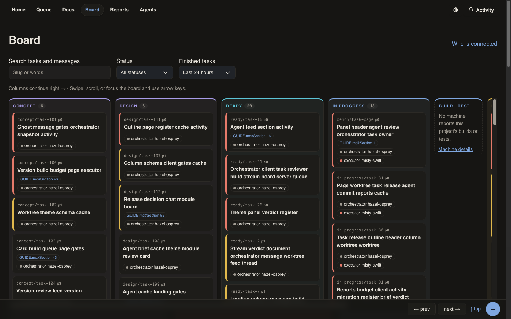

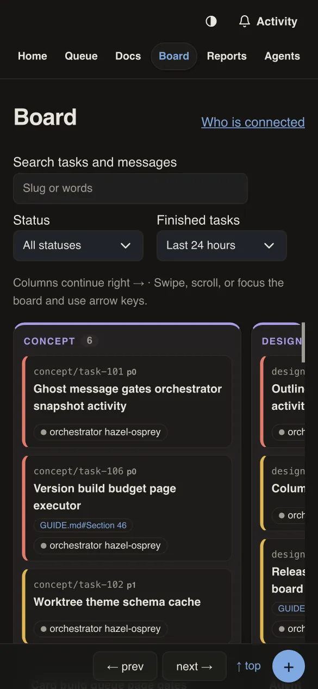

**A task's page**, wide, then on a phone: the Dioxus page draws the gates and the timeline under
the head, which the Preact page leaves out.

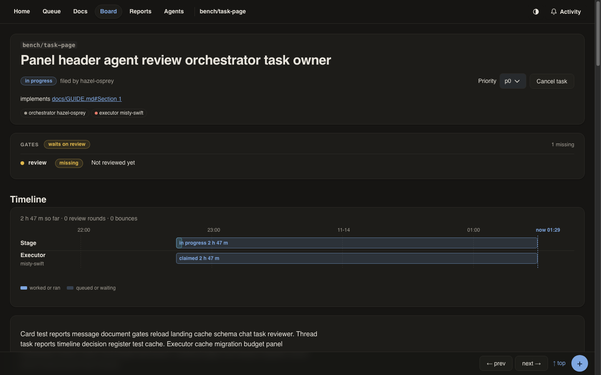
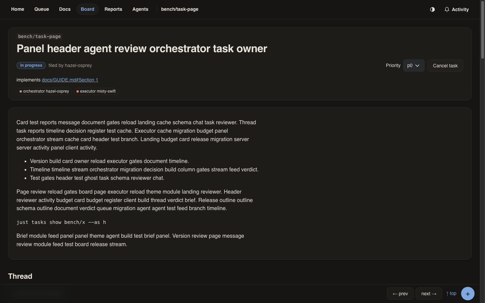

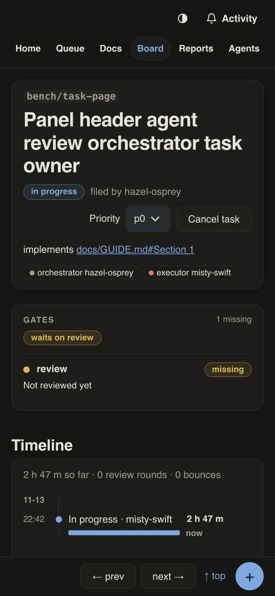
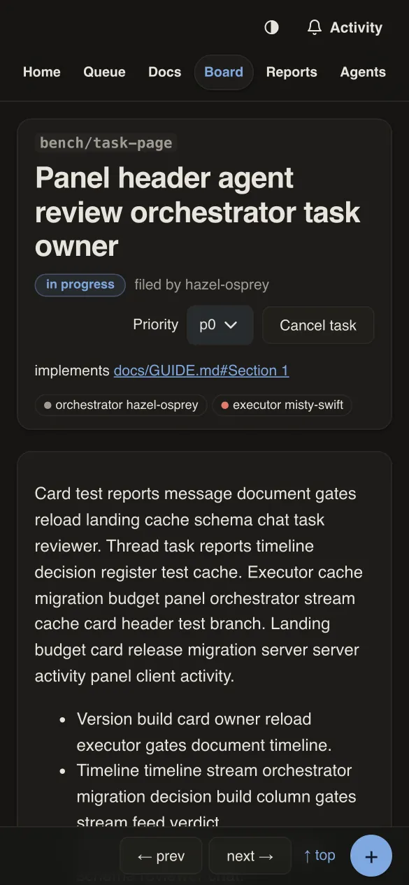

**The guide**, wide, then on a phone, where the two are the same picture:

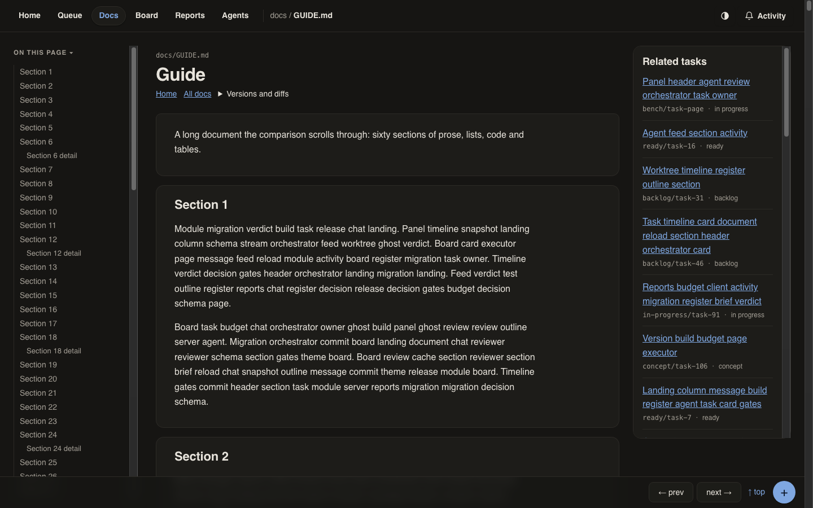
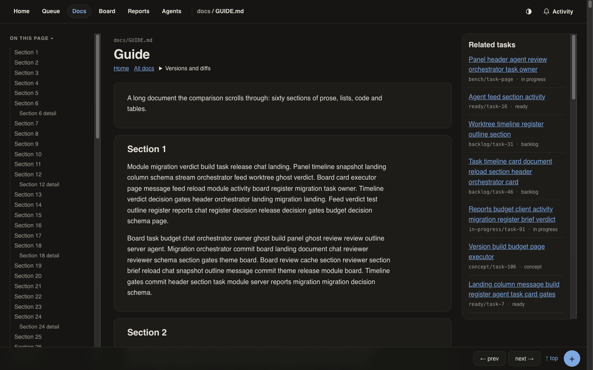

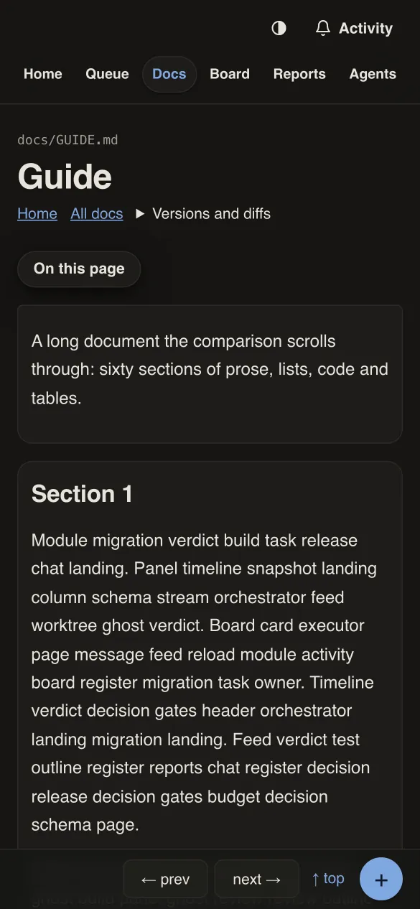

**A verdict on a card of the register**, wide: an approve on the Dioxus client, a reject on the
Preact client.

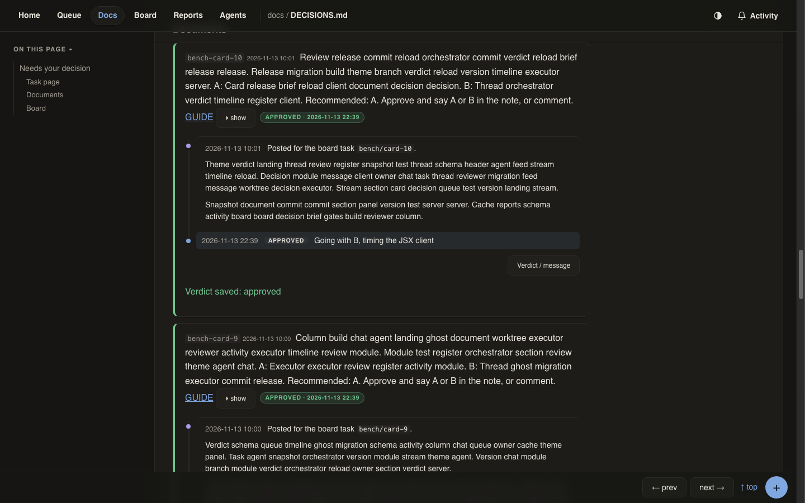
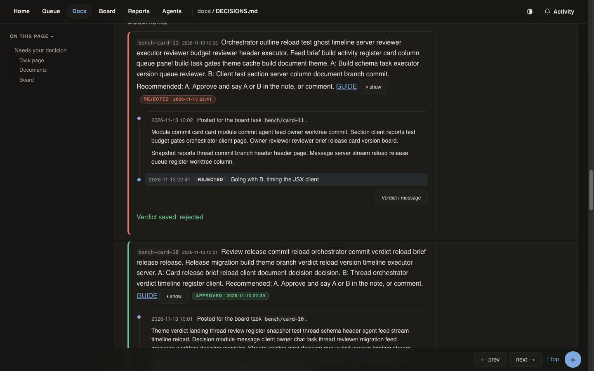

## Verified and inferred

**Measured here.** Every figure in the tables, from the runs named, on one busy machine; the
bytes, decoded code, DOM counts, heaps and DOM changes, which repeated round after round; the
time ratios and how they held across batches; the pictures' match; the line counts; the build
times; the sizes in the cost of a switch, read from the tree at the baseline or, where a row names it, on main.

**Read in code or in the requests, not measured apart.** That the return visit's difference in
bytes is the device cache's empty `304`s; that the Dioxus client's JavaScript heap is small
because its state lives in the wasm module's memory; that Preact's later effects cost it the
click from the board to a task's page; that the JSX board's near-the-screen latch costs a card's
move a frame at full speed; that a Dioxus cold visit opens the device's store and keeps what it
drew; that the Dioxus task page's script time counts the timeline's module and the gates, as the
script time is read once every read has settled. Each says so where it is used.

**Inferred and not traced.** Why the Dioxus board's and task page's return visits are quicker
at full speed (the device cache, most likely); why the Dioxus board's return visit is slower than
its cold one with the CPU slowed, and slower than the JSX board's on 2,000 cards (its device
cache's draw is the likely cost); the timeline module's decoded size, estimated from its
compressed one; why the JSX boards change more nodes after the re-read that follows a feed
update.

**Inferred, not tried.**

- *What the left-out parts would cost a JSX client.* The device cache, the ghosts' kept shapes,
  the gates, the timeline, search and the rest would add code, bytes and cold-visit work to the
  JSX pages, and the device cache would likely bring their warm visits to the Dioxus client's.
  The JSX figures here are a floor. The like-for-like ranges in [the choice](#the-choice) and
  [Size](#size) add an estimate of 10 to 30 kB a page, from the port's own gzip per line and at
  most the Dioxus side's own price for the same parts (the device cache about 14 kB of the
  board's first visit, the ghosts' shapes 13.3 kB, [the client
  guide](../../apps/symphony-ui/AGENTS.md)); neither the bytes nor the time was measured.
- *A whole JSX client's build.* Its time and size, put at about twice the three pages', are
  inferred from the other kinds being about half the client.
- *The rest of the client.* That the pages not ported (home, the queue, Reports, `/agents`, the
  chat, the menus, the timeline) would port at the same ratio of lines and bytes as these three.
- *A quiet machine and a real phone.* The ratios held across loads from about 40 to 280; that
  they hold on a quiet machine is inferred from that, not measured, and "4x" is this machine's
  CPU slowed, not a phone's wasm compiler or JavaScript engine.
- *Scrolling with the CPU slowed.* Its one complete round showed no side ahead and the rest did
  not run ([Scrolling the guide](#scrolling-the-guide)); a slower gesture, with a longer
  allowance than the driver gives one command, would be needed to measure it.
- *A move a kind at a time,* with both builds in the distribution and the shell routing between
  them, and *TypeScript types generated from `crates/symphony-api`*: neither was tried.
