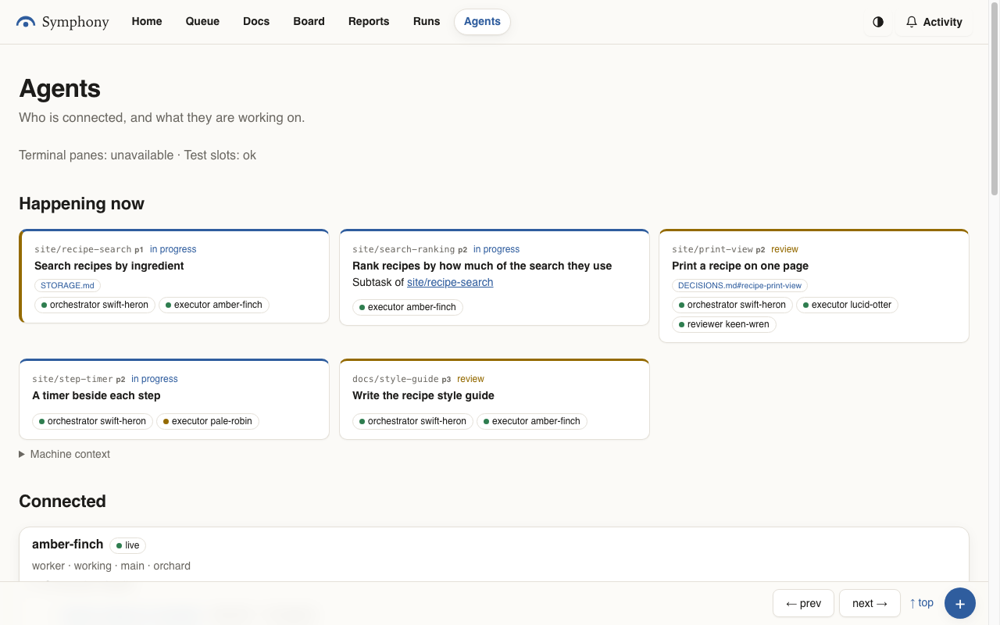
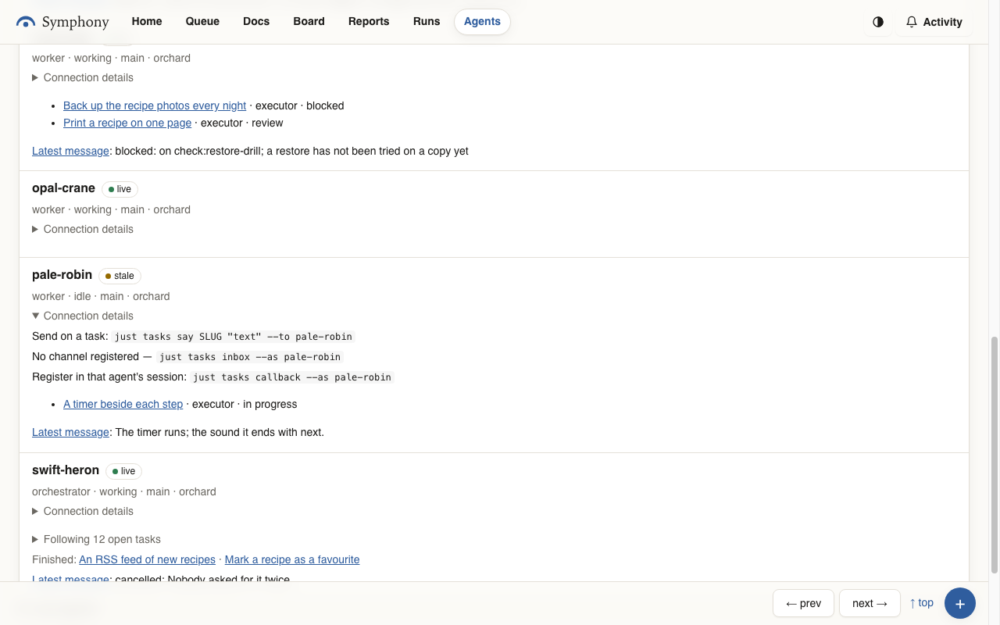
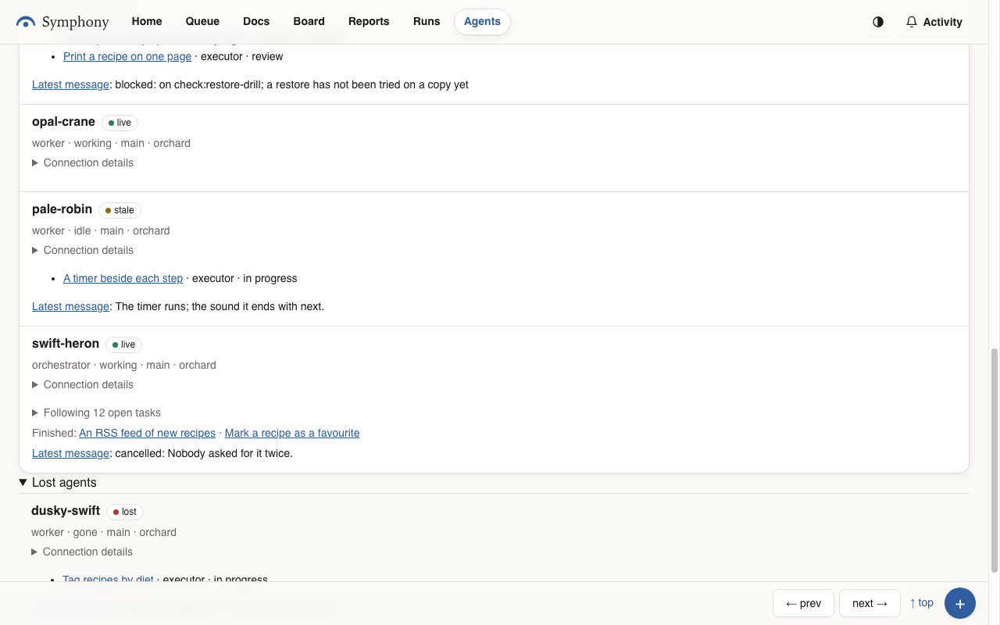
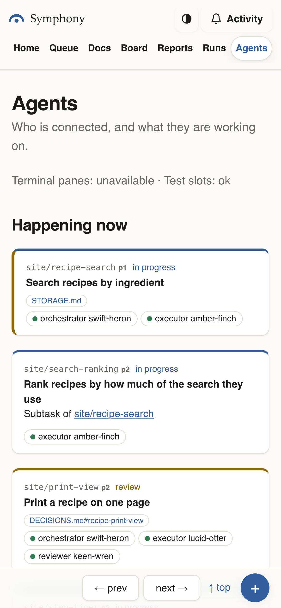

# The agents page

The agents page is every agent connected to the project's board, what each is working on and how
to reach it, at `/<project>/agents`. It is for the owner, who reads there who is at work, who has
gone quiet, and which agent to talk to about a task.

## What the owner does here

- **Sees what is happening now**: the tasks in progress or in review that the agents here work
  on, with who holds each.
- **Finds an agent that went quiet.** A stale agent says so beside its name; a lost one is under
  **Lost agents**.
- **Goes to an agent's session** with **Go to session**, to watch it or talk to it.
- **Finds how to reach an agent** from its **Connection details**.
- **Sees what an orchestrator follows** and what each agent finished last.

## What it shows

From the top: the title, a line saying whether this machine's terminals and test slots answer
(*Terminal panes: ok · Test slots: ok*, or *unavailable*), then **Happening now**, **Machine
context**, **Connected** and **Lost agents**.

| Region | Holds |
| --- | --- |
| **Happening now** | a card per task in progress or in review that a listed agent executes or reviews ([below](#happening-now)), as [the board](BOARD.md) words it: its slug, its priority, its stage, its title (a link to [its page](TASK.md)), its builds and tests running, the task it is a subtask of, the documents it links, and a chip per role with its holder's name and health |
| **Machine context** | folded: each machine that reports its builds and tests, *Builds: 1 running, 0 queued · Tests: 0 running, 2 queued*, or *Occupancy unknown* and how sure its report is (*stale*, *disconnected*, *partial inventory*, *conflicting evidence* or *unknown*), with the builds and tests under it and its advisory targets |
| **Connected** | a row per agent that is not lost, by name |
| **Lost agents** | folded: a row per lost agent, read when it is opened |

### An agent's row

| Part | What it says |
| --- | --- |
| Name and health | its handle, and its health ([below](#health)) in its colour |
| Its line | its kind, its model where it said one, what it is doing (*working*, *idle*, *gone*, *unknown*, or a state of its own in its own words, such as *running_test* or *waiting_on_input*), its branch and its worktree's folder: *worker · working · main · orchard* |
| Tokens | where it used any, *Tokens: 1.2M in 340 calls*, and their cost estimated at the list prices of a named day, with the models no price was found for |
| **Go to session** | its way in, where there is one ([below](#go-to-session)) |
| Builds and tests | a chip per build or test it runs now |
| **Connection details** | folded: how to send it a message, its channel or that it has none, and the command that registers one |
| Its work | each task it holds a role on and is not finished, by title, then its role and its stage: *Print a recipe on one page · executor · review* |
| **Following N open tasks** | for an orchestrator, folded: the open tasks it orchestrates, by priority, each with its stage |
| **Finished:** | the last five tasks it held that are done or cancelled, the newest first |
| **Latest message** | the last thing it said on a task's thread, the link opening that task |

A row also says *Chat goes to* and its name when it answers the chat, *parent:* and the agent it
works under for a subagent, *slots: 2 of 4* for an orchestrator, how many tasks it builds
against how many it may, and the recipe and its step while it runs a long one.

### Lost agents

A lost agent's row is the same as a connected one's. Its tasks wait on nobody on
[the board](BOARD.md) until another agent takes them over or the orchestrator moves them.

## Health

| Health | When | Where |
| --- | --- | --- |
| **live** | heard from in the last minute and a half, or in a long step it said it was in | **Connected** |
| **stale** | quiet for up to ten minutes, its work still its own | **Connected** |
| **unknown** | its processes cannot be read, or the check that its session is still there is overdue: it may be at work | **Connected** |
| **lost** | quiet for longer, holding work another agent could take over: a task it executes that is not yet in review (from concept to in progress), or a review it has not given | **Lost agents** |
| left | it said it left, however recently it was heard from; or quiet for longer with no such work, its tasks blocked, in review or finished | not listed |

The same health colours its role chips on the cards of **Happening now** and on [a task's
page](TASK.md).

## Happening now

A task is there while it is in progress or in review and an agent the page lists holds a role on
it other than orchestrator. So a task whose only executor is lost comes once **Lost agents** is
opened, one whose agents are past the rows loaded comes with **Load more agents**, and a blocked
task, being neither in progress nor in review, is not there at all: [the board](BOARD.md) shows
it.

## Go to session

**Go to session** does what reaches the agent from where the page is read:

- on the machine the Symphony runs on, it brings the agent's terminal forward there;
- elsewhere, it opens the session's own web address where the session has one;
- else it shows the terminal's screen in place, read only, with **Read the screen again** and
  **Close**.

A subagent's goes to its parent's session and says *in swift-heron's session*. An agent with no
known session has none.

## Order and loading

**Connected** and **Lost agents** are in the order of their names. Rows load a page at a time:
**Load more agents** and **Load more lost agents** bring the next, and the first comes as the
foot of the list nears the screen.

## Live

The page changes in place as agents come, go quiet and move tasks, with no reload. Nothing of it
is kept on the device: every visit reads it fresh.

## States

| State | What the page shows |
| --- | --- |
| Loading | grey lines that stand in for the page, which a screen reader reads as *Loading the board…*, then *Loading agents…* |
| No listed agent on a task in progress or review | **Happening now** with nothing under it |
| No machine reports its work | **Machine context** says *Machine occupancy unknown* |
| Work no machine vouches for | *Some work has no proven machine identity; capacity remains unknown.*, with its builds and tests |
| The board cannot be read | **The board could not be loaded**, why, and **Retry**; it tries again by itself |
| The agents cannot be read | **The agents could not be loaded**, why, and **Retry** |
| The connection is lost | *Reconnecting: the board may be out of date*, the page as last drawn, and each machine's occupancy unknown until it is back |
| The board does not answer | *The task board is unavailable. Reconnecting…*, or *The task board is slow to answer. Retrying…* |

## On a phone

One column: the cards of **Happening now** one under another, then the rows across the width.

## Edges

- An orchestrator's open tasks are under **Following**, not in its work: its work lists only
  the tasks it executes or reviews.
- In an agent's work and under **Following**, a task with a workflow of its own says the state
  that workflow names in place of its stage; the cards of **Happening now** say its stage.
- A machine's advisory targets are what orchestrators aim at, never a limit: *Orchestrators decide
  when to start work. These targets do not enforce admission.*
- An agent's tokens and cost are its own sessions', not its tasks': a task's are on its page.

## Related

- [The task board](BOARD.md): the same tasks by stage, and what each waits on.
- [Task board](../TASKS.md#going-to-a-session): sessions, health and going to a session, for
  agents.
- [Recording builds and tests](../MACHINE_WORK.md): what **Machine context** reports.
