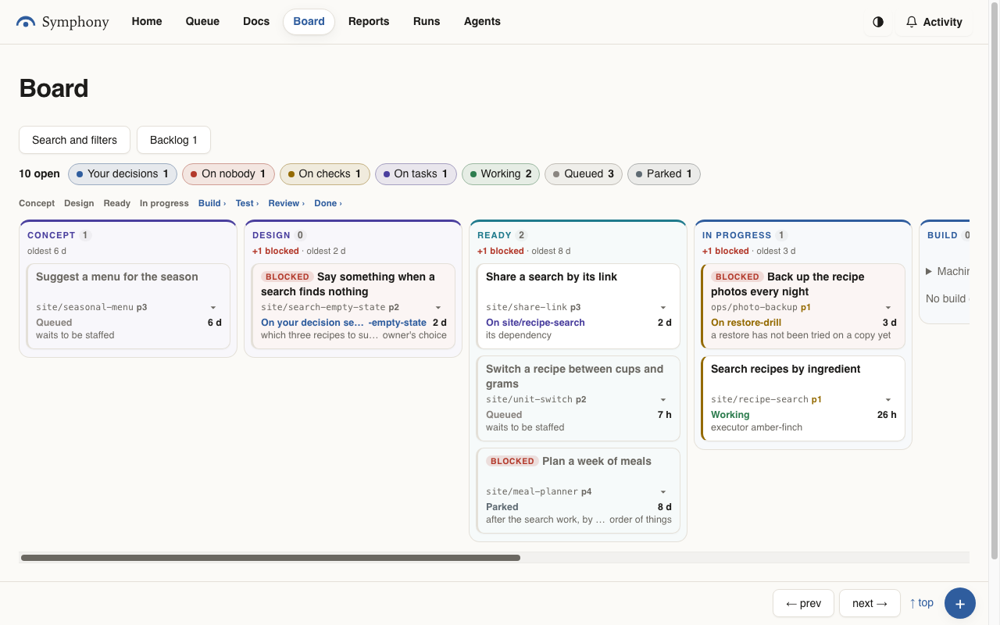
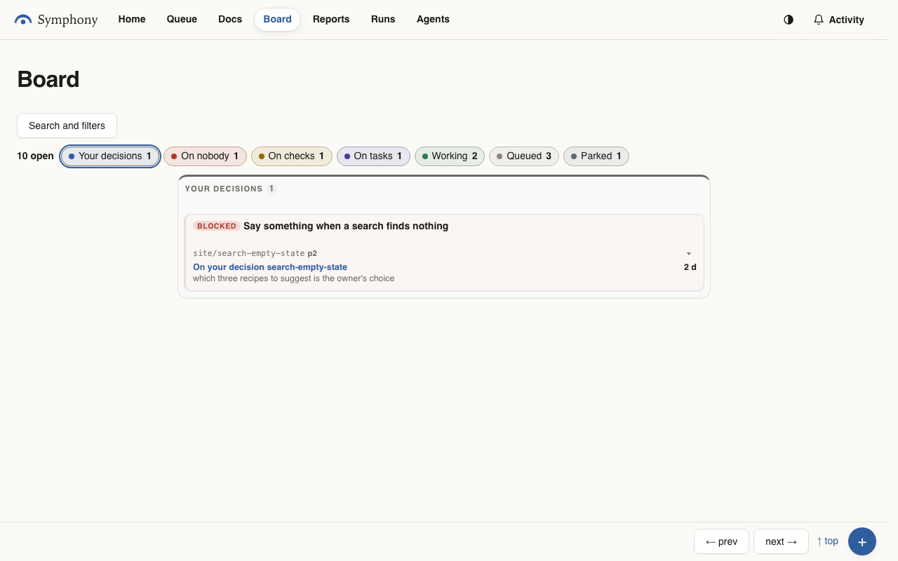
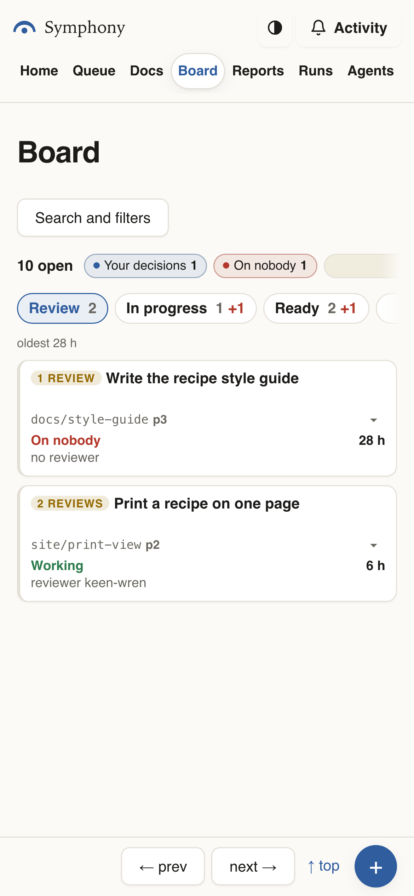

# The task board

The board is every task of the project, each in the stage it has reached and saying what it waits
on, at `/<project>/tasks`. It is for the owner, who reads there what the agents are doing, what is
stuck and what waits on them, and opens a task from it. Agents file, take and move the tasks; the
board itself changes none.

## What the owner does here

- **Sees what waits on them.** **Your decisions** counts the tasks that cannot go on without the
  owner; a press lists them.
- **Finds what is stuck.** A blocked task stays at the top of the stage it stopped in, marked
  **blocked**, with what it waits on and for how long.
- **Opens a task.** A press on a card's title opens [the task's page](TASK.md), where its brief,
  its gates and its thread are.
- **Looks for one.** **Search and filters** opens a search over slugs, titles, briefs and
  messages, and the window of finished tasks.
- **Checks that someone is running the work.** A banner says so when ready tasks wait and no
  orchestrator is live.

## What it shows

From the top: **Search and filters** and **Backlog** with its count, the strip of what the open
tasks wait on, a row naming every stage, and a column per stage.

| Region | Holds |
| --- | --- |
| The strip | the number of open tasks, then a chip for each thing a task can wait on, with its count |
| The stage row | a button per stage, which brings that column into view; **‹** or **›** marks a column the window cuts |
| A column | its name and how many tasks it holds that are not blocked, then under it how many more are blocked there and the age of its oldest, then its cards |
| A card | a task: its title, its slug, its priority, what it waits on, for how long and why |

### The stages

The columns, left to right, are the stages a task goes through: **concept**, **design**,
**ready**, **in progress**, **build**, **test**, **review** and **done**.

- **build** and **test** are not stages a task is moved to. A task in progress is shown there
  while a machine reports that it builds or tests it now, and returns to **in progress** when
  that ends. Running work counts before queued work, and a test before a build. A blocked task
  is never moved there. Under **build**, **Machine context** says how fresh the machines' report
  is and links to the agents page.
- **done** holds the tasks finished in the last 24 hours, newest first. Under its name,
  **N cancelled · today** opens the cancelled tasks of the same window as a list in the board's
  place. **Finished tasks**, behind **Search and filters**, changes the window to **Last week**.
- **Backlog** is not a column: its button opens the tasks put aside for later as a list in the
  board's place. **Back to stages** returns from it, and from the cancelled list.

### A card

| Part | What it says |
| --- | --- |
| Marks before the title | **blocked** on a blocked task; **1 review**, **2 reviews** once it has been to review that many times |
| Title | the task's title, two lines at most; it opens the task's page |
| Slug | the task's name on the board, which its branch carries too |
| Cost | what the task and its subtasks spent in tokens, as an estimate in dollars: **$1.23**, **$1.23+** when some of it had no price, **unpriced** when none had; absent when nothing was spent |
| Priority | **p0**, the most urgent, to **p4** |
| **▾** | opens the card in place to the whole of its title, slug, wait and reason |
| Wait line | what it waits on, for how long, and why |

The age on the wait line counts from when the task came to wait on that: in hours up to two days,
then in days. It turns red after a week, except on a task that is queued, parked or finished. A
finished card says **Done** or **Cancelled** and the time since.

## What a task waits on

Every open task waits on exactly one thing, and the strip counts the open tasks by it. The counts
add up to the number of open tasks, the backlog among them. A subtask is not counted or drawn: it
is on its task's page.

| Chip | Counts the tasks that | Their card says |
| --- | --- | --- |
| **Your decisions** | wait on the owner: a card to decide, or their approval before it lands | **On your decision** and the card's or the approval's name |
| **On nobody** | wait on something no one is there to give: an executor that is gone, a review no reviewer has taken, a cancelled task they depended on, a block with no reason | **On nobody** |
| **On checks** | wait on a check or a stamp someone has to give before they land | **On** and the check's name |
| **On tasks** | wait on another task that is still open | **On** and that task's slug, *its dependency* |
| **Working** | have an agent at work on them, or on a subtask of theirs | **Working**, the role and the agent's name; **(stale)** after an agent that has gone quiet |
| **Queued** | lack nothing: waiting for an agent to take them (*waits to be staffed*), or reviewed and waiting to land | **Queued** |
| **Parked** | were put aside on purpose | **Parked** |

A press on a chip shows its tasks alone, as one list across every stage, under the chip's name;
a second press, or a press on the count of open tasks, returns to the stages. Finished tasks are
never in such a list.

## Order

Within a column:

1. blocked tasks first, by what they wait on in the strip's order (the owner's decisions, nobody,
   checks, tasks), then the longest wait first;
2. then the rest, the longest in the stage first;
3. parked tasks last;
4. in **done** and among the cancelled, the newest first.

A column draws thirty cards; **Load more tasks** brings the next thirty.

## Search and filters

**Search and filters** is closed at first, at every width. **Search tasks and messages** takes a
slug or words and keeps on the board only the tasks whose slug, title, brief or thread has them,
subtasks among them, as it is typed. **Finished tasks** is **Last 24 hours** or **Last week**, and
decides which finished and cancelled tasks are shown and counted.

## No live orchestrator

An orchestrator is the agent that staffs the ready tasks and lands the approved ones. While at
least one ready task waits to start and no orchestrator is live, a banner above the strip says
**No live orchestrator.**, who holds the role and in what health, and how many of the ready tasks
wait to start. It is amber while a holder has only gone quiet, red when none is there, and absent
while one is live or nothing waits to start.

## States

| State | What the page shows |
| --- | --- |
| Loading, first visit | the board's outline: the strip at zero and a column per stage with a card's shape in each |
| Loading, a later visit | at once, the board this device last held, with *Shown from this device, saved 14:32. Checking for changes…* until the server has answered |
| No task in a stage | the column with its count at 0 and no card |
| No build or test going on | in **build** and **test**, *No tasks with fresh build activity.*, or *No build observations reported.* when no machine reports at all |
| The first read fails | **The task board could not be read**, why, and **Retry**; the page tries again by itself |
| The connection is lost | *Reconnecting: the board may be out of date*, the board as last drawn, and **build** and **test** saying *Disconnected · build activity unknown* |
| A link names a task the board no longer has | *The linked task is no longer on this board.* and **Retry** |
| A task moves while the page is open | its card moves in place, with no reload; a card that holds the keyboard's focus keeps it |

## On a phone

One stage at a time. A row of tabs under the strip names the stages, **Review** first, then
**In progress**, **Ready**, **Done**, **Design**, **Concept** and **Backlog**, each with its count
and, after a **+**, how many more are blocked there; **Build** and **Test** join the row while a
machine reports work. The stage chosen is kept on this device, for this project. The strip and the
tabs each scroll sideways, and a choice that does not fit whole is drawn as an empty shape rather
than cut. There is no **Backlog** button and no **Back to stages**: the backlog is a tab, and the
cancelled tasks open from **Done** as on a wide screen.

## Edges

- A link to one task on the board (`/<project>/tasks#row-<slug>`) opens the stage that task is in,
  the backlog and the cancelled list among them, and loads further pages of its column until the
  card is there.
- A task blocked with nothing named is not shown as blocked: it stays in the stage it stopped in,
  under **On nobody**, saying *no reason recorded*.
- Two cards that differ only at the end of a long slug or reason stay told apart: a line too long
  for the card keeps its start and its end, with the ellipsis between them.
- A card's cost is read after the card is drawn, so it can appear a moment later; a read that
  fails leaves the card without one.
- On a project that runs a workflow of its own, the columns and the tabs are that workflow's
  phases, each card names the state it is in, and a second strip counts the tasks by state.
- Beside the open chat the columns keep their width and the row of columns scrolls sideways.

## Related

- [A task's page](TASK.md): what a card opens.
- [Task board](../TASKS.md#what-a-task-waits-on): how the board decides what a task waits on,
  and the commands agents move tasks with.
- [Recording builds and tests](../MACHINE_WORK.md): what puts a task in **build** or **test**.
- [Workflow](../WORKFLOW.md): a project's own stages.
