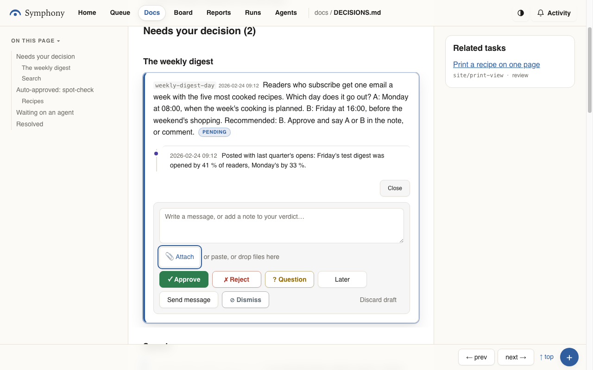
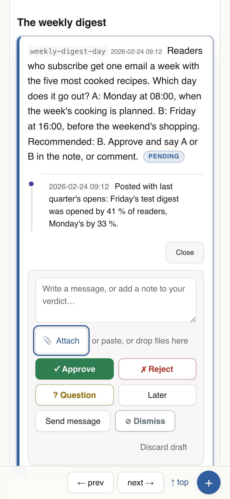

# Cards and verdicts

A decision card asks the project's owner for one choice, inside a document at
`/<project>/docs/<document>.md#<card>`. Read the proposal and evidence, give a verdict or send a
message, and return to the same history for the agent's answer.

## What the owner does here

- **Decides.** Open **Verdict / message** or press the prose, add an optional note, then
  **Approve**, **Reject** or **Question**.
- **Chooses an option.** Approve and put A, B or the requested option in the note. Reject means
  none of the offered options will do. There is no separate option picker.
- **Talks.** **Send message** or ⌘/Ctrl+Enter sends the box's words without a verdict.
- **Puts it off.** Press **Later** beside the verdict choices to open the next card.
- **Closes an unnecessary proposal.** **Dismiss** says there is nothing to act on.
- **Takes a verdict back.** **Reset to pending** asks for a decision again, keeping the history.
- **Checks replies.** Read the dated conversation or unfold a settled card.

## What it shows

A card shows its stable name, proposal, posting time, state and decision time when available,
then evidence and conversation. An unposted proposal says **draft, not posted**. A section
link's **show** opens a read-only excerpt; **hide** closes it.

The editor holds the note, attachments, verdict choices, Later and other actions. Its current
verdict is marked. These pictures show a fictional Orchard proposal with an unsaved editor.

## Marks and what follows an answer

The mark records the verdict; the group also depends on who spoke last.

| Mark | What it means to the owner |
| --- | --- |
| Pending | no verdict yet; it waits for the owner |
| Approved | the proposal is accepted; a note still asks the agent for an answer |
| Rejected | the proposal was refused; the agent owes an answer, usually a replacement |
| Question | clarification is requested |
| Auto-approved | an agent applied an earlier owner decision; spot-check it, and any owner verdict overrides it |
| Resolved | the accepted card has nothing left to answer |
| Dismissed | the proposal needs no further action, including when replaced while still open |

A plain approval can settle the card. A message, question, rejection or verdict note asks an
agent for an answer. An answered note on an approved or questioned card can return for another
approval or comment. A new owner comment can reopen a settled card. The
[review rules](../workflow/REVIEW.md#groups) define the lifecycle; the [queue](QUEUE.md) gathers what
waits on each person.

## Notes, files and drafts

Notes show line breaks, paragraphs, emphasis, lists, tables, code, links and media. Raw HTML
stays literal. Review callouts and unclosed code fences are refused with the draft kept;
see the [note format](../workflow/REVIEW.md#card-history).

**Attach**, paste or drop adds files as removable chips. A message can be files alone; a verdict
needs no note. Uploads in progress hold the save. Posted pictures open in the viewer; other
files are links. [Attachments](../workflow/REVIEW.md#attaching-files) gives limits and durability.

Close or Escape keeps the draft on this browser, including across reloads; **Resume draft**
reopens it and **Discard draft** clears it. The card stays in place while being edited.

## Later

Later is offered on cards waiting for the owner. It changes order without changing the verdict
or count. **postponed** and **Undo Later** let the owner restore it. This order is shared across
devices; the card returns after the other waiting cards of its kind are opened, or after three
days. A new owner line ends Later. [The queue](QUEUE.md#later) gives the full rule.

## Branch drafts and saved history

Committing a branch's proposal posts it. A draft can take a question, rejection or message,
but cannot be approved or dismissed. Uncommitted changes to a posted proposal or its agent
replies also prevent a closing verdict. Missing required pictures hold a proposal out of the
queue.

Main and a branch can show one card with both copies' dated lines. A page showing main's card
saves on main; a branch's own proposal saves there. Owner history stays visible after a branch
finishes, until main carries it or closes the card later. Entries are appended, never
overwritten. [Concept review](../workflow/REVIEW.md#one-app-every-worktree) owns the exact save, commit
and conflict rules.

## Settled cards

Resolved and dismissed cards, and answered rejections, fold to a summary line. Open it for the
proposal, evidence, history and **Verdict / message**. Unanswered rejections stay open. Folding
deletes nothing.

## States

| State | What the card does |
| --- | --- |
| Loading | its section shows an outline until the card arrives; a settled body loads when opened |
| No note | a verdict can be saved; Send message needs words or files |
| Checking freshness or reconnecting | the visible copy stays; save buttons wait for the server |
| Saving | the editor prevents another save while its answer is on the way |
| Saved | the owner's entry appears on the card and its group updates; confirmed sent text clears |
| Save response uncertain | the draft and error remain; an arriving saved verdict can confirm it, and retrying that verdict does not add a duplicate |
| Save refused | the reason appears, such as an unposted draft, invalid note or unsafe merge position; the draft remains |
| Card removed while editing | a warning keeps the draft for copying or discarding and disables saving to the old place |

## On a phone

The card and conversation fill the column. Verdict buttons wrap to fit, with other actions
below. Pictures and mockups scale; tables and code scroll inside. A settled fold opens by tap
or keyboard.

## Edges

- Read the latest entry and group as well as the mark to see whose turn it is.
- Only the owner approves. Auto-approvals can be spot-checked; an agent must not reopen an
  approved choice with a new question.
- Two branch proposals with the same name can be distinct decisions in the queue. Follow the
  task tag to check which proposal is being answered.
- A missing branch or merge can refuse a save, retaining the draft. It does not silently send
  the words to another proposal.
- A saved verdict's pictures are the supplied evidence, not a capture of the current app.
  [Reading a document](DOCUMENT.md#pictures-and-mockups) explains their provenance and durability.

## Related

- [Reading a document](DOCUMENT.md): contents, comments, media, versions and branch comparisons.
- [The review queue](QUEUE.md): what waits on the owner, ordering and Later.
- [Concept review](../workflow/REVIEW.md#start-with-the-decision-register): the exact marks, authority,
  note format, saved history and lifecycle mechanics.
