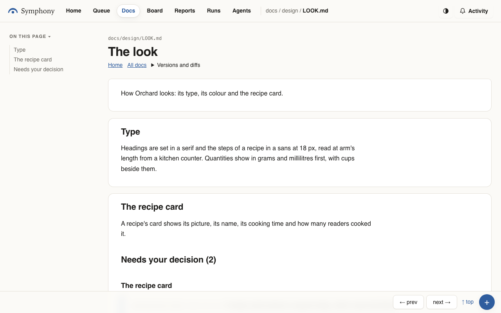
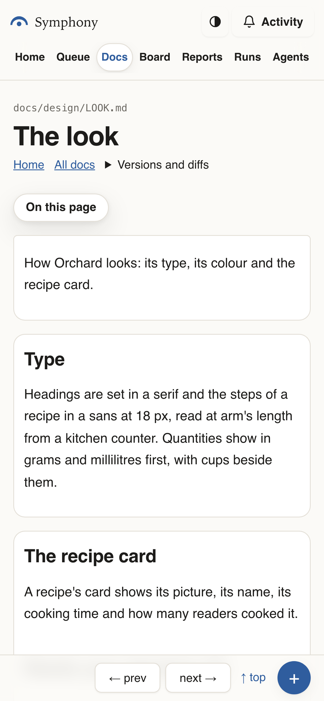

# Reading a document

A document page lets the owner and project contributors read Markdown, follow evidence and
comment in place. Its usual address is `/<project>/docs/<document>.md`; a project can choose
another documents address.

## What the owner does here

- **Reads and finds a section.** Follow **On this page**, a heading link or a link from another
  document, which may name the heading by its text, as a task's link does (`#The order`).
  **All docs** returns to the document list.
- **Comments on a block.** Press **+ comment** beside the paragraph, heading or table. Choose
  comment, question or decision, write the first line as its title, then **Save comment**.
- **Asks a question.** The document's [ask conversation](../workflow/REVIEW.md#asking) is a chat;
  a comment requests a lasting change.
- **Opens the evidence.** Tap a picture for its original, or a mockup's **full size** link.
- **Looks back.** Open **Versions and diffs**, then choose a dated commit to read what changed.
- **Reviews a proposal.** A document can hold [decision cards](CARDS.md), each with its own
  verdict and conversation.

## What it shows

The head gives the path, title, Home, All docs and **Versions and diffs**. With at least three
headings there is **On this page**. The body holds prose, lists, tables, code, pictures, review
callouts and project components. Related tasks appear beside it; finished work folds under its
count.

These pictures show Orchard, the fictional fixture project, in the current reader. They are
examples, not historical captures or real project decisions.

## Comments and drafts

A saved comment follows its block; an agent's resolution nests under the owner's words.
Answered callouts can fold shut. **Close comment** or Escape keeps the draft on this browser;
**Resume draft** reopens it and **Discard draft** clears it. Attach, paste or drop files into
the editor; a comment still needs words.

An open editor keeps its block in place during updates. If the block disappears elsewhere, a
warning keeps the draft for copying or discarding and disables saving to its old position.
Inside a register, comment on a card through **Verdict / message**; a comment on a group or
topic heading is refused. Blocks outside the register can take comments.

## Pictures and mockups

A picture reserves space before loading near the screen. The page may show a small copy;
the viewer opens the original. An HTML mockup embedded as a picture is a live preview scaled
to the column, with a caption and **full size** link. Its scripts are isolated from the app.

Document and card pictures must be committed beside them so a clone shows the evidence.
Working evidence can be local to this machine. Valid uploads named by a verdict or document
comment are committed with that save. Appearing in the page alone does not make an original
durable; see the [picture](../workflow/REVIEW.md#writing-a-card) and
[attachment rules](../workflow/REVIEW.md#attaching-files). Media show the supplied version, not proof
that proposed behavior is implemented.

## Versions and branch pages

**Versions and diffs** lists the document's commits by date and subject. Choosing one opens
its text diff below the list; the current document stays in place. A document has no overall
approval status: its waiting decisions are its cards.

A branch's document links stay on that branch. Its changes still differing from main are
marked **Added**, **Changed** or **Removed**, with **Previously on main** available for changed
content. Previous and removed content are read-only; unchanged blocks have no mark. A note
links the task behind the differences. [Cards](CARDS.md#branch-drafts-and-saved-history)
explains answers shared across main and a branch.

## States

| State | What the page shows or allows |
| --- | --- |
| First load | a document outline and loading sections until their content arrives |
| Return visit | the copy this browser kept, identified as a device copy, while freshness is checked; saves wait |
| Connection lost | the document stays visible with a warning that it may be out of date; it reconnects by itself |
| Read fails | an explanation and Retry; content already drawn stays visible |
| Document moved | a route no file has opens the one document of its file name in its place, the heading kept, as a wikilink to that name finds it; Back skips the old route |
| Document missing | Document not found, with All documents and Retry, and each document of the route's name when more than one has it; a document removed while open gets a notice |
| Empty body | the document head with no body sections |
| Save refused or fails | an error beside the editor, with the draft retained |
| Markdown outside the document folders | a read-only page in the project's look, with heading links; no block comments, card editor or Versions and diffs |

## On a phone

One column, with **On this page** folded under the title. Wide screens start with contents
beside the body; a cramped table folds them automatically unless the reader chose their state.
Related tasks move below the document. Tables and diffs scroll within their boxes; pictures fit.

## Edges

- Wait for freshness to be confirmed before saving. Unsaved drafts belong to this browser.
- During a branch merge, a conflicted document shows its last committed content and a merging
  notice. Block comments wait for the merge; a card may still take an answer where it is safe.
- Nearby insertions and rewrites can make a comparison's previous paragraph a best-effort
  match. Use the text diff for the exact edit.
- Read-only Markdown and an HTML document are different views. An HTML document shows its own
  page in an isolated frame, without the Markdown reader's contents, comments or versions.

## Related

- [Cards and verdicts](CARDS.md): deciding, notes, Later and settled cards.
- [Concept review](../workflow/REVIEW.md#commenting-in-place): comment format, review authority and saves.
- [The project file](../operations/PROJECT_FILE.md#entrypoints): which files are documents and their addresses.
- [Product pictures](README.md#pictures): how these fictional examples are captured and retaken.
