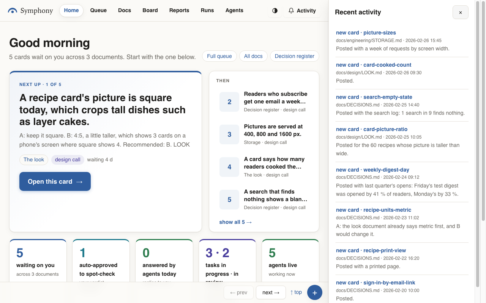
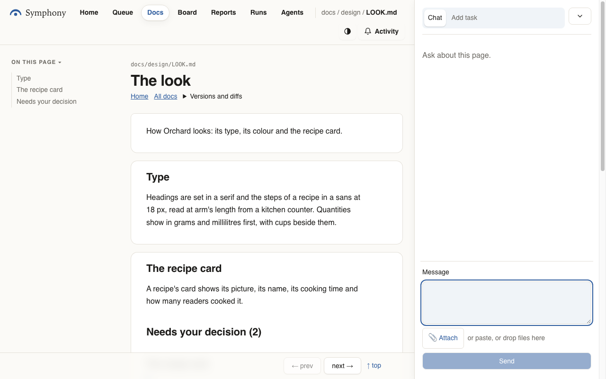
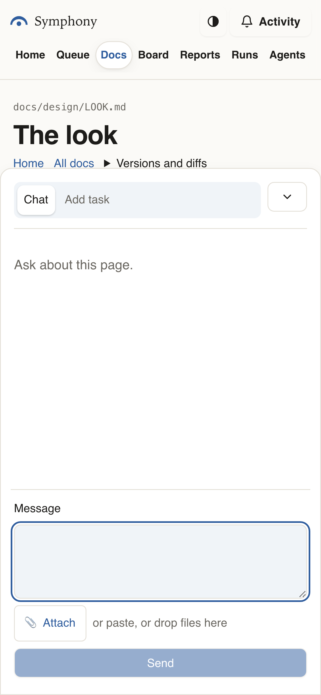

# What every page shares

Every page of a project is drawn inside the same frame: a header with the project's pages,
**Activity**, the **+** button that opens the chat, a bar that steps through the cards waiting on
the owner, and the notices that say when a page may be out of date. It is for the owner, who
moves between the pages with it and hears from the agents without leaving the page they read.

## What the owner does here

- **Goes to another page** by its name in the header, or back to the list of projects.
- **Reads what the agents said last.** **Activity** lists their latest replies; a dot on it says
  some are unread.
- **Asks about the page in front of them**, or **files a task**, from the **+** button, on any
  page.
- **Steps to the next card that waits on them** with **next →**, or the `]` key.
- **Changes the project's look on this device** from **Appearance**.

## What it shows

| Region | Holds |
| --- | --- |
| The header | the project's mark and name, **Projects**, the pages, the crumbs, **Appearance** and **Activity** |
| The page | whatever the address names |
| The foot | the bar of waiting cards, the **+** button, and the notices |
| A side panel | **Recent activity** or the chat, one at a time, at the window's right edge |

### The header

- **The mark and the name** are the Symphony's, or the project's own where [its
  theme](THEMES.md#a-projects-theme) has them. They are not a link.
- **Projects** opens [the project picker](PROJECTS.md). It is there on every page of the
  machine's one Symphony, which serves each project under its id, however many it serves; a
  Symphony started for one checkout alone has none.
- **The pages**, always in this order: **Home**, **Queue**, **Docs**, **Board**, **Reports**,
  **Runs**, **Agents**, then any page the project adds of its own. The one shown is lit. A
  task's page lights **Board**, and a document or a folder lights **Docs**.
- **The crumbs** say what the lit page does not: a document's folders and its name, each folder a
  link, or a task's slug.
- **Appearance** (the half-filled circle) opens [a small panel](THEMES.md#appearance) that
  changes the project's look on this device, from a theme file, or puts back the project's own.
- **Activity** opens the list of recent activity, and closes it again.

The header stays at the top of the window while the page scrolls.

## Activity

**Recent activity** opens at the window's right edge and pushes the page aside. Each item is an
agent's reply or a new card: its kind and its card's name, which is a link to it, then its
document and its time, then its first words. An unread item is marked.

- An item is unread until the owner follows its link, or answers it, on this device. The first
  time a device opens the project, everything already there counts as read.
- Following an item's link closes the list.
- **×** or the Escape key closes it and returns to **Activity**.
- Opening it closes the chat and **Appearance**: one panel is open at a time.

### Toasts

An item that arrives while a page is open, and is unread, comes up as a toast above the foot:
its kind and its card's name, as a link, and **×** to take it down. Items that arrive together
leave together, seven seconds later. Three toasts show at most; a newer one takes the oldest
down. A toast needs no press: the item stays in **Recent activity**.

## The + button

**+**, at the foot's right corner, opens a sheet with two tabs.

| Tab | Holds | **Send** |
| --- | --- | --- |
| **Chat** | *Ask about this page.*, then the conversation once there is one, each message under its author's name; **Message**; **Attach** | sends the message, with the page it was asked on, to the agent that answers chat |
| **Add task** | **Title**, with its count out of 200 characters; **Details**; **Slug (optional)**; **Priority**, **p0** to **p4**, **p2** to begin with; **Attach** | files the task on the board, and says **✓ Task** *slug* **created**, the slug a link to its page |

- Under a conversation the sheet says who receives it, *Chat goes to* and the agent's name, or
  *Nobody is registered to receive chat; your message is queued.*
- **New conversation** starts another; the one before is not shown again.
- **Attach** takes pictures or documents: picked, pasted or dropped on the sheet.
- The button with the down arrow folds the sheet away and keeps the conversation. The Escape key
  does the same.
- What is typed is kept on this device, for this project, as it is typed: the sheet, its tab and
  its words are the same on the next page and after a reload.
- An agent's answer arrives in the open sheet by itself.

## The bar of waiting cards

While at least one card waits on the owner, the foot holds **← prev**, **next →** and **↑ top**.

- **next →** goes to the first waiting card below the reader's place in the document, then to
  the next document that has one; **← prev** goes the other way. They walk the documents in
  the index's order and each document's waiting cards from its top, which is not [the
  queue's](QUEUE.md#order) order.
- A step with nowhere to go is greyed.
- `[` and `]` do the same from the keyboard, pressed alone, anywhere but in a text field or an
  open menu.
- **↑ top** returns to the top of the page.

With no card waiting there is no bar, and **+** sits alone in the corner.

## Notices

A notice floats over the foot of the window while something about the page is not as it looks.

| Notice | Means |
| --- | --- |
| *Reconnecting: the board may be out of date*, on a document *Reconnecting: this document may be out of date* | the page lost its live connection and is opening another |
| *Shown from this device, saved 14:32. Checking for changes…* | the page was drawn at once from what this device kept, and the server has not answered yet |
| *Not reachable: shown from this device, saved 14:32* | the same, and the server does not answer |
| *The task board is unwell: …* or *The task board is starting: …* | the project's board cannot be relied on; the notice says why |
| *The task board is unavailable. Reconnecting…*, or *The task board is slow to answer. Retrying…* | on the board, a task's page and the agents page: the board does not answer, or answers slowly |
| *The task board is at schema N, ahead of this Symphony's …* | the board is read and nothing is written to it from here; a verdict or a message saved now is kept, and reaches no agent until then |
| *This project's settings do not load, so it is served with the defaults: …* | the project's settings file has an error, which the notice quotes |

While one of the first three shows, the buttons that save on a document or a task's page (a
verdict, **Later**, a comment's or the task's message's **Send**) take no press and say
*Checking…*; what is typed stays editable. The chat's **Send** is not held.

## States

| State | What the frame shows |
| --- | --- |
| Loading | the header at once; the page under it as its own outline |
| A panel opened before it has loaded | the panel's box at once, saying *Loading activity…* or *Loading conversation…* |
| A panel that cannot load | *Conversation could not be loaded.* and **Retry loading conversation**, at the top of the page |
| Activity cannot be read | the list as last read, under *Activity could not be refreshed:* and why |
| No activity | *No recent activity.* |
| The conversation cannot be read | *Conversation could not be refreshed:* and why, over the messages last read |
| A conversation that is gone | *This conversation is no longer available. Your text is kept; send again to start a new conversation.* |
| A task's save not confirmed | *Checking save…* and why; then **Check save** in **Send**'s place, with *Check the previous save to continue; your text is kept.* |
| A new version of the Symphony is served | the page loads again by itself, once, and waits while the owner is typing or has a menu open |

## On a phone

- The header is two rows: the name, **Projects**, **Appearance** and **Activity**, then the
  pages across the width. The seven pages fit; a project's own beyond them scroll sideways, and
  one that does not fit whole is drawn as an empty shape rather than cut.
- There are no crumbs, and the header scrolls away with the page.
- On the narrowest phones **Activity** is its bell alone.
- The chat is a sheet over the lower part of the page, the bar and **+** under it, instead of a
  panel beside it.
- **Recent activity** covers the page.
- On a page that ends in a message box, a task's or a document's question box, the notices sit
  under the box, at the page's end, rather than over it, at 600 points wide or less.

A window narrower than a laptop's, a tablet's, keeps the header of a wide window and lays the
panels over the page as a phone does, rather than pushing it aside.

## Edges

- Two devices do not share what is read: an item read on the laptop is still unread on the
  phone, until the owner answers it.
- A task whose save is not confirmed is asked about again, and never filed twice: **Check save**
  repeats the same request.
- The chat's **Message** needs words, even with a file attached.
- On a branch's copy of a document, the header's **Home**, **Queue**, **Board**, **Reports**,
  **Runs** and **Agents** are still the project's own; **Docs** and the crumbs stay on the
  branch.
- **↑ top** and the steps stay clear of an open panel: the bar, the toasts and the notices move
  left with the page.
- With a panel open the header is narrower, and what does not fit its row, **Activity** first,
  goes to a second.
- [A project's theme](THEMES.md#a-projects-theme) can keep the header to one row at every
  width, scrolling sideways where it does not fit.

## Related

- [Home](HOME.md): where **Home** leads.
- [The review queue](QUEUE.md), [reading a document](DOCUMENT.md), [the task board](BOARD.md),
  [Reports](REPORTS.md), [Runs](RUNS.md) and [the agents page](AGENTS.md): the other pages of the
  header.
- [Themes and appearance](THEMES.md): a project's own name, mark and look, and what
  **Appearance** imports.
- [Review](../workflow/REVIEW.md): the cards the bar steps through, and attaching files.
- [Project file](../operations/PROJECT_FILE.md): a project's own name, mark, theme and pages.
