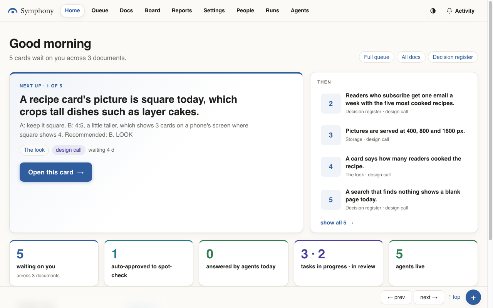
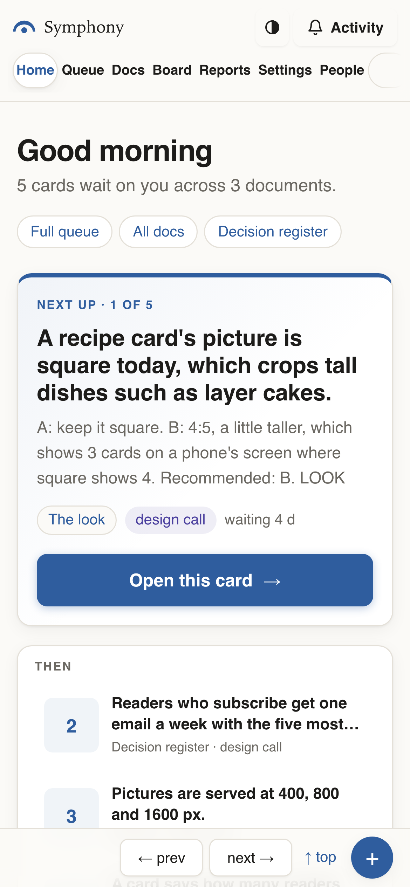

# Home

Home is where a project opens, at `/<project>/`: the next card that waits on the owner, the few
after it, and a row of counts that each lead to where their detail is. It is for the owner, who
comes to it to see at a glance whether anything waits on them and to start on it.

## What the owner does here

- **Starts on the next card.** **Open this card** opens the first card waiting on them, in its
  document, where the verdict is given.
- **Sees what comes after it**, and opens any of the next four.
- **Reads how things stand**: how many cards wait on them, how many were approved without them,
  what the agents answered today, what the board is doing, how many agents are at work.
- **Goes to the rest**: the whole queue, every document, the decision register.

## What it shows

From the top: the greeting and its line, the links, **Next up** beside **Then**, the counts, and
the project's progress.

### The greeting

**Good morning** until noon, **Good afternoon** until six, **Good evening** after, by the clock of
the device it is read on. Under it, *5 cards wait on you across 3 documents.*, or *Your queue is
empty.*

Beside it, the links: **Full queue**, **All docs**, a link to each page the project adds of its
own, **Decision register** where the project has one, and **How review works** where it has a
guide to it.

### Next up

The first card of [the queue](QUEUE.md), in the queue's order.

| Part | What it says |
| --- | --- |
| **Next up · 1 of 5** | that it is the first of the cards that wait on the owner, and how many there are |
| Title | the card's first sentence, cut at 110 characters; a card that asks for a picture is named for it, its slot's name and *picture* |
| Summary | the rest of its text, cut short when it is long |
| Its document | the document's title, a link to it |
| Its task | the task's slug, for a card an agent posted on a branch that has not landed |
| Why | why it ranks there, as the queue says it: *design call* |
| *waiting 4 d* | how long since it was posted: *new* in its first hour, then hours, then days |
| **Open this card →** | the card in its document |
| Pictures | under its words, up to six of the card's pictures, each opening full size; *picture coming* where one is not made yet |

### Then

The four cards after it, numbered **2** to **5**: each its first picture, or its number where it
has none, its title, its document and why, and its task where it has one. Each opens its card.
**show all 5 →** opens the queue.

### The counts

| Count | Says | Opens |
| --- | --- | --- |
| **waiting on you** | the cards that wait on the owner, *across 3 documents*, or *all clear* | the queue, at its first group |
| **auto-approved to spot-check** | the cards approved on the owner's earlier words | the queue, at its spot-check group |
| **answered by agents today** | the cards an agent replied on today | **Recent activity**, in the frame ([what every page shares](FRAME.md#activity)) |
| **tasks in progress · in review** | the open tasks at work and the open tasks in review | [the board](BOARD.md) |
| **agents live** | the agents working now | [the agents page](AGENTS.md) |

Only **waiting on you** says a line under its count; the others are their number and label.

The last two say **–** in a project with no task board.

### Progress

Under the counts, a panel. A project whose own code reports progress shows each of its regions
first, each with something to count: its title, how much of it is done as a share, a bar per part
(done, waiting, and the rest), and the legend of the three. Then **Design docs**, **browse all 12
→** and how many decisions wait.

## Order

**Next up** and **Then** are the queue's first five, in the queue's order: one card from each
topic in turn, the oldest first within a topic. A card put off with **Later** comes after the
rest of its topic, as it does in the queue.

## Live

Home changes in place as cards are posted and answered, with no reload. While the tab is hidden
and the owner has let the browser show notifications, more cards waiting than before shows one:
*6 cards wait on you*, with the next card's title. A second one replaces the first rather than
piling up.

## The time

The greeting and the ages read again each minute, so a page left open turns to *Good afternoon*
at noon.

## States

| State | What the page shows |
| --- | --- |
| Loading, first visit | grey lines that stand in for the page, which a screen reader reads as *Loading the board…* |
| Loading, a later visit | at once, home as this device last held it, with *Shown from this device, saved 14:32. Checking for changes…* until the server answers |
| Nothing waits on the owner | **Next up** and *Nothing waits on you. ✦*, then, while any are auto-approved, *2 auto-approved cards to spot-check.*, its first words a link to them; no **Then** |
| One card waiting | **Next up · 1 of 1**, and no **Then** |
| No task board | the counts of tasks and agents say **–** |
| The first read fails | **The board could not be loaded**, why, *Trying again…* and **Retry**; the page tries again by itself |
| The connection is lost | *Reconnecting: the board may be out of date*, and home as last drawn |

## On a phone

One column: the greeting, its links on a line of their own, **Next up**, then **Then** under it,
then the counts two to a row, the fifth across the whole width, then the progress. A narrow
window that is not yet a phone keeps **Next up** beside **Then** and puts the counts three to a
row.

## Edges

- The greeting and the ages follow the device's own clock and time zone: a phone abroad greets by
  the hour where it is.
- *answered by agents today* counts by the server's day, which a device in another time zone may
  not share.
- A card posted on a branch is in **Next up** like any other, and **Open this card** opens it on
  the branch's page.
- An age is from the card's first dated line, so a card the owner commented on keeps its first
  age.
- With no card after the first, **Next up** takes the whole width.
- [A project's theme](THEMES.md#a-projects-theme) can keep home to **Next up** and **Then**,
  without the counts and the progress.

## Related

- [The review queue](QUEUE.md): the order **Next up** follows.
- [Cards and verdicts](CARDS.md): what **Open this card** opens.
- [What every page shares](FRAME.md): the header, Activity and the notices.
- [Review](../workflow/REVIEW.md): how a card is written and answered.
