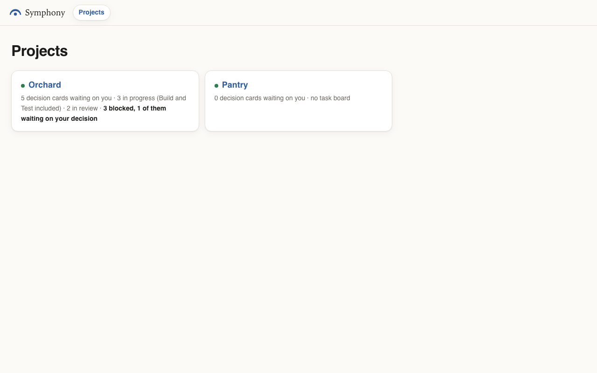
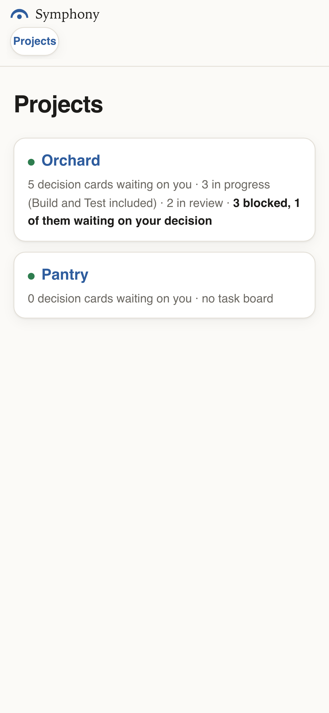

# The project picker

The picker is the list of every project the machine's Symphony serves, at the server's own root,
`/`. It is for the owner, who opens a project from it and sees across all of them, without
opening any, which has cards waiting on them, which has work stuck, and which board is unwell.

## What the owner does here

- **Opens a project.** A press on its name opens [its home](HOME.md).
- **Sees where they are needed**: how many cards wait on them in each project, and how many of
  its tasks are blocked on their decision.
- **Sees which board is unwell**, by the dot before each name and the line under it.

**Projects** in the header of every project's page returns here.

## What it shows

The header holds the Symphony's mark and name and one page, **Projects**. Under the title, a card
per project, side by side as the width allows.

| Part | What it says |
| --- | --- |
| The dot | how the project's board stands: green, well; amber, slow or no orchestrator at work; red, failing |
| The name | the project's own name, a link to its home |
| The counts | *5 decision cards waiting on you*, then *· 1 in progress (Build and Test included) · 2 in review*, then, in bold, *3 blocked, 1 of them waiting on your decision* |
| The line | why the dot is not green, in its colour: absent while it is |

### The counts

- **Decision cards waiting on you** are the cards [the queue](QUEUE.md) puts first.
- **In progress** counts every task at work, those a machine is building or testing now among
  them, so it can be more than [the board's](BOARD.md) **in progress** column shows. Like every
  count here, it leaves out subtasks.
- **Blocked** counts the tasks blocked on something named, parked ones among them, and not their
  subtasks; *N of them waiting on your decision* names those that wait on a card or an approval
  of the owner's. It is left out while none is blocked.
- A project with no task board yet says *no task board* in place of its tasks.

### The dot and its line

| Dot | When | Its line says |
| --- | --- | --- |
| Green | the board is well, or the project has none | nothing |
| Amber | its writes were slow over the last hour, or requests went unanswered | *Board slow (writes 3 s, 48 unanswered this hour)* |
| Amber | ready work waits to start and no orchestrator is live | *orchestrator stale* while the one holding it has gone quiet, *no orchestrator* when none is there |
| Red | the board is starting, failing its callbacks or its idle sweep, or went back to an older schema | what every page of the project says of it ([notices](FRAME.md#notices)) |

Two amber reasons share the line, a dot between them.

## Order

Projects are listed in the order they were registered. A project is registered by `just
symphony` run in its checkout ([getting started](../GETTING_STARTED.md#4-open-the-app-and-answer)).

## What it reads

The picker reads what the server already holds of each board and reads no board itself, so it
opens at once however many projects there are. It shows each project as it stood when the page
was loaded: a reload brings the counts up to date.

## States

| State | What the page shows |
| --- | --- |
| A project still starting | its name alone; then its dot, red with *The task board is starting* while its board is, and no counts until its board is first read |
| A project this Symphony cannot serve | its name and, in place of its counts, why, and what serves it: *its folder is gone: run `just symphony` in its new folder*, or that this Symphony is older or lacks a part the project needs, and what to run |
| An address no project answers | *No project is called “Orchard” here: this Symphony serves the projects below.*, then, when a project's address differs from it only in its capitals, *Did you mean orchard?* with a link, over the list |
| A project asked for that it cannot serve | *The Symphony does not serve orchard now*, why, over the list |

## On a phone

One card a row, across the width, and the header's **Projects** under the name.

## Edges

- A Symphony started for one checkout alone (`just symphony --port 0`) serves that project at its
  root: there is no picker and no **Projects** in its header.
- A project whose theme gives it a name of its own is listed by that name.
- The checkout the Symphony was started from is listed even when it was never registered, first,
  unless a registered checkout holds its id: then it is not listed.
- An address with no project in it, such as a bookmark from a Symphony of one project, opens that
  page of the project whose page linked it, or, followed from no project's page, of the project
  the Symphony was started from. Where that project has no such page, the picker says no project
  is called that.

## Related

- [Getting started](../GETTING_STARTED.md#4-open-the-app-and-answer): the one server and how a
  project joins it.
- [The commands](../COMMANDS.md#the-app): `just symphony` and registering a project.
- [Home](HOME.md): what a project's name opens.
- [Task board](../TASKS.md): what makes a task blocked, and the board's health.
