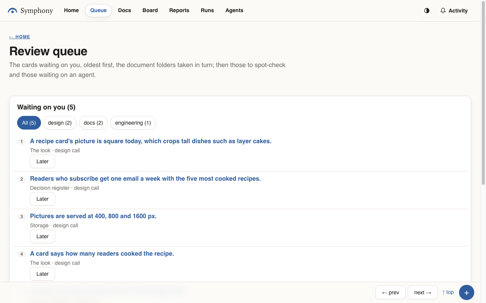
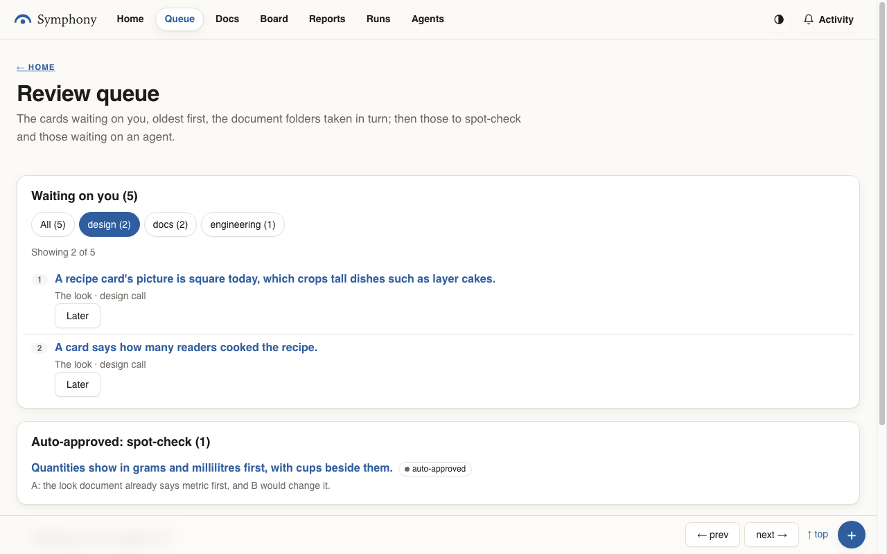
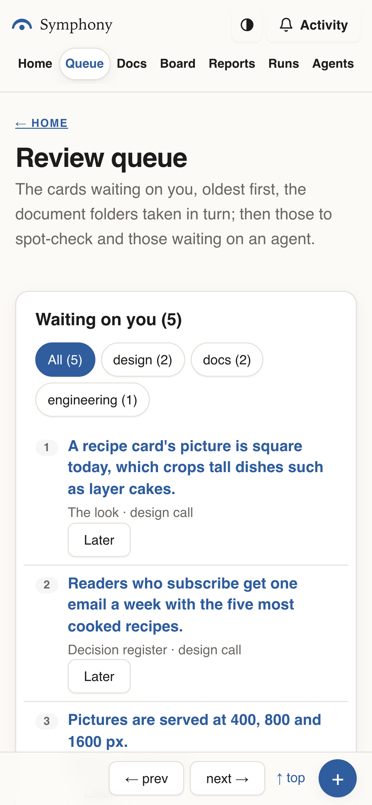

# The review queue

The queue is the one list of every card that waits on the owner, in the order to answer them, at
`/<project>/queue`. It is for the owner, who decides there what to read next and never has to
search the documents for what is open.

## What the owner does here

- **Picks the next card.** A press on a card's title opens the card in its document, where the
  verdict is given. The queue itself takes no verdict.
- **Narrows it to one topic.** A chip per document folder shows only that folder's cards.
- **Puts a card off** with **Later**, and takes that back with **Undo Later**.
- **Spot-checks** what was approved without them, and sees what they said that still waits on an
  agent.

## What it shows

Three groups, always in this order, each with its count in its heading.

| Group | Holds | A row shows |
| --- | --- | --- |
| Waiting on you | a card not answered yet, a card whose agent asks the owner a question, and a card the owner commented on that an agent has answered since | its rank, its first sentence, its document and why it ranks there, **Later** |
| Auto-approved: spot-check | a card approved on the owner's earlier words | its first sentence, its mark, the basis it was approved on |
| Waiting on the agent | a card the owner had the last word on, and each open comment in a document | its first sentence or the comment's title, its mark, the card's last line or the comment's document |

A card an agent posted on a branch that has not landed is in the same groups. Among those waiting
on the owner it carries a tag naming its task; in the other two it looks like a card of main's,
and its title opens the branch's page.

## Order

Cards waiting on the owner are ranked from 1. The folders under `docs/` are taken in turn, one
card from each, and inside a folder the oldest card comes first, so no topic waits behind
another's backlog. A document directly in `docs/` counts as the topic `docs`. The home page's
*Next up* follows the same order. The **prev** and **next** buttons of the bar at the foot of
every page do not: they walk the documents in the index's order and each document's waiting cards
from its top.

## Topics

The chips under the first group's heading are **All** and one per topic, each with its count; the
counts add up to the group's. Choosing a topic shows its cards alone, ranked again from 1, under a
line that says how many of the total are shown. The choice is kept on this device, for this
project. The
other two groups are never filtered.

## Later

**Later** moves a card after the rest of its topic and opens the next card. The card keeps its
mark, its lines and its place in the count; its button becomes **Undo Later**, which puts it back.
It returns to its own place by itself once the owner has opened every card of its kind (not
answered yet, or answered by an agent) that was waiting when it was put off and was not put off
itself, or after three days. Answering the card, or a new line from the owner on it, ends its
Later. The order is the owner's, not the device's: a card put off on the phone is put off on the
laptop.

## States

| State | What the page shows |
| --- | --- |
| Loading, first visit | the three groups as outlines, with the rows each is likely to hold |
| Loading, a later visit | at once, the queue this device last held, while the server is asked; Later takes no press until it has answered |
| Nothing waits on the owner | *nothing to decide* in the first group; the other groups as they are |
| A group is empty | *none* under spot-check, *every comment is answered* under the agents' group |
| A saved topic has no cards left | All |
| A read fails | what failed, above the groups, which stay as last drawn; the page asks again by itself |
| A card is answered elsewhere | the list changes in place, with no reload |

## On a phone

The same three groups in one column. The chips wrap onto a second line, a card's first sentence
wraps beside its rank, and **Later** stays under each card.

## Edges

- Two cards of one topic posted in the same minute keep the order the triage gave them.
- Several cards put off in one topic return in the order they were put off, after the topic's
  other cards.
- While a branch proposes a card main's register also has, the queue lists the branch's copy in
  place of main's. Two branches that propose the same card are two cards, each put off on its own.
- A branch's card whose pictures are not yet on disk in its worktree is not listed until they are.
- When the file that keeps the order cannot be read, the queue is shown in its plain order with
  nothing put off; the file is left as it is.

## Related

- [Concept review](../workflow/REVIEW.md): cards, verdicts and how a card's group is worked out.
- [Task board](../workflow/TASKS.md#asks): what the owner said that waits on an agent, as asks.
