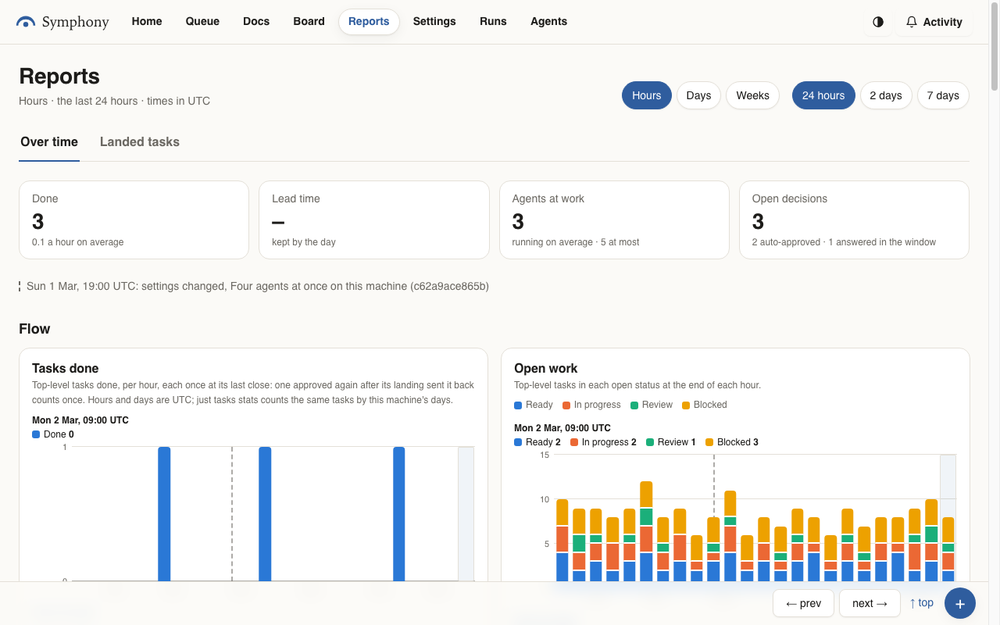
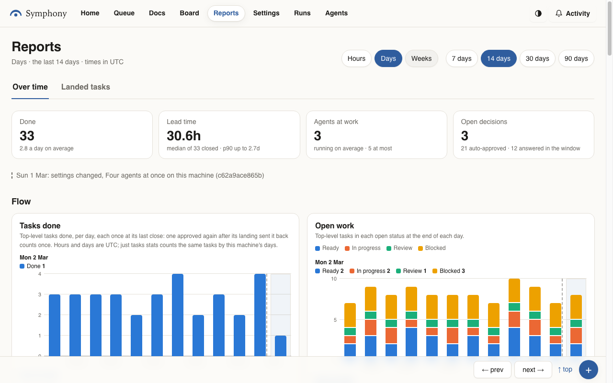
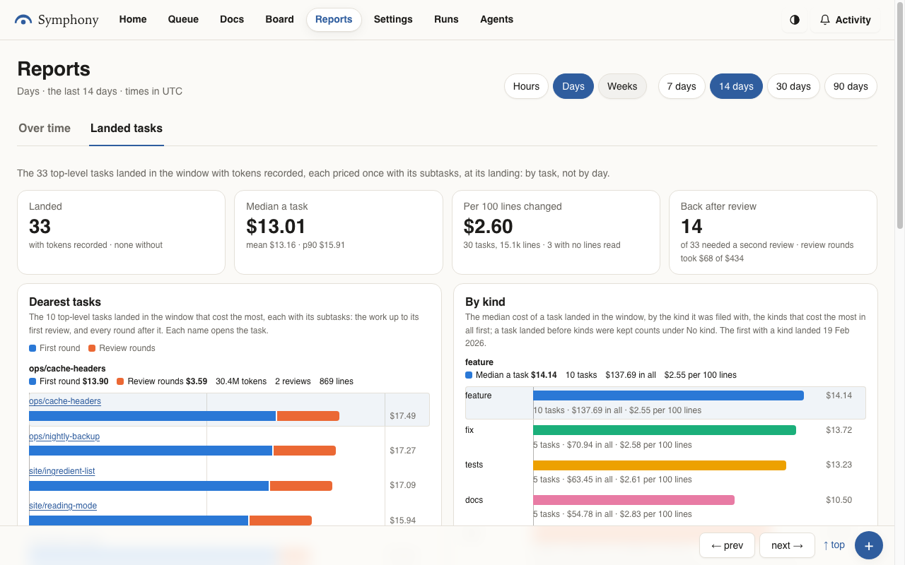
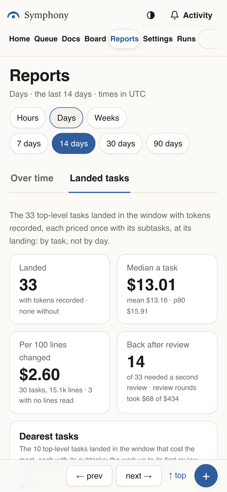
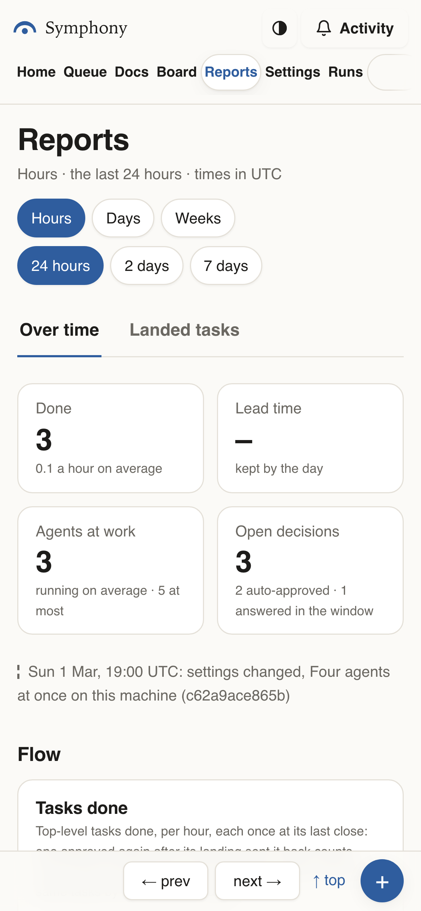

# Reports

Reports is how the project's work has gone over time, at `/<project>/reports`: how much was done
and how long it took, how many agents worked and what they cost, the owner's decisions, the code
that landed and the board's own health, as charts on one time axis. It is for the owner, who
changes a limit, a rule or a skill and wants to see what that did to the speed and the quality of
what lands. Nothing on it can be changed: it is read from what the machine recorded each hour.

It has two tabs. **Over time** draws each period of the window; **Landed tasks**
(`/<project>/reports?view=landed`) draws the tasks landed in it, one by one, and what each cost.

## What the owner does here

- **Chooses how far back to look.** **Hours**, **Days** or **Weeks**, then a window of that grain.
- **Reads the four figures.** What was done, how long a task took, how many agents worked and how
  many decisions wait, over the window. A press on a figure's name goes to its chart.
- **Reads one period across every chart.** A tap on a column, or the left and right arrow keys in
  a chart, picks a period: every chart then says that period's values in words over its plot.
  Until one is picked, each chart says its newest recorded period.
- **Hides a series.** A press on a name in a chart's legend takes that series off the chart, so
  the smaller ones can be read; a second press brings it back.
- **Looks for what a change did.** A dashed line crosses every chart where the project's settings
  or its agents' instructions changed.
- **Reads a chart as a table.** **Show the table** under a chart lists every period's values.
- **Reads what a landed task cost.** **Landed tasks** says which tasks cost the most, what a task
  of each kind costs, what the review rounds added and which tasks were dear for their size; a
  task's name opens its page.

## What it shows

From the top: the heading with the grain and window chosen, the two rows of buttons that choose
them, the two tabs, then the tab shown. **Over time** holds its four figures, the changes marked in
the window, then the charts under a heading per group. **Landed tasks** is [below](#landed-tasks).
Both tabs read the window chosen, and the address names the tab, so a reload or a link opens the
same one.

### The window

| Grain | Windows offered | Chosen with the grain |
| --- | --- | --- |
| **Hours** | 24 hours, 2 days, 7 days | 2 days |
| **Days** | 7, 14, 30 or 90 days | 14 days |
| **Weeks** | 4 or 12 weeks | 12 weeks |

A first visit opens on the last 24 hours by the hour. After that the page opens on the grain and
the window this device last chose, for this project. A window ends with the hour it is read in,
and a week starts on a Monday. Every time on the page is in UTC.

### The figures

| Figure | Says | Under it |
| --- | --- | --- |
| **Done** | the tasks done in the window | the average for each hour, day or week |
| **Lead time** | the median time from a task's creation to its close | how many closed, and the time nine in ten of them closed within (**p90**) |
| **Agents at work** | the average number of sessions at work | the most at once |
| **Open decisions** | the cards waiting on the owner at the window's end | how many were answered and how many auto-approved in the window |

A figure with nothing to say shows **–** and why: lead time is kept by the day, so by the hour it
says *kept by the day*.

### The charts

| Group | Chart | Shows, for each period |
| --- | --- | --- |
| **Flow** | **Tasks done** | the tasks done, each counted once, at its last close |
| | **Open work** | the tasks ready, in progress, in review and blocked at the period's end |
| | **Task-hours** | the hours tasks spent in each of those four |
| | **Lead time** | the median time from creation to close and the time nine in ten closed within (**p90**); by the day or the week only |
| | **Waits between hands** | the median wait from review to a reviewer, from changes asked to work resumed and to review again, and from approval to landing |
| **Workflow** | **Time by phase**, **Time by state** | on a project with a workflow of its own: the task-hours in each phase and in each state, the four largest named and the rest as **Other** |
| **Agents** | **Agents at work** | the average sessions at work as orchestrators, executors, reviewers and in other roles, and a line of the sessions counted once each |
| | **Sessions** | the sessions that connected, went stale and were lost |
| | **Machine load** | the peak and the average of the machine's load |
| **Tokens and cost** | **Estimated cost** | what the agents' model calls would cost at list prices, by role |
| | **Tokens** | the tokens those calls took, by role |
| | **Cost per landed task** | the median and the **p90** cost of a task landed in the period, with its subtasks, and **All in**: every token of the period, the orchestrators' with them, over the tasks landed in it |
| | **Cost per 100 lines changed** | what the landed tasks cost for 100 of the lines their landings changed, and **All in**: every token of the period over every line that reached the default branch in it |
| **Decisions and code** | **Decisions** | cards answered and auto-approved, and a line of those still open |
| | **Commits** | commits and merges that reached the default branch |
| | **Lines changed** | lines added, above the axis, and removed, below it |
| **Quality** | **Bounces, reds and reverts** | tasks sent from review back to work, reds filed, reverts, and changes a review asked for |
| | **Time to fix a red** | the median and the **p90** time from a red's filing to its close |
| **Board health** | **Board requests** | requests to the board that were slow or got no answer, and failed passes of its dispatch and sweep |

Only tasks are counted, never their subtasks. Each chart has its title, a sentence saying exactly
what it counts, its legend, the period picked said in words, its plot with the unit on its axis,
and **Show the table**.

### Tokens and cost

Under the group's heading the page sums the window: the estimated dollars and the tokens in all.
A period that landed no task has no point on **Cost per landed task**, and says *no task landed*
over the plot rather than *no data recorded*; one whose landings changed no counted line has none
on **Cost per 100 lines changed**, and says *no line changed*, or *lines not read* where a task it
landed came before lines were kept and its roll-up counted no line of git. Under the charts the page says what every dollar is: an
estimate at the providers' list prices, with the day those prices were read, never money spent,
as a subscription is not billed by the token. A figure marked **+ unpriced** leaves out the
tokens of a model the price list does not name, and the page names those models.

## Landed tasks

Each task landed in the window with tokens recorded, priced once with its subtasks, at its last
landing in the window: by task, not by period. A sentence says how many, then four figures, each
a link to its chart, and four charts.

| Figure | Says | Under it |
| --- | --- | --- |
| **Landed** | the tasks landed with tokens recorded | how many landed with none, which no figure counts |
| **Median a task** | the median cost of a task with its subtasks | the mean and the **p90** |
| **Per 100 lines changed** | what 100 of the lines the landings changed cost | of how many tasks and lines, how many changed no counted line and how many landed before lines were kept |
| **Back after review** | the tasks reviewed twice or more | of how many, and what the review rounds cost of the whole |

| Chart | Shows |
| --- | --- |
| **Dearest tasks** | the ten tasks that cost the most, a bar each: the work up to its first review, and every round after it. Each name opens the task; **Show all N as a table** lists every task landed, with its kind, its parts, tokens, reviews and lines |
| **By kind** | the median cost of a task of each kind it was filed with (feature, fix, red, tests, docs), the kinds that cost the most in all first, each in its own colour; how many, what in all and what 100 lines cost under each. A task given no kind, or landed before kinds were kept, is under **No kind**, grey and last |
| **By review rounds** | the mean cost of a task by how many reviews it took, none to four or more, its first round and its review rounds stacked; how many tasks under each column |
| **Every task, cost against size** | every task as a dot of its kind's colour, its cost against the lines its landing changed, both on a log scale: a dot above the others cost more for its size. A tap names the task, its cost, its lines and what 100 of them cost, and links its page. A task that changed no counted line, or landed before lines were kept, has no dot, and the chart says how many |

A press on a name in a legend hides that part, kind or series, as on **Over time**. Generated
files and lock files are left out of a task's lines, as **Lines changed** leaves them out.

Under the charts the tab says what no figure on it counts: a Codex session's tokens, which no hook
records, so a task a Codex agent worked looks cheap; the orchestrators' tokens, which are on no
task and count only in **All in** on **Over time**; and a session's last answer after its last
tool call. A window in which no task landed says so in place of the charts, its figures at **–**.

## Gaps are not zeros

A period nothing recorded is drawn hatched, and a line breaks across it: it is never drawn as a
zero. The machine's server records each hour as it passes, so an hour it did not run through, or
whose file it could not read, is a gap. The words over a plot say **no data recorded** for a
gap, and how much of a period was recorded when only part was (*18 of 24 h recorded*). Periods
from before the project's first record are left off the axis altogether.

Each source has its own gaps: the tasks, decisions and code come from one record, the agents and
the machine's load from a second, and the board's health from a third. The hour the page is read
in has no agents and no board health yet, as those are written when an hour ends.

## Marked changes

A dashed line crosses every chart at each commit on the default branch, in the window, that
changed the project's settings, its rules or one of its agents' skills. Above the charts the
newest three are listed, each with its period, what it changed and the commit's subject and
short hash; more are folded under **N more changes**. Picking the period a change fell in says it
over every plot as well.

## Hidden series

Each name in a legend is a button. Pressed, its series leaves that chart alone: the plot, the
words over it and the table. The axis then fits the series left, so hiding a large one makes the
others taller. The choice is kept on this device, for this project, in every window, until the
name is pressed again.

## How fresh it is

A figure is up to an hour old: the machine's server sums the project's hour once an hour. An open
page reads its window again every five minutes, and at once when another window is chosen.

## States

| State | What the page shows |
| --- | --- |
| Loading, first visit | grey lines that stand in for four figures and two charts, which a screen reader reads as *Loading the reports…*, or *Loading the landed tasks…* on **Landed tasks** |
| Loading, a later visit | at once, the window as this device last kept it, with *Shown from this device, saved 14:32. Checking for changes…* until the server has answered |
| Nothing recorded yet | *No roll-up yet.*, when the first is due, the four figures at **–** and no chart |
| A file could not be read | **N files not read: their hours show as gaps**, which opens to name each file and why |
| The read fails | **The reports could not be read.**, or **The landed tasks could not be read.**, why, and that it is trying again; what was shown stays |
| No task landed in the window | on **Landed tasks**: *No top-level task landed in the window.*, or how many landed with no tokens recorded, the four figures at **–** and no chart |
| The read fails over a kept copy | the kept copy, with *Not reachable* in place of *Checking for changes…* |
| Lead time, by the hour | in the chart's place: *The roll-up keeps lead time by the day: switch to Days or Weeks to see it.* |
| A chart below the screen | its outline, drawn as it comes near the screen |

## On a phone

One chart to a row, where a wide screen has two side by side from 960 points, and the figures two
to a row, four from 760 points. A tap on a column picks the period. With many marked changes,
only the newest three are listed, so the first chart stays on the first screen.

## Edges

- A server a project runs for itself, rather than the machine's shared one, records no hours:
  on it the page shows what the shared server recorded, or *No roll-up yet*.
- A task approved, sent back by its landing and approved again counts once in **Tasks done**, at
  its last close.
- The days of **Tasks done** are UTC days, so a count by the day can differ from one made by the
  machine's own days.
- An hour's tokens are what the board's count gained between two hourly sums: an hour no two sums
  span has none, and is a gap.
- A session with two roles counts in both in **Agents at work**; the line counts it once.
- A link to one chart (`/<project>/reports#chart-cost`) opens the page at that chart, until a
  window is chosen. A figure's link on **Landed tasks** does the same for its chart.
- A task landed twice in the window, sent back by its landing and landed again, is one task on
  **Landed tasks**, at its last landing, with every token it took.
- Day files written before kinds and lines were kept still read: their tasks are under **No kind**
  and have no dot.
- A change that reaches the default branch outside the window is not marked, and a change to a
  guide is never marked.

## Related

- [Reports and monitoring](analysis/reports-and-monitoring.md#the-day-files): what the hourly
  record holds and how each figure is computed.
- [Agent activity](../workflow/AGENT_ACTIVITY.md): what the agents' hours record.
- [Task board](../workflow/TASKS.md#what-the-tokens-cost): how tokens are counted and priced.
- [Runs](RUNS.md): the builds and tests behind the work, one by one.
- [Workflow](../workflow/WORKFLOW.md): a project's own phases and states.
