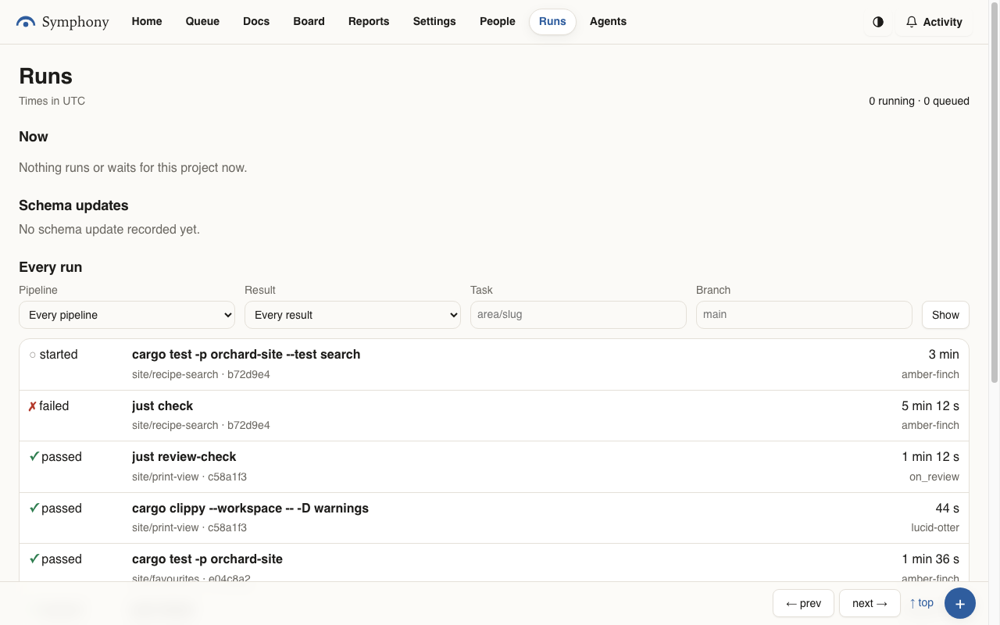
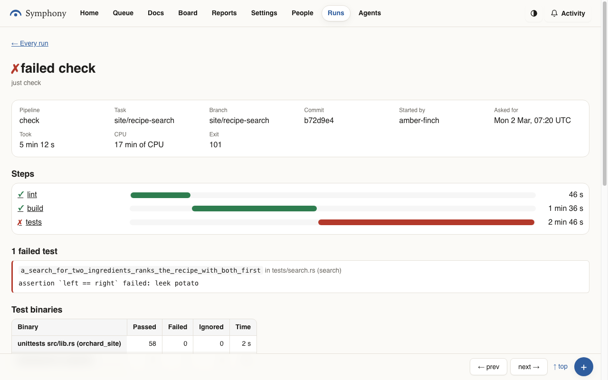
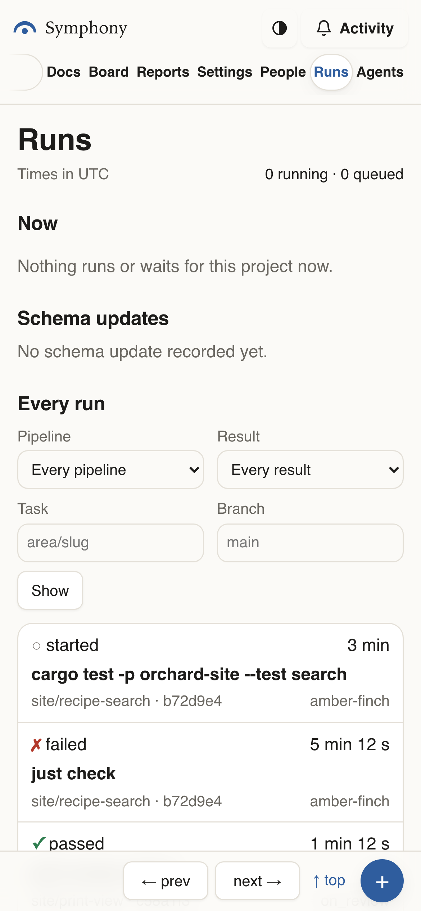

# Runs

Runs is every build, test and check the project's machine recorded, at `/<project>/runs`: what
runs now, and each run of the last 14 days with how it ended. It is for the owner, and for anyone
who wants to know why a check failed without asking the agent that ran it: a run opens to its
steps, the tests it failed and its log. Nothing on it starts, stops or repeats a run.

## What the owner does here

- **Sees what runs now.** **Now** lists each build or test running or waiting, for which task and
  for how long.
- **Finds a run.** **Every run** lists them newest first; the filters keep those of one pipeline,
  one result, one task or one branch.
- **Opens a run.** A press on a line opens that run: how it ended, its steps, the tests it failed
  and its log.
- **Reads why a test failed.** A run names each failed test with the line it failed on, and its
  log holds the rest.
- **Follows a run that has not ended.** Its page reads on by itself, the log growing under it.

## What it shows

Under the heading, with *N running · N queued* beside it, three sections.

| Section | Holds |
| --- | --- |
| **Now** | a line for each machine that reports to the project, saying how fresh its word is and how long ago it came, then each operation running or queued: what it runs, the task and the agent it runs for, and for how long |
| **Schema updates** | each board of this machine that moved to a new schema, and how long it took the machine's server to serve it; the ones still waiting first |
| **Every run** | the filters, then a line for each run, newest first |

### A line of a run

| Part | What it says |
| --- | --- |
| Result | a mark and a word: **✓ passed**, **✗ failed**, **⏱ timed out**, **⊘ interrupted**, **? incomplete**, **● running** or **○ started** |
| Label | the command or the recipe that ran, on one line; a long one is cut short, and whole on hover |
| Where | the task it ran for, else its branch, and the commit it checked |
| Who | the agent that started it, **owner** for a person, or what started it by itself, such as a move to review |
| Time | how long it took, or has run so far |
| **N failed** | how many tests it failed, when any |

A run's pipeline, the kind of run it is (a test, a lint, a build, a check of several steps, the
command a move to review starts), is not on its line: the **Pipeline** filter chooses by it, and
the run's page names it.

### A run

A run's page opens with its result and name, the command under it, and **← Every run**.

| Part | Holds |
| --- | --- |
| Facts | the pipeline, the task, the branch, the commit (saying so when the checkout had changes not committed), who started it, when it was asked for, how long it took, the CPU it used and how its command ended |
| **Steps** | each named step in order, and the steps inside a step under it: its result, its name, a bar on the run's span showing when it ran and for how long, and its time. A step opens as a run of its own |
| **N failed tests** | each failed test: its name, the test binary it is in and the first line of what it said |
| **Test binaries** | each test binary the run ran, with how many tests passed, failed and were ignored, and its time |
| **Log** | what the command wrote, colours and cursor codes taken out |

A run that repeats an earlier one, the same check on the same tree, says so above its steps with
a link to the earlier one.

## The results

| Word | The run |
| --- | --- |
| **passed** | ended with nothing wrong |
| **failed** | ended with an error |
| **timed out** | was stopped at its time limit |
| **interrupted** | was stopped from outside: a key, a kill, a closed terminal |
| **incomplete** | never started, or its recorder was lost before it could say how it ended |
| **running** | has not ended, and the machine reports it at work now |
| **started** | has not ended, and no machine reports it: still going where this page cannot see it, or lost |

## Filters

**Pipeline** and **Result** are lists and apply as soon as one is chosen; **Result** has *not
ended* for the runs with no end. **Task** and **Branch** are typed, and apply on **Show** or the
Enter key. Each matches whole: `site/recipe-search` finds that task's runs, `recipe` finds none.
**Clear**, shown while any filter is set, removes them all. The filters chosen are kept on this
device, for this project.

## The list and its pages

The list holds the newest 50 runs that match; **Load more** adds the 50 before them. A step is
never a line of the list: it is on its run's page. Runs older than 14 days are not listed.

## The log

A run's page shows the end of its log, the last 64 KiB, saying how much of the whole that is.
**Show earlier output** puts the megabyte before it in front, as often as it is pressed, back to
the start. A step has a log of its own, and its output is in its run's log too.

## How fresh it is

| What | Read again |
| --- | --- |
| **Now** | every 5 seconds |
| **Every run**, its first page | every 15 seconds |
| **Schema updates** | every 15 seconds |
| A run that has not ended, and its log | every 5 seconds, the log from where it stopped |

A run that has ended is read once. Nothing is read while the page is behind another tab, and
everything is read at once when it is in front again.

## States

| State | What the page shows |
| --- | --- |
| Loading | *Reading what runs now…*, *Reading the schema updates…* and the outline of the list, each until its own read answers |
| Nothing runs | *Nothing runs or waits for this project now.* |
| No machine reports | **Now** with no machine's line |
| No schema update | *No schema update recorded yet.* |
| No run matches | *No run in the last 14 days matches.* |
| A day's record could not be read | **N day files not read: their runs are missing**, which opens to name each and why |
| A read fails | in its own section: *What runs now could not be read*, *The schema updates could not be read* or *The runs could not be read*, and why; the rest of the page stays |
| A run not found | **No such run**, that a run is kept 14 days on this page, and **Every run** |
| A run's read fails | **The run could not be read**, why, and **Retry** |
| No log kept | *No log was kept.*, as its command wrote to a terminal |
| A log gone | *This run's log is no longer kept.* on an ended run; *Its log is not written yet.* on one still going |
| An empty log | *Nothing written to the log yet.* |

## On a phone

A line takes three rows: its result with its time, its label, then where and who. A step's bar
goes under its name, and the table of test binaries becomes a block for each binary. The filters
are two to a row, **Show** under them.

## Edges

- A run started by a person at a terminal keeps no log, and so names no failed test and no test
  binary: its output stayed in the terminal.
- A log is kept 14 days and a run's line 90, but the page lists only the last 14 days.
- A run whose recorder died is shown **started** until the next recorded run on that machine
  finds it and marks it **incomplete**.
- The CPU says **at least** when the recorder knows it could not count all of it.
- Two runs asked for in the same second are both listed, and a run is never listed twice when
  **Load more** brings a page that holds it again.
- A schema update names the task filed for it when it failed, with how many times it was tried
  and what the last try said. On a server a project runs for itself, only that project's tasks
  are linked.
- Times are in UTC, on the clock of the machine that recorded the run.

## Related

- [Runs](../workflow/RUNS.md): what a run and a step are, what a line records, how logs are kept and how
  failed tests are read from them.
- [Recording builds and tests](../workflow/MACHINE_WORK.md#recording-builds-and-tests): how a command comes
  to be recorded.
- [The task board](BOARD.md): the **build** and **test** columns, which show the same work as
  **Now**.
- [Releases](../workflow/RELEASES.md#the-refresh): what moves a board to a new schema.
- [Reports](REPORTS.md): the project's work over time.
