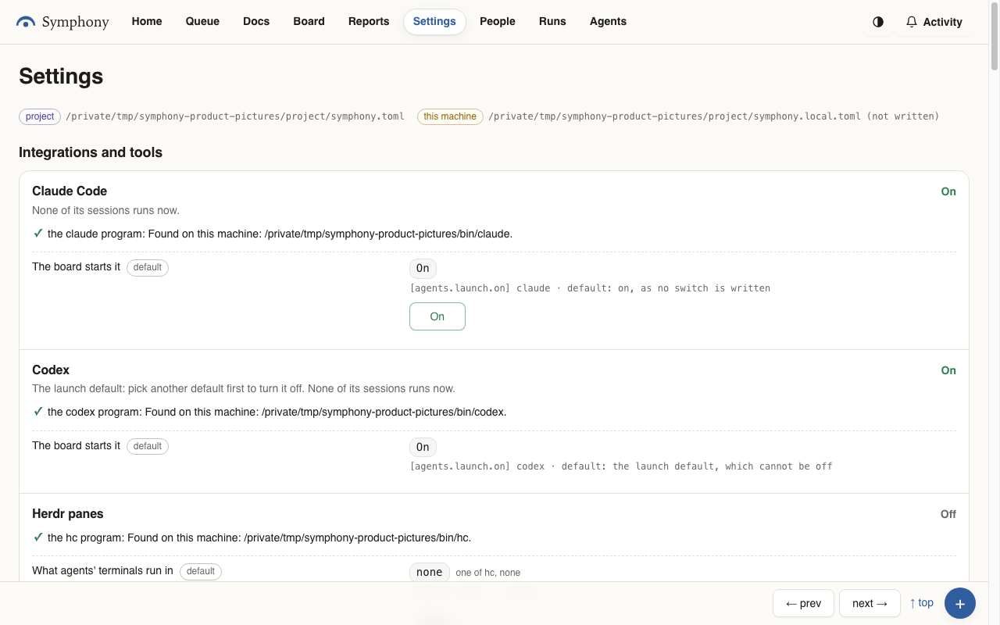
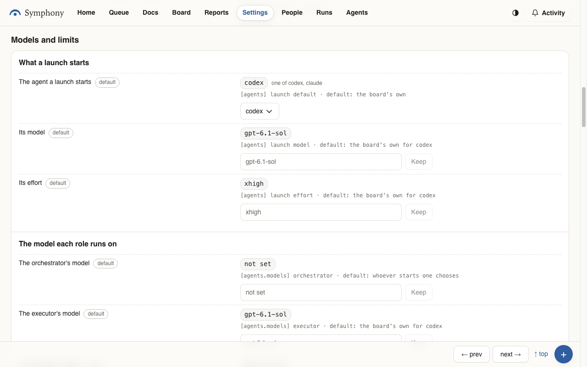
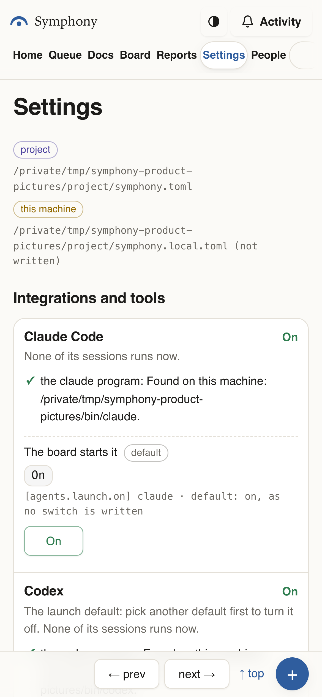
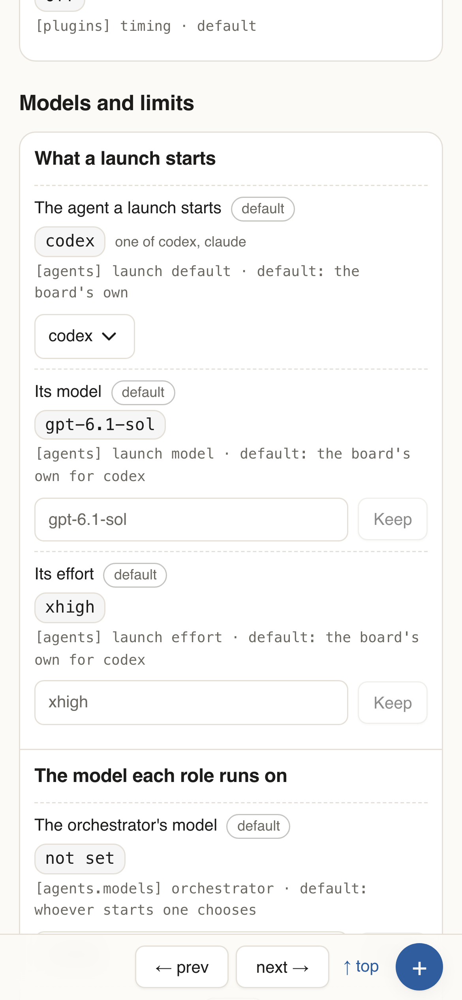

# Settings

Settings is everything in force for the project and where each value comes from, at
`/<project>/settings`: the agents a launch starts and whether this machine has them, the model
each role runs on, the limits the board holds work to, the project's name, folders and look, what
a land does, and what this browser keeps. It is for the owner, who wants to know why an agent
started on the model it did or why the board started no more work, and to change a preference
without editing a file. It writes the preferences the board keeps, and commits one to the project
file when asked; a setting that runs a command or decides what lands is shown here and changed by
a reviewed task.

## What the owner does here

- **Reads what is in force.** Every setting says its value and where it comes from: the
  Symphony's default, the project file with its line, the board, or this machine's own file.
- **Checks what this machine has.** Each integration says whether it is on and whether the
  program it needs is found here; each agent, how many of its sessions run now.
- **Changes a preference.** The agent a launch starts, its model and effort, whether the board
  starts each agent, a role's model, a limit or where agents' terminals open: kept on the board,
  in force at once.
- **Makes it the project's.** A value kept on the board is committed to the project file, so it
  holds for every machine and every clone.
- **Puts the file's value back.** **Remove** takes the board's value away.
- **Reads who changed a value and when**, from its record on the board.
- **Finds why a settings file does not load**, said at the top of the page with what holds in its
  place.

## What it shows

From the top: the title, any settings file that does not load, the two files read with their paths
(*(not written)* where one is not there), then five sections, always in this order, each its
heading over its entries.

| Section | Holds |
| --- | --- |
| **Integrations and tools** | Claude Code and Codex, Herdr panes, GitHub and the plugins, then any entry a plugin of the project describes |
| **Models and limits** | what a launch starts, the model each role runs on, the work-in-progress limits and the pipeline alarm |
| **The project** | its name and folders, the documents it serves, its theme |
| **Reviewed settings** | the landing, the board's commands, the stamps, the releases and the workflow |
| **This device** | the appearance this browser keeps |

### An entry

| Part | What it says |
| --- | --- |
| Name and state | the thing's name and, where it can be on or off, its state in a word: **On**, **Off**, **Unknown**, *2 selected* |
| Why | why it is in its state, where its word does not say it all: *The launch default: pick another default first to turn it off.* |
| What it needs | each program it needs, **✓** *Found on this machine:* and where, or **!** *Not found on this machine:* and what that means |
| Its settings | a row for each |

### A setting's row

| Part | What it says |
| --- | --- |
| Name | what it sets, in words: *Agents this machine runs* |
| Tag | where its value comes from: **project**, **this board**, **this machine**, **this device** or **default** ([below](#where-a-value-comes-from)) |
| **reviewed** | on a setting the page never writes ([below](#preferences-and-reviewed-settings)) |
| Value | the value in force: a number, a word, **On** or **Off**, a list; a table the page cannot show as one value, such as the landing, as a sentence |
| *one of …* | the values a choice takes |
| Where | the key as the project file names it, and the file and line that write it, or the default and what it is: *[limits] machine_agents · symphony.toml [limits] machine_agents, line 9* |
| Its control | on a preference the board keeps ([below](#what-a-control-writes)) |

## Preferences and reviewed settings

A setting is a *preference*, or *reviewed* when it runs a command or a program on this machine, or
decides what lands: the landing and the owner's saves, the board's commands and where its store is,
the stamps, the releases, the workflow, the plugins, the project's default branch and its command
for Cargo. A reviewed setting is tagged **reviewed**, has no control, and is changed by a task that
edits the project file and passes review: a place no commit records must never change the landing
gate or run a command. GitHub's settings decide what lands, so every one is reviewed. A plugin's
entry is shown alike, and a key the project's own rules hold as reviewed is reviewed whatever the
plugin says of it.

## Where a value comes from

A setting is read from four places, each over the one before:

1. the Symphony's default, tagged **default**;
2. the project file, committed for everyone, tagged **project**;
3. the board, what the project was told there and no file holds, tagged **this board**;
4. this machine's own settings file, never committed, tagged **this machine**.

The row names the place that won and the value it stands over: *the board's store [limits]
machine_agents · over 12 (symphony.toml [limits] machine_agents, line 9)*. A value kept on the board
holds over a later commit of the same key until it is removed; this machine's file is the last
word on its machine. The appearance alone is this browser's, tagged **this device**. Which keys
each place may hold is [the project file's](../operations/PROJECT_FILE.md#the-boards-store).

## What a control writes

Only a preference the board keeps has a control: what a launch starts (its agent, model and
effort), whether the board starts each agent, the model of each role, the work-in-progress limits
and where agents' terminals open. The control is chosen by the kind of value, never by the
setting:

| Kind | Settings | Control |
| --- | --- | --- |
| A switch | whether the board starts Claude Code, and Codex, but the launch default | a button saying **On** or **Off**, the other kept as it is pressed |
| A choice | the agent a launch starts, what agents' terminals run in | a menu of its values, kept as another is chosen |
| A number | each limit | a field and **Keep**; a number that is not whole is refused before it is sent |
| A text | the launch's model and effort, each role's model | a field and **Keep** |

A field opens with the value a file or the board writes, or empty with the default shown faintly
in it; **Keep** takes a press once something is typed.

- **A value kept** is kept on the board and is in force at once, for the board's next launch
  and every page of the project, with no commit and no landing: the row then says **this
  board**, and *The board's store holds 3, in force.* The page says what it did on the row.
- **A value refused** (of the wrong kind, out of range, an agent a launch does not start) is said
  on the row with why, and nothing is kept.
- **Make it the project's**, beside a value kept on the board (its title: *Commits it to
  symphony.toml, delivered by a pull request*), commits it to the project file on the default
  branch: that value's line alone changes, every comment and the rest of the file
  kept, in one commit that names the key and its two values (*settings: [limits] low_volume from
  4 to 3*). The board's value is then removed and the file's, the same, is in force. A file the
  [settings check](../operations/PROJECT_FILE.md#the-settings-check) would refuse with it is
  not committed, and the row says why. Where the project delivers by pull request the commit is
  delivered as the owner's task, and the row says it waits; the board's value holds until the
  pull request is merged.
- **Remove** takes the board's value away, its record kept: the files' value is in force again.
- **Its record in the board's store** opens to every change of it, the newest first: when, by
  whom, from what to what.

The page never writes this machine's settings file: a value that file writes is shown over the
board's, *the local settings file writes over it*, and is changed in the file itself. Nor does it write a
preference the board does not keep (the project's name, folders and theme, the alarm's
thresholds): it shows it, and the project file changes it.

## States

| State | What the page shows |
| --- | --- |
| Loading | three grey panels that stand in for the sections |
| The read fails | *The settings could not be read.* and why, above what was read last if anything was; it tries again by itself |
| A settings file does not load | **A settings file does not load** at the top, each problem with what holds in its place: the project on every default, the board's own launch and models, or the committed settings without this machine's file |
| The board cannot be read | the same, saying none of the board's values is read and the files' settings hold |
| A program not found here | its need marked **!** with *Not found on this machine:* and what fails because of it |
| GitHub's program absent, failing or silent for 10 seconds | GitHub **Unknown**, and why; the rest of the page as usual |
| A write out | the row's controls take no press until it is answered |
| A write answered | what it did, or why it was refused, under the row's control |
| A commit waiting for its pull request | *Waiting for its delivery by pull request*, where it stands (*waiting for its pull request*, *in conflict*), and that the board's value stays in force until it is proved; **Make it the project's** takes no press |
| A value the board holds and does not read | *The board's store does not read its entry:* and why; **Make it the project's** takes no press |
| This machine's file over the board's value | *The board's store holds 3; the local settings file writes over it.* |

## On a phone

One column: each setting's name and tags above its value, its source and its control, rather than
beside them. The tags' meanings and the files' paths wrap to the width, a path wherever it must.

## Edges

- The page reads once as it opens and again after each write: a value changed elsewhere, from a
  board command or another device, shows on the next visit.
- What is typed in a field and not kept yet stays on that device, for that setting, after a
  reload too, until it is kept.
- A value made the project's that the project file on the default branch already writes is not
  committed again: the board's value is removed.
- **Make it the project's** commits only while the checkout the server serves is on the default
  branch: otherwise it is refused with why, and the board's value holds.
- A hosted visitor, or a page open while its server closes, writes nothing.
- Claude Code and Codex are each **On** until its switch turns it **Off**: then no launch, no
  staffing and no restore of a closed pane starts it, one already running keeps running, and its
  files stay installed, so **On** again is the switch alone. The row says where it was turned off
  and how many of its sessions run. The one the launch default names is started when the caller
  names neither, and cannot be off: its switch has no control and says to pick another default
  first, and a switch that turned it off before it became the default is said not to hold.
- A launch of an agent whose program this machine does not find is refused with that reason,
  whatever its switch says.
- A project with no settings file at all shows every value a file would write as **default**,
  and the project file as *(not written)*.

## Related

- [The project file](../operations/PROJECT_FILE.md#the-settings-page): every key, its default and
  its class, the board's store and this machine's own file.
- [Task board](../workflow/TASKS.md#limits-and-models): what the limits and the models do, and
  `just tasks limits`, which names each value's source as this page does.
- [GitHub](../operations/GITHUB.md#the-commands): the program that says GitHub's entry.
- [Plugin protocol](../engineering/PLUGIN_PROTOCOL.md#settings-describers): what a plugin's entry
  holds.
- [Themes and appearance](THEMES.md#appearance): what this device's appearance changes.
- [What every page shares](FRAME.md): the header, where **Settings** sits between **Reports** and
  **Runs**.
