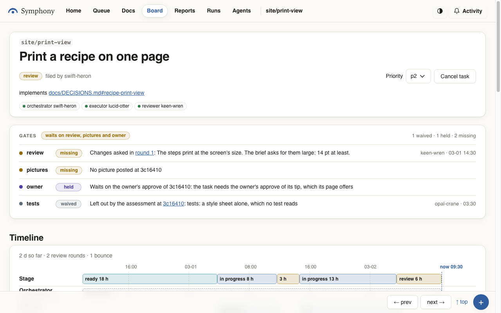
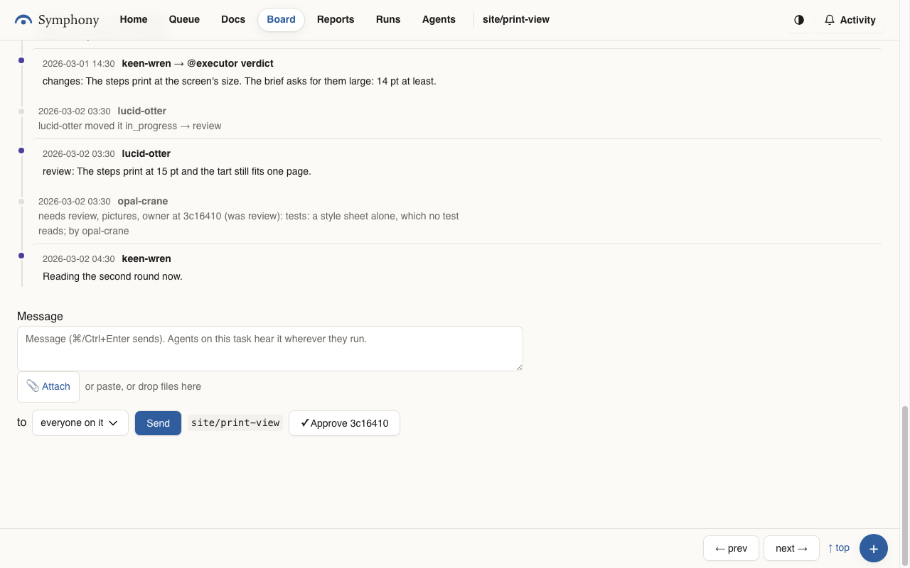
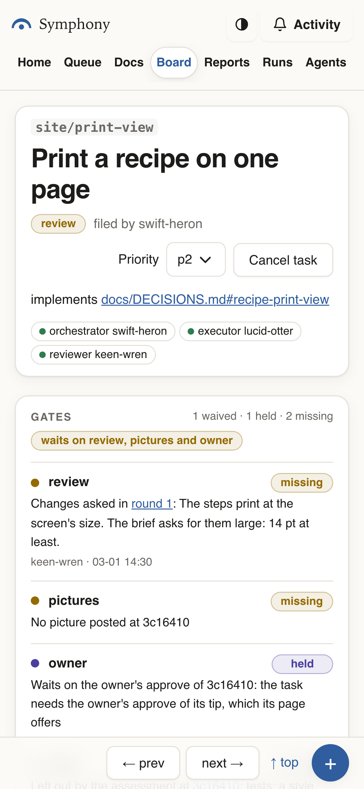

# A task's page

A task's page is everything the board knows about one task: what it asks for, who works on it,
what still stands between it and landing, what it went through and what was said about it, at
`/<project>/task/<slug>`. It is for the owner, who follows a task there, talks to the agents on it
and, where their approval is needed, gives it.

## What the owner does here

- **Reads where it stands.** The head says its stage and who holds it; the gates say what it still
  waits on before it can land.
- **Talks to the agents on it.** A message in the thread's box reaches them wherever they run.
- **Approves it**, where its landing waits on the owner: a button beside **Send** names the commit
  it approves.
- **Changes its priority**, or **cancels** it.
- **Goes to an agent's session** to watch it work.
- **Reads what changed**: the files the task's branch changes, and each file's lines.

## What it shows

From the top, in this order. **Subtasks**, **Attempts** and the facts of the head are left out
when there are none; the other parts say that they are empty (**Changes** says *No changed
files.*).

| Part | Holds |
| --- | --- |
| Head | the slug, the title, the stage, who filed it, **Priority** and **Cancel task**, what it is part of or comes after, who holds each role, and the builds and tests running for it now |
| **Gates** | what the task waits on, and a row for each thing it needs before it lands |
| **Subtasks** | the smaller tasks under it, each with its stage |
| Timeline | the stages it went through, how long each took and what it cost, with its reviews, builds and tests |
| Brief | what the task asks for, as it was filed |
| **Changes** | the files its branch changes |
| **Attempts** | on a project that runs tasks on a provider of its own, each run of this one |
| **Thread** | every message and move, oldest first, then the box to write in |

## The head

- **The stage** is the board's: *concept*, *design*, *ready*, *in progress*, *review*, *blocked*,
  *done* or *cancelled*.
- **Priority** is **p0**, the most urgent, to **p4**. Choosing one saves it at once and says
  *Priority saved*.
- **Cancel task** asks **Cancel this task?** and waits for **Confirm cancellation** or **Keep
  task**. Cancelling tells the agents on the task to stop. A task that is done or cancelled has
  no such button.
- **The facts** are links: *part of* the task it is a subtask of, *after* each task that must be
  done first, and *implements* each document it was filed for.
- **The roles** are a chip each: *orchestrator*, *executor* or *reviewer*, and the agent's name.
  The chip's colour is the agent's health: live, gone quiet, or gone.
- **Go to session**, on a role's chip, leads to that agent's session where the board knows a way
  in. For an agent that runs on the web it is a link, from any device. For one in a terminal on
  the server's machine it brings that terminal forward when the page is open on that machine,
  and from any other device shows the terminal's screen, read only, with **Read the screen
  again**. An agent that runs inside another's session leads to that one. Nothing is ever typed
  into a session from here.

## Gates

The section opens with what the task waits on now and how many gates are in each state, then a
row for each gate: its name, its state, a line of detail, and who gave it and when.

What it waits on follows its stage: in concept, design and progress, its executor, said *lost* or
*left* when that agent is gone; in review, the gates still missing or held; blocked, the tasks it
depends on; in the backlog or ready, nothing of its stage's. Outside review, each gate that is
held is named after that (*executor* and its name *and owner*), so a task not started still waits
on the owner while a card of its waits on them. A finished task waits on nothing.

| Gate | It is met when |
| --- | --- |
| **review** | a reviewer who did not write the work approved it as it stands now. Each round of review is kept, with its verdict. |
| **tests** | the builds and tests run for the task are green as it stands now, a test among them |
| **pictures** | a message on the thread shows pictures of the change as it stands now |
| **owner** | the owner approved it as it stands now. It is also held while a card the task posted waits on the owner. |
| **check** | on a project that names one check for every task, that check's newest run is green |

A project can add gates of its own, drawn the same way.

| State | What it means to the reader |
| --- | --- |
| **met** | given, for the work as it stands now |
| **missing** | not given yet, or given for an earlier commit: any new commit asks for it again. The **owner** gate is never missing: unmet, it is held. |
| **held** | waits on the owner |
| **waived** | not needed for this task; the row says who decided that and why |
| **unknown** | could not be read, or the task finished and neither its branch nor the commit it landed as can be found; the row says which |

Which gates a task needs is decided for each task by an agent that neither filed nor wrote it,
from the kind of change it is. A task lands once every gate it needs is met.

## The owner's approval

When a task's **owner** gate is needed and not met, the row of buttons under the message box
shows the task's branch and **✓ Approve** with the first characters of the commit, as in the
picture under [Thread](#thread). A press
approves exactly that commit, in the owner's name, as a line on the thread. If the branch gains a
commit afterwards, the button returns for the new one: an approval never covers work the owner
has not seen.

## Timeline

**Timeline** opens with how long the task has taken, what it cost, how many times it went to
review and how often it came back from one (*2 d so far $80.02 · 2 review rounds · 1 bounce*):
[What the task cost](#what-the-task-cost).

On a wide screen it is lanes over the same hours, with a line at now:

| Lane | Draws |
| --- | --- |
| **Stage** | each stage the task was in, as long as it lasted, and its time and cost where they fit |
| **Orchestrator**, **Executor**, **Reviewer** | when each agent held the role; a review's verdict after its bar |
| Builds and tests | each recorded run, striped while it is going on; absent on a task with none |
| **Other / task messages** | a mark for each message from a sender that holds no one role; a role holder's message is marked on that role's lane |
| **Gates** | a thin lane per gate, its pattern the state it was in: dotted missing, double held, solid met |

The arrow keys, a click or a tap pick a part, and the line under the lanes, where the legend
was, says all of it: for a
build or test its command, how long it waited and ran, how it ended, its commit, who ran it and
where. A bar says when an agent held a role, not that it worked the whole time.

**Messages, in send order**, under the lanes, picks one message, or steps through them with
**Previous message** and **Next message**, and shows who sent it, to whom, and its text, with a
link to its place in the thread.

Times are the server's clock. The timeline is read again every minute while the task is open.

## Thread

Every line the task ever got, oldest first: each message with its time, who sent it and to whom,
each move from one stage to another, and each review verdict, marked **verdict**. An agent's
message is drawn as a document is, with lists, tables, code and pictures. **Load earlier
messages** brings the page before the ones shown.

The box under it sends a message as the owner. **Send**, or ⌘/Ctrl+Enter, posts it.

Whatever **to** says, the owner's message reaches every agent holding a role on the task and the
task's orchestrator, and stays on the thread for everyone to read. A recipient adds, and never
narrows:

| Sent **to** | Who hears it |
| --- | --- |
| **everyone on it** | every agent holding a role on the task, and the task's orchestrator |
| **@executor**, **@reviewer**, **@orchestrator** | the same, the message addressed to whoever holds that role |
| an agent's name | the same, and that agent where it holds no role on the task |

When no live orchestrator holds the task, every orchestrator on the board hears it, so it is never
lost. **Attach**, paste or drop adds files. The words typed are kept on this device, for this
task, until the message is sent; the recipient chosen is kept after it too.

## Changes

**Changes** lists the files the task's branch changes, with the lines added and removed in each;
a binary file is said as such. It says what is compared: **Branch from its merge base** for a task
still open, **Landing merge** for one that landed. A press on a file opens its lines. **Refresh
files** reads the list again; it also follows the branch by itself.

## What the task cost

The cost has no part of its own: it follows the time, in dollars, as an estimate of what the
tokens the task and its subtasks took would cost at the API's list prices, never money spent.

- **On the board**, the task's card says it on the time's line: *Done $80.02 · 1 h*.
- **The timeline's first line** says it after the task's time: *1 d 3 h in all $80.02 · 6 review
  rounds · 1 bounce*. Pointed at, tapped or focused, it says the rest: the day the prices were
  read, the cost by role (executor, reviewer, reserved) and by kind (input, cache write, cache
  read, output), and the tokens and calls. Wide, those words take the line under the lanes; on a
  phone they stand under the totals, and the rounds and bounces take a second line.
- **Each stage stretch** says its own after its time, as much as its label has room for:
  *in progress 3 h 14 m $30.75*, else *3 h 14 m $30.75*, else the time alone. Its words always say
  it: whose calls it carries, by role, each with its cost, when they ran (first to last) and how
  many. On a phone each stage row ends with its time and its cost.

A stretch carries the work done for it, never a share of its hours: an in-progress stretch its
round's executor and what was spent while the task was reserved, a review its reviewer and, where
no in-progress stretch follows it in its round, the executor's fixes. Ready, blocked and done
carry nothing, except on a task never in progress or in review, whose cost is all on its last
stretch that is neither done nor cancelled, ready or blocked as it may be. Of two in-progress
stretches in one round, a block between them, the last carries the round's executor and the words
of both say so. Every cost is on exactly one stretch, so the stretches add up to the total, and
none is split: one whose calls ran past the stretch's edge says when they ran. A subtask's cost is
on the in-progress or review stretch its first call fell in, named for the subtask.

A cost some of whose tokens had no price is followed by **+** (*$1.23+*), and one none of whose
had says **unpriced**; the total's words name the models. A task that recorded no tokens shows
no cost anywhere: its lines say only the time.

## A task in a workflow of the project's own

Where the project runs its own workflow and that workflow holds the task, the head adds
**At** and the phase and state the task is in, then a button for each step that leaves that
state, with where it leads. A step the owner cannot take now is shown with why, and whose it is. A
step that asks for something, a reason say, shows a field for it. When the task moved since the
actions were read, a press takes no step: the page says that the task moved and offers **Refresh
actions**. *No action is open now* stands where no step leaves the state.

## States

| State | What the page shows |
| --- | --- |
| Loading, first visit | *Loading task…* and the outline of each part: the head, the gates, the timeline's box, the brief, the thread |
| Loading, a later visit | at once, the head, the brief and the thread this device last held, with *Shown from this device, saved 14:32. Checking for changes…*; **Send**, **Cancel task** and the approval say *Checking…* and wait until the server has answered, and **Priority** cannot be changed until then |
| One part fails | that part says so in its own place, with its retry, while the rest is drawn: **Retry** under the gates, **Try again** in the timeline's box, **Load messages** |
| The task cannot be read | **The task could not be loaded**, why, and **Retry** |
| No such task | **No task** and the slug, with **All tasks** back to the board |
| The connection is lost | *Reconnecting: the board may be out of date*, the page as last drawn |
| The task changes while the page is open | the head, the gates, the timeline and the thread change in place; a draft is never replaced |
| A very long brief | its start, how much is not shown yet, and **Show more of the brief** |

## On a phone

One column, in the same order. A gate takes three lines instead of one row. The timeline is a
list instead of lanes: a row per stage with when it started, how long it lasted and a bar as
long, and under it the builds, tests and gate changes that began in it. It is kept short, showing
the latest steps; **Show all**, with the number of steps, at its foot lets it grow, and
**Show the latest** folds it again. Text fields are large enough that the phone does not zoom
into them.

## Edges

- An approval, a review or a test run counts only for the commit it names. After a new commit the
  gate reads **missing**, the owner's **held**, and names the commit it stood on.
- A subtask has no review gate of its own: it is reviewed with the task it is part of.
- A task that landed and whose branch was since removed keeps its gates, read at the commit that
  landed.
- A draft is kept per device and task, and one tab does not follow another: two tabs open on one
  task each show their own words, and the one typed in last is what the device keeps.
- A message that fails to send keeps its words in the box and says why.
- A task finished before gates were assessed keeps the gates it had then, and is not judged again.

## Related

- [The task board](BOARD.md): where a task's card is, and what its wait line says.
- [Task board](../workflow/TASKS.md#gates): how each gate is read, [which a task needs](../workflow/TASKS.md#needed-stamps),
  [who a message reaches](../workflow/TASKS.md#talking-on-a-task), [the timeline](../workflow/TASKS.md#the-timeline)
  and [going to a session](../workflow/TASKS.md#going-to-a-session).
- [Checks](../workflow/CHECKS.md): what a task shows as evidence before review.
- [Execution attempts](../engineering/EXECUTION_ATTEMPTS.md#on-a-tasks-page) and
  [Workflow](../workflow/WORKFLOW.md#the-app): the two parts only some projects have.
