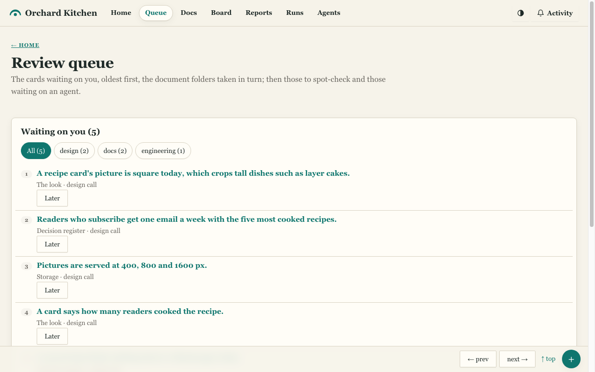
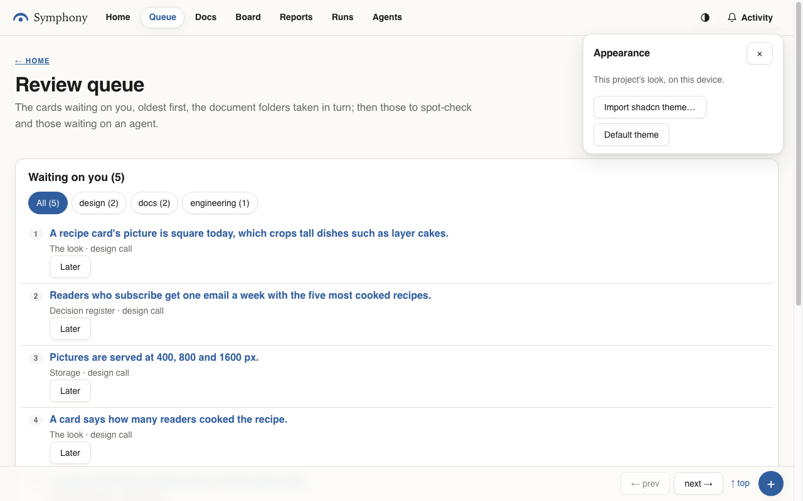
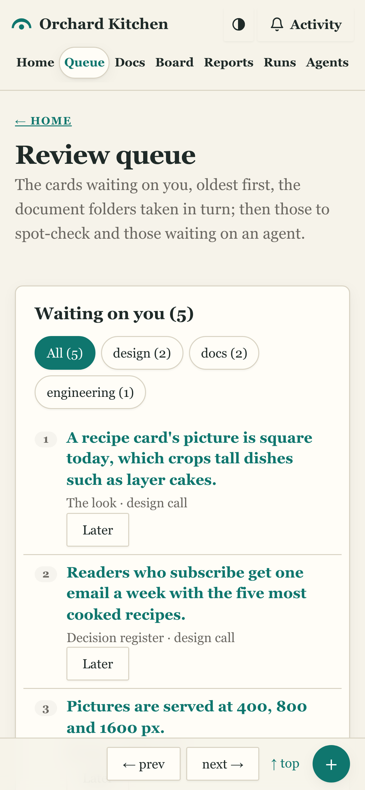

# Themes and appearance

A project's Symphony can look like the project: its name, its icon, its colours, its font and
its corners. There are two ways, and they stack. A **project's theme** is written once in the
project's settings and is what everyone who opens the project sees. **Appearance** is one
person's own choice on one device: a theme file imported in the header of any page, over the
project's. This page is for the owner who wants the project to look like theirs, and for a
reader who wants other colours on their own screen.

## What the owner does here

- **Gives the project its name and icon.** The name takes the Symphony's place in the header and
  on the browser's tab; the icon takes the place of its mark.
- **Gives it its colours, font and corners.** A few named values in the project's settings: the
  page behind everything, the cards, the text, the lines, the colour of links and filled
  buttons, the fonts and how round the corners are.
- **Chooses a layout.** The header in one row, or a home page that shows only what is next.
- **Tries a theme on one device.** **Appearance**, the round half-filled button in the header,
  imports a theme file for this project on this device alone.
- **Goes back.** **Default theme**, in the same panel, removes the imported theme and leaves the
  project's.

## What it shows

### A project's theme

A project with no theme is drawn in the Symphony's own look, under the Symphony's mark and name,
as the pictures of the other specs show. A project's theme changes these, on every page of the
project:

| Part | What it changes | Without it |
| --- | --- | --- |
| Name | the name in the header and on the browser's tab | the Symphony's name in the header, the project's on the tab |
| Icon | the picture beside the name and on the tab | the Symphony's mark |
| Colours | the page, the cards and panels, the text and the secondary text, the lines, links and filled buttons, the faint fills, and the colours of each state: approved, rejected, asked, decided, settled, and an agent's health | the Symphony's, light or dark by the device |
| Font | the text's font and the code's | the Symphony's |
| Corners and shadows | how round buttons, fields and cards are, and the shadow under a card and a panel | the Symphony's |
| Line length | the widest a line of a document's text runs | 72 characters |
| Header layout | **compact**: one row at every width, its links scrolling across | two rows on a phone |
| Home layout | **focus**: the next card and the queue, without the tiles and the progress | the whole home page |
| A stylesheet | the project's own rules, applied after everything else | none |

The theme is set in the project's settings file, or brought by a plugin as a package that several
projects share, each still free to set parts over it.

### Appearance

The **Appearance** button is in the header of every page, left of the bell. It opens a small
panel under itself:

| Part | Does |
| --- | --- |
| *This project's look, on this device.* | says what the panel changes |
| **Import shadcn theme…** | shows **Choose a theme file…**, which takes a theme file from the device |
| **Default theme** | removes the imported theme |
| A status line | says what happened: **Theme applied.**, **Default theme restored.**, or why a file was refused |
| **×** | closes the panel; so does the Escape key |

A theme file is the JSON file the shadcn and tweakcn theme editors export: its colours for light
and for dark, its fonts and its corners. The page takes the new look at once, with no reload.

## Rules

### Which look wins

1. The Symphony's own look is under everything.
2. The project's theme is drawn over it, for everyone.
3. A theme imported in **Appearance** is drawn over both, on that device, for that project.

A value the upper one does not set shows through from the one below: an imported theme that sets
only colours keeps the project's font, and the colours of a card's states stay as they were unless
the imported file names them.

### Light and dark

The Symphony's own look follows the device: light or dark. A colour a project's theme sets holds
in both, so a project that sets its page's colour sets its text, its cards and its lines with it,
or the dark scheme draws pale text on the pale page. An imported theme file carries a light set
and a dark set, and each is used in its own scheme.

### What a theme cannot do

A theme is values, never code. A colour, a font or a size is refused when it holds anything that
could reach outside itself: a semicolon, a brace, an angle bracket, a comment, or an address to
load. An imported file is refused whole, naming the value, and the look stays as it was. A
project's settings with such a value, or with one holding a backslash or a line break, are
refused the same way, naming it, and one in a plugin's package is left out, which the project's
settings check says.

### One project, one device

An imported theme is kept in the browser, for the project it was imported in. Another project on
the same machine keeps its own look, and so does the same project in another browser or on
another device. Clearing the browser's data for the site removes it.

## States

| State | What the page shows |
| --- | --- |
| No theme anywhere | the Symphony's look, its mark and its name |
| A project's theme | the project's name, icon and look, from the first paint |
| An imported theme | the imported look from the first paint of every page, on that device |
| The panel, opened | the two buttons, the first holding the keyboard's focus |
| A file being chosen | **Choose a theme file…** under the buttons, until a file is applied |
| A file applied | **Theme applied.**; the file chooser closes |
| A file that is not JSON | *The theme is not valid JSON.* |
| A file that is no theme | *The theme needs cssVars with theme, light or dark tokens.* |
| A file with a value it may not hold | *Invalid theme token:* and the value's name |
| A theme file with no value in it | *The theme has no cssVars tokens.* |
| The default put back | **Default theme restored.** |

## On a phone

The same look. The header is two rows, the pages' links in the second, unless the project chose
the compact header. **Appearance** stays in the first row, and its panel opens under it at the
screen's width.

## Edges

- A project's theme is read when a page loads: a change to the settings shows at the next load,
  with no restart, and an open page keeps the look it loaded with.
- A theme that names a package none of the project's plugins brings is drawn without it, and the
  project's settings check says so.
- A value under a name the Symphony does not use is still set, for the project's own stylesheet
  to read.
- **Default theme** removes only what this device imported. It never changes the project's theme.
- Opening **Appearance** closes the activity panel, and the other way round.
- The charts of [Reports](REPORTS.md) keep five colours of their own unless a theme names them.

## Related

- [Writing a plugin and a theme](../engineering/PLUGIN_WRITING.md#a-theme): every value a theme can set, by
  name, with a whole example in the settings file and from a plugin.
- [The project file](../operations/PROJECT_FILE.md#theme): the keys of the theme's table.
- [The settings check](../operations/PROJECT_FILE.md#the-settings-check): what names a theme's mistakes.
