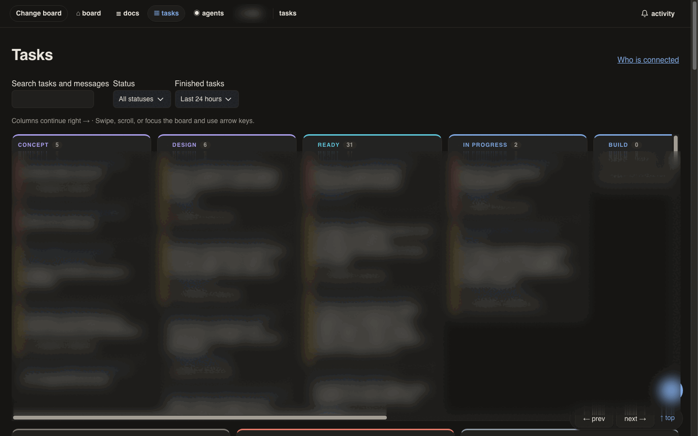
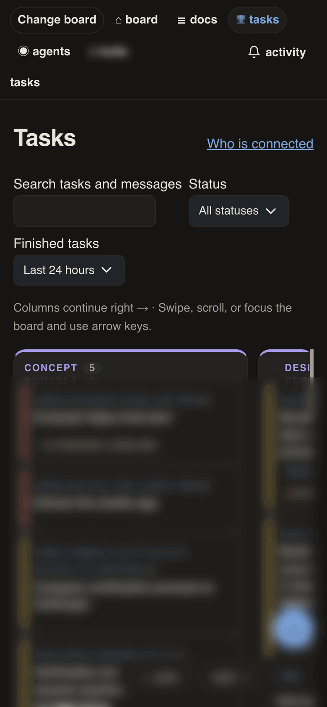
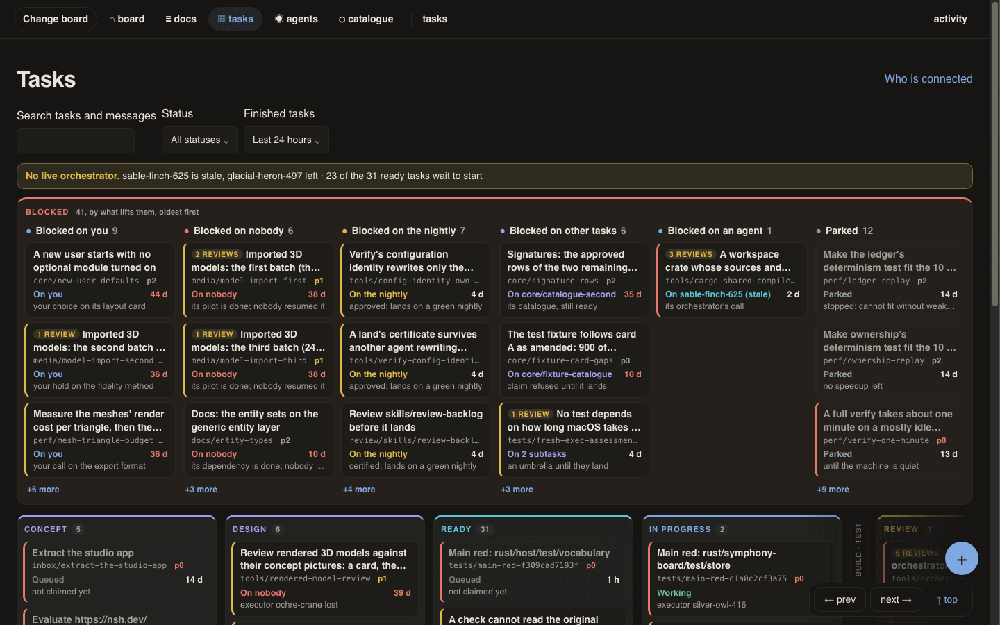
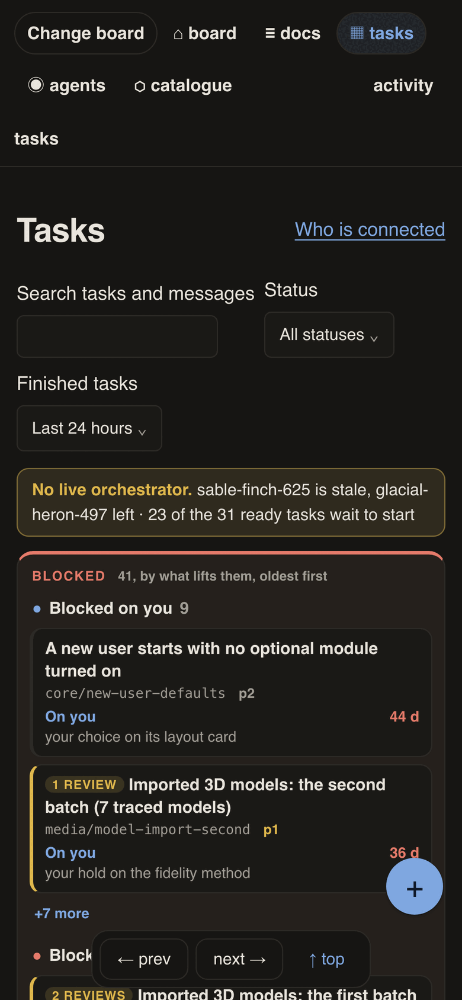
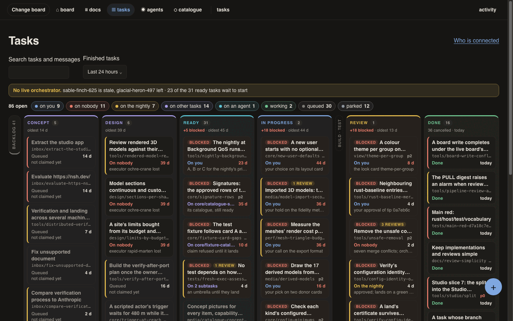
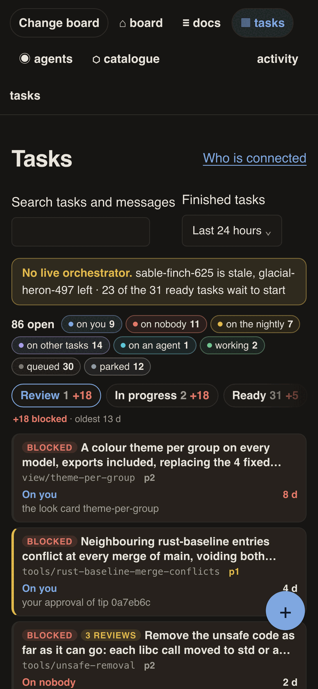
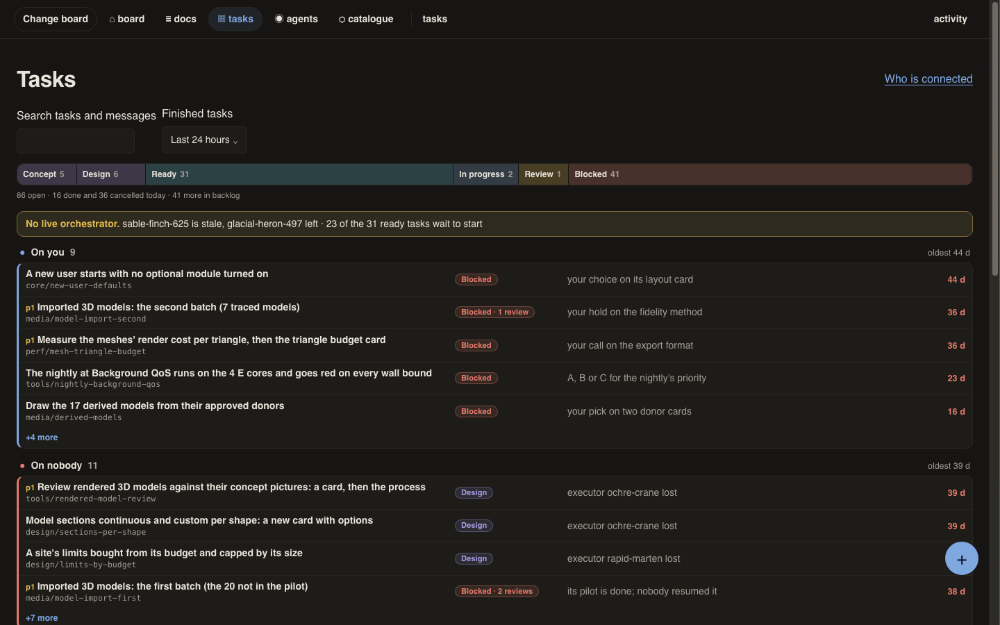
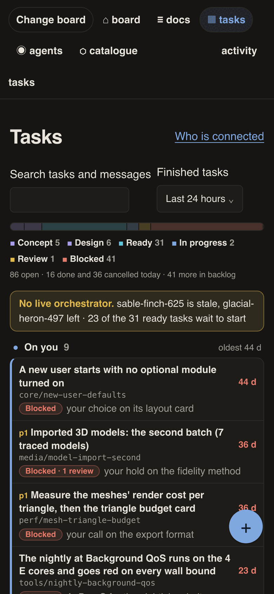
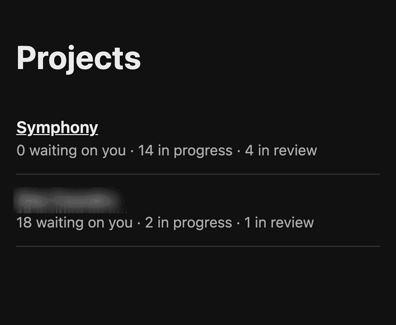
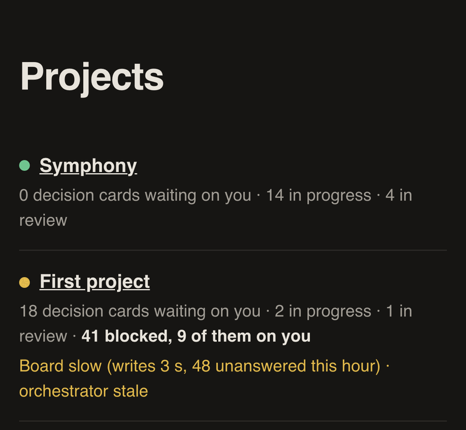

# The board at a glance

What it takes for a project's task board to say, before anything is opened, what is stuck, on whom
it waits and for how long; the three layouts proposed on the board-at-a-glance card in
[DECISIONS](../../DECISIONS.md), the Projects page's health line on the projects-health card, and the
board they were measured on. "Read 2026-11-11" marks the consuming project's board as the shared
server answered it at 19:10 that day.

The ask: the board's design is not good enough. The board task `tools/board-design-review` names
what operating the consuming project's board showed: blocked work with no reason, owner or age on its card; dead sessions keeping their roles, so a task reads as staffed;
review rounds as cards of their own; no age in stage; and a Projects page with counts but no health.

## What the board shows today

Read 2026-11-11 on the consuming project's board, through the shared server's own pages and API, read only:

- **86 open tasks** at the top level (5 concept, 6 design, 31 ready, 2 in progress, 1 in review,
  41 blocked), 41 in backlog. **2 are being worked** by an agent that is there.
- **41 blocked**, a median of 10 days in blocked, the oldest 44 days: 18 were moved there from
  review, 18 from in progress, 5 from ready. Read from each thread by hand, 9 wait on the owner (the
  oldest 44 days), 7 on the nightly, 6 on other unfinished work, 1 on its orchestrator's call (that
  orchestrator stale, so still there), 12 are parked on purpose (a cost exemption that stays, a
  recurrence, a quiet machine) and 6 on nobody: 2 whose agent or orchestrator left, 4 whose blocker
  has finished with nobody resuming them.
- **None of that is on a card.** The move to blocked is a line with no reason (`X moved it review →
  blocked`); the reason is in a post near it, often several hundred words long. The Blocked column
  sits in a lower row, below the first screen on a wide screen.
- **Roles that left stay.** The 41 blocked cards draw 117 role chips, 110 of them for sessions that
  left or were lost; 24 blocked tasks show a reviewer no longer there, one card 8 reviewers, all gone.
  Of the 31 ready tasks none has a live executor (one holds a lost one), and 8 wait on unfinished
  work (2 of them on a blocked subtask). The project has no live orchestrator (sable-finch-625
  stale, glacial-heron-497 left), so nobody will start the other 23. Nothing on the page says so.
- **Ages.** Ready tasks have waited a median of 6.5 days. Nothing on the page shows an age.
- **Review rounds.** Of the 73 subtasks under the blocked, in-progress and review tasks, 20 to 24
  are review rounds (`review`, `adversarial`, `rereview`, …, 24 with the visual critiques); one task
  has 6. Over 14 days, 233 of 328
  subtasks were review rounds (tools/stage-times' measurement).
- **The first screen.** Wide (1440), it shows Concept, Design, Ready, In progress and an empty Build
  column; Review and Done are off to the right, the lower row below. On a phone the header (three
  rows), the filters and the scroll hint come first; the first card starts mid-screen, at about 457
  of 844 px, with the next column cut at the right edge.
- **Health.** The consuming project's board answered writes in 3.0 s at p90 over the last hour, with 95 slow
  requests and 48 unanswered; Symphony's in 7 ms with none. The Projects page shows neither: it
  warns only while callbacks or the sweep fail.

## Who a task waits on

The same under every option. Each open task's card ends in one line: who it waits on, why in a few
words, and for how long, the age in its current stage (red from a week).

| line | when | colour |
|---|---|---|
| Working · executor amber-heron | someone there holds the role the stage needs | `--like` |
| On you · your choice on its layout card | a card of the owner's the task names, a block naming the owner, an owner gate the project holds | `--primary` |
| On the nightly · lands on a green nightly | what its landing lacks (the landing's own record), a project's check gate missing or held, a block naming a check | `--question` |
| On tools/unsafe-removal · its dependency, blocked | an open dependency (a subtask too), or a block naming a task | `--decision` |
| On sable-finch-625 (stale) · its orchestrator's call | a block naming a session that is there | `--auto` |
| On nobody · its pilot is done; nobody resumed it | the role the stage needs held by one who left or was lost, or by no one in progress or review; a block naming one who left, a block whose task finished, a block with no reason | `--dislike` |
| Queued · not claimed yet | concept, design or ready work with no holder and nothing open before it: it waits to be staffed | muted |
| Parked · until the machine is quiet | a block naming no one on purpose (`--on parked`): a recurrence, an exemption that stays | muted |

Queued and parked work is drawn quieter than stuck work, its age never red: it waits by design.

- **A stale session is there, marked stale.** The board's own rule (docs/workflow/TASKS.md: a stale
  session's "work is still held, nobody may take it"), applied the same way on the card line, the
  banner and the Projects page. A stale holder reads `Working · executor amber-heron (stale)`, a
  block naming one reads `On amber-heron (stale)`, and neither is ever "on nobody". Only lost and
  left sessions are gone.
- **One cause is said once.** When no orchestrator is live, a banner above the board says so and
  names who is stale or gone, with the ready work nobody will start: `No live orchestrator.
  sable-finch-625 is stale, glacial-heron-497 left · 23 of the 31 ready tasks wait to start`, counted
  by PULL's rule (ready, no live executor, nothing open before it). It is amber while an
  orchestrator is stale and red when none is there. The cards it holds back read `Queued · not
  claimed yet`, not the cause 23 times.
- **Only present roles are drawn.** A role held by a session that left or was lost is not drawn on the
  card; when it is the role the stage needs, the line says so (`On nobody · executor amber-heron left
  2 h ago`). The task page keeps every role.
- **A block names what it waits on.** Moving work to blocked records who can lift it and why, in a
  few words: `just tasks move SLUG blocked --on owner|check:NAME|task:SLUG|HANDLE|parked --why "…"`.
  A cancelled dependency's block names the task itself. What a landing lacks is not recorded again:
  the landing tool already keeps it in `fields._board.waits` (`TIP: certificate, review`), and the
  line reads it there, as it reads a project's own gates where the project answers them
  (tools/task-gates-seam). A block written without a record reads `On nobody · no reason recorded`,
  so an orchestrator sees which to triage. A block naming a task that has since finished reads `On
  nobody · its dependency is done`.
- **Review rounds are one mark** on the task (`3 reviews`), as tools/review-as-stamps' third slice
  has it; review subtasks are never cards.
- **Documents and roles leave the card**; the slug stays, under the title, with the priority in
  words beside it (`p1`) as well as on the card's edge.

The rule for each line is the one the PULL digest already applies for orchestrators
(`crates/tasks/src/cli/pull.rs`: ready with no live executor, in progress with none, review with no
reviewer, dependency blocked), so the board and PULL never disagree.

The strip that counts these kinds keeps one order everywhere: what needs someone first (on you, on
nobody, a check, other tasks, an agent), then work going on, then work that waits by design (queued,
parked).

## The options

All three draw the same cards, the same line and the same banner; they differ in where the waiting
work goes. The pictures are HTML mock-ups (this folder) on the board's own tokens, filled with the
consuming project's board as read 2026-11-11, at 1440 wide and at a phone's 390, dark. All four pictures,
today's included, carry today's header (three rows on a phone), filters and buttons, so they differ
only in the board: the header's names and rows are app/header-names' cards, not this choice.

### A: a Blocked lane

Today's board with the Blocked column lifted into a lane above the columns, in six groups by what
lifts the block (blocked on you, on nobody, on the nightly, on other tasks, on an agent; parked),
oldest first, three a group and `+N more`. Its counts are of blocked tasks only (on nobody 6); B's
strip and C's groups count all open work (on nobody 11: the 6 blocked, 3 in design, 1 ready and 1 in
progress).

- **Removes:** the Blocked column, role and document chips, the scroll hint (a fade at the columns'
  right edge says they go on).
- **Keeps:** columns 288 px wide that scroll sideways, so Review and Done stay off the first screen
  wide; Backlog and Cancelled in the lower row; the Status filter, search and the finished window
  with their labels; Who is connected; the + button; the prev, next and top pager.
- **Cost:** the least: the client groups what the line already says.

### B: stuck in place

No Blocked column: a blocked task stays in the column of the stage it stopped in, first in it (parked
work last), with a `blocked` mark. Every stage fits a wide screen; a column's head gives its own
count, then `+N blocked` and its oldest age, so the bottleneck shows (the consuming project: Review 1
+18 blocked). A strip counts the open work by who it waits on, and each count filters the board to it.
On a phone, tabs show one stage at a time (`Review 1 +18`).

- **Removes:** the lower row (Blocked goes into the stages; Backlog becomes a narrow rail; Cancelled a
  count under Done), sideways scrolling wide, the Status filter (the strip and tabs replace it), the
  prev, next and top pager (nothing scrolls sideways; a phone has tabs), role and document chips,
  the scroll hint.
- **Keeps:** the pipeline: where each task is; search and the finished window with their labels; Who
  is connected; the + button.
- **Cost:** the stage a blocked task came from, kept by the stages replay (`crates/tasks/src/stages.rs`)
  and put on the wire; tabs on a phone.

### C: who acts next

No columns. The open work is one list grouped by who has to act next (you, nobody, a check, other
tasks, an agent, then working, queued and parked), oldest first; each row has its title and slug, its
stage, its reason and its age. The stages are a bar of their counts on top that filters the list.

- **Removes:** columns and sideways scrolling, the lower row, the Status filter (the bar filters by
  stage), the prev, next and top pager, role and document chips, the scroll hint.
- **Keeps:** search and the finished window with their labels; Who is connected; the + button.
- **Loses:** the pipeline as a picture: where work piles up is the bar of counts, not columns.
- **Cost:** a new page layout and a grouped read; the list pages by group.

### Recommended: C

The owner's question of the board is who has to act and how long it has waited. C answers it for
all 86 open tasks in one order: who acts first, oldest first, the age at the right, the same wide
and on a phone, with no sideways scroll. A answers it for the 41 blocked tasks only, above columns
that still scroll sideways; B spreads the blocked work over Ready, In progress and Review, and its
by-who order is a strip filter the owner has to tap. The pipeline is not lost in C: the bar on top
keeps each stage's share and filters to it, and each row carries its stage. Both fresh reviewers
picked C.

B is the choice if the pipeline as columns matters more than who acts: it fits a wide screen and
shows the bottleneck as a column's count, at the cost of phone tabs. A is the cheapest and keeps the
problem of a board wider than the screen.

- [r] **board-at-a-glance** — A task board should say what is stuck, on whom and for how long. The consuming project's board says none of it: 41 tasks are blocked, a median of 10 days, and no card says why; 110 of the 117 role chips on them name sessions that have left. Under every option, each card ends in one line: who it waits on, why in a few words, and how long it has been in its stage (red from a week). Roles that left and document chips leave the card, review rounds become one mark, and a banner says once when no orchestrator is live. Where does the waiting work go? A: a Blocked lane above today's columns, grouped by what lifts each block. B: no Blocked column; a blocked task stays first in the column it stopped in, every stage fits a wide screen, and a phone shows one stage at a time. C: no columns; one list grouped by who has to act next, oldest first, under a bar of the stages' counts. Recommended: C. Approve and say A, B or C in the note, or comment. [[analysis/board-design#The options]]
  [2026-11-11 19:42] agent — Base: the board today, wide, from the shared server at 19:10. 
  [2026-11-11 19:42] agent — Posted for the board task `tools/board-design-review`. The three options at 1440 wide:   
  [2026-11-11 19:42] agent — The options are mock-ups on the board's own colours, filled with the consuming project's 86 open tasks as they stood at 19:10. Queued and parked work, which waits by design, is drawn quieter and never red. All four pictures carry today's header, filters and buttons: the header's rows and names are app/header-names' card, not this choice.

    **On a phone**, today first (its first card mid-screen, under the three-row header, the filters and the scroll hint), then A, B and C:    

    **A, a Blocked lane.** Removes the Blocked column, role and document chips, and the scroll hint. Keeps columns that scroll sideways, so Review and Done stay off the first screen wide, the Status filter and the prev, next and top pager. Cost: the least.

    **B, stuck in place.** Removes the lower row, sideways scrolling, the Status filter, the prev, next and top pager, role and document chips, and the scroll hint. Keeps the pipeline as columns, and a column's head shows where work piles up (Review 1, +18 blocked). Cost: stage tabs on a phone.

    **C, who acts next.** Removes columns, sideways scrolling, the lower row, the Status filter, the prev, next and top pager, role and document chips, and the scroll hint. The pipeline becomes the bar on top, and each row names its stage. Cost: a new page layout.

    All three keep search and the finished window with their labels, Who is connected and the + button.

    **Why C.** C orders all 86 open tasks by who has to act, oldest first, with the age at the right, the same wide and on a phone and with no sideways scroll. A orders only the 41 blocked tasks, above columns that still scroll sideways. In B the by-who order is a strip filter you tap. B is the pick if columns matter more than who acts.

    **Fresh review.** A reviewer saw the three before this card went up. Its three blocking findings were fixed and checked again, and the task's reviewer also picked C. The first reviewer's verdict: "Its single list grouped by who acts next, with 'On you' first and ages on the right, answers what is stuck, on whom and for how long in one top-to-bottom read, and it looks the same wide and on the phone."

    Filed in design, waiting on this card: tools/task-waits-on (the line's data, for any option) and app/board-at-a-glance (the chosen option only).
  [2026-11-11 20:06] agent — Corrected after the task's review, before any answer. Two counts were wrong: 23 ready tasks wait only on an orchestrator, not 25 (two wait on a blocked subtask), and 6 blocked tasks wait on nobody, not 7 (one waits on its orchestrator, which is stale, so still there). The cards no longer repeat the missing orchestrator; the banner says it once. A now shows the Status filter it keeps. Every picture now has today's header and controls, and each option lists what it drops. C's phone rows keep the slug. The pictures above are the corrected ones.
  [2026-11-11 21:52] owner · approved — B. They shoild be blocked on a decision (not a person). There should not be a blocked on nothing, a card that is blocked on nothing is not blocked.
  [2026-11-11 21:55] agent — B it is: no Blocked column, a blocked task stays first in the column it stopped in. Your two rules go into the build: a block names what it waits on, a decision card, a task or a check, and where that is yours it reads `On your decision NAME`, never a person alone; and a task whose block names nothing is not drawn or counted as blocked, it goes back to the stage it stopped in and the board lists it once for its orchestrator to give a reason or release. Carried on the board tasks `app/board-at-a-glance` and `tools/task-waits-on`.
  [2026-11-11 22:02] agent · resolved

## The projects page

The machine's Projects page lists each project with its counts. While a board's callback dispatch or
idle sweep is failing it already says so under the project's name (`⚠ The task board is unwell: …`,
`apps/symphony-server/src/projects.rs`, `list_row`, from `live/health.rs`). It says nothing of a board
that answers slowly or of one nobody orchestrates: at 19:10 on 2026-11-11 the consuming project's
writes took
3.0 s at p90, 48 requests went unanswered that hour, and its one orchestrator was stale, while its row
read like Symphony's.

It gains a dot per project, its worst signal (green, amber, red) and, only when the dot is not green,
one short line saying why, from the health the server already keeps in memory (`/api/health`,
`crates/tasks/src/board_health.rs`) and who is connected:

- **red:** what the row says today, callbacks or the sweep failing, in the same words;
- **amber:** writes at p90 of a second or more, or requests unanswered in the last hour (`Board slow
  (writes 3 s, 48 unanswered this hour)`); no live orchestrator while work is queued, by the board's
  one rule for a stale session: `orchestrator stale` while one is stale, `no orchestrator` when none
  is there.

The counts say what they count, `18 decision cards waiting on you` (as today, the owner's cards),
and gain the blocked tasks, `41 blocked, 9 of them on you`, from the line above, in bold.
tools/server-projects-list's `/api/projects` carries the same health for the desktop app ("whether it
is refused, or its board unwell"), so both read one function.

- [r] **projects-health** — The Projects page warns only while a board's callbacks or sweep fail. At 19:10 today the consuming project's board took 3 s to answer a write, left 48 requests unanswered in the hour and had its one orchestrator stale, and its row read like Symphony's. Proposed: a dot per project for its worst signal (green, amber, red); only when it is not green, one short line saying why; and counts that say what they count, `18 decision cards waiting on you`, then `41 blocked, 9 of them on you`. Approve, or comment with what to change. [[analysis/board-design#The projects page]]
  [2026-11-11 19:42] agent — Base: the Projects page today, on a phone, from the shared server at 19:09. 
  [2026-11-11 19:42] agent — Proposed, on a phone and wide:  
  [2026-11-11 19:42] agent — Red keeps today's words for failing callbacks or sweep. Amber is a board slow over the last hour (writes over a second at p90, or any request unanswered) or no live orchestrator while work waits to start (`orchestrator stale`, or `no orchestrator` when none is there: a stale session is still there, one rule for the card line, the board's banner and this page); the build sets the thresholds. The blocked counts come from the same line as board-at-a-glance. The fresh reviewer's finding that "18 waiting on you" and "9 on you" read as two answers to one question is fixed by naming the 18 as decision cards. Filed in design, waiting on this card: app/projects-health.
  [2026-11-11 21:53] owner · approved
  [2026-11-11 22:02] agent · resolved

## What the build touches

Filed on the board in `design`, each waiting on its card, each brief complete:

1. **tools/task-waits-on** (every option), after tools/task-gates-seam and
   tools/project-gates-everywhere: the block record (`move … blocked --on --why`, kept in the task's
   `fields._board`, which older readers keep and ignore, so no schema change), the line's derivation
   on the server shared with PULL, reading what a landing lacks from the landing's own
   `fields._board.waits` and a project's gates where they answer, and a `waits_on` on the wire
   (`kind`, `who`, `why`, `since`), with `from` for a blocked task and the board's orchestrators with
   their health for the banner. The age is tools/stage-times' `in_status_since`.
2. **app/board-at-a-glance**, after tools/task-waits-on, app/build-test-columns and
   app/skeleton-loading: the card, the banner and the chosen layout in the React client, where the
   board moved (`apps/symphony-web/src/board.tsx`, `boardlive.tsx`, `taskcard.tsx`, and
   `apps/symphony-ui/assets/board.css`).
3. **app/projects-health**: the dot and line on the Projects page.

Built on, not repeated: tools/stage-times (the age), tools/review-as-stamps (review rounds as marks),
tools/task-gates-seam and tools/project-gates-everywhere (a project's gates), app/build-test-columns
(the Build and Test columns, drawn as its rail here), app/header-names (the header), app/skeleton-loading
(placeholders while columns load), tools/server-projects-list (health on `/api/projects`).

## The data

`window.BOARD`, in each of the three option pages, is the board the pictures draw: the consuming
project's open top-level tasks and the last day's done ones, read 2026-11-11 19:10 from the shared
server's `/api/task-board` and each task's `/api/task-thread`, read only. The titles and slugs of the project's own product work
were reworded in neutral terms on 2026-11-12; every status, age, priority, wait and review count is as
read. The age is from each task's last status line; who a task waits
on is from its roles and their health (a lost or left holder of the needed role reads on nobody), its
dependencies (subtasks too, their status read from `/api/task-page`), and for a blocked task from the
posts beside its move to blocked, shortened by hand to a few words (a block whose post says it is
parked, stopped on purpose or waiting on a recurrence reads parked; one naming a session that is
there reads on that session; unclaimed concept, design and ready work reads queued). The
pictures are the `.html` pages here, shot with `symphony shot` at `--phone` and at 1440 wide, and
reduced to 256 colours; they were shot again from the reworded data on 2026-11-12. "Projects
today" is the shared server's own page at 19:09, and "Today" its board at 19:10; in those three
pictures the consuming project's name, its own tab and the cards' titles are blurred, their layout
as it was.

## Not in this design

- The header and its names: app/header-names.
- The task page: tools/task-gates-panel and tools/task-timeline.
- Trends (lead time, where hours go): the Reports page, tools/reports-page.
- Thresholds (a week is red, a second is slow): set in the build, not cards.
