# What a landed task cost, drawn

A concept, not a design to build from: how the Reports page would draw what its landed tasks
cost, now said in sentences and a list under the charts of tokens, and which measures join it.
Nothing in the product changes with it. Its three cards are answered: the landed tasks' view is
[a tab of its own](#reports-landed-view-place), a task's kind is [a field chosen when it is
filed](#reports-task-kind), and the view's fourth chart draws [every task as a
dot](#reports-landed-fourth-chart). Nothing is left to choose. [What the build
needs](#what-the-build-needs) is filed as a task from this one.

## The ask

The owner, from the page: **Cost per landed task** reads as text where everything else is a
chart, and looks out of place. It lacks measures such as the cost of a changed line or of a task.
A view by kind of task may belong apart from the timeline. The information itself is useful.

## Today

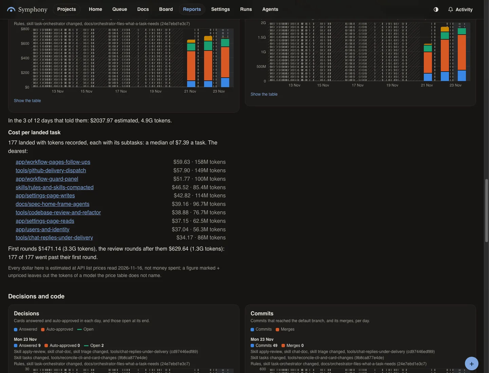

Under **Estimated cost** and **Tokens** ([REPORTS](../REPORTS.md#tokens-and-cost)), the page
writes:

- a sentence of the window's dollars and tokens;
- **Cost per landed task**: how many top-level tasks landed with tokens recorded and the median
  cost of one with its subtasks, the ten dearest as a numbered list (a link and
  `$59.63 · 158M tokens` each), and a sentence of the first rounds against the review rounds
  after them;
- what every dollar is: an estimate at API list prices, never money spent.

It reads as text among charts for four reasons.

- **It is prose and a list.** Every other figure on the page is one of the four figures at the
  top or a chart card: a title, a sentence saying what it counts, a legend, a readout, a plot and
  **Show the table**. This one has none of them.
- **It leaves a hole.** It sits in the left column under the cost chart, the width of a column of
  text, and the right column beside it is empty.
- **It says three numbers of many.** The day files hold every landed task with its tokens by role,
  review round, model and speed (`symphony_api::reports::Landed`); the server reduces them to a
  median, ten rows and two sums (`LandedSpend`, `crates/tasks/src/reports/spend.rs`
  `landed_costs`). Nothing can be compared: one kind of task against another, a task against its
  size, this week against last.
- **Its last count is always all of them.** "177 of 177 went past their first round": the first
  review's tokens are round 2 ([where the tokens go](../../workflow/TASKS.md#where-the-tokens-go)),
  so every reviewed task went past its first round. The count that says something is the tasks
  reviewed twice or more, whose first review sent them back: 54 of those 177.

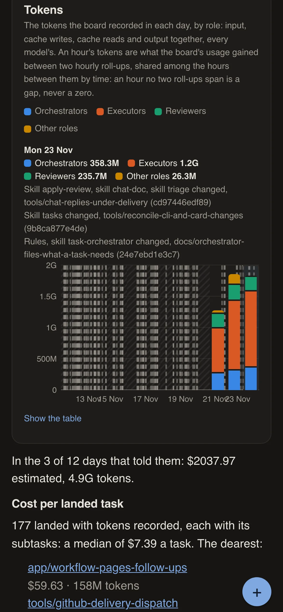

## The proposal

Every picture is a drawing by hand ([the mockup](reports-landed-cost/mockup.html)) in the page's
own tokens and chart look, from this board's day files: the last 2 days by the hour, to
23 Nov 2026 16:00 UTC, in which 160 top-level tasks landed. Nothing in them is built. No task has
a kind yet, so where the built page groups by kind the pictures group by the slug's first part.
The measures go in two places: two charts on the time axis, and the tasks' own view, by task
rather than by hour.

### Over time: two charts join Tokens and cost

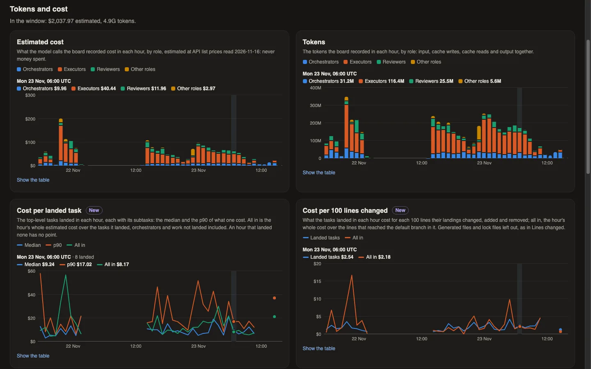

- **Cost per landed task**: of the top-level tasks landed in each period, each priced with its
  subtasks, the **Median** and the **p90** of what one cost, as **Lead time** draws its two
  lines. **All in** is the period's whole estimated cost over the tasks it landed: the
  orchestrators' tokens, which are on no task, and the work that did not land are in it. A period
  that landed none has no point; a period with no record is hatched, as every chart's gap is.
- **Cost per 100 lines changed**: what the tasks landed in each period cost for each 100 lines
  their landings changed, added and removed together, and **All in**, the period's whole cost
  over the lines that reached the default branch in it. Generated files and lock files are left
  out, as **Lines changed** leaves them out.

The two fill the column beside **Tokens** and take nothing from the other charts: the same card,
axis, readout, table and hidden series. By the hour they swing, as an hour lands a handful of
tasks (from $6 to $58 for the p90 in these two days); by the day and the week they settle.

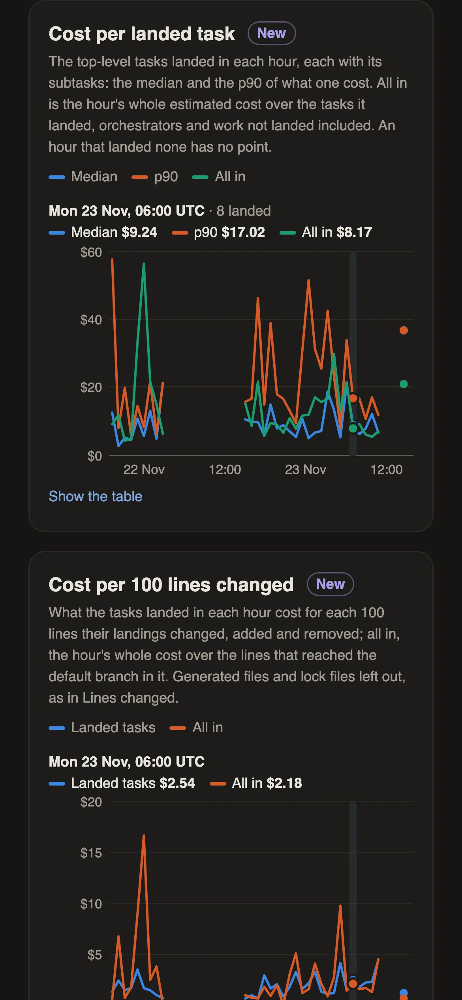

### By task: the landed tasks' own view

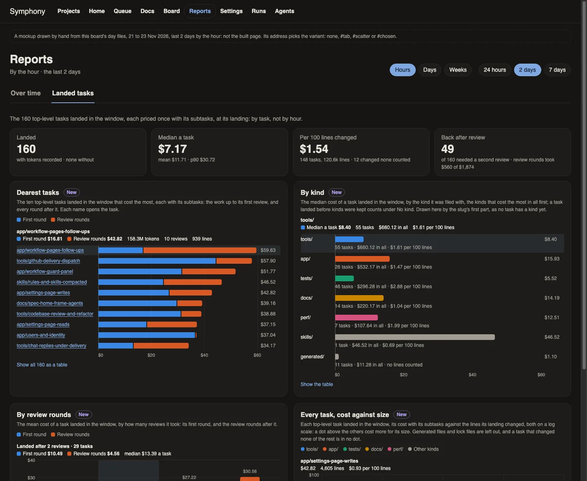

The view is a tab of its own, **Landed tasks**, beside **Over time**, which holds the charts the
page draws now and the two above ([where it goes](#where-it-goes)). Four figures, as the page's
own four are drawn, each a link to its chart:

| Figure | Says | Under it |
| --- | --- | --- |
| **Landed** | the top-level tasks landed in the window with tokens recorded | how many landed with none, which are in no figure |
| **Median a task** | the median cost of one, with its subtasks | the mean and the p90 |
| **Per 100 lines changed** | their cost over the lines their landings changed | how many tasks and lines, and how many changed no line counted |
| **Back after review** | the tasks reviewed twice or more | of how many, and what the review rounds cost of the whole |

Then four charts, each a chart card as the page draws them:

- **Dearest tasks**: the ten that cost the most, a bar each, its work up to its first review and
  every round after it stacked, its name a link to its page. A tap says its tokens, its reviews
  and its lines. **Show all 160 as a table** lists every task landed in the window with the same
  figures.
- **By kind**: the median cost of a task of each kind it was filed with, the kinds that cost the
  most in all first, with each kind's count, its whole cost and its cost per 100 lines under its
  bar, and **No kind** last ([what a kind is](#by-kind)).
- **By review rounds**: the mean cost of a task by how many reviews it took, its first round and
  its review rounds stacked, the count under each.
- **Every task, cost against size**: each task a dot in its kind's colour, its cost against the
  lines its landing changed, both on a log scale; a tap names it and links its page
  ([the fourth chart](#the-fourth-chart)).

What these two days already say, which no figure on the page says today:

- A task reviewed once cost $7.72 on average (111 tasks), twice $15.05 (29), three times $27.22
  (9). The first round of a task reviewed again cost more too: it was the larger task before any
  review.
- By the slug's first part, the regenerator's aside, a tests task is the cheapest to land
  ($5.52, the median of 46) and the dearest per line ($2.88 for 100); a docs task the cheapest per
  line ($1.04).
- Review rounds took $560 of the $1,874 the 160 tasks cost.

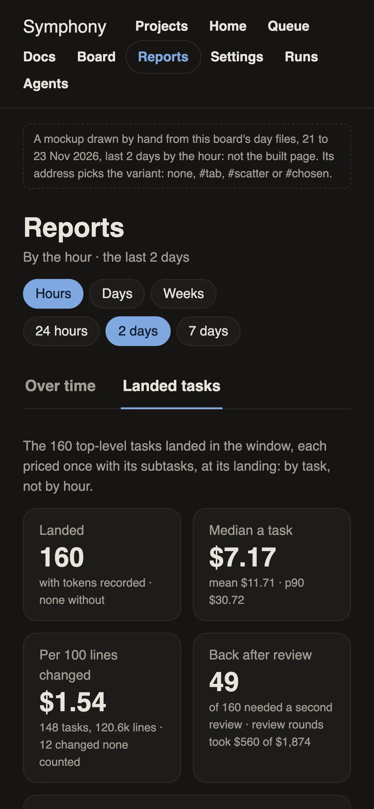

### Where it goes

The view is a tab of its own beside the timeline: **Over time** and **Landed tasks**, the
window's controls above both, so the two read the same window. The address names the tab, so a
link opens it, and the four figures of **Landed tasks** link its charts as the page's own four
link theirs. The two new charts on the time axis are in **Tokens and cost**, under **Over time**.
A section under **Tokens and cost** was set aside: it lengthened a page of sixteen charts by about
four screens on a phone.

- [r] **reports-landed-view-place** — Reports would draw what its landed tasks cost as charts: the dearest ten as bars, the cost by kind of task, by review rounds and how many tasks cost each much, under four figures (how many landed, the median a task, the cost of 100 changed lines, how many a review sent back). They follow the window chosen. Where do they go? A: a section of the page under Tokens and cost, scrolled to as the other charts are. B: a tab of their own, Over time and Landed tasks, the window's controls above both. Recommended: B. Approve and say A or B in the note, or comment. [[analysis/reports-landed-cost#Where it goes]]
  [2026-11-23 12:50] agent — Base: the page today, its landed tasks in sentences and a list. 
  [2026-11-23 12:50] agent — Posted for the board task `inbox/improve-cost-and-token-usage-reports`. Drawn by hand from this board's last two days, nothing built: 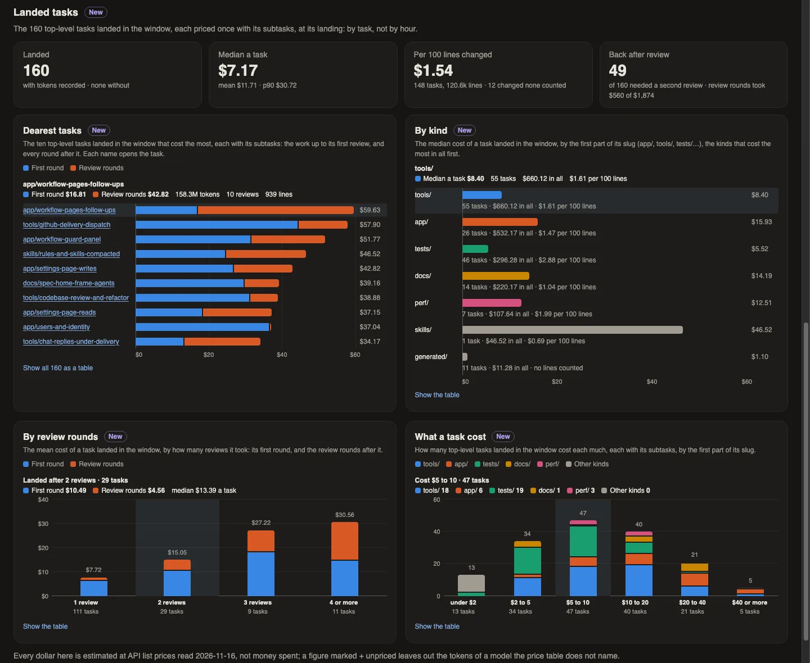 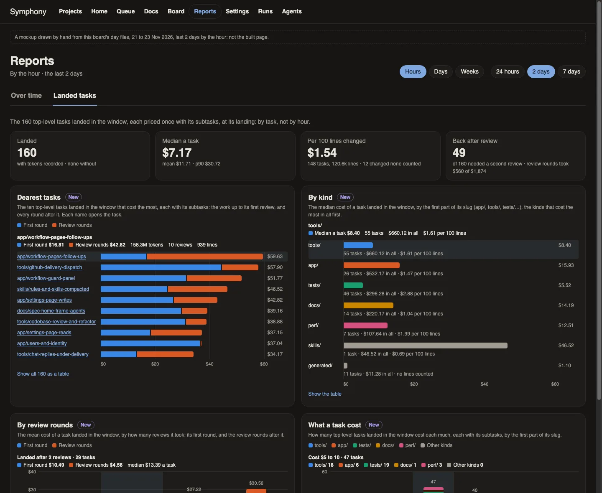

    **What is the same under both.** The figures and the four charts, the window, a link from each figure to its chart. The two new charts on the time axis (cost per landed task, cost per 100 lines changed) are in Tokens and cost under both.

    **A, a section.** One page, scrolled. It adds a heading, the figures and four charts to a page of sixteen charts: on a phone about four screens more.

    **B, a tab.** The timeline stays the page it is, and the tasks' view is one press away, as its own question: where the money went, not how it moved over time. The address names the tab, so a link opens it.

    **What each costs.** About the same: B adds the two tabs and the address that keeps the one chosen.

    **Earlier verdicts checked.** **reports-pipeline-defects** (A) decides that the figures are rolled up hourly into files, **reports-small-choices** settles smaller choices of the Runs and Reports pages, and **task-cost-after-time** where a task's cost sits on its card and its page. None says where a view of the landed tasks goes.
  [2026-11-23 13:01] owner · approved — B
  [2026-11-23 13:02] agent — Recorded: B. The landed tasks' view is a tab of its own beside the timeline, Over time and Landed tasks, the window's controls above both and the address naming the tab, so a link opens it. The two new charts on the time axis stay in Tokens and cost. The sections above this card now say so.
  [2026-11-23 13:07] agent · resolved

### By kind

A task's kind is a field of its own, chosen when the task is filed, from a short list:
**feature**, **fix**, **red**, **tests** and **docs**. Its slug stays its name and its branch,
and is not read as its kind: a slug's first part says one only by habit, and a task the owner
files from a page is `inbox/` until its orchestrator names it again. Only top-level tasks are
counted, so a subtask needs none.

- **Who names it, and when.** The filer, at filing: `just tasks create … --kind KIND`, the board
  API's create (`kind`), and the create-task skill, which names one for every task it files. The
  release run's red filer names `red`. A task the owner files from a page has none until its
  orchestrator names one as it briefs it, with `just tasks kind SLUG KIND`, as `just tasks
  priority` sets a priority. The regenerator's deliveries name none: they are no work of a kind.
- **None by default.** A task may have none, so a project's own tooling that files a task
  without one goes on working. The tasks already on the board keep none: nothing writes them a
  kind they were not filed with. An open task can be given one with the same command.
- **Kept as an arm is kept.** Among the board's own fields, `fields._board.kind`, beside the red
  mark and an experiment's arm ([arms](../../workflow/TASKS.md#where-the-time-goes)): no table or
  schema field holds it, and `just tasks field` cannot reach it.
- **Drawn without one.** Under **No kind**, grey and last in **By kind**, grey dots in **Every
  task**, *none* in the table. A window from before kinds were kept is all **No kind**, and the
  chart's sentence says from which day they were.

- [r] **reports-task-kind** — The view would group the landed tasks by kind, but the board keeps no kind for a task. What is a task's kind? A: the first part of its slug (app/, tools/, tests/, docs/, perf/), which every task already has, past ones too, and which follows how it was named. B: a kind chosen when the task is filed, from a short list (a feature, a fix, a red, tests, docs), which says what the work was but holds only for tasks filed from then. Recommended: A. Approve and say A or B in the note, or comment. [[analysis/reports-landed-cost#By kind]]
  [2026-11-23 12:50] agent — Posted for the board task `inbox/improve-cost-and-token-usage-reports`. The chart by kind as the slug's first part groups it, from this board's last two days: 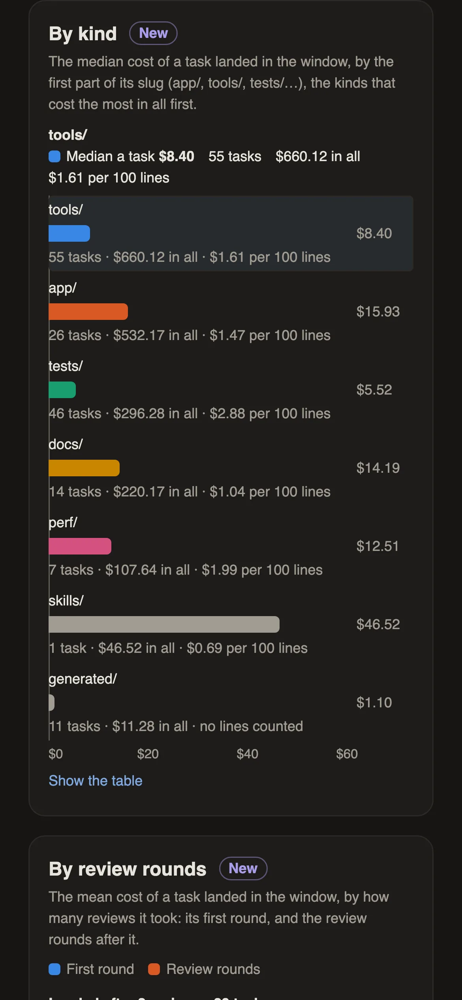

    **A.** Nothing new to keep: the server reads the slug. A slug named loosely groups loosely, and an `inbox/` task that lands without a new name counts under `inbox/`.

    **B.** A field on the board, a choice when a task is filed (`just tasks add`, the page's form, the orchestrator's skill), and a migration of the board's schema. The tasks landed before it have no kind and count apart.

    **Earlier verdicts checked.** No card says what a task's kind is.
  [2026-11-23 13:02] owner · approved — B
  [2026-11-23 13:07] agent — Recorded: B. A task's kind is a field of its own, chosen when it is filed from a short list (feature, fix, red, tests, docs), and the slug is no longer read as one. The filer names it (just tasks create --kind, the board API, the create-task skill, the red filer), an orchestrator names one for a task the owner filed from a page as it briefs it, and the tasks already on the board keep none. It is kept among the task's own board fields, as an experiment's arm is, so the board's schema version stays 28 and it owes no consumer note and no release run. A landed task without one is drawn under No kind, grey and last. By kind and What the build needs above now say so.
  [2026-11-23 13:07] agent · resolved

### The fourth chart

The fourth chart draws every task landed in the window as a dot, in its kind's colour, its cost
with its subtasks against the lines its landing changed, both on a log scale: a dot above the
others cost more for its size. A tap names the task, says its cost, its lines and its cost per
100 lines, and links its page; its table lists every dot. A task that changed no counted line
(the regenerator's, a landing that changed nothing) has no dot, and the chart says how many. A
count of the tasks by cost band was set aside: the median and the p90 above it say most of what
it said.

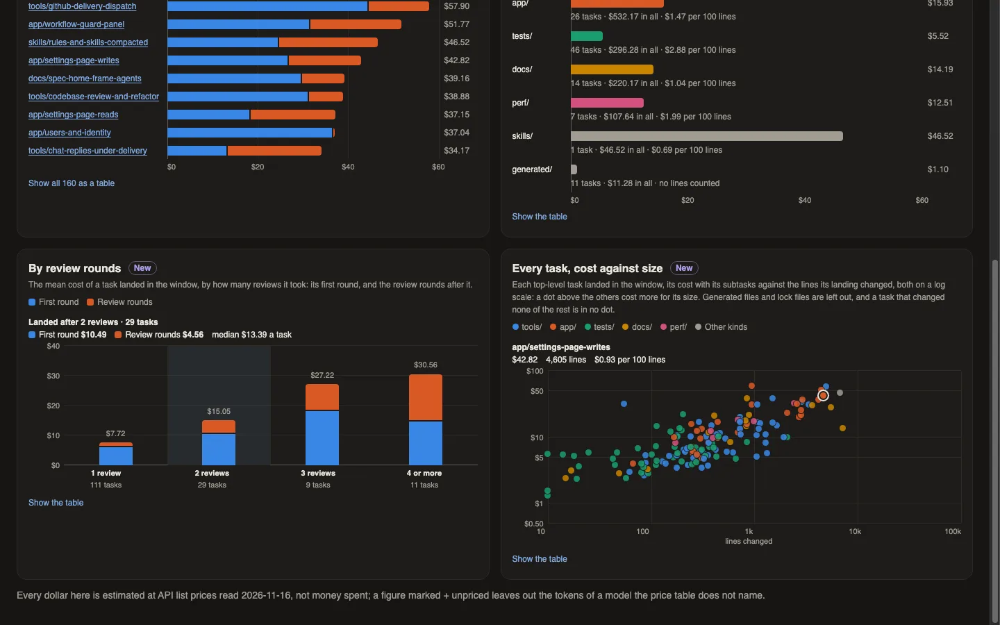

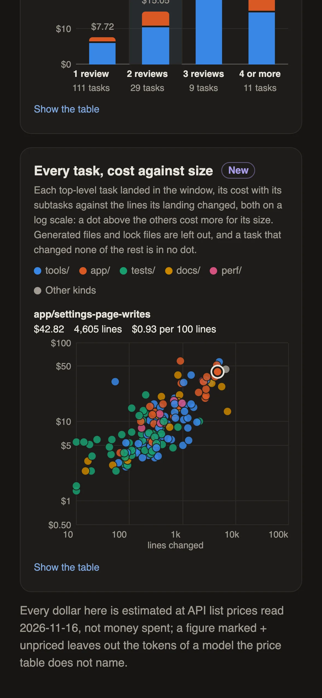

- [r] **reports-landed-fourth-chart** — The fourth chart of the landed tasks' view would show their cost task by task. A: how many cost under $2, $2 to 5, and on to $40 or more, by kind. B: every task as a dot, its cost against the lines its landing changed, so the cost of a line shows for each task and a task dear for its size stands out; a tap names it and links its page. Recommended: B. Approve and say A or B in the note, or comment. [[analysis/reports-landed-cost#The fourth chart]]
  [2026-11-23 12:50] agent — Posted for the board task `inbox/improve-cost-and-token-usage-reports`. Both drawn by hand from this board's last two days, A as the section's last chart:  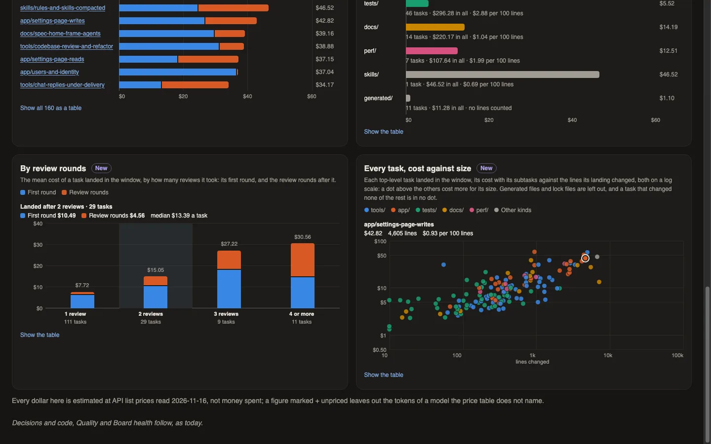

    **A.** A column chart, the kind the view needs for review rounds anyway. It says how the costs spread, which the median and the p90 above it say in part.

    **B.** The cost of a line task by task, which you asked for, and the outliers by name. It is a new kind of chart for the page, with a dot to tap rather than a column, harder on a phone, and a task that changed no counted line (the regenerator's, one that changed nothing) has no dot.

    **Earlier verdicts checked.** No card decides the charts of a view of tasks.
  [2026-11-23 13:01] owner · approved — B
  [2026-11-23 13:02] agent — Recorded: B. The view's fourth chart draws every task landed in the window as a dot, its cost against the lines its landing changed, both on a log scale; a tap names the task and links its page. The count of tasks by cost band is set aside, and a task that changed no counted line has no dot, the chart saying how many. The section above this card now says so.
  [2026-11-23 13:07] agent · resolved

## What the board can compute, and what it cannot

| Measure | Read from | Today |
| --- | --- | --- |
| A landed task's cost, with its subtasks | the day files' `landed`: each top-level task landed, when, and its tokens by role, review round, model and speed | on the wire as a median and the ten dearest; each task's is there to send |
| Its cost by period (median, p90) | the same, by when each landed | the server can sum it into each period |
| All in, by period | each period's estimated cost, which the page reads already, over the tasks landed in it | the count of landings in a period is in the day file (`ReportHour::landed`) |
| Its review rounds | the round of each of its sums | counted, but as "past its first round", which every reviewed task is |
| Its kind | the task's kind field ([by kind](#by-kind)), carried into the day file at its landing | not kept: needs the field, and holds from the build on |
| The lines its landing changed | the git roll-up's read of the default branch, which has each commit's lines and subject (`crates/symphony/src/reports/git.rs`) | not recorded: needs a field |

**The lines of a landing** are found by its commit's subject: the squash commit a pull request
lands says the task's slug, and a land's merge says `Merge branch 'SLUG'` (`landing_slug`). The
roll-up would write each landed task's lines into its day file as it writes the hours' lines, so
they hold from the build on: a task landed before has none, is in no figure per line, and the
figure says how many. Joined by hand over the three days recorded, 165 of the 177 landed tasks
found their commit; the 12 others were 11 of the regenerator's, whose only change is the client
distribution the counts leave out, and one landing that changed nothing.

What no figure can say:

- **A Codex session's tokens**, which no hook records: a task a Codex agent worked looks cheap.
- **The orchestrators' tokens**, which are on no task: they are in **All in** alone.
- **A session's last answer**, after its last tool call, which no beat reads: a few in a
  thousand of a long run's tokens, a few in a hundred of a short one's.
- **Tokens recorded before the hours were told** (from 21 Nov here): a task landed early carries
  them, the hours do not. Over the three days the landed tasks' own cost is $2,100.78 and every
  hour's together $2,037.97, so **All in** reads low until the window starts after that day.
- **Lines as a measure of work.** A deletion, a moved file, a test and a page of prose each count
  a line. A figure per line compares a kind with itself over time better than one kind with
  another.
- **Work that did not land**, cancelled or still open, is in no task's figure, only in **All in**.

## What the build needs

One task, filed from this one:

- **The board's kind.** A board field, `fields._board.kind`, written as an arm is
  (`crates/tasks/src/arm.rs`): the task's own fields already hold it, so it is no schema step.
  `schema::VERSION` stays 28, every build of the contract reads and writes the board as before,
  and it owes no `board` consumer note and starts no release run at once ([the board is a
  contract](../../workflow/CHECKS.md#the-board-is-a-contract)); a build without it keeps the field
  as it keeps every board field. The list is held in code. It is taken by `just tasks create
  --kind`, a new `just tasks kind SLUG KIND`, the board API's create (an optional field) and the
  red filer, shown on a task's page and in `tasks show`, and named by the create-task skill
  (`crates/symphony/shipped/skills/`), which a project takes by running `symphony init` again, so
  it owes no `init` note either.
- **The day files.** Each landed task's lines (added, removed), written by the git roll-up beside
  the hours' (`crates/symphony/src/reports/git.rs`), and its kind, read from the task where the
  board's replay writes the landed tasks (`crates/tasks/src/reports.rs` `landed`,
  `symphony_api::reports::Landed`). A day file written before has neither.
- **The reports read.** Each period's landed tasks summed (how many, the median, the p90, their
  cost and lines) for **Over time**; for **Landed tasks**, a read of its own when the tab opens:
  the window's figures, the dearest ten with their two parts, by kind, by review rounds, and
  every task's row (slug, kind, cost, its two parts, lines), which the dots draw and the table
  lists, as a window of 12 weeks can land a few thousand tasks (`crates/tasks/src/reports/spend.rs`,
  `symphony_api::report_page`). **Back after review** counts the tasks with a round past the
  second, in place of `again`, in `just tasks stats` too.
- **The client.** The two tabs, the address naming the one shown; a chart of bars by row, one of
  columns by category and one of dots beside the time axis's (`chart.tsx`, with no charting
  library, as now); the sentences and the list removed (`reports.tsx`).
- **The documents.** [REPORTS](../REPORTS.md#tokens-and-cost) and its pictures,
  [where the tokens go](../../workflow/TASKS.md#where-the-tokens-go) and the kind among a task's
  fields ([TASKS](../../workflow/TASKS.md#tasks-and-roles)), the board API's create
  ([BOARD_API](../../engineering/BOARD_API.md)), and the day files' format ([reports and
  monitoring](reports-and-monitoring.md#the-day-files)).
