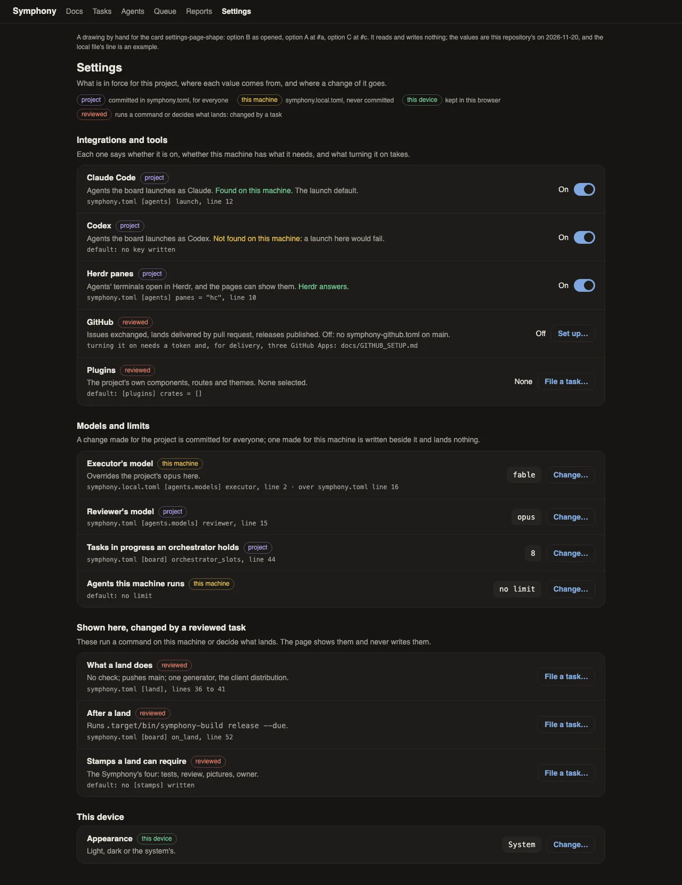
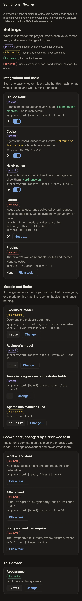
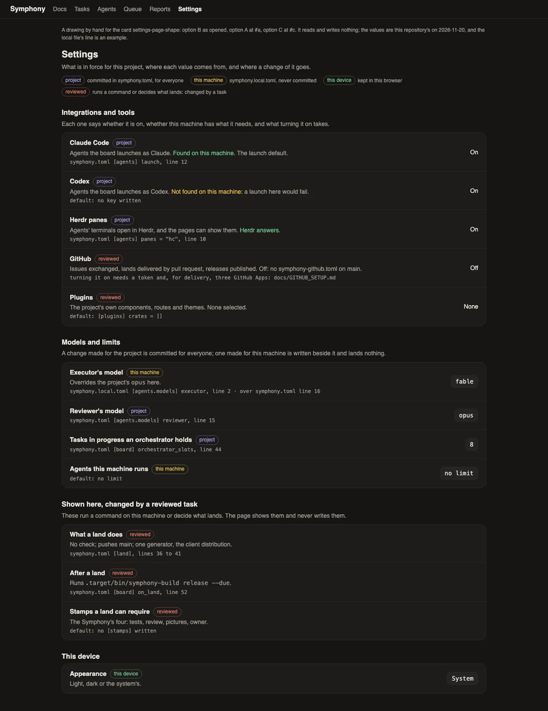
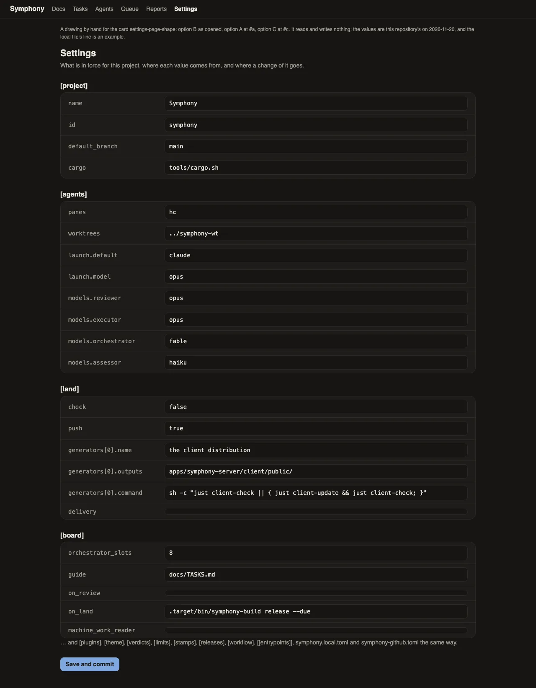

# A Settings page

A concept, not a design to build from: what a Settings page that turns a project's integrations
and tools on and off would be, questioned against the settings the Symphony has now. Nothing in
the product changes with it. Its choices went to the owner as cards over two rounds, and all five
are answered: [the page shows everything in force and writes the preferences
alone](../../DECISIONS.md#settings-page-shape), [a project-wide change is committed straight to the
default branch](../../DECISIONS.md#settings-page-project-save), [each thing on the page describes
itself](../../DECISIONS.md#settings-page-entries), [every preference the page changes is kept in
the board first](../../DECISIONS.md#settings-board-store), and [an agent that is off is refused at
launch and not offered](../../DECISIONS.md#settings-agent-off). Nothing is left to choose.
[What is built, and when](#what-is-built-and-when) names the tasks.

It is one of three concepts filed together, with blueprints (the board task `app/blueprints`) and
users and identity (`app/users-and-identity`); [how they meet](#how-it-meets-the-other-two-concepts)
says what each needs of this one.

## Today

No page shows or changes a setting. The app's own routes (`symphony_api::SYMPHONY_ROUTES`) hold no
settings route, and no save route (`symphony::save::ROUTES`) writes a settings file. A setting is
changed by an edit of a file, by `just symphony-cli model` for the models and the launch agent,
or by `symphony init` for the agents' files.

### Where a setting lives

| Place | Whose it is | What it holds | Who writes it | When a change holds |
| --- | --- | --- | --- | --- |
| `symphony.toml`, committed ([PROJECT_FILE](../../operations/PROJECT_FILE.md)) | the project, on every machine | 14 tables: the project's name and routes, plugins, theme, agents and their models, limits, the board's commands, the landing, the stamps, the workflow, releases | a hand edit; the model command | the board reads its limits, launch agent and models from the main checkout's file as it is on disk, and the stamps from the commit; the server reads the file again when it changes |
| `symphony.local.toml`, beside it ([the local settings file](../../operations/PROJECT_FILE.md#the-local-settings-file)) | one machine | the launch agent, the role models and `[limits]`, over the committed ones | a hand edit; the model command with `--local` | at once; nothing lands |
| `symphony-github.toml`, committed ([GITHUB](../../operations/GITHUB.md#turning-it-on)) | the project | whether the GitHub exchange is on, the repository, what is exchanged, where each token file is | a hand edit | once the default branch commits it: the program reads it from git's objects, never a checkout |
| `.claude/settings.json`, `.codex/rules/`, the skills and `symphony.just` | the project | what an agent's session may run without asking, its hooks, its skills | `symphony init`, which keeps its stamped files current | at an agent's next start |
| The machine folder | the machine | the registry of projects, the installed releases and `current`, the server's record | `symphony project add`, a release's refresh | at once; the server watches the folder |
| The server's state for a project | the owner, on that project | the queue's postponed order and such view choices | the pages | at once |
| The browser | one device | the appearance, a remembered filter | the pages | at once |

Three things follow from the table.

- **A setting has a scope**, and there are three a person meets: the project (committed, the same
  for everyone), this machine (never committed) and this device.
- **Two lists already sort the project file's keys by risk**, and they are the same list. A key
  that holds a command or a program the Symphony runs, or decides what lands, is refused in the
  local file (`PROTECTED` and `PROTECTED_KEYS` in `crates/tasks/src/local.rs`), and a change of
  it needs a reviewer where any other change of a value lands on the settings check alone
  ([the settings check](../../operations/PROJECT_FILE.md#the-settings-check), [needed
  stamps](../../workflow/TASKS.md#needed-stamps)). The reason is said once there: a file no commit records
  must not change the landing gate or run a command.
- **Nothing answers "what is in force, and why" for the whole of it.** `just tasks limits` does
  for the limits, the launch agent and the models, naming the file and the line of each.
  `symphony-github status` does for the exchange. For the rest a person reads the file and the
  reference.

### What on and off mean today

The request names GitHub, Claude Code, Codex and Herdr. None of them is a switch of one shape.

| Thing | How it is on today | What off would mean |
| --- | --- | --- |
| GitHub | `enabled = true` in `symphony-github.toml` on the default branch, with a repository, a token file outside the repository and, for delivery, three GitHub Apps and two rulesets ([the setup](../../operations/GITHUB_SETUP.md)). The program is one no other package builds with, and no page runs it. | `enabled = false`, landed: one line. On is a setup of several steps on GitHub and on the machine, most of which no page can do. |
| Claude Code, Codex | Not a switch. `[agents.launch] default` picks which of the two a launch starts when its caller names none, and a caller may name either. `symphony init` installs both agents' files in every project. Whether the program is on the machine is never asked before a launch. | Three different things: the board refuses to launch it, init stops installing its files, or the pages stop offering it. |
| Herdr | `[agents] panes = "hc"`, else `"none"`. The agents page already probes whether Herdr answers. | `panes = "none"`: the one of the four that is a switch already. |
| A plugin | Named in `[plugins] crates`, with a command in `[plugins.process]` or a host that links it. | Its name taken out: the project's components, routes and theme from it stop answering. |

So "enable or disable" covers three kinds of change: a value among a few (`panes`), a name in a
list (a plugin), and a setup that ends in a value (GitHub). A page that offered one identical
switch for all of them would promise more than a click can do for the third.

## Questioning the idea

**Is a page needed?** Yes, for reading before writing. Each of the last settings added came with
its own way to see it (the limits command, the exchange's status), which is the sign that the
whole is hard to see. A project that is not this one has it harder: its people did not write the
reference. The reading half has no risk and no open choice of substance.

**Is it a form over the files?** No. The project file is a contract with a reference, comments a
project wrote beside its values, and tables (the workflow, the hosted database's budget, the
landing's generators) that are designs, not preferences. A form over every key would let a click
change what lands, would lose or have to preserve the comments, and would need a control for
every shape of value. The files stay the source, and a person who wants all of it edits the file.

**What must it never do?** Run a command, or let the browser choose one. Whoever reaches the
server is the owner: it answers this machine and the tailnet peers `tailscale whois` confirms,
and a write is held to its Host and Origin. That is enough for a verdict on a card. It is not
enough for `[board] on_land`, which is a command the machine runs after every land: a page that
wrote it would make every device that reaches the server able to run a program here. The two
lists above already draw this line, so the page takes it as it is: what the local file refuses
and a settings landing reviews, the page shows and never writes.

**What is the smallest thing that answers the request?** A page that lists what is in force and
its source, with a switch or a value for the settings both lists call preferences, written to the
scope the person picks. Everything else is shown with where it is changed.

## The page

The picture is a drawing by hand ([the mockup](settings-page/mockup.html)), with this
repository's values. It has four parts.

- **Integrations and tools.** One row for each thing that can be on or off. A row says its
  state, where the state comes from, and what this machine has of what it needs (Claude Code
  found, Herdr answering, the GitHub program built and its settings read). A preference has a
  switch. A setup has a button that opens its guide, and a reviewed one a button that files a
  task.
- **Models and limits.** The values `just tasks limits` prints, each with its source and its
  scope. The drawing asks which scope a change is for, the project or this machine; by [the
  store's card](#what-the-board-keeps) a change is kept in the board first, with a control
  beside it that makes it the project's.
- **Shown, changed by a reviewed task.** The landing, the board's commands, the stamps, the
  plugins, the workflow: what they are now, in a sentence, with the file and the line.
- **This device.** What the browser keeps, the appearance first.

Every row names its source as `just tasks limits` does (`symphony.local.toml [limits]
machine_agents, line 6`), and a value no file writes says it is the default.

[Its card](../../DECISIONS.md#settings-page-shape) chose this page, B, over reading alone (A) and a
form over every key (C).

## What a save writes

By the answered cards, the page has two writers and three places a value can end up.

- **This device**: the browser, as now.
- **The board**: [its store](#what-the-board-keeps), where every switch and value the page
  changes goes first. It holds at once and nothing lands.
- **The project**: the committed file, by the control beside a stored value that makes it the
  project's.

The page does not write `symphony.local.toml`. That file stays what it is, one machine's override
by hand or by the model command with `--local`, read last, and the page shows a value that comes
from it with its line.

A change of the committed file could reach the default branch three ways.

1. **As the owner's document saves do.** An answer on a card is committed straight to the default
   branch over a private index, never staging the checkout's other work
   (`crates/symphony/src/commit.rs`). A settings save would take the same road: the edit made,
   the settings check run on the result, a red one refused with its file and line and nothing
   written, a green one committed as one commit that says what changed. Where the project
   delivers its land by pull request, a document save is already kept, committed on a branch of
   its own and filed as the owner's task until its delivery is proved ([a document save under
   delivery](../../workflow/TASKS.md#a-document-save-under-delivery)); a settings save would be kept the same
   way, and the page would say it is waiting.
2. **As a task, always.** The page files a task with the one-line change on a branch. Its assessor
   reads it as settings alone, it lands on the settings check with no reviewer, and its
   orchestrator lands it. The change holds when someone lands it, and the board records it like
   any work.
3. **Not at all.** The page writes nothing committed and shows the command or the line to change.

[Its card](../../DECISIONS.md#settings-page-project-save) chose the first. Its gate is the one a
settings landing has now, the settings check, so no change lands with less than it does today;
what it drops is the task around it, and the commit itself is the record. It also means one
committer for everything the pages write, with the delivery case solved once. The answer adds a
place of its own, [the board's store](#what-the-board-keeps).

One thing holds under any of them and is worth saying on the page: the board reads the limits,
the launch agent and the models from the main checkout's file on disk, so they hold from the
write, while the stamps and the GitHub settings are read from what the default branch commits.

## What makes an entry

The request expects more such things to come. Whether the page's list is written
in the Symphony or is declared by each thing decides how those others arrive.

- **A list the Symphony holds.** The page knows GitHub, the two agents, Herdr and the plugins by
  name. A new integration is new page code, and a project's own plugin cannot add a row.
- **Each thing describes itself.** One small description for every entry: its name, what it is
  for, its state and why, what it needs and whether the machine has it, and its settings, each
  with its key, its type, the scopes it may be written in and whether it is a preference or
  reviewed. The Symphony's own things describe themselves in that shape from the start. A program
  such as the GitHub exchange answers it with a command (it already says most of it in
  `status`). A plugin answers it at a seam of the kit, as it answers its components, and the
  client draws every entry with the one component. The page then never learns an integration's
  name.

The second costs a shape to agree on and to keep stable for plugins, which the kit's version
rules cover as they cover a block. It can be built in two steps without waste: the Symphony's own
entries in that shape first, the seam for programs and plugins once it has held for them. A
description declares; it changes nothing and reaches no outside service. A program's is the
answer of one command the server runs to read it, as it runs a plugin's process to read its
components.

The class of a setting is not the describer's to lower: a plugin may mark its own setting
reviewed, and anything it names that the Symphony would run or that decides what lands is
reviewed whatever it says. [Its card](../../DECISIONS.md#settings-page-entries) chose descriptions.

## What the board keeps

The answer on the save's card adds a fourth place to the three scopes: the board's own store,
read before the settings file, with the file used where the store has no entry. It fits, and it
solves three things the files cannot.

**The order a value is read in.** The Symphony's default, then the committed project file, then
the board's store, then the local file. A board that was never told anything has no entries, so
a fresh clone and every project that never opens the page behave as they do now. The local file
stays the last word, so a person at a machine can always override by hand, as now.

**What it may hold.** Preferences alone. A setting that holds a command or decides what lands is
never read from the store, by the same line that keeps it out of the local file and out of the
page: a place no commit records must not change the landing gate or run a command. A value is
judged when it is written, by the shape rules the settings check applies to the file, since no
landing passes over it.

**What it solves.**

- A change holds at once and waits for nothing. Where a project lands by pull request, a
  committed change waits for its delivery; a stored one does not.
- Each change has a record: what changed, from what, when, and by whom once there are several
  people.
- A hosted board has no checkout beside its server to write a local file in or commit from. Its
  store is the one place a preference can go, and there it is shared by everyone on the board.
- A setting with no key in any file has a home: whether an entry a plugin describes is on, and
  later a person's own choices.

**What it costs.**

- A new table moves the board's schema, which is a landing with a release run of its own and a
  note for consuming projects.
- A stored value is not in a clone. On boards kept on each machine, two machines of one project
  can differ, as they can with a local file today. The page's source line says where each value
  comes from, and a stored value has a control that commits it for the project.
- One more place for the one reader of the settings to read.

**Which preferences go there** had three answers.

1. **Only those with no key in a file.** A model, a limit or the panes setting is committed, as
   the save's card chose; the store holds what a plugin's entry adds and, later, a person's own.
2. **Every preference the page changes, first.** A switch or a value is stored and holds at once.
   Beside a stored value the page offers to make it the project's: that commits it by the chosen
   route and removes the store's entry. The page then has two writers, the store and the
   committer, and no longer writes the local file: on a board kept on the machine the store is
   that machine's, which is what "this machine" meant.
3. **None.** The page commits or writes the local file, and a hosted board's page changes
   nothing project-wide without a repository to commit to.

The second is the one that behaves the same on a local board, under delivery by pull request and
on a hosted board, and it keeps the commit for the moment a person means the whole project.
[Its card](../../DECISIONS.md#settings-board-store) chose it. What follows from the choice:

- **What is stored** is every preference the page has a control for: the launch agent, its model
  and effort, the role models, the limits, the panes setting and [an agent
  off](#turning-an-agent-off). The panes setting has no place in the local file today and needs
  none: the store is where it differs from the committed value.
- **A stored value has two controls beside it.** One makes it the project's: the value is
  committed by the route the save's card chose, and the entry is removed once the commit stands,
  or once its delivery is proved where the project lands by pull request. The other removes the
  entry, and the value in force is the file's again.
- **A stored value stands over a later commit of the same key**, since it is read after the file.
  The page says so on that row, with the committed value it stands over, as `just tasks limits`
  says what a local value is over.
- **One reader.** The board's reader of the settings (`crates/tasks/src/local.rs` and the limits
  beside it) is the one place the store is read, so `just tasks limits`, a launch and the page
  agree, and each names the store as a source.
- **A hosted board's page writes nothing yet.** Its visitors are not the owner, and who may write
  there is the identity concept's to say. The store is built so that it can.

## Turning an agent off

The page has a switch for Claude Code and one for Codex, and neither can be off today: `[agents.launch]
default` picks which a launch starts when its caller names none, a caller may name either, and
`symphony init` installs both agents' files in every project. Off could mean three things.

1. **Refused and not offered.** The board refuses a launch that names it, saying it is off and
   where, and the pages stop offering it. Its files stay installed, so turning it on again is the
   switch alone.
2. **Also not installed.** As the first, and `symphony init` takes its files out of the project
   (its rules, hooks and skill links), which is a change of committed files and so a landing.
3. **Not offered only.** The pages stop offering it, and a launch that names it still starts it.

Under any of them the launch default cannot be turned off: the switch says to pick another
default first. Whether the program is on this machine is shown beside the switch whatever it
says, and a launch of an agent the machine lacks is refused with that reason. Off is a
preference, so it can hold for the project or for one machine.

[Its card](../../DECISIONS.md#settings-agent-off) chose the first. What follows from it and from
the store:

- **The setting** is one more key of `[agents.launch]`, the agents that are off, none written
  being none off. It is a preference by the two lists, so the local file may hold it, the board's
  store may hold it, and a commit of it lands on the settings check alone.
- **The switch** is stored first like every other, so off holds on this board at once, and the
  control beside it makes it the project's.
- **A file that names the launch default as off does not load**, with a line that says to pick
  another default first, and the store refuses the same write. Where a default committed later
  meets an older stored off, the default wins and the page says the entry no longer holds.
- **What is refused** is a start: `just tasks launch`, the staffing pass and a restore of a
  closed pane. An agent already running is not stopped, and the page says how many are.
- **Not offered** means the agents page and the board's launch controls leave it out, and the
  Settings page is the one place that still names it, with its switch.

## Who may change what

Today there is one owner, and everyone who reaches the server is them. The page needs no new
rule for that: preferences are the owner's to set, the rest goes through review, and the review
is what holds when the owner's device is not the one asking.

With several people, the three scopes and the one class line become the places a permission
attaches, with no new sorting:

| What | Today | With users |
| --- | --- | --- |
| This device | whoever holds it | each person, no role |
| This machine, or the board's store | the owner | whoever runs that machine's server; on a hosted board the store is shared, and a role guards it |
| The project's preferences | the owner | a role the identity concept names |
| Reviewed settings | a task and a reviewer | the same, the page never the way in |

## How it meets the other two concepts

**Blueprints.** A blueprint is a set of the same settings given a name. The page meets it in the
source of a value: a value comes from the default, the project file, the board's store or the
local file, and a blueprint is one more layer between the default and the project file. The page's source line
is then where a person sees which values are the blueprint's and which the project wrote over
it, and where "back to the blueprint's" is offered. Two things this concept asks of that one: a
blueprint's settings sort into preferences and reviewed by the same line, so taking a blueprint
that sets a command is a reviewed landing and never a click; and a blueprint lists the entries it
turns on by the names their descriptions give, which is a reason for descriptions.

**Users and identity.** The table above is what this concept hands it: four places a permission
attaches. Three things come back the other way. An identity provider is itself an entry of the
page, and its settings decide who gets in, so they are reviewed and the page never writes them.
A commit the page makes names who asked for it once there is more than one person. And a hosted
board has no checkout beside the server to write a local file in, so "this machine" is a scope
of the local server alone, which is one reason for [the board's store](#what-the-board-keeps).

## Settled by the answered cards

These follow from the five answers and are not asked. What follows from the store and from an
agent off is in their own sections above.

- **GitHub's row.** Its settings decide what lands and what is written to an outside service, so
  both on and off are reviewed: the row says the state and why, opens the setup guide, and files
  a task. The exchange describes itself as every program does, by a command that reads the
  committed settings and what it keeps, and no remote.
- **Where the page is.** At `settings` under the project, a route of the Symphony's own, in the
  header after Reports. Such a route wins over a project's entrypoint of the same name, so the
  landing that adds it says so to consuming projects. What is the machine's (the registry, the
  installed release) stays on the machine's own page, and the Settings page links there.
- **The record of a change.** A committed one is its commit, whose message names the key, the
  old value and the new. A stored one is the store's own record, which keeps each change and not
  only the last, and the page shows a row's changes.
- **The description's shape** for programs and plugins is the one the reading page's own entries
  take, kept stable under the kit's version rules as a block is
  ([its card](../../DECISIONS.md#kit-new-block-version)). A stored switch for an entry a plugin
  describes comes with that task.
- **Who may change the project's preferences** once there are several people is the identity
  concept's to say, at the four places [above](#who-may-change-what).

## What is built, and when

| Task | What it builds | Waits on |
| --- | --- | --- |
| `app/settings-page-reads` | The page, reading: every entry of the Symphony's own in the description's shape, each value with its source, and the reviewed settings shown with their file and line. It writes nothing. | nothing |
| `app/settings-store` | The board's store of preferences: its table, the order a value is read in, a value judged when written, the record of each change, and the store named as a source by `just tasks limits`. No page. | nothing |
| `app/settings-page-writes` | Switches and values for the preferences, written to the store; beside a stored value, the control that commits it for the project and the one that removes it. | the reading page and the store |
| `app/agent-off` | The setting, the launch's refusal, the pages no longer offering the agent, and its switch. | the page's writes |
| `app/settings-descriptions` | Descriptions from programs and plugins: the kit's seam and a program's command, with the GitHub exchange's first. Parked. | the reading page having held its own entries in that shape |

## Not proposed

- A setting the Symphony does not read yet. Each of those is code and a task of its own.
- A change to the settings check, the local file's rules or what a landing reviews. The page
  reads those lines; it does not move them.
- An editor for the workflow, the stamps or the landing.
