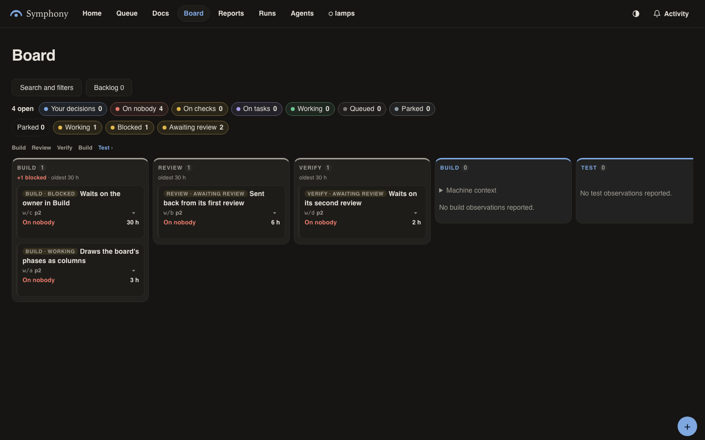
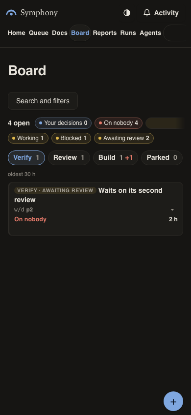
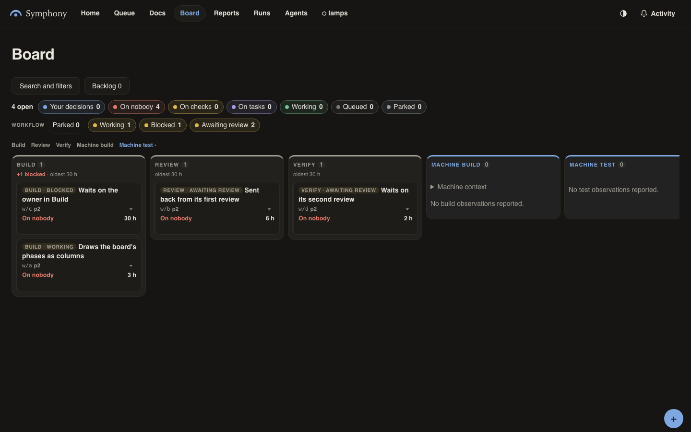
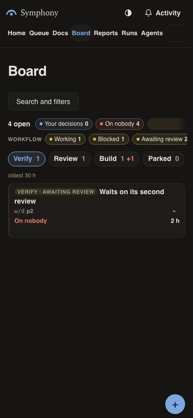

# Workflow definitions

`symphony_api::workflow` supplies additive data types for delivery definitions, positions and
operation requests. `symphony_board::workflow` supplies the strict candidate reader,
normalization, revision identity, host prerequisite checks and grants, built-in definition v1 and
the reader of the project file the default branch commits; `symphony::project::workflow`
re-exports those items at their earlier paths. Existing public structs, Rust calls, task wire
fields, CLI operations and board writers keep their meaning on a board with no custom workflow.
A custom workflow's tasks move through the board's one admission ([below](#admission)), which
`tasks workflow`, three `tasks api` methods (and `workflow_observe`, an approval authority's
report, [guards](#guards)) and the owner's `/api/workflow-apply` reach.

The [project file](../operations/PROJECT_FILE.md#workflow) accepts `[workflow]`: `candidate(text)` reads and
validates that table without activating it, and ordinary project reads accept a definition the
local host supports and refuse any other with `unsupported_activation`, naming what it needs
(`activate::supported_with`, [below](#activation-and-mappings)), and `[[workflow_authorities]]`,
the public keys its guards are verified by ([guards](#guards)). Invalid definitions are refused with
their validation error. `Project::of` reports the refusal through its existing project problem
mechanism. Omission runs the current board implementation unchanged; `candidate` selects the
immutable built-in v1 definition.

The selected activation contract is automatic activation of a valid committed definition when
the board reads it, with complete mappings and prerequisites required, as decided by
[the activation card](analysis/configurable-delivery-workflow.md#configurable-workflow-activation). The board activates
([below](#activation-and-mappings)), admits each operation ([admission](#admission)), answers a
holder's exit ([recovery](#recovery)) and an execution attempt's ending ([attempts](#attempts)),
and keeps its records behind fences on every writer ([records](#records-on-the-board)). A candidate's
validation or a host prerequisite check is not activation. The
[graph design](analysis/configurable-delivery-workflow.md) describes the remaining system:
configured staffing and PULL (`tools/workflow-operations`), local sessions as attempts
(`tools/local-provider-attempts`) and the app's reading of phases and actions
(`app/workflow-actions`) each have a task of their own; a project's approval ledger stays its own,
the board verifying only its signed word ([guards](#guards)); artifact policy receipts and
execution attempts retain their separate ownership. A dependency on an accepted output is admitted
here ([accepted outputs](#accepted-outputs)).

## Activation and mappings

A board activates only what its project's default branch commits: `committed(main, branch)` reads
the project file from the tip of that branch's tree, never the index or a working tree, and a
file that is a link, a folder or not UTF-8 refuses the read. A file with no `[workflow]` is the
board's existing writers. A custom definition carries its revision (the commit and the file's
blob) and its `[[workflow_mappings]]` ([PROJECT_FILE](../operations/PROJECT_FILE.md#workflow_mappings)): each
maps a pair the definition no longer declares to one it declares, once, and never remaps a pair
still declared, since an ID keeps its meaning. A task the existing writers kept starts from
built-in v1's pair of its status (`legacy_pair`).

A capability a definition declares is supported only when the host's `Grants` give it to a
principal, and a principal holds only the capabilities a grant names: the definition's
declaration mints nothing, and an unknown capability fails the prerequisites. A principal is
`symphony_plugin::execution::Principal`, built by the host from what it authenticated (an agent
session by its handle, the local owner, a board service), never read from a request. The local
host's policy is fixed in code (`Host::local`): the local owner holds `owner`, the board's
recovery service holds `recovery`, and the two landing adapters are registered: `default_land`,
the default landing, and `project_land`, a project's own ([external effects](#external-effects)).
A hosted board brings its own
`Host`, built from the principals its ingress authenticated; nothing in a project file or a
request extends it.

Every command that opens a project's live board to write follows the workflow its default
branch commits (`workflow::follow`, `Store::follow_committed`), but `agent-send`, whose message
moves no task and whose program links none of the workflow: a project that commits no
`[workflow]` on a board with none active reads the branch tip and writes nothing, and a
repository without that branch commits nothing. The commit is read with its top tree and the
file in one more read of git, and the board's one read of its active generation answers the
project file that generation was activated from: a commit of that file's bytes, in the same
format, is the active workflow, and no other record is read to say so. A committed definition,
or mappings, other than the active one's is activated, in one transaction fenced on the active
generation, on the version of every task it reads and on the session of each executor or
reviewer it reads as lost, and refused as stale where a task it would read, open or placed, is
one it did not plan when it writes, filed or reopened since its read at the old generation's pair
or at none: a lost holder that beats meanwhile, or that task, is read again by the next plan
(`Store::activate_workflow`). A commit that changes neither, any landing of other files, leaves
the active generation, every task's version and every record as they were, and the active
revision names the commit that activated it. It records the definition under its digest,
places every task a workflow holds and every open task the board's writers keep, records each
move as a transition by the board's activation service and the activation with the mappings it
applied, and moves the active generation to it. A task whose pair, resume pair and status stay
keeps its revision; done and cancelled tasks the board's writers kept stay theirs until a write
of theirs takes one out of done or cancelled (the default landing sends an approved task back to
review, say): that write places it, as its first transition, where built-in v1's pair for the
status it moves to stands on the active workflow, declared or mapped by the activation's
mappings, and is refused, naming the pair, where nothing maps it, the mapping would give it an
outcome, satisfied dependants or a completion, the pair stands for another status, or only
guarded edges enter it ([guards](#guards)). The database
refuses every other write that takes a task with no position out of done or cancelled while a
workflow is active. A new commit of other mappings, another definition (a label) or other approval
authorities (a changed key) is a new generation, which moves no task whose pair it still declares.

The whole activation is refused, nothing written and the previous workflow left active, and the
command says why on stderr and runs on: a capability or adapter the host does not support; a
guard with no approval authority committed for its adapter, a pair a guarded edge enters that a
route reaches without its guards (another edge, the initial pair, a recovery action's target or an
exhausted retry bound), or a guard on an edge an adapter prepares or finalizes
([guards](#guards)); an automatic edge that another automatic edge leaves its pair beside, that
asks for inputs, gives a role, prepares or finalizes an effect or carries a guard (which
admission refuses every taker, the board among them, as the board brings no attestation), whose
retry bound is exhausted to a pair on a cycle through it (reached from where it goes and reaching
where it leaves, by any edge or a recovery action's target, its source's own `attempt_failure`
action aside, which the bound replaces): the count of its takes restarts there, so a lap that
passes it would never run the bound out; or that no authority of
which the host grants the board's recovery service, which alone takes it ([attempts](#attempts));
a retry bound on an edge a caller takes, as the board counts only its own takes;
`landed` dependencies and parent integration; a prepare or finalize of an
adapter the host does not register; a
pair or resume pair neither declared nor mapped; a mapping onto a position recording an outcome, satisfied dependants or a completion its
source lacks; a task it would place, or resume, at a pair only guarded edges enter, unless the task
stood there already under the same guards; a task it would record a transition for (a move, or an
output it supersedes where it stays) or restaff while it has a live execution attempt no cancel
was asked of (`Store::live_attempts`), as that attempt's ending would be pinned to a revision the
task no longer stands at; and a task it would move or restaff while a live executor or reviewer
holds it, whose session may be no attempt: one launched before local terminals were attempts
([EXECUTION_ATTEMPTS](../engineering/EXECUTION_ATTEMPTS.md#local-terminals)), or not by the board's launcher. An
attempt is never rebound to another position: it drains
(let it end) or is invalidated (cancel it, after which no result of it is eligible), and a task
activation keeps where it stands keeps its attempts. Rolling back is a forward activation: of
another committed definition with mappings, or of none
([below](#returning-to-the-boards-own-writers)).

### Returning to the board's own writers

A file that drops `[workflow]` after an activation returns the board to its existing writers, as
the next generation's activation (`Store::return_to_default`, `activate::returning`). Its
`[[workflow_mappings]]` then map onto built-in v1: every task the workflow holds, closed ones
too, goes to the v1 pair it stands at where v1 declares that pair, else to its mapped one, and a
task returning blocked maps the pair it resumes to the same way. In one transaction, fenced as
any activation is, each task takes the status its v1 pair stands for and loses its position; a
blocked one keeps the block record it carried (what it waits on and why) where it has stood
blocked since that record was written, as a workflow's edges never write one, and otherwise
takes one waiting on `parked`, naming the status it came from; the move is recorded as a
transition by the board's activation service, the activation is recorded as a return with the
commit and the mappings it applied, and no generation is left active. The definitions,
activations, transitions and receipts recorded before it stay, and each task keeps the workflow
revision its return made (`fields._board.workflow_retired`), which a later activation or
reopening continues from. A concept, design or review pair is recorded as v1's
held one where the task's executor or reviewer holds it, as the board reads it from then on.

From that write the board is one with no custom workflow: its own commands move, claim, review
and close every task again, `tasks workflow` and the api answer that none is active, and an
operation admitted under the workflow it left is refused. A later commit of a `[workflow]`
activates it as the generation after the return's.

The whole return is refused, nothing written and the custom generation left active, on a pair or
a blocked task's resume pair that v1 neither declares nor has mapped to it; a mapping onto a v1
position recording an outcome, satisfied dependants or a completion its source lacks (unfinished
work mapped to done, say); a live execution attempt no cancel was asked of on a task the workflow
holds, whose ending is pinned to the position the return retires; and a live executor or
reviewer on a task returning to a status where the board's writers keep no such holder
(`activate::keeps`): an executor is kept in concept, design, in_progress and review, a reviewer
in review, and either on a blocked task by the status it resumes to. A lost holder's role row
returns with the task, the board's writers' to recover.

## Admission

Every move of a task a custom workflow holds is one typed operation admitted by the board
(`Store::apply_operation`, `symphony_board::workflow::admit`), whatever surface sends it: `just
tasks workflow apply SLUG EDGE --revision N`, the `workflow_apply` api method, the owner's
`/api/workflow-apply`, or a linked Rust caller. Each carries a guarded edge's attestations
(`--attestation FILE`, `attestations`, `Store::apply_attested`), which every route verifies alike
([guards](#guards)). The principal is the host's, never the request's:
the CLI and the api bind the agent session the call names, which must be on the board and not
have left, and refuse the owner, who acts from the Symphony as the local owner. An
`OperationRequest` fences the caller's intention, not its authority.

Admission reads the active workflow, the task, its role rows, the tasks it depends on and the
key's receipt in one read, then refuses, by its code, in this order: a request naming another
project than the board's, or a task no workflow holds (`unknown_id`); a request whose digest, generation, workflow revision or pair is not the task's now
(`stale_workflow`, `stale_activation`, `stale_task`); an edge the definition does not declare, or
one that leaves another pair (`unknown_id`); an automatic edge, which the board's recovery service
alone takes on an attempt's failure ([attempts](#attempts)), and, for that service, any other
(`unsupported_writer`); a parent integration, or a prepare or finalize of an adapter the host
does not register (`unsupported_adapter`); a guard its attestations do not meet ([guards](#guards):
`guard_unavailable`, the board's own take bringing none, or `unknown_id` for an attestation of a
guard the edge does not carry); a
human wait taken by anyone but a person (`human_wait`); a principal meeting none of the edge's
authorities (`unauthorized`); an input the edge does not declare (`unknown_id`), one it declares
and the request lacks, an `acquire_role` taken by anyone but an agent, a resume to a pair other
than the one its block saved, or, where its block saved none, to a pair a guarded edge enters
(`explicit_action_required`); on an edge no guard binds, an input
revision naming anything but the accepted output of a task it depends on, for an edge depending on
`accepted_output`, as the board records no other (`stale_input`); a dependency predicate not met
(`dependency`), and for `accepted_output` an output the request does not name
(`explicit_action_required`) or one other than the output standing (`stale_input`); and a start
past the project's cap (`capacity`). Last come a guarded edge's attestations, each checked against
the operation: one for another principal (`unauthorized`), one binding other input revisions
(`stale_input`), and any other that fails (`guard_unavailable`).

A task role is held on this task: a holder of its row, or, by an edge that takes the role, a
session no other holder or reservation stands against, its own reservation consumed. A
reviewer's role, by holding or taking it, is a fresh session's (RULES.md
`workflow/reviewers-not-the-owner`): never one that executed the task or work under it, filed it,
or orchestrates or orchestrated it, whatever the graph says. A capability is held only by a
principal the host's grants name. A `done` dependency is met by a task the workflow holds at a
position that satisfies its dependants, or one the board's writers keep in done; an
`accepted_output` dependency by the output standing for it, named
([accepted outputs](#accepted-outputs)); a dependency not on the board meets nothing.

The write is one transaction that checks again everything the decision read: the active
generation and digest, the task's version, each dependency's version, each role relied on, no
other holder or live reservation of a role taken, the key unused, the agent on the board, the
cap's counters, and the state the board accepted from each approval authority a guard was met at.
A reservation past its expiry, or held by a session lost or gone, stands against no claim: the
write drops it, fenced on that session's beat as it was read. Anything moved since reads and decides again, so a request the board moved past
is refused as stale, never replayed on where another left the task. The write records the
transition and its receipt, drops and adds the role rows its effects name, records a guarded
edge's admission, puts the task at its pair and projected status, settles its hold when its status
moves, and posts `took EDGE (SLUG@REVISION): FROM → TO, workflow revision N` on its thread, naming
the attempt whose failure it answered for an automatic edge, then `HANDLE joined as ROLE` for each
role the edge gives, as the board's own join says it, so every reader of who held the task's roles
(a fresh reviewer's rule among them) reads it there. It answers the transition's id, its effects and the
principal's next actions. A key is its principal's: a request repeating it answers the first
result when it is the same request, whatever attestations come with it, and is refused when it is
another; `tasks workflow apply` sends the receipt's request again when its command is repeated.

`Store::workflow_actions` previews each edge leaving the task's pair with what stops the principal
taking it now, its authority named without saying who holds it: never a permit. A guarded edge
always previews `guard_unavailable`, as only an attestation given with the operation meets it.
`Store::workflow_read` answers the active definition, revision and generation. A task filed while
a custom workflow is active starts at the definition's initial pair, its first transition
recorded in the write that files it, and a filing that asks for another status is refused. A
filing is written as the board's own first, so a board with no workflow files it in one write as
before; that write refuses itself where a workflow is active, and the task is filed again at the
initial pair.
The board's own writers neither move nor staff a task the workflow holds: a move, verdict,
block, close, `Store::claim` (the api's claim) or takeover of its executor or reviewer refuses as
`explicit_action_required`, naming `just tasks workflow actions`, and a status written past them
meets the database's fence with the same code; a release and a leave go by the position's
recovery ([below](#recovery)). The orchestrator's role and a reservation stay the board's
coordination, which its writers keep: a launch reserves held work for the session it starts, and
admission honours that reservation, and consumes it, when the session takes the edge. The
board's block of a dependant whose prerequisite was cancelled leaves one to its edges' dependency
predicates and its position's policy. `just tasks claim`, PULL, `next`, the launcher, staffing,
the cap, the alarm and the sweeps read a held task by its position and edges
([Operations](#operations)).

## Accepted outputs

A task's accepted output is the identity of the transition that accepted it, `SLUG@REVISION`:
the one an edge records when it moves the task to a position that satisfies its dependants from
one that does not (built-in v1's approve, covered close, subtask completion and land), or between
two that do where none stands (a task filed at an initial pair that satisfies them, or one whose
last transition was recorded before accepted outputs were). The board
mints it, so it is never a caller's claim, and the transition record keeps it, never changed, as
its `accepted`. It stands while the task stays at positions that satisfy dependants: every later
transition there carries it, an edge's, an activation's mapping or a recovery's stay. A move to a
position that does not satisfy them supersedes it (a reopen, a rework, an activation whose new
definition no longer has the pair satisfy them, which records that as a transition that moves
nothing), and none stands until an edge accepts the task's output again, under a new identity. A
mapping or a recovery never accepts one, and a task the board's own writers keep, done before the
activation or not, has none.

An edge depending on `accepted_output` is taken only on the output standing for each task its task
depends on, each named in the request's `input_revisions` under that task's slug: none standing is
`dependency`, one not named is `explicit_action_required`, and one other than the output standing,
superseded or never accepted, is `stale_input`, so a caller that read an output a supersession
replaced never takes the new one unread. The receipt keeps the request, and with it the outputs it
took. The write is fenced on each prerequisite's version (held `FOR SHARE` in PostgreSQL), so a
supersession and an admission racing from one read let one of them win: a supersession written
first makes the admission decide again and refuses it, and an admission written first took the
output standing then. What a supersession does to a dependant already admitted or delivered is
not this check's (`tools/workflow-revision-guards`). `just tasks workflow actions SLUG` prints the
task's own output standing and, where an edge leaving its pair depends on accepted outputs, the
one standing for each task it depends on, which `workflow apply … --accept SLUG=OUTPUT` names.
The board's claim names the ones it reads (`just tasks claim`, a launch, the staffing pass), and
it and `workflow actions` take them from the read that gave the revision they name
(`Store::workflow_actions_with_outputs`). PULL and the staffing pass find such an edge open by the
outputs standing too ([Operations](#operations)).

## External effects

An edge whose effect is `prepare` or `finalize` changes something outside the board (a merge), and
is taken only through its adapter's boundary (`symphony_board::workflow::effect`,
`Store::prepare_effect`, `dispatch_effect`, `finalize_effect`), never by a plain operation: an
operation naming one is refused as `explicit_action_required`, so a prepared effect never completes
on a caller's word. The refusal names what takes the edge where a command of the board's does
(`just land SLUG` for a landing's adapter, the default's or the project's own), and a task's next
actions list the edge with that code for every principal, so `just tasks workflow actions` says it
is taken by `just land SLUG`, never applied. The host registers each adapter by name (`Host::adapters`), and the adapter
itself answers what its system holds (`effect::Adapter`): its bindings as they are now, and the
result of an effect it reads back.

- **Prepare** admits the prepare edge as any operation is admitted and, in the same write as its
  transition, records the effect's intent (`['intent', SLUG, REVISION]`, the workflow revision the
  prepare made, which is the operation's key from there on): the adapter, the request's
  idempotency key and principal, the workflow generation and digest, and what the effect is bound
  to: the project and task, the repository, the pull request where there is one, the exact head,
  the revision of the landing policy, the revision of the evidence as read, and the destination.
  The same key again answers the same intent, and with other bindings is refused.
- **Dispatch** comes before anything is sent. The intent stands only while the task is still at
  the revision the prepare made, under the generation that admitted it, with every binding the
  adapter reads now equal to the one recorded, and with each guard that brought the task into the
  pair it was prepared from still standing ([guards](#guards)). Otherwise it is withdrawn, for good, and the
  dispatch refused as `stale_input` naming what moved, as a finalize that meets it withdrawn is: a task taken out of its prepared pair by
  another edge cancels its reservation this way. An adapter then checks the real head once more
  as it acts, by merging the bound commit itself and never a branch name.
- **Finalize** takes the finalize edge only on a result the adapter read back from its system
  for an intent that was dispatched: with none, it is refused, and no receipt a request carries is
  believed. The result (the merge commit) is recorded on the intent and given as the edge's
  `receipt` input where it declares one. Asked again, it answers what it recorded and takes no
  second transition, so a process killed between the effect and this step is finished by the next
  one that asks, under the same intent.

An effect that happened is recorded whatever moved while it was in flight, as it was authorized,
with the recovery it owes said to the orchestrator on the thread and kept on the intent
(`recovery`). Where the landing policy or the evidence was another when the effect happened than
when it was prepared, the finalize edge is still taken, since the task did land, and the record
never says the policy now in force accepts it. Where the task left its prepared pair, the
workflow was activated again or left the board, or the edge refuses its principal, the result is
recorded and no edge is taken: a person recovers the task by its graph, and a later finalize by
who may take the edge takes it.

**The default landing** (`just land SLUG`, [TASKS](TASKS.md#the-default-landing)) is the adapter
`default_land` (`symphony_board::land::adapter`). On a task a workflow holds it lands by the
graph alone: it takes the `prepare_land` edge of `default_land` leaving the task's pair, and
refuses, before anything is merged, a task at a pair no such edge leaves. The stamps the task
needs are read at its tip by the board's readers, as for any land. Its review is read from the
workflow: an approve edge writes no verdict message, so the approve standing is the task's last
review transition, and the head it read is the `head` input of that transition's request, kept on
its receipt (`Store::reviewed`); a tip that is not that head is refused before the prepare. The
landing binds the repository's common folder, the branch's tip, the project file the default
branch commits as the policy revision, a digest of the stamps needed and standing with that
review as the evidence revision, and the default branch. After the merge it reads back its own
record of it, a merge of the bound head the default branch holds, and finalizes with that commit.
A land run again finishes an interrupted one from its intent, merging nothing twice. The evidence it reads back is judged by the stamp catalogue
the merge's first parent commits, as the policy revision is: the main checkout's head holds the
branch's own project file by then, and a branch that changes `[stamps]` owes no recovery for its
own change. A managed
task is not delivered by a pull request (`[land] delivery`) yet.

**A project's own landing** takes the same three calls under the name `project_land`, with an
`effect::Adapter` of its own that reads its repository and pull request: its `land` recipe decides
its evidence and policy as before, and the board holds it to what it bound.

A guard on the prepare or finalize edge itself refuses the activation: an adapter takes those
edges, and no attestation comes with them. A project guards the edge that brings a task into the
pair its prepare leaves (the approve, say), and each dispatch rechecks that guard
([guards](#guards)).

## Guards

A guard is a decision the project keeps in its own approval ledger, which an edge needs before it
is taken: a person's approval of a design, say. The board never holds the ledger and never decides
a guard. The project's approval authority signs what its ledger decided, and the board verifies
that signature by the key the project commits and admits the edge only on that word
([the decision](analysis/revision-bound-transition-guards.md#revision-bound-project-guards),
[the analysis](analysis/revision-bound-transition-guards.md)). What it asks of a project, in
plain words:

- **It holds a signing key.** The project runs an authority over its ledger that holds an
  Ed25519 signing key; its secret half never enters the repository, the board or a request.
- **It commits the public half** in `[[workflow_authorities]]`, one for each adapter its guards
  name, with the issuer it signs as and the explicit `[project] id` it signs for
  ([PROJECT_FILE](../operations/PROJECT_FILE.md#workflow_authorities)). A guard with no authority committed for
  its adapter leaves the workflow unsupported.
- **A changed key is a new generation.** A changed key, issuer or authority is a commit of the
  project file, so a new activation generation: every attestation made for the previous one stops
  at once.
- **It reports its ledger's state.** The authority signs observations of where its ledger stands:
  an epoch (one run of its numbering), a generation that rises with every decision that could
  change an answer, and a digest of that state, each naming the state it follows (none for its
  first). It hands each to the board: `just tasks workflow observe FILE`, the `workflow_observe`
  api method or `Store::observe_authority`. Whoever passes it on adds nothing: the board checks it.
- **It attests each operation.** For an operation the ledger allows, the authority signs an
  attestation of contract 1: the project, task, guard, edge, workflow digest and activation
  generation, the task's workflow revision and the pair it is taken from, the input revisions it
  covers, the principal (its kind, issuer and subject), its result (`pass`, `refuse` or
  `unknown`) with the ledger facts a pass rests on and the reasons for another, the epoch and
  generation it was decided at, and its time: issued no more than 30 s ahead of the clock of the
  machine that decides, whatever clock a caller pins for the board (`TASKS_NOW`), expiring at most
  900 s after it was issued, on that clock too. The caller gives it with the operation, or, from
  the app, the host asks for it.
- **The app asks for it.** A plugin the project selects may answer for the authority by its
  adapter ([PLUGIN_PROTOCOL](../engineering/PLUGIN_PROTOCOL.md#approval-authorities)). When the owner takes a
  guarded edge from the app with no attestation given, the Symphony asks that authority for each
  guard, for the operation the request names, the project the activation recorded and the owner,
  ten seconds at most, and gives the board what it answered unchanged: the board verifies it as
  below, so the plugin adds no trust. An authority that errs, panics or does not answer in time
  refuses the operation as `guard_unavailable`, naming the guard and why, and moves nothing; a
  guard no plugin answers is refused as one taken with no attestation. Nothing is kept: each
  operation asks again. The board's command line links no plugin and takes the attestation as a
  file (`--attestation FILE`).

The board accepts an observation only signed by the committed key, under the observation's own
domain (a signature over an attestation's bytes is none), from an authority the active
activation commits, and following the state it accepted before: the same state again changes
nothing, a generation is never lowered within its epoch, a new epoch starts only from the accepted
state, and nothing is skipped. Another state at the accepted generation marks the authority in
conflict, and nothing it attests is admitted until it reports a state following that one. A
refusal names the accepted state the authority reports again from.

A guarded edge is admitted only with one attestation for each of its guards, each verified by the
committed key under the attestation's domain and covering exactly the operation taken: the
project the activation recorded (never the one a request names), the task, guard, edge, workflow,
activation, workflow revision and pair, the principal the host bound (else `unauthorized`), the
request's input revisions exactly (else `stale_input`), a pass resting on at least one fact, in its
time, at the epoch and generation the board accepted from its authority now. Everything else fails
closed as `guard_unavailable`: no observation accepted, a conflict, a refusal, an unknown, an
attestation that does not verify or covers another operation, or one decided at an older
generation (a decision revoked since) or a newer one (its observation not yet given). An
attestation for a guard the edge does not carry is `unknown_id`, and two for one guard are refused.

The write is fenced on each authority's accepted state it checked, and counts each admission on
that authority's record: an observation accepted between an admission's read and its write makes
the admission decide again on the new generation, and an admission between an observation's read
and its write makes the observation decide again, so a revocation and an admission never pass
each other. The write records the admission (`['admission', SLUG, REVISION]`): the transition, the
principal, the input revisions, and each guard met with its attestation and the authority's
state, the board's audit of what it admitted, never an approval. A request repeating its key
answers its first result and admits nothing again.

An effect that cannot be taken back is checked again right before it. An external effect's
dispatch (`Store::dispatch_effect`, which the default landing and a project's landing call before
they merge), when its prepare left a pair the active workflow's guarded edges enter, finds the
transition that last entered that pair: it goes back from the prepare past each transition that
stayed in the pair (an edge or a recovery from it to it, such as a holder's release that keeps the
task there, an activation that kept it there, and a block from it with everything up to its resume
back) to the one that entered it from another pair (`guard::entry`). That transition's admission
must have met each guard the pair's edges carry, and each must still stand: its authority still
committed with the key that verifies the attestation it recorded, and the board still accepting
the very state it was met at, not in conflict. A decision revoked since moves that state, so the
intent is withdrawn and nothing is merged; so is one whose record holds no such transition, or no
admission of it, as nothing is dispatched on a guard no record says was met. The attestation's own
time was held when it was admitted: a land comes whenever it runs, and the authority's state is its
current word. A prepare that leaves a pair no guarded edge enters dispatches on its position and
bindings alone.

`Store::revalidate_dispatch(SLUG, REVISION, FRESH)` is the stricter check, for a caller that holds
the guarded transition itself: it refuses unless the task still stands where that transition left
it, under the same activation, and each guard its admission met is met again now, by the
attestations it recorded or by fresh ones covering the same operation, signed, in their time and
at the generation the board accepts now. A decision revoked since, an expired attestation or an
authority in conflict refuses.

A route never goes around a guard. An activation is refused where a pair a guarded edge enters is
reached without its guards: by another edge into it under other guards or none, as the initial
pair, as a recovery's target from another position, or as the pair an exhausted retry bound sends
a task to (a move within a pair and a block's resume are no route in); and an activation's
placement, its mappings or a reopening never puts a task at a pair only guarded edges enter, unless
it stood there already under the same guards. A resume is no route in because admission returns a
task to a pair a guarded edge enters only where its block saved that very pair: a task that came to
the blocked pair by any other edge, or by an activation, saved none, and its resume there is
refused (`explicit_action_required`), so it reaches that pair by a guarded edge or not at all.

The board keeps each authority's accepted state across activations, so a new key goes on from
the state the old one left. A whole-board copy or restore leaves the accepted states behind: its
guards are refused until each authority reports again, as a first report. A restore of the
database's own files would bring back an older accepted state, which only the attestations' expiry
bounds until the authority reports its current one.

## Recovery

A holder's exit from a task a custom workflow holds is answered by the position's configured
action, never by a target the board invents (`symphony_board::workflow::recover`), and written as
an admitted operation is, by the board's recovery service, which the host must grant `recovery`
(`Host::local` does). Three exits come there: an agent's own `just tasks release` of its role
(the position's `release` action), a session's `just tasks leave` (its `lost_holder` action, for
each task it staffs; a session that left already holds only what a manual action kept for a
person, and its leave is refused as any write of a session that left, before any recovery), and
`just tasks workflow recover SLUG HOLDER`, which any session on the board may ask for a holder
whose session is lost or left (`Store::recover_holder`, its `lost_holder` action); a live, stale
or unswept holder lets go of its own.

The action reads the role the position staffs. A role the position does not staff (an executor's
left after its work went to review, a reservation) goes alone, and the position stays as it
was. The staffed role goes when the action releases it; where it does not, an agent's own release
is refused as `explicit_action_required` (an edge takes it out), and a lost or leaving holder keeps
it. Every reservation on the task goes when the action releases them. The task then moves to the
action's target, which clears a block's resume pair, or stays, keeping it: either way a
transition by the recovery service records the move or the stay with what it recovered (the
trigger, the holder, its role) and the slot effect, and a manual action leaves the position marked
until its next transition (`TaskPosition::manual`), its thread line saying it waits on a person.
A move into a position whose slot policy holds a slot, from one that holds none, is counted under
the project's cap as a start is ([Operations](#operations)).

The write is fenced on the active workflow, the task's version, each role it relies on or drops
and, for a lost holder, the holder's session as it was read: a holder that beats again, or takes
an edge first, wins, and the recovery decides again from where it left the task. The orchestrator
role is never a workflow's: a release or leave of it is the board's own. The board recovers a
lost holder by itself as well, wherever it gives open work an orchestrator
([Operations](#operations)), and an execution attempt's ending
by its own proposal ([Attempts](#attempts)).

## Attempts

An execution attempt ([EXECUTION_ATTEMPTS](../engineering/EXECUTION_ATTEMPTS.md)) admitted for a task a custom
workflow holds keeps on its row where the task stood then: its pair and workflow revision. Its
ending is proposed to the workflow by the board's recovery service, which the host must grant
`recovery` (`Store::observe_attempt`, `symphony_board::workflow::recover::observed`): the
coordinator proposes it after its own write that ends the attempt, and a host may propose it
again, as often as it likes, for an attempt whose worker died first.

- An attempt that ended failed or rejected with no cancel asked of it is an attempt failure. The
  automatic edge leaving the task's pair is taken through the one [admission](#admission), as the
  recovery service under the key `attempt/ID`, while its retry bound allows: the board's own takes
  of it, each answering an attempt, are counted since the task last stood at the bound's
  `exhausted` pair, whoever brought it there (the bound, a person or an activation), and a
  caller's take of an edge of that id under an earlier definition counts nothing. At the bound,
  or with no automatic edge, the position's `attempt_failure` action answers it as a holder's
  exit is answered ([recovery](#recovery)), the attempt's session its holder. At the bound its
  target is the bound's `exhausted` pair, where it waits on a person; a position that declares no
  recovery goes there keeping its slot and letting nothing go.
- Admission may refuse the board's take for a reason that can pass: a dependency of the edge not
  yet met, a slot full where the edge takes one, any condition that holds only some of the time.
  The failure is then answered as if no automatic edge left the pair, by the position's
  `attempt_failure` action, whose line says the edge was refused and why; a manual action leaves
  the task waiting on a person under `attempt_failure`. That answer is no take of the board's, so
  it spends nothing of the bound.
- A failure nothing can answer (its position declares no `attempt_failure` action, or that
  action is refused too) is said on its task's thread by the recovery service, once, under the
  key `attempt/ID`: the line names the attempt and every refusal, and it is the failure's answer.
- An attempt whose cancel took (its cancellation confirmed) is answered by the position's
  `cancellation_acknowledged` action, whatever its provider reported after: no result of a
  cancelled attempt is eligible.
- A success, a stop or a supersession proposes nothing, nor does an attempt a later one replaced
  in its lane or that has a successor, nor one admitted before a workflow held its task.

The proposal is decided on the task, the active workflow and the transitions recorded, and
written as an operation or a recovery is, fenced on the task's version, which every transition
moves, so a decision another write overtook is made again. An ending from a pair or workflow
revision the task has left (it moved, was reassigned, or activation placed it elsewhere, whether
the decision or admission's take finds it) is refused as `stale_task`, and one of a task no
workflow holds as `unknown_id`, or `unsupported_activation` where none is active: none of them
waits to pass, so each stays on its attempt, moves nothing and is said nowhere. So does a cancel
whose position declares no action for it, refused as `explicit_action_required`. The transition
records what it recovered (`Transition::recovery`) under the key `attempt/ID`, an edge's and a
recovery's alike, and an ending is answered once: a repeat answers the transition keyed by its
attempt, or, for a failure its thread said nothing could answer, writes nothing, even once the
edge or the action could be taken. Its line on the thread names the attempt and, where it ran out,
the bound or, where the take was refused, the refusal. The line that says nothing answers a
failure is fenced on its key alone, not on the task's version: of two observations of one failure
at once, one may say it on what it read while the other's take, which a prerequisite done in
between let pass, moves the task, and both the line and the transition then stand.

## Operations

The board's operational readers read a held task's declared position and the edges leaving it
(`symphony_board::workflow::operate`), never a state's name or the status a position projects to;
whether a principal may take an edge stays admission's question.

- **Claims.** A claim is an edge leaving the task's pair that gives its taker a role
  (`acquire_role`), whatever operation the definition names it; an automatic edge is the board's,
  never a claim. `just tasks claim SLUG` takes the one claim edge that gives the executor's role,
  at the revision it reads (`Store::claim_by_workflow`), naming, for an edge that depends on
  `accepted_output`, the outputs it reads standing ([Accepted outputs](#accepted-outputs)), and is
  refused as `explicit_action_required`, naming the edges, where none gives it or several open
  ones do.
- **PULL and `next`.** PULL lists a held task by its claims: an executor's claim nobody there holds,
  its dependency predicate met (as admission judges it: `accepted_output` by the output standing for
  each prerequisite at the revision the board read, which the workflow's read takes only where an
  edge depends on one; `landed` never), is ready (red, once red work waited unstaffed) and a
  reviewer's is unreviewed, a live reservation named beside it. A staffed role whose holders are all
  lost or gone is orphaned, saying whether the board recovers it or a person does; a prerequisite
  that ended without success (an outcome of cancellation or failure, or the board's cancelled)
  blocks it, naming its position's `unsuccessful_dependency`; its staffed executor at work is
  executing. `just tasks next` offers a held task whose executor's claim edge admission's preview
  shows nothing stopping, unless another's live reservation stands on it, whatever status the
  claim's position projects to: its read takes those statuses beside the pullable ones, and a task
  no workflow holds only in a pullable one.
- **Settling.** Wherever the board gives open work an orchestrator, it then settles what no
  session asks for (`Store::settle_held`): before `tasks pull` lists anything, in an
  orchestrator's monitor, in a look of `tasks wait`, in a write's detached dispatcher (`tasks
  dispatch`) and on the server's clock, under its give's retry. Each staffed holder lost or gone
  is recovered by its position's `lost_holder` action as the recovery service, once, a stay that
  waits on a person recorded no second time; and a task with a prerequisite that ended without
  success, at a position whose policy is `cancel`, takes the one cancel edge leaving its pair the
  recovery service may take. `block` and `manual` move nothing. A move admission refuses is said
  on stderr each time it is tried, and writes nothing. `agent-send` delivers what it sends through
  the dispatcher's pass but neither gives nor settles, so it links none of admission's write.
- **Launching and staffing.** A launch on a held task starts only a role an edge leaving its
  position gives, refused before anything starts otherwise: its executor reserves the task and
  claims the edge when it starts, and its reviewer takes the edge as the new session, through
  admission, which judges it fresh; no reviewer joins beside another. The staffing pass starts
  the role the open claim edges give, an executor's before a reviewer's, and a reused idle
  reviewer takes its edge the same way.
- **Slots.** A held task holds a task slot, the cap on an orchestrator's open work, while its
  position's slot policy is `acquire` or `retain`, whatever status it projects to: a block that
  retains keeps it, a reviewer's position that acquires counts as work, and a position that
  releases frees it. A move into a position that holds one, from one that holds none, is a start
  the cap refuses past it (`capacity`). The cap reads the active definition's positions in its own
  transaction. A task slot is task WIP, never an execution attempt's capacity.
- **Finished.** A held task is finished at a terminal position: the launcher, cleanup and the
  worktree sweep read that, never a done-looking status, so approved work that projects to done
  keeps its worktree until it is accepted, and an edge into a terminal position closes what was
  launched on the task as `done` does.
- **The pipeline alarm** counts a held task by its recorded transitions, each read by its id:
  every one that changed the status its task projects to is a move from its predecessor's.

## Records on the board

From board schema 24 a custom workflow's records are one `workflow` table in both stores, each a
`kind` and a `body` under a compound id: the active generation (`['active']`), each definition by
its digest, each activation by its generation, and each transition of a task by its slug and the
workflow revision it made (`['event', SLUG, REVISION]`), with the accepted output standing after it
([accepted outputs](#accepted-outputs)), and each external effect's intent by the revision its
prepare made (`['intent', SLUG, REVISION]`, which moves by its stages until its finalize edge is
taken). From schema 26 it holds as well the state the board accepted from each approval authority
(`['authority', ADAPTER]`) and each guarded edge's admission (`['admission', SLUG, REVISION]`)
([guards](#guards)). A task the workflow holds keeps its
position in `fields._board.workflow`: its pair, the pair a blocked task resumes to, the generation
and digest it was last moved under, and its workflow revision, which only its own transitions move.
The position, and the status it projects to, change only in the one write that records their
transition (`symphony_board::workflow::Transition`), from the revision the writer read; of two
writers from one revision one commits, and the other is refused as `stale_task`.

The database holds every writer to that, the board's own writers and its generic field, import
and copy paths included. A write that changes a task's position, or the status of a task that has
one, is refused unless the position is the next revision and the transition recorded for it names
the same pair, resume, generation, digest and status. A position goes only beside the next
transition recorded for its task by an activation recorded as a return, at the status that
transition names, and a task is never put back at a position its later transitions left. A
recorded definition, activation, transition, receipt or admission is never changed, the
generation accepted from an approval authority is never lowered within its epoch, and the active
generation moves forward only to an activation recorded for it. The database fences no deletion
of a record, as the whole-board copy replaces the table: that the active generation goes only in
the write of a return, and that no record is deleted otherwise, is held by the store, whose one
module writes the table, and by `Store::raw`, which refuses it. A board with no custom workflow
holds none of these records, its export is the text it was, and every other write runs as
before. The whole-board copy carries the records before the tasks, so a copy that lost them
cannot restore a task the workflow holds, and leaves the authorities' accepted states behind
([guards](#guards)). A reader one schema behind keeps and ignores the position.

## The app

A board with no custom workflow draws as it always has: its listing names no workflow, and the
client fetches none of what follows, so its seven columns, its phone's tabs and its Build and
Test overlays are those of the board's own writers, and its first visit carries nothing more.

**What the wire carries.** `GET /api/workflow` (`WORKFLOW_PATH`) answers `BoardWorkflow`: the
board's project and its active `WorkflowRead` (definition, revision and generation), or none. A
task the workflow holds carries `workflow`, its `TaskPlace`, on its page and in every listing:
its phase and state IDs, the pair a blocked task resumes to, its workflow revision, and the
recovery by hand it waits on (`manual`: whose `release` or `lost_holder` left it, in which role).
A task the board's own writers keep carries none, and its wire is the text it was.
`GET /api/workflow-actions?slug=SLUG` (`WORKFLOW_ACTIONS_PATH`) answers that task's
`ActionsRead` for the local owner: its `NextActions`, a preview and never a permit, and `takes`,
the accepted output standing for each task it depends on where an edge leaving its pair depends on
`accepted_output` (none standing as null), empty otherwise, both from one read
(`Store::workflow_actions_with_outputs`). A hosted visitor is refused it, as the apply route
refuses one.
`GET /api/workflow-guards?slug=SLUG` (`WORKFLOW_GUARDS_PATH`) answers that task's `TaskGuards`,
the local owner's too: each authority the active activation commits, with the epoch and
generation the board accepted from it, whether it is in conflict, the admissions counted on it
and whether this host asks it (`asked_here`: a plugin of the project answers for its adapter);
each guard the definition declares with its adapter and, where the project commits one, its
authority's `page` filled in for this task; the edges leaving the task's pair that carry guards;
and `entry`, the transition that brought the task into its pair by a guarded edge, with each
guard its admission met, its standing as a word (`GuardStanding`) and what its attestation
said (`GuardRecord`), shown only while it still verifies by the committed key. It reads the
board's records and decides nothing; a board with no workflow answers none of each. A take of
`/api/workflow-apply` that a guard refuses answers `guard` beside its `error`, a `GuardRefusal`:
the guard, its adapter, why as a word (`GuardWhy`) and, from an attestation that verified, what
it said. The error's text is what it was, and every other refusal answers as it did.

**The board.** The [waiting listing](TASKS.md#what-a-task-waits-on) puts a task the workflow holds
in its phase's column, keyed `phase:ID` so a phase never takes a status's key or an overlay's,
unless its machine work puts it in Build or Test; blocked, it stays in its phase, and
`status=phase:ID` selects one there; every other listing counts and selects a held task by its
status, as before. The waiting listing's `waiting` adds `workflow`, the active generation,
absent on a board with none, and `states`, `[state, count]` for the open tasks the workflow
holds, by state ID in its order, counted after search and window and before `wait`;
`wait=state:ID` lists one state's open tasks across their phases, as a wait kind's are. The
server learns the generation from the board's own read, which carries it in its round trip, and
an activation or a return moves the board's marker, so a relabel, which moves no task, and a
return on a board with no task to move still reach the page. The board loads the workflow's
chunk (`apps/symphony-web/src/flow.tsx`) only once a listing names a generation, reads the
definition, and reads it again when the generation moves; a chunk that does not load is said
with its retry, and the board draws its own lanes meanwhile. It draws the phases that are columns
by their `order`, then Build and Test, then any status the board's own writers still hold a task
in; on a phone, a tab for every phase by its `phone_order`; on a desk, a button for each phase
that is no column, which opens it as a list as Backlog opens; and a chip for each state with
open tasks, which chooses its facet, that strip led by the word Workflow; Build and Test read
Machine build and Machine test there, as a phase may be named Build and a state Working. A card
names its place by its phase's and state's labels. The phone tab the board keeps for a project
is the phase's stable key, never its label, so a relabel keeps it, and a phase no longer drawn
falls back to the first tab; the ghost drawn before the board's first read draws that tab, with
the count the phase last had. The state facet chosen is the page's own and is not kept. A
definition the board cannot draw leaves it as its own writers draw it.

- [x] **workflow-board-labels** — On a board a custom workflow holds, the project's own words can match the board's: a phase named Build beside the machine's Build column, a state chip Working beside the Working wait chip. As built, the machine's columns read Machine build and Machine test, and the workflow's chips follow a small Workflow label. A board with no workflow is unchanged.
  [2026-11-20 00:04] agent — Posted for the board task `app/workflow-pages-follow-ups`, at its tip 57ac59eb3; the change is its commit f80b7c2bc. Both pictures are the browser test's board, drawn from main's build at e00700b13 and from that tip.

    **Before**, wide and on a phone:  

    **As built**, wide and on a phone:  

    **What changes:**
    - The machine's two columns, their links in the row above the columns and their phone tabs read Machine build and Machine test.
    - The row of the workflow's own chips opens with a small WORKFLOW label, so its Working and Parked read apart from the wait chips of the same words above.
    - Both only on a board a workflow holds.
    - **Cost:** on a phone the label takes room, so the row's last chip starts at the edge and scrolls.

    **Rejecting it** drops both with one revert, and the board looks as in the before pictures. Other words are a one-line change.

    **Earlier verdicts checked.** **project-workflow-shape** (C) and **configurable-workflow-activation** (B) decide what a workflow may name and when it takes effect, not how the board tells its own columns from the project's words. No card decides these labels.

    Approve to keep it, reject to drop it, or comment with other words.
  [2026-11-20 04:14] owner · approved

**The task page.** A task with a place loads the next-actions chunk
(`apps/symphony-web/src/nextactions.tsx`). It says the place, the pair a blocked task resumes to
and the recovery by hand it waits on, then each action by its label and destination, with the
inputs it needs and, where it is unavailable now, why and whose it is (the authorities the edge
names); an edge a land takes says `just land SLUG` takes it, and one an adapter takes says so, in
place of asking for an explicit action. Where an edge depends on accepted outputs, it names the
output standing for each task the task depends on. Taking one posts its edge, the snapshot the
actions named, those outputs where its edge depends on them (`input_revisions`, from the read the
page drew, never one taken when it is sent) and a fresh idempotency key to
`/api/workflow-apply`, the same key again only for the same request after an answer that never
came. A refusal says its words; a `stale_*` one says the task moved since and offers to read its
actions again, and they are read again whenever the task's revision moves.

Where the definition declares a guard, the page reads the task's guards beside its actions and
draws them (`apps/symphony-web/src/guards.tsx`). Over the actions, *Let in by EDGE · revision N ·
time*, a link to the task's timeline, heads the guards that admission met: `met` while the board
still accepts the state it was decided at, else why it no longer stands (`decided again`,
`conflict`, `unreported`, `uncommitted`, `unverified`), which is why no effect is dispatched on
it. Under each action a guard holds, *ACTION needs* heads a row for each guard its edge carries.
A row is the guard's name, its state in a word, a line saying why, and its authority (the issuer
it signs as, and its adapter) with what the board accepted from it: its generation and epoch,
`none yet`, or `in conflict`. Before any take the row is the board's records: `no word yet`
where taking the action asks the authority, `not from here` where this host cannot ask it, saying
what would (a plugin of the project answering for the guard's adapter) and no command, as the
command line takes an edge as an agent's session and never as the owner, `unreported` with the command that
reports the authority's state, `conflict`, or `uncommitted`. After the owner's take is refused,
the row of the guard the refusal names says it by its word: `missing`, `unanswered`, `refused`
and `unknown` with the authority's reasons, `expired`, `early`, `held too long`, `stale`,
`decided again`, `not reported`, `not yours` or `unverified`. The page keeps that refusal beside
the action only until the task's revision moves or the page loads again: the board records no
refusal, so it shows on no other page, device or session.

The guard's name is the row's link: it opens, under the row, what the board holds for it (the
state it accepted and the admissions counted on it; for a refusal, what the attestation said, its
time and what it covers; for an admission, the transition and who took it). What the authority
itself points at, the facts a pass rests on and its reasons, is drawn as the gates draw a link: a
path of the app in it is a link named for the task, decision, run or document it names, a web
address at its end puts the link on the words before it, marked as leaving the app with its host
beside it, and anything else is its text; nothing an unverified attestation says is shown. The
authority's name links to its ledger's page for the guard where the project commits `page`
([PROJECT_FILE](../operations/PROJECT_FILE.md#workflow_authorities)). An action its guards alone
hold is the owner's to take when this host asks every one's authority, the take bringing its
word; otherwise it waits. The panel shows and links: it has no approval, grant, paste or upload, and the
authority decides in the project's own ledger.

**The timeline and the Agents page.** A task's timeline (`/api/task-timeline`) carries `places`,
one for each transition recorded for it (`Store::workflow_transitions`, a read of its own events'
keys alone), each named by the definition its move was made under, with the status it projects
to, who moved it and by which edge; a task no workflow held carries none. The page draws a Phase
lane and a State lane under the stages, a row for each place on a phone, and the time spent in
each phase and in each state in the heading: the clock's time there, told apart from the
machine's time on runs. The Agents page says a held task's place where it says another task's
status, by the definition's names, which it reads through the board's workflow chunk only once a
task it lists has a place.

**Reports.** On a board that runs a custom workflow, the hourly roll-up's one read says so, and it
then reads each task of its window's recorded transitions too (`Store::report_places`), each named
as the timeline names it; each hour of the day files then carries `workflow`: the task-hours
top-level tasks and subtasks, apart, spent in each phase and in each state, under the label the
move was made under, time at a position that projects to done or cancelled left out
([the day files](../product/analysis/reports-and-monitoring.md#the-day-files)). A board that runs none asks
nothing more and writes the files it wrote before. `/api/reports` sums a period's top-level hours
by ID and label (`ReportBucket::workflow`), and Reports draws them after Flow, time by phase and
time by state in two charts, only while a period of the window records them.

## Definition format 1

IDs begin with a lowercase ASCII letter and contain only lowercase ASCII letters, digits,
`_` and `-`. IDs are case-sensitive and unique within each namespace. Labels are display text
and confer no behavior or authority. The root fields are in the project-file reference.
Every record rejects unknown fields and every enum rejects unknown variants. Optional fields
are omitted in TOML or `null` in JSON; all other fields are required. Empty lists are explicit.

| Record | Fields |
| --- | --- |
| Pair | `phase`, `state`: IDs naming one explicitly declared position; not a Cartesian product. |
| Phase | `id`, nonempty `label`, unique unsigned `order` and `phone_order`, `column` boolean. The default's backlog/blocked/cancelled groups are outside its six delivery columns; Build and Test are separate process overlays. Phone order follows the current board, including backlog. |
| State | `id`, nonempty `label`. These are coordination states, never execution-attempt status. |
| Position | `at` pair; optional `staffing` (`executor`, `reviewer`, `orchestrator`, omission means none); `slot`; `dependencies`; `unsuccessful_dependency`; booleans `accepts_work`, `terminal`, `satisfies_dependencies`; conservative `legacy`; optional `outcome`; `completion`; optional `recovery`. |
| Recovery | Required actions `release`, `lost_holder`, `attempt_failure`, `cancellation_acknowledged`. Every staffed position declares all four. |
| Recovery action | Optional `target` pair; boolean `manual`; `slot`; booleans `release_role` and `release_reservation`. No target means stay and requires explicit manual recovery. A target must be ordinary nonterminal coordination work without outcome, dependency-satisfaction or completion facts; completing work requires a typed edge. |
| Guard | `id`, `adapter`: a decision the project's approval authority for that adapter attests per operation ([guards](#guards)), with no executable expression or cached pass. |
| Edge | `id`, nonempty `label`, exact `from` and `to` pairs, `operation`, optional legacy `alias`, nonempty `authority`, `inputs` ID list, `dependencies`, `guards` ID list, ordered `effects`, boolean `automatic`, optional `retry`, boolean `human_wait`. |
| Retry | Positive unsigned `maximum`, `exhausted` pair with explicit manual recovery. |

`slot` is `retain`, `acquire` or `release`. Dependency predicates are `none`, `done`, `landed` or
`accepted_output`; unsuccessful predecessor handling is `block`, `cancel` or `manual`.
Outcomes are `success`, `cancellation` or `failure`. Completion requirements are `none`,
`landing`, `covered_close` or `parent_integration`. A terminal position declares an outcome and
allows no ordinary outgoing edge, staffing or accepted work. Dependency satisfaction is a
separate declaration: default approved-but-unlanded work retains the existing `done` predicate
without being declared a repository landing or terminal delivery.

Legacy projections are `backlog`, `concept`, `design`, `ready`, `in_progress`, `review`, `done`,
`blocked`, `cancelled`. They preserve compatibility views and do not authorize legacy custom
mutations. Each source pair has at most one route per alias and per operation/alias combination;
multiple explicit aliases may expose choices of the same operation without choosing for a client.

## Authority, operations and effects

Authority records are tagged by `kind`: `task_role` requires `role`; `project_capability` and
`system_capability` require `capability`. A declared name never grants membership or authority.
The host must supply the capability and adapter support independently (`prerequisites`) and
must bind a trusted principal and its task relationship outside caller-controlled JSON at
admission. Authority alternatives are an unordered OR. A human wait requires every alternative
to be a project capability and requires a deliberate action; adding a task-role or system
alternative cannot bypass the human requirement. Review operations
require an independent task reviewer; admission enforces the exclusions regardless of any
configured label or actor string ([admission](#admission)), and refuses evidence revisions until
the board records them.

Operations are `create`, `claim`, `release`, `advance`, `request_review`, `approve`, `changes`,
`block`, `resume`, `retry`, `cancel`, `complete_subtask`, `close_covered`, `prepare_land`,
`confirm_land`, `prepare_external`, `confirm_external`. Creation away from the initial position
requires an explicit route. External operations use declared adapters
([external effects](#external-effects)); no operation executes
project code while validating a definition.

Effects are tagged by `kind` with these exact parameters:

| Kind | Parameters |
| --- | --- |
| `acquire_role`, `release_role` | `role` |
| `slot` | `policy`: `retain`, `acquire`, `release` |
| `review` | boolean `approved` |
| `block` | boolean `save_resume` (a block operation requires true) |
| `clear_block` | none |
| `outcome` | `outcome`, boolean `satisfies_dependencies` |
| `parent_integration` | none |
| `prepare`, `finalize` | declared `adapter` |

Every edge explicitly declares a slot effect. Claim/release require their role effects,
approve/changes their matching review effect, block/resume their block effect, cancel its
cancellation outcome, subtask completion its parent integration and success outcome, covered
closure its success outcome, and external prepare/finalize their matching effect. Advance
cannot impersonate reviews, parent integration, outcomes or external effects. The validator
checks structure and referenced requirements; it never evaluates a guard or mints a receipt.
Terminal routes must record the destination's declared outcome/dependency satisfaction and
meet its landing, covered-close or parent-integration requirement when one is declared.

Deliberate rework cycles are legal. Every automatic edge participating in a cycle requires a
finite retry maximum and manual exhaustion destination. Each nonterminal position must reach
an outcome or explicit manual recovery; every configured terminal completion must be reachable
from the initial position. Host prerequisites, retained history, input revisions, capacity and
live migrations are activation's and admission's, beyond these syntax checks.
Recovery targets, including retry exhaustion, cannot record completion through the limited
recovery-action format. They must use a typed completion edge for outcomes, satisfied
dependencies, terminal delivery or a landing/covered-close/parent-integration boundary.
Terminal positions may declare a manual stay, but no recovery route out to further work.

## Revisions and additive API records

`Validated::new` validates then normalizes namespace lists by stable ID; unordered input/guard
lists and authorities are normalized too. Phase display/phone order, labels and effect order
remain significant. The normalized definition, format, source commit and project-file blob
form a SHA-256 revision digest. Source IDs must be lowercase Git object IDs (40 or 64 hex
characters). The caller obtains committed source metadata from its Git reader; the hashing
function validates its shape and does not attest that caller's provenance. `committed(root,
reference)` reads a real commit and its project-file blob from a repository root, ignoring the
index and working tree; a missing, linked, non-blob or non-UTF-8 file refuses the read. A project
file with no workflow table still selects the default candidate.
`check_revision` rejects substituted content, format, digest or metadata. Revision identity
does not supply an activation generation or an execution-attempt identity.

`WorkflowRead` carries definition, revision and activation generation. `PositionSnapshot`
carries workflow revision, activation generation, monotonic task revision and exact pair.
`OperationRequest` carries project/task identity, edge ID, expected snapshot, input revision
map, actor-bound idempotency key and typed input map; it contains no trusted actor. Input values
are tagged by `kind` (`text`, `revision`, `pair`, `flag`) with their typed `value`.
`OperationResult` carries the committed transition ID, effects and current `NextActions`.
Each preview action names edge/operation, destination, label, responsible authority requirements,
required inputs and stable unavailability codes. A preview is never permission to write.

The data types provide stale task/workflow/activation/input, unknown/removed ID, unauthorized,
dependency, capacity, human wait, unavailable guard, unsupported activation/writer/adapter and
explicit-action-required refusal codes; a refusal's text starts with its code. Old wire consumers
receive no new fields from this delivery, and existing public construction and calls remain
available through the compatibility release.

## Built-in behavior

`builtin()` returns a fresh copy of version 1 in the same definition format. Its move routes
match every pair in the current board's transition matrix. Preparation claims, held preparation
and review, ready/work claims, release recovery, backward moves, blocks and held blocks,
verdicts, approved-but-unlanded work, reopen, subtask and covered closure, and landing boundaries
are declared separately. The opaque `legacy_board` requirement names the current board's
authority, dependency, stamp, parent, hold, completion and landing predicates. It supplies no
replacement stamp engine. Existing writers continue to enforce those predicates directly.
Covered-close routes exist for every open legacy position, including backlog, preparation,
blocks and held preparation/review, under that existing holder-and-covering-landing predicate.
